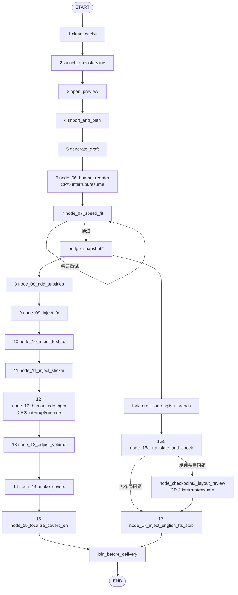
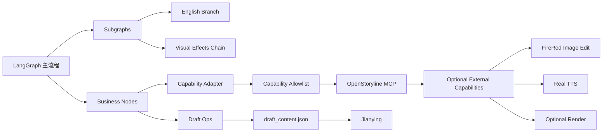

# auto-video-editor 节点全量核查与冗余合并设计执行计划

> 项目：`wayyet/auto-video-editor`  
> 分支：`main`  
> 主题：节点 Nodes 全量盘点、LangGraph 工作流关系、MCP/工具调用情况、不可达/未调用组件识别、冗余合并设计与执行计划  
> 分析日期：2026-09-30  
> 参考仓库：<https://github.com/wayyet/auto-video-editor>

---

## 1. 本次分析结论

### 1.1 节点数量必须区分两个口径

当前项目存在两个容易混淆的数字：

- **17 个业务步骤（SOP）**：项目原有的 17 步视频生产链。
- **21 个 LangGraph 图节点**：按 `graph.py` 实际注册的节点对象统计。

原因是业务第 16 步“英文字幕翻译与布局检查”在当前 `main` 实现中已经拆成两个实际 LangGraph 节点：

```text
node_16a_translate_and_check
        ↓
route_after_translate
   ┌────┴────┐
   ↓         ↓
CP③节点      node_17
```

因此：

```text
17 个业务步骤
        ≠
17 个 LangGraph Node
```

当前应按：

```text
17 个业务节点
+
4 个编排/辅助节点
=
21 个 LangGraph 图节点
```

统计口径。

> **21 是本设计/执行计划当前采用的目标核查口径。** 由于本次运行环境不能重新 clone GitHub 仓库，正式实施前仍应以 `main` 最新 commit 上的 `graph.py` AST 解析结果做一次自动化复核。

---

## 2. 证据与限制

### 2.1 已使用的项目材料

本方案以以下项目材料的静态核查结果作为主要依据：

1. `auto-video-editor` 仓库 URL（用户提供）。
2. 项目内已有的 `graph.py` 节点接线验证报告。
3. 项目内已有的 `main` 分支功能映射、节点验证、FireRed/OpenStoryline 集成评审文档。
4. `video-agent-kit` 集成设计文档，仅用于区分“已经存在”与“计划新增”。

用户指定的原始参考文档路径为：

```text
docs/integration/auto-video-editor_节点冗余合并设计与执行计划.md
```

本次环境没有成功读取该精确文件：GitHub 页面抓取出现 cache miss，同时当前环境没有可用的 GitHub 仓库连接。因此，本文件不能假装已经逐段读取该文档。

### 2.2 本次不能宣称的内容

以下事项没有在本次环境中重新执行，因此不把它们写成“本次运行已通过”：

- 最新 `main` commit 的本地 clone。
- `python -m pytest -q` 全量运行。
- Windows + 剪映真实 UI / 9:16 自动化。
- FireRed 图像编辑真实 HTTP 服务。
- 真实英文 TTS 服务。
- 实际 MCP Server 的实时 `list_tools()` 返回值。

### 2.3 重要区别

必须严格区分：

```text
源码存在
    ≠
图上可达
    ≠
真实外部能力已调用
    ≠
本次环境已跑通
```

---

# 3. 当前 LangGraph 节点全量清单

## 3.1 业务节点：17 个

| 业务步骤 | Graph Node | 主要文件 | 作用 | 当前状态 |
|---|---|---|---|---|
| 1 | `clean_cache` | `nodes/node_01_clean_cache.py` | 清理工作流缓存 | 在主图 |
| 2 | `launch_openstoryline` | `nodes/node_02_launch_openstoryline.py` | 启动 OpenStoryline 服务并等待就绪 | 在主图；当前就绪判断仍偏健康检查 |
| 3 | `open_preview` | `nodes/node_03_open_preview.py` | 打开预览/Web UI | 在主图 |
| 4 | `import_and_plan` | `nodes/node_04_import_and_plan.py` | 导入视频并获取分镜/规划结果 | 在主图；通过 OpenStoryline Client |
| 5 | `generate_draft` | `nodes/node_05_generate_draft.py` | 将规划结果写成剪映初始草稿 | 在主图 |
| 6 | `node_06_human_reorder` | `nodes/node_06_human_reorder.py` | 人工调整分镜顺序；CP① | 在主图；`interrupt/resume` |
| 7 | `node_07_speed_fit` | `nodes/node_07_speed_fit.py` | 35 秒目标时长适配 | 在主图；存在条件重试 |
| 8 | `node_08_add_subtitles` | `nodes/node_08_add_subtitles.py` | 中文字幕写入 | 在主图 |
| 9 | `node_09_inject_fx` | `nodes/node_09_inject_fx.py` | 转场/视频特效注入 | 在主图 |
| 10 | `node_10_inject_text_fx` | `nodes/node_10_inject_text_fx.py` | 花字/字幕动画 | 在主图 |
| 11 | `node_11_inject_sticker` | `nodes/node_11_inject_sticker.py` | 贴纸注入 | 在主图 |
| 12 | `node_12_human_add_bgm` | `nodes/node_12_human_add_bgm.py` | 人工添加 BGM；CP② | 在主图；`interrupt/resume` |
| 13 | `node_13_adjust_volume` | `nodes/node_13_adjust_volume.py` | 音量、淡入淡出 | 在主图 |
| 14 | `node_14_make_covers` | `nodes/node_14_make_covers.py` | 生成三比例封面 | 在主图；真实外部能力仍有缺口 |
| 15 | `node_15_localize_covers_en` | `nodes/node_15_localize_covers_en.py` | 英文封面本地化 | 在主图；当前默认使用 Mock Image Edit Client |
| 16a | `node_16a_translate_and_check` | `nodes/node_16a_translate_and_check.py` | 英文字幕翻译 + 布局检查 | 在主图；通过条件路由进入 CP③或 node17 |
| 17 | `node_17_inject_english_tts_stub` | `nodes/node_17_inject_english_tts_stub.py` | 英文音频注入 | 在主图；当前是静音 WAV Stub，不是真实 TTS |

> 业务第 16 步只有一个业务目标，但实现上被拆成了 `16a` + `CP③` 两个图节点，因此“业务步骤数”和“图节点数”必须分开统计。

## 3.2 编排/辅助节点：4 个

| Graph Node | 类型 | 作用 | 是否应计入 Node 总数 |
|---|---|---|---|
| `bridge_snapshot2` | 工作流桥接节点 | 在中文后续链与英文分支之间建立稳定快照点 | **是** |
| `fork_draft_for_english_branch` | 分支准备节点 | 从稳定状态建立英文草稿分支 | **是** |
| `node_checkpoint3_layout_review` | 人工关卡节点 | CP③：英文字幕布局人工复核，负责 `interrupt/resume` | **是** |
| `join_before_delivery` | 汇合节点 | 等待中文与英文分支完成后统一检查并结束 | **是** |

### 3.3 最终统计

```text
17 个业务节点
+
4 个编排/辅助节点
=
21 个 LangGraph Node
```

---

# 4. 当前完整 Workflow

## 4.1 主流程 Mermaid



## 4.2 工作流结构

可以进一步压缩理解为：

```text
输入初始化
    ↓
规划 + 草稿
    ↓
CP①
    ↓
时长护栏
    ↓
bridge_snapshot2
    ├──────────────────────────────┐
    │                              │
    ↓                              ↓
中文成片分支                   英文分支
    │                              │
    ├─ 字幕                         ├─ Fork
    ├─ FX                           ├─ 英文翻译
    ├─ Text FX                      ├─ CP③（必要时）
    ├─ Sticker                      └─ 英文 TTS Stub
    ├─ CP② BGM
    ├─ 音量
    ├─ 中文封面
    └─ 英文封面
    │                              │
    └──────────────┬───────────────┘
                   ↓
              join_before_delivery
                   ↓
                  END
```

---

# 5. 条件路由与人工关卡

## 5.1 CP①：人工分镜调整

```text
node_06_human_reorder
        ↓
interrupt()
        ↓
人工调整
        ↓
resume
```

这里属于真正的 LangGraph Human-in-the-loop，而不是普通函数等待。

## 5.2 Node 7：35 秒护栏

`node_07_speed_fit` 使用条件重试模式：

```text
speed_fit
   ├─ 未满足时长约束 → retry
   └─ 满足 → bridge_snapshot2
```

因此它不是简单的线性 Node。

## 5.3 CP②：人工选择 BGM

当前不是自动调用 FireRed 的 `SelectBGMNode`，而是：

```text
node_12_human_add_bgm
        ↓
interrupt()
        ↓
用户进入剪映人工选 BGM
        ↓
resume
```

因此：

```text
FireRed select_BGM
        ≠
当前 auto-video-editor node_12
```

当前实现属于“人工替代自动能力”。

## 5.4 CP③：英文字幕布局检查

当前 `main` 已把第 16 步拆成：

```text
node_16a_translate_and_check
        ↓
route_after_translate
   ┌────┴────┐
   ↓         ↓
CP③节点      node17
   ↓
node17
```

这种拆分有利于避免 `interrupt()` 前副作用重放。

---

# 6. MCP 与工具调用边界

## 6.1 当前主流程实际依赖的 MCP 边界

当前 `auto-video-editor` 并不是自己实现全部媒体分析能力，而是通过：

```text
node_04_import_and_plan
        ↓
mcp_clients/openstoryline_client.py
        ↓
OpenStoryline MCP
```

获取媒体导入/分镜规划结果。

现有静态分析材料确认 `node_04` 存在 `load_media` 类能力调用路径，但**不应把 `load_media` 直接当作当前 MCP Session 中已经实时验证过的最终 tool name**；正式版本应以 `list_tools()` + `inputSchema` 做运行时发现。

## 6.2 当前没有进入 auto-video-editor 主 Workflow 的 OpenStoryline/FireRed 能力

下表中的“未调用”口径是：**当前固定 LangGraph 主流程没有直接调用对应外部能力**，不是说上游项目永远不能使用它们。

| 外部能力 | 当前主流程 | 处理方式 | 建议 |
|---|---|---|---|
| `SearchMediaNode` / `search_media` | 未调用 | 当前没有素材搜索分支 | 从本项目主能力白名单中排除 |
| `SearchWebTopicNode` | 未调用 | 当前没有网络主题搜索分支 | 排除 |
| `SplitShotsNode` / `split_shots` | 未完整调用 | node04 获取现成规划，不走完整拆镜链 | 排除或由 Storyline 专项流程调用 |
| `LocalASRNode` | 未作为主流程独立节点执行 | 当前没有独立 ASR 节点链 | 排除 |
| `SpeechRoughCutNode` | 未调用 | 主流程不是口播粗剪 Workflow | 排除 |
| `GenerateAITransitionNode` | 未调用 | 当前没有单独 AI Transition 主分支 | 默认关闭；专项需求再启用 |
| `UnderstandClipsNode` | 未调用 | 当前没有完整视觉理解链 | 排除 |
| `FilterClipsNode` | 未调用 | 当前没有 LLM Clip Filter 链 | 排除 |
| `GroupClipsNode` | 未调用 | 当前没有 Group Clips 链 | 排除 |
| `GenerateScriptNode` | 未调用 | 当前主流程没有 FireRed Script Node 直连 | 排除 |
| `ScriptTemplateRecomendation` | 未调用 | 当前主图无该工具调用 | 排除 |
| `GenerateVoiceoverNode` | 未调用 | 当前不由 FireRed 生成中文配音 | 排除 |
| `SelectBGMNode` | 未调用 | 被 CP② 人工选 BGM 替代 | 保留上游能力，但不要进入默认主链 |
| `RecommendTransitionNode` | 未直接调用 | 当前 node09 使用本地草稿/模板能力 | 排除 MCP 直连 |
| `RecommendTextNode` | 未直接调用 | 当前 node10 使用本地模板/草稿逻辑 | 排除 MCP 直连 |
| `PlanTimelineProNode` | 未调用 | 当前草稿生成不是 FireRed Pro Timeline 主链 | 排除 |
| `PlanTimelineAITransitionNode` | 未调用 | AI Transition Timeline 不在默认主链 | 排除 |
| `RenderVideoNode` | 未调用 | 最终交付以剪映草稿/既有交付链为主 | 保留为旁路能力，不进入默认主链 |

### 6.3 MCP 调度层本身存在的未完成能力

当前设计资料明确提出，但不能认为已经在现有主链完全落地：

```text
MCP initialize
      ↓
list_tools
      ↓
读取 inputSchema
      ↓
能力发现
      ↓
capability → runtime tool
```

现阶段 `node_02_launch_openstoryline.py` 的“服务就绪”仍主要依赖进程/HTTP 健康检查逻辑；不能把它等价成：

```text
MCP initialize 成功
AND
list_tools 成功
AND
必需能力都存在
```

因此这部分应该列为后续执行计划，而不是删除为“冗余”。

---

# 7. 未调用、未启用、未完成组件清单

## 7.1 真实 FireRed Image Edit 未调用

文件：

```text
mcp_clients/firered_image_edit_client.py
```

当前默认客户端是：

```text
MockFireRedImageEditClient
```

Mock 实现本质上是复制文件，而真正的：

```text
HTTPFireRedImageEditClient
```

仍属于未完成的接入路径。

因此：

```text
node_15
```

**图节点会执行**，但：

```text
真实 FireRed Image Edit
```

并没有被真实调用。

## 7.2 真实英文 TTS 未调用

文件：

```text
nodes/node_17_inject_english_tts_stub.py
```

当前行为是生成静音 WAV 占位。

所以：

```text
node17 = 被调用
real TTS provider = 未调用
```

这是“节点已用，但真实能力未接通”的典型情况。

## 7.3 真实 9:16 剪映自动化仍存在缺口

封面相关节点已经进入主图，但此前代码验证材料明确区分了：

```text
代码框架存在
≠
真实剪映 9:16 自动化已经验收
```

因此封面链不能因为 node14/node15 存在，就认定真实外部能力已完成。

## 7.4 OpenStoryline MCP Runtime Discovery 尚未作为主护栏

以下能力属于设计目标，但不能当作当前已经完全执行的能力：

```text
initialize
list_tools
inputSchema 校验
capability alias
runtime tool selection
```

它们应该进入 `node_02` / `openstoryline_client.py` 的下一阶段改造。

---

# 8. “不可达节点”与“未调用组件”需要分开处理

## 8.1 不可达节点

判定标准：

```text
从 START 出发
    ↓
沿普通边 + 条件边全部展开
    ↓
无法到达某 Node
```

当前已有的静态验证结果没有证明 21 个节点中存在一个“明确注册但完全不可达”的正式节点。

因此目前不能为了追求“减少 Node 数量”而直接删除节点。

### 结论

```text
当前：没有足够证据证明某个已注册 graph node 是 DEAD NODE
```

需要通过最新 `main/graph.py` 自动化 AST + Reachability 扫描最终确认。

## 8.2 未调用组件

这一类反而比较明确：

- 多个 FireRed/OpenStoryline 能力没有进入当前固定主链。
- `HTTPFireRedImageEditClient` 未成为默认真实执行器。
- real TTS 未执行。
- `RenderVideoNode` 不属于当前最终交付主链。
- `SelectBGMNode` 被人工 CP② 替代。
- `GenerateAITransitionNode` 不在默认主链。

这些组件不应该直接当“死代码”删除，而应该先从：

```text
主流程能力
```

和：

```text
可选能力 / 扩展能力
```

中分层。

---

# 9. 冗余合并设计

## 9.1 第一原则：优先合并“能力暴露”，不要先合并“业务节点”

当前最明显的冗余不是：

```text
node_08 + node_09 + node_10 + ...
```

而是：

```text
上游大量 MCP Node 能力
        ↓
当前固定 Workflow 实际只用其中很少一部分
```

所以第一阶段应该做：

```text
Capability Allowlist
```

而不是删除业务节点。

推荐主流程能力白名单只保留当前真实需要的能力，例如：

```text
load_media / import
storyline planning
（后续按实际接入再增加）
```

## 9.2 第 16 步：不要物理合并

不建议：

```text
node_16a_translate_and_check
+
node_checkpoint3_layout_review
```

合并成一个“大节点”。

理由：

1. CP③ 的 `interrupt()` 有独立生命周期。
2. 需要保证 interrupt 前副作用最小。
3. resume 时需要重新读取人工修改后的草稿。
4. 分开节点更利于单测和幂等。

### 推荐

保留两个 Node，但把它们封装成：

```text
english_subtitle_review_subgraph
```

即：

```text
逻辑上合并
≠
实现上删除节点
```

## 9.3 `bridge_snapshot2` + `fork_draft_for_english_branch`

这两个节点都属于英文分支准备阶段，但职责并不完全重复：

```text
bridge_snapshot2
= 稳定工作流状态

fork_draft_for_english_branch
= 创建英文草稿分支
```

因此第一阶段不建议直接合并。

更合理的方案：

```text
english_branch_prepare_subgraph
    ├─ snapshot
    └─ fork
```

保留内部两个动作，但减少顶层 Graph 复杂度。

## 9.4 `node_09/10/11` 不建议直接物理合并

它们都是修改剪映 Draft 的操作，但：

- 失败原因不同。
- 资源类型不同。
- 可能需要独立重试。
- 后续人工调试时定位粒度不同。

因此不建议直接变成：

```text
node_apply_all_effects
```

可以做成一个：

```text
visual_effect_subgraph
```

但内部仍保留 3 个可测试节点。

## 9.5 `node_14 + node_15` 不建议合并

两者分别是：

```text
中文封面生成
        ↓
英文封面本地化
```

外部依赖不同，失败语义不同。

保持分离更合理。

## 9.6 `join_before_delivery` 不应删除

这是 fan-in 汇合点，同时承担最终交付前检查：

```text
中文分支完成
AND
英文分支完成
        ↓
join_before_delivery
```

它不是“冗余节点”，而是工作流同步屏障。

---

# 10. 推荐的目标架构



核心原则：

```text
业务 Workflow
        ↓
能力适配层
        ↓
允许调用的 Capability
        ↓
外部 MCP / Provider
```

不要让主 Graph 直接依赖大量上游 Node Class。

---

# 11. 执行计划

## Phase 0：证据冻结

### 目标

获得一个可以复现的：

```text
main commit SHA
```

并读取：

```text
graph.py
state.py
config.py
mcp_clients/openstoryline_client.py
nodes/node_*.py
```

### 执行

```powershell
git rev-parse --short HEAD
```

记录：

```text
repo
branch
commit
analysis_date
```

同时获取用户指定的：

```text
docs/integration/auto-video-editor_节点冗余合并设计与执行计划.md
```

### 验收

- [ ] Commit SHA 已固定。
- [ ] 目标设计文档已读取。
- [ ] 不再依赖“二手分析资料”作为唯一证据。

---

## Phase 1：自动提取 Graph 节点

### 目标

通过 AST 或稳定的源码解析自动生成：

```text
registered_nodes
edges
conditional_edges
entry
finish
```

### 重点

扫描：

```python
g.add_node(...)
g.add_edge(...)
g.add_conditional_edges(...)
```

并输出：

```json
{
  "nodes": [],
  "edges": [],
  "conditional_edges": []
}
```

### 验收

```text
AST Node Count == Reachability Node Count
```

若出现差异，进入人工复核。

---

## Phase 2：Reachability 分析

### 算法

```text
START
 ↓
BFS / DFS
 ↓
普通边
+
条件边所有可能分支
 ↓
Reachable Set
```

输出三个集合：

```text
A = Registered Nodes
B = Reachable Nodes
C = Registered - Reachable
```

其中：

```text
C = 真正的候选 DEAD NODE
```

只有 C 中的节点，才允许进入“删除评审”。

---

## Phase 3：调用者分析

对每个组件执行：

```text
定义位置
 ↓
import caller
 ↓
function caller
 ↓
graph registration
 ↓
runtime call
```

建立：

```text
Node
Tool
Client
Provider
```

之间的调用图。

### 特别关注

```text
HTTPFireRedImageEditClient
MockFireRedImageEditClient
real TTS provider
OpenStoryline client
```

---

## Phase 4：MCP 能力审计

启动 MCP 后执行：

```text
initialize
    ↓
list_tools
    ↓
读取 inputSchema
    ↓
建立 runtime tool catalog
```

生成：

```text
Capability
Tool Name
Input Schema
Current Caller
Default Path
Fallback
```

并分为：

1. `USED`：默认主链真实调用。
2. `AVAILABLE_BUT_UNUSED`：存在但主链不用。
3. `MOCKED`：代码调用，但实际 provider 是 Mock。
4. `STUB`：代码路径存在，但真实能力未实现。
5. `UNREACHABLE`：图上不可达。

---

## Phase 5：冗余重构

### 5.1 第一批：能力白名单

建立：

```text
config / capability registry
```

默认只暴露当前主链需要的 MCP 能力。

未调用能力：

```text
默认不注册
或
按需 lazy-load
```

### 5.2 第二批：Subgraph 重构

建议形成：

```text
english_branch_subgraph
visual_effect_subgraph
```

目标不是减少执行节点，而是减少顶层 Graph 的认知复杂度。

### 5.3 第三批：Mock / Stub 隔离

将：

```text
Mock
Stub
Real Provider
```

统一通过依赖注入切换。

禁止业务 Node 默认静默使用 Mock 来代表生产能力。

---

## Phase 6：真实能力补齐

优先级建议：

### P0

```text
OpenStoryline MCP runtime discovery
```

即：

```text
initialize + list_tools + inputSchema
```

### P1

```text
real FireRed Image Edit
real English TTS
```

### P2

```text
real Jianying 9:16 automation
```

### P3

```text
FireRed RenderVideoNode / AI Transition
```

仅作为可选旁路能力，不改变默认主链。

---

# 12. 测试执行计划

## 12.1 静态测试

```powershell
python -m compileall .
```

验证：

- Node import。
- graph import。
- syntax。
- module dependency。

## 12.2 单元测试

```powershell
python -m pytest -q tests/unit
```

重点：

```text
node_06_human_reorder
node_07_speed_fit
node_15_localize_covers_en
node_16a_translate_and_check
node_checkpoint3_layout_review
node_17_inject_english_tts_stub
join_before_delivery
```

## 12.3 集成测试

```powershell
python -m pytest -q tests/integration
```

重点验证：

1. 17 业务步骤全部可达。
2. 21 图节点全部按预期进入。
3. CP① resume 不重跑错误副作用。
4. CP② resume 后正确继续。
5. CP③ resume 后重新读取人工修改草稿。
6. 中文/英文分支真正并行。
7. join 不提前执行。

## 12.4 图结构自动验收

增加一个专门测试：

```text
assert registered_node_count == 21
assert business_node_count == 17
assert helper_node_count == 4
assert no_unreachable_nodes
assert has_cp1
assert has_cp2
assert has_cp3
assert has_fan_in
```

> 这里的 `21` 是当前核查口径。正式落地后应由 AST 自动统计，避免未来新增节点后出现“文档数字过期”。

---

# 13. 最终建议

## 13.1 节点数量结论

```text
业务步骤：17
LangGraph Nodes：21
```

不要把 17 与 21 混用。

## 13.2 当前真正的“冗余”主要来自能力层

而不是业务 Node 层：

```text
大量外部 MCP 能力
        ↓
固定业务 Workflow 只需要其中少部分
```

因此优先做：

```text
Capability Allowlist
+
Runtime Discovery
+
Subgraph 封装
```

再考虑物理删 Node。

## 13.3 不建议直接删除的节点

当前明确不应直接删除：

```text
node_16a_translate_and_check
node_checkpoint3_layout_review
bridge_snapshot2
fork_draft_for_english_branch
join_before_delivery
```

它们承担的是：

```text
幂等
快照
分支
人工中断
汇合
```

不是简单重复逻辑。

## 13.4 当前最明确的未调用/未完成能力

```text
FireRed/OpenStoryline 非主链能力
real FireRed Image Edit
real English TTS
real 9:16 Jianying automation
FireRed RenderVideoNode
FireRed SelectBGMNode
FireRed AI Transition
runtime MCP list_tools/inputSchema discovery
```

其中：

```text
SelectBGMNode
```

是被人工 CP② 替代；

```text
RenderVideoNode
```

是当前交付边界主动不使用；

```text
real Image Edit / TTS
```

属于真实能力尚未接入；

```text
MCP discovery
```

属于架构护栏尚未完全落到主链。

---

# 14. 参考资料

1. 项目仓库：<https://github.com/wayyet/auto-video-editor>
2. 用户提供的仓库 URL 文件：`auto-video-editor.txt`
3. `graph.py` 节点接线验证材料：`AI视频剪辑自动化工作流第4周代码验证报告.md`
4. `auto-video-editor` 与 FireRed 默认 Skill 功能映射：`auto-video-editor_vs_FireRed_default_editing_workflow_skill_功能映射分析.md`
5. `video-agent-kit` 与 `auto-video-editor` 功能对比：`video-agent-kit_vs_auto-video-editor_功能差异对比.md`
6. FireRed 集成评审：`FireRed-OpenStoryline_嵌入_auto-video-editor_集成综合评审与落地方案.md`
7. `video-agent-kit` 集成 `auto-video-editor` 设计执行计划：`video-agent-kit集成auto-video-editor设计执行计划.md`

---

# 15. 一页摘要

```text
                    auto-video-editor main
                             │
                   ┌─────────┴─────────┐
                   │                   │
               17 业务节点          4 辅助节点
                   │                   │
                   └─────────┬─────────┘
                             ↓
                     21 LangGraph Nodes
                             │
              ┌──────────────┴──────────────┐
              │                             │
          中文生产分支                  英文生产分支
              │                             │
        字幕/FX/BGM/音量              翻译/CP③/TTS Stub
        封面/英文封面
              │                             │
              └──────────────┬──────────────┘
                             ↓
                    join_before_delivery
                             ↓
                            END

当前主要问题：

1. 外部 MCP 能力明显多于主链实际需求。
2. MCP runtime discovery 尚未成为完整主流程护栏。
3. FireRed Image Edit 仍是 Mock 默认路径。
4. 英文 TTS 仍是 Stub。
5. 真实 9:16 剪映自动化仍有缺口。
6. FireRed Render / BGM / AI Transition 等能力不属于默认主链。

推荐改造顺序：

证据冻结
  → Graph AST 自动统计
  → Reachability
  → MCP Capability Audit
  → Allowlist
  → Subgraph 化
  → Mock/Stub/Real 解耦
  → 真实能力补齐
  → 全链路验收
```

---

> **注：** 本文档是“设计与执行计划”，不是声称已经在 2026-09-30 对 GitHub `main` 最新 commit 完成全量运行验收。正式执行阶段应先固定 commit SHA，并对 `graph.py`、MCP Client 与用户指定的节点冗余设计文档重新做一次自动化核验。
