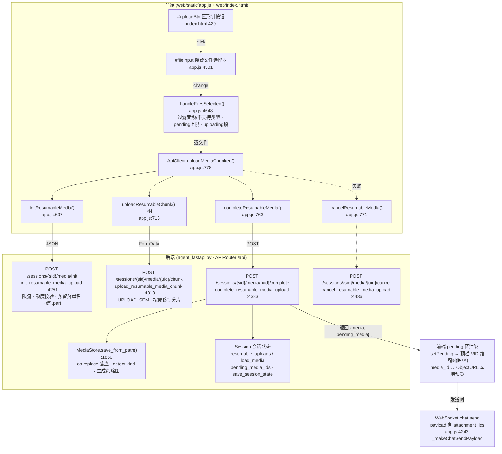
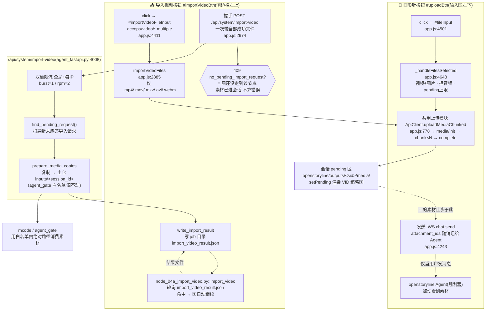

# Web UI 左下「回形针」按钮与左上「导入视频」按钮链路分析

> 分析日期:2026-11-01
> 涉及代码:`openstoryline/web/index.html`、`openstoryline/web/static/app.js`、`openstoryline/agent_fastapi.py`、`nodes/node_04a_import_video.py`
> 所有行号以当日工作区代码为准(部分文件存在未提交改动)。

---

## 一、回形针按钮(输入区左下角)= 「上传素材」入口

截图左下角那个回形针按钮是 `#uploadBtn`(`web/index.html:429`,SVG path `M21.44 11.05l-9.19 9.19...` 就是经典回形针图标)。它**不经过任何 AI 节点**,走的是一条纯工程链路:**前端分片续传上传 → 后端 resumable media 端点 → MediaStore 落盘 + 缩略图 → 进入"待发送素材"栏**。

截图顶上一排带 ▶/✕ 的 VID 缩略图,就是上传完成后进入 pending 区的结果(`setPending` 渲染);发送时这些素材以 `attachment_ids` 挂到 `chat.send` 的 WS 消息上。

### 1. 调用链(关键代码位置)

| 步骤 | 位置 |
|---|---|
| 点击回形针 → 打开文件选择器 | app.js:4501 (`uploadBtn.click → fileInput.click`) |
| 选中文件 → 入口处理(过滤音视频类型、pending 上限、上传锁) | app.js:4648 `_handleFilesSelected` |
| 单文件分片上传编排 init→chunk…→complete,失败 cancel | app.js:778 `uploadMediaChunked` |
| 后端 init:限流/额度/预留落盘名/建 `.part` 临时文件 | agent_fastapi.py:4251 |
| 后端 chunk:信号量 + 按偏移写 `.part` | agent_fastapi.py:4313 |
| 后端 complete:校验分片 → `MediaStore.save_from_path` 移入 media_dir + 生成缩略图 → 加入 `load_media`/`pending_media_ids` | agent_fastapi.py:4383,MediaStore 在 agent_fastapi.py:1860 |
| 失败清理临时文件 | agent_fastapi.py:4436 |

### 2. Mermaid 调用结构图

### 3. 行为要点

- 文件类型:视频 + 图片(`isSupportedMediaFile`,app.js:4661),音频被拒(后端没有处理逻辑)。
- 限流:按素材个数限流(`upload_media` 的 rpm/burst,agent_fastapi.py:1660)+ `UPLOAD_SEM` 上传并发信号量。
- 上传到 `media/complete` 即**到此为止**,素材留在 `openstoryline/outputs/<sid>/media/`;只有随消息以 `attachment_ids` 走 WS `chat.send` 发出后,Agent(规划器)才看得到。
- 相邻按钮不在本链路:右下角骰子图是 `#quickPromptBtn`(快捷 prompt),黑色上箭头是 `#sendBtn`(发送)。

---

## 二、「导入视频」按钮(侧边栏左上角)

`#importVideoBtn`(`web/index.html:37`,📥 图标)是 auto-video-editor 工作流图的**人工卡点/握手按钮**。app.js:2862 的注释把定位说得很死:**它是图侧 `import_video` 节点继续往下走的唯一入口,图自己永不自动导入视频**(有集成测试 `tests/integration/test_no_auto_import_video.py` 守护)。

### 1. 前端链路

1. 点击 → 弹出隐藏文件框 `#importVideoFileInput`(app.js:4411),`accept="video/*,.mp4,.mov,.mkv,.avi,.webm"` 且 `multiple`(index.html:67-68)。
2. `importVideoFiles`(app.js:2885):
   - 按扩展名白名单过滤,**仅视频**(`.mp4/.mov/.mkv/.avi/.webm`,与后端 `detect_media_kind` 的 video 集合对齐);
   - 与 📎 共用同一套 pending 上限(`max_pending_media_per_session`,默认 30);
   - 逐个走 **`ApiClient.uploadMediaChunked`**(与 📎 完全同一模块);
   - 全部传完后,**一次握手** POST `/api/system/import-video`(app.js:2974)带全部成功文件——端点限流 burst=1/rpm=2,分 N 次 POST 必然 429(app.js:2868 注释);
   - 部分成功即算导入成功,失败的只降级提示;握手载荷同时带单值字段兼容旧端点。
3. 409 分支:`no_pending_import_request` = 图还没走到 import_video 节点 → 素材已进会话,规划器立刻能用,**不算错误**(app.js:2988)。

### 2. 后端端点 `/api/system/import-video`(agent_fastapi.py:4008)

1. **双桶限流**:全局 + 每 IP,默认 burst=1 / rpm=2(防误连点)。
2. **跨 venv 动态加载**主仓 `nodes/node_04a_import_video.py` 的握手纯函数(`find_pending_request` / `parse_import_payload` / `build_result_payload` / `write_import_result`),本端点只做薄转发。
3. `find_pending_request()` 扫描最新未应答的导入请求;没有 → 409。
4. `prepare_media_copies`:把 openstoryline 会话 media 目录的素材**复制**到 `<auto-video-editor>/inputs/<session_id>/`(agent_gate/mcode 的白名单目录),源文件不动;顺序严格"**先复制成功,再写导入结果**"。
5. `write_import_result`:把结果写到 job 目录的 `import_video_result.json`。
6. 图侧 `nodes/node_04a_import_video.py::import_video` 轮询该结果文件,命中即自动继续——人只点一下按钮,不用敲 resume。

安全设计:端点**不接受任意 `job_id` 入参**,只认扫出来的最新未应答请求,防止被诱导污染别的 job 目录。

---

## 三、两按钮差异对比

### 一句话定位

| | 回形针 `#uploadBtn`(输入区左下) | 导入视频 `#importVideoBtn`(侧边栏左上) |
|---|---|---|
| **本质** | 通用素材上传入口(纯素材入库) | 工作流**人工卡点/握手**按钮 |
| **驱动对象** | 只喂"聊天上下文",不碰工作流图 | 驱动 auto-video-editor 图的 `import_video` 节点继续往下走 |

### 相同点(共用同一套上传模块)

两者上传阶段**完全复用** `ApiClient.uploadMediaChunked`(app.js:778)→ 同一组分片端点 `media/init → chunk ×N → complete`(agent_fastapi.py:4251/4313/4383),落盘后都进会话 pending 区(即聊天输入框上方的 VID 缩略图栏),共用 `max_pending_media_per_session`(默认 30)上限。

### 关键差异

1. **有无第二段握手**(最本质差异)
   - 📎:到 `media/complete` 就结束。素材只有随消息以 `attachment_ids` 走 WS `chat.send` 发出后,Agent 才看得到。
   - 📥:上传完后**必须**再 POST `/api/system/import-video`,把"导入完成"信号写回主仓 job 目录的结果文件,图侧节点轮询命中后自动继续。

2. **文件类型过滤**
   - 📎:视频 **+ 图片**(音频被拒)。
   - 📥:**仅视频**,扩展名白名单 `.mp4/.mov/.mkv/.avi/.webm`。

3. **限流模型**
   - 📎:按素材个数限流 + `UPLOAD_SEM` 上传并发信号量。
   - 📥:握手端点全局 + 每 IP 双桶 burst=1 / rpm=2,前端必须一次 POST 带全部文件。

4. **素材的最终去向**
   - 📎:止步于 openstoryline 会话 media 目录。
   - 📥:端点额外把素材**复制**到 `<auto-video-editor>/inputs/<session_id>/`(agent_gate/mcode 白名单目录),源文件不动;且先复制成功才写导入结果。

5. **409 的语义**
   - 📥 有正常分支 409 `no_pending_import_request`(图还没走到该节点,素材已进会话,不算错误)。📎 没有这个概念。

6. **批量与容错**
   - 📥 支持多选、逐个上传、部分成功即导入成功;📎 逐文件独立上传,单个失败直接抛错中断。

7. **UI 反馈**
   - 📥 按钮自身变 ⏳ 并改文案;📎 用全局 toast 显示进度。

### 两链路合并对比图

---

## 四、结论

**回形针是"素材进聊天",导入视频是"素材进工作流"**——后者在 📎 整条上传链路之上多挂了一段握手协议(`/api/system/import-video` → 结果文件 → 图节点轮询),这是两个按钮唯一的结构性分叉点;上传本身则是同一段代码(`uploadMediaChunked` + 同组分片端点)。
