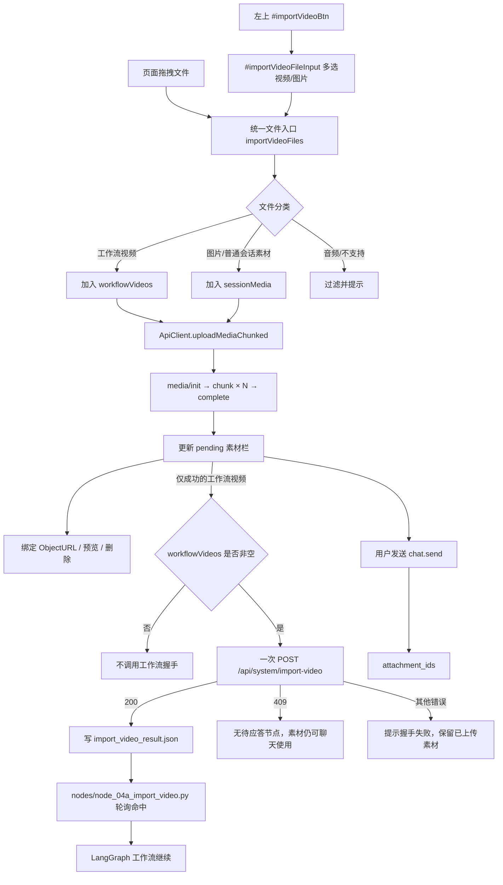

# Web UI 上传入口合并执行设计

> ⚠️ **历史状态标记(2026-11-01)**:OpenStoryline 目录扁平化迁移(见《docs/修改文档/auto-video-editor-openstoryline-目录扁平化迁移执行设计.md》)完成后,本文中的 `openstoryline/...` 路径已上移至仓库根(`agent_fastapi.py`、`web/`、`src/open_storyline/`、`outputs/openstoryline/` 等)。本文仅作历史记录,不代表当前目录结构,请勿按本文路径操作。


> 项目：`wayyet/auto-video-editor`  
> 分支：`main`  
> 设计日期：2026-11-01  
> 设计基线：左上「导入视频」`#importVideoBtn`  
> 目标：将左下「回形针」`#uploadBtn` 的通用素材上传能力并入「导入视频」入口，最终只保留一个上传入口。

---

## 0. 设计结论

本次改造采用**导入视频入口为主、回形针上传能力为辅**的合并方式。

- 保留左上 `#importVideoBtn`，以及它现有的文件选择、视频分片上传和工作流握手流程。
- 删除左下 `#uploadBtn` 和它专用的 `#fileInput`。
- 将回形针原来支持的视频、图片上传能力合并到 `importVideoFiles()`，使其成为唯一的素材上传编排入口。
- 视频与图片共用 `ApiClient.uploadMediaChunked()`，但必须在上传后分流：**只有工作流白名单内的视频可以进入 `/api/system/import-video`；图片只能进入当前会话 pending 素材区，不得进入 `video_input_paths`。**
- 保留单次批量握手、409 正常分支、pending 上限、上传进度、缩略图预览、本地 `ObjectURL` 管理和拖拽上传。
- 不改 `import_video` 节点的人工等待协议，不让工作流自动导入视频。

**不采用反向方案**：不能把「导入视频」改造成普通回形针上传，然后删除它的工作流握手。那样会破坏 `import_video` 人工卡点，导致图侧节点无法收到 `import_video_result.json`。

## 1. 代码基线与现状

### 1.1 本轮检查范围

本设计依据以下来源：

1. 用户提供的链路分析文档：`Web UI 左下回形针按钮与左上导入视频按钮链路分析.md`。
2. GitHub 仓库 `wayyet/auto-video-editor` 的 `main` 分支当前文件。
3. 仓库现有集成守护测试：`tests/integration/test_no_auto_import_video.py`。

本轮查询到的近期 `main` 提交记录包括：

- `a1757d00277b52bd23fd5b2974510f8e903c054f`，提交时间 `2026-10-31T17:40:03Z`。
- 相关上传链路文件：`openstoryline/web/index.html`、`openstoryline/web/static/app.js`、`openstoryline/agent_fastapi.py`、`nodes/node_04a_import_video.py`。

行号会随提交变化。实施时应以函数名、DOM ID 和接口路径定位，不应把本文行号当成固定 ABI。

### 1.2 两个入口当前分别做什么

| 项目 | 左上「导入视频」 | 左下「回形针」 |
|---|---|---|
| DOM | `#importVideoBtn` | `#uploadBtn` |
| 文件选择器 | `#importVideoFileInput` | `#fileInput` |
| 前端入口 | `importVideo()` → `importVideoFiles()` | `bindUI()` → `_handleFilesSelected()` |
| 文件类型 | 视频；工作流白名单 `.mp4/.mov/.mkv/.avi/.webm` | 视频和图片；拒绝音频 |
| 上传实现 | `ApiClient.uploadMediaChunked()` | `ApiClient.uploadMediaChunked()` |
| 上传结果 | pending 素材区 | pending 素材区 |
| 额外动作 | 上传成功后批量 POST `/api/system/import-video` 一次 | 不调用工作流握手端点 |
| 工作流影响 | 命中等待中的 `import_video` 节点，节点继续执行 | 只有用户后续发送 `chat.send` 且携带 `attachment_ids` 后，Agent 才能看到素材 |

两者上传底层相同，结构性差异在上传完成之后：

- 回形针：上传完成 → pending 素材区 → 等待用户发送聊天消息。
- 导入视频：上传完成 → pending 素材区 → 一次工作流握手 → `import_video_result.json` → 图侧节点继续。

### 1.3 当前关键代码事实

| 文件 | 当前实现 | 合并时的处理 |
|---|---|---|
| `openstoryline/web/index.html` | 同时定义 `#importVideoBtn`、`#importVideoFileInput`、`#uploadBtn`、`#fileInput` | 保留前两者；删除后两者 |
| `openstoryline/web/static/app.js` | `importVideoFiles()` 和 `_handleFilesSelected()` 分别编排上传 | 合并为一个上传编排器，避免两套状态、锁和预览逻辑 |
| `ApiClient.uploadMediaChunked()` | `init → chunk × N → complete`；失败时调用 cancel | 原样复用，不复制实现 |
| `openstoryline/agent_fastapi.py` | 分片端点将文件保存到会话 media 目录，并更新 `load_media`、`pending_media_ids` | 不改变分片协议 |
| `openstoryline/agent_fastapi.py` | `/system/import-video` 执行限流、查找待应答请求、准备素材副本、写入结果文件 | 保留接口路径、请求结构和握手顺序 |
| `nodes/node_04a_import_video.py` | 写请求文件并轮询结果文件；自身不导入视频 | 不修改人工等待机制 |
| `tests/integration/test_no_auto_import_video.py` | 守护图不自动导入，并验证网页端握手可解除等待 | 保留为强制回归门禁 |

### 1.4 当前实现中的一个缺陷

当前 `importVideoFiles()` 中候选列表声明为 `const candidates = []`，但 pending 余量不足时又执行 `candidates = candidates.slice(0, remain)`。对 `const` 变量重新赋值会抛出 `TypeError`。

本次合并需要重构这个函数，应一并修正：

- 改成 `let candidates`；或
- 保留 `const candidates`，另建 `const limitedCandidates = candidates.slice(0, remain)`。

必须增加“所选文件数超过 pending 剩余容量”的回归测试，防止该分支再次失效。

### 1.5 后端媒体类型识别的现状

`openstoryline/agent_fastapi.py::detect_media_kind()` 当前识别：

- 图片：`.png`、`.jpg`、`.jpeg`、`.gif`、`.bmp`、`.webp`。
- 视频：`.mp4`、`.mov`、`.avi`、`.mkv`、`.webm`。

旧回形针前端的扩展名兜底还接受 `.m4v`、`.flv`、`.wmv`、`.tiff` 等类型；这些扩展名不在当前 `detect_media_kind()` 的识别集合中，后端可能把它们标记为 `unknown`，缩略图行为也不会与标准图片/视频完全一致。

本次不扩大后端格式支持范围。保留旧前端筛选行为时，必须把“可作为普通会话素材上传”和“可进入视频工作流”分开判断，不能因为浏览器接受 `video/*` 就把任意视频扩展名送入工作流握手。

## 2. 改造目标与边界

### 2.1 必须达到的目标

1. Web UI 只保留左上「导入视频」一个素材选择入口。
2. 该入口同时接受原回形针支持的视频和图片。
3. 所有素材均通过现有 `ApiClient.uploadMediaChunked()` 上传。
4. 上传成功后，素材继续显示在原 pending 素材栏，保留删除、预览和发送能力。
5. 工作流视频仍然通过一次 `/api/system/import-video` 握手导入。
6. 图片、音频和非工作流视频不得误写入 `video_input_paths`。
7. 上传过程只允许一个活动上传任务，避免两个入口并发修改 pending 状态。
8. 保留拖拽上传；拖拽文件也必须进入同一个统一处理函数。
9. 保留 `chat.send` 的 `attachment_ids` 协议，不修改聊天消息结构。

### 2.2 本次明确不做的事情

- 不修改 `nodes/node_04a_import_video.py` 的人工等待/轮询机制。
- 不把上传完成事件直接改成自动启动工作流。
- 不把图片传入 `/api/system/import-video`。
- 不为每个视频单独调用一次 `/api/system/import-video`。
- 不改变 `/api/sessions/{session_id}/media/{upload_id}/complete` 的返回结构。
- 不修改 `chat.send` WebSocket 消息格式和 `attachment_ids` 语义。
- 不移动或删除会话 media 源文件；工作流副本仍由后端现有逻辑准备。
- 不改 LangGraph checkpointer、会话数据库或执行状态持久化。

> 基线补充：近期 `main` 提交记录已将 SQLite checkpoint 标记为历史实现，并完成 PostgreSQL 方向的统一改造。该数据库变化与本次 Web 上传入口合并无关，不应顺带修改。

## 3. 目标交互行为

### 3.1 UI 结构

保留左上侧边栏按钮：

```html
<button id="importVideoBtn" class="sidebar-action secondary">
  <span class="sidebar-action-icon">📥</span>
  <span class="sidebar-action-text">导入视频</span>
</button>

<input
  type="file"
  id="importVideoFileInput"
  accept="video/*,image/*,.mp4,.mov,.mkv,.avi,.webm,.m4v,.flv,.wmv,.jpg,.jpeg,.png,.gif,.webp,.bmp,.tiff"
  multiple
  hidden
/>
```

上面只展示目标属性。实施时保留现有 `data-i18n-*`、无障碍属性和侧边栏样式，不要用示例片段覆盖整个按钮。

删除输入区左下角的：

- `<input id="fileInput">`
- `<button id="uploadBtn">` 及回形针 SVG。

pending 素材栏 `#pendingBar`、`#pendingRow` 不删除。它们是上传后的素材展示区，不是上传入口。

按钮主文案可继续保持「导入视频」，但 tooltip/辅助说明应明确提示“支持导入视频和上传图片”。避免用户误以为图片也会作为视频工作流的输入。

### 3.2 文件分类规则

统一处理函数必须把文件分成“工作流视频”“普通会话素材”“不支持”三类。

| 类型 | 判断规则 | 上传到 pending | 调用工作流握手 |
|---|---|---:|---:|
| 工作流视频 | 扩展名为 `.mp4/.mov/.mkv/.avi/.webm` | 是 | 是 |
| 图片 | `image/*` 或旧前端图片扩展名 `.jpg/.jpeg/.png/.gif/.webp/.bmp/.tiff` | 是 | 否 |
| 旧版通用视频 | `video/*` 或旧前端视频扩展名，但不在工作流视频白名单，例如 `.m4v/.flv/.wmv` | 是，保持旧回形针行为 | 否 |
| 音频 | `audio/*` 或 `.mp3/.wav/.m4a/.aac/.flac/.ogg/.opus` | 否 | 否 |
| 其他文件 | 不符合以上条件 | 否 | 否 |

规则说明：

- 工作流视频白名单必须与 `nodes/node_04a_import_video.py::ACCEPT_EXTS` 保持一致。
- 后端当前 `detect_media_kind()` 的识别能力比旧前端扩展名兜底范围窄。对旧版额外格式，不在本次宣称新增后端识别能力；上传后的行为不得比原回形针路径更差。
- 无 MIME 的文件允许按扩展名兜底判断。
- 先判断音频，再判断视频/图片，避免异常 MIME 导致音频误入素材区。
- 不得仅依赖 `accept` 属性。浏览器文件选择器的 `accept` 只是界面提示，最终仍须由 JS 分类。

### 3.3 三种典型选择结果

**情况 A：只选视频**

1. 逐个使用分片 API 上传。
2. 每个成功文件都进入 pending 素材栏。
3. 把成功的工作流视频合并成一个 `files` 数组。
4. 只发起一次 `/api/system/import-video`。
5. 工作流节点收到结果后继续；若返回 409，则按正常分支提示素材已上传。

**情况 B：只选图片**

1. 逐个使用分片 API 上传。
2. 图片进入 pending 素材栏。
3. 不调用 `/api/system/import-video`。
4. 用户后续发送聊天消息时，图片 ID 随 `attachment_ids` 发给 Agent。

**情况 C：视频和图片混合选择**

1. 所有支持的文件逐个上传。
2. 视频和图片都进入 pending 素材栏。
3. 只有工作流白名单内且上传成功的视频进入握手 `files` 数组。
4. 图片和旧版通用视频不进入握手数组。
5. 对这一次选择最多执行一次握手 POST。

## 4. 目标调用链



## 5. 前端实现设计

### 5.1 `openstoryline/web/index.html`

修改范围：侧边栏顶部和 composer 输入区。

1. 保留 `#importVideoBtn`。
2. 保留 `#importVideoFileInput`，设置 `multiple`。
3. 把 `accept` 扩展到视频和图片，至少覆盖原回形针的客户端接受范围。
4. 删除 `#uploadBtn`。
5. 删除 `#fileInput`。
6. 保留 `#pendingBar`、`#pendingRow`、发送按钮、快捷 Prompt 按钮。

不要把回形针按钮移动到侧边栏后又保留第二个上传按钮；最终只能有一个文件选择入口。

### 5.2 `openstoryline/web/static/app.js`

#### A. DOM 引用收敛

构造函数中保留：

```js
this.importVideoBtn = $("#importVideoBtn");
this.importVideoFileInput = $("#importVideoFileInput");
this.localObjectUrlByMediaId = new Map();
```

删除旧引用：

```js
this.fileInput = $("#fileInput");
this.uploadBtn = $("#uploadBtn");
```

同时清理所有对 `this.fileInput`、`this.uploadBtn` 的事件绑定和状态引用，不能留下空 DOM 引用导致运行时异常。

#### B. 统一入口事件

`bindUI()` 中：

- `#importVideoBtn` 点击时继续调用 `importVideo()`。
- `#importVideoFileInput change` 只调用 `importVideoFiles(files)`。
- 拖拽上传完成后也调用 `importVideoFiles(files)`。
- 删除原来 `#uploadBtn → #fileInput → _handleFilesSelected()` 的独立事件链。

建议将 `_handleFilesSelected()` 删除。如果其他代码仍需要兼容旧方法，可以暂时保留为薄包装：

```js
async _handleFilesSelected(files) {
  return this.importVideoFiles(files);
}
```

不能继续保留另一套上传循环、另一套上传锁和另一套 pending 更新逻辑。

#### C. `importVideoFiles()` 成为唯一上传编排器

职责：

1. 检查上传锁。
2. 对输入文件做统一分类。
3. 应用同一个 pending 容量上限。
4. 串行调用 `ApiClient.uploadMediaChunked()`。
5. 将所有成功素材更新到 pending。
6. 维护 `localObjectUrlByMediaId`。
7. 汇总工作流视频，并且只握手一次。
8. 统一处理部分成功、409、429、异常和 finally 清理。

建议结构：

```js
async importVideoFiles(rawFiles) {
  if (this.uploading) {
    // 提示已有上传任务，不允许并发启动第二个任务
    return;
  }

  const sessionId = this.sessionId;
  const files = Array.from(rawFiles || []);
  const classified = classifyMediaFiles(files);
  // 分类结果包含 workflowVideos、sessionMedia、rejected

  // 统一按 pending 剩余容量截断
  // this.uploading = true
  // this._updateComposerDisabledState()

  const uploadedWorkflowVideos = [];
  const failedFiles = [];

  try {
    // 对 sessionMedia 串行上传：
    // 1. createObjectURL
    // 2. api.uploadMediaChunked(sessionId, file, ...)
    // 3. media.id -> localObjectUrlByMediaId
    // 4. setPending(resp.pending_media)
    // 5. 仅当文件属于 workflowVideos 且有有效 media.id 时，加入握手数组

    // uploadedWorkflowVideos 非空时：只调用一次 /api/system/import-video
    // uploadedWorkflowVideos 为空时：不调用工作流握手
  } finally {
    // this.uploading = false
    // 恢复按钮、composer 状态和图标/文案
  }
}
```

注意：这段代码是结构示意，不是可直接复制的完整实现。具体 toast key、错误解析方式应复用当前 `app.js` 和 i18n 资源。

#### D. 上传成功后的本地预览

必须把原回形针上传器的 `ObjectURL` 逻辑合入统一上传器：

```js
const localUrl = URL.createObjectURL(file);

try {
  const resp = await this.api.uploadMediaChunked(sessionId, file, options);
  const mediaId = resp?.media?.id;

  if (mediaId) {
    this.localObjectUrlByMediaId.set(mediaId, localUrl);
  } else {
    URL.revokeObjectURL(localUrl);
  }

  this.setPending(resp?.pending_media || []);
} catch (error) {
  URL.revokeObjectURL(localUrl);
  throw error;
}
```

实际实现仍应采用“单文件失败、记录失败、继续处理剩余文件”的部分成功策略；上面片段只说明 URL 生命周期。

`setPending()` 和 `bindLocalUrlsToMedia()` 保留，不要重写 pending 渲染组件。

#### E. 上传锁和会话切换保护

原回形针逻辑使用 `this.uploading` 禁止并发上传，并由 `_updateComposerDisabledState()` 禁止上传期间发送消息。导入视频逻辑则单独禁用按钮，没有完整复用这个锁。

合并后统一使用 `this.uploading`：

- 上传开始：`this.uploading = true`。
- 上传结束：在 `finally` 中恢复为 `false`。
- `_updateComposerDisabledState()`：上传期间禁用 `#importVideoBtn`；保留原有发送按钮规则。
- `_isSwitchBlocked()`：增加上传状态判断，上传期间不允许切换会话或创建新会话。
- `_showSwitchWhileStreamingToast()`：根据实际状态提示“正在上传素材”或“正在生成回复”，避免上传时显示错误文案。
- 在 `useSession()` 执行真正切换前再检查一次上传状态，防止用户在 `getSession()` 等待期间启动上传后发生竞态。
- `importVideoFiles()` 开始时捕获 `const sessionId = this.sessionId`，后续所有分片上传和握手都使用这个固定值，不要在循环中反复读取可变的 `this.sessionId`。

### 5.3 分片上传模块保持不变

继续复用：

```text
ApiClient.uploadMediaChunked(sessionId, file, options)
  ├─ initResumableMedia()
  ├─ uploadResumableChunk() × N
  ├─ completeResumableMedia()
  └─ catch → cancelResumableMedia()
```

对应后端接口：

```text
POST /api/sessions/{session_id}/media/init
POST /api/sessions/{session_id}/media/{upload_id}/chunk
POST /api/sessions/{session_id}/media/{upload_id}/complete
POST /api/sessions/{session_id}/media/{upload_id}/cancel
```

禁止在新代码里另写一套 `fetch`/`XMLHttpRequest` 上传实现。

## 6. 工作流握手设计

### 6.1 仅发送工作流视频

上传结束后构造：

```js
const workflowFiles = uploadedWorkflowVideos.map(({ media, file }) => ({
  media_id: media.id || "",
  filename: media.name || media.filename || file.name || "",
  stored_path: media.path || media.stored_path || "",
}));
```

请求仍维持现有兼容结构：

```json
{
  "session_id": "当前会话 ID",
  "files": [
    {
      "media_id": "服务端返回的 media ID",
      "filename": "source.mp4",
      "stored_path": ""
    }
  ],
  "media_id": "第一条文件的 media_id",
  "filename": "第一条文件的 filename",
  "stored_path": "第一条文件的 stored_path"
}
```

`stored_path` 允许为空。当前 `public_media` 不保证把磁盘路径暴露给浏览器，后端 `resolve_session_media_paths()` 会优先通过会话媒体登记表中的 `media_id` 解析真实路径。不要为了填充 `stored_path` 而把服务器绝对路径暴露给前端。

### 6.2 一次选择只能调用一次握手

`/api/system/import-video` 有全局和每 IP 双桶限流，当前默认 `burst=1 / rpm=2`。

因此：

- 先完成所有文件上传。
- 收集所有成功的工作流视频。
- 合并成 `files` 数组。
- 对这批文件只 POST 一次。

禁止在逐文件上传循环内部调用 `/api/system/import-video`。否则多文件选择会触发 429，且可能造成同一批素材只部分写入工作流结果。

### 6.3 409 是正常业务分支

HTTP 409 `no_pending_import_request` 表示图侧目前没有待应答的 `import_video` 请求。

处理要求：

- 不把它当作上传失败。
- 不删除已上传素材。
- 不自动重试握手。
- 提示用户“素材已上传到当前会话，可在聊天中使用；当前没有等待导入的视频工作流”。

### 6.4 其他握手失败

遇到 429、5xx、网络异常或响应体 `ok !== true`：

- 已上传文件仍保留在 pending 区。
- 显示“素材上传成功，但工作流导入握手未确认”的明确提示。
- 不要自动重新上传文件。
- 不要在一个用户操作内自动重试握手；限流策略和当前握手协议不支持无条件重试。

本次改造不新增自动重试协议，也不改变服务端结果文件格式。

## 7. 后端和工作流边界

### 7.1 本次不改的后端链路

`/api/system/import-video` 当前负责：

1. 全局与每 IP 限流。
2. 解析新多文件载荷，并兼容旧单文件字段。
3. 调用 `find_pending_request()` 找最新未应答请求。
4. 没有请求时返回 409 `no_pending_import_request`。
5. 通过服务端会话媒体登记表解析媒体路径。
6. 将素材副本准备到 `<auto-video-editor>/inputs/<session_id>/` 等受控目录。
7. 复制成功后调用 `write_import_result()` 写入 job 目录的 `import_video_result.json`。
8. 返回成功结果。

这些步骤不应被前端合并代码绕过。

### 7.2 工作流人工关卡必须保持

`nodes/node_04a_import_video.py::import_video` 继续只做：

- 写入 `import_video_request.json`。
- 轮询 `import_video_result.json`。
- 收到 Web 端回写结果后继续执行。
- 超时后清理陈旧请求，并按现有降级逻辑继续。

**禁止**在 `media/complete` 中直接写 `import_video_result.json`，也禁止由 `importVideoFiles()` 之外的后台自动动作伪造“人工已确认导入”。

### 7.3 可选的后端防御性增强

当前工作流视频/图片分流由前端执行。后端 `/system/import-video` 会解析文件记录并准备副本，但该端点不应被假设为天然具备完整的媒体类别校验。

后续可以单独增加服务端校验：对每个 `media_id` 从当前会话媒体登记表读取服务端 `MediaMeta`，确认 `kind == "video"` 且扩展名属于 `ACCEPT_EXTS`，再执行副本准备。该增强属于服务端输入校验，不改变接口路径和握手协议；建议独立提交，避免把本次 UI 合并扩大成不必要的后端重构。

## 8. 测试与验收

### 8.1 前端行为测试矩阵

| 编号 | 输入/场景 | 预期结果 |
|---|---|---|
| F01 | 单个 `.mp4` | 分片上传成功；pending 出现；恰好一次握手 |
| F02 | 多个 `.mp4/.mov` | 串行上传；pending 全部更新；只发一次握手，`files` 包含所有成功视频 |
| F03 | 仅 `.png/.jpg` | 图片上传到 pending；不调用握手 |
| F04 | 视频 + 图片混合 | 两类文件都进入 pending；握手只包含工作流视频 |
| F05 | 选择音频 | 音频被过滤；不上传、不握手 |
| F06 | 选择旧版通用视频 `.m4v/.flv/.wmv` | 按旧回形针规则进入普通素材路径；不进入工作流握手 |
| F07 | MIME 为空但扩展名有效 | 按扩展名正确分类 |
| F08 | 全部文件类型不支持 | 显示类型提示；不发上传请求 |
| F09 | pending 已满 | 不上传；提示容量上限 |
| F10 | 选择数量超过 pending 剩余容量 | 只处理允许数量；不触发 `const` 重赋值异常 |
| F11 | 一批文件中某个上传失败 | 记录失败文件；其余文件继续；成功视频仍只触发一次握手 |
| F12 | 图片上传成功、视频上传失败 | 图片保留在 pending；不调用握手 |
| F13 | 工作流握手返回 409 | 按正常分支提示；不删除素材、不显示普通上传失败 |
| F14 | 工作流握手返回 429/5xx | 保留 pending；提示握手未确认；不自动重复上传或循环重试 |
| F15 | 连续双击导入按钮 | 只允许一个上传任务；第二次操作被锁阻止 |
| F16 | 上传过程中拖入第二批文件 | 被同一上传锁阻止，不并发改变 pending |
| F17 | 上传过程中切换会话/创建新会话 | 被阻止；上传与握手仍绑定开始时的 `sessionId` |
| F18 | 上传成功后 pending 预览 | `localObjectUrlByMediaId` 正确绑定；失败时及时 revoke |
| F19 | 上传完成后删除 pending 素材 | 原删除逻辑正常工作 |
| F20 | 发送聊天消息 | `chat.send` 仍携带 pending 的 `attachment_ids` |
| F21 | 页面拖拽视频或图片 | 与按钮选择走完全相同的统一处理流程 |

### 8.2 后端与工作流回归

至少执行：

```bash
pytest -q tests/integration/test_no_auto_import_video.py
pytest -q tests/unit/test_node_04a_import_video.py
```

其中：

- `test_graph_never_auto_imports_video` 必须继续证明图本身不会调用 `load_media` 自动导入。
- `test_button_click_unblocks_graph_and_import_succeeds` 必须继续证明网页端握手结果可以解除等待。
- `test_multi_file_button_click_unblocks_graph` 必须继续证明多文件结果可写入 `video_input_paths`。
- `test_rollback_switch_restores_auto_import` 的既有回滚语义不得被此次 UI 改造破坏。

如仓库实际测试环境的依赖或命令有差异，以当前 CI 的既有执行命令为准，不要为了本次改造替换测试框架。

### 8.3 浏览器手工验收

至少在桌面 Chromium/Edge 实测：

1. 左侧只显示一个「导入视频」入口；输入区不再显示回形针。
2. 从入口一次多选视频和图片，文件选择器允许多选。
3. pending 素材栏显示所有成功上传的素材，缩略图可预览、可删除。
4. 只选图片时，Network 面板中没有 `/api/system/import-video` 请求。
5. 视频和图片混选时，Network 面板中 `/api/system/import-video` 仅出现一次，且载荷 `files` 不包含图片。
6. 图侧等待 `import_video` 时，完成握手后节点继续执行。
7. 图侧未等待时，接口 409 不会把已上传素材从 pending 移除。
8. 拖拽上传走同一逻辑。
9. 上传时重复点击、重复拖入、切换会话均不会产生并发状态错乱。

### 8.4 完成标准（DoD）

- [ ] DOM 中只有 `#importVideoBtn` 一个素材选择入口。
- [ ] `#uploadBtn`、`#fileInput` 及其 JS 事件绑定全部清理。
- [ ] `importVideoFiles()` 是按钮选择和拖拽上传的唯一编排入口。
- [ ] 视频/图片共用分片上传模块。
- [ ] 图片不会进入 `/api/system/import-video`。
- [ ] 一个批次的工作流视频只触发一次握手。
- [ ] 409 分支保持“素材已上传，不算错误”。
- [ ] pending 上限、部分成功、ObjectURL、上传锁和拖拽行为通过验收。
- [ ] 会话切换不会造成素材上传到错误会话或 pending 跨会话污染。
- [ ] `test_no_auto_import_video.py` 通过，图仍然不会自动导入。
- [ ] `chat.send` / `attachment_ids` 协议没有变化。

## 9. 分阶段执行计划

### 阶段 A：前端入口合并

1. 修改 `openstoryline/web/index.html`，扩展 `#importVideoFileInput` 的 accept，删除 `#uploadBtn` 和 `#fileInput`。
2. 修改 `openstoryline/web/static/app.js`，清理旧 DOM 引用与事件绑定。
3. 把 `_handleFilesSelected()` 的逻辑合入 `importVideoFiles()`。
4. 把拖拽上传改为调用统一处理函数。

**阶段 A 验收：** 页面只有一个入口；视频和图片均能触发上传；没有残留 DOM 引用错误。

### 阶段 B：统一上传状态与文件分流

1. 增加统一文件分类逻辑。
2. 保留旧回形针支持的图片和通用媒体筛选行为。
3. 工作流视频严格限制为 `ACCEPT_EXTS`。
4. 统一 pending 容量检查和部分成功逻辑。
5. 合并 ObjectURL、本地预览和 URL 释放逻辑。
6. 统一 `this.uploading` 锁，并保护会话切换。
7. 修复 `const candidates` 被重新赋值的问题。

**阶段 B 验收：** 图片只进入 pending；工作流白名单视频才进入待握手集合；上传过程无并发状态错乱。

### 阶段 C：握手与工作流回归

1. 对一批成功的工作流视频只发一次 `/api/system/import-video`。
2. 保持原单值字段兼容载荷。
3. 保持 409 正常分支。
4. 不修改后端接口和工作流节点协议。
5. 执行现有集成测试和多文件测试。

**阶段 C 验收：** 工作流节点仍需人工按钮操作才能继续；多文件导入正常；图片不会污染视频输入路径。

### 阶段 D：UI 和异常验收

1. 验证 pending 预览、删除、聊天发送。
2. 验证文件类型过滤、pending 上限和部分失败。
3. 验证 409、429、5xx 和网络异常提示。
4. 验证拖拽上传与按钮选择结果一致。
5. 验证上传期间的会话切换保护。

**阶段 D 验收：** 第 8 节的测试矩阵全部通过，DoD 全部勾选。

## 10. 回滚方案

本次核心改动限制在前端两个文件：

- `openstoryline/web/index.html`
- `openstoryline/web/static/app.js`

如果合并后出现问题：

1. 回滚上述两个文件到改造前版本。
2. 恢复 `#uploadBtn`、`#fileInput` 和原 `_handleFilesSelected()` 事件链。
3. 保留后端 media API、`/system/import-video` 和 `node_04a_import_video.py` 不变。
4. 不需要数据库迁移，不需要清理现有 pending 素材，不需要修改工作流 checkpoint。

由于不修改服务端握手协议，回滚不会产生新旧协议不兼容问题。

## 11. 风险清单

| 风险 | 影响 | 控制措施 |
|---|---|---|
| 图片误入握手载荷 | 图片路径污染 `video_input_paths` | 前端明确分类；握手数组只收工作流视频；增加混合文件回归测试 |
| 每个视频都单独握手 | 触发双桶限流 429 | 批次上传结束后统一 POST 一次 |
| 丢失 ObjectURL 绑定 | pending 缩略图体验退化 | 合并原回形针的 URL 创建、绑定与 revoke 逻辑 |
| 上传锁分裂 | 两入口或拖拽并发，pending 状态错乱 | 所有来源共用 `this.uploading` |
| 上传时切换会话 | 文件写入旧会话而 UI 更新新会话 | 捕获 sessionId，并在上传期间阻止会话切换 |
| 409 被当成失败 | 用户误以为素材未上传 | 保留现有 409 正常分支 |
| 旧格式被误认为工作流视频 | 后端识别失败或工作流拿到不支持的输入 | 工作流严格使用 `ACCEPT_EXTS`；其他旧格式只走普通素材路径 |
| 图自动导入行为被引入 | 破坏人工关卡设计 | 不修改节点；持续运行 `test_no_auto_import_video.py` |
| `const candidates` 分支异常 | pending 容量不足时上传流程抛错 | 改用新数组变量，并覆盖容量边界测试 |

---

## 12. 相关源码与测试链接

以下链接指向 `main` 分支文件，行号仅供快速定位；以执行时工作区实际内容为准。

- [OpenStoryline Web UI：`index.html`](https://github.com/wayyet/auto-video-editor/blob/main/openstoryline/web/index.html)
  - `#importVideoBtn`、`#importVideoFileInput`
  - composer 中的 `#uploadBtn`、`#fileInput`、pending 素材栏
- [OpenStoryline 前端：`app.js`](https://github.com/wayyet/auto-video-editor/blob/main/openstoryline/web/static/app.js)
  - `importVideo()`、`importVideoFiles()`
  - `_handleFilesSelected()`
  - `bindUI()`、`_updateComposerDisabledState()`、`_isSwitchBlocked()`
  - `ApiClient.uploadMediaChunked()`、`setPending()`、`bindLocalUrlsToMedia()`
  - `_makeChatSendPayload()` 中的 `attachment_ids`
- [OpenStoryline 后端：`agent_fastapi.py`](https://github.com/wayyet/auto-video-editor/blob/main/openstoryline/agent_fastapi.py)
  - `detect_media_kind()`
  - `/system/import-video`
  - media `init/chunk/complete/cancel` 端点
  - `resolve_session_media_paths()`、`MediaStore.save_from_path()`
- [工作流节点：`node_04a_import_video.py`](https://github.com/wayyet/auto-video-editor/blob/main/nodes/node_04a_import_video.py)
  - `ACCEPT_EXTS`、`ACCEPT_MIME_PREFIXES`
  - `write_import_request()`、`find_pending_request()`、`write_import_result()`、`import_video()`
- [人工导入守护测试：`test_no_auto_import_video.py`](https://github.com/wayyet/auto-video-editor/blob/main/tests/integration/test_no_auto_import_video.py)
- [SQLite checkpoint 转 PostgreSQL 的相关提交](https://github.com/wayyet/auto-video-editor/commit/85e2289ec74d1d7785f68f0b45009cb65586a4be)

---

## 最终实施原则

**保留 `#importVideoBtn` 的工作流语义；将回形针的通用上传体验并入它；让 `importVideoFiles()` 成为唯一上传编排器；视频和图片共用分片上传，但只有工作流白名单视频参加一次性握手。**

这能完成入口收敛，同时不破坏原有人工导入关卡、会话素材 pending 机制和聊天附件协议。
