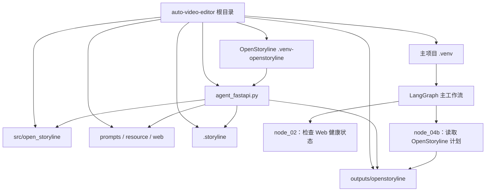

# auto-video-editor：OpenStoryline 目录扁平化迁移执行设计

> 文档类型：执行设计 / 迁移 Runbook  
> 分析基线：`wayyet/auto-video-editor` 仓库 `main` 分支  
> 分析日期：2026-11-01  
> 迁移目标：移除 `auto-video-editor/openstoryline/` 这一层目录，将代码、配置、提示词、前端和脚本整合到仓库根目录，同时保留运行环境与数据隔离。

---

## 1. 目标与范围

### 1.1 目标

把当前目录：

```text
auto-video-editor/
└── openstoryline/
    ├── .storyline/
    ├── .venv/
    ├── outputs/
    ├── prompts/
    ├── resource/
    ├── scripts/
    ├── src/
    ├── tests/
    ├── web/
    ├── agent_fastapi.py
    ├── config.toml
    ├── config.toml.local
    ├── LICENSE
    ├── README.md
    └── requirements.txt
```

调整为根目录直接承载 OpenStoryline 运行文件：

```text
auto-video-editor/
├── .venv/                         # 主工作流环境，保持不变
├── .venv-openstoryline/           # OpenStoryline 独立环境，重新创建
├── .storyline/                    # OpenStoryline 模型和缓存
├── agent_fastapi.py
├── config.toml
├── config.toml.local              # 本机密钥，不提交 Git
├── LICENSE-OpenStoryline
├── README-OpenStoryline.md
├── requirements-openstoryline.txt
├── prompts/
├── resource/
├── scripts/                       # 合并 OpenStoryline 脚本
├── src/open_storyline/
├── tests/                         # 主项目测试，保持不变
├── tests_openstoryline/            # OpenStoryline 独立测试
├── web/
└── outputs/
    └── openstoryline/             # OpenStoryline 会话输出
```

完成后，根目录下不再保留活动中的 `openstoryline/` 目录。

### 1.2 非目标

本次不做以下事情：

- 不合并两个 Python 虚拟环境的依赖。
- 不把 OpenStoryline 会话输出直接混进主工作流的 `outputs/job-*`。
- 不删除 `.storyline/models`、`resource/`、会话输出或用户配置。
- 不修改 LangGraph 主图的业务节点和工作流拓扑。
- 不改变 Web 服务端口：仍使用 `127.0.0.1:7860`。
- 不改变 OpenStoryline 业务功能、API 路由和前端交互行为。

---

## 2. 当前仓库结构与关键发现

### 2.1 GitHub `main` 分支结构

当前 `main` 分支已经存在独立的 `openstoryline/` 子目录，包含：

- `agent_fastapi.py`：OpenStoryline FastAPI Web 服务入口。
- `config.toml`：OpenStoryline 配置文件。
- `prompts/`：LLM 提示词模板。
- `src/open_storyline/`：OpenStoryline Python 包。
- `scripts/`：安装、下载资源和模型的 PowerShell 脚本。
- `tests/`：OpenStoryline 独立测试。
- `web/`：Web UI、静态资源和节点图页面。
- `README.md`、`LICENSE`、`requirements.txt`：子系统文档、许可证和依赖清单。

截图还显示了本机未纳入 Git 跟踪的运行时目录：

- `.venv/`
- `.storyline/`
- `outputs/`
- `resource/`
- `config.toml.local`

这些目录在仓库 `.gitignore` 中被排除，因此不会完整显示在 GitHub 文件树中。迁移时必须以本机实际文件为准，不能只依据 GitHub 跟踪文件列表。

### 2.2 已确认的路径依赖

目前主项目存在以下直接路径引用：

| 文件 | 当前引用 | 迁移后目标 |
|---|---|---|
| `config.py` | `VENDORED_OPENSTORYLINE_ROOT = <repo>/openstoryline` | `<repo>` |
| `config.py` | `openstoryline/.venv/Scripts/python.exe` | `.venv-openstoryline/Scripts/python.exe` |
| `nodes/node_02_launch_openstoryline.py` | `openstoryline/agent_fastapi.py` | 根目录 `agent_fastapi.py` |
| `nodes/node_02_launch_openstoryline.py` | `openstoryline/.venv/...` | 根目录 `.venv-openstoryline/...` |
| `nodes/node_04b_get_storyboard_plan.py` | `openstoryline/outputs/` | `outputs/openstoryline/` |
| `start_production.ps1` | `$RepoRoot/openstoryline` | `$RepoRoot` |
| `scripts/check_openstoryline_llm.py` | 默认 `OPENSTORYLINE_DIR=<repo>/openstoryline` | 默认 `<repo>` |
| `agent_fastapi.py` | `ROOT_DIR` 被认为是子目录，父目录才是主仓根 | `ROOT_DIR` 本身就是主仓根 |

另外还有三类隐式路径约束：

1. `src/open_storyline/utils/prompts.py` 当前使用相对路径 `prompts/tasks`，依赖进程的当前工作目录。
2. OpenStoryline 配置中的 `resource/`、`.storyline/`、`outputs/` 等相对路径，是相对于 `config.toml` 所在目录解析的。
3. OpenStoryline 的 `tests/conftest.py` 会根据原有目录层级计算 `src`、子目录和仓库根路径。

### 2.3 目录合并冲突

不能把所有子目录无差别移动到根目录：

| 子目录 | 根目录现状 | 处理方式 |
|---|---|---|
| `scripts/` | 已存在主项目脚本 | 合并文件；迁移前检查同名冲突 |
| `tests/` | 已存在主项目测试，且有 `conftest.py` | 改名为 `tests_openstoryline/`，保持独立测试入口 |
| `outputs/` | 主工作流已有输出目录 | 放入 `outputs/openstoryline/`，禁止直接覆盖根输出 |
| `README.md` | 根目录已有 README | 改名为 `README-OpenStoryline.md` |
| `requirements.txt` | 根目录已有主项目依赖清单 | 改名为 `requirements-openstoryline.txt` |
| `LICENSE` | 根目录可能有本机文件或后续新增许可证 | 改名为 `LICENSE-OpenStoryline`，保留 Apache-2.0 文本 |
| `.venv/` | 根目录已有主项目虚拟环境 | 不合并、不覆盖；重新创建 `.venv-openstoryline/` |
| `.storyline/` | 根目录可能已有同名缓存 | 合并到根 `.storyline/`，迁移前检查文件冲突 |
| `resource/` | 根目录可能已有同名资源 | 合并到根 `resource/`，迁移前检查文件冲突 |
| `src/`、`prompts/`、`web/` | 当前 `main` 树中没有对应根目录 | 可以直接提升到根目录；仍需检查本机未跟踪文件 |

主项目 `pyproject.toml` 明确将 `torch`、`torchaudio` 等重型组件排除在主环境之外；OpenStoryline 也明确要求使用独立 venv。因此，不能将子目录 `.venv` 改名为根 `.venv`，也不能把两套依赖强行安装到同一个环境。

---

## 3. 目标目录与命名约定

### 3.1 目录映射

| 原路径 | 新路径 | 动作 | 说明 |
|---|---|---|---|
| `openstoryline/agent_fastapi.py` | `agent_fastapi.py` | 上移 | Web 应用入口 |
| `openstoryline/config.toml` | `config.toml` | 上移 | 继续保留占位密钥，不写真实密钥 |
| `openstoryline/config.toml.local` | `config.toml.local` | 上移 | 本机密钥和覆盖配置，必须被 Git 忽略 |
| `openstoryline/prompts/` | `prompts/` | 上移 | 提示词模板目录 |
| `openstoryline/resource/` | `resource/` | 上移/合并 | 字体、BGM、模板等静态资源 |
| `openstoryline/src/open_storyline/` | `src/open_storyline/` | 上移 | Python 包源码 |
| `openstoryline/web/` | `web/` | 上移 | Web 前端、静态资源和节点图 |
| `openstoryline/scripts/*` | `scripts/*` | 合并 | 与主项目脚本共存 |
| `openstoryline/tests/` | `tests_openstoryline/` | 改名并上移 | 防止与主项目测试的 `conftest.py` 冲突 |
| `openstoryline/outputs/*` | `outputs/openstoryline/*` | 合并 | 保留 session_id 目录层级 |
| `openstoryline/.storyline/*` | `.storyline/*` | 合并 | 缓存、模型和技能目录 |
| `openstoryline/.venv/` | 不迁移 | 重建 | 新建根目录 `.venv-openstoryline/` |
| `openstoryline/README.md` | `README-OpenStoryline.md` | 改名上移 | 避免覆盖主 README |
| `openstoryline/requirements.txt` | `requirements-openstoryline.txt` | 改名上移 | 避免覆盖主项目依赖清单 |
| `openstoryline/LICENSE` | `LICENSE-OpenStoryline` | 改名上移 | 保留上游许可证 |
| `openstoryline/.gitignore` | 不保留 | 删除 | 运行时忽略规则统一写入根 `.gitignore` |

### 3.2 缓存与环境隔离规则

| 目录 | 用途 | 是否保留 | 是否允许清理 |
|---|---|---:|---:|
| `.venv/` | 主工作流依赖 | 保留 | 否 |
| `.venv-openstoryline/` | OpenStoryline 依赖 | 保留 | 否 |
| `.storyline/.server_cache/` | 服务端可再生缓存 | 保留 | 可以按缓存清理策略清理 |
| `.storyline/models/` | TransNet 等模型权重 | 保留 | 否；删除后需重新下载 |
| `.storyline/skills/` | 本地技能或技能缓存 | 保留 | 默认不清理 |
| `resource/` | 字体、BGM、TTS、模板资源 | 保留 | 否；删除后需重新下载或重新配置 |
| `outputs/openstoryline/` | 会话媒体、计划和结果 | 保留 | 不纳入普通缓存清理 |
| `outputs/` | 主工作流任务输出 | 保留 | 不纳入本次迁移清理 |

**核心原则：只统一目录层级，不合并运行环境，也不把业务数据当缓存删除。**

---

## 4. 迁移后的运行架构



运行约束：

- 主工作流继续使用根目录 `.venv`。
- OpenStoryline Web 继续使用独立 `.venv-openstoryline`。
- OpenStoryline Web 的工作目录统一为仓库根目录。
- Web 服务仍通过 `uvicorn agent_fastapi:app` 启动。
- Web 服务地址仍为 `http://127.0.0.1:7860`。
- OpenStoryline 计划产物统一写入 `outputs/openstoryline/<session_id>/...`。

---

## 5. 必须修改的代码与配置

### 5.1 `config.py`

修改 vendored OpenStoryline 路径常量：

**当前：**

```python
VENDORED_OPENSTORYLINE_ROOT: Path = Path(__file__).resolve().parent / "openstoryline"
VENDORED_OPENSTORYLINE_VENV_PY: Path = (
    VENDORED_OPENSTORYLINE_ROOT / ".venv" / "Scripts" / "python.exe"
)
```

**目标：**

```python
VENDORED_OPENSTORYLINE_ROOT: Path = Path(__file__).resolve().parent
VENDORED_OPENSTORYLINE_VENV_PY: Path = (
    VENDORED_OPENSTORYLINE_ROOT / ".venv-openstoryline" / "Scripts" / "python.exe"
)
```

同时检查 `CACHE_PATHS_TO_CLEAN` / `CACHE_GLOB_SPECS`：

- 将本地嵌入版 OpenStoryline 的服务缓存指向根目录 `.storyline/.server_cache`。
- 不再把本机嵌入版缓存指向旧的 `openstoryline/.storyline`。
- 旧的 `FireRed-OpenStoryline` 外部仓库路径，只有在仍需维护该外部仓库时才保留。
- 不得把 `.storyline/models/`、`.venv-openstoryline/`、`resource/`、`outputs/openstoryline/` 加入自动清理列表。

缓存根路径应由 `Path(__file__).resolve().parent` 推导，不再硬编码 `E:\Documents\...` 绝对路径。

### 5.2 `nodes/node_02_launch_openstoryline.py`

将以下路径常量调整到仓库根目录：

```python
REPO_ROOT = Path(__file__).resolve().parent.parent
OPENSTORYLINE_DIR = REPO_ROOT
OPENSTORYLINE_AGENT = REPO_ROOT / "agent_fastapi.py"
OPENSTORYLINE_VENV_PY = (
    REPO_ROOT / ".venv-openstoryline" / "Scripts" / "python.exe"
)
```

如果 `OPENSTORYLINE_DIR`、`OPENSTORYLINE_AGENT`、`OPENSTORYLINE_VENV_PY` 目前仅用于诊断或测试，也应同步更新，避免测试和后续代码继续依赖旧路径。

节点本身仍只负责健康检查，不应重新承担 Web 服务的进程生命周期管理。

### 5.3 `nodes/node_04b_get_storyboard_plan.py`

将 OpenStoryline 产物根目录改为：

```python
OPENSTORYLINE_OUTPUTS_ROOT: Path = (
    Path(__file__).resolve().parent.parent / "outputs" / "openstoryline"
)
```

保留原有读取逻辑和 session 目录查找逻辑，只改变产物根路径。

### 5.4 `agent_fastapi.py`

文件上移后，`ROOT_DIR` 就是主项目根目录。必须调整原来依赖“父目录是仓库根”的代码。

建议入口路径初始化统一为：

```python
ROOT_DIR = os.path.dirname(os.path.abspath(__file__))
SRC_DIR = os.path.join(ROOT_DIR, "src")

# 根目录放在 sys.path 前面，确保主项目 config.py、db、nodes 等模块可导入。
if ROOT_DIR not in sys.path:
    sys.path.insert(0, ROOT_DIR)

# OpenStoryline Python 包位于 src/open_storyline。
if SRC_DIR not in sys.path:
    sys.path.insert(1, SRC_DIR)
```

调整要点：

1. 删除旧的 `REPO_ROOT_DIR = os.path.dirname(ROOT_DIR)` 路径假设。
2. 不再把 `openstoryline/` 自身作为额外包根目录追加到 `sys.path`。
3. 确保根目录 `config.py`、`db/`、`nodes/` 可导入。
4. 确保 `src/open_storyline/` 可通过 `import open_storyline...` 导入。
5. `WEB_DIR`、`STATIC_DIR`、`INDEX_HTML`、`NODE_MAP_DIR` 继续由 `ROOT_DIR` 派生；上移后它们会自然指向根目录 `web/`。
6. `SERVER_CACHE_DIR` 应指向根目录 `.storyline/.server_cache`。
7. `/api/system/clean-cache` 和 `/api/system/import-video` 两处 `AUTO_VIDEO_EDITOR_DIR` 默认值应改为 `ROOT_DIR`，不再使用硬编码的本机绝对路径。
8. 更新注释中 `openstoryline/outputs/<sid>/media/` 为 `outputs/openstoryline/<sid>/media/`。

### 5.5 OpenStoryline 配置 `config.toml`

配置文件上移到仓库根目录后，建议调整项目输出路径：

```toml
[project]
media_dir = "./outputs/openstoryline/media"
bgm_dir = "./resource/bgms"
outputs_dir = "./outputs/openstoryline"
```

以下相对路径仍保持统一根目录语义：

- `.storyline/.server_cache`
- `.storyline/models/...`
- `.storyline/skills`
- `resource/...`

`src/open_storyline/config.py` 当前会根据配置文件所在目录解析相对路径。配置文件上移后，上述值会自然指向仓库根目录下的新位置。

`default_config_path()` 当前默认返回 `config.toml`。因此，启动 OpenStoryline Web 时必须把当前工作目录设为仓库根目录；如果外部环境设置了 `OPENSTORYLINE_CONFIG`，必须确认其指向根目录的 `config.toml`。

### 5.6 提示词路径 `src/open_storyline/utils/prompts.py`

当前实现：

```python
PROMPTS_DIR = Path("prompts/tasks")
```

这依赖启动进程的当前工作目录。迁移后 `start_production.ps1` 会以仓库根目录作为 Web 工作目录，因此可以继续工作。

更稳妥的方案是将提示词目录改为从当前模块位置推导的绝对路径，避免用户从其他工作目录手工启动时找不到提示词：

```python
REPO_ROOT = Path(__file__).resolve().parents[3]
PROMPTS_DIR = REPO_ROOT / "prompts" / "tasks"
```

### 5.7 `start_production.ps1`

将 OpenStoryline 路径变量集中调整为：

```powershell
$OsDir    = $RepoRoot
$OsVenvPy = Join-Path $RepoRoot '.venv-openstoryline\Scripts\python.exe'
$OsAgent  = Join-Path $RepoRoot 'agent_fastapi.py'
$OsSrc    = Join-Path $RepoRoot 'src'
```

资源与模型路径调整为：

```powershell
$OsResource = Join-Path $RepoRoot 'resource'
$OsModels   = Join-Path $RepoRoot '.storyline\models'
```

安装与下载脚本提示调整为：

```powershell
.\scripts\install.ps1
.\scripts\download_resources.ps1
.\scripts\download_models.ps1
```

启动 Web 时必须使用：

```powershell
-WorkingDirectory $RepoRoot
```

不能再使用原来的 `openstoryline/` 作为工作目录，否则相对提示词路径和默认 `config.toml` 可能解析到错误位置。

### 5.8 安装脚本与依赖文件

文件改名：

- `openstoryline/requirements.txt` → `requirements-openstoryline.txt`
- `openstoryline/scripts/install.ps1` → `scripts/install.ps1`
- 下载脚本 → `scripts/download_resources.ps1`、`scripts/download_models.ps1`

修改 `scripts/install.ps1`：

```powershell
$RepoRoot = Split-Path -Parent $PSScriptRoot
$VenvPy = Join-Path $RepoRoot '.venv-openstoryline\Scripts\python.exe'
$Requirements = Join-Path $RepoRoot 'requirements-openstoryline.txt'
```

安装脚本创建 `.venv-openstoryline`，不得操作主项目 `.venv`。

修改两个资源下载脚本：

- 用 `$PSScriptRoot` 推导仓库根目录。
- 下载与解压前切换到仓库根目录。
- 模型继续解压到 `.storyline/models/`。
- 静态资源继续解压到 `resource/`。
- 不得把模型或资源下载到旧的 `openstoryline/` 路径。

### 5.9 `scripts/check_openstoryline_llm.py`

当前默认值：

```python
OPENSTORYLINE_DIR = Path(
    os.environ.get("OPENSTORYLINE_DIR", REPO_ROOT / "openstoryline")
)
```

迁移后调整为：

```python
OPENSTORYLINE_DIR = Path(
    os.environ.get("OPENSTORYLINE_DIR", REPO_ROOT)
)
```

同时保留 `OPENSTORYLINE_DIR` 环境变量覆盖能力。脚本启动说明改成使用 `.venv-openstoryline`。

### 5.10 测试目录 `tests_openstoryline/`

原 `openstoryline/tests/conftest.py` 假定：

- 测试目录的父目录是 OpenStoryline 子目录。
- 再上一层才是主仓库根目录。
- `src/` 位于 OpenStoryline 子目录下面。

迁移后应改为：

```python
TESTS_DIR = Path(__file__).resolve().parent
REPO_ROOT = TESTS_DIR.parent
SRC_DIR = REPO_ROOT / "src"

for _p in (str(REPO_ROOT), str(SRC_DIR)):
    if _p not in sys.path:
        sys.path.insert(0, _p)
```

注意：如果测试文件本身还引用 `OPENSTORYLINE_DIR`，应把它改为 `REPO_ROOT`，或保留一个兼容别名：

```python
OPENSTORYLINE_DIR = REPO_ROOT
```

OpenStoryline 测试必须使用 `.venv-openstoryline`，不能默认并入主项目 `pytest testpaths = ["tests"]` 的测试集合。

### 5.11 根目录 `.gitignore`

删除旧的嵌套规则：

```gitignore
openstoryline/.venv/
openstoryline/outputs/
openstoryline/.storyline/
openstoryline/resource/
openstoryline/config.toml.local
```

新增根目录规则：

```gitignore
# OpenStoryline flattened runtime
.venv-openstoryline/
.storyline/
resource/
config.toml.local
```

根目录已有 `outputs/` 忽略规则，继续保留即可。不要忽略以下内容：

- `agent_fastapi.py`
- `config.toml`（只允许提交占位密钥）
- `prompts/`
- `src/open_storyline/`
- `scripts/` 中的安装和下载脚本
- `tests_openstoryline/`
- `web/`
- `requirements-openstoryline.txt`
- `README-OpenStoryline.md`
- `LICENSE-OpenStoryline`

---

## 6. 执行步骤

以下命令以 Windows PowerShell 为准。必须从 `auto-video-editor` 仓库根目录打开 PowerShell。

### 阶段 0：确认仓库位置和工作区状态

```powershell
$RepoRoot = (Get-Location).Path
$Source = Join-Path $RepoRoot 'openstoryline'

if (-not (Test-Path -LiteralPath (Join-Path $Source 'agent_fastapi.py'))) {
    throw "当前目录不是 auto-video-editor 仓库根目录，或 openstoryline/agent_fastapi.py 不存在：$RepoRoot"
}

git status --short
```

确认：

- 当前目录是 `auto-video-editor` 根目录。
- `git status --short` 已检查，所有未提交修改都已提交或备份。
- 当前分支最好是单独的迁移分支，例如：

```powershell
git switch -c refactor/flatten-openstoryline
```

如果该分支已存在，不要重复创建；先确认分支状态。

### 阶段 1：停止服务并备份

先停止生产脚本管理的服务：

```powershell
.\stop_production.ps1
```

再确认 7860 端口没有仍在运行的 OpenStoryline Web 进程：

```powershell
Get-NetTCPConnection -LocalPort 7860 -State Listen -ErrorAction SilentlyContinue
```

如果仍有监听进程，先通过 PID 文件或进程命令行确认归属；不要直接结束未知进程。

备份整个 `openstoryline/`，包括本机未跟踪的 `.venv`、`.storyline`、`outputs`、`resource` 和 `config.toml.local`：

```powershell
$BackupRoot = Join-Path (Split-Path $RepoRoot -Parent) (
    'auto-video-editor-openstoryline-backup-' + (Get-Date -Format 'yyyyMMdd-HHmmss')
)
New-Item -ItemType Directory -Path $BackupRoot -Force | Out-Null

robocopy $Source (Join-Path $BackupRoot 'openstoryline') /E /COPY:DAT /DCOPY:DAT /R:2 /W:2
if ($LASTEXITCODE -ge 8) {
    throw "备份失败，robocopy exit code=$LASTEXITCODE。停止迁移。"
}

Write-Host "备份目录：$BackupRoot"
```

如果根目录已经存在 `.storyline/`、`resource/`、`outputs/`、`src/`、`prompts/`、`web/` 或 `scripts/`，这些目标目录也要先备份。不要在没有备份的情况下覆盖本机文件。

### 阶段 2：执行目标路径冲突检查

以下检查用于发现本机文件系统中的同名文件。GitHub `main` 分支没有覆盖本机所有未跟踪文件，因此必须在本机执行。

```powershell
$MergePairs = @(
    @{ Source = 'scripts';   Target = 'scripts' },
    @{ Source = 'src';       Target = 'src' },
    @{ Source = 'prompts';   Target = 'prompts' },
    @{ Source = 'web';       Target = 'web' },
    @{ Source = 'resource';  Target = 'resource' },
    @{ Source = '.storyline'; Target = '.storyline' },
    @{ Source = 'outputs';   Target = 'outputs\openstoryline' },
    @{ Source = 'tests';     Target = 'tests_openstoryline' }
)

$Collisions = @(
    foreach ($pair in $MergePairs) {
        $srcDir = Join-Path $Source $pair.Source
        $dstDir = Join-Path $RepoRoot $pair.Target
        if ((Test-Path -LiteralPath $srcDir) -and (Test-Path -LiteralPath $dstDir)) {
            Get-ChildItem -LiteralPath $srcDir -File -Recurse -Force | ForEach-Object {
                $relative = $_.FullName.Substring($srcDir.Length).TrimStart('\')
                $targetFile = Join-Path $dstDir $relative
                if (Test-Path -LiteralPath $targetFile) {
                    [pscustomobject]@{
                        Source = $_.FullName
                        Target = $targetFile
                    }
                }
            }
        }
    }
)

$Collisions | Format-Table -AutoSize
if ($Collisions.Count -gt 0) {
    throw '发现同名文件。先逐个比较内容并人工决定合并方式，不得直接覆盖。'
}
```

另外检查文件级目标是否已经存在：

```powershell
$RootFiles = @('agent_fastapi.py', 'config.toml', 'config.toml.local')
foreach ($name in $RootFiles) {
    if ((Test-Path -LiteralPath (Join-Path $Source $name)) -and
        (Test-Path -LiteralPath (Join-Path $RepoRoot $name))) {
        throw "目标文件已存在，需人工比较后再迁移：$name"
    }
}
```

README、许可证和依赖文件会通过改名避开根目录冲突。

### 阶段 3：创建目标目录并复制代码

先创建 OpenStoryline 独立测试目录和输出隔离目录：

```powershell
New-Item -ItemType Directory -Path (Join-Path $RepoRoot 'tests_openstoryline') -Force | Out-Null
New-Item -ItemType Directory -Path (Join-Path $RepoRoot 'outputs\openstoryline') -Force | Out-Null
```

以下目录可在冲突检查通过后复制到根目录：

```powershell
$CopyPairs = @(
    @{ Source = 'src';      Target = 'src' },
    @{ Source = 'prompts';  Target = 'prompts' },
    @{ Source = 'web';      Target = 'web' },
    @{ Source = 'resource'; Target = 'resource' },
    @{ Source = '.storyline'; Target = '.storyline' }
)

foreach ($pair in $CopyPairs) {
    $srcDir = Join-Path $Source $pair.Source
    $dstDir = Join-Path $RepoRoot $pair.Target
    if (Test-Path -LiteralPath $srcDir) {
        robocopy $srcDir $dstDir /E /COPY:DAT /DCOPY:DAT /R:2 /W:2
        if ($LASTEXITCODE -ge 8) {
            throw "目录复制失败：$($pair.Source)，robocopy exit code=$LASTEXITCODE"
        }
    }
}
```

把输出复制到隔离目录，不能直接复制到根 `outputs/`：

```powershell
if (Test-Path -LiteralPath (Join-Path $Source 'outputs')) {
    robocopy (Join-Path $Source 'outputs') (Join-Path $RepoRoot 'outputs\openstoryline') /E /COPY:DAT /DCOPY:DAT /R:2 /W:2
    if ($LASTEXITCODE -ge 8) {
        throw "OpenStoryline outputs 复制失败，exit code=$LASTEXITCODE"
    }
}
```

合并 `scripts/`：

```powershell
if (Test-Path -LiteralPath (Join-Path $Source 'scripts')) {
    robocopy (Join-Path $Source 'scripts') (Join-Path $RepoRoot 'scripts') /E /COPY:DAT /DCOPY:DAT /R:2 /W:2
    if ($LASTEXITCODE -ge 8) {
        throw "scripts 合并失败，exit code=$LASTEXITCODE"
    }
}
```

复制或改名根目录文件：

```powershell
Copy-Item (Join-Path $Source 'agent_fastapi.py') (Join-Path $RepoRoot 'agent_fastapi.py')
Copy-Item (Join-Path $Source 'config.toml') (Join-Path $RepoRoot 'config.toml')
Copy-Item (Join-Path $Source 'README.md') (Join-Path $RepoRoot 'README-OpenStoryline.md')
Copy-Item (Join-Path $Source 'LICENSE') (Join-Path $RepoRoot 'LICENSE-OpenStoryline')
Copy-Item (Join-Path $Source 'requirements.txt') (Join-Path $RepoRoot 'requirements-openstoryline.txt')

if (Test-Path -LiteralPath (Join-Path $Source 'config.toml.local')) {
    Copy-Item (Join-Path $Source 'config.toml.local') (Join-Path $RepoRoot 'config.toml.local')
}

robocopy (Join-Path $Source 'tests') (Join-Path $RepoRoot 'tests_openstoryline') /E /COPY:DAT /DCOPY:DAT /R:2 /W:2
if ($LASTEXITCODE -ge 8) {
    throw "tests_openstoryline 复制失败，exit code=$LASTEXITCODE"
}
```

> 说明：以上采用“先复制、后验证、最后清理源目录”的策略，避免迁移中途失败导致唯一副本丢失。若根目录目标文件已经存在，必须先比较，不得直接执行覆盖。

### 阶段 4：调整虚拟环境

先检查旧环境的 Python 版本：

```powershell
Get-Content (Join-Path $Source '.venv\pyvenv.cfg')
& (Join-Path $Source '.venv\Scripts\python.exe') --version
```

根据旧环境使用的 Python 主/次版本创建新环境。例如，旧环境为 Python 3.11 时：

```powershell
py -3.11 -m venv .venv-openstoryline
```

安装依赖：

```powershell
.\.venv-openstoryline\Scripts\python.exe -m pip install --upgrade pip
.\.venv-openstoryline\Scripts\python.exe -m pip install -r .\requirements-openstoryline.txt
```

如果旧环境不是 Python 3.11，应将 `py -3.11` 替换为旧环境实际使用的版本。

**不要执行以下操作：**

```powershell
# 禁止：会覆盖或污染主项目环境
Move-Item .\openstoryline\.venv .\.venv
.\.venv\Scripts\python.exe -m pip install -r .\requirements-openstoryline.txt
```

旧 `.venv` 暂时保留在备份目录中，等新环境完整通过验收后再删除。

### 阶段 5：修改代码和配置引用

按第 5 节逐项修改：

1. `config.py`
2. `nodes/node_02_launch_openstoryline.py`
3. `nodes/node_04b_get_storyboard_plan.py`
4. `agent_fastapi.py`
5. 根目录 `config.toml`
6. `src/open_storyline/utils/prompts.py`
7. `start_production.ps1`
8. `scripts/install.ps1`
9. `scripts/download_resources.ps1`
10. `scripts/download_models.ps1`
11. `scripts/check_openstoryline_llm.py`
12. `tests_openstoryline/conftest.py` 及测试内的路径引用
13. 根目录 `.gitignore`
14. 根 README 中的 OpenStoryline 安装、资源下载和目录路径说明

还需要全文检索活动代码中的旧路径：

```powershell
git grep -n -I -E 'openstoryline[/\\]|openstoryline\.venv|openstoryline\\outputs|OPENSTORYLINE_DIR' -- '*.py' '*.ps1' '*.toml' '*.md'
```

检索结果需要逐项分类：

- 运行时代码、启动脚本和当前操作文档：必须改成新路径。
- 历史迁移记录、旧方案文档：可以保留旧路径，但应标记为历史状态，避免被误当成当前操作指南。
- `open_storyline` Python 包名：不属于旧目录引用，不要误改。

### 阶段 6：验证文件与配置

验证关键文件存在：

```powershell
$RequiredPaths = @(
    'agent_fastapi.py',
    'config.toml',
    'requirements-openstoryline.txt',
    'README-OpenStoryline.md',
    'LICENSE-OpenStoryline',
    'src\open_storyline\__init__.py',
    'prompts\tasks',
    'web\index.html',
    'web\static\app.js',
    'scripts\install.ps1',
    'scripts\download_resources.ps1',
    'scripts\download_models.ps1',
    'tests_openstoryline\conftest.py',
    '.storyline\models',
    'resource'
)

foreach ($path in $RequiredPaths) {
    if (-not (Test-Path -LiteralPath (Join-Path $RepoRoot $path))) {
        Write-Warning "缺少迁移目标：$path"
    }
}
```

验证配置文件没有把运行目录留在旧位置：

- `project.outputs_dir` 为 `./outputs/openstoryline`。
- `project.media_dir` 为 `./outputs/openstoryline/media`。
- `project.bgm_dir` 为 `./resource/bgms`。
- 模型路径位于 `.storyline/models/`。
- 缓存路径位于 `.storyline/.server_cache/`。
- `config.toml.local` 仍存在且没有提交到 Git。

### 阶段 7：运行测试

设置 Windows Python 输出编码：

```powershell
$env:PYTHONUTF8 = '1'
$env:PYTHONIOENCODING = 'utf-8'
```

执行 OpenStoryline 测试：

```powershell
.\.venv-openstoryline\Scripts\python.exe -m pytest .\tests_openstoryline -q --junitxml="$env:TEMP\openstoryline.xml"
```

执行主项目测试：

```powershell
.\.venv\Scripts\python.exe -m pytest .\tests -q --junitxml="$env:TEMP\main.xml"
.\.venv\Scripts\python.exe -m pytest .\agent_gate\tests -q -p no:cacheprovider --junitxml="$env:TEMP\agent-gate.xml"
```

执行前端测试（需要本机已安装 Node.js）：

```powershell
node --test .\web\tests\*.test.mjs
```

检查测试报告文件：

```powershell
Get-ChildItem "$env:TEMP\openstoryline.xml", "$env:TEMP\main.xml", "$env:TEMP\agent-gate.xml"
```

### 阶段 8：启动与集成验收

#### 8.1 单独启动 OpenStoryline Web

从仓库根目录执行：

```powershell
.\.venv-openstoryline\Scripts\python.exe -m uvicorn agent_fastapi:app --host 127.0.0.1 --port 7860
```

浏览器访问：

```text
http://127.0.0.1:7860/
```

检查：

- 首页返回 HTTP 200。
- CSS、JS、图片和节点图资源正常加载。
- 提示词能够加载，不出现 `Template not found`。
- `config.toml` 和 `config.toml.local` 能正常合并。
- 上传视频写入 `outputs/openstoryline/<session_id>/media/`。
- 分镜计划写入 `outputs/openstoryline/<session_id>/plan_timeline_pro/`。
- `.storyline/.server_cache/` 能正常创建和写入。

#### 8.2 生产启动脚本

停止手工启动的 Web 服务后，运行：

```powershell
.\start_production.ps1 -StorylineMode human
```

确认：

- 脚本从根目录找到 `.venv-openstoryline`。
- OpenStoryline Web 仍在 `127.0.0.1:7860` 正常运行。
- PID 文件中的 `os_dir` 是仓库根目录。
- `node_02_launch_openstoryline` 健康检查通过。
- `node_04b_get_storyboard_plan` 能从 `outputs/openstoryline/` 读取计划。

再验证自动模式：

```powershell
.\start_production.ps1 -StorylineMode auto
```

确认自动模式原有行为不变，且使用根目录 `.venv-openstoryline` 访问所需模型或 ASR 资源。

#### 8.3 清理缓存验证

执行 Web 的清理缓存功能或相应单测，确认：

- 可以定位 `.storyline/.server_cache/`。
- 不会删除 `.storyline/models/`。
- 不会删除 `resource/`。
- 不会删除 `outputs/openstoryline/`。
- 不会删除主项目 `.venv/` 或 `.venv-openstoryline/`。

### 阶段 9：清理旧目录

必须等阶段 7、8 全部通过后再清理。

先把原始目录移出仓库，作为短期回滚副本：

```powershell
$RetiredSource = Join-Path $BackupRoot 'openstoryline-before-cleanup'
Move-Item -LiteralPath $Source -Destination $RetiredSource
```

确认根目录扁平化文件都可用，且仓库根目录已经不存在 `openstoryline/`：

```powershell
if (Test-Path -LiteralPath (Join-Path $RepoRoot 'openstoryline')) {
    throw '旧 openstoryline 目录仍存在，不能结束迁移。'
}
```

旧目录副本不要立即删除。建议完整回归通过并稳定运行一段时间后，再手动清理 `$BackupRoot`。

---

## 7. 验收标准

| 编号 | 验收项 | 通过标准 |
|---|---|---|
| A01 | 目录层级 | 活动目录中不存在 `openstoryline/` |
| A02 | 主虚拟环境 | 根 `.venv/` 保持原样，主项目测试通过 |
| A03 | OpenStoryline 虚拟环境 | `.venv-openstoryline/` 可独立启动 Web 和运行测试 |
| A04 | Python 包导入 | `open_storyline`、主项目 `db`、`nodes` 均可正常导入 |
| A05 | 提示词 | `prompts/tasks` 能被正常加载 |
| A06 | Web 页面 | `http://127.0.0.1:7860/` 返回 200，静态资源正常 |
| A07 | 缓存 | `.storyline/.server_cache` 可写；模型权重仍存在 |
| A08 | 静态资源 | `resource/` 中原有资源完整 |
| A09 | 会话输出 | 输出写到 `outputs/openstoryline/`，不污染主 `outputs/job-*` |
| A10 | 计划读取 | `node_04b_get_storyboard_plan` 能读取新目录中的计划文件 |
| A11 | 启动脚本 | `start_production.ps1 -StorylineMode human` 成功 |
| A12 | 自动模式 | `start_production.ps1 -StorylineMode auto` 的原有行为不回归 |
| A13 | 测试隔离 | OpenStoryline 测试和主项目测试可分别运行 |
| A14 | 密钥保护 | `config.toml.local` 被 Git 忽略，真实 API Key 不进入提交 |
| A15 | 缓存清理安全 | 清理逻辑不会删除模型、资源、业务输出和 venv |

---

## 8. 回滚方案

出现以下任一情况，立即停止迁移，不执行阶段 9 的旧目录清理：

- 新 venv 安装依赖失败。
- OpenStoryline Web 无法启动。
- `open_storyline` 或主项目模块导入失败。
- 提示词或资源路径失效。
- 分镜计划无法被 `node_04b_get_storyboard_plan` 读取。
- 主项目测试出现与迁移相关的回归。

回滚方法：

1. 停止新启动的 OpenStoryline Web。
2. 恢复迁移前的代码分支或通过 Git 回退本次提交。
3. 从 `$BackupRoot\openstoryline` 恢复旧 `openstoryline/` 目录。
4. 恢复迁移前的根目录目标文件（如果迁移前已存在）。
5. 使用原 `openstoryline/.venv` 启动旧服务。
6. 确认原 `start_production.ps1`、`node_02`、`node_04b` 路径引用恢复一致。

注意：`git restore` 只能恢复 Git 跟踪文件，不能恢复被忽略的 `.venv`、`.storyline`、`resource`、`outputs` 和 `config.toml.local`。这些内容必须依赖阶段 1 的文件备份。

---

## 9. 风险与处理策略

| 风险 | 影响 | 处理策略 |
|---|---|---|
| 两套 `.venv` 被误合并 | 主项目依赖污染，Torch 等重依赖进入主环境 | 使用 `.venv-openstoryline` 独立环境，禁止覆盖根 `.venv` |
| OpenStoryline 输出覆盖主项目输出 | 任务产物混乱，可能导致数据覆盖 | 固定使用 `outputs/openstoryline/` |
| `scripts/` 存在同名文件 | 覆盖主项目脚本 | 迁移前执行冲突检测，有冲突先人工合并 |
| 测试目录 `conftest.py` 重名 | pytest fixture 相互污染 | 使用 `tests_openstoryline/` 独立测试目录 |
| `agent_fastapi.py` 根路径计算错误 | 主仓模块、配置、数据库导入失败 | 重写 `ROOT_DIR`、`SRC_DIR` 和 `sys.path` 初始化 |
| 提示词依赖当前工作目录 | Agent 运行时报模板不存在 | 固定 Web 工作目录为仓库根目录，或改为模块绝对路径 |
| 配置文件相对路径解析错误 | 模型、资源、输出目录找不到 | 统一将 `config.toml` 放在仓库根目录并检查路径值 |
| 本机配置含真实 API Key | 密钥泄露 | `config.toml.local` 根目录忽略，不提交；入库 `config.toml` 只保留占位符 |
| 旧 venv 直接移动 | Windows venv 中的启动器和路径可能失效 | 新建 venv 并重新安装依赖 |
| 清缓存误删模型或输出 | 模型重复下载、用户数据丢失 | 只清理 `.storyline/.server_cache` 等可再生缓存 |
| 只迁移 Git 跟踪文件 | 本机模型、资源、会话和密钥遗漏 | 以本机目录为准，完整备份并单独迁移被忽略目录 |

---

## 10. 建议实施顺序与提交拆分

建议拆成 3 个可审查提交，减少单次变更范围：

### Commit 1：目录搬迁和路径适配

- 把代码、配置、提示词、前端、静态资源搬到根目录。
- 合并 `scripts/`。
- 将测试改名为 `tests_openstoryline/`。
- 更新 Python、PowerShell 和配置文件中的旧路径。
- 更新根 `.gitignore`。

### Commit 2：运行环境和输出隔离

- 创建 `.venv-openstoryline/`。
- 更新安装脚本和依赖文件名。
- 将会话输出切换到 `outputs/openstoryline/`。
- 将 `.storyline/`、`resource/` 统一为根目录。

### Commit 3：测试、验收和旧目录清理

- 运行 OpenStoryline 独立测试、主项目测试和前端测试。
- 验证 human / auto 两种运行模式。
- 验证健康检查、计划读取、缓存清理和密钥忽略规则。
- 从仓库中移除旧 `openstoryline/` 目录。

---

## 11. 最终建议

采用“**代码上移、运行环境分离、缓存归根、输出隔离、测试独立**”的方案：

1. OpenStoryline 的代码和配置文件上移到仓库根目录。
2. `.venv` 保留为主项目环境，OpenStoryline 另建 `.venv-openstoryline`。
3. `.storyline` 和 `resource` 迁移到根目录，模型与业务资源不参与普通缓存清理。
4. OpenStoryline 输出迁移到 `outputs/openstoryline/`，避免和主工作流共享同一层业务目录。
5. OpenStoryline 测试放入 `tests_openstoryline/`，避免与主项目 pytest 配置和 `conftest.py` 冲突。
6. 只有在新路径启动、测试和生产流程全部通过后，才删除旧 `openstoryline/`。

该方案可以移除多余的目录层级，同时保留主工作流与 OpenStoryline 的依赖隔离、运行数据隔离和独立测试能力。

---

## 12. 代码依据

以下链接指向本次分析使用的 `main` 分支文件：

- [仓库根目录](https://github.com/wayyet/auto-video-editor/tree/main)
- [OpenStoryline 当前目录](https://github.com/wayyet/auto-video-editor/tree/main/openstoryline)
- [OpenStoryline README](https://github.com/wayyet/auto-video-editor/blob/main/openstoryline/README.md)
- [OpenStoryline 配置](https://github.com/wayyet/auto-video-editor/blob/main/openstoryline/config.toml)
- [OpenStoryline Python 配置加载器](https://github.com/wayyet/auto-video-editor/blob/main/openstoryline/src/open_storyline/config.py)
- [OpenStoryline 提示词加载器](https://github.com/wayyet/auto-video-editor/blob/main/openstoryline/src/open_storyline/utils/prompts.py)
- [主项目路径配置](https://github.com/wayyet/auto-video-editor/blob/main/config.py)
- [OpenStoryline 健康检查节点](https://github.com/wayyet/auto-video-editor/blob/main/nodes/node_02_launch_openstoryline.py)
- [OpenStoryline 计划读取节点](https://github.com/wayyet/auto-video-editor/blob/main/nodes/node_04b_get_storyboard_plan.py)
- [生产启动脚本](https://github.com/wayyet/auto-video-editor/blob/main/start_production.ps1)
- [主项目 `.gitignore`](https://github.com/wayyet/auto-video-editor/blob/main/.gitignore)
- [OpenStoryline 安装脚本](https://github.com/wayyet/auto-video-editor/blob/main/openstoryline/scripts/install.ps1)
- [OpenStoryline 独立测试配置](https://github.com/wayyet/auto-video-editor/blob/main/openstoryline/tests/conftest.py)

