# auto-video-editor 工作流流程图与实时节点追踪

> 基线分支：`main`（撰写时 HEAD：`352a468`，feat(storyline): 主图按开关包装 21 个 storyline 节点并接侧支边(默认关)）  
> 撰写日期：2026-11-01  
> 参考文档：[auto-video-editor-实时工作流流程图功能设计与开发计划.md](./auto-video-editor-实时工作流流程图功能设计与开发计划.md)（2026-10-20 分析稿）  
> 项目地址：<https://github.com/wayyet/auto-video-editor>  
> 目标：在现有节点图界面（`node_map.html`）基础上，展示项目真实的 LangGraph 主工作流拓扑，并在执行期间实时显示节点状态、分支走向、人工等待、重试和异常。  
> 与参考稿的关系：本文档在参考稿基础上按 2026-11-01 代码实况**逐项重新核实**并修订，两稿主要差异见 §2.4。**实施以本文档为准**；§9 为分阶段执行开发任务。

## 1. 结论

**推荐方案：复用现有 `node_map.html` 的可视化交互，新增真实工作流拓扑数据、统一运行事件、事件持久化和 SSE 实时推送。** 不另起一套只负责画图的前端，也不通过轮询 `status_log` 猜测当前节点。

原因（均已在 2026-11-01 代码上核实）：

1. 仓库已有可拖拽节点图页面（1055 行，JS 内联），支持展开/折叠、重置布局、SVG 连线和浏览器本地布局保存。
2. `openstoryline/web/node_map/workflow.json` 当前是 **14 个 OpenStoryline 子流程节点**的静态定义，并非 `graph.py` 编译出的主工作流；主图实际注册 **53 个节点**（graph.py:614–743）。
3. 主工作流在 `graph.py` 中通过 `StateGraph(WorkflowState)` 构建，包含 human/auto 双模式、条件边、并行分支（列表形式 fan-in，graph.py:854–857）、质检重试回环和 `interrupt` 人工关卡。
4. **页面托管入口已确认**：`node_map.html` 由 `openstoryline/agent_fastapi.py` 的 FastAPI 应用通过 HTTP 托管（`app.mount("/node_map", StaticFiles(...))` :3476，`GET /node-map` :3670–3678），由 `start_production.ps1:678` 以 uvicorn 启动在 `127.0.0.1:7860`。监控 API/SSE 端点就落在这个应用里，不进 FastMCP（`openstoryline/src/open_storyline/server.py` 仅是 MCP 入口，不托管静态文件）。
5. 数据库已 **PostgreSQL-only**（SQLite 已全线移除）：checkpointer 为 `AsyncPostgresSaver`（graph.py:443–494），运行台账 `workflow_runs` 建表 DDL 收敛在 `db/migrations.py:129–140`。事件持久化直接建 PostgreSQL 表，不再设计 SQLite 后端。
6. **执行入口有两个**（参考稿只提了 CLI）：`scripts/run_workflow.py`（Postgres checkpointer + `ainvoke`，:259）和 `agent_gate/runner.py::run_worker`（同步 `invoke`，含 `Command(resume=...)` 恢复路径 :366–400，由 MCP 工具 `agent_gate/mcp_server.py:124,202` 拉起）。统一事件必须覆盖这两条路径，否则 worker 跑的图在页面上是盲区。
7. `STORYLINE_HUMAN_FUSION` 已接线（默认关）：21 个 storyline 节点按开关被 `_sl(...)` 包装并在开启时接 21 条侧支边（graph.py:629–638、707–743、871–873）。这是继 `ASSEMBLY_QC_GATE_ENABLED` 之后第二个"开关改变拓扑"的一等概念，拓扑服务必须原生支持。
8. LangGraph 版本 1.2.9（requirements.txt:21–28），实测安装包的 `astream` 支持 `stream_mode=["tasks","updates","custom"]` 与 `version="v2"`（`langgraph/pregel/main.py:3063–3078`，默认 `v1`，须显式传参）——事件采集的技术前提成立。

**关键设计原则：图的静态拓扑从编译后的 LangGraph 图生成，实时状态从 LangGraph 执行事件获取。** 前者回答"有哪些节点和边"，后者回答"实际执行到哪里"。两者必须分开。

## 2. 现状核实（2026-11-01）

### 2.1 关键位置与职责

| 位置 | 当前职责（已核实） | 本次设计如何使用 |
|---|---|---|
| `graph.py` | 构建并编译主 `StateGraph`，53 节点；`_route_mode`(:319–331) 分 human/auto；fusion 包装(:629–638)与侧支接线(:871–873)；`get_checkpointer`(:443–494) 返回 AsyncPostgresSaver；`normalize_thread_id`(:500–534) | 从编译图提取拓扑；统一执行入口在外层接管事件采集；拓扑服务的"开关→连通性"数据源 |
| `state.py` | `WorkflowState`；`status_log`(:158)、`error_log`(:150) 均为 append-only reducer；fusion 专用键(:254–257)；import_video 键(:286–294) | 作为运行参数/业务状态来源；不将完整内容发给浏览器 |
| `scripts/run_workflow.py` | CLI 入口；pre-flight(:102–135)→迁移(:247–249)→**仅一条执行路径** `ainvoke`(:259)；退出码 0/2/3/130 | 改为复用统一 `WorkflowRunner`（async 路径），保留 CLI 参数与退出码 |
| `agent_gate/runner.py` | worker 执行入口：`run_worker`(:456–533) 同步 `invoke`(:513/515)、恢复走 `Command(resume=resume_map)`(:366–400)；自带 `make_checkpointer`（同步 PostgresSaver，:180–262） | 接入运行级事件（run.*），节点级事件作为可选增强；保持 `invoke` 语义不变为默认 |
| `openstoryline/agent_fastapi.py` | FastAPI 应用(:3454)，托管全部 Web 静态资源；`/node_map` 静态挂载(:3476)、`/node-map` 路由(:3670–3678)、`/api/system/import-video`(:4008)；uvicorn 127.0.0.1:7860 | **监控 API 与 SSE 端点的宿主**；建议新增独立 router 模块挂载，避免继续膨胀主文件 |
| `openstoryline/src/open_storyline/server.py` | FastMCP MCP 服务(:7,:17)，不托管静态文件 | **不放监控端点**，与参考稿的提醒一致（现已确证） |
| `openstoryline/web/node_map/node_map.html` | 1055 行；JS 内联 IIFE(:387)；`fetch(DATA_URL)`(:983) 读 JSON；拖拽(:748–800)、折叠(:730–733)、Expand/Collapse/Reset(:359–362,:958–976)、SVG 箭头(:370–374)、localStorage 布局(:537,:554–572)；file:// 打开会警告 fetch 受限(:989) | 作为主要前端实现基础，添加状态样式和 SSE 事件消费 |
| `openstoryline/web/node_map/workflow.json` | 712 行、14 节点；顶层 `workflow_meta`(id=`video_editing_pipeline`) + `nodes`(id/name/kind/pro/description/dependencies/next_nodes/input_schema/output_schema)；**无** schema_version/mode 字段 | 保留为 OpenStoryline 子流程图；主工作流图由 API 动态返回，不覆盖此文件 |
| `monitoring/runs_table.py` | PostgreSQL-only 台账：`workflow_runs`(thread_id 主键、video_name、current_checkpoint ①②③、status、updated_at)；`upsert_run/mark_resumed/mark_completed/mark_failed/list_suspended`(:47–181)；不可用时降级计数 | 继续用于挂起线程查询与最新状态；逐节点事件进新表，不塞成覆盖式单行 |
| `db/migrations.py` | 全部建表 DDL 的收敛位置（`workflow_runs` 在 :129–140） | 新增 `workflow_run_events` DDL 的落点 |
| `monitoring/heartbeat_writer.py`、`timeout_watchdog.py` | 心跳线程（`build_graph` 启动，graph.py:604–608）；两级超时看门狗（默认关） | 不改动；事件层不与之耦合 |
| `nodes/node_04a_import_video.py` | 文件握手而非 interrupt：写 `import_video_request.json`(:77–91) 后轮询 `import_video_result.json`(:400–409)，1 秒间隔(:config.py:231)、600 秒超时(:config.py:230)；多视频支持；`ACCEPT_EXTS`(:60) 与 Web 端 `WORKFLOW_VIDEO_EXTS`(media_upload.mjs:24) 一致 | 等待状态事件的来源节点（§7.3 规则 7） |
| `tests/integration/test_graph_compiles.py` | 图可编译、接口齐全、checkpointer 注入契约、禁止 SQLite 回归(:62–85) | 在此基础上增加流事件与图 schema 一致性测试 |

### 2.2 现有节点图页面能复用什么

当前 `node_map.html` 已具备：深色背景、节点卡片、带箭头的 SVG 连线；拖拽调整布局；单击标题展开/折叠；`Expand All` / `Collapse All` / `Reset Layout`；从 JSON 读取节点定义并将位置/折叠状态存入 `localStorage`。

这些能力与截图交互一致，应优先保留。当前缺失的是**完整主工作流拓扑、真实执行状态、事件订阅、异常/等待状态和运行历史**。

### 2.3 当前状态字段不等于运行事件

`WorkflowState.status_log` / `error_log` 是 append-only 业务日志，不能可靠表达：

- 某节点何时开始、何时结束、耗时多久；
- 并行节点是否同时运行（auto 模式存在列表形式屏障边，graph.py:950–995）；
- 条件边实际选中了哪条路径；
- 节点是否因 `interrupt` 挂起（挂起不是失败）；
- 某节点是否是质检重试、重放或恢复执行；
- 浏览器断线后如何补回已发生的事件。

不要把业务日志当执行生命周期。应从 LangGraph 的 task/update 事件构建标准化事件，再投影成页面状态。

### 2.4 相对参考稿（2026-10-20）已变化或需修正的结论

| # | 参考稿的说法 | 2026-11-01 核实结果 | 对设计的影响 |
|---|---|---|---|
| 1 | 承载 `node_map.html` 的 HTTP 服务入口"需实际验证" | **已确认**：`agent_fastapi.py` FastAPI（uvicorn 127.0.0.1:7860），`/node_map` 静态挂载 + `/node-map` 路由 | SSE/API 端点落点明确（§6.3）；§11.8 风险关闭并改写 |
| 2 | 事件存储"开发环境可用独立共享 SQLite 文件" | SQLite 已全线移除（PostgreSQL 统一改造 + SQLite 移除系列提交）；checkpointer、`workflow_runs` 均 PG | 事件表直接建 PG（§6.2-D）；DDL 进 `db/migrations.py` |
| 3 | 执行入口只有 CLI（`run_workflow.py`） | 还有 `agent_gate/runner.py`（worker，同步 invoke + resume），由 MCP 工具拉起，**独立进程** | 双入口接线设计（§6.2-B）；worker 进程边界强化了"事件必须走共享 PG 存储"（§11.9） |
| 4 | 主图以 human 链 + assembly + storyline 主要节点概括 | 实际 **53 个节点**；63a6549 已把 5 个原不可达节点挂到相关节点旁（三个开关默认全开）；`clean_cache` 注册但 0 条边（仅 Web 按钮触发） | 拓扑必须程序化生成；"注册但未连通"是一等展示状态 |
| 5 | `storyline_local_asr` 路径"可达性存疑" | 条件可达（`STORYLINE_ENABLE_ASR_BRANCH` 且素材有音轨，graph.py:355–359、900–908），且是**死胡同分支**——产物经 `storyline_asr_artifact` 等状态键回填 `plan_timeline_pro`，不进 fan-in 屏障（graph.py:388–392 守卫注释） | 图上如实标注条件分支与死胡同边；不可达告警由 63a6549 解决 |
| 6 | `STORYLINE_HUMAN_FUSION` 仅是开关与 state 新键（未接线） | 已接线（352a468 + 48dfeda）：21 节点包装 + 21 条侧支边，默认关，`STORYLINE_FUSION_DISABLE` 支持按节点关闭 | 开=主图多 21 条边；拓扑 API 需反映开关（§4.4、AC-13） |
| 7 | `import_video` 等待握手细节未展开 | 文件握手：请求/结果 JSON + 轮询（1s / 600s）；Web 端 1eac1d5 后 `importVideoFiles` 是唯一编排器，`POST /api/system/import-video` 载荷只含白名单视频（409 = 图未在等） | 等待事件设计（§7.3 规则 7）；409/超时/回滚分支的 UI 语义（§5.3） |
| 8 | LangGraph 事件结构"开发前先验证版本支持" | 已验证：langgraph 1.2.9，`stream_mode` 支持 `values/updates/checkpoints/tasks/debug/messages/custom`，`version` 支持 `v1/v2`（默认 v1，须显式传 `"v2"`）；`langgraph-checkpoint` 为本地 editable 源码 | 阶段 0 仍需用真实测试图固化事件样例（契约测试），但技术可行性不再是未知数 |
| 9 | `join_before_delivery` 表述为汇合点 | 现为单前驱（graph.py:863 注释"不再承担 fan-in"） | 拓扑展示以编译图为准（本条即为例证） |

## 3. 功能范围

### 3.1 必须实现

1. **完整拓扑**：展示主工作流的所有有效节点、分支、循环、并行边和汇合点；human/auto 两条模式路径均可查看；`STORYLINE_HUMAN_FUSION` / `ASSEMBLY_QC_GATE_ENABLED` 开关状态对连通性的影响如实呈现。
2. **实时定位**：节点开始执行时立即标记"执行中"，完成后标记"已完成"；实时更新当前活动节点和已执行路径。
3. **并行状态**：允许多个节点同时处于"执行中"。LangGraph 存在并行分支与列表形式 fan-in，页面不能强制显示成单线程流水线。
4. **人工等待**：区分 `interrupt` 人工关卡（⓪①②③）、`import_video` 文件握手等待、普通执行中。
5. **条件分支与重试**：标明运行时实际选中的路径；质检/护栏重试显示循环次数及重试历史（`assembly_repair_loop`、`node_07_speed_fit` 自环、`storyline_qa_gate` 回环）。
6. **异常可见**：节点失败时突出显示错误节点、脱敏错误摘要和时间；错误详情可展开。
7. **恢复与重连**：页面刷新或 SSE 断线后，按 `Last-Event-ID` 和持久化事件补齐状态。
8. **保留既有交互**：继续支持拖拽、展开/折叠、布局重置；旧 14 节点子流程图不受影响。
9. **数据安全**：前端只获取白名单筛选后的节点摘要，不暴露完整 `WorkflowState`、凭据、提示词、媒体数据或任意文件内容。

### 3.2 本次不做

- 不重写 LangGraph 节点业务逻辑。
- 不把流程图变成工作流编辑器；前端不允许改变节点边并写回生产图。
- 不另造任务调度/队列系统替代 LangGraph。
- 不将静态 OpenStoryline 14 节点图冒充主工作流。
- 不改变现有 checkpoint、`thread_id`、`interrupt/resume` 的业务语义。
- 不引入 WebSocket（单向推送 SSE 足够）。
- 不给 `agent_gate` worker 强上节点级事件流（运行级事件为底线，节点级为可选增强，见 §6.2-B）。

## 4. 流程图界面设计

在现有顶部工具栏基础上新增运行状态区域：

- **工作流选择**：`完整 LangGraph 工作流` / `OpenStoryline 子流程`。
- **运行标识**：`thread_id`、`run_id`（可选关联键）、human/auto 模式、开始时间、总耗时。
- **当前状态**：运行中、等待人工操作、已完成、失败、中断。
- **当前节点**：单个或多个活动节点。并行执行时显示活动节点数量，不能只选一个展示。
- **进度概览**：已完成/执行中/等待/失败节点计数。**不得**用节点数量或固定百分比计算"进度"（human/auto 路径节点数不同，且 fusion 侧支可选执行）。
- **视图操作**：保留展开全部、折叠全部、重置布局；新增"跟随当前节点"开关。

### 4.1 节点状态与连线

| 状态 | 建议样式 | 触发条件 |
|---|---|---|
| 未开始 | 深灰节点 | 尚未收到该节点的启动事件 |
| 执行中 | 蓝色边框/柔和脉冲 | 收到 `node.started`，尚未收到完成事件 |
| 已完成 | 绿色状态标记 | 收到 `node.succeeded` |
| 等待人工操作 | 紫色/琥珀色标记 | 收到 interrupt 相关事件，或 `import_video` 文件握手等待 |
| 重试中 | 橙色标记及次数 | 节点因 QC/护栏逻辑再次执行 |
| 失败 | 红色边框 | 收到节点异常或执行器捕获失败 |
| 跳过/未参与 | 灰色虚线/低对比度 | 运行结束后确认未执行；或按配置/模式未连通（如 QC 关闭时的 6 个 assembly 节点、human 模式下的 auto 链、fusion 关闭时的侧支边、`clean_cache`） |

连线体现三种信息：普通拓扑边、已走过的路径、当前活动路径。未命中的条件分支只在执行状态确定后弱化；不要在运行一开始就把未来分支判为"跳过"。

### 4.2 点击节点的详情

详情区域只展示已知且经白名单处理的字段：

- 节点 ID、显示名称、分组/阶段；
- 当前状态、开始/结束时间、耗时、尝试次数（attempt）；
- 上游触发节点或条件分支摘要；
- 精简的输入/输出摘要（产物数量、文件名、状态码），默认隐藏完整内容；
- 错误类型、脱敏后的错误摘要、日志引用；
- 若处于人工等待：等待原因和关卡编号（⓪①②③），或"等待网页导入"（文件握手）。

### 4.3 图的数据模型

前端统一使用以下结构，不直接依赖 `workflow.json` 的私有结构：

```json
{
  "workflow_id": "auto_video_editor_main",
  "schema_version": 1,
  "mode": "human",
  "flags": {
    "ASSEMBLY_QC_GATE_ENABLED": true,
    "STORYLINE_HUMAN_FUSION": false
  },
  "nodes": [
    {
      "id": "assembly_validate_render_qc",
      "name": "渲染与质量检查",
      "group": "assembly_qc",
      "description": "检查时间线、渲染产物及质量指标",
      "kind": "task",
      "checkpoint": null,
      "enabled": true,
      "reachable": true
    }
  ],
  "edges": [
    {
      "id": "assembly_validate_render_qc->assembly_repair_loop",
      "from": "assembly_validate_render_qc",
      "to": "assembly_repair_loop",
      "kind": "conditional",
      "label": "未达标且仍可重试"
    }
  ]
}
```

> 以上是**建议的 API 响应格式示例**，不是声称仓库已存在这些字段。节点和边由编译图提取（`compiled_graph.get_graph()`），元数据（中文名、阶段、关卡编号、条件边标签）来自节点元数据注册表；`flags` 来自 `config` 的实际读值（`ASSEMBLY_QC_GATE_ENABLED` graph.py:793–794，`STORYLINE_HUMAN_FUSION` graph.py:629–634）。

## 5. 工作流拓扑与人工关卡

### 5.1 主流程概览

主图的确切节点和边以 `graph.py` 当前编译结果为准（53 节点）。以下是便于理解的阶段图；**开发时必须由程序从编译图生成全量拓扑**，不得把此 Mermaid 当运行时数据源，也不得手工维护第二份边定义。

```mermaid
flowchart TD
    START([START]) --> launch[launch_openstoryline]
    launch --> ready{human 且 openstoryline 未就绪?}
    ready -->|是| END0([END])
    ready -->|否| open_preview[open_preview]
    open_preview --> mode{STORYLINE_MODE}

    mode -->|human| cp0[checkpoint0_storyline_plan / interrupt ⓪]
    cp0 --> import_video[import_video / 文件握手等待网页导入]
    import_video --> get_plan[get_storyboard_plan]
    get_plan --> has_plan{存在 storyline_plan 或 shot_plan?}
    has_plan -->|是| draft[generate_draft]
    has_plan -->|否| END1([END])

    mode -->|auto| load_media[storyline_load_media]
    load_media --> media_route{检索路由}
    media_route -->|有检索源| search_media[storyline_search_media]
    media_route -.-> search_web[storyline_search_web_topic]
    search_media --> split_shots[storyline_split_shots]
    split_shots --> asr_route{ASR 分支开启且有音轨?}
    asr_route -->|是（两条并行）| understand[storyline_understand_clips]
    asr_route -->|是（两条并行）| local_asr[storyline_local_asr]
    local_asr -. 死胡同分支，产物经 state 回填 .-> rough_cut[storyline_speech_rough_cut]
    asr_route -->|否| understand
    understand --> filter[storyline_filter_clips]
    filter --> group[storyline_group_clips]
    group --> script[storyline_generate_script]
    script --> template[storyline_script_template_recommendation]
    script --> voice[storyline_generate_voiceover]
    script --> bgm[storyline_select_bgm]
    script --> text[storyline_recommend_text]
    group --> timeline[storyline_plan_timeline_pro]
    script --> timeline
    voice --> bgm
    voice --> timeline
    bgm --> transition[storyline_recommend_transition]
    bgm --> timeline
    transition --> qa[storyline_qa_gate]
    text --> qa
    timeline --> qa
    qa -->|重试| group
    qa -->|继续| render[storyline_render_video]
    render --> join_storyline[storyline_join]
    join_storyline -->|有计划| draft
    join_storyline -->|无计划| END2([END])

    draft --> qc_flag{ASSEMBLY_QC_GATE_ENABLED?}
    qc_flag -->|启用| discover[assembly_discover_and_probe]
    discover --> observe[assembly_asr_and_visual_observe]
    observe --> timeline2[assembly_build_timeline]
    timeline2 --> validate[assembly_validate_render_qc]
    validate -->|未达标且可重试| repair[assembly_repair_loop]
    repair --> validate
    validate -->|通过/达上限/降级| report[assembly_write_report]
    report --> reorder[node_06_human_reorder / interrupt ①]
    qc_flag -->|关闭| reorder

    reorder --> speed[node_07_speed_fit]
    speed -->|未达标且可重试| speed
    speed -->|重试超限| guardrail[escalate_guardrail_failure]
    guardrail --> END3([END])
    speed -->|达标| bridge[bridge_snapshot2]
    bridge --> subtitles[node_08_add_subtitles]

    subtitles --> cn_fx[node_10_inject_text_fx]
    cn_fx --> covers[node_14_make_covers]
    covers --> cover_en[node_15_localize_covers_en]

    subtitles --> fork[fork_draft_for_english_branch]
    fork --> translate[node_16a_translate_and_check]
    translate --> en_sub[node_08b_add_subtitles_en]
    en_sub --> en_fx[node_10b_inject_text_fx_en]
    en_fx --> layout_route{布局需人工复核?}
    layout_route -->|需要| cp3[node_checkpoint3_layout_review / interrupt ③]
    cp3 --> tts[node_17_inject_english_tts]
    layout_route -->|不需要| tts

    cover_en --> join_fx((列表 fan-in：都到才触发))
    tts --> join_fx
    join_fx --> fx[node_09_inject_fx]
    fx --> sticker[node_11_inject_sticker]
    sticker --> bgm_human[node_12_human_add_bgm / interrupt ②]
    bgm_human --> volume[node_13_adjust_volume]
    volume --> delivery[join_before_delivery]
    delivery --> END4([END])
```



### 5.2 拓扑事实与展示约束

以下均来自编译图核实，UI 必须遵守：

- **双模式并存在一张编译图里**：human 链与 auto 链的边都在编译结果中，但互不连通（有专门测试守卫 `test_flag_off_has_no_edge_from_human_node_to_storyline_node` 同类约束）。UI 按 `mode` 高亮当前路径，另一条链显示为"另一模式的路径"，不得视为当前运行的"跳过"。
- **注册但未连通的节点要如实标注**：`clean_cache`（0 条边，仅 Web 按钮触发）；`ASSEMBLY_QC_GATE_ENABLED=False` 时 6 个 assembly 节点有注册无边；fusion 关闭时 21 条侧支边不存在；`storyline_generate_ai_transition`、`storyline_plan_timeline_ai_transition` 等按各自开关连通（63a6549 接入，开关默认全开）。
- **并行**：fan-in 用列表形式 `add_edge([...], target)` 表达（node_15 + node_17 → node_09，graph.py:854–857）；auto 模式屏障同样是列表边（graph.py:950–995）；`_storyline_route_after_load_media` / `_storyline_route_after_split_shots` 可返回 `list[str]` 产生并行分支。UI 必须支持一个 superstep 内多个活动节点。
- **回路**：`assembly_repair_loop → assembly_validate_render_qc`（graph.py:809）、`node_07_speed_fit` 自环、`storyline_qa_gate → storyline_group_clips`（graph.py:998–1005）。同一节点可能执行多次，不能只存 `node_id → status` 覆盖式状态（§11.1）。
- **死胡同分支**：`storyline_local_asr → storyline_speech_rough_cut` 的结果经 state 键回填，不进 fan-in 屏障；图上用虚线标注，不显示为"断头失败"。

### 5.3 人工关卡与 import_video 握手

| 关卡/节点 | 当前语义（已核实） | 前端展示 |
|---|---|---|
| `checkpoint0_storyline_plan` | human 模式规划确认，`interrupt`（nodes/node_checkpoint0_storyline_plan.py:44，经 `nodes/_checkpoint.py:5` 统一封装） | 紫色"等待人工规划 ⓪"，保留 thread/checkpoint |
| `import_video` | **不用 interrupt**；写 `import_video_request.json` 后轮询结果文件（1s/600s），等待 Web 端 `POST /api/system/import-video` 回写 | 琥珀色"等待网页导入"；节点内部发等待/恢复事件（§7.3 规则 7） |
| `node_06_human_reorder` | 关卡①，`interrupt`（node_06_human_reorder.py:78） | "等待人工调整 ①" |
| `node_checkpoint3_layout_review` | 关卡③，仅布局检测命中才触发（`route_after_translate`，graph.py:402–413） | 条件未命中走旁路；触发后"等待布局复核 ③" |
| `node_12_human_add_bgm` | 关卡②，`interrupt`（node_12_human_add_bgm.py:169） | "等待人工添加 BGM ②" |

LangGraph `interrupt` 的挂起不是节点失败。恢复时应沿用同一 `thread_id` 与 checkpointer，追加 `run.resumed` 事件，不得新建空白状态重新执行。`agent_gate` 的恢复路径（`Command(resume=resume_map)`，runner.py:366–400）与 `resume_utils.resume_all_pending` 都必须沿用原 `thread_id`。

## 6. 技术架构

### 6.1 架构总览

```mermaid
flowchart LR
    graph[LangGraph 编译图] --> schema[GraphSchemaService]
    schema --> graph_api[GET /api/workflow/graph]

    trigger1[CLI: run_workflow.py] --> runner[WorkflowRunner async]
    trigger2[Worker: agent_gate runner] --> runner2[运行级事件钩子]
    runner --> stream[astream tasks/updates/custom v2]
    stream --> parser[WorkflowEventAdapter]
    parser --> store[(workflow_run_events · PostgreSQL)]
    runner2 --> store
    store --> sse[SSE Events API]
    parser --> broadcaster[EventBroadcaster 进程内加速层]
    broadcaster --> sse
    graph_api --> browser[node_map.html + workflow_monitor.mjs]
    sse --> browser
```

### 6.2 组件职责

#### A. `GraphSchemaService`：静态图数据

- 接收 `build_graph(...)` 返回的已编译图，用 `compiled_graph.get_graph()` 取节点和边，转换为 §4.3 的 JSON。
- 规范化 START/END、条件边、并行 fan-out/fan-in、回路、孤立节点。
- 从节点元数据注册表取中文名、阶段、描述、关卡编号、条件边标签。
- 按实际 config 读值标注：当前模式、QC 开关（关闭时 6 个 assembly 节点 `reachable=false`）、fusion 开关（关闭时无侧支边）、以及 `clean_cache` 等注册未连通节点。
- **不要从 `workflow.json` 手工复制主图拓扑**，否则代码改边后流程图会过期。

建议新文件：`monitoring/workflow_graph.py`。

#### B. `WorkflowRunner`：统一执行入口

- **async 路径**（主）：封装 `astream(initial_state, config, stream_mode=["tasks","updates","custom"], version="v2")` 的完整消费循环；继续传入原 checkpointer 与 `configurable.thread_id`；不改变节点业务函数与重试策略。`scripts/run_workflow.py` 的 `ainvoke`(:259) 迁移到它。
- **sync 路径**（`agent_gate/runner.py`）：worker 是独立进程且用同步 `invoke`。分两步走：
  1. **底线（必做）**：在 `run_worker` 既有的 `mark_resumed/mark_completed/mark_failed` 挂点旁补发 `run.started/run.resumed/run.completed/run.failed` 运行级事件——改动小、不碰 `invoke` 语义；
  2. **增强（可选）**：将 `invoke` 换成同语义的 `graph.stream(...)` 消费以获得节点级事件，仅在契约测试证明最终状态一致后启用；有差异就退回运行级兜底。
- CLI 和 Web API 都调用这个 runner，避免一套路径能显示、另一套没有事件。

建议新文件：`monitoring/workflow_runner.py`。

#### C. `WorkflowEventAdapter`：把 LangGraph 事件转成稳定协议

- `tasks` 事件识别节点启动/结束/错误/interrupt；`updates` 事件读取状态增量（仅白名单字段进 summary）；`custom` 事件承载 `import_video` 等节点主动报告的等待/进度。
- LangGraph 1.2.9 的 `version` 默认 `"v1"`，必须显式传 `version="v2"`（已核实 `langgraph/pregel/main.py:3063–3078`）。
- 节点异常仍由 runner 外层 `try/except` 兜底发 `node.failed`/`run.failed`，不能只依赖流事件携带异常。
- `tasks` 模式需要 checkpointer；生产路径本就强制注入（`build_graph` 无 checkpointer 直接 `RuntimeError`，graph.py:597–602），测试用 `make_checkpointer("memory")`（config.py:556–590）。

#### D. `WorkflowEventStore`：事件持久化

新增事件明细表，与 `workflow_runs` 台账分工：台账保留线程最新状态/关卡/状态；事件表保存逐节点事件序列，供重连补发与回放。**PostgreSQL-only**，DDL 放 `db/migrations.py`（与 `workflow_runs` 同一收敛点）。

```sql
CREATE TABLE IF NOT EXISTS workflow_run_events (
    id          BIGSERIAL PRIMARY KEY,          -- 全局单调递增，直接作为 SSE 的 id / Last-Event-ID 游标
    thread_id   TEXT NOT NULL,
    run_id      TEXT,                           -- 可选关联键（一次业务运行的 uuid）
    event_type  TEXT NOT NULL,                  -- 如 node.started / run.failed
    node_id     TEXT,                           -- 运行级事件为空
    attempt     INT NOT NULL DEFAULT 1,
    occurred_at TIMESTAMPTZ NOT NULL DEFAULT now(),
    payload     JSONB NOT NULL DEFAULT '{}'
);
CREATE INDEX IF NOT EXISTS idx_wre_thread ON workflow_run_events (thread_id, id);
CREATE INDEX IF NOT EXISTS idx_wre_run    ON workflow_run_events (run_id);
```

设计说明（与参考稿的差异）：仓库现有语义是 `thread_id` 中心（`workflow_runs` 主键即 `thread_id`；`normalize_thread_id` 有严格校验），因此事件表以 `thread_id` 为主关联键，用全局 `BIGSERIAL id` 做游标——`WHERE thread_id = $1 AND id > $2` 一条索引即可完成 `Last-Event-ID` 补发，恢复运行时同 `thread_id` 续写、游标天然不回退，避免给 `workflow_runs` 动主键。

事件存储不可用时：记录 ERROR 并让 `/events` 返回明确错误（沿用 `runs_table.py` 的降级计数风格），**不得**静默把已开始的任务显示为成功。

#### E. SSE API：实时推送（宿主：`agent_fastapi.py`）

本功能只需服务端到浏览器的单向事件，用 SSE，不引入 WebSocket。

| HTTP | 路径 | 作用 |
|---|---|---|
| `GET` | `/api/workflow/graph` | 返回 §4.3 图 JSON（含 flags 与 mode 过滤） |
| `POST` | `/api/workflow/runs` | 显式启动运行，返回 `thread_id`/`run_id`；必须经统一 runner |
| `GET` | `/api/workflow/runs/{thread_id}` | 查询运行快照：状态、活动节点、进度摘要 |
| `GET` | `/api/workflow/runs/{thread_id}/events` | SSE 事件流；支持 `Last-Event-ID` 补发 |
| `POST` | `/api/workflow/runs/{thread_id}/resume` | 经原 `thread_id` 执行 `Command(resume=...)`；或仅查询外部恢复后的事件 |

实现要点：

1. **启动与订阅分离**。`GET .../events` 绝不启动工作流，避免浏览器自动重连造成重复执行。
2. **先持久化，后推送**。runner 先写事件表再通知订阅者；进程内 broadcaster 只是实时加速层。`agent_gate` worker 在独立进程里产出的事件，SSE 服务从共享事件表补发读取——不能依赖任何跨进程内存队列。
3. **落点与代码组织**。`agent_fastapi.py` 已近 5000 行，建议新增独立 router 模块（如 `openstoryline/web/api_workflow.py`）挂载进现有 `app`/`api` 路由组，与 `/api/system/import-video`（:4008）同层；**不得**把这些端点塞进 FastMCP 的 `server.py`。
4. **访问控制**。uvicorn 已绑定 `127.0.0.1`（start_production.ps1:678），保持本机限定并校验 `Origin`/`Referer`，默认拒绝外部来源。
5. 对"运行已结束、当前挂起、尚无事件、事件存储不可用"分别定义明确响应。

#### F. 前端节点图

改造 `node_map.html`，把事件处理、DOM 更新和重连逻辑迁移到独立模块 `openstoryline/web/static/workflow_monitor.mjs`（仓库已有 `.mjs` 纯逻辑模块 + `node --test` + pytest 包装的测试惯例，如 `media_upload.mjs`）。

前端执行流程：

1. 请求 `GET /api/workflow/graph` 建图（节点/边/图例/flags）。
2. `GET /api/workflow/runs/{thread_id}` 取当前快照，避免从空白状态开始。
3. 建立 SSE 连接，按 `id` 顺序应用事件。
4. 更新节点状态、活动边、运行概览与节点详情。
5. 断线后带 `Last-Event-ID` 重连：先补历史事件，再接实时事件。
6. "跟随当前节点"仅当活动节点落在视口外时滚动；手动拖动或查看其他节点时暂停自动跟随。
7. `localStorage` 布局 key 纳入 `workflow_id + mode + schema_version`，避免主图与 14 节点子流程、human 与 auto 互相污染布局。

## 7. 标准事件协议

### 7.1 事件类型

| 事件 | 触发时机 | UI 处理 |
|---|---|---|
| `run.started` | 运行启动（含 worker 入口） | 初始化计时器与节点状态 |
| `node.started` | LangGraph task 开始 | 标记执行中；记录开始时间、attempt、触发来源 |
| `node.progress` | 节点主动报告阶段进度（`custom` 流） | 更新节点详情，不改变拓扑 |
| `node.succeeded` | 节点正常结束 | 标记完成，记录结束时间与耗时 |
| `node.waiting_input` | interrupt 挂起，或 `import_video` 进入文件握手轮询 | 显示等待人工/外部操作，不当作失败 |
| `node.resumed` | 挂起节点恢复执行 | 从等待转回执行中 |
| `node.failed` | 节点或 runner 捕获异常 | 显示失败与脱敏摘要 |
| `node.retrying` | 重试即将开始 | attempt+1，保留上次耗时/错误 |
| `branch.selected` | 条件边选路可确定时 | 高亮选中边；未命中路径不标失败 |
| `run.interrupted` | 图因人工关卡挂起 | 运行级显示等待，保留 thread/checkpoint |
| `run.resumed` | 已挂起运行续跑（含 `Command(resume=...)`） | 恢复运行状态与耗时统计 |
| `run.completed` | 图正常走到终点 | 显示成功完成 |
| `run.failed` | 图异常退出 | 显示失败并提供错误定位 |

### 7.2 SSE 消息示例

```text
id: 42
event: node.started
data: {"thread_id":"video-001","run_id":"run-abc","node_id":"assembly_build_timeline","attempt":1,"occurred_at":"2026-11-01T07:20:30Z"}

id: 43
event: node.succeeded
data: {"thread_id":"video-001","node_id":"assembly_build_timeline","attempt":1,"duration_ms":1250,"summary":{"timeline_items":12}}

id: 44
event: node.waiting_input
data: {"thread_id":"video-001","node_id":"import_video","waiting_kind":"web_file_handshake","detail":{"pending_files":2}}
```

> 以上是协议示例，不是现有运行日志。

### 7.3 事件解析规则

1. **task start**：发 `node.started`；同一超步启动多个节点时全部标记执行中。
2. **task result**：无异常无 interrupt → `node.succeeded`；包含 interrupt → `node.waiting_input` + `run.interrupted`。
3. **state update**：只把白名单字段转成 `summary`，不把整个 state 推给浏览器。
4. **Python 异常**：runner 兜底发 `node.failed`/`run.failed`，记录异常类型、短摘要和日志关联 ID。
5. **循环重试**：同一 `node_id` 再次启动时 attempt 递增，保留历史，不覆盖。
6. **恢复运行**：沿用原 `thread_id` 与 checkpointer；事件游标（全局 `id`）继续递增。
7. **外部网页等待**：`import_video` 的握手不是 interrupt。在该节点进入轮询前用 `get_stream_writer` 发 `custom` 事件（LangGraph 1.2.9 支持 `custom` 流模式），适配器映射为 `node.waiting_input(waiting_kind="web_file_handshake")`；结果文件回写后任务正常结束 → `node.succeeded`。Web 端 409（图未在等）不产生图事件。
8. **路由选择**：优先用"任务结束后下一个 task 开始"的时序推断已走边并标 `branch.selected(inferred=true)`；对低成本的路由函数可加轻量钩子精确上报。不得仅凭节点 ID 静态猜测条件边。

## 8. 代码改动清单

| 文件 | 改动 |
|---|---|
| `monitoring/workflow_graph.py`（新增） | 从编译图生成全量节点/边 JSON；元数据注册表；标注孤立/禁用/条件节点与开关状态 |
| `monitoring/workflow_events.py`（新增） | 事件类型常量、字段校验、敏感字段白名单与脱敏、序列化 |
| `monitoring/workflow_event_store.py`（新增） | PostgreSQL 事件追加、按 `thread_id` 分页查询、按 `id` 补发 |
| `monitoring/workflow_runner.py`（新增） | 统一封装首次/恢复执行；async astream 消费；异常兜底；事件发布；worker 运行级钩子复用 |
| `db/migrations.py`（调整） | 新增 `workflow_run_events` DDL（§6.2-D） |
| `scripts/run_workflow.py`（调整） | `ainvoke` 迁移到共享 runner；保留 CLI 参数与退出码 |
| `agent_gate/runner.py`（调整） | `run_worker` 挂点旁补发运行级事件；节点级事件为可选增强（§6.2-B） |
| `nodes/node_04a_import_video.py`（调整） | 轮询前发 `custom` 等待事件（§7.3 规则 7） |
| `openstoryline/agent_fastapi.py`（调整） | 挂载 `/api/workflow/*` 路由组（建议新文件 `openstoryline/web/api_workflow.py`） |
| `openstoryline/web/node_map/node_map.html`（调整） | 工作流切换、状态图例、运行信息、节点状态、SSE 订阅 |
| `openstoryline/web/static/workflow_monitor.mjs`（新增） | 事件处理、DOM 更新、重连补发逻辑（纯逻辑可 `node --test`） |
| `openstoryline/web/node_map/workflow.json`（不动） | 继续作为 14 节点子流程定义；主图由 API 动态返回 |
| `monitoring/runs_table.py`（微调，可选） | 补充按 `thread_id` 关联查询最新事件的便捷函数；不塞逐节点覆盖式记录 |
| `tests/unit/monitoring/test_workflow_events.py`（新增） | 事件映射、脱敏、attempt、异常状态 |
| `tests/integration/test_workflow_stream_events.py`（新增） | 真实图流式执行、条件分支、并行、interrupt/resume、事件补发 |
| `tests/integration/test_workflow_graph_schema.py`（新增） | 图 JSON 与编译图节点/边一致性（含开关两种取值） |
| 前端测试（新增） | `workflow_monitor.mjs` 配套 `node --test` 用例 + pytest 包装（仓库既有惯例） |

## 9. 分阶段执行开发任务

### 9.1 与设计章节的关系与贯穿不变量

§4–§8 是"最终形态"设计；本章把同一份设计从开发视角拆成 **7 个阶段（0–6）**，每个阶段目标单一、可独立验收、可独立提交、可独立回滚。顺序按风险从低到高：纯新增模块 → 触碰执行路径 → 触碰 Web 服务 → 前端 → 回归收口。

**贯穿不变量**（阶段 1–6 的每一次提交都必须成立）：

1. 现有工作流行为零变化：`run_workflow.py` 与 `agent_gate` worker 的执行结果与基线一致；checkpoint/resume 语义不变。
2. 全量测试（`python -m pytest -m "not slow and not admin"`）失败集合 = 基线（本机已知固定 3 个基线失败，源于 `config.toml.local` 的 `[zcode].cwd` 合并泄漏，见阶段 0），只允许通过数增加。
3. 事件只读：除显式 `POST /api/workflow/runs`（与 resume）外，任何端点不得触发图执行；页面刷新不产生第二次 run。
4. 事件白名单与脱敏单测（阶段 2）通过之前，runner 不允许接入真实事件发布（防止把敏感 state 泄漏到浏览器）。
5. `git add` 逐文件加，不 `git add -A`（工作区常有其他不相关改动）。

### 9.2 总览

| 阶段 | 目标 | 主要涉及文件 | 验收门 | 对应章节 | 建议提交 |
|---|---|---|---|---|---|
| 0 | 基线固定与流事件契约验证 | 无生产代码（探针脚本 + 基线记录） | 事件样例固化；入口清单 | §2、§6.2-C | docs/chore 一笔 |
| 1 | 拓扑 Schema 服务与元数据注册表（纯新增） | `monitoring/workflow_graph.py`、`tests/integration/test_workflow_graph_schema.py` | schema 与编译图逐点一致（含开关两态） | §4.3、§6.2-A | feat 一笔 |
| 2 | 事件协议、脱敏与事件存储（纯新增） | `monitoring/workflow_events.py`、`monitoring/workflow_event_store.py`、`db/migrations.py`、`tests/unit/monitoring/test_workflow_events.py` | 单测过；PG 建表成功；未碰图执行 | §6.2-D、§7.1 | feat 一笔 |
| 3 | 统一 Runner 与双入口接线 | `monitoring/workflow_runner.py`、`scripts/run_workflow.py`、`agent_gate/runner.py`、`nodes/node_04a_import_video.py`、`tests/integration/test_workflow_stream_events.py` | CLI 全流程事件入 PG；worker 运行级事件；全量=基线 | §6.2-B/C、§7.3 | feat 一笔（worker 可拆两笔） |
| 4 | SSE API 与重连补发 | `openstoryline/web/api_workflow.py`、`openstoryline/agent_fastapi.py` | curl 订阅/断线续传/访问控制 | §6.2-E | feat 一笔 |
| 5 | 节点图前端实时化 | `node_map.html`、`static/workflow_monitor.mjs`、前端测试 | 实时定位/并行高亮/等待与重试呈现；旧图回归 | §4、§6.2-F | feat 一笔 |
| 6 | 回归验收与文档 | 无（或文档微调） | §10 AC-01..14 逐项过 | §10、§11 | docs 一笔 |

**依赖**：0 → 1 → 2 → 3 → 4 → 5 → 6 严格串行（3 依赖 2 的脱敏与存储；4 依赖 3 产事件；5 只消费 4 的稳定 API）。阶段 1 与 2 互不依赖，可并行开发但建议分开提交。

### 9.3 阶段 0：基线固定与流事件契约验证

不改生产代码。

**任务**

1. 记录基线：HEAD SHA（撰写时 `352a468`）、Python 版本、`pip show langgraph`（预期 1.2.9）、`langgraph-checkpoint` editable 指向（`E:\Documents\kuaishou\langgraph-main\libs\checkpoint`）。
2. 跑全量测试并记录**基线失败集合**（本机固定 3 个：`config.toml.local` 泄漏所致；restore 系测试需 Postgres 5432 存活）。后续每阶段以此为对照。
3. 盘点执行入口清单并核对与 §2.1 一致：`scripts/run_workflow.py`、`agent_gate/runner.py`（`agent_gate/cli.py`、`agent_gate/drive.py`、MCP `spawn_worker` 拉起）、smoke 脚本。
4. 写临时探针脚本（建议 `scripts/probe_stream_events.py`，可不入库）：用最小测试图 + `make_checkpointer("memory")` 跑 `astream(stream_mode=["tasks","updates","custom"], version="v2")`，固化三类样例：普通节点起止、并行超步、`interrupt` 挂起与 `Command(resume=...)` 续跑；确认 `tasks` 事件在本版本的实际字段形态。样例存入基线记录。
5. 确认 `node_map.html` 的实际访问 URL（`http://127.0.0.1:7860/node-map`）与 `/api` 路由前缀写法，为阶段 4 定端点。

**交付物**：基线记录（含失败集合、事件样例 JSONL、入口清单）。

**回滚**：无生产代码，删除探针脚本即可。

### 9.4 阶段 1：拓扑 Schema 服务与元数据注册表（纯新增）

本阶段不接 API、不碰前端，只产出可被后续阶段调用的纯函数模块。

**任务**

1. `monitoring/workflow_graph.py`：`build_graph_schema(compiled_graph, config) -> dict`（§4.3 结构）；节点元数据注册表（中文名、阶段、描述、关卡编号、条件边标签）；`flags` 反映 `ASSEMBLY_QC_GATE_ENABLED` / `STORYLINE_HUMAN_FUSION` 实际读值。
2. 处理 START/END 归一化、条件边、列表 fan-in、回路、孤立节点（`clean_cache`）与"注册未连通"标注（QC 关闭时的 6 节点、human 模式下的 auto 链、fusion 关闭时的侧支）。
3. `tests/integration/test_workflow_graph_schema.py`：用 `build_graph + make_checkpointer("memory")` 断言——(a) schema 节点/边集合与 `compiled_graph.get_graph()` 逐点一致；(b) QC 开关两态、fusion 开关两态下 `reachable`/边数量正确（fusion 开 = 恰好多 21 条侧支边）；(c) 每个节点有元数据。

**验收**

```powershell
python -m pytest tests/integration/test_workflow_graph_schema.py
# 预期：全部通过

python -m pytest -m "not slow and not admin"
# 预期：失败集合 = 基线（本阶段未触碰任何执行路径）
```

**回滚**：删除 2 个新文件。

### 9.5 阶段 2：事件协议、脱敏与事件存储（纯新增）

**任务**

1. `monitoring/workflow_events.py`：§7.1 全部事件类型常量；事件构造与字段校验；**敏感字段白名单**（明确拒绝：完整 state、ASR 全文、提示词、密钥、绝对路径；异常消息脱敏规则）；`to_sse_frame(event) -> str`。
2. `monitoring/workflow_event_store.py`：`append_event`（先落库后推送）、`fetch_events_after(thread_id, last_id, limit)`、`latest_snapshot(thread_id)`；连接复用 `db/connection`，URI 走统一 DSN 解析（与 361cc13 的收敛一致）。
3. `db/migrations.py`：新增 §6.2-D 的 `workflow_run_events` DDL。
4. `tests/unit/monitoring/test_workflow_events.py`：事件映射、attempt 递增、脱敏（含"异常里夹路径/密钥"用例）、SSE 帧格式、存储不可用时的显式报错路径（mock 连接失败）。

**验收**

```powershell
python -m pytest tests/unit/monitoring/test_workflow_events.py
# 预期：全部通过

# Postgres 5432 存活时：
python -c "from db.migrations import apply_migrations_to_db; apply_migrations_to_db(); print('ok')"
# 预期：ok（workflow_run_events 已建表，重复执行幂等）
```

**回滚**：删除 3 个新文件 + 还原 `db/migrations.py`（表可留在库里，幂等无害）。

### 9.6 阶段 3：统一 Runner 与双入口接线

本阶段开始触碰执行路径——是风险最高的一笔，靠阶段 0 的契约样例与全量回归兜底。

**任务**

1. `monitoring/workflow_runner.py`：async `run(graph, state, config, on_event)` 封装 `astream` 消费循环（`stream_mode=["tasks","updates","custom"]`，显式 `version="v2"`）；异常兜底发 `node.failed`/`run.failed`；每事件先 `append_event` 再回调广播。
2. `scripts/run_workflow.py`：`ainvoke`(:259) 换成 runner 调用；**保持** pre-flight 顺序、`--skip-preflight`、退出码 0/2/3/130 完全不变。
3. `agent_gate/runner.py`（底线）：`run_worker` 在既有 `mark_resumed/mark_completed/mark_failed` 挂点旁补发 `run.started/run.resumed/run.completed/run.failed`；节点级 stream 改造仅在有契约测试证明与 `invoke` 终态一致后启用，否则维持运行级。
4. `nodes/node_04a_import_video.py`：轮询前经 `get_stream_writer` 发 `custom` 等待事件（§7.3 规则 7）；不改轮询/超时/回滚逻辑本身。
5. `tests/integration/test_workflow_stream_events.py`：测试图覆盖——普通起止序列、并行超步两节点同时 started、`interrupt` → `run.interrupted` → resume → `run.resumed`、QC 重试 attempt 递增、import_video 等待事件、事件全部落 PG 且 `id` 单调、脱敏不泄漏白名单外字段。

**验收**

```powershell
python -m pytest tests/integration/test_workflow_stream_events.py
# 预期：全部通过

python -m pytest -m "not slow and not admin"
# 预期：失败集合 = 基线

# CLI 实跑一次（人工在网页完成导入），另开会话查事件表：
# 预期：node.* 事件序列完整、node_04a 出现 waiting_input、run.completed 收尾
```

**回滚**：`git checkout -- scripts/run_workflow.py agent_gate/runner.py nodes/node_04a_import_video.py` 并删除新文件；已入库的历史事件无副作用。

### 9.7 阶段 4：SSE API 与重连补发

**任务**

1. 新增 `openstoryline/web/api_workflow.py`（APIRouter）实现 §6.2-E 五个端点，挂载进 `agent_fastapi.py` 现有 `app`/`api` 路由组；`GET .../events` 用 `StreamingResponse` 输出 §7.2 帧。
2. SSE 推送顺序：连接时先从事件表补发 `id > Last-Event-ID` 的历史事件，再切换到 broadcaster 实时流；无 `Last-Event-ID` 时先发当前快照摘要再进实时。
3. 对已结束/挂起/无事件/存储不可用分别返回明确状态（结束态发终态事件后关闭流）。
4. 访问控制：保持 127.0.0.1 绑定前提下校验 `Origin`，默认拒绝跨源。
5. 用 `POST /api/workflow/runs` 启动的运行与 CLI 运行产出事件结构一致（同一 runner）。

**验收**

```powershell
# 端点存在性与快照：
curl http://127.0.0.1:7860/api/workflow/graph | more
# 预期：返回 §4.3 结构 JSON（含 flags）

# 订阅（另开窗口跑一次 CLI 运行）：
curl -N http://127.0.0.1:7860/api/workflow/runs/video-001/events
# 预期：持续收到 id 单调的 node.* / run.* 帧

# 断线续传：Ctrl-C 后带 Last-Event-ID 重连
curl -N -H "Last-Event-ID: 42" http://127.0.0.1:7860/api/workflow/runs/video-001/events
# 预期：第一帧 id > 42，无重复无遗漏

# 刷新页面 / 重复 GET events：不产生第二次运行（workflow_runs 与事件表无新 run）
```

**回滚**：还原 `agent_fastapi.py` 挂载行，删除 router 文件。

### 9.8 阶段 5：节点图前端实时化

**任务**

1. `node_map.html`：保留深色主题、卡片、SVG 连线、拖拽、折叠与布局持久化；新增"完整 LangGraph 工作流 / OpenStoryline 子流程"切换与状态图例（§4.1 七态）。
2. `static/workflow_monitor.mjs`：加载图 → 取快照 → 订阅 SSE → 应用事件；断线带 `Last-Event-ID` 重连补历史；并行活动节点多高亮；跟随开关（视口外才滚动，手动拖动即暂停）。
3. 节点详情面板（§4.2 白名单字段）；错误摘要可展开；人工等待显示关卡编号或"等待网页导入"。
4. 布局 key 纳入 `workflow_id + mode + schema_version`；旧 14 节点图的布局数据不受影响。
5. 前端逻辑测试：`workflow_monitor.test.mjs`（`node --test`）覆盖事件归约（started/succeeded/failed/retrying/waiting 状态机）、`Last-Event-ID` 补发去重、布局 key 生成；pytest 包装接入现有体系。

**验收**

```powershell
node --test openstoryline/web/static/workflow_monitor.test.mjs
# 预期：全部通过
```

浏览器手工验收：运行期间节点实时变色、并行同亮、QC 重试显示轮次、关卡⓪①②③与网页导入等待态正确、刷新页面状态恢复且不重复启动、旧图交互（拖拽/折叠/重置）无回归。

**回滚**：还原 `node_map.html`，删除 `workflow_monitor.mjs` 与测试。

### 9.9 阶段 6：回归验收与文档

**任务**

1. 按 §10 验收标准 AC-01..AC-14 逐项过（human/auto 各一次完整运行；QC 重试、护栏重试、并行 fan-in、模式切换、关卡挂起恢复、断线补发、失败展示、脱敏抽查）。
2. 旧 14 节点 OpenStoryline 地图回归（旧链接、布局保存、折叠）。
3. 更新根 README / openstoryline README：`/node-map` 新能力、端点清单、排错说明（事件表不可用时的表现、如何看 `workflow_run_events`）。
4. 归档本设计的执行记录（按仓库惯例归档到 docs/修正）。

**交付物**：验收记录、已知限制清单、启动与排错说明。

### 9.10 每阶段通用检查

1. `git status --short` 只含本阶段清单里的文件；
2. 全量测试失败集合 = 基线（阶段 0 记录），通过数只增不减；
3. 未改任何节点业务函数、`graph.py` 边定义、checkpoint/resume 语义（阶段 3 的 `node_04a` 仅新增事件发射）；
4. 每阶段独立一笔提交，提交信息见 §9.2"建议提交"列（feat/test/docs 前缀，参照仓库惯例）；
5. 中途发现结构性缺陷：回到对应阶段修，再重跑该阶段与阶段 6 的相关验收，不跳步。

## 10. 验收标准

| 编号 | 验收标准 | 验证方式 |
|---|---|---|
| AC-01 | 页面能展示当前编译图中的所有节点和边，包括条件分支、回环和汇合 | 比较 API schema 与 `compiled_graph.get_graph()`（阶段 1 测试） |
| AC-02 | 节点启动后及时显示"执行中"，完成后显示"已完成" | 含 sleep 的测试节点观察状态变化 |
| AC-03 | 并行分支执行时所有活动节点同时高亮（含列表 fan-in 汇合只触发一次） | 并行测试节点 + node_15/node_17 真实链路 |
| AC-04 | 条件路由和重试反映真实执行路径（assembly QC 回环、node_07 自环/护栏、qa_gate 回环） | QC 通过/失败两套用例 + attempt 计数 |
| AC-05 | interrupt 表现为等待人工操作而非失败；恢复沿用原 thread_id | 关卡⓪/①/②/③挂起与恢复测试 |
| AC-06 | `import_video` 文件握手期间显示独立等待态；600s 超时与回滚分支有明确呈现 | 等待握手文件前后观察事件与 UI |
| AC-07 | 刷新页面或 SSE 断线后状态恢复，且不重复启动工作流 | `Last-Event-ID` 端到端测试 |
| AC-08 | CLI 与 Web API 启动的同类运行产生一致事件；agent_gate worker 至少产生运行级事件 | 三入口分别执行同一测试图对比事件表 |
| AC-09 | `ASSEMBLY_QC_GATE_ENABLED=False` 时 6 个 assembly 节点显示为禁用/未参与 | 开关两态对照 |
| AC-10 | `STORYLINE_HUMAN_FUSION` 开/关两种拓扑正确呈现（关：无侧支边；开：恰好多 21 条侧支边），另一模式路径不显示为"跳过" | 图 schema 测试 + UI 两态手工对照 |
| AC-11 | 原 14 节点 OpenStoryline 图继续可查看，布局缓存互不冲突 | 手工回归 + 前端测试 |
| AC-12 | API/事件不返回完整 WorkflowState、密钥、提示词、ASR 全文或敏感文件内容 | 白名单/脱敏单测 + 抓包抽查 |
| AC-13 | 原有工作流执行、checkpoint、resume 测试不回归（失败集合 = 基线） | 全量测试套件 |
| AC-14 | 运行结束后可从事件存储回放整场执行（含耗时与 attempt 历史） | 事件表按 thread_id 全量查询 + UI 历史查看 |

## 11. 主要风险与处理

### 11.1 同一节点可能执行多次

`node_07_speed_fit`、assembly QC、`storyline_qa_gate` 都有重跑路径。不能仅用 `node_id → status` 覆盖历史；事件表按次记录（attempt、起止时间），前端保留重试历史。

### 11.2 并行节点不等于一条直线

主图有列表形式 fan-in 与路由函数返回 `list[str]` 的并行分支。UI 必须支持一个 superstep 多个活动节点；汇合边以编译图为准，不为布局方便改成串行。

### 11.3 interrupt 和外部 UI 等待不同

interrupt 经 checkpointer 挂起；`import_video` 是文件握手轮询（1s/600s）。事件模型已区分两种等待（`waiting_kind`），否则页面会把 600 秒轮询一直显示成"执行中"。

### 11.4 不要只靠内存队列

SSE 会断线；且 `agent_gate` worker 是**独立进程**——它的任何事件都不可能经进程内队列到达 Web 进程。必须先持久化（共享 PG 事件表）再推送，内存 broadcaster 只做同进程实时加速。

### 11.5 避免为可视化重复执行图

加载流程图和订阅事件不得触发 `invoke()`。启动必须是显式 `POST`；页面刷新只重放事件。

### 11.6 拓扑数据不能依赖人工同步

Mermaid/JSON 不得成为 `graph.py` 的第二份主定义。静态 `workflow.json` 只保留给 14 节点子图；主图一律由编译图生成，并用 `test_workflow_graph_schema.py` 防漂移（本设计 §5.1 的 Mermaid 即为例证：`join_before_delivery` 已从汇合点变为单前驱）。

### 11.7 事件数据需脱敏

不推送完整 `WorkflowState`、ASR 全文、提示词、密钥、绝对路径。事件只携带白名单摘要；异常消息脱敏。白名单单测先于 runner 接线（§9.1 不变量 4）。

### 11.8 监控端点落点已确认，注意代码组织

宿主为 `agent_fastapi.py`（FastAPI，uvicorn 127.0.0.1:7860）。风险从"落点未知"转为两点：(a) 不要把端点塞进 FastMCP 的 `server.py`；(b) `agent_fastapi.py` 已近 5000 行，新增路由放独立模块 `api_workflow.py` 再挂载，避免继续膨胀与合并冲突。

### 11.9 agent_gate 的 invoke→stream 语义差异

worker 现用同步 `invoke` + `Command(resume=...)`。改 `stream` 有终态语义差异风险。策略：运行级事件先行（零语义风险），节点级仅在契约测试证明一致后启用，否则保持运行级兜底——页面至少不盲。

### 11.10 langgraph-checkpoint 为本地 editable 源码

`langgraph-checkpoint 4.1.1` 指向本地 `langgraph-main` 源码目录，换机器/升级会改变行为面。阶段 0 基线记录该事实；事件契约测试（阶段 3）同时充当升级护栏。

## 12. 参考资料

### 项目代码（行号以 352a468 为准）

- 主工作流构建：`graph.py`（:614–743 注册 53 节点；:761–1005 边与条件路由）
- State 定义：`state.py`
- CLI 执行入口：`scripts/run_workflow.py`
- Worker 执行入口：`agent_gate/runner.py`
- Web 宿主与页面：`openstoryline/agent_fastapi.py`（:3454 应用、:3476 `/node_map` 挂载、:3670 `/node-map`）、`openstoryline/web/node_map/node_map.html`、`openstoryline/web/node_map/workflow.json`
- 运行台账与迁移：`monitoring/runs_table.py`、`db/migrations.py`
- import_video 握手：`nodes/node_04a_import_video.py`、`openstoryline/web/static/app.js`（`importVideoFiles`）、`openstoryline/web/static/media_upload.mjs`
- 图编译与契约测试：`tests/integration/test_graph_compiles.py`、`tests/integration/test_interrupt_resume.py`
- 参考文档：[auto-video-editor-实时工作流流程图功能设计与开发计划.md](./auto-video-editor-实时工作流流程图功能设计与开发计划.md)（2026-10-20 分析稿）

### LangGraph 官方资料

- Streaming（`updates`/`tasks`/`custom`、统一事件格式）：<https://docs.langchain.com/oss/python/langgraph/streaming>
- `get_stream_writer` 与自定义进度事件：<https://github.com/langchain-ai/langgraph/blob/main/libs/langgraph/langgraph/config.py>

---

## 最终建议

以 `graph.py` 编译后的真实拓扑作为流程图数据源（并原生呈现 QC/fusion 两个拓扑开关），以 `tasks`/`updates`/`custom` 流事件作为执行状态数据源，用 PostgreSQL 事件表 + SSE 负责从后端传到现有节点图页面；`agent_gate` worker 以运行级事件兜底接入。保留当前 OpenStoryline 14 节点图作为子流程视图。实施按 §9 的 7 个阶段推进：每个阶段可独立验收与回滚，且任何一笔提交后现有工作流行为与基线完全一致。
