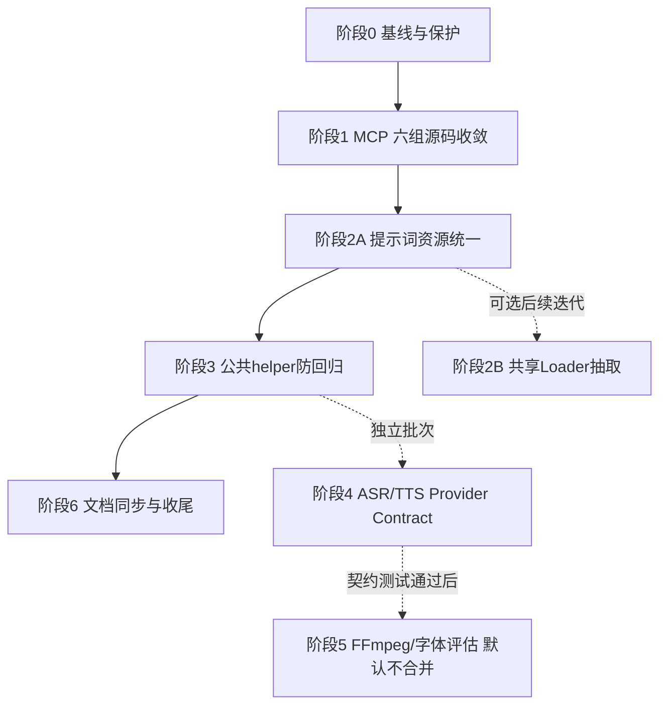

# auto-video-editor main 冗余模块合并设计与执行计划

> 项目：[`wayyet/auto-video-editor`](https://github.com/wayyet/auto-video-editor)  
> 源码基准提交：`a27298a11deb5b597474ac6b317edf7db6a12c0f`（`main` 与本地 `feat/chat-workflow-node-indicator` HEAD 一致）  
> 文档版本：`v1.0`（主文档 / canonical）  
> 编写日期：2026-11-03  
> 关联文档（同目录）：
>
> - `docs/修改文档/auto-video-editor_main_源码重复与冗余审查报告_20261103.md`（审查报告，基准 `1164714`）
> - `docs/修改文档/auto-video-editor_节点冗余合并设计与执行计划_修订20261103.md`（节点计划修订版，基准 `a27298a`）
> - `docs/修改文档/auto-video-editor_main_冗余模块合并设计与执行计划_20261103.md`（前版模块计划，基准 `1164714`，本文整合后可标记 superseded）
> - `docs/修改文档/refactor_dedupe_openstoryline_mcp.py`（随文档交付的可执行重构脚本，需复制到 `scripts/` 后使用）

---

## 1. 目标

本计划在两轮源码审查（基准 `1164714` 与 `a27298a`）结论之上，把当前源码中**确认的重复实现**收敛为单一事实源，同时保持现有业务行为、LangGraph 拓扑、PostgreSQL 持久化和 OpenStoryline 独立运行时不变。

本次范围：

1. 收敛 `src/open_storyline/`（旧路径）与 `src/open_storyline/mcp/`（规范路径）之间 **6 组逐字节相同的源码**。
2. 收敛 `prompts/tasks/` 与 `storyline_capabilities/prompts/` 之间 **48 组逐字节相同的提示词 Markdown**。
3. 为已完成的公共 helper（`_draft_io` / `_checkpoint` / `storyline/_common`）补齐防重复回归测试。
4. 为 ASR/TTS 等相似能力定义后续 Provider Contract 原则，但不在本批次强行合并运行时。
5. 修订旧架构文档中的节点数量和过期技术描述。

**本计划不合并 LangGraph 业务节点，不改变主流程拓扑，不更改数据库方案，不把 OpenStoryline 重量级依赖引入主项目环境。**

---

## 2. 审查结论摘要

### 2.1 核心数据（基准 `a27298a`）

| 审查项目 | 当前结果 | 说明 |
|---|---:|---|
| Git Tree 条目 | 926 | 包含文件和目录 |
| Git Blob 文件 | 705 | 不包含目录 |
| 内容重复组 | 59 组 | 按 Git Blob SHA 完全相同判断 |
| 重复组涉及路径 | 126 | 含提示词、文档、测试快照和空文件 |
| MCP 完全重复源码 | **6 组 / 12 个路径** | 两份源码逐字节相同，旧副本合计约 67,387 字节 |
| 提示词完全重复 | **48 对 / 96 个路径** | `prompts/tasks/` 与 `storyline_capabilities/prompts/`，每侧 48 个文件、67,930 字节 |
| `graph.py` 节点注册 | 53 | `g.add_node()` 调用数 |
| `graph.py` 普通边声明 | 44 | `g.add_edge()` 调用数 |
| `graph.py` 条件边声明 | 10 | `g.add_conditional_edges()` 调用数 |

> 2026-11-03 本地工作区复核：6 组 MCP 文件 `cmp` 逐字节一致（重构尚未应用）、两套提示词目录各 48 个 `.md`、`graph.py` 统计 53/44/10，与上表一致。脚本预检前提当前成立。

### 2.2 版本事实

- 运行时持久化已统一为 **PostgreSQL**（`langgraph-checkpoint-postgres` + `psycopg`）；SQLite checkpointer 与本地 `.sqlite` 落盘已移除。任何改造不得按旧版 SqliteSaver 设计回退。
- 59 组重复内容**不能全部当成可删除的业务重复**：其中包含 docs 快照、测试 fixture、空 `__init__.py`，这些一律保留（见 3.3）。

### 2.3 重复判定分类

| 类型 | 定义 | 处理 |
|---|---|---|
| A | 完全重复源码（Blob SHA 相同） | 调用链确认后直接收敛 |
| B | 完全重复提示词/文档 | 先统一资源加载路径，再删副本 |
| C | 功能相似或职责重叠 | 先抽象接口/契约，保留各自适配器 |
| D | 刻意复制/隔离（注释或 ADR 明确） | 保留，不进入去重范围 |

---

## 3. 合并范围界定

### 3.1 纳入本次合并（P0）

**M1-M6：OpenStoryline MCP 六组重复源码**

| 编号 | 旧路径（改为兼容入口） | 唯一实现路径 |
|---|---|---|
| M1 | `src/open_storyline/hooks/chat_middleware.py` | `src/open_storyline/mcp/hooks/chat_middleware.py` |
| M2 | `src/open_storyline/hooks/node_interceptors.py` | `src/open_storyline/mcp/hooks/node_interceptors.py` |
| M3 | `src/open_storyline/register_tools.py` | `src/open_storyline/mcp/register_tools.py` |
| M4 | `src/open_storyline/sampling_handler.py` | `src/open_storyline/mcp/sampling_handler.py` |
| M5 | `src/open_storyline/sampling_requester.py` | `src/open_storyline/mcp/sampling_requester.py` |
| M6 | `src/open_storyline/server.py` | `src/open_storyline/mcp/server.py` |

选择 `src/open_storyline/mcp/` 作为唯一实现的依据：`src/open_storyline/agent.py`、根目录 `agent_fastapi.py`、`src/open_storyline/server.py` 的生产导入均已优先使用 `open_storyline.mcp.*`；ADR-001 指定的 MCP Server 启动路径为 `python -m open_storyline.mcp.server`。

**P1：48 对提示词 Markdown**

唯一物理资源目录：`prompts/tasks/<kind>/<lang>/<part>.md`。任务种类共 12 类：`elementrec_text`、`filter_clips`、`generate_ai_transition`、`generate_script`、`generate_title`、`generate_voiceover`、`group_clips`、`instruction`、`scripts`、`select_bgm`、`speech_rough_cut`、`understand_clips`。

### 3.2 已收敛，只加防回归保护

| 编号 | 模块 | 说明 |
|---|---|---|
| H1 | `nodes/_draft_io.py` | `load_draft()` / `write_draft()` / `apply_and_write()` / `jianying_running_tags()` 单一实现；`safe_write_draft()` 传草稿**目录**而非文件路径 |
| H2 | `nodes/_checkpoint.py` | `build_interrupt_payload()` / `post_resume()` 单一实现；`interrupt()` 仍留在各节点内 |
| H3 | `nodes/storyline/_common.py` | `_read_json_artifact()` / `_read_groups()` / `_read_media()` / `resolve_video_input_paths()` / `append_status_tag()` / `append_error()` 单一实现 |

不得在业务节点中重新实现以上等价逻辑；本计划为其补静态防重复测试（阶段 3）。

### 3.3 明确不合并（排除项）

| 编号 | 对象 | 类型 | 原因与处理 |
|---|---|---|---|
| A1 | `jy_common/asr_client.py`、`storyline_capabilities/asr_runner.py`、`assembly_capabilities/speech_asr.py`、OpenStoryline ASR Node | C | 调用协议（HTTP/子进程/MCP/ToolResult）、产物形态、运行环境不同。后续统一 Provider Contract（阶段 4），保留各自适配器 |
| T1 | `jy_common/tts_client.py`、`storyline_capabilities/tts_runner.py`、`video_edit_capabilities/speech_synthesize.py`、OpenStoryline TTS Node | C | 同上 |
| F1 | `assembly_capabilities/ffproc.py`、`video_edit_capabilities/ffproc.py` 及两套 `fonts.py` | D | 源码注释明确独立演进边界（字体目录搜索顺序等平台行为差异）。默认不合并，仅做行为一致性审查（阶段 5） |
| N1 | OpenStoryline Core Node / `storyline_capabilities/*.py` / `nodes/storyline/*.py` | C | 三层分别是 MCP 运行时、可注入业务能力、LangGraph State 适配，不是三份重复 |
| W1 | `monitoring/workflow_runner.py`、`workflow_events.py`、`workflow_event_store.py`、`runs_table.py`、`workflow_graph.py`、`web/api_workflow.py`、`web/static/workflow_monitor.mjs` | 非重复 | 分层链路（编排/事件模型/持久化/台账/拓扑/接口/前端归约），合并只会增加循环依赖 |
| C1 | `monitoring/workflow_chat_link_store.py`、`web/static/workflow_chat_indicator.mjs` | 非重复 | 会话关联存储与运行台账/事件存储的数据粒度、失败契约不同；聊天节点指示器复用 `workflow_monitor.mjs` 的 `createMonitorState()` / `applyEvent()` / `activeNodeIds()`，是"共享 reducer + 独立 DOM 生命周期"，不是第二套状态机 |
| D2 | `agent_gate/fixtures/` 下的模块副本、`docs/` 内代码快照、多个空 `__init__.py` | D | 测试夹具需要可控的隔离快照，文档交付包是历史归档，空包文件无业务逻辑。一律保留，禁止自动删除 |

---

## 4. 总体设计

### 4.1 MCP 兼容别名层

旧路径不直接删除，替换为薄兼容层，采用 **`sys.modules` 模块对象别名**而非 `import *`：

- `import *` 会漏掉下划线开头的符号，并使 monkeypatch、模块级状态分散到两个模块对象；
- `sys.modules[__name__] = _implementation` 保证旧 import 与规范 import 解析到**同一个模块对象**，历史测试打桩路径不变。

```python
"""旧导入路径兼容层。

唯一实现位于 :mod:`open_storyline.mcp.hooks.chat_middleware`。此文件不再保存
业务实现；导入时直接将旧模块名映射到规范模块对象，确保公开/私有符号、
模块级状态和 monkeypatch 都指向同一份实现。
"""
from __future__ import annotations

import sys

from open_storyline.mcp.hooks import chat_middleware as _implementation

sys.modules[__name__] = _implementation
```

`server.py` 需要特殊处理：兼容旧的 `python -m open_storyline.server` 启动方式——

```python
from open_storyline.mcp import server as _implementation

if __name__ == "__main__":
    _implementation.main()
else:
    sys.modules[__name__] = _implementation
```

纪律：兼容层只服务旧脚本、外部插件和历史测试；**生产代码一律使用 `open_storyline.mcp.*` 路径**，不允许新增生产代码继续引用根目录旧路径。

### 4.2 提示词资源统一：单一物理目录 + 双 Loader Facade

唯一物理资源目录为仓库根 `prompts/tasks/`（`src/open_storyline/utils/prompts.py` 的 `PROMPTS_DIR` 已指向这里，无需移动根目录文件）。`storyline_capabilities/prompts/__init__.py` 的 `PROMPTS_ROOT` 改为 `Path(__file__).resolve().parents[2] / "prompts" / "tasks"`，随后删除该目录下 48 份重复 Markdown，**保留 `__init__.py`（它是 Loader，不是重复资源）**。

**两套 Loader 的 Python 实现不合并**，因为可观察行为不同：

| 行为 | `open_storyline.utils.prompts` | `storyline_capabilities.prompts` |
|---|---|---|
| API | `get_prompt()`、`build_prompts()` | `load_prompt()`、`render_prompt()`、`unresolved_placeholders()` |
| 文件缺失 | 抛 `FileNotFoundError` | 返回空字符串 |
| 变量格式 | `{{name}}` | `{{name}}`、`{name}`、`{name:?}` |
| 变量缺失 | 严格报错（KeyError） | 保留未解析占位符 |
| 缓存 | `PromptBuilder` 有模板缓存 | 直接读取文件 |

分两步走：

- **2A（本批次必做，脚本化）**：只统一物理资源——切换 `PROMPTS_ROOT`、删除 48 份逐字一致副本、补资源路径与双 Loader 语义回归测试。风险最小、可独立验收。
- **2B（可选后续迭代）**：如确有需要，抽取共享底层 Loader（路径解析 / UTF-8 读取 / 缓存 / 模板渲染），以 `strict_missing_file`、`strict_variables`、`placeholder_syntax` 策略参数承载两套语义差异；两套 Facade 公开 API 与调用方可观察结果保持不变。**2B 不在本批次强制执行，且必须以 golden 渲染对比测试为前置。**

### 4.3 架构硬约束

1. **PostgreSQL-only**：不恢复 SqliteSaver / `.sqlite`；不改 `db/`、Postgres Checkpointer、`chat_sessions`、`workflow_run_events`、`workflow_chat_links` 的存储边界。
2. **图拓扑不变**：`graph.py` 的 53 个节点注册、44 处 `add_edge`、10 处 `add_conditional_edges` 不变；`ASSEMBLY_QC_GATE_ENABLED`、`STORYLINE_HUMAN_FUSION`、AI 转场开关三种开关组合的构图结果不回归。
3. **运行环境隔离**：OpenStoryline 独立虚拟环境（PyTorch/torchaudio/MoviePy）与主项目不共享；不把 `torch`、`torchaudio`、`moviepy` 加入主项目依赖（ADR-001）。
4. **提交纪律**：每个阶段一个独立 commit；阶段验收通过后才进入下一阶段；回归时只回退当前阶段，不跨阶段回滚。

---

## 5. 目标结构

```text
src/open_storyline/
├── agent.py                           # 不变（已引用 open_storyline.mcp.*）
├── server.py                          # 旧 import + `python -m` 入口兼容别名
├── hooks/                             # 旧路径兼容别名，不再保存实现
│   ├── chat_middleware.py
│   └── node_interceptors.py
├── register_tools.py                  # 旧路径兼容别名
├── sampling_handler.py                # 旧路径兼容别名
├── sampling_requester.py              # 旧路径兼容别名
└── mcp/                               # MCP 功能唯一实现目录
    ├── server.py                      # 唯一 MCP Server 实现 / 正式启动入口
    ├── register_tools.py
    ├── sampling_handler.py
    ├── sampling_requester.py
    └── hooks/
        ├── chat_middleware.py
        └── node_interceptors.py

prompts/
└── tasks/                             # 唯一物理提示词资源目录（48 个 .md）

storyline_capabilities/
└── prompts/
    └── __init__.py                    # Loader 保留，PROMPTS_ROOT 指向 prompts/tasks

nodes/
├── _draft_io.py                       # 草稿读写单一实现（保留）
├── _checkpoint.py                     # 人工关卡公共函数（保留）
└── storyline/
    └── _common.py                     # Storyline 公共辅助函数（保留）
```

---

## 6. 分阶段执行开发任务

> 本章为执行开发任务总纲：每个阶段给出目标、前置条件、任务清单、交付物、验收标准与回滚方式。
> 执行环境：本地工作区（当前 HEAD `a27298a`）。建议在独立分支执行，不直接向 `main` 推送未验证改动。

### 6.0 阶段总览与批次

| 阶段 | 内容 | 批次 | 依赖 | 提交策略 |
|---|---|---|---|---|
| 0 | 基线与保护（审计、测试基线、Schema 快照） | 第一批（必做） | — | 可与 0.6 审计脚本合为一个 commit |
| 1 | MCP 六组源码收敛（6 个兼容别名 + 兼容测试） | 第一批（必做） | 阶段 0 | 独立 commit |
| 2A | 提示词资源统一（Loader 根切换 + 删 48 份副本 + 测试） | 第一批（必做） | 阶段 0 | 独立 commit |
| 2B | 共享底层 Loader 抽取（可选） | 后续迭代 | 阶段 2A + golden 测试 | 独立 commit，可整体延期 |
| 3 | 公共 helper 防回归静态测试 | 第一批（必做） | 阶段 1、2A | 独立 commit |
| 4 | ASR/TTS Provider Contract 定义与契约测试 | 第二批（可独立安排） | 不阻塞第一批 | 独立 commit |
| 5 | FFmpeg/字体行为一致性审查（默认不合并） | 第三批（谨慎评估） | 阶段 4 结论 | 产出审查记录，默认无代码变更 |
| 6 | 文档同步与收尾 | 第一批（必做，收尾） | 阶段 1、2A、3 | 独立 commit |



### 6.1 阶段 0：建立基线和保护

**目标：** 固定重构前的文件哈希、导入路径、拓扑和测试结果，作为后续每个阶段的对照基线。

**前置条件：** 本地工作区可用；主项目虚拟环境可运行 pytest。

任务清单：

- [ ] 0.1 同步并建分支（若 `main` 已前进，先重跑重复文件审计并更新本文基线，不得硬 reset 到本文 SHA）：

  ```bash
  git fetch origin
  git switch main
  git pull --ff-only origin main
  git switch -c refactor/dedupe-openstoryline-mcp-20261103
  ```

- [ ] 0.2 复制交付脚本到 `scripts/`：

  ```bash
  cp "docs/修改文档/refactor_dedupe_openstoryline_mcp.py" scripts/refactor_dedupe_openstoryline_mcp.py
  ```

- [ ] 0.3 运行脚本 dry-run 预检（校验 6 组 MCP 逐字一致、48 对提示词路径集合与字节一致、目标测试文件不存在）：

  ```bash
  python scripts/refactor_dedupe_openstoryline_mcp.py
  ```

- [ ] 0.4 记录基线测试结果（通过/失败/跳过数分开记录，不得把 skip 计入 pass）。已知存量情况：`a27298a` 提交说明记录 `tests/unit` 存在 21 个存量失败（经 stash 对照确认为既有失败、无新增），须作为基线对照，不得误判为本计划引入：

  ```bash
  python -m pytest tests/unit -q
  python -m pytest tests/integration -q
  python -m pytest tests_openstoryline -q
  node --test web/tests/workflow_monitor.test.mjs web/tests/workflow_chat_indicator.test.mjs
  ```

- [ ] 0.5 记录四种配置组合的 `build_graph_schema()` 节点/边 JSON 快照（保存文件只用于对比，不作为第二份运行时拓扑源）：

  | `ASSEMBLY_QC_GATE_ENABLED` | `STORYLINE_HUMAN_FUSION` | AI Transition | 目的 |
  |---|---|---|---|
  | true | false | false | 默认基线 |
  | false | false | false | Assembly QC 关闭 |
  | true | true | false | Human Fusion 开启 |
  | true | false | true | AI 转场开启 |

- [ ] 0.6 编写一次性审计脚本 `scripts/audit_duplicate_files.py`：递归扫描普通文件（排除 `.git/`、`.venv*/`、`__pycache__/`、`outputs/`、日志与构建产物），以 SHA-256 分组，输出 JSON + Markdown 清单，并把 docs 快照、测试 fixture、空文件与生产源码分开分类。**该脚本只报告，不删除任何文件。**

**交付物：** 分支、预检通过记录、基线测试记录、四份 Schema JSON、重复文件清单。

**验收：** 上述记录齐全；dry-run 预检通过（若预检失败，说明源码已偏离本文假设，先更新审计再继续）。

**回滚：** 纯记录，无代码变更，无需回滚。

### 6.2 阶段 1：MCP 六组源码收敛

**目标：** 每项 MCP 业务逻辑只有一个实现位置（`src/open_storyline/mcp/`），旧 import 路径仍可用且与规范模块同一对象。

**前置条件：** 阶段 0 完成，脚本 dry-run 预检通过。

任务清单：

- [ ] 1.1 执行脚本应用变更（或按 4.1 手工生成 6 个兼容别名）：

  ```bash
  python scripts/refactor_dedupe_openstoryline_mcp.py --apply
  ```

- [ ] 1.2 逐个核对 6 个旧路径 shim：确认采用 `sys.modules[__name__] = _implementation` 别名方式；确认未残留任何业务实现；`server.py` shim 保留 `__main__` → 规范 `main()` 分支。
- [ ] 1.3 兼容身份测试通过（脚本生成的 `tests_openstoryline/test_mcp_legacy_compat.py`，参数化断言 6 个旧路径 `import_module(legacy) is import_module(canonical)`）：

  ```bash
  python -m pytest tests_openstoryline/test_mcp_legacy_compat.py -q
  ```

- [ ] 1.4 启动入口验证：在 `.venv-openstoryline` 环境分别验证 `python -m open_storyline.mcp.server`（正式入口）与 `python -m open_storyline.server`（旧入口）均可用。
- [ ] 1.5 生产引用扫描：确认生产代码统一使用 `open_storyline.mcp.*`，旧路径仅由兼容层与历史测试引用（未装 `rg` 时可用 PowerShell `Select-String` 或 Python 脚本等价检查）：

  ```bash
  rg -n "open_storyline\.(hooks|register_tools|sampling_handler|sampling_requester)\b" src agent_fastapi.py scripts tests tests_openstoryline
  ```

- [ ] 1.6 MCP 行为回归：

  ```bash
  python -m pytest tests_openstoryline/test_agent_mcode_branch.py tests_openstoryline/test_zcode_agent_branch.py -q
  ```

**交付物：** 6 个兼容别名文件 + 1 个兼容性测试文件；引用扫描记录。

**验收标准：**

| 编号 | 验收标准 | 验证方式 |
|---|---|---|
| M-A1 | 6 组 MCP 源码仅保留一份业务实现 | Git diff + 模块 AST/符号检查 |
| M-A2 | 旧 import 路径仍能导入且与规范模块同一对象 | 兼容身份测试 |
| M-A3 | 新 import 路径可正常使用 | MCP 单测 |
| M-A4 | Tool 注册和 Sampling 行为不变 | MCP 工具列表/回调测试 |
| M-A5 | 正式启动入口不变 | `.venv-openstoryline` 启动 MCP 子进程 smoke test |

**回滚：** revert 本阶段 commit；兼容层已隔离变更范围，回滚不影响提示词与图拓扑。

### 6.3 阶段 2A：提示词资源统一（本批次必做）

**目标：** 48 组提示词内容只存放一份（`prompts/tasks/`），两套 Loader 的调用方可观察行为不变。

**前置条件：** 阶段 1 已提交；脚本预检仍通过。

任务清单：

- [ ] 2A.1 由脚本将 `storyline_capabilities/prompts/__init__.py` 的 `PROMPTS_ROOT` 切换为仓库根 `prompts/tasks/`（含模块 docstring 更新；脚本会校验 docstring 与根目录定义未被外部改动，不匹配即停止）。
- [ ] 2A.2 由脚本删除 `storyline_capabilities/prompts/` 下 48 份逐字一致的 `.md` 副本，仅清理由此变空的目录；保留 `__init__.py`。
- [ ] 2A.3 资源路径测试通过（脚本生成的 `tests/unit/test_shared_storyline_prompt_resources.py`：`PROMPTS_ROOT` 指向 `prompts/tasks`、模板仍可加载、旧目录无 `.md` 残留）：

  ```bash
  python -m pytest tests/unit/test_shared_storyline_prompt_resources.py tests/unit/test_storyline_capabilities_b_classes.py -q
  ```

- [ ] 2A.4 双 Loader 语义回归（新增或扩展单测，逐项覆盖）：
  - 缺失文件：OpenStoryline 侧抛 `FileNotFoundError`，Storyline 侧返回空字符串；
  - 占位符：`{{name}}` 两侧支持；`{name}`、`{name:?}` 仅 Storyline 侧支持且保留未解析占位符；
  - 缺变量：OpenStoryline 侧严格报错，Storyline 侧保留原样；
  - 缓存：`PromptBuilder` 缓存与刷新行为不变；
  - 中英文模板批量加载 + 重构前后渲染 golden 对比。
- [ ] 2A.5 删除副本后重跑 0.6 审计脚本，确认提示词重复组归零、总数下降 48 组。

**交付物：** Loader 根目录切换 + 48 份副本删除 + 1 个资源测试文件 + 双 Loader 语义测试。

**验收标准：**

| 编号 | 验收标准 | 验证方式 |
|---|---|---|
| P-A1 | 48 组提示词只有一套物理文件 | 重复 SHA 审计 |
| P-A2 | OpenStoryline API 严格行为不变 | 缺文件/缺变量单测 |
| P-A3 | Storyline Capability API 兼容行为不变 | 空文件返回、单/双花括号、未解析占位符测试 |
| P-A4 | 中英文模板均能加载 | 批量模板加载测试 |
| P-A5 | 渲染输出保持兼容 | 重构前后 golden 比较 |

**回滚：** 恢复 48 份提示词副本并将 `PROMPTS_ROOT` 还原（revert 本阶段 commit 即可整体还原）；不得通过改动另一套 Loader 来规避问题。

### 6.4 阶段 2B（可选后续迭代）：共享底层 Loader 抽取

**目标：** 消除两套 Loader 在文件读取/路径解析/模板渲染上的实现重复，同时不改变任何调用方可观察行为。

**前置条件：** 阶段 2A 已验收；已建立渲染 golden 对比测试。

任务清单：

- [ ] 2B.1 新增共享底层模块（建议 `src/open_storyline/utils/prompt_loader.py` 或 `jy_common/prompt_core.py`），提供：`task/lang/part` 路径解析、UTF-8 读取、模板缓存与刷新、`{{name}}` 替换、可选 `{name}`/`{name:?}` 兼容、缺失文件/缺失变量的策略开关。
- [ ] 2B.2 两套 Facade 改为策略参数化调用共享底层；公开 API（`get_prompt`/`build_prompts` 与 `load_prompt`/`render_prompt`/`unresolved_placeholders`）签名与语义逐项不变。
- [ ] 2B.3 golden 渲染对比测试扩展到策略矩阵（严格/宽松 × 单/双花括号 × 命中/缺失）。

**验收：** P-A1..P-A5 全部保持通过；两套 Facade 的既有单测零修改通过（允许仅改 import）。

**回滚：** revert 本阶段 commit，Facade 回退为各自独立实现。

### 6.5 阶段 3：公共 helper 防回归

**目标：** 防止后续节点开发重新复制 `_draft_io` / `_checkpoint` / `storyline/_common` 的等价逻辑。

**前置条件：** 阶段 1、2A 已提交（避免扫描结果受在途变更干扰）。

任务清单：

- [ ] 3.1 静态扫描确认公共函数只有一份生产定义（排除 docs 快照与 fixture）：

  ```bash
  rg -n "def (load_draft|write_draft|apply_and_write)\b" nodes
  rg -n "def (_read_json_artifact|_read_groups|_read_media|resolve_video_input_paths)\b" nodes/storyline
  rg -n "def (build_interrupt_payload|post_resume)\b" nodes
  ```

- [ ] 3.2 新增防重复静态测试（如 `tests/unit/test_shared_node_helpers_single_source.py`）：AST 扫描 `nodes/` 生产目录，断言上述函数名只在预期模块定义一次；测试显式排除 `docs/`、`agent_gate/fixtures/`、`tests/fixtures/`。
- [ ] 3.3 检查写回路径语义：`write_draft()`/`apply_and_write()` 传给 `safe_write_draft()` 的仍是草稿**目录**；`jianying_running` 告警行为未被遗漏。
- [ ] 3.4 运行节点业务测试回归：

  ```bash
  python -m pytest tests/unit -q
  ```

**交付物：** 1 个防重复静态测试文件 + 扫描记录。

**验收：** 0.4 基线之外无新增失败；扫描确认无第二份生产定义。

**回滚：** revert 本阶段 commit（仅删除新增测试，无生产行为变更）。

### 6.6 阶段 4（第二批，可独立延期）：ASR/TTS Provider Contract

**目标：** 减少 Provider 处理和结果格式重复，**保留不同运行环境**，不在本阶段合并任何运行时。

任务清单：

- [ ] 4.1 定义结果契约草案（字段/单位须按当前调用方逐一映射，特别区分秒/毫秒与音频产物路径语义）：

  ```python
  @dataclass
  class ASRResult:
      artifact_path: Path | None
      segments: list[dict[str, Any]]
      provider: str
      error: str | None = None
      duration_ms: int = 0

  class ASRProvider(Protocol):
      def transcribe(self, *, media_path: Path, output_dir: Path) -> ASRResult: ...

  @dataclass
  class TTSResult:
      audio_path: Path | None
      duration_ms: int
      provider: str
      error: str | None = None

  class TTSProvider(Protocol):
      def synthesize(self, *, text: str, output_path: Path, voice: str, speed: float) -> TTSResult: ...
  ```

- [ ] 4.2 字段映射评审：对照 `jy_common/asr_client.py`、`storyline_capabilities/asr_runner.py`、`assembly_capabilities/speech_asr.py`、`jy_common/tts_client.py`、`video_edit_capabilities/speech_synthesize.py` 的现有返回结构，产出映射表。
- [ ] 4.3 为四类适配器（HTTP 客户端 / Storyline 子进程 / MCP Node / ToolResult 适配器）补契约测试（Stub + Mock）。
- [ ] 4.4 **仅在契约测试覆盖后**，才允许把重复的 HTTP 传输与错误分类代码抽到共享层；FireRed 客户端、子进程 runner、Mock/Stub、MCP Node、ToolResult 适配器文件本身不删除。

**验收：** 契约草案 + 映射表 + 契约测试入库；运行环境隔离未被破坏（`pyproject.toml` 无新增重量级依赖）。

**回滚：** revert 本阶段 commit；契约层为新增文件时可直接删除。

### 6.7 阶段 5（第三批，默认不合并）：FFmpeg/字体行为一致性审查

**目标：** 判断 `assembly_capabilities` 与 `video_edit_capabilities` 两套 `ffproc.py`、`fonts.py` 是否已出现真实行为漂移。**默认结论：不合并。**

任务清单：

- [ ] 5.1 建立行为对比矩阵：`stdin=DEVNULL` / `-nostdin` 注入与默认 timeout、filtergraph 文本与参数转义、`require_ffmpeg()` 能力检测、Windows/macOS/Linux 字体目录与搜索顺序、字体缓存行为。
- [ ] 5.2 跨平台行为测试（至少覆盖本仓库实际部署的平台组合）。
- [ ] 5.3 结论归档：全部一致 → 才可评估抽 `media_common/ffproc_core.py`、`media_common/fonts_core.py`（两套 Capability 保留轻量 wrapper 与策略参数）；任一不一致 → 维持独立实现并记录差异点。

**验收：** 审查记录入库；无代码变更（除非全平台一致且另行评审）。

### 6.8 阶段 6：文档同步与收尾

**目标：** 让文档与重构后的源码一致，并完成全量回归对照。

任务清单：

- [ ] 6.1 更新 `README.md`：确认 PostgreSQL-only 持久化描述、当前主图节点统计口径（53 节点 / 44 普通边 / 10 条件边）。
- [ ] 6.2 修订 `docs/integration/` 下两份旧计划文档（`auto-video-editor_节点冗余合并设计与执行计划.md`、`auto-video-editor节点全量核查与冗余合并设计执行计划.md`）：以 `a27298a` 基线覆盖 21/22/50 节点等过期统计，标记已完成的 helper 收敛。
- [ ] 6.3 在 `docs/integration/architecture_decision_record.md` 追加 ADR：MCP 唯一实现目录与旧路径兼容别名决策、提示词单一物理资源目录决策（追加，不覆盖旧决策历史）。
- [ ] 6.4 同名/同内容文档治理：指定本文为冗余模块合并主文档；`docs/修改文档/auto-video-editor_main_冗余模块合并设计与执行计划_20261103.md` 执行完成后改为索引页或标记 superseded（被历史执行记录引用时保留文件）。
- [ ] 6.5 全量回归并对照阶段 0 基线：

  ```bash
  python -m pytest tests/unit tests/integration tests_openstoryline -q
  node --test web/tests/workflow_monitor.test.mjs web/tests/workflow_chat_indicator.test.mjs
  git diff --check
  ```

**验收：** G-A1..G-A10（见第 7 章）全部通过；基线外无新增失败。

### 6.9 阶段间纪律

1. **一阶段一提交**：每阶段独立 commit，验收通过后才进入下一阶段；建议提交信息前缀 `refactor(mcp):`、`refactor(prompts):`、`test(nodes):`、`docs(integration):`。
2. **失败即停**：交付脚本的字节/路径/数量预检不匹配即停止，不得绕过预检强制执行。
3. **不碰红线**：任何阶段不得修改 `graph.py` 拓扑、`db/migrations.py`、数据库 schema、`ASSEMBLY_QC_GATE_ENABLED` 等开关默认值。
4. **不删保护对象**：docs 快照、测试 fixture、空 `__init__.py` 一律保留。
5. **测试不绿不合并**：存在失败时先定位是存量还是新增（对照 0.4 基线），新增失败必须修复或回退当前阶段。
6. **回退最小化**：回归时只回退当前阶段 commit，不同时回退已验收阶段。

---

## 7. 全局验收标准

| 编号 | 验收标准 | 验证方式 |
|---|---|---|
| G-A1 | `graph.py` 仍注册 53 个节点 | AST/正则统计 |
| G-A2 | 节点 ID 和边关系不变 | 四种配置下对比 `build_graph_schema()` 快照 |
| G-A3 | `tests/unit` 无新增失败 | pytest，对照 0.4 基线 |
| G-A4 | `tests/integration` 无新增失败 | pytest |
| G-A5 | `tests_openstoryline` 无新增失败 | pytest |
| G-A6 | PostgreSQL Checkpointer 可正常启动与恢复 | Postgres 集成测试 |
| G-A7 | OpenStoryline MCP 独立环境启动正常 | 子进程 smoke test |
| G-A8 | 主项目未新增 `torch`、`torchaudio`、`moviepy` 依赖 | 检查 `pyproject.toml` |
| G-A9 | 旧路径不再包含重复实现 | `rg` / AST 扫描 |
| G-A10 | 未删除 docs 快照、fixture 和必要 `__init__.py` | Git diff 审查 |

常用验收命令汇总：

```bash
# 专项测试（阶段 1 + 2A 新增）
python -m pytest tests_openstoryline/test_mcp_legacy_compat.py tests/unit/test_shared_storyline_prompt_resources.py -q

# MCP 行为回归
python -m pytest tests_openstoryline/test_agent_mcode_branch.py tests_openstoryline/test_zcode_agent_branch.py -q

# 完整回归（对照 0.4 基线）
python -m pytest tests/unit tests/integration tests_openstoryline -q

# 前端状态归约与指示器
node --test web/tests/workflow_monitor.test.mjs web/tests/workflow_chat_indicator.test.mjs

# 旧 MCP 路径引用扫描
rg -n "open_storyline\.(hooks|register_tools|sampling_handler|sampling_requester)\b" src agent_fastapi.py scripts tests tests_openstoryline

# helper 单一实现扫描
rg -n "def (load_draft|write_draft|apply_and_write)\b" nodes
rg -n "def (_read_json_artifact|_read_groups|_read_media)\b" nodes/storyline
```

---

## 8. 风险与回滚

| 风险 | 影响 | 防护措施 | 回滚方式 |
|---|---|---|---|
| 外部脚本仍从旧 MCP 路径导入 | OpenStoryline 启动/Agent 异常 | 旧路径保留 `sys.modules` 兼容别名；新增模块身份测试 | 恢复旧文件或 revert 兼容层 commit |
| `python -m open_storyline.server` 旧启动方式失效 | 旧运维脚本中断 | server shim 在 `__main__` 场景显式调用规范 `main()` | revert 本阶段 commit |
| Prompt Loader 行为变化 | 模型输入变化、任务失败 | 只合并物理资源不合并 Loader（2A）；golden 渲染对比测试 | 恢复 48 份副本 + `PROMPTS_ROOT` 还原 |
| 变量替换规则变化 | 提示词残留占位符或误替换 | 覆盖单/双花括号、缺变量、中英文模板测试 | revert 模板引擎相关 commit |
| 误合并 ASR/TTS 运行时 | 环境依赖冲突、服务不可用 | 阶段 4 只定契约，不合并环境 | revert Provider 契约 commit |
| FFmpeg/字体行为变化 | 渲染、字幕和中文字体异常 | 阶段 5 默认不合并，仅行为审查 | 不执行合并即可 |
| 图拓扑被意外修改 | 工作流顺序和恢复行为变化 | Schema 快照比较（0.5）；阶段纪律第 3 条 | revert 对应 commit |
| 仓库已前进、脚本前提失效 | 预检通过但实际内容漂移 | 脚本按字节、路径集合、数量三重预检，不匹配即停 | 无需回滚（未写入） |

---

## 9. 交付状态与本地前置条件核验

**本文性质：** 设计与执行计划，代码尚未按本计划执行改造。

2026-11-03 本地工作区核验结果（HEAD `a27298a`，分支 `feat/chat-workflow-node-indicator`）：

- 6 组 MCP 新旧路径 `cmp` 逐字节一致 —— 重构尚未应用，脚本预检前提成立；
- `prompts/tasks/` 与 `storyline_capabilities/prompts/` 各 48 个 `.md` —— 副本在位；
- `graph.py` 统计 53 / 44 / 10 —— 与审查基准一致；
- `scripts/`、`tests/unit`、`tests/integration`、`tests_openstoryline`、`web/tests`（含 `workflow_monitor.test.mjs`、`workflow_chat_indicator.test.mjs`）均存在 —— 测试入口可用。

结论：**可直接按 6.1 阶段 0 开始执行**。执行前注意：当前工作区还有 4 个未跟踪的 `docs/修改文档/` 文件（含交付脚本），建议先将其作为独立 docs commit 入库或另行保存，再创建重构分支，避免与重构变更混在同一工作区。

---

## 10. 参考源码与关联文档

- [最新 main 提交 a27298a](https://github.com/wayyet/auto-video-editor/commit/a27298a11deb5b597474ac6b317edf7db6a12c0f)
- [graph.py](https://github.com/wayyet/auto-video-editor/blob/main/graph.py)
- [MCP 规范目录](https://github.com/wayyet/auto-video-editor/tree/main/src/open_storyline/mcp)
- [nodes/_draft_io.py](https://github.com/wayyet/auto-video-editor/blob/main/nodes/_draft_io.py)
- [nodes/_checkpoint.py](https://github.com/wayyet/auto-video-editor/blob/main/nodes/_checkpoint.py)
- [nodes/storyline/_common.py](https://github.com/wayyet/auto-video-editor/blob/main/nodes/storyline/_common.py)
- [src/open_storyline/agent.py](https://github.com/wayyet/auto-video-editor/blob/main/src/open_storyline/agent.py)
- [src/open_storyline/utils/prompts.py](https://github.com/wayyet/auto-video-editor/blob/main/src/open_storyline/utils/prompts.py)
- [storyline_capabilities/prompts/__init__.py](https://github.com/wayyet/auto-video-editor/blob/main/storyline_capabilities/prompts/__init__.py)
- [architecture_decision_record.md](https://github.com/wayyet/auto-video-editor/blob/main/docs/integration/architecture_decision_record.md)
- [monitoring/workflow_graph.py](https://github.com/wayyet/auto-video-editor/blob/main/monitoring/workflow_graph.py)

关联文档（本仓库内，相对路径）：

- `docs/修改文档/auto-video-editor_main_源码重复与冗余审查报告_20261103.md`
- `docs/修改文档/auto-video-editor_节点冗余合并设计与执行计划_修订20261103.md`
- `docs/修改文档/auto-video-editor_main_冗余模块合并设计与执行计划_20261103.md`
- `docs/修改文档/refactor_dedupe_openstoryline_mcp.py`
