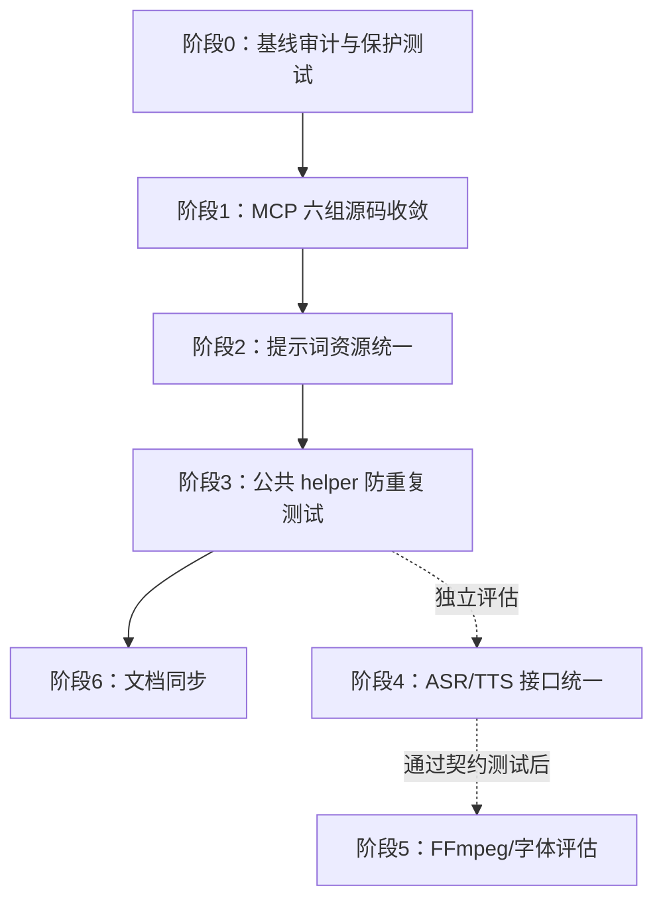

# auto-video-editor 冗余模块合并设计与执行计划

> 项目：[`wayyet/auto-video-editor`](https://github.com/wayyet/auto-video-editor)  
> 目标分支：`main`  
> 源码基准提交：`1164714f028e1f44c7c96d5cd04ee710cf2a12a9`  
> 计划版本：`v1.0`  
> 日期：2026-11-03

> ⚠️ **superseded(2026-11-03)**:本文是前版模块计划,已被整合进主文档
> [`docs/修改文档/auto-video-editor_main_冗余模块合并设计与执行计划.md`](./auto-video-editor_main_冗余模块合并设计与执行计划.md)
> (基准 `a27298a`,v1.0 canonical)。执行记录以主文档与分支
> `refactor/dedupe-openstoryline-mcp-20261103` 的提交历史为准;
> 本文按计划 §6.8(6.4)保留为历史记录,不再维护。

---

## 1. 目标

本计划将当前源码中确认的重复实现收敛为单一事实源，同时保持现有业务行为、LangGraph 拓扑、PostgreSQL 持久化和 OpenStoryline 独立运行时不变。

本次范围：

1. 收敛 `src/open_storyline/` 与 `src/open_storyline/mcp/` 之间 6 组完全重复源码。
2. 收敛 `prompts/tasks/` 与 `storyline_capabilities/prompts/` 之间 48 组完全相同的提示词文件。
3. 保留已有公共 helper，并增加防止重复实现回归的测试。
4. 为 ASR/TTS 等相似能力定义后续接口统一原则，但不在本次第一批中强行合并运行时。
5. 修订旧架构文档中的节点数量和过期技术描述。

**本计划不合并 LangGraph 业务节点，不改变主流程拓扑，不合并 Python 虚拟环境，也不更改数据库方案。**

---

## 2. 约束与架构决策

### 2.1 OpenStoryline 运行时必须隔离

仓库 `docs/integration/architecture_decision_record.md` 的 ADR-001 明确要求 FireRed/OpenStoryline 和主项目不共享 Python 环境：

- 主项目运行 LangGraph、PostgreSQL、`Pillow` 等依赖。
- OpenStoryline 独立环境包含 PyTorch、torchaudio、MoviePy 等重量级依赖。
- 两套进程通过 MCP 通信。

本次只收敛 OpenStoryline 包内部的重复文件，不将 OpenStoryline 代码搬入主项目运行环境，不把 `torch`、`torchaudio`、`moviepy` 加到主项目依赖。

### 2.2 数据库保持 PostgreSQL-only

当前 `main` 的运行时持久化已统一为 PostgreSQL。不要恢复 SqliteSaver 或 `.sqlite` 运行时文件，不要修改 `db/`、Postgres Checkpointer、`chat_sessions`、`workflow_run_events` 的存储边界。

### 2.3 LangGraph 节点拓扑保持不变

当前 `graph.py` 静态注册 53 个节点。该数字是当前基准，不是过去设计文档中的 21 或 50 个。

第一批模块去重完成后必须满足：

- 53 个节点注册名不变。
- 现有 `add_edge`、`add_conditional_edges` 关系不变。
- `ASSEMBLY_QC_GATE_ENABLED` 开/关两种构图结果不回归。
- `STORYLINE_HUMAN_FUSION` 开/关两种构图结果不回归。
- AI 转场开关开/关两种构图结果不回归。

### 2.4 兼容性优先

第一阶段不直接删除旧 import 路径。先将旧路径改造成兼容转发层；完成全仓引用扫描、测试和部署验证后，再决定是否删除。

---

## 3. 目标结构

### 3.1 OpenStoryline MCP 模块

目标结构：

```text
src/open_storyline/
├── agent.py
├── server.py                         # 旧入口兼容转发
├── hooks/                            # 旧路径兼容转发，可逐步废弃
│   ├── chat_middleware.py
│   └── node_interceptors.py
├── register_tools.py                 # 旧路径兼容转发
├── sampling_handler.py               # 旧路径兼容转发
├── sampling_requester.py              # 旧路径兼容转发
└── mcp/                              # 唯一 MCP 实现目录
    ├── server.py                     # 唯一 MCP Server 实现/正式启动入口
    ├── register_tools.py
    ├── sampling_handler.py
    ├── sampling_requester.py
    └── hooks/
        ├── chat_middleware.py
        └── node_interceptors.py
```

### 3.2 提示词目录

```text
prompts/
└── tasks/                            # 唯一提示词资源目录
    ├── filter_clips/
    ├── generate_script/
    ├── generate_voiceover/
    ├── group_clips/
    └── ...

src/open_storyline/utils/prompts.py   # OpenStoryline 兼容 API
storyline_capabilities/prompts/
└── __init__.py                        # Capability 兼容 API，读取根目录资源
```

`storyline_capabilities/prompts/` 不再保存第二套 Markdown 资源文件。

### 3.3 保持现有公共 helper

```text
nodes/
├── _draft_io.py                       # 草稿读写单一实现
├── _checkpoint.py                    # 人工关卡公共函数
└── storyline/
    └── _common.py                    # Storyline 公共辅助函数
```

不得在业务节点中重新实现已有 helper 的等价逻辑。

---

## 4. 改造清单

| 编号 | 改造项 | 修改方式 | 风险 |
|---|---|---|---|
| M1-M6 | 6 组 MCP 完全重复源码 | 嵌套 `mcp/` 目录保留实现，根目录文件改兼容转发 | 中 |
| P1 | 48 组提示词重复文件 | 根目录 `prompts/tasks/` 做唯一资源源，调整 Capability Loader 后删除副本 | 中高 |
| H1 | `nodes/_draft_io.py`、`_checkpoint.py`、`_common.py` | 保持现状，补充去重回归测试 | 低 |
| A1 | ASR 多实现 | 本次只定义后续 Provider Contract，不合并实现 | 中高 |
| T1 | TTS 多实现 | 本次只定义后续 Provider Contract，不合并实现 | 中高 |
| F1 | `ffproc.py`、`fonts.py` 双实现 | 本次不修改 | 高 |
| D1 | 重复设计文档 | 指定主文档，另一份改成索引或历史记录 | 低 |
| D2 | docs 中的源码快照/测试夹具 | 保留，禁止自动删除 | 中 |

---

## 5. 分阶段执行步骤

每个阶段单独提交，阶段通过后再进入下一阶段。建议在独立分支完成，不直接向 `main` 推送未验证改动。

### 阶段 0：建立基线和保护测试

**目标：** 固定本次重构前的文件哈希、导入路径、拓扑和测试结果。

#### 步骤 0.1：切换到基准提交并创建分支

```powershell
git fetch origin
git checkout main
git pull --ff-only origin main
git checkout -b refactor/consolidate-duplicate-modules
```

注意：如果 `main` 已经前进，不要强行 reset 到本文 SHA；应先重新运行重复文件审计，更新本计划中的基线。

#### 步骤 0.2：保存重复文件清单

编写一次性脚本 `scripts/audit_duplicate_files.py`：

- 递归扫描仓库普通文件。
- 排除 `.git/`、`.venv/`、`.venv-openstoryline/`、`__pycache__/`、`outputs/`、运行日志和构建产物。
- 以 SHA-256 分组。
- 输出 JSON 和 Markdown 两种清单。
- 将 `docs/` 快照、测试 fixture、空文件与生产源码分开分类。

该脚本只报告，不自动删除任何文件。

#### 步骤 0.3：记录基线测试

在当前项目环境中运行：

```powershell
python -m pytest tests/unit -q
python -m pytest tests/integration -q
python -m pytest tests_openstoryline -q
```

如项目当前测试目录或环境配置与命令不匹配，应以仓库当前测试入口调整命令，并记录实际通过/失败/跳过数。不得把 skip 计入 pass。

#### 步骤 0.4：记录工作流 Schema

在相同配置下运行 `build_graph_schema()`，保存以下配置组合的节点和边 JSON：

| `ASSEMBLY_QC_GATE_ENABLED` | `STORYLINE_HUMAN_FUSION` | AI Transition | 目的 |
|---|---|---|---|
| true | false | false | 默认基线 |
| false | false | false | Assembly QC 关闭 |
| true | true | false | Human Fusion 开启 |
| true | false | true | AI 转场开启 |

保存文件只用于对比，不作为第二份运行时拓扑源。

**验收：** 基线清单、测试结果和四种构图 Schema 均有记录。

---

### 阶段 1：合并 OpenStoryline MCP 的 6 组重复源码

**目标：** 每项 MCP 业务逻辑只有一个实现位置，旧 import 路径仍然可用。

#### 步骤 1.1：指定唯一实现路径

唯一实现统一放在：

```text
src/open_storyline/mcp/
```

具体文件：

```text
src/open_storyline/mcp/hooks/chat_middleware.py
src/open_storyline/mcp/hooks/node_interceptors.py
src/open_storyline/mcp/register_tools.py
src/open_storyline/mcp/sampling_handler.py
src/open_storyline/mcp/sampling_requester.py
src/open_storyline/mcp/server.py
```

理由：当前 Agent/Web 主路径已从 `open_storyline.mcp.*` 导入这些功能；ADR-001 也要求通过 `python -m open_storyline.mcp.server` 启动 MCP 进程。

#### 步骤 1.2：根目录旧文件改兼容转发

逐个把旧文件改为兼容层，不保留原函数实现。例如：

```python
"""兼容旧导入路径；实际实现位于 open_storyline.mcp.hooks.chat_middleware。"""

from open_storyline.mcp.hooks.chat_middleware import (
    handle_tool_errors,
    log_tool_request,
    on_progress,
    reset_mcp_log_sink,
    set_mcp_log_sink,
)

__all__ = [
    "handle_tool_errors",
    "log_tool_request",
    "on_progress",
    "reset_mcp_log_sink",
    "set_mcp_log_sink",
]
```

示例符号只是示例，真正修改时必须从原文件读取实际公开 API，并保证导出清单完整。不要照抄示例后直接覆盖其他模块。

对以下路径执行同样处理：

- `src/open_storyline/hooks/node_interceptors.py`
- `src/open_storyline/register_tools.py`
- `src/open_storyline/sampling_handler.py`
- `src/open_storyline/sampling_requester.py`
- `src/open_storyline/server.py`

`server.py` 兼容层必须支持原本约定的直接执行方式：

```python
if __name__ == "__main__":
    main()
```

#### 步骤 1.3：统一生产代码 import

生产代码统一使用 `open_storyline.mcp.*` 路径。兼容转发只服务旧脚本、外部插件或历史测试，不允许新增生产代码继续引用根目录旧路径。

重点检查：

```text
src/open_storyline/agent.py
agent_fastapi.py
src/open_storyline/server.py
scripts/
tests/
tests_openstoryline/
```

#### 步骤 1.4：兼容与回归测试

新增测试验证：

- 新路径和旧路径导出的公开函数/类相同。
- 旧路径不会再次包含业务逻辑实现。
- Sampling 回调能够正常创建。
- MCP Tool 注册结果不变。
- `python -m open_storyline.mcp.server` 的启动入口未改变。
- `ToolInterceptor`、聊天中间件和事件回调行为未改变。

**验收：** 6 组重复源码变成 6 份实现 + 6 份薄兼容层；MCP 行为测试通过。

---

### 阶段 2：统一 48 组提示词资源

**目标：** 提示词内容只存放一份，同时保持两个调用方的兼容语义。

#### 步骤 2.1：唯一资源目录

保留：

```text
prompts/tasks/
```

作为唯一提示词目录。

不移动根目录已有提示词，因为 `src/open_storyline/utils/prompts.py` 已经把 `PROMPTS_DIR` 指向仓库根 `prompts/tasks`。

#### 步骤 2.2：抽取共享底层 Loader

建议新增：

```text
src/open_storyline/utils/prompt_loader.py
```

共享以下底层功能：

- 根据 `task / lang / part` 解析路径。
- UTF-8 文件读取。
- 模板缓存和缓存刷新。
- 双花括号 `{{name}}` 替换。
- 可选兼容单花括号 `{name}`、`{name:?}`。
- 未提供变量时可选择抛错或保留占位符。
- 文件不存在时可选择抛错或返回空字符串。

共享底层不决定业务默认值。具体策略由两层 Facade 控制。

#### 步骤 2.3：保留两套公开 API

`src/open_storyline/utils/prompts.py` 保留：

```python
get_prompt(name: str, lang: str = "zh", **kwargs)
build_prompts(task: str, lang: str = "zh", **user_vars)
```

兼容原行为：

- 文件缺失抛 `FileNotFoundError`。
- 未提供模板变量时维持严格报错。
- 默认使用 `{{name}}`。

`storyline_capabilities/prompts/__init__.py` 保留：

```python
load_prompt(...)
render_prompt(...)
unresolved_placeholders(...)
```

兼容原行为：

- 文件缺失返回空串。
- 支持双花括号和历史单花括号。
- 缺少变量时保留占位符。
- 保留未解析变量检测。

两套 API 共享文件读取和模板实现，但行为策略通过参数传入，不要改变调用方可观察到的结果。

#### 步骤 2.4：逐文件校验内容

删除 `storyline_capabilities/prompts/` 下的重复 Markdown 前，执行：

1. 对 48 组文件比较 SHA-256。
2. 从两种旧路径分别读取模板，记录渲染前内容。
3. 使用相同变量渲染，比较输出。
4. 覆盖缺失文件、缺失变量、中文、英文和多段模板场景。
5. 检查缓存刷新行为。

#### 步骤 2.5：删除副本

仅在 Loader 测试全部通过后，删除：

```text
storyline_capabilities/prompts/<task>/<lang>/*.md
```

保留：

```text
storyline_capabilities/prompts/__init__.py
```

它作为原有 Python API 的兼容入口。

**验收：** 48 组 Markdown 资源只保留一个实际文件；两种 Loader 的公开 API 和旧语义均通过测试。

---

### 阶段 3：保护已经完成的公共 helper 收敛

**目标：** 防止后续节点开发重新复制相同的工具函数。

#### 步骤 3.1：草稿 I/O

保持 `nodes/_draft_io.py` 为唯一草稿公共 I/O 层。对 `nodes/` 中新旧节点进行检查：

- 不得重新定义与 `load_draft()` 等价的 `_load_draft()`。
- 写回必须使用 `write_draft()` 或 `apply_and_write()`。
- 写入路径仍必须传给 `safe_write_draft()` 草稿目录，而不是草稿文件本身。
- 不得遗漏 `jianying_running` 告警行为。

#### 步骤 3.2：人工关卡

保持 `nodes/_checkpoint.py` 为共享纯函数层：

- `build_interrupt_payload()` 只维护一份。
- `post_resume()` 只维护一份。
- 不改变 `checkpoint`、`legacy_id`、`step` 字段值。
- `interrupt()` 仍留在具体 LangGraph 节点模块内，以保留节点可读性和测试打桩路径。

#### 步骤 3.3：Storyline 辅助函数

保持 `nodes/storyline/_common.py` 为唯一来源：

- `_read_json_artifact()`。
- `_read_groups()`。
- `_read_media()`。
- `resolve_video_input_paths()`。
- `append_status_tag()`。
- `append_error()`。

#### 步骤 3.4：增加防重复测试

新增或扩展静态测试，确保相关函数只存在一个生产定义。测试不应把 docs 快照或测试 fixture 计算为生产实现。

**验收：** 原有节点业务测试通过，公共 helper 没有出现第二份实现。

---

### 阶段 4：ASR/TTS 接口统一评估（不与阶段 1/2 混合提交）

**目标：** 减少 Provider 处理和结果格式重复，但保留不同运行环境。

#### 步骤 4.1：先定义通用结果契约

ASR 建议契约：

```python
from dataclasses import dataclass
from pathlib import Path
from typing import Any, Protocol

@dataclass
class ASRResult:
    artifact_path: Path | None
    segments: list[dict[str, Any]]
    provider: str
    error: str | None = None
    duration_ms: int = 0

class ASRProvider(Protocol):
    def transcribe(
        self,
        *,
        media_path: Path,
        output_dir: Path,
    ) -> ASRResult: ...
```

TTS 建议契约：

```python
from dataclasses import dataclass
from pathlib import Path
from typing import Protocol

@dataclass
class TTSResult:
    audio_path: Path | None
    duration_ms: int
    provider: str
    error: str | None = None

class TTSProvider(Protocol):
    def synthesize(
        self,
        *,
        text: str,
        output_path: Path,
        voice: str,
        speed: float,
    ) -> TTSResult: ...
```

以上为目标接口草案，正式实施前需按当前调用方字段和单位做字段映射，尤其区分秒、毫秒和音频路径。

#### 步骤 4.2：保留 Provider 适配器

以下实现不直接删除：

- FireRed ASR/TTS HTTP 客户端。
- Storyline 独立环境子进程 ASR。
- Mock/Stub 测试客户端。
- OpenStoryline MCP Node。
- Assembly ToolResult 适配器。

同一 Provider 可以共享底层 HTTP 传输和错误分类，但不同运行环境仍然使用各自适配器。

**验收：** 只有在结果契约和单元测试覆盖后，才允许把重复传输代码抽到共享层。本阶段可独立延期，不阻塞 M1-M6 和 P1。

---

### 阶段 5：FFmpeg/字体模块审查（本次默认不合并）

**目标：** 判断重复实现是否已经出现真实行为漂移。

对比：

```text
assembly_capabilities/ffproc.py
video_edit_capabilities/ffproc.py
assembly_capabilities/fonts.py
video_edit_capabilities/fonts.py
```

必须比较：

- `stdin=DEVNULL`、`-nostdin` 注入和默认 timeout。
- FFmpeg filtergraph 文本/参数转义。
- `require_ffmpeg()` 的能力检测行为。
- Windows/macOS/Linux 字体目录及搜索顺序。
- 字体缓存行为。

只有所有受支持平台行为一致，才考虑：

```text
media_common/ffproc_core.py
media_common/fonts_core.py
```

两套 Capability 各自保留轻量 wrapper 和策略参数。

**本阶段默认结论：不合并。** 源码已经注明两者的独立演进原因，不能为了减少重复文件而破坏行为。

---

### 阶段 6：文档与结构同步

更新以下材料：

- `README.md`：注明当前 PostgreSQL-only 持久化和当前主图节点统计口径。
- `docs/integration/auto-video-editor_节点冗余合并设计与执行计划.md`：以本次审查结果覆盖旧结论。
- `docs/integration/auto-video-editor节点全量核查与冗余合并设计执行计划.md`：同步最新 53 节点统计，标记已完成 helper 收敛。
- `docs/integration/architecture_decision_record.md`：如果改变兼容入口或提示词 Loader 决策，追加 ADR，不覆盖旧决策历史。

对于内容完全相同的设计文档：

1. 指定一个主文档路径。
2. 另一份改为简短索引，链接主文档。
3. 如两份文档被历史执行记录引用，则保留文件但标记为 superseded，不直接删除。

---

## 6. 测试和验收标准

### 6.1 阶段 1 验收

| 编号 | 验收标准 | 验证方式 |
|---|---|---|
| M-A1 | 6 组 MCP 源码仅保留一份业务实现 | Git diff + 模块 AST/符号检查 |
| M-A2 | 旧 import 路径仍能导入 | 兼容导入测试 |
| M-A3 | 新 import 路径可正常使用 | MCP 单测和服务启动测试 |
| M-A4 | Tool 注册和 Sampling 行为不变 | MCP 工具列表/回调测试 |
| M-A5 | 正式启动入口不变 | `.venv-openstoryline` 启动 MCP 子进程 |

### 6.2 阶段 2 验收

| 编号 | 验收标准 | 验证方式 |
|---|---|---|
| P-A1 | 48 组提示词只有一套物理文件 | 重复 SHA 审计 |
| P-A2 | OpenStoryline API 的严格行为不变 | 缺文件/缺变量单测 |
| P-A3 | Storyline Capability API 的兼容行为不变 | 空文件返回、单/双花括号和未解析占位符测试 |
| P-A4 | 中英文模板均能加载 | 批量模板加载测试 |
| P-A5 | 渲染输出保持兼容 | 重构前后 golden 比较 |

### 6.3 全局验收

| 编号 | 验收标准 | 验证方式 |
|---|---|---|
| G-A1 | `graph.py` 仍注册 53 个节点 | AST/正则统计 |
| G-A2 | 节点 ID 和边关系不变 | 四种配置下对比 `build_graph_schema()` |
| G-A3 | `tests/unit` 无新增失败 | pytest |
| G-A4 | `tests/integration` 无新增失败 | pytest |
| G-A5 | `tests_openstoryline` 无新增失败 | pytest |
| G-A6 | PostgreSQL Checkpointer 可正常启动与恢复 | Postgres 集成测试 |
| G-A7 | OpenStoryline MCP 独立环境启动正常 | 子进程 smoke test |
| G-A8 | 主项目未新增 `torch`、`torchaudio`、`moviepy` 依赖 | 检查 `pyproject.toml` |
| G-A9 | 旧路径不再包含重复实现 | `rg` / AST 扫描 |
| G-A10 | 不删除 docs 快照、fixture 和必要 `__init__.py` | Git diff 审查 |

### 6.4 建议的基础命令

```powershell
# 静态检查
 git diff --check

# 主项目单元测试
python -m pytest tests/unit -q

# 主项目集成测试
python -m pytest tests/integration -q

# OpenStoryline 专项测试
python -m pytest tests_openstoryline -q

# 搜索旧 MCP 路径引用
rg -n "open_storyline\.(hooks|register_tools|sampling_handler|sampling_requester|server)" src agent_fastapi.py scripts tests tests_openstoryline

# 检查是否又出现多个草稿读取实现
rg -n "def _load_draft|def load_draft" nodes

# 检查是否又出现重复 Storyline artifact helper
rg -n "def (_read_json_artifact|_read_groups|_read_media)" nodes/storyline
```

如果项目环境没有安装 `rg`，可使用 PowerShell `Select-String` 或 Python 脚本完成相同检查。

---

## 7. 风险与回滚

| 风险 | 影响 | 防护措施 | 回滚方式 |
|---|---|---|---|
| 删除旧 MCP 路径导致外部调用失败 | OpenStoryline 启动/Agent 异常 | 先保留兼容转发 | 恢复旧文件或回退兼容层 commit |
| Prompt Loader 行为变化 | 模型输入变化、任务失败 | 双 Loader 策略保持兼容，golden 测试 | 回退 Loader，恢复旧提示词副本 |
| 变量替换规则变化 | 提示词残留占位符或误替换 | 覆盖单/双花括号、缺变量测试 | 回退模板引擎 |
| 误合并 ASR/TTS 运行时 | 环境依赖冲突、服务不可用 | 本计划先只定契约，不合并环境 | 回退 Provider 适配器 |
| FFmpeg/字体行为变化 | 渲染、字幕和中文字体异常 | 暂不合并两套实现 | 不执行阶段 5 合并 |
| 图拓扑被意外修改 | 工作流顺序和恢复行为变化 | Schema 快照比较 | 回退对应提交 |

每个阶段一个 commit。发现回归时先回退当前阶段，不要同时回退其他已经验收通过的阶段。

---

## 8. 推荐实施顺序



优先级：

1. **第一批必须做：** 阶段 0、1、2、3、6。
2. **第二批可独立安排：** 阶段 4。
3. **第三批谨慎评估：** 阶段 5，默认不合并。

---

## 9. 本次交付状态

本文件是基于 `main` 指定提交的源码审查和执行设计，不代表代码已经提交到仓库。

当前环境通过 GitHub API 完成了仓库树和关键文件静态审查，但无法在本地完成仓库 clone、运行时联调和 pytest 验证。因此，本次没有直接修改或推送项目源码。建议按本文阶段 0 至阶段 3 在独立分支中实施，并在测试通过后再合并到 `main`。

---

## 10. 参考源码

- [README.md](https://github.com/wayyet/auto-video-editor/blob/main/README.md)
- [pyproject.toml](https://github.com/wayyet/auto-video-editor/blob/main/pyproject.toml)
- [graph.py](https://github.com/wayyet/auto-video-editor/blob/main/graph.py)
- [nodes/_draft_io.py](https://github.com/wayyet/auto-video-editor/blob/main/nodes/_draft_io.py)
- [nodes/_checkpoint.py](https://github.com/wayyet/auto-video-editor/blob/main/nodes/_checkpoint.py)
- [nodes/storyline/_common.py](https://github.com/wayyet/auto-video-editor/blob/main/nodes/storyline/_common.py)
- [src/open_storyline/agent.py](https://github.com/wayyet/auto-video-editor/blob/main/src/open_storyline/agent.py)
- [src/open_storyline/mcp/server.py](https://github.com/wayyet/auto-video-editor/blob/main/src/open_storyline/mcp/server.py)
- [src/open_storyline/utils/prompts.py](https://github.com/wayyet/auto-video-editor/blob/main/src/open_storyline/utils/prompts.py)
- [storyline_capabilities/prompts/__init__.py](https://github.com/wayyet/auto-video-editor/blob/main/storyline_capabilities/prompts/__init__.py)
- [architecture_decision_record.md](https://github.com/wayyet/auto-video-editor/blob/main/docs/integration/architecture_decision_record.md)
- [monitoring/workflow_graph.py](https://github.com/wayyet/auto-video-editor/blob/main/monitoring/workflow_graph.py)
