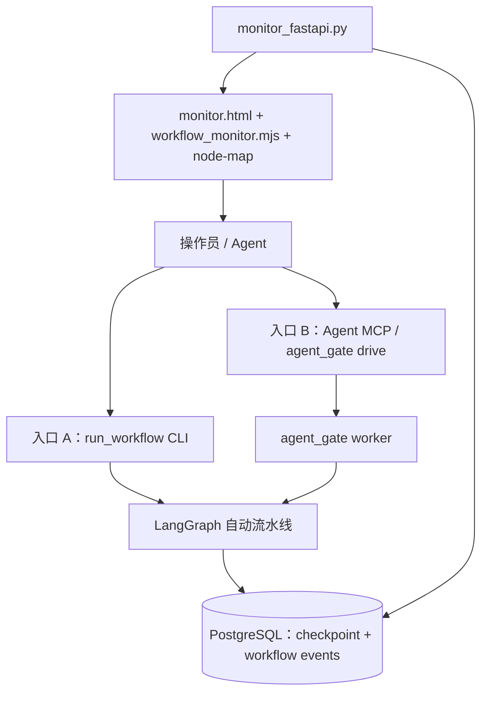

# auto-video-editor：移除对话回合循环，收敛为单流水线架构

> **文档类型**：架构设计、附件评审与分阶段执行计划  
> **修订日期**：2026-11-04  
> **评审对象**：附件《auto-video-editor · 删除①对话回合循环,收敛为②流水线循环 · 执行计划》  
> **仓库**：[`wayyet/auto-video-editor`](https://github.com/wayyet/auto-video-editor)  
> **评审分支**：`main`  
> **评审基准提交**：`9ab3df57614fc2acda61134e0ae5af6e1bf62a93`（2026-11-03）  
> **文档状态**：评审修订版；尚未执行代码修改

---

## 1. 执行摘要

### 1.1 目标

删除旧的 Web 聊天回合运行时，将项目收敛为以 LangGraph 为唯一业务编排核心的自动化视频处理流水线。

本次重构要删除的是旧聊天 UI 和其每条消息独立启动模型子进程的运行方式，不是删除所有循环：

- 保留 LangGraph 的条件路由、重试、并行分支和人工 `interrupt/resume`。
- 保留 `agent_gate` 的任务信箱、worker、Agent 任务消费及无人值守监督循环。
- 保留 PostgreSQL checkpoint 和 workflow event 持久化。
- 保留独立的工作流监控页面，但监控服务不再承担聊天或工作流启动职责。

### 1.2 评审结论

**建议有条件通过。架构方向合理，但原附件不能直接作为实施清单。** 原附件正确识别了主要边界，但存在入口参数错误、恢复语义缺口、图拓扑删除不完整、迁移历史风险、测试迁移缺失和监控 API 定位冲突等问题。

实施前必须完成以下修正：

1. 将“19 节点”明确为 `storyline_*` 自动剧情子链，而不是整个 LangGraph 图的节点总数。
2. 删除旧 Web 运行时前，重接图入口，不能保留对 OpenStoryline Web 的隐式依赖。
3. 为 `scripts/run_workflow.py` 增加受支持的 checkpoint 恢复路径，或取消它作为独立生产入口的承诺。两种入口不能只在启动阶段等价。
4. `monitor_fastapi.py` 只负责查询、SSE 和 node-map。若设计坚持仅有两条启动路径，应移除监控 API 的 `POST /runs`。
5. 保留 PostgreSQL 历史迁移定义和存量数据，不要直接从迁移清单中删除已发布迁移。
6. 先迁移仍属于保留流水线的测试，再删除 `tests_openstoryline/`。
7. 修正 `agent_gate drive`、`start`、`resume` 的命令参数和素材路径白名单要求。

### 1.3 重要限制

本次评审通过 GitHub 文件读取与提交记录核对了 `main` 分支代码；**没有在用户本机运行 pytest、启动 PostgreSQL、执行视频剪辑或执行任何删除操作**。测试数字引用仓库最新提交的回归记录，不代表本次重新运行所得。

---

## 2. 当前仓库基线

### 2.1 Git 基线

| 项目 | 值 |
|---|---|
| 仓库 | `wayyet/auto-video-editor` |
| 分支 | `main` |
| 基准提交 | `9ab3df57614fc2acda61134e0ae5af6e1bf62a93` |
| 基准提交日期 | 2026-11-03 |
| 建议重构分支 | `refactor/remove-chat-loop-20261104` |
| 建议分支起点 | 上述固定 SHA，而不是依赖可能移动的分支名 |

附件计划分支来源写为 `refactor/dedupe-openstoryline-mcp-20261103 @ 9ab3df5`。本次任务要求以 `main` 为分析基准，因此实施时应先确认 `main` 指向的 SHA 与本表一致；如不一致，以实际审查并再次记录的 SHA 为准。

### 2.2 当前测试基线

仓库 `9ab3df5` 的提交说明记录了以下测试结果：

| 测试范围 | 提交记录中的结果 | 验收解释 |
|---|---:|---|
| `tests/unit` | 1296 条，18 条失败 | 18 条失败与既有基线用例 ID 一致；不能当作全绿 |
| `tests/integration` | 230 条，23 条错误 | 记录注明 PostgreSQL 不可达；需在数据库可用环境重跑 |
| `tests_openstoryline` | 325 条，66 条失败 | 66 条失败与既有基线用例 ID 一致；删除前仍须筛选共享代码覆盖 |
| 前端 `node --test` | 37/37 通过 | 应拆分保留监控相关测试后复测 |
| `git diff --check` | 干净 | 这是基线提交记录，不代表重构后结果 |

**验收原则：按失败用例 ID 与错误类型做差分，不以单一 pytest 退出码作为唯一标准。** 23 条数据库错误只有在确认是相同的环境性原因、并且没有新增错误时，才能按基线问题处理。

### 2.3 当前图结构口径

当前 README 记录的图注册口径是 **53 个节点、44 条普通边、10 条条件边**。其中 `STORYLINE_MODE=auto` 使用的“19 节点”是 `nodes/storyline/` 自动剧情子链的历史口径，不等于整张图只有 19 个节点。

原附件中的“保留 auto 19 节点链”可以保留，但必须改成“保留自动剧情子链，并在重接图入口后重新生成完整拓扑统计和 schema 快照”。不要在重构后直接沿用 53/44/10 或 19 作为未经验证的新图统计。

---

## 3. 当前架构与实际代码事实

### 3.1 两套循环

| 层 | 当前实现 | 当前职责 | 重构后处理 |
|---|---|---|---|
| 旧聊天回合 | `agent_fastapi.py`、`src/open_storyline/`、旧聊天前端和模型子进程适配器 | Web 聊天、会话状态、每轮模型执行、上传和工具交互 | 删除 |
| LangGraph 流水线 | `graph.py`、`nodes/`、`scripts/run_workflow.py`、PostgreSQL checkpointer | 视频处理节点、条件边、重试、interrupt/resume | 保留并清理旧模式依赖 |
| Agent 任务调度 | `agent_gate/` | worker 生命周期、mailbox、任务领取、提交答案、Agent 会话重启 | 保留 |
| 监控 | `monitoring/`、`web/api_workflow.py`、`workflow_monitor.mjs` | workflow event、SSE、node-map、运行快照 | 保留，独立部署 |

### 3.2 `agent_gate drive` 的真实语义

`agent_gate drive` 不是 LangGraph 内部业务循环的替代品，而是一个无人值守监督器：

1. 启动或检查 worker 状态。
2. 检查 mailbox 是否存在待答 LLM 任务。
3. 启动 Claude/MCode 会话处理一批任务。
4. 会话结束后检查是否有进展，必要时再次启动会话。
5. worker 崩溃时按既有策略自动重启一次。
6. 完成时退出；进入真人关卡时返回退出码 `10`，等待真人放行。

因此，本次架构应表述为：**删除旧 Web 聊天回合循环，保留 Agent 任务监督循环和 LangGraph 流水线循环。** 不要把 `drive` 描述成“完全没有循环”的执行器。

### 3.3 `agent_gate` 命令参数事实

`agent_gate/cli.py` 中 `_common()` 对 `start`、`drive`、`status`、`resume` 等命令都要求 `--thread-id`。`drive` 还要求 `--agent` 和 `--project-dir`。

`drive` 真实支持的关键参数：

- `--thread-id`：必填。
- `--outputs-root`：可选，默认读取 `AGENT_GATE_OUTPUTS`，否则 `outputs`。
- `--agent`：必填，`claude` 或 `mcode`。
- `--project-dir`：必填，Agent 工作目录。
- `--video` / `--video-paths`：初次创建运行时的素材路径。
- `--mcode-config`：可选，但生产使用建议提供加锁配置。
- `--batch`、`--max-sessions`、`--max-wall-s`、`--session-timeout-s`：监督预算。

`drive --video` 路径必须通过 `safe_media_path()` 校验。运行环境要配置 `AGENT_GATE_MEDIA_ROOTS`，且输入视频必须位于白名单内。否则会被拒绝。

MCode 没有提供 `--mcode-config` 时，CLI 会输出警告：模型除 MCP 工具以外，仍可能具有 bash、文件读写、联网等内置能力。生产场景应先使用 `mcode-lock` 生成受限配置，再通过 `--mcode-config` 传入。

### 3.4 当前自动模式仍有旧 Web 入口依赖

当前 `graph.py` 的实际起点为：

```text
START
  -> launch_openstoryline
  -> open_preview
  -> _route_mode
       human -> checkpoint0_storyline_plan -> import_video -> get_storyboard_plan
       auto  -> storyline_load_media
```

其中：

- `node_02_launch_openstoryline.py` 在 auto 模式下虽然不启动进程，但仍生成 OpenStoryline URL 和兼容字段。
- `node_03_open_preview.py` 仍会按 `unattended` 参数启动 Edge 或 Playwright；它不是一个可以无条件保留的纯监控节点。
- `node_01_clean_cache.py` 仍由旧 `/api/system/clean-cache` 端点调用，不是流水线自动执行节点。

因此，删掉旧 Web 后不能简单保留 `launch_openstoryline -> open_preview -> storyline_load_media` 原拓扑。必须明确改为直接进入自动流水线，并删掉旧 Web 的残留副作用。

### 3.5 当前两个生产运行入口并非恢复语义等价

**入口 A：** `scripts/run_workflow.py --production`

- 通过 PostgreSQL checkpointer 和 `monitoring.workflow_runner.run_with_events()` 执行。
- 会调用 `db.migrations.apply_migrations_to_db()`。
- 当前参数包含 `--thread-id`、`--production`、`--initial-state-json` 等。
- 当前没有直接提供 `--resume-checkpoint` 或等价的人工恢复命令。

**入口 B：** `agent_gate` worker / MCP `run_start` / CLI `drive`

- worker 通过 `checkpointer_session()` 建立 saver，并维护 mailbox 状态文件。
- `agent_gate status` 可以读取 worker 状态和挂起关卡。
- `agent_gate resume` 通过 worker 状态机检查挂起节点，并从 checkpoint 恢复。
- `resume` 要求交互终端；默认不允许 Agent 非交互地放行人工关卡。

**结论：** 两条路径共享 PostgreSQL checkpoint 和 event store，不意味着它们共享同一套控制状态。一次运行必须由原启动路径对应的恢复入口继续，不得混用 `run_workflow.py` 与 `agent_gate resume`。

### 3.6 当前监控 API 的事实

`web/api_workflow.py` 目前暴露：

- `GET /api/workflow/graph`
- `POST /api/workflow/runs`
- `GET /api/workflow/runs/{thread_id}`
- `GET /api/workflow/runs/{thread_id}/events`
- `POST /api/workflow/runs/{thread_id}/resume`（只查询挂起状态并返回外部恢复提示，不直接执行 resume）
- `GET /api/workflow/chat-sessions/{chat_session_id}/run`

该 router 当前挂载在 `agent_fastapi.py` 上。`POST /runs` 会拉起 `scripts/run_workflow.py` 子进程，并接受 `chat_session_id`。如果重构目标是严格保留两种触发路径（直接 CLI 与 Agent/MCP），则该 POST 会形成第三种工作流启动路径，应在监控迁移阶段移除，或者明确修改架构目标并接受三种入口。

当前文件还设置：

```python
_REPO_ROOT = Path(__file__).resolve().parents[2]
```

按当前仓库布局 `web/api_workflow.py` 位于仓库根目录下的 `web/`，仓库根目录应由 `parents[1]` 得到。新建 `monitor_fastapi.py` 时必须修正路径解析，并增加单元测试验证 repo root、主解释器、脚本路径和日志路径。

---

## 4. 目标架构设计

### 4.1 目标组件边界



说明：入口 A 与 B 使用各自的启动和恢复控制器；两者运行都写入 PostgreSQL checkpoint 和 workflow event。监控服务只读共享数据，不启动、不恢复、不修改运行状态。

### 4.2 入口 A：直接生产 CLI

目标命令：

```powershell
.\.venv\Scripts\python.exe scripts\run_workflow.py --production --thread-id <THREAD_ID> --initial-state-json <STATE_JSON>
```

实现要求：

1. 继续走 PostgreSQL checkpointer。
2. 继续走 `monitoring.workflow_runner.run_with_events()`，保证事件格式和 SSE 消费一致。
3. 增加受支持的恢复操作。建议采用单独的 `scripts/resume_workflow.py`，或为 `run_workflow.py` 增加严格校验过的 resume 参数。
4. 恢复时先通过 `graph.get_state(config)` 读取挂起信息，校验指定 checkpoint 确实属于该 thread，再构造 `langgraph.types.Command(resume=...)`。
5. resume 也必须走 `run_with_events()`，并写 `run.resumed`、节点恢复和终态事件。
6. 同一 `thread_id` 的直接 CLI 运行只能由直接 CLI 恢复；不得使用 `agent_gate resume` 恢复它。

如果不实施第 3-5 项，则入口 A 不能宣称具备完整生产能力；可选择把 `agent_gate` 设为唯一生产启动器，直接 CLI 仅保留开发/诊断用途。

### 4.3 入口 B：Agent / MCP / drive

保留现有 `agent_gate`：

- MCP `run_start`：Agent 通过 MCP 发起后台 worker。
- MCP 工具：领取任务、读取任务、提交答案、查询状态。
- CLI `drive --agent mcode|claude`：无人值守监督 worker 和 Agent 会话。
- CLI `status`：查看 worker、任务和 interrupt 状态。
- CLI `resume`：由操作员在交互终端中通过人工关卡。

`agent_gate` 现有的路径白名单、thread_id 校验、租约、worker 崩溃恢复和真人关卡保护必须保留，不得为简化流程而绕过。

### 4.4 监控服务：只读

建议 `monitor_fastapi.py` 独立启动：

- 绑定：`127.0.0.1:7860`。
- 依赖：主 `.venv`。
- 保留：`GET /api/workflow/graph`、运行快照、SSE 事件流、node-map 静态资源。
- 新增：独立 `web/monitor.html` 页面。
- 移除：聊天 API、会话接口、清理缓存 API、`POST /api/workflow/runs`、chat-session 关联查询。
- `/resume` 端点若保留，只能作为只读状态查询/恢复说明；不能伪装成实际 resume 操作。也可以直接删除，避免接口名称产生误解。

监控页只负责显示从 PostgreSQL 读取的 event。页面刷新、SSE 重连和读取图结构均不得启动第二个 workflow。

### 4.5 LangGraph 自动图

目标图规则：

1. `STORYLINE_MODE` 默认值固定为 `auto`。
2. 传入 `human` 时 fail-fast，并给出明确配置错误。
3. 从 `START` 直接进入自动流水线入口。根据当前拓扑，预期是 `START -> storyline_load_media`，需先确认节点前置条件（素材路径、输出目录、配置、预检）已被入口层覆盖。
4. 删除 `checkpoint0_storyline_plan`、`import_video`、`get_storyboard_plan` 等依赖旧 Web 的 human 路径。
5. 删除 `launch_openstoryline` 与 `open_preview` 的旧 Web 启动/浏览器副作用；只有在证明存在保留业务用途时才允许拆分后保留纯逻辑部分。
6. 保留关卡① `node_06_human_reorder`、关卡② `node_12_human_add_bgm`、关卡③ `node_checkpoint3_layout_review`。
7. 保留 assembly QC、guardrail retry、翻译并行分支、汇合屏障和交付前 QA。
8. 删除 human 融合层 `nodes/storyline/fusion.py` 及其专属配置，前提是 AST/import 搜索和测试确认没有 auto 路径依赖。
9. 重新生成图 schema、节点/边快照和监控拓扑测试，不手工沿用旧统计数字。

### 4.6 数据与迁移策略

- PostgreSQL checkpoint、`workflow_runs`、`workflow_run_events`、`app_schema_migrations` 保留。
- `chat_sessions` 和 `workflow_chat_links` 的应用层读写逻辑删除。
- 存量数据库中的 `chat_sessions`、`workflow_chat_links` 表不执行 DROP，不清理数据。
- `db/migrations.py` 中已发布的迁移版本应视为历史记录，不应直接删除迁移 1 或迁移 5 的定义。对已有数据库删掉旧迁移定义或改变新库迁移结果，会造成“迁移台账”和代码迁移历史不一致。
- 推荐方案：保留 1-5 号迁移定义不变，新增注释说明 1/5 为 legacy schema，应用代码不再使用；未来若有明确的数据治理需求，再通过新的显式迁移版本做归档/清理，并且必须得到独立审批。本次不 DROP。

### 4.7 依赖管理

新监控服务使用 FastAPI 和 Uvicorn。当前 `requirements.txt` 和 `pyproject.toml` 均未声明这两项为主环境运行依赖；附件仅要求改 `requirements.txt`，不完整。

实施时：

- 在 `requirements.txt` 加入经过验证的 `fastapi` 和 `uvicorn[standard]` 版本约束。
- 在 `pyproject.toml` 的 `[project].dependencies` 中同步声明。
- 用干净主 `.venv` 执行安装和导入测试。
- `.venv-openstoryline/` 是本地虚拟环境目录，不能把删除一个目录的动作当成 Git 代码改动。应在回归和回滚窗口结束后，由操作员确认是否手动归档/删除。

---

## 5. 附件文档问题与修正方案

| 编号 | 严重度 | 原附件问题 | 当前代码依据 / 风险 | 修正方案 |
|---|---|---|---|---|
| R-01 | P0 | `drive` 示例没有 `--thread-id` | `agent_gate/cli.py::_common()` 将 `--thread-id` 设为 required | 补齐 `--thread-id`、`--outputs-root`，并给出完整 status/resume 命令 |
| R-02 | P0 | 两条生产入口被描述为等价，但直接 CLI 没有 resume 参数 | `scripts/run_workflow.py` 当前没有 resume CLI；`agent_gate resume` 依赖 mailbox 状态 | 为直接 CLI 增加 checkpoint resume，并验证事件一致性；否则取消双生产入口承诺 |
| R-03 | P0 | 删除 human 节点，但没有重接 auto 图入口 | `graph.py` 的 auto 路径仍经过 `launch_openstoryline` 和 `open_preview` | 重写为 `START -> storyline_load_media`（或经明确的纯预检节点），补拓扑和 E2E 测试 |
| R-04 | P0 | 监控 API 继续保留 `POST /runs`，与“两条触发路径”冲突 | `web/api_workflow.py` 有 `POST /runs` 并 spawn CLI 子进程 | 监控改为只读；移除 `POST /runs`。若保留则把目标改成三入口，并统一幂等/恢复/审计规则 |
| R-05 | P1 | `web/api_workflow.py` 根路径计算错误 | 当前 `_REPO_ROOT = Path(__file__).resolve().parents[2]`；仓库根应为 `parents[1]` | 修正为 `Path(__file__).resolve().parents[1]` 或可测试的 root resolver；所有子路径从该根派生 |
| R-06 | P1 | 只提 `requirements.txt`，遗漏 `pyproject.toml` | 两处均未声明 FastAPI/Uvicorn 主环境依赖 | 两个依赖清单同步更新，并在干净环境安装验证 |
| R-07 | P1 | 整体删除 `tests_openstoryline/`，没有共享测试迁移策略 | 部分测试覆盖共享 `storyline_capabilities`、ASR、prompt loader 等保留模块 | 先按 import/coverage 分类；保留模块测试迁至 `tests/`，旧运行时专属测试再删除 |
| R-08 | P1 | 迁移脚本计划删除旧迁移定义 | 当前迁移版本 1 创建 `chat_sessions`，版本 5 创建 `workflow_chat_links`；迁移台账是长期记录 | 保留历史迁移定义不变；删除应用层引用；不 DROP 存量表 |
| R-09 | P1 | 把“19 节点”写成最终图口径 | 当前 README 记录 53 节点、44 普通边、10 条条件边；19 是自动剧情子链旧口径 | 变更后从真实编译图生成 schema，并将统计结果写入 regression.md |
| R-10 | P1 | 没明确删除旧 Web 的清理缓存链路 | `POST /api/system/clean-cache` 调用 `nodes/node_01_clean_cache.py`；该节点未列入图删除项 | 删除 API、节点、配置常量和仅服务该入口的测试；若仍需清理能力，另做独立 CLI 设计 |
| R-11 | P1 | 删除 `launch_openstoryline` / `open_preview` 的依赖未写入阶段任务 | auto 模式虽跳过 Web 探测，但仍执行 `open_preview` | 与 R-03 同阶段重接图；检查 `node_02/03` 的 import、state 字段和配置常量 |
| R-12 | P1 | `STORYLINE_MODE` 默认值变更但未处理测试 fixture | `tests/conftest.py` 有 checkpoint0 旁路、手动导入等待和 fusion fixture | 删除过期 fixture；为 auto 图建立显式 fixture，避免隐式 monkeypatch 掩盖残留引用 |
| R-13 | P1 | `scripts/capture_prompt_golden.py` 会 import 将被删除的模块 | 脚本直接 `from open_storyline.utils import prompts` | 删除前先改为仅调用保留的 prompt loader；保留 golden 基线和重构后语义测试 |
| R-14 | P1 | `asr_runner.py` 仍依赖 `.venv-openstoryline` 配置 | 当前仍有 `VENDORED_OPENSTORYLINE_*` 和 `vendored` 模式 | 确认实际 auto 节点是否会调用 vendored ASR；若保留则改为主项目支持的服务接口/独立 ASR 进程；若仅 stub 则删除死分支和配置 |
| R-15 | P1 | start/stop 脚本只规划删除 OpenStoryline 生命周期，没有完整接入独立监控进程 | `start_production.ps1`、`stop_production.ps1` 当前管理 `agent_fastapi:app`、PID 文件及 7860/8001 | 改为管理 `monitor_fastapi` PID；停止脚本只杀有本项目 PID 记录的进程，未知进程 fail-closed |
| R-16 | P1 | 保留 Phase 0.55 资源/模型校验没有依赖审计 | `start_production.ps1` 当前阶段包含旧 OpenStoryline 资源/模型校验 | 按 auto 节点实际调用做清单；仅校验保留流水线依赖，不要为了旧模块保留下载流程 |
| R-17 | P1 | E2E `agent_gate start` 示例缺 `--thread-id`，且素材路径白名单未说明 | `start` 也使用 `_common()`；`--video` 经过 `safe_media_path()` | 使用唯一测试 thread_id；视频放在白名单目录，或构造合规 initial-state 文件 |
| R-18 | P2 | `agent_gate resume` 示例只有裸命令 | `resume` 要求 `--thread-id` 和 `--checkpoint`，并默认要求 TTY | 先运行 `status` 读取 interrupts，再在操作员终端运行 resume |
| R-19 | P2 | 备份 `config.toml.local` 只说执行 copy，没有保密与恢复验证 | 该文件可能含 API key 且 gitignored | 备份权限受控；不输出密钥；diff 只检查配置键，不复制密钥到日志或提交 |
| R-20 | P2 | 删除 `.venv-openstoryline/` 被写进代码删除清单 | 该目录是本机虚拟环境，不是普通 Git 源文件 | 将其移到“部署清理/手工操作”步骤；通过回归与回滚窗口后再处理 |
| R-21 | P2 | 回归验收的 Postgres 错误“存量不计”条件不够明确 | 当前 integration 基线记录 23 个 PG 不可达错误 | 每条错误按 node id、异常类型和堆栈摘要与基线逐条对比；新增错误一律失败 |
| R-22 | P2 | 监控恢复端点名称容易造成误解 | 当前 `POST /resume` 只是查询挂起状态并返回外部恢复说明 | 改成 GET probe 或明确命名为 `resume-status`；实际恢复仍走控制器 CLI |

---

## 6. 分阶段执行开发任务

> 执行规则：每阶段完成代码、测试、文档和回滚检查后再提交一次 commit。禁止一次性批量删除。任何阶段出现新增失败，先修复再进入下一阶段。

### 阶段 0：基线冻结与依赖盘点

**目标：** 固定可回退基线，确认需要迁移的生产依赖、测试和运行中任务。

任务：

1. 检查工作区 clean；记录 `git status --short`、当前分支和 `git rev-parse HEAD`。
2. 确认 `main` 的 HEAD 是否为 `9ab3df57614fc2acda61134e0ae5af6e1bf62a93`；不一致时更新本计划基准 SHA。
3. 建立 `refactor/remove-chat-loop-20261104`，从固定 SHA 切出。
4. 按当前真实环境执行并保存 JUnit：
   - `python -m pytest tests/unit -q --junitxml=docs/remove-chat-loop-20261104/baseline-unit.xml`
   - `python -m pytest tests/integration -q --junitxml=docs/remove-chat-loop-20261104/baseline-integration.xml`
   - `python -m pytest agent_gate/tests -q --junitxml=docs/remove-chat-loop-20261104/baseline-agent-gate.xml`
   - `node --test web/tests`
   - 独立记录 `tests_openstoryline/` 结果，不要把它与保留流水线基线混在一起。
5. 建立生产代码 import 清单：`agent_fastapi.py`、`src/open_storyline/`、`agent_gate/`、`storyline_capabilities/`、`nodes/`、`monitoring/`、`scripts/`。
6. 对 `tests_openstoryline/` 按用途分类：旧聊天专属、OpenStoryline 私有、共享能力、prompt loader、ASR、node contract、集成回归。
7. 备份 `config.toml.local` 为 `config.toml.local.bak-20261104`；确认备份仍受 `.gitignore` 保护，不输出 API key。
8. 盘点 PostgreSQL 运行中的 worker、thread_id、checkpoint、event 行数；先停止新任务入口，待运行任务完成或人工中止后再部署。

**交付物：** `docs/remove-chat-loop-20261104/baseline.md`、JUnit 文件、import 清单、DB 盘点记录。

**验收条件：** 基线可复现；现存运行任务有明确处置；回滚 SHA 确认。

### 阶段 1：先拆出独立监控服务

**目标：** 在不删除旧聊天运行时的前提下，让监控 UI 可以独立启动和运行。

任务：

1. 新建根目录 `monitor_fastapi.py`，只创建 FastAPI app 并挂载 workflow router、node-map 和监控静态页。
2. 新建 `web/monitor.html`，复用 `workflow_monitor.mjs` 的 SSE、事件回放和节点状态展示。
3. 评估 `workflow_chat_indicator.mjs`：若它只依赖 chat session，删除；若仍有纯 workflow 状态显示价值，先改成不依赖 chat-session 的监控组件。
4. 修复 `web/api_workflow.py` 的 `_REPO_ROOT` 计算。增加测试断言其定位到仓库根，而不是仓库父目录。
5. 将 monitor API 改为只读：保留 graph、snapshot、events、node-map；移除 POST `/runs`、chat-session 查询及其所有 chat id 字段。
6. 对 resume 查询接口改名或删除；实际恢复只通过对应执行控制器。
7. 在 `requirements.txt` 和 `pyproject.toml` 同步声明 FastAPI、Uvicorn 依赖。
8. 检查 `_MAIN_VENV_PYTHON`、`_MAIN_CLI`、日志目录等路径是否仍存在；只读监控不应依赖这些启动参数。
9. 迁移 `tests_openstoryline/` 中的监控前端测试到 `tests/`；保留 `web/tests/` 中确实属于 monitor 的 `.mjs` 测试。
10. 保留 Origin 校验、`127.0.0.1` 绑定、SSE Last-Event-ID 补发、PostgreSQL 不可用时显式 503 等行为。

**交付物：** `monitor_fastapi.py`、`web/monitor.html`、独立依赖、监控测试、启动说明。

**验收条件：** 主 `.venv` 可独立启动监控；打开页面可查询现有 run、SSE 可重连补发；监控页面刷新不会触发 workflow；无聊天 API。

### 阶段 2：迁移保留测试并删除旧聊天运行时

**目标：** 删除聊天 Web、聊天会话和旧的模型回合执行器，不破坏 `agent_gate` 和自动流水线。

任务：

1. 先修改 `scripts/capture_prompt_golden.py`，不再 import `open_storyline.utils.prompts`；用保留的 prompt Loader 重新记录 golden。
2. 把共享功能测试迁入 `tests/`：重点检查 `storyline_capabilities/`、ASR stub/provider、Prompt loader、节点 contract 和被保留的公共工具。
3. 对所有将删除模块做 import graph / AST 扫描，确认 `agent_gate`、auto 图、monitoring 和保留脚本没有生产 import。
4. 删除聊天 UI：`web/index.html`、聊天专属 `web/static/app.js`、`mcode_panel.mjs`、`media_upload.mjs` 及仅供聊天使用的测试。
5. 删除 `agent_fastapi.py` 及旧聊天 runtime 的唯一入口和服务装配代码。
6. 删除 `src/open_storyline/` 及根目录兼容转发模块前，逐项核实 `jy_common`、`storyline_capabilities` 和共享模型是否位于删除目录；只删除旧 runtime 专属内容。
7. 删除旧聊天子进程适配器、会话 Repository/Store、WebSocket 聊天循环、上传握手和仅聊天使用的 API。
8. 删除 `requirements-openstoryline.txt` 中仅用于旧 Web/runtime 的依赖定义；不从主依赖引入 torch、torchaudio、moviepy 等重型依赖。
9. 检查 `storyline_capabilities/asr_runner.py` 的 `vendored` 路径是否仍调用 `.venv-openstoryline`；保留 stub 时同步清理旧 venv 路径和 dead subprocess 分支。
10. 仅删除有证据确认不再使用的配置常量与脚本。不要基于名称相似就批量删除 `jy_common` 或 capability 代码。

**交付物：** 旧聊天运行时删除 commit、迁移后的共享测试、prompt golden 及 import 审计报告。

**验收条件：** `agent_gate`、auto 图、monitor 服务可在主 `.venv` 导入；保留模块不再引用 `open_storyline`；无旧聊天服务入口。

### 阶段 3：图拓扑改为 auto-only

**目标：** 删除 human 模式和 OpenStoryline Web 前置步骤，使图直接进入自动剧情流水线。

任务：

1. 将 `config.STORYLINE_MODE` 默认设为 `auto`；配置值不是 `auto` 时启动即报错。
2. 在 `graph.py` 中重接起点：移除 `launch_openstoryline`、`open_preview` 前置路径，改为从 `START` 进入 `storyline_load_media`，或经一个不依赖旧 Web 的纯预检节点进入。
3. 删除 `checkpoint0_storyline_plan`、`import_video`、`get_storyboard_plan` 及其路由、状态字段、配置和专属测试。
4. 删除 `node_02_launch_openstoryline.py`、`node_03_open_preview.py` 的旧实现和相关依赖；如果某些纯逻辑仍有价值，先拆分后再决定保留。
5. 保留关卡① `node_06_human_reorder`、关卡② `node_12_human_add_bgm`、关卡③ `node_checkpoint3_layout_review`。
6. 保留 assembly QC 六节点、repair loop、speed-fit guardrail、中文/英文分支、fan-in barrier 和交付 QA。
7. 删除 `nodes/storyline/fusion.py`、`STORYLINE_HUMAN_FUSION`、`STORYLINE_FUSION_DISABLE` 和 fusion 专属拓扑代码。
8. 检查 `WorkflowState`：只删除旧节点独占字段；保留自动子链、assembly、checkpoint resume 和旧 checkpoint 兼容实际需要的字段。
9. 更新 `monitoring/workflow_graph.py`：删除 human 节点模式元数据、mode 分支和已不存在节点的 edge label。
10. 更新 `tests/conftest.py`：删除 checkpoint0 跳过、人工导入等待和 fusion-off 等过期 autouse fixture。
11. 更新 schema snapshot 与 topology test；以编译后图为真源，记录节点数、普通边、条件边和所有 interrupt 节点。

**交付物：** auto-only `graph.py`、更新后的 `config.py`、`state.py`、monitor graph schema、拓扑测试和 interrupt 测试。

**验收条件：** `STORYLINE_MODE=auto` 编译成功；`human` 被拒绝；图无 OpenStoryline Web import、浏览器启动或人工导入等待；3 个保留人工关卡和恢复路径可用。

### 阶段 4：清理 chat_link 和数据库应用层引用

**目标：** 从运行时移除 chat-session 与 workflow 的绑定，但完整保留数据库历史数据。

任务：

1. 删除 `monitoring/workflow_chat_link_store.py` 的运行时引用和实现。
2. 在 `monitoring/workflow_runner.py` 删除 `_default_link_store()`、`_chat_link_upsert_running()`、`_chat_link_update()`、chat-link 状态映射和相关参数；保留 run/node 标准事件。
3. 在 `scripts/run_workflow.py` 删除 `--chat-session-id` 参数及初始 state 注入逻辑。
4. 从 `WorkflowState` 删除 `chat_session_id` 字段（确认无其他保留模块消费后）。
5. 删除 monitor API 的 chat-session 查询路径。
6. 删除 chat session repository、session store、chat link unit/integration 测试；对仍被其它模块使用的通用 DB connection/migration 测试保留。
7. **不删除** `db/migrations.py` 中已经发布的迁移 1 和迁移 5 定义；添加注释标识 legacy table，不再由应用运行时读写。
8. 不 DROP `chat_sessions`、`workflow_chat_links`；不要对存量数据做清理、重命名或 schema 破坏性调整。
9. 对 fresh database 与已有 database 分别执行迁移测试，确保迁移台账可持续升级。

**交付物：** chat-link 代码清理 commit、迁移策略说明、fresh/existing DB 测试。

**验收条件：** 生产代码不存在 chat-session 关联读写；历史迁移定义未被改写；旧表与数据仍存在；workflow event 和 checkpoint 正常工作。

### 阶段 5：生产启停脚本、README 与 ADR 同步

**目标：** 删除旧 Web 生命周期管理，建立独立监控服务生命周期。

任务：

1. `start_production.ps1` 删除 `.venv-openstoryline`、`agent_fastapi:app`、OpenStoryline PID、Phase 0.6/0.7 Web 生命周期和 `STORYLINE_MODE=human` 参数。
2. 为 `monitor_fastapi.py` 增加明确启动项：使用主 `.venv\Scripts\python.exe`，绑定 `127.0.0.1:7860`，记录 PID、日志和启动配置。
3. `stop_production.ps1` 改为停止本项目拥有的 `monitor_fastapi` 进程；未知 PID/端口占用时不得按端口盲杀。
4. 保留 Postgres preflight 的必要部分；单独审计 Docker、代理、资源下载、模型检查哪些仍为 auto 节点必需。
5. `.venv-openstoryline/` 作为本地目录，放在部署清理步骤；由操作员在验证和回滚窗口结束后手动处理。
6. README 重写架构图、依赖安装、启动/停止、`agent_gate` drive、状态查询、resume、监控访问和退出码。
7. `docs/integration/architecture_decision_record.md` 追加 ADR：移除聊天运行时、auto-only 图、监控只读、入口恢复语义、legacy DB schema 保留。
8. 旧文档保留历史内容并加明显失效日期/新文档链接，不要把旧操作步骤留作当前指引。

**交付物：** 更新后的 PowerShell 脚本、README、ADR、部署和回滚说明。

**验收条件：** 一键启动不再检查旧 Web venv；monitor 独立启动/停止；未知服务不被误杀；README 命令能按实际 CLI 解析执行。

### 阶段 6：全量回归、E2E 与发布验收

**目标：** 证明重构没有破坏保留流水线、Agent 驱动、人工关卡、事件监控和数据库。

任务：

1. 在与阶段 0 相同的 Python、依赖、环境变量和 DB 环境下重跑所有基线测试。
2. 对比 JUnit XML 的失败用例 ID、异常类型和堆栈摘要；新增失败一律阻断发布。
3. 运行 `agent_gate/tests` 全套测试。
4. 运行 `node --test web/tests`，覆盖 monitor SSE、节点图、重连和无重复启动。
5. 在 PostgreSQL 可用环境运行 integration，单独记录 DB 不可达时的失败，不允许把新 SQL/迁移错误归类成环境问题。
6. 图测试：编译后 schema 节点/边与拓扑快照一致；确认 `START` 到 auto 链可达；确认 3 个人工关卡都可达。
7. 直接 CLI 路径：运行一条隔离的测试 thread，验证 checkpoint、事件、interrupt、直接 CLI resume、继续执行和终态事件。
8. Agent 路径：运行 `agent_gate start --backend stub`，确认进入人工关卡；读取 `status`；在 TTY 终端按状态返回的 checkpoint 执行 `resume`；确认继续执行。
9. drive 路径：在素材白名单中准备测试视频，运行 `drive --agent mcode`，验证会话预算、任务领取/提交、超时退出和人工关卡退出码 10。
10. monitor 路径：独立启动 `monitor_fastapi.py`，确认运行快照、SSE 实时事件、Last-Event-ID 补发、node-map 和 Postgres 不可用时 503。
11. 安全残留扫描：生产代码不得引用 `agent_fastapi`、旧聊天循环、旧 Web 资源、旧 OpenStoryline import 和 chat-link；文档历史引用可保留但必须标注失效。
12. 执行 `git diff --check`、依赖清单检查、secret 扫描、配置 diff 检查。
13. 输出 `docs/remove-chat-loop-20261104/regression.md`，记录基线/本次结果、差异、E2E thread_id、DB 表保留确认和已知限制。

**交付物：** 全量回归报告、E2E 报告、残留扫描、最终拓扑 schema。

**验收条件：** 无新增失败；所有保留的控制/恢复路径有验证；旧聊天运行时无生产引用；数据库无 DROP；回滚方案有效。

---

## 7. 可复制的操作命令

> 以下命令用于实施和验收。`<...>` 是需要替换的占位符，不要原样执行。

### 7.1 创建分支并冻结基线

```powershell
git status --short
git switch main
git rev-parse HEAD
git switch -c refactor/remove-chat-loop-20261104
```

如果实际 `main` HEAD 不是本文件记录的 SHA，应先确认差异，再更新分支起点和本文件基线。

### 7.2 Agent Gate stub 冒烟

```powershell
$env:AGENT_GATE_MEDIA_ROOTS = "E:\Documents\kuaishou\video-ops\inputs"

python -m agent_gate start `
  --thread-id smoke-auto-20261104-001 `
  --outputs-root outputs `
  --backend stub `
  --video "E:\Documents\kuaishou\video-ops\inputs\30s.mp4"
```

说明：`--video` 必须处于 `AGENT_GATE_MEDIA_ROOTS` 白名单中。测试用 thread_id 必须唯一，避免覆盖历史 run。

### 7.3 查看挂起状态

```powershell
python -m agent_gate status `
  --thread-id smoke-auto-20261104-001 `
  --outputs-root outputs
```

先读取返回 JSON 中 `interrupts` 的实际 checkpoint 标识，不要假定每次都固定停在同一关。

### 7.4 人工 resume

```powershell
python -m agent_gate resume `
  --thread-id smoke-auto-20261104-001 `
  --outputs-root outputs `
  --checkpoint "<status 返回的 checkpoint 标识>" `
  --value true
```

该命令应在操作员交互终端执行。不要使用 `--force-no-tty` 绕过真人关卡；该参数只用于受控 CI。

### 7.5 MCode drive（无人值守）

```powershell
$env:AGENT_GATE_MEDIA_ROOTS = "E:\Documents\kuaishou\video-ops\inputs"

python -m agent_gate drive `
  --thread-id drive-20261104-001 `
  --outputs-root outputs `
  --agent mcode `
  --project-dir "E:\Documents\kuaishou\video-ops" `
  --video "E:\Documents\kuaishou\video-ops\inputs\30s.mp4" `
  --mcode-config "<加锁后的 MCode config.yaml 路径>"
```

`drive` 到达人工关卡时返回退出码 `10`。此时先执行 `status`，确认 checkpoint，再由真人在终端执行 `resume`。

### 7.6 监控服务启动

目标入口（阶段 1 实施后）：

```powershell
.\.venv\Scripts\python.exe -m uvicorn monitor_fastapi:app --host 127.0.0.1 --port 7860
```

---

## 8. 风险与回滚

| 风险 | 影响 | 处理策略 |
|---|---|---|
| 活跃 thread 在旧拓扑运行时被新版图恢复 | checkpoint 与节点名/状态字段不兼容 | 部署前暂停新任务，等待旧 thread 完成或人工关闭；不跨图版本恢复旧 thread |
| auto 起点重接遗漏前置条件 | 节点缺素材路径、配置或目录 | 入口层集中做 preflight，图拓扑测试和真实素材 E2E 双重验证 |
| 直接 CLI 没有 resume | 人工关卡后无法继续 | 阶段 0 将其列为发布阻断项；完成恢复命令前不宣布双入口等价 |
| monitor 启停脚本误杀其他应用 | 造成用户服务中断 | PID 所有权记录、命令行校验和 fail-closed；不按端口直接 kill |
| 数据库迁移历史被改写 | 新库与旧库 schema 不一致 | 保留已发布迁移定义；不 DROP；对 fresh/existing DB 分别测试 |
| Prompt loader 删除后语义变化 | 模板渲染结果不同 | 删除前采集 golden，保留模板文件 hash、变量渲染和错误语义测试 |
| MCode 权限过宽 | Agent 可执行非预期操作 | 使用 `mcode-lock` 受限配置；密钥文件不入库；drive 工作目录最小化 |
| Windows 中文路径/编码错误 | PowerShell 重写配置污染编码 | 所有 Python/MD/TOML 文件 UTF-8；禁止通过默认代码页重写配置；diff 检查 |
| 环境性测试错误被误判 | 漏掉真实回归 | 按 JUnit 用例 ID 和异常类型与基线逐条对比；Postgres 错误单列 |

### 8.1 回滚原则

1. 每阶段单独 commit，避免把半成品阶段合并为一个大提交。
2. 任一阶段失败，先回退该阶段 commit，不跨阶段手工补偿删除。
3. 若已部署新图，不使用新代码恢复旧图创建的活跃 checkpoint；切回旧版本前先确认没有仍在运行的新版 thread。
4. PostgreSQL 数据不回滚、不 DROP；`config.toml.local` 从受保护备份恢复。
5. `.venv-openstoryline` 只在回滚窗口结束后由操作员清理，避免回滚时缺少旧运行时环境。

---

## 9. 发布检查清单

- [ ] `main` SHA 已确认，分支基于固定 SHA。
- [ ] 单元、集成、agent_gate、前端测试基线已保存。
- [ ] 共享测试和 prompt golden 已从 `tests_openstoryline/` 迁出。
- [ ] `monitor_fastapi.py` 可从主 `.venv` 独立启动。
- [ ] monitor 只有读接口，不承担 workflow 启动和状态写入。
- [ ] 直接 CLI 有已验证的 resume 路径，或已取消其独立生产入口定位。
- [ ] auto 图从 START 可达自动处理节点，不再依赖 OpenStoryline Web/Edge。
- [ ] 关卡①、②、③ 均可挂起和恢复。
- [ ] `agent_gate start/status/resume/drive` 参数符合 argparse 实际定义。
- [ ] `AGENT_GATE_MEDIA_ROOTS` 和 MCode 安全配置已验证。
- [ ] chat-link 运行时代码已删除，历史 DB 表/数据保留。
- [ ] 已发布 migration 定义未被删除或改写。
- [ ] `requirements.txt` 和 `pyproject.toml` 依赖同步。
- [ ] `start_production.ps1` / `stop_production.ps1` 只管理本项目拥有的 monitor 进程。
- [ ] 没有新增测试失败；基线环境性错误有逐条证据。
- [ ] `git diff --check` 通过；secret 扫描通过。
- [ ] `docs/remove-chat-loop-20261104/regression.md` 已提交。

---

## 10. 参考代码与审查来源

以下链接均指向本次审查的 `main` 分支文件；行号或具体实现可能随提交变化。

| 文件 | 核验用途 |
|---|---|
| [README.md](https://github.com/wayyet/auto-video-editor/blob/main/README.md) | 当前目录、图节点计数、依赖、旧启动说明和测试记录 |
| [graph.py](https://github.com/wayyet/auto-video-editor/blob/main/graph.py) | 当前起点、human/auto 分支、auto 子链和人工关卡拓扑 |
| [config.py](https://github.com/wayyet/auto-video-editor/blob/main/config.py) | `STORYLINE_MODE` 默认值和 human fusion 配置 |
| [state.py](https://github.com/wayyet/auto-video-editor/blob/main/state.py) | `WorkflowState` 字段及旧 checkpoint 兼容结构 |
| [agent_gate/cli.py](https://github.com/wayyet/auto-video-editor/blob/main/agent_gate/cli.py) | CLI 参数必填项、`drive`、`start` 和 `resume` 分支 |
| [agent_gate/drive.py](https://github.com/wayyet/auto-video-editor/blob/main/agent_gate/drive.py) | Agent 会话循环、预算、worker restart 和退出码 |
| [agent_gate/runner.py](https://github.com/wayyet/auto-video-editor/blob/main/agent_gate/runner.py) | worker/checkpointer/resume 状态机 |
| [agent_gate/factory.py](https://github.com/wayyet/auto-video-editor/blob/main/agent_gate/factory.py) | 支持的 LLM backend 及 gate 任务信箱连接方式 |
| [agent_gate/mcp_server.py](https://github.com/wayyet/auto-video-editor/blob/main/agent_gate/mcp_server.py) | MCP `run_start` 和工具边界 |
| [scripts/run_workflow.py](https://github.com/wayyet/auto-video-editor/blob/main/scripts/run_workflow.py) | 直接 CLI 生产路径和当前恢复参数缺口 |
| [monitoring/workflow_runner.py](https://github.com/wayyet/auto-video-editor/blob/main/monitoring/workflow_runner.py) | 统一事件流和 chat-link 耦合点 |
| [monitoring/workflow_graph.py](https://github.com/wayyet/auto-video-editor/blob/main/monitoring/workflow_graph.py) | 监控图 schema、human-only 元数据 |
| [web/api_workflow.py](https://github.com/wayyet/auto-video-editor/blob/main/web/api_workflow.py) | API 路由、POST 启动入口、repo root 和 chat link |
| [agent_fastapi.py](https://github.com/wayyet/auto-video-editor/blob/main/agent_fastapi.py) | 旧聊天宿主、清理缓存端点和 workflow router 挂载 |
| [db/migrations.py](https://github.com/wayyet/auto-video-editor/blob/main/db/migrations.py) | migration 1/5 与历史 schema |
| [start_production.ps1](https://github.com/wayyet/auto-video-editor/blob/main/start_production.ps1) | 旧 Web 生命周期和 preflight 流程 |
| [stop_production.ps1](https://github.com/wayyet/auto-video-editor/blob/main/stop_production.ps1) | 旧 Web PID/命令行清理和进程所有权处理 |
| [requirements.txt](https://github.com/wayyet/auto-video-editor/blob/main/requirements.txt) | 当前主 venv 依赖 |
| [pyproject.toml](https://github.com/wayyet/auto-video-editor/blob/main/pyproject.toml) | 项目元数据和运行时依赖声明 |
| [tests/conftest.py](https://github.com/wayyet/auto-video-editor/blob/main/tests/conftest.py) | checkpoint0、人工导入和 fusion 测试 fixture |
| [scripts/capture_prompt_golden.py](https://github.com/wayyet/auto-video-editor/blob/main/scripts/capture_prompt_golden.py) | 旧 prompt loader import 和 golden 基线 |
| [提交 9ab3df5](https://github.com/wayyet/auto-video-editor/commit/9ab3df57614fc2acda61134e0ae5af6e1bf62a93) | 本次评审基准和测试基线记录 |

---

## 11. 最终建议

按阶段 0-6 执行。**阶段 2（删除旧 runtime）之前必须完成阶段 1 的监控迁移和共享测试迁移；阶段 3（删除 human 图）之前必须确定直接 CLI 的恢复策略。**

优先推荐的最终形态：

- `graph.py`：auto-only 业务图。
- `agent_gate/`：MCP、worker、mailbox、drive 和人工 resume 控制器。
- `scripts/run_workflow.py`：直接执行控制器；必须补齐自身 resume 能力后才作为第二条生产路径。
- `monitor_fastapi.py`：只读监控服务。
- PostgreSQL：checkpoint 和 workflow event 的唯一持久化来源；历史 chat 表保留但不再使用。

本次重构不应顺便重做视频节点业务、ASR 算法、资源库、剪映草稿结构或 PostgreSQL 数据清理。把改动限制在运行时边界、图拓扑、入口控制、监控服务和文档，才能将回归范围控制在可验证的范围内。
