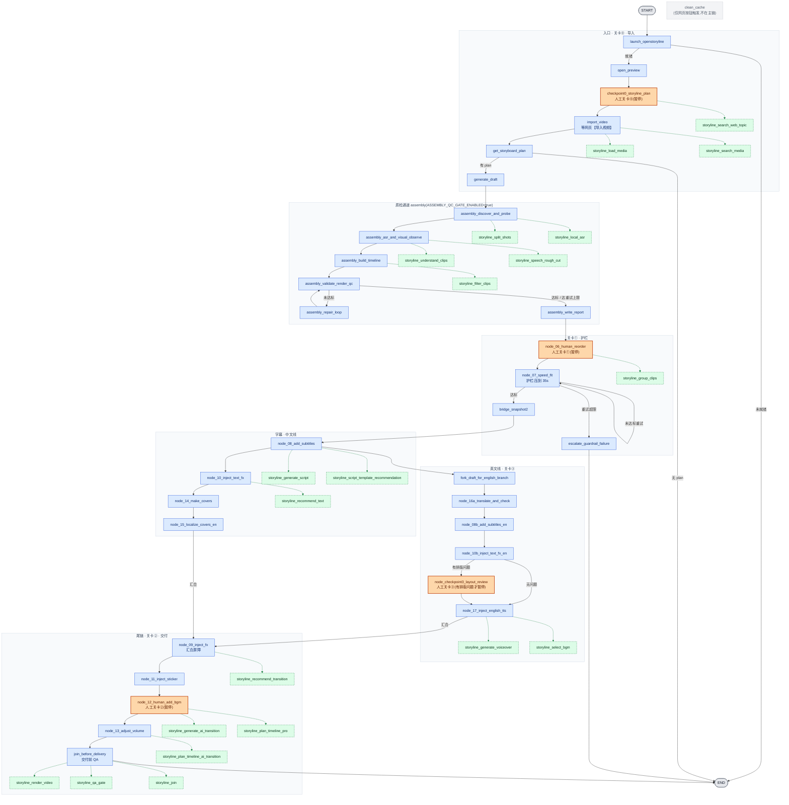

> ⚠️ **历史文档(2026-11-04 单流水线架构收敛后失效)**:本文档描述的聊天 Web /
> OpenStoryline Web / human 模式 / mcode-zcode 档位链路已删除;现行架构见 `README.md`
> 与 `docs/integration/architecture_decision_record.md`。内容保留仅作历史记录。

# 剧情线自动模式节点并入人工模式主图:设计与执行计划

| 项 | 内容 |
|---|---|
| 项目 | `wayyet/auto-video-editor`,`main` 分支,基线提交 `e7e6bbd97805541b416ad7ab08c060838df26530` |
| 日期 | 2026-11-01 |
| 状态 | 方案已在沙箱的**副本**里实现并验证。你的原仓库**没有被改动**。补丁文件另附 |
| 怎么读 | 只要结论:读 §0。看摆放:读 §3、§4。要动手:读 §6、§7 |

---

## 0. 一页结论

**做了什么**

- 把 `STORYLINE_MODE=auto` 里的 **21 个** `storyline_*` 节点,并入 `human` 模式的 LangGraph 主图。
- 每个节点**单独**挂在一个相关的 human 节点旁边。共 13 个挂载点,每处最多 2 个(只有交付前的 `join_before_delivery` 是 3 个)。**没有**堆在同一处。
- 挂法是 `锚点 → storyline 节点`:只有进边,**没有出边**(叫"侧支")。所以所有 human 节点的执行顺序和原来**完全一样**。

**怎么开关**

- 环境变量 `STORYLINE_HUMAN_FUSION=1` 开启。默认关。
- 关闭时,图和改动前**逐边一致**。回滚 = 取消这个变量,再重启进程。

**验证结果**(真实 LangGraph 1.2.9,沙箱)

- 21 个节点各自只被触发 1 次,且都在锚点的**下一拍**。其中 2 个因为没有 `storyline_targets.query`,被包装层跳过(原函数没被调用)。其余 19 个,原函数各被调用 1 次。
- 人工关卡 ①→③→② 不变。human 节点的执行顺序、拍号、终态,开和关**逐项一致**。
- 全量测试:改动前 3 失败 / 950 通过。改动后(开关关)3 失败 / 995 通过。开关强制开,也是 3 失败 / 995 通过。**那 3 个失败改动前就有**,与本方案无关(见附录 C)。

**要你定的 1 件事:默认开,还是默认关?**

| 选项 | 内容 | 判断要点 |
|---|---|---|
| **A(推荐)默认关** | 先合入,用环境变量灰度开启 | 这 21 个节点的产物,现在还没有 human 节点去用。真实的 LLM / TTS / ASR 也没接上。打开只会多耗时间(接了真 LLM 还会耗 token) |
| B 默认开 | 合入即生效 | 同一拍里最慢的节点会拖慢主链(见 §9)。要改的只有 `config.py` 里 `"0"` → `"1"` 一行 |

本文按 **A** 写。想要 B,回我一个字就行。

---

## 1. 你的要求 → 本文哪里满足

| 要求 | 怎么满足 | 在哪看 |
|---|---|---|
| #3 全部 storyline 节点并入 human 主图 | 21 个全部并入,一个不少 | §3、§4 |
| #4 位置恰当 | 先看"做什么 + 吃谁的产物",找到相关 human 节点,再挂在它旁边 | §2、§3 |
| #5 不能合在一起放一处 | 13 个挂载点,每处 ≤2 个(交付闸门 3 个) | §3.2 |
| #6 先整理相关性,再存放 | 先出相关性表,再按表挂 | §2 |
| #7 mermaid 结构图 | 已画。已用 mmdc 渲染通过,并与真实构图逐边核对 | §4 |
| #2 设计 + 执行计划 | §2~§5 是设计,§6~§7 是执行计划 | — |

**先记住 4 个词**

- **节点**:图里的一步。
- **锚点**:storyline 节点"挂"在哪个已有 human 节点后面。
- **侧支**:只有进边、没有出边的节点。它跑完就结束,不会再触发别的节点。
- **拍**(LangGraph 叫超步,superstep):一轮并行执行。同一拍里的节点同时跑,全部跑完才进下一拍。**侧支,和它锚点的"下一个 human 节点",在同一拍并行。**

---

## 2. 先整理相关性(要求 #6)

### 2.1 21 个 storyline 节点 ↔ 现有 human 节点

**怎么读**:"前置产物"= 这个节点要吃的 state 字段。缺了就**跳过**(见 §5)。"锚点"= 质检通道开启时(默认)挂在谁后面。

| # | storyline 节点(做什么) | 相关的现有 human 节点 | 锚点 | 为什么挂这里 / 前置产物 |
|---|---|---|---|---|
| 1 | `storyline_search_web_topic`<br>联网搜选题 | `checkpoint0_storyline_plan`(关卡⓪:人工在网页做剧情规划) | `checkpoint0_storyline_plan` | 选题属于"规划"阶段。<br>前置:`storyline_targets.query`(默认没人写,默认跳过) |
| 2 | `storyline_load_media`<br>把源视频登记成素材清单 | `import_video`(网页【导入视频】)、`get_storyboard_plan` | `import_video` | 同属"导入素材"。**只在 `import_video_status=imported` 时才跑**:图自己绝不导入视频 |
| 3 | `storyline_search_media`<br>Pexels 搜素材 | `import_video` | `import_video` | 素材来源的补充,和 #2 平级。<br>前置:`storyline_targets.query` + 环境变量 `PEXELS_API_KEY`。<br>产物改名发布(原节点会覆盖 #2 的产物,见 §5) |
| 4 | `storyline_split_shots`<br>切镜头(帧差法) | `assembly_discover_and_probe`(发现并探测素材)、`generate_draft`(用镜头计划) | `assembly_discover_and_probe` | 同为"素材分析的第一步"。<br>前置:素材清单(#2 的产物) |
| 5 | `storyline_local_asr`<br>本地语音识别(默认 stub,返回空) | `assembly_asr_and_visual_observe`(现有的转写 + 抽帧)、`node_08_add_subtitles`(写 `asr_segments_zh`) | `assembly_discover_and_probe` | 和 `assembly_asr_and_visual_observe` 同一拍并行,比 `assembly_build_timeline` 早一拍(它会读转写)。<br>前置:素材清单 |
| 6 | `storyline_understand_clips`<br>理解片段内容(LLM,默认 Stub) | `assembly_asr_and_visual_observe`(现有的"看画面") | `assembly_asr_and_visual_observe` | "看画面"和视觉观察是同一类事。<br>前置:素材清单 + 镜头清单(#4) |
| 7 | `storyline_speech_rough_cut`<br>按语音切段粗剪 | `assembly_asr_and_visual_observe`、`assembly_build_timeline` | `assembly_asr_and_visual_observe` | 必须晚于 #5。<br>前置:`storyline_asr_artifact` |
| 8 | `storyline_filter_clips`<br>过滤片段 | `assembly_build_timeline`(分组评分选段) | `assembly_build_timeline` | 同属"选素材"。<br>前置:`storyline_understanding_artifact`(#6) |
| 9 | `storyline_group_clips`<br>片段分组(段落) | `node_06_human_reorder`(关卡①:人工调顺序)、`assembly_build_timeline` | `node_06_human_reorder` | 分组就是段落顺序,和人工调序是同一件事。<br>前置:`storyline_filtered_clips`(#8) |
| 10 | `storyline_generate_script`<br>生成脚本 / 旁白文案 | `node_08_add_subtitles`(字幕文本) | `node_08_add_subtitles` | 文案和字幕是同一份文字。<br>前置:`storyline_groups_artifact`(#9) |
| 11 | `storyline_script_template_recommendation`<br>推荐脚本模板(源码是 noop,只记日志) | `node_08_add_subtitles` | `node_08_add_subtitles` | 原图里它就和 #10 并行。<br>前置:`storyline_groups_artifact`(为统一规则) |
| 12 | `storyline_recommend_text`<br>推荐花字样式 | `node_10_inject_text_fx`(注入花字) | `node_10_inject_text_fx` | 一个"推荐",一个"落地"。<br>前置:`storyline_groups_artifact` |
| 13 | `storyline_generate_voiceover`<br>生成配音(默认 stub) | `node_17_inject_english_tts`(英文 TTS) | `node_17_inject_english_tts` | 都是"配音"。<br>前置:`storyline_script_artifact`(#10) |
| 14 | `storyline_select_bgm`<br>选 BGM | `node_12_human_add_bgm`(关卡②:人工选曲)、`node_17_inject_english_tts` | `node_17_inject_english_tts` | 选曲建议要在关卡②**之前**算出。挂在 `node_17` 后,比 `node_12` 早 2 拍。<br>前置:`storyline_groups_artifact` |
| 15 | `storyline_recommend_transition`<br>推荐转场 | `node_09_inject_fx`(注入转场 / 特效) | `node_09_inject_fx` | 一个"推荐",一个"落地"。<br>前置:`storyline_groups_artifact` |
| 16 | `storyline_generate_ai_transition`<br>生成 AI 转场(默认 noop) | `node_09_inject_fx`、`node_12_human_add_bgm` | `node_12_human_add_bgm` | 必须晚于 #15。<br>前置:`storyline_transition_plan` |
| 17 | `storyline_plan_timeline_pro`<br>规划完整时间线 | `node_12_human_add_bgm`(音频已就位)、`node_13_adjust_volume` | `node_12_human_add_bgm` | 要等脚本、配音、BGM、花字、转场都出来。挂在 `node_12` 后,它们全部就绪。<br>前置:`storyline_groups_artifact` + 素材清单 |
| 18 | `storyline_plan_timeline_ai_transition`<br>带 AI 转场的时间线(默认 noop) | `node_13_adjust_volume` | `node_13_adjust_volume` | 设计上晚于 #17 和 #16。<br>前置:`storyline_groups_artifact`。<br>产物改名发布 |
| 19 | `storyline_render_video`<br>冒烟渲染(默认 noop) | `join_before_delivery`(交付前 QA) | `join_before_delivery` | 交付前最后一道检查。<br>前置:最终时间线文件 |
| 20 | `storyline_qa_gate`<br>校验时间线 + 时长闸门(目标 35 秒) | `join_before_delivery`、`node_07_speed_fit`(同样守 35 秒) | `join_before_delivery` | 同为"质检闸门"。<br>前置:最终时间线文件 |
| 21 | `storyline_join`<br>把时间线转成 plan 字典 | `join_before_delivery` | `join_before_delivery` | 收尾汇总。<br>前置:最终时间线文件。<br>产物改名发布(原节点写 `storyline_plan`,会和 human 的计划撞) |

> **说明**
>
> - **最终时间线** = `storyline_timeline_plan_ai`(有就用),否则 `storyline_timeline_plan`。
> - 没人写 `storyline_targets`,所以 #1、#3 默认被跳过。要用,得让入口写 `storyline_targets.query`。
> - #16、#18、#19 默认是 noop,因为各自的开关没开:`STORYLINE_ENABLE_AI_TRANSITION`、`STORYLINE_ENABLE_RENDER_SMOKE_TEST`。noop 也会被调用一次,只记一条日志。
> - 这张表里的"前置产物"和"软依赖",来自逐个读 21 个节点源码和 `_common.py` 的结果(不是看名字猜的)。一处和文档不符:`select_bgm` 的文档说它会读配音产物,**代码并没有读**。所以配音和 BGM 之间没有先后要求。

### 2.2 21 个节点之间,谁吃谁的产物

侧支之间**没有图的边**。它们靠 state 里的字段传数据。

- **实线** = 硬依赖:缺了就跳过(由包装层检查,见 §5)。
- **虚线** = 软依赖:有就读,没有也能跑。只决定谁该先、谁该后。

```mermaid
flowchart LR
    classDef side fill:#dcfce7,stroke:#15803d,color:#06361a
    classDef human fill:#dbeafe,stroke:#1d4ed8,color:#0b2a6b
    classDef idle fill:#f3f4f6,stroke:#9ca3af,color:#4b5563,stroke-dasharray:2 2
    import_video["import_video<br/>(human)"]:::human
    QUERY["state.storyline_targets.query<br/>(默认没有人写入)"]:::idle
    s_search_web_topic["storyline_search_web_topic"]:::side
    s_load_media["storyline_load_media"]:::side
    s_search_media["storyline_search_media"]:::side
    s_split_shots["storyline_split_shots"]:::side
    s_local_asr["storyline_local_asr"]:::side
    s_understand_clips["storyline_understand_clips"]:::side
    s_speech_rough_cut["storyline_speech_rough_cut"]:::side
    s_filter_clips["storyline_filter_clips"]:::side
    s_group_clips["storyline_group_clips"]:::side
    s_generate_script["storyline_generate_script"]:::side
    s_script_template_recommendation["storyline_script_template_recommendation"]:::side
    s_recommend_text["storyline_recommend_text"]:::side
    s_generate_voiceover["storyline_generate_voiceover"]:::side
    s_select_bgm["storyline_select_bgm"]:::side
    s_recommend_transition["storyline_recommend_transition"]:::side
    s_generate_ai_transition["storyline_generate_ai_transition"]:::side
    s_plan_timeline_pro["storyline_plan_timeline_pro"]:::side
    s_plan_timeline_ai_transition["storyline_plan_timeline_ai_transition"]:::side
    s_render_video["storyline_render_video"]:::side
    s_qa_gate["storyline_qa_gate"]:::side
    s_join["storyline_join"]:::side
    s_load_media --> s_split_shots
    s_load_media --> s_local_asr
    s_load_media --> s_understand_clips
    s_load_media --> s_plan_timeline_pro
    s_split_shots --> s_understand_clips
    s_local_asr --> s_speech_rough_cut
    s_understand_clips --> s_filter_clips
    s_filter_clips --> s_group_clips
    s_group_clips --> s_generate_script
    s_group_clips --> s_script_template_recommendation
    s_group_clips --> s_recommend_text
    s_group_clips --> s_select_bgm
    s_group_clips --> s_recommend_transition
    s_group_clips --> s_plan_timeline_pro
    s_group_clips --> s_plan_timeline_ai_transition
    s_generate_script --> s_generate_voiceover
    s_recommend_transition --> s_generate_ai_transition
    s_plan_timeline_pro --> s_render_video
    s_plan_timeline_pro --> s_qa_gate
    s_plan_timeline_pro --> s_join
    s_plan_timeline_ai_transition --> s_render_video
    s_plan_timeline_ai_transition --> s_qa_gate
    s_plan_timeline_ai_transition --> s_join
    QUERY -.-> s_search_media
    QUERY -.-> s_search_web_topic
    import_video --> s_load_media
    s_understand_clips -.-> s_generate_script
    s_generate_script -.-> s_recommend_text
    s_generate_script -.-> s_select_bgm
    s_generate_script -.-> s_plan_timeline_pro
    s_recommend_text -.-> s_plan_timeline_pro
    s_recommend_text -.-> s_plan_timeline_ai_transition
    s_select_bgm -.-> s_recommend_transition
    s_select_bgm -.-> s_plan_timeline_pro
    s_select_bgm -.-> s_plan_timeline_ai_transition
    s_recommend_transition -.-> s_plan_timeline_pro
    s_recommend_transition -.-> s_plan_timeline_ai_transition
    s_generate_voiceover -.-> s_plan_timeline_pro
    s_generate_voiceover -.-> s_plan_timeline_ai_transition
    s_generate_ai_transition -.-> s_plan_timeline_ai_transition
    linkStyle 26,27,28,29,30,31,32,33,34,35,36,37,38,39 stroke:#6b7280,stroke-width:1px
```



**摆放时必须满足的先后规则**("<" 表示必须早至少一拍)

1. 素材链
   - `load_media` < `split_shots`、`local_asr`、`understand_clips`
   - `split_shots` < `understand_clips`
   - `local_asr` < `speech_rough_cut`
   - `understand_clips` < `filter_clips` < `group_clips`
2. 文案链:`group_clips` < `generate_script` < `recommend_text`、`select_bgm`、`generate_voiceover`
3. 音画链:`select_bgm` < `recommend_transition` < `generate_ai_transition`
4. 时间线链
   - 脚本、配音、BGM、花字、转场 < `plan_timeline_pro`
   - `plan_timeline_pro`、`generate_ai_transition` < `plan_timeline_ai_transition`(设计选择:AI 版晚于普通版)
   - `plan_timeline_pro` / `plan_timeline_ai_transition` < `render_video`、`qa_gate`、`join`
5. 和 human 节点的先后
   - `select_bgm` 早于关卡② `node_12_human_add_bgm`
   - `local_asr` 早于 `assembly_build_timeline`(给以后读转写的钩子留位置)

---

## 3. 摆放设计(要求 #4、#5)

### 3.1 摆放规则

1. **先看做什么**:找"做的是同一类事"的 human 节点(§2.1 第 3 列)。
2. **再看先后**:产出方必须比使用方早至少一拍(§2.2 的 5 条规则)。
3. **不堆放**:每个锚点最多挂 2 个。只有 `join_before_delivery` 例外,3 个一组(渲染、质检、汇总,本来就是同一个收尾动作)。
4. **只进不出**:侧支只有进边,没有出边。

### 3.2 最终摆放(质检通道开启,默认)

共 13 个锚点。"拍号"来自一次真实整图运行。那次运行里英文线触发了关卡③,所以拍号偏大。关系"侧支拍 = 锚点拍 + 1"不受影响。

| # | 锚点(现有 human 节点) | 挂在它旁边的 storyline 节点 | 锚点拍 → 侧支拍 |
|---|---|---|---|
| 1 | `checkpoint0_storyline_plan` | `storyline_search_web_topic` | 3 → 4 |
| 2 | `import_video` | `storyline_load_media`<br>`storyline_search_media` | 4 → 5 |
| 3 | `assembly_discover_and_probe` | `storyline_split_shots`<br>`storyline_local_asr` | 7 → 8 |
| 4 | `assembly_asr_and_visual_observe` | `storyline_understand_clips`<br>`storyline_speech_rough_cut` | 8 → 9 |
| 5 | `assembly_build_timeline` | `storyline_filter_clips` | 9 → 10 |
| 6 | `node_06_human_reorder` | `storyline_group_clips` | 12 → 13 |
| 7 | `node_08_add_subtitles` | `storyline_generate_script`<br>`storyline_script_template_recommendation` | 15 → 16 |
| 8 | `node_10_inject_text_fx` | `storyline_recommend_text` | 16 → 17 |
| 9 | `node_17_inject_english_tts` | `storyline_generate_voiceover`<br>`storyline_select_bgm` | 21 → 22 |
| 10 | `node_09_inject_fx` | `storyline_recommend_transition` | 22 → 23 |
| 11 | `node_12_human_add_bgm` | `storyline_generate_ai_transition`<br>`storyline_plan_timeline_pro` | 24 → 25 |
| 12 | `node_13_adjust_volume` | `storyline_plan_timeline_ai_transition` | 25 → 26 |
| 13 | `join_before_delivery` | `storyline_render_video`<br>`storyline_qa_gate`<br>`storyline_join` | 26 → 27 |

### 3.3 质检通道关闭时(`ASSEMBLY_QC_GATE_ENABLED=false`)

关闭后,6 个 `assembly_*` 节点**不接边,不会执行**。挂在它们后面的 6 个侧支,改挂到仍会执行的相邻 human 节点。其余 15 个不变。

| 侧支节点 | 默认锚点 | 质检关闭时的锚点 |
|---|---|---|
| `storyline_split_shots` | `assembly_discover_and_probe` | `get_storyboard_plan` |
| `storyline_local_asr` | `assembly_discover_and_probe` | `get_storyboard_plan` |
| `storyline_understand_clips` | `assembly_asr_and_visual_observe` | `generate_draft` |
| `storyline_speech_rough_cut` | `assembly_asr_and_visual_observe` | `generate_draft` |
| `storyline_filter_clips` | `assembly_build_timeline` | `node_06_human_reorder` |
| `storyline_group_clips` | `node_06_human_reorder` | `bridge_snapshot2` |

**注意**:关闭后,`understand_clips` 和 `speech_rough_cut` 会和关卡① `node_06_human_reorder` **在同一拍**。关卡①挂起、人工点继续之后,它们**不会重跑**。已实测:函数只调用 1 次,resume 时只是重放事件。完整拍号表见 §8.2。

### 3.4 为什么不会改变 human 节点的顺序

- LangGraph 每一拍,会同时跑"上一拍触发的所有节点"。
- 侧支只被锚点触发,自己不触发任何节点。所以它只是**多一个并行任务**。不会让 human 节点提前、推迟,或多跑一次。
- human 节点之间的边,一条没改。
- 实测:开和关两种运行,human 节点的"(拍号, 节点名)"序列**完全相同**(§8)。
- 代价只有一个:这一拍要等最慢的任务。侧支慢,这一拍就慢(§9)。

---

## 4. 并入后的结构图(要求 #7)

**图例**

| 样式 | 含义 |
|---|---|
| 蓝色实线框 | 现有 human 节点 |
| 橙色粗框 | 人工关卡(会暂停等人) |
| 绿色虚线框 | 并入的 21 个 storyline 侧支 |
| 绿色虚线箭头 | 侧支的**唯一**入边(锚点 → 侧支) |
| 灰色虚线框 | `clean_cache`:只由网页按钮触发,不在主链上 |



**说明**

- 这是**质检通道开启**(默认)的图。质检关闭时,6 个侧支改挂别处,见 §3.3。
- 图里的 human 边,已用脚本和真实构图逐条核对(开关开启、`ASSEMBLY_QC_GATE_ENABLED=true`):图里有的真实图都有,真实图有的图里也都有,**0 差异**。
- 没画 auto 模式的入口分支(`open_preview → storyline_load_media`)。它只在 `STORYLINE_MODE=auto` 时才会走。
- 这张图用 mmdc 11.16.0 渲染通过。

---

## 5. 侧支包装设计

每个侧支都套一层包装(`nodes/storyline/fusion.py` 里的 `wrap_node`)。包装按这个顺序做事:

1. **禁用检查**:节点名在 `STORYLINE_FUSION_DISABLE` 里 → 直接返回,记 `<节点名>_fusion_disabled`。
2. **前置检查**:缺前置产物 → 直接返回,记 `<节点名>_fusion_skipped:<缺什么>`(缺多项时用 `+` 连接)。**不调用原节点**。
3. **隔离**:给原节点一份 state 副本,并把产物目录指向 `<outputs>/<session_id>/fusion/`。
4. **调用原节点**:出错 → 记 `<节点名>_fusion_failed`,并往 `error_log` 写 `[fusion:<节点名>] <异常类型>: <信息>`。**不往外抛**。第 2~4 步整体包在同一个 try/except 里。
5. **发布**:只放行白名单里的键,按需改名,日志只发新增的部分。

| 要解决的问题 | 做法 | 证据(测试) |
|---|---|---|
| 侧支不能覆盖 human 已有字段(`storyline_plan`、`storyline_outputs_root`、`session_id` 等) | **白名单**:每个侧支只能写自己声明的 `storyline_*` 键 + `status_log` / `error_log` | 单元 `test_whitelist_blocks_whole_state_echo`。另做了变异实验:去掉白名单,真实 LangGraph 直接报 `InvalidUpdateError: At key 'session_id': Can receive only one value per step`(§8.3) |
| 原节点写的键,和 human 或别的侧支撞名 | **改名发布**:`search_media` 的产物 → `storyline_search_media_artifact`;`plan_timeline_ai_transition` → `storyline_timeline_plan_ai`;`join` 的计划 → `storyline_auto_plan` | 单元 `test_search_media_needs_query_and_pexels_key`、`test_ai_timeline_is_published_under_its_own_key`、`test_join_publishes_to_auto_plan_and_drops_foreign_keys` |
| 缺前置产物 | **跳过**,记缺了什么 | 单元 `test_missing_prerequisite_is_skipped_without_calling_node`;整图 `test_no_import_means_no_load_media_and_whole_chain_skips` |
| 侧支报错不能拖垮人工主链 | **异常隔离** | 单元 `test_exception_is_isolated`;整图 `test_side_node_exception_is_isolated_in_real_graph` |
| 产物不能写进 OpenStoryline 网页会话目录 | 产物只写 `<outputs>/<session_id>/fusion/`(`node_04b` 会把 `storyline_outputs_root` 指到网页会话目录,所以包装层强制改写) | 单元 `test_outputs_are_isolated_from_openstoryline_session_dir`(state 里已带网页会话目录的场景)。整图 `test_artifacts_are_isolated_and_published_under_new_keys`(默认场景:产物都落在 `fusion/` 下)。**注意**:整图里没有真实的网页会话,所以"带会话目录"的场景只有单元测试覆盖(见 §8.3 的 M4) |
| 图不能自己导入视频 | `load_media` 只在 `import_video_status=imported` 且有 `video_input_paths` 时才跑 | 单元 `test_load_media_only_runs_after_successful_import`;整图 `test_no_import_means_no_load_media_and_whole_chain_skips`(`load_media` 调用 0 次) |
| 某个节点太慢或有问题,要单独关掉 | `STORYLINE_FUSION_DISABLE=节点名,节点名` | 单元 `test_disable_switch_skips_node`;整图 `test_kill_switch_disables_a_node_without_touching_human_flow` |
| 日志重复 | `status_log` / `error_log` 只发**新增**部分 | 单元 `test_status_log_is_published_as_delta` |
| `qa_gate` 的"重试"标签会误导(融合版没有回到 `group_clips` 的重试环) | 标签 `storyline_qa_retry` 改名 `storyline_qa_over_target`(只记录,不重试);重试计数不发布 | 单元 `test_qa_retry_tag_is_renamed_and_retry_counter_not_published` |
| 渲染 / 质检 / 汇总该用哪份时间线 | 有 `storyline_timeline_plan_ai` 就用它,否则用 `storyline_timeline_plan` | 单元 `test_final_timeline_prefers_ai_variant` |

**两个"默认不生效"的点,先说清**

- `storyline_search_web_topic`、`storyline_search_media` 默认被跳过,因为没人写 `storyline_targets.query`。
- `local_asr` 默认是 stub,返回空结果。`STORYLINE_ASR_MODE=vendored` 会去调不存在的 `open_storyline.runway`,会失败。失败被包装层隔离,只在 `error_log` 留一条。

---

## 6. 代码改动

### 6.1 一览

共 8 个文件:改 5 个,新增 3 个。合计新增 1230 行、删除 24 行(测试占大头)。**生产代码只动 4 个文件**。

| 文件 | 类型 | 增 / 删 | 作用 |
|---|---|---|---|
| `config.py` | 改 | +17 / -0 | 2 个新开关 |
| `state.py` | 改 | +4 / -0 | 3 个新字段 |
| `graph.py` | 改 | +74 / -21 | 构图时按开关包装 21 个节点,并接 21 条边 |
| `nodes/storyline/fusion.py` | 新增 | +284 | 规格表、包装、接线(全文见附录 A) |
| `tests/conftest.py` | 改 | +13 / -0 | 测试默认关闭融合开关 |
| `tests/unit/test_draft_path_degradation.py` | 改 | +9 / -3 | 1 个旧测试显式按 auto 模式构图 |
| `tests/unit/test_storyline_fusion.py` | 新增 | +248 | 26 个单元测试 |
| `tests/integration/test_human_fusion_graph.py` | 新增 | +581 | 19 个整图测试 |

**没动的地方**(已用 `git diff HEAD --stat` 核对,只有上表 8 个文件)

- 21 个 storyline 原节点的源文件:**一个字没改**。
- 所有 human 节点函数、所有 human 边:没改。
- `STORYLINE_MODE=auto` 的图:没改。

### 6.2 `config.py`

```diff
@@ -271,6 +271,23 @@ if STORYLINE_MODE not in ("human", "auto"):
         f"STORYLINE_MODE 必须是 'human' 或 'auto',当前 {STORYLINE_MODE!r}"
     )
 
+# ---------------------------------------------------------------------------
+# human 模式融合:auto 的 21 个 storyline 节点以"侧支"并入 human 主图
+# ---------------------------------------------------------------------------
+# - ``STORYLINE_HUMAN_FUSION``:默认关闭。只在 ``STORYLINE_MODE=human`` 时生效;
+#   **构图时**读取(与 ``ASSEMBLY_QC_GATE_ENABLED`` 同一惯例,改完需重新 build_graph)。
+#   关闭时图拓扑与改动前逐边一致。
+# - ``STORYLINE_FUSION_DISABLE``:逗号分隔的节点名,运行时跳过(例如
+#   ``storyline_local_asr,storyline_render_video``),用来单独关掉某个慢节点。
+STORYLINE_HUMAN_FUSION: bool = (
+    os.environ.get("STORYLINE_HUMAN_FUSION", "0").lower().strip() in ("1", "true", "yes")
+)
+STORYLINE_FUSION_DISABLE: frozenset = frozenset(
+    s.strip()
+    for s in os.environ.get("STORYLINE_FUSION_DISABLE", "").split(",")
+    if s.strip()
+)
+
 
 # ---------------------------------------------------------------------------
 # Phase 4 render_video 冒烟测试旁支(对应 plan_v4 §5 阶段 6 / ADR-006)
```

- `STORYLINE_HUMAN_FUSION`:默认关。值为 `1`、`true`、`yes` 才算开(不分大小写,忽略前后空格)。
- `STORYLINE_FUSION_DISABLE`:逗号分隔的节点名。空项会被忽略。
- 两个值都在**进程启动时**读一次(`import config` 那一刻)。所以改完环境变量,要**重启进程**。

### 6.3 `state.py`

```diff
@@ -251,6 +251,10 @@ class WorkflowState(TypedDict, total=False):
     storyline_ai_transition_artifact: Annotated[Optional[str], _last_wins]    # generate_ai_transition(ADR-005 默认关闭)
     storyline_web_topic_artifact: Annotated[Optional[str], _last_wins]        # search_web_topic(条件)
     storyline_render_smoke_test_path: Annotated[Optional[str], _last_wins]    # render_video(旁支)
+    # human 模式融合专用键(只写新键,不覆盖 human 主图已有字段):
+    storyline_search_media_artifact: Annotated[Optional[str], _last_wins]     # search_media(不覆盖 storyline_media_artifact)
+    storyline_timeline_plan_ai: Annotated[Optional[str], _last_wins]          # plan_timeline_ai_transition(不覆盖 storyline_timeline_plan)
+    storyline_auto_plan: Annotated[Optional[dict], _last_wins]                # storyline_join(不覆盖 storyline_plan)
     storyline_qa_retry_count: NotRequired[int]            # qa_gate 唯一写入者(无需 reducer)
     # storyline_targets:{ target_duration_ms, ratio, ... },qa_gate 用
     storyline_targets: NotRequired[Optional[dict]]
```

三个新字段都带 `_last_wins`(合并规则:后写的覆盖先写的)。为什么要新字段,见 §5:原节点写的键会和 human 节点撞名,所以改名后发布。

### 6.4 `graph.py`

四处改动。逻辑改动只有 (2)(3)(4)。另外在文件头 docstring 加了一段"2026-10 human 融合"说明,并给 4 处"已注册未连通"注释补了一句话。这两样都不影响运行。

**(1) 导入(1 行)**

```python
from nodes.storyline import fusion as _fusion
```

**(2) `_build_state_graph()` 开头:算开关,定义 `_sl`**

```python
    # human 模式融合(设计文档《剧情线自动模式节点并入人工模式主图…》):
    # 构图时读开关;只在 human 模式 + STORYLINE_HUMAN_FUSION=1 时启用。
    import config as _config
    _fusion_on = (
        (_STORYLINE_MODE_OVERRIDE.get() or STORYLINE_MODE) == "human"
        and bool(_config.STORYLINE_HUMAN_FUSION)
    )

    def _sl(name, fn):
        """融合模式:storyline 节点换成带白名单/跳过/异常隔离的侧支包装;否则原样返回。"""
        return _fusion.wrap_node(name, fn) if _fusion_on else fn

    g = StateGraph(WorkflowState)
```

- 只有**模式是 human 且开关开**时,`_fusion_on` 才为真。
- `_sl` 在开关关闭时**原样返回**节点函数。所以关闭时图和改动前一样。

**(3) 21 个 `add_node` 全部改成 `_sl(...)` 包一层**

下面是其中 3 行(共 21 处,写法相同)。后两行的函数来自模块属性,所以写法略有不同。

```python
    g.add_node("storyline_load_media", _sl("storyline_load_media", storyline_load_media_node))
    g.add_node("storyline_qa_gate", _sl("storyline_qa_gate", _qa_gate_mod.storyline_qa_gate_node))
    g.add_node("storyline_join", _sl("storyline_join", _join_storyline_mod.storyline_join_node))
```

**(4) 接线:原有的 human 边全部加完之后**

```python
    # ---- human 模式融合:21 个 storyline 节点以侧支挂到相关 human 节点旁 ----
    # 融合时**不接** auto 链内部边:LM 有出边会把整条 auto 链触发,
    # 且 storyline_join -> generate_draft 会回环。侧支节点只有入边,没有出边。
    if _fusion_on:
        _fusion.wire_human_fusion(g, qc_enabled=bool(_config.ASSEMBLY_QC_GATE_ENABLED))
        return g
```

**为什么开启后要提前 `return`**:不接 auto 链内部的边。原因有两个:

- `storyline_load_media` 在 auto 链里有出边。接上会把整条 auto 链触发。
- `storyline_join -> generate_draft` 会形成回环。

### 6.5 `nodes/storyline/fusion.py`(新增)

全文见附录 A。结构如下:

| 名字 | 作用 |
|---|---|
| `FusionSpec` | 一个节点一份规格:锚点、允许写的键、前置检查、质检关闭时的备用锚点、改名表、后处理 |
| `FUSION_SPECS` | 21 份规格。顺序就是数据流顺序 |
| `anchor_of(spec, qc_enabled)` | 取锚点。质检关闭时,有备用锚点就用备用的 |
| `fusion_layout(qc_enabled)` | 返回 `{锚点: [挂在它旁边的节点, ...]}`,测试用它检查"是否分散" |
| `fusion_outputs_root(state)` | 产物目录:`<outputs>/<session_id>/fusion` |
| `wrap_node(name, fn)` | 给原节点套包装(§5) |
| `wire_human_fusion(g, qc_enabled=...)` | 加 21 条 `锚点 -> 节点` 的边。节点不在图里会直接报错,不会悄悄漏接 |

### 6.6 测试相关的两处改动

**`tests/conftest.py`**:新增一个自动生效的 fixture(测试夹具),让所有测试默认关闭融合开关。这样开发者本机的环境变量不会影响测试。需要开启的用例,在用例里再设一次即可。

```diff
@@ -96,3 +96,16 @@ def _no_wait_for_manual_import_button(monkeypatch):
 
     monkeypatch.setattr(_config, "IMPORT_VIDEO_WAIT_TIMEOUT_S", 0)
     monkeypatch.setattr(_config, "IMPORT_VIDEO_POLL_INTERVAL_S", 0.0)
+
+
+# ---------------------------------------------------------------------------
+# 2026-10 human 模式融合:默认关,且不受开发者本机 STORYLINE_HUMAN_FUSION /
+# STORYLINE_FUSION_DISABLE 环境变量影响。需要开启的用例在用例内再 monkeypatch
+# 一次即可(后执行的 setattr 生效)。
+# ---------------------------------------------------------------------------
+@pytest.fixture(autouse=True)
+def _fusion_off_by_default(monkeypatch):
+    import config as _config
+
+    monkeypatch.setattr(_config, "STORYLINE_HUMAN_FUSION", False)
+    monkeypatch.setattr(_config, "STORYLINE_FUSION_DISABLE", frozenset())
```

**`tests/unit/test_draft_path_degradation.py`**:这个旧测试检查的是 **auto 链**的汇合点(fan-in)。融合开启时不接 auto 链内部的边,所以它改成显式按 auto 模式构图。这样开关开或关,它检查的都是同一张 auto 图。

```diff
@@ -84,9 +84,15 @@ def test_plan_timeline_pro_fan_in_excludes_split_shots() -> None:
     split_shots 在 qa_gate 重试点(group_clips)的**上游**,不会重跑;
     留在 barrier 里 → 第二轮补不齐 → 图静默 END。
     """
-    from graph import build_graph
-
-    graph = build_graph(thread_id="topo-probe", start_heartbeat_thread=False, run_preflight=False)
+    from graph import _STORYLINE_MODE_OVERRIDE, build_graph
+
+    # 这里守的是 auto 链的 fan-in。human 融合模式(STORYLINE_HUMAN_FUSION)不接 auto 链内部边,
+    # 所以显式按 auto 模式构图:无论融合开关开/关,断言都针对同一张 auto 链。
+    token = _STORYLINE_MODE_OVERRIDE.set("auto")
+    try:
+        graph = build_graph(thread_id="topo-probe", start_heartbeat_thread=False, run_preflight=False)
+    finally:
+        _STORYLINE_MODE_OVERRIDE.reset(token)
     edges = graph.get_graph().edges
 
     sources_of_ptp: set[str] = set()
```

---

## 7. 执行计划

**总思路**:分三段,每段都能单独停下。

| 段 | 做什么 | 默认状态 | 风险 |
|---|---|---|---|
| 0 | 确认基线,先跑一遍改动前的测试 | — | 无 |
| A | 应用补丁,跑测试,提交 | 开关**关**。图和改动前逐边一致 | 极低 |
| B | 用环境变量在一台机器上开启,跑一条真实视频验收 | 开关**开**(仅这个进程) | 低。随时一条命令关掉 |
| C(可选) | 把默认值改成开 | 默认**开** | 中。见 §9 的"同一拍变慢" |

**命令约定**:下面的命令都是 **PowerShell**,在 `auto-video-editor` 仓库根目录执行。补丁文件放在仓库的**上一级目录**,这样 `git status` 不会多出一个未跟踪文件。

> **验证说明**:这些命令里的 `git apply --check`、`git apply`、`python -m pytest ...`,我在沙箱(Linux)里用等价命令跑过,结果见 §8。**Windows PowerShell 上没有实机运行过。** 环境变量命令(`$env:` 开头)是 PowerShell 标准写法,同样未实机运行。

---

### 阶段 0:确认基线

**步骤 0.1** 确认当前提交,并确认工作区干净。

```powershell
git log -1 --format=%H
git status --short
```

- 第一条应输出 `e7e6bbd97805541b416ad7ab08c060838df26530`。补丁只在这个提交上验证过。
- 第二条应**没有任何输出**。
- 如果提交不一样,不用停。下一阶段的 `git apply --check` 会告诉你补丁还能不能用。

**步骤 0.2** 先跑一遍**改动前**的测试,记下失败的用例名。

```powershell
python -m pytest -m "not slow and not admin"
```

- 沙箱里改动前的结果:`3 failed, 950 passed, 31 skipped, 5 deselected, 3 xfailed, 4 xpassed`。
- 那 3 个失败是沙箱(Linux)里本来就有的,与本方案无关(见附录 C)。**你的机器上的失败集合,以这一步的结果为准**。
- `-m "not slow and not admin"` 会排除 5 个标了 `slow` / `admin` 的用例。这 5 个我没有跑过。

---

### 阶段 A:应用补丁(默认关)

**步骤 A.1** 新建分支。

```powershell
git switch -c feat/storyline-human-fusion
```

**步骤 A.2** 检查补丁能不能用。**没有任何输出 = 可以用**。

```powershell
git apply --check ..\剧情线自动模式节点并入人工模式主图-代码补丁.patch
```

如果报错,先确认步骤 0.1 的提交号。换行符(CRLF / LF)问题可以加 `--ignore-whitespace` 再试(这一条**未验证**)。

**步骤 A.3** 应用补丁。

```powershell
git apply ..\剧情线自动模式节点并入人工模式主图-代码补丁.patch
git status --short
```

`git status --short` 应**正好**输出这 8 行:

```text
 M config.py
 M graph.py
 M state.py
 M tests/conftest.py
 M tests/unit/test_draft_path_degradation.py
?? nodes/storyline/fusion.py
?? tests/integration/test_human_fusion_graph.py
?? tests/unit/test_storyline_fusion.py
```

**步骤 A.4** 跑新增和相关的测试。

```powershell
python -m pytest tests/unit/test_storyline_fusion.py
python -m pytest tests/unit/test_draft_path_degradation.py
python -m pytest tests/integration/test_human_fusion_graph.py
```

预期:

| 命令 | 预期 |
|---|---|
| 第 1 条 | `26 passed` |
| 第 2 条 | 全部通过 |
| 第 3 条 | 机器上有 `ffmpeg`(在 `PATH` 里):`19 passed`。没有 `ffmpeg`:`8 passed, 11 skipped`。跳过的 11 个要用 `ffmpeg` 合成一段测试视频 |

注意:不要再加 `-q`。`pyproject.toml` 的 `addopts` 里已经有一个,再加会把结尾的统计行也藏掉。

**步骤 A.5** 再跑一遍全量,和步骤 0.2 对比。

```powershell
python -m pytest -m "not slow and not admin"
```

通过标准:**失败的用例集合和步骤 0.2 完全相同**,通过数增加 45(沙箱里是 950 → 995)。

**步骤 A.6** 提交。

```powershell
git add config.py graph.py state.py nodes/storyline/fusion.py tests/conftest.py tests/unit/test_draft_path_degradation.py tests/unit/test_storyline_fusion.py tests/integration/test_human_fusion_graph.py
git commit -m "feat(storyline): 21 个 auto 节点以侧支并入 human 主图(默认关)"
```

到这一步,**行为和改动前完全一样**。开关没开,图没变。

---

### 阶段 B:灰度开启

**步骤 B.1** 在**启动工作流的那个 PowerShell 窗口**里开启开关,然后用你平时的方式启动工作流。

```powershell
$env:STORYLINE_HUMAN_FUSION = "1"
```

- 这个变量只对**这个窗口里启动的进程**有效。
- 要在进程**启动前**设置。进程已经在跑时再设,不会生效。

**步骤 B.2** 用一条真实视频,把人工流程走完(关卡 ①、③、②)。然后按下面的清单验收。

| # | 检查项 | 怎么看 | 通过标准 |
|---|---|---|---|
| 1 | 人工关卡顺序没变 | 关卡依次挂起 | ① → ③ → ② |
| 2 | 侧支确实执行了 | `status_log` | 能看到各节点的 `*_done`、`*_skipped` 或 `*_fusion_skipped:<原因>` 标签。**没有** `*_fusion_failed`。默认配置下的完整标签清单见附录 F |
| 3 | 没有侧支报错 | `error_log` | **没有**以 `[fusion:` 开头的条目(那是侧支抛了异常)。如果有,看是哪个节点,用 B.3 把它关掉。<br>默认 stub 配置下,会有 1 条 `[storyline:generate_voiceover] TOOL_EXECUTION_FAILED: voiceover_0001: empty narration`。这是原节点自己写的(没有旁白文本),不是融合的问题 |
| 4 | 产物位置正确 | 文件夹 `.\outputs\<session_id>\fusion\storyline\` | 里面是 `load_media.json`、`split_shots.json`、`asr.json` 等 `.json` |
| 5 | 没写进网页会话目录 | OpenStoryline 网页的会话目录 | 没有多出 `fusion` 相关文件 |
| 6 | human 的计划没被改 | `state` 里的 `storyline_plan` | 和关闭开关时一样。融合版的计划在 `storyline_auto_plan` |
| 7 | 耗时可接受 | 对比开 / 关两次的总时长 | 沙箱里全是 stub(假实现),**测不出真实耗时**。需要你在真实环境测 |

> `.\outputs` 是默认的输出根目录(仓库根下的 `outputs`)。设置了环境变量 `AUTO_VIDEO_EDITOR_OUTPUTS_ROOT` 时,以它为准。
>
> 第 4 项的文件名,是沙箱里用默认 stub 跑出来的。接了真实的 LLM / TTS / ASR 之后,文件名不会变,内容会变。

**步骤 B.3** 某个节点太慢,或者报错,**单独关掉它**。节点名用逗号隔开:

```powershell
$env:STORYLINE_FUSION_DISABLE = "storyline_local_asr,storyline_render_video"
```

- 同样要在进程启动前设置。
- 被关掉的节点,`status_log` 里会留一条 `<节点名>_fusion_disabled`。

---

### 阶段 C(可选):默认开

只有你选了 B 方案(默认开)才做。要改**两处**:

**① `config.py`**:把默认值 `"0"` 改成 `"1"`。

```python
STORYLINE_HUMAN_FUSION: bool = (
    os.environ.get("STORYLINE_HUMAN_FUSION", "1").lower().strip() in ("1", "true", "yes")
)
```

**② `tests/unit/test_storyline_fusion.py`**:`test_fusion_flag_defaults_off_and_parses_env` 的参数表里,第一项的期望值改成 `"True"`。

```python
[(None, "True"), ("", "False"), ("0", "False"), ("no", "False"),
 ("1", "True"), ("true", "True"), ("YES", "True"), (" 1 ", "True")],
```

改完后,想临时关掉,把环境变量设成 `0`:`$env:STORYLINE_HUMAN_FUSION = "0"`。

> **已验证**(沙箱):按上面改这两处后,`tests/unit/test_storyline_fusion.py` 和 `tests/unit/test_draft_path_degradation.py` 共 34 个用例全部通过。`tests/conftest.py` 的 fixture 会让其余测试仍然默认关闭,所以不用动别的测试。

---

### 回滚

| 场景 | 做法 |
|---|---|
| **立刻停用**(不改代码) | 在启动工作流的窗口里,取消变量,然后**重启**工作流:<br>`Remove-Item Env:STORYLINE_HUMAN_FUSION -ErrorAction SilentlyContinue`<br>`Remove-Item Env:STORYLINE_FUSION_DISABLE -ErrorAction SilentlyContinue` |
| **彻底去掉代码**(分支还没合并) | `git switch main` |
| **彻底去掉代码**(已经合并) | `git revert <合并提交的哈希>` |
| **有任务正挂在关卡上**,中途开启或关闭 | 沙箱里验证过(`SqliteSaver` 检查点,模拟重启):<br>① 关 → 开:任务从关卡 ① 继续,能走完。锚点已经过去的侧支**不会补跑**;之后才触发的侧支因为缺前置产物,**跳过**,不报错。<br>② 开 → 关:任务从关卡 ① 继续,能走完。侧支函数**不会再被调用**。<br>**Postgres 检查点未验证** |

---

### 验收总表

| # | 验收项 | 阶段 | 沙箱结果 |
|---|---|---|---|
| 1 | 补丁在基线 `e7e6bbd` 上能干净应用 | A | 已验证 |
| 2 | 新增 45 个用例全部通过 | A | 已验证 |
| 3 | 全量测试失败集合 = 改动前 | A | 已验证(3 个,附录 C) |
| 4 | 开关关闭时,图与改动前逐边一致 | A | 已验证 |
| 5 | 开关打开时,21 个节点各执行 1 次,且都在锚点的下一拍 | B | 已验证(stub 实现) |
| 6 | 人工关卡 ①→③→② 与关闭时一致 | B | 已验证 |
| 7 | 单个节点出错、被关闭、缺前置,都不影响人工主链 | B | 已验证 |
| 8 | Windows 上同样通过 | A / B | **未验证** |
| 9 | 真实 LLM / TTS / ASR 下的耗时与产物质量 | B | **未验证** |

---

## 8. 验证记录

**验证环境**:沙箱(Linux)。Python 3.13.18,LangGraph 1.2.9,langchain-core 1.6.1,pytest 9.1.1,ffmpeg 6.1.1,mmdc(Mermaid 命令行)11.16.0。基线提交 `e7e6bbd97805541b416ad7ab08c060838df26530`。检查点用过 `InMemorySaver` 和 `SqliteSaver`。

**怎么验证的**:不是只看单元测试。主要证据来自**真实 LangGraph 整图运行**:用 ffmpeg 合成一段 4 秒带音轨的 mp4,真的走完人工关卡 ①、③、②,同时记录每个节点在第几拍、函数被真实调用了几次。

### 8.1 测试数字

| 场景 | 失败 | 通过 | 跳过 | 未选中 | xfailed | xpassed | 耗时 |
|---|---|---|---|---|---|---|---|
| 改动前(基线) | 3 | 950 | 31 | 5 | 3 | 4 | 56 秒 |
| 改动后,开关关(默认) | 3 | 995 | 31 | 5 | 3 | 4 | 150 秒 |
| 改动后,开关**强制开** | 3 | 995 | 31 | 5 | 3 | 4 | 144 秒 |

- 命令:`python -m pytest -m "not slow and not admin"`。"未选中"的 5 个,是标了 `slow` / `admin` 的用例,没有跑。
- 995 − 950 = 45,正好是新增的 45 个用例(附录 B)。
- "开关强制开"的做法:用一个临时的 pytest 插件,在每个用例运行前把 `config.STORYLINE_HUMAN_FUSION` 设为真。**全量测试在融合开启下一样通过**。
- 3 个失败在三种场景里是**同一批**,基线就有(附录 C)。
- 补丁应用到干净的基线副本后:`git apply --check` 通过,新增 45 个用例 + `test_draft_path_degradation.py` 的 8 个,共 **53 个全部通过**。
- 阶段 C(默认开)按 §7 改两处后:34 个单元用例全部通过。

### 8.2 真实运行:每个侧支在第几拍执行

**怎么读**

- "锚点超步"= 锚点所在的拍。"侧支超步"= 侧支所在的拍。
- 所有行都是 **侧支超步 = 锚点超步 + 1**。这正是设计要求的位置。
- "函数真实调用"= 原节点函数被调用的次数,用计数包装统计,不是看日志。`0` 表示被包装层**跳过**了。
- 这次运行里英文线触发了关卡 ③,所以拍号偏大。**不开融合时也一样**:基线同样是 ①→③→② 三次挂起。

**质检通道开启(默认)**:human 节点共 26 拍,挂起顺序 ①→③→②。

| # | 侧支节点 | 锚点 | 锚点超步 | 侧支超步 | 函数真实调用 |
|---|---|---|---|---|---|
| 1 | `storyline_search_web_topic` | `checkpoint0_storyline_plan` | 3 | 4 | 0 |
| 2 | `storyline_load_media` | `import_video` | 4 | 5 | 1 |
| 3 | `storyline_search_media` | `import_video` | 4 | 5 | 0 |
| 4 | `storyline_split_shots` | `assembly_discover_and_probe` | 7 | 8 | 1 |
| 5 | `storyline_local_asr` | `assembly_discover_and_probe` | 7 | 8 | 1 |
| 6 | `storyline_understand_clips` | `assembly_asr_and_visual_observe` | 8 | 9 | 1 |
| 7 | `storyline_speech_rough_cut` | `assembly_asr_and_visual_observe` | 8 | 9 | 1 |
| 8 | `storyline_filter_clips` | `assembly_build_timeline` | 9 | 10 | 1 |
| 9 | `storyline_group_clips` | `node_06_human_reorder` | 12 | 13 | 1 |
| 10 | `storyline_generate_script` | `node_08_add_subtitles` | 15 | 16 | 1 |
| 11 | `storyline_script_template_recommendation` | `node_08_add_subtitles` | 15 | 16 | 1 |
| 12 | `storyline_recommend_text` | `node_10_inject_text_fx` | 16 | 17 | 1 |
| 13 | `storyline_generate_voiceover` | `node_17_inject_english_tts` | 21 | 22 | 1 |
| 14 | `storyline_select_bgm` | `node_17_inject_english_tts` | 21 | 22 | 1 |
| 15 | `storyline_recommend_transition` | `node_09_inject_fx` | 22 | 23 | 1 |
| 16 | `storyline_generate_ai_transition` | `node_12_human_add_bgm` | 24 | 25 | 1 |
| 17 | `storyline_plan_timeline_pro` | `node_12_human_add_bgm` | 24 | 25 | 1 |
| 18 | `storyline_plan_timeline_ai_transition` | `node_13_adjust_volume` | 25 | 26 | 1 |
| 19 | `storyline_render_video` | `join_before_delivery` | 26 | 27 | 1 |
| 20 | `storyline_qa_gate` | `join_before_delivery` | 26 | 27 | 1 |
| 21 | `storyline_join` | `join_before_delivery` | 26 | 27 | 1 |

两行 `0` 的原因:`storyline_search_web_topic`、`storyline_search_media` 需要 `storyline_targets.query`,而没有人写它,所以被跳过。

**质检通道关闭**(`ASSEMBLY_QC_GATE_ENABLED=false`):human 节点共 21 拍(比上面少 5 拍,因为 `assembly_*` 里实际会执行的 5 个节点不再执行),挂起顺序同样是 ①→③→②。锚点与上表不同的是 #4~#9 这 6 行,其余行锚点相同,只是拍号更小。

| # | 侧支节点 | 锚点 | 锚点超步 | 侧支超步 | 函数真实调用 |
|---|---|---|---|---|---|
| 1 | `storyline_search_web_topic` | `checkpoint0_storyline_plan` | 3 | 4 | 0 |
| 2 | `storyline_load_media` | `import_video` | 4 | 5 | 1 |
| 3 | `storyline_search_media` | `import_video` | 4 | 5 | 0 |
| 4 | `storyline_split_shots` | `get_storyboard_plan` | 5 | 6 | 1 |
| 5 | `storyline_local_asr` | `get_storyboard_plan` | 5 | 6 | 1 |
| 6 | `storyline_understand_clips` | `generate_draft` | 6 | 7 | 1 |
| 7 | `storyline_speech_rough_cut` | `generate_draft` | 6 | 7 | 1 |
| 8 | `storyline_filter_clips` | `node_06_human_reorder` | 7 | 8 | 1 |
| 9 | `storyline_group_clips` | `bridge_snapshot2` | 9 | 10 | 1 |
| 10 | `storyline_generate_script` | `node_08_add_subtitles` | 10 | 11 | 1 |
| 11 | `storyline_script_template_recommendation` | `node_08_add_subtitles` | 10 | 11 | 1 |
| 12 | `storyline_recommend_text` | `node_10_inject_text_fx` | 11 | 12 | 1 |
| 13 | `storyline_generate_voiceover` | `node_17_inject_english_tts` | 16 | 17 | 1 |
| 14 | `storyline_select_bgm` | `node_17_inject_english_tts` | 16 | 17 | 1 |
| 15 | `storyline_recommend_transition` | `node_09_inject_fx` | 17 | 18 | 1 |
| 16 | `storyline_generate_ai_transition` | `node_12_human_add_bgm` | 19 | 20 | 1 |
| 17 | `storyline_plan_timeline_pro` | `node_12_human_add_bgm` | 19 | 20 | 1 |
| 18 | `storyline_plan_timeline_ai_transition` | `node_13_adjust_volume` | 20 | 21 | 1 |
| 19 | `storyline_render_video` | `join_before_delivery` | 21 | 22 | 1 |
| 20 | `storyline_qa_gate` | `join_before_delivery` | 21 | 22 | 1 |
| 21 | `storyline_join` | `join_before_delivery` | 21 | 22 | 1 |

**human 流程有没有被改变**:开融合、关融合各跑一次,逐项比较。

| 比较项 | 结果 |
|---|---|
| human 节点的 (拍号, 节点名) 序列 | 完全相同。质检开、关两种布局都一样 |
| 挂起次序 | 相同,都是 ①→③→② |
| 终态里 human 的字段(不含日志和 `storyline_*`) | 相同(去掉时间戳、随机文件名之后) |
| 终态里 human 自己的 `storyline_*` 字段(`storyline_plan`、`storyline_session_id` 等) | 相同,没有被侧支改写 |
| `status_log` / `error_log` | 关闭融合时的每一条,开启后都**按原顺序保留**。多出来的条目,全部来自侧支(以 `storyline_` 开头,或带 `[storyline:`、`[fusion:`) |

对应测试:`test_human_flow_is_identical_with_and_without_fusion`、`test_qc_off_layout_runs_each_node_once_and_keeps_human_flow`。

**两个容易误会的点**

- 质检关闭时,`storyline_understand_clips`、`storyline_speech_rough_cut` 和关卡 ① `node_06_human_reorder` 在**同一拍**(表中 #6、#7 的侧支超步 7,等于 `node_06_human_reorder` 的拍号 7)。LangGraph 在回放事件时,会把这两个节点的事件再报一次。**函数不会重跑**:计数为 1。
- 默认设置下,这 21 个节点产出的内容很少。`local_asr` 是 stub,返回 0 段;语音粗剪被节点内部跳过;配音是占位文本;BGM 是占位路径。这是默认配置,不是融合的问题。

### 8.3 故意改坏代码,看测试能不能发现

**目的**:一组测试"全部通过"不说明它们有用。所以我在**干净副本的拷贝**里,故意把 `fusion.py` 改坏 7 次,每次改一个点,看新增的 45 个用例会不会报警。原仓库和工作副本都没动。

| 编号 | 怎么改坏的 | 结果 | 发现它的测试 |
|---|---|---|---|
| M0 | 对照:不改动 | 45 个全部通过 | — |
| M1 | 去掉**白名单**:节点返回什么键,就发布什么键 | 4 个失败 + 4 个夹具报错,其余 37 个通过 | `test_whitelist_blocks_whole_state_echo`<br>`test_join_publishes_to_auto_plan_and_drops_foreign_keys`<br>`test_qa_retry_tag_is_renamed_and_retry_counter_not_published`<br>`test_qc_off_layout_runs_each_node_once_and_keeps_human_flow`<br>(夹具报错)`test_each_side_node_runs_once_right_after_its_anchor`<br>`test_human_flow_is_identical_with_and_without_fusion`<br>`test_artifacts_are_isolated_and_published_under_new_keys`<br>`test_skipped_nodes_leave_a_reason_in_status_log` |
| M2 | 去掉**前置检查**:缺前置产物,也照样调用原节点 | 12 个失败,其余 33 个通过 | `test_missing_prerequisite_is_skipped_without_calling_node`<br>`test_load_media_only_runs_after_successful_import`<br>`test_search_media_needs_query_and_pexels_key`<br>`test_each_side_node_runs_once_right_after_its_anchor`<br>`test_artifacts_are_isolated_and_published_under_new_keys`<br>`test_skipped_nodes_leave_a_reason_in_status_log`<br>…等共 11 个用例 |
| M3 | 去掉**异常隔离**:原节点抛错时直接往外抛 | 2 个失败,其余 43 个通过 | `test_exception_is_isolated`<br>`test_side_node_exception_is_isolated_in_real_graph` |
| M4 | 去掉**产物隔离**:沿用 state 里已有的 `storyline_outputs_root`,不再改写到 `fusion/` | 1 个失败,其余 44 个通过 | `test_outputs_are_isolated_from_openstoryline_session_dir` |
| M5 | 去掉**改名发布**:产物用原始键名发布 | 5 个失败,其余 40 个通过 | `test_search_media_needs_query_and_pexels_key`<br>`test_join_publishes_to_auto_plan_and_drops_foreign_keys`<br>`test_ai_timeline_is_published_under_its_own_key`<br>`test_human_flow_is_identical_with_and_without_fusion`<br>`test_artifacts_are_isolated_and_published_under_new_keys` |
| M6 | 21 个节点**全部堆在一个锚点** `join_before_delivery` | 12 个失败,其余 33 个通过 | `test_layout_is_dispersed` ×2<br>`test_qc_off_only_moves_the_six_assembly_anchored_nodes`<br>`test_each_side_node_runs_once_right_after_its_anchor`<br>`test_artifacts_are_isolated_and_published_under_new_keys`<br>`test_skipped_nodes_leave_a_reason_in_status_log`<br>`test_qc_off_layout_runs_each_node_once_and_keeps_human_flow`<br>…等共 9 个用例 |
| M7 | 给 `storyline_group_clips` **加一条出边**,指向 `node_08_add_subtitles` | 8 个失败 + 4 个夹具报错,其余 33 个通过 | `test_flag_on_adds_exactly_the_layout_edges` ×2<br>`test_qc_off_layout_runs_each_node_once_and_keeps_human_flow`<br>`test_no_import_means_no_load_media_and_whole_chain_skips`<br>`test_side_node_exception_is_isolated_in_real_graph`<br>`test_kill_switch_disables_a_node_without_touching_human_flow`<br>`test_upgrade_in_flight_thread_resumes_and_new_side_nodes_skip_gracefully` ×2<br>(夹具报错)`test_each_side_node_runs_once_right_after_its_anchor`<br>`test_human_flow_is_identical_with_and_without_fusion`<br>`test_artifacts_are_isolated_and_published_under_new_keys`<br>`test_skipped_nodes_leave_a_reason_in_status_log` |

**结论**:7 种改坏都被发现。对照组(M0,不改动)45 个全部通过,说明报警来自改动本身。

**一个覆盖缺口**:M4(产物隔离)只有 **1 个**单元测试能发现。整图测试发现不了,因为沙箱里没有真实的网页会话目录(见 §8.4 第 10 项)。

M1 的错误信息,和 §5 的说法一致:

```text
langgraph.errors.InvalidUpdateError: At key 'session_id': Can receive only one value per step. Use an Annotated key to handle multiple values.
```

意思是:侧支把整份 state 原样写回,和同一拍里也在回写整份 state 的 human 节点冲突了。所以**白名单不是可选项,是必须的**。

> 表中 `ERROR` 不是"没跑",而是测试夹具(fixture)在准备阶段就因为同一个错误崩了。依赖它的用例因此都显示为 `ERROR`。这同样算"被发现"。

### 8.4 已验证 / 未验证

**已验证**(沙箱,真实 LangGraph)

1. 开关关:图和改动前**逐边一致**。开关开:恰好多 21 条边,每条都是 `锚点 → 侧支`;侧支都没有出边;human 的边、等待关系、分支都没变。
2. `STORYLINE_MODE=auto` 的图,不受开关影响。
3. 21 个节点各自**只被触发 1 次**,且都在锚点的**下一拍**。其中 19 个的原函数被调用 1 次(用真实调用计数),另外 2 个被包装层跳过(调用 0 次)。质检开、关两种布局都成立。
4. human 流程(拍号、挂起次序、终态)开 / 关一致。
5. 白名单必须有(M1)。缺前置会跳过(M2)。异常不外溢(M3)。产物隔离(M4,只有单元测试能发现,见 §8.3)。改名发布(M5)。不会堆在一处(M6)。侧支没有出边(M7)。
6. 单个节点出错、被 `STORYLINE_FUSION_DISABLE` 关掉,都不影响人工主链。
7. 图不会自己导入视频:没有"导入成功"就不跑 `load_media`,整条侧支链都会跳过。
8. 中途升级和回滚(`SqliteSaver`):旧图挂起后用新图继续,或新图挂起后用旧图继续,都能走完。
9. 补丁在基线上干净应用,新测试全过。全量测试的失败集合等于基线。
10. 本文的两张 mermaid 图用 mmdc 渲染通过;图里的 human 边与真实构图逐边核对,**0 差异**。

**未验证**

| # | 未验证的点 | 为什么重要 |
|---|---|---|
| 1 | Windows / PowerShell 实机:命令、路径、换行符 | 你的环境是 Windows。我在 Linux 上验证 |
| 2 | Postgres 检查点(`AsyncPostgresSaver`)下的升级、回滚 | 我只测了 `InMemorySaver` 和 `SqliteSaver` |
| 3 | 真实的 LLM / TTS / ASR / AI 转场服务 | 默认全是 stub。耗时、费用、产物质量都没测 |
| 4 | 大视频、多个源视频 | 测试视频只有 4 秒、1 个文件 |
| 5 | 检查点体积 | 字典类产物(`storyline_auto_plan` 等)直接进 state。大视频下检查点会不会变大,没测 |
| 6 | 关卡 ① 弹出的时机会不会被慢侧支推迟 | 按 LangGraph 的"同一拍等最慢任务"语义推断,stub 下没有可测的延迟 |
| 7 | 标了 `slow` / `admin` 的 5 个用例 | 全量命令排除了它们 |
| 8 | 基线那 3 个失败用例,在你的 Windows 机器上是否通过 | 原因已查明是沙箱环境问题(附录 C)。Windows 上的结果没验证 |
| 9 | 补丁在 `e7e6bbd` 以外的提交上能否应用 | 只在这个提交上验证过 |
| 10 | state 里已带"网页会话目录"时的**整图**行为 | 沙箱没有真实的 OpenStoryline 会话,`node_04b` 走了兜底(日志里有"未找到任何会话产物")。这个场景只有单元测试覆盖(见 §8.3 的 M4) |

---

## 9. 风险与后续

### 9.1 风险

| # | 风险 | 影响 | 现在的对策 |
|---|---|---|---|
| 1 | **同一拍会变慢**。侧支和锚点的下一个 human 节点在同一拍并行,这一拍要等最慢的任务 | 接了真实 LLM / TTS / ASR 后,慢的侧支会拖慢主链。例子:`storyline_understand_clips`(LLM)和 `assembly_build_timeline`(LLM)在同一拍 | 默认关。灰度时用 `STORYLINE_FUSION_DISABLE` 单独关掉慢的节点。**建议先在真实环境测耗时再决定要不要默认开** |
| 2 | **没有消费方**。21 个节点的产物,现在没有任何 human 节点去读 | 融合只是"接进图 + 留下产物",**不会让成片变好**。打开只会多耗时间,接了真 LLM 还会多耗 token | 这是第二期的工作,见 §9.2 |
| 3 | **默认全是 stub** | `local_asr` 返回 0 段。`search_web_topic` / `search_media` 因为没人写 `storyline_targets.query` 而被跳过。`STORYLINE_ASR_MODE=vendored` 时,`storyline_capabilities/asr_runner.py` 第 146 行会执行 `python -m open_storyline.runway`,而全仓搜索 `runway*` 没有结果。按源码阅读,得到的是一个带 error 的空结果,没有转写(**未实跑**) | 即使出错也只是空结果,不影响主链 |
| 4 | **开关在进程启动时读** | 改了环境变量不重启,不生效 | §7 已写明 |
| 5 | **模式覆盖变量**:`graph.py` 里的 `_STORYLINE_MODE_OVERRIDE` 是测试 / 脚本用的覆盖开关。融合开关在**构图时**看它。构图之后再改它,图和路由会不一致 | 只影响测试和脚本。生产只用环境变量 `STORYLINE_MODE`,不受影响 | 使用时要在 `build_graph` 之前设置 |
| 6 | **QA 闸门只打标签,不重试** | auto 链里 `storyline_qa_gate` 超时长会回到 `group_clips` 重试。融合版没有这个回环,所以只记 `storyline_qa_over_target`,不重试 | 标签已改名,避免误导 |
| 7 | **human 节点回写整份 state** | 担心它把同一拍里侧支刚写的键冲掉 | 每个侧支键只写一次(写之前是空),而 `_last_wins` 不会让"空值"覆盖已有值,所以不会被冲掉。实测:能产出的产物在终态里都在(`test_artifacts_are_isolated_and_published_under_new_keys`) |
| 8 | **检查点体积** | 见 §8.4 第 5 项 | 未验证 |

### 9.2 第二期:让产物真正被用上(建议,未实现)

这些都是"改一个 human 节点,去读一个侧支产物"。**不在本次补丁里**。

| 侧支产物 | 建议的消费方 | 说明 |
|---|---|---|
| `storyline_bgm_selection` | `node_12_human_add_bgm`(关卡 ②) | 给人工选曲提供建议。侧支已安排在关卡 ② 之前 2 拍 |
| `storyline_text_style_plan` | `node_10_inject_text_fx` | 推荐的花字样式 |
| `storyline_transition_plan` | `node_09_inject_fx` | 推荐的转场 |
| `storyline_script_artifact` | `node_08_add_subtitles` | 脚本文案 |
| `storyline_asr_artifact` | `assembly_build_timeline` | 读转写。现有读取点见下 |
| `storyline_rough_cut_artifact` | (暂无) | 现在没有任何下游,审计文档 P0-3 同一问题 |

**ASR 钩子的限制**:`nodes/assembly/node_asr_and_visual_observe.py` 第 140 行,会读一个可选的 state 字段 `storyline_transcript_external_path`(`state.py` 里没有声明它)。它对**每个**源视频都传同一个路径,所以多视频时不能直接用。接 ASR 前要先解决这一点。

### 9.3 要你定的一件事

| 选项 | 内容 | 建议 |
|---|---|---|
| **A 默认关** | 先合入,灰度开启 | **推荐**。理由:风险 #1、#2、#3 |
| B 默认开 | 合入即生效 | 按 §7 阶段 C 改两处。建议等真实环境测完耗时再选 |

---

## 附录

### 附录 A:`nodes/storyline/fusion.py` 全文

新增文件,284 行。和补丁里的内容一致。

```python
"""human 模式融合:把 auto 模式的 21 个 storyline 节点,以"侧支"并入 human 主图。

设计要点(完整设计见《剧情线自动模式节点并入人工模式主图设计与执行计划》):

1. **各挂各的锚点**:每个 storyline 节点独立挂在一个已有 human 节点之后
   (``anchor -> storyline_xxx``),不集中放在同一处。侧支节点**没有出边**,
   所以不会改变任何 human 节点的执行顺序(按 LangGraph 超步语义)。
2. **只写新键(白名单)**:侧支只能写自己声明的 ``storyline_*`` 产物键 + ``status_log`` /
   ``error_log``。不会覆盖 human 主图已有字段(``storyline_plan`` /
   ``storyline_outputs_root`` / ``storyline_session_id`` 等)。
3. **缺前置就跳过,出错不外溢**:前置产物没有 -> 记一条 ``*_fusion_skipped`` 并返回;
   节点抛任何异常 -> 记 ``error_log``,不拖垮人工主链。
4. **产物隔离**:全部写到 ``<outputs>/<session_id>/fusion/``,不写 OpenStoryline 网页会话目录。

只在 ``STORYLINE_MODE=human`` 且 ``STORYLINE_HUMAN_FUSION=1`` 时由 ``graph.py`` 启用。
"""
from __future__ import annotations

import logging
import os
from dataclasses import dataclass, field
from pathlib import Path
from typing import Any, Callable, Mapping, Optional

import config
from nodes.storyline._common import resolve_video_input_paths

logger = logging.getLogger(__name__)

# 白名单里永远允许的两个日志键(都有 append-only reducer,可并发写)
_LOG_KEYS = ("status_log", "error_log")


# ---------------------------------------------------------------------------
# "缺什么前置产物"检查函数:返回缺失项列表,空列表 = 可以运行
# ---------------------------------------------------------------------------
def _needs_keys(*keys: str) -> Callable[[Mapping[str, Any]], list[str]]:
    def _check(state: Mapping[str, Any]) -> list[str]:
        return [k for k in keys if not state.get(k)]

    return _check


def _query_of(state: Mapping[str, Any]) -> str:
    targets = state.get("storyline_targets")
    if isinstance(targets, dict):
        return str(targets.get("query") or "").strip()
    return ""


def _needs_query(state: Mapping[str, Any]) -> list[str]:
    return [] if _query_of(state) else ["storyline_targets.query"]


def _needs_query_and_pexels(state: Mapping[str, Any]) -> list[str]:
    # 注意:能力层读的是 PEXELS_API_KEY(graph.py 的旧路由读 STORYLINE_PEXELS_API_KEY,
    # 两者不一致 —— 见审计文档 P0-1)。融合版以能力层为准。
    missing = _needs_query(state)
    if not os.environ.get("PEXELS_API_KEY", "").strip():
        missing.append("PEXELS_API_KEY")
    return missing


def _needs_imported_video(state: Mapping[str, Any]) -> list[str]:
    """load_media 只在网页【导入视频】成功后才跑(守护 test_no_auto_import_video)。"""
    missing: list[str] = []
    if state.get("import_video_status") != "imported":
        missing.append("import_video_status=imported")
    if not resolve_video_input_paths(dict(state)):
        missing.append("video_input_paths")
    return missing


def _final_timeline_path(state: Mapping[str, Any]) -> Optional[str]:
    """最终时间线 = AI 转场版(若有)优先,否则普通版。

    plan_timeline_ai_transition 在融合版写独立键 ``storyline_timeline_plan_ai``
    (不覆盖 ``storyline_timeline_plan``),避免与回写整份 state 的 human 节点竞争同一键。
    """
    return state.get("storyline_timeline_plan_ai") or state.get("storyline_timeline_plan")


def _needs_final_timeline(state: Mapping[str, Any]) -> list[str]:
    p = _final_timeline_path(state)
    if not p or not Path(str(p)).exists():
        return ["storyline_timeline_plan(file)"]
    return []


# ---------------------------------------------------------------------------
# 输出后处理
# ---------------------------------------------------------------------------
def _qa_post(out: dict) -> dict:
    """融合版没有 qa_gate 的"重试回 group_clips"循环,'retry' 标签改名避免误导。"""
    out["status_log"] = [
        "storyline_qa_over_target" if t == "storyline_qa_retry" else t
        for t in out.get("status_log", [])
    ]
    return out


# ---------------------------------------------------------------------------
# 规格表
# ---------------------------------------------------------------------------
@dataclass(frozen=True)
class FusionSpec:
    node_name: str
    anchor: str                       # 挂在哪个已有 human 节点之后(质检开启时)
    writes: tuple[str, ...]           # 允许写出的产物键(重命名之前的原始键)
    needs: Callable[[Mapping[str, Any]], list[str]]
    qc_off_anchor: Optional[str] = None   # ASSEMBLY_QC_GATE_ENABLED=false 时的备用锚点
    rename: Mapping[str, str] = field(default_factory=dict)  # 原始键 -> 对外发布的键
    use_final_timeline: bool = False  # 运行前把 storyline_timeline_plan 换成"最终时间线"
    post: Optional[Callable[[dict], dict]] = None


# 顺序即数据流顺序;锚点选择理由见设计文档"相关性表"。
FUSION_SPECS: tuple[FusionSpec, ...] = (
    FusionSpec("storyline_search_web_topic", "checkpoint0_storyline_plan",
               ("storyline_web_topic_artifact",), _needs_query),
    FusionSpec("storyline_load_media", "import_video",
               ("storyline_media_artifact",), _needs_imported_video),
    FusionSpec("storyline_search_media", "import_video",
               ("storyline_media_artifact",), _needs_query_and_pexels,
               rename={"storyline_media_artifact": "storyline_search_media_artifact"}),
    FusionSpec("storyline_split_shots", "assembly_discover_and_probe",
               ("storyline_shots_artifact",), _needs_keys("storyline_media_artifact"),
               qc_off_anchor="get_storyboard_plan"),
    FusionSpec("storyline_local_asr", "assembly_discover_and_probe",
               ("storyline_asr_artifact",), _needs_keys("storyline_media_artifact"),
               qc_off_anchor="get_storyboard_plan"),
    FusionSpec("storyline_understand_clips", "assembly_asr_and_visual_observe",
               ("storyline_understanding_artifact",),
               _needs_keys("storyline_media_artifact", "storyline_shots_artifact"),
               qc_off_anchor="generate_draft"),
    FusionSpec("storyline_speech_rough_cut", "assembly_asr_and_visual_observe",
               ("storyline_rough_cut_artifact",), _needs_keys("storyline_asr_artifact"),
               qc_off_anchor="generate_draft"),
    FusionSpec("storyline_filter_clips", "assembly_build_timeline",
               ("storyline_filtered_clips",), _needs_keys("storyline_understanding_artifact"),
               qc_off_anchor="node_06_human_reorder"),
    FusionSpec("storyline_group_clips", "node_06_human_reorder",
               ("storyline_groups_artifact",), _needs_keys("storyline_filtered_clips"),
               qc_off_anchor="bridge_snapshot2"),
    FusionSpec("storyline_generate_script", "node_08_add_subtitles",
               ("storyline_script_artifact",), _needs_keys("storyline_groups_artifact")),
    FusionSpec("storyline_script_template_recommendation", "node_08_add_subtitles",
               (), _needs_keys("storyline_groups_artifact")),
    FusionSpec("storyline_recommend_text", "node_10_inject_text_fx",
               ("storyline_text_style_plan",), _needs_keys("storyline_groups_artifact")),
    FusionSpec("storyline_generate_voiceover", "node_17_inject_english_tts",
               ("storyline_voiceover_artifact",), _needs_keys("storyline_script_artifact")),
    FusionSpec("storyline_select_bgm", "node_17_inject_english_tts",
               ("storyline_bgm_selection",), _needs_keys("storyline_groups_artifact")),
    FusionSpec("storyline_recommend_transition", "node_09_inject_fx",
               ("storyline_transition_plan",), _needs_keys("storyline_groups_artifact")),
    FusionSpec("storyline_generate_ai_transition", "node_12_human_add_bgm",
               ("storyline_ai_transition_artifact",), _needs_keys("storyline_transition_plan")),
    FusionSpec("storyline_plan_timeline_pro", "node_12_human_add_bgm",
               ("storyline_timeline_plan",),
               _needs_keys("storyline_groups_artifact", "storyline_media_artifact")),
    FusionSpec("storyline_plan_timeline_ai_transition", "node_13_adjust_volume",
               ("storyline_timeline_plan",), _needs_keys("storyline_groups_artifact"),
               rename={"storyline_timeline_plan": "storyline_timeline_plan_ai"}),
    FusionSpec("storyline_render_video", "join_before_delivery",
               ("storyline_render_smoke_test_path",), _needs_final_timeline,
               use_final_timeline=True),
    FusionSpec("storyline_qa_gate", "join_before_delivery",
               (), _needs_final_timeline, use_final_timeline=True, post=_qa_post),
    FusionSpec("storyline_join", "join_before_delivery",
               ("storyline_plan",), _needs_final_timeline, use_final_timeline=True,
               rename={"storyline_plan": "storyline_auto_plan"}),
)

_SPEC_BY_NAME: dict[str, FusionSpec] = {s.node_name: s for s in FUSION_SPECS}
FUSION_NODE_NAMES: tuple[str, ...] = tuple(s.node_name for s in FUSION_SPECS)


def anchor_of(spec: FusionSpec, qc_enabled: bool) -> str:
    """质检开启用 ``anchor``;关闭(assembly_* 不接边)时优先用备用锚点。"""
    if not qc_enabled and spec.qc_off_anchor:
        return spec.qc_off_anchor
    return spec.anchor


def fusion_layout(qc_enabled: bool = True) -> dict[str, list[str]]:
    """``{锚点: [挂在它旁边的 storyline 节点,...]}``,保持规格表顺序。"""
    out: dict[str, list[str]] = {}
    for s in FUSION_SPECS:
        out.setdefault(anchor_of(s, qc_enabled), []).append(s.node_name)
    return out


# ---------------------------------------------------------------------------
# 包装
# ---------------------------------------------------------------------------
def fusion_outputs_root(state: Mapping[str, Any]) -> Path:
    """融合产物根目录:``<outputs>/<session_id>/fusion``。

    故意**不**用 ``state.storyline_outputs_root``:node_04b 会把它设成
    OpenStoryline 网页会话目录,往里写会污染网页读取的产物。
    """
    job_id = str(state.get("session_id") or "unknown")
    return Path(config.storyline_outputs_root()) / job_id / "fusion"


def _delta(base: list, new: Optional[list]) -> list:
    """把节点返回的"整份日志"(旧日志 + 新条目)还原成只含新条目的增量。"""
    base = list(base or [])
    new = list(new or [])
    if new[: len(base)] == base:
        return new[len(base):]
    return [x for x in new if x not in base]


def _publish(spec: FusionSpec, state: Mapping[str, Any], out: Mapping[str, Any]) -> dict:
    allowed = set(spec.writes)
    published: dict[str, Any] = {}
    for key, value in out.items():
        if key in _LOG_KEYS:
            continue
        if key in allowed:
            published[spec.rename.get(key, key)] = value
    published["status_log"] = _delta(state.get("status_log"), out.get("status_log"))
    errors = _delta(state.get("error_log"), out.get("error_log"))
    if errors:
        published["error_log"] = errors
    if spec.post is not None:
        published = spec.post(published)
    return published


def wrap_node(node_name: str, fn: Callable[[Any], Optional[dict]]) -> Callable[[Any], dict]:
    """给原 storyline 节点函数套上"白名单 + 跳过 + 异常隔离 + 产物隔离"。"""
    spec = _SPEC_BY_NAME[node_name]

    def _fusion_node(state):  # 不写类型注解:让 LangGraph 传入完整 state
        if node_name in config.STORYLINE_FUSION_DISABLE:
            return {"status_log": [f"{node_name}_fusion_disabled"]}
        try:
            missing = spec.needs(state)
            if missing:
                return {"status_log": [f"{node_name}_fusion_skipped:{'+'.join(missing)}"]}
            iso = dict(state)
            iso["storyline_outputs_root"] = str(fusion_outputs_root(state))
            if spec.use_final_timeline:
                iso["storyline_timeline_plan"] = _final_timeline_path(state)
            out = fn(iso) or {}
        except Exception as e:  # noqa: BLE001 — 侧支失败不得拖垮人工主链
            logger.warning("fusion node %s failed: %r", node_name, e)
            return {
                "status_log": [f"{node_name}_fusion_failed"],
                "error_log": [f"[fusion:{node_name}] {type(e).__name__}: {e}"],
            }
        return _publish(spec, state, out)

    _fusion_node.__name__ = f"{node_name}_fusion"
    _fusion_node.__qualname__ = f"{node_name}_fusion"
    return _fusion_node


# ---------------------------------------------------------------------------
# 接线
# ---------------------------------------------------------------------------
def wire_human_fusion(g, *, qc_enabled: bool) -> None:
    """给 ``StateGraph`` 加 21 条 ``锚点 -> storyline 节点`` 的边(节点须已注册)。"""
    for spec in FUSION_SPECS:
        anchor = anchor_of(spec, qc_enabled)
        for name in (anchor, spec.node_name):
            if name not in g.nodes:
                raise ValueError(f"融合接线失败:图里没有节点 {name!r}")
        g.add_edge(anchor, spec.node_name)


__all__ = [
    "FUSION_NODE_NAMES",
    "FUSION_SPECS",
    "FusionSpec",
    "anchor_of",
    "fusion_layout",
    "fusion_outputs_root",
    "wire_human_fusion",
    "wrap_node",
]
```

---

### 附录 B:新增的 45 个测试

测试文件的运行方式见 §7 阶段 A。不要再加 `-q`。

**`tests/unit/test_storyline_fusion.py`(26 个)**

```text
tests/unit/test_storyline_fusion.py::test_specs_cover_exactly_the_21_storyline_nodes
tests/unit/test_storyline_fusion.py::test_layout_is_dispersed[True]
tests/unit/test_storyline_fusion.py::test_layout_is_dispersed[False]
tests/unit/test_storyline_fusion.py::test_qc_off_only_moves_the_six_assembly_anchored_nodes
tests/unit/test_storyline_fusion.py::test_missing_prerequisite_is_skipped_without_calling_node
tests/unit/test_storyline_fusion.py::test_load_media_only_runs_after_successful_import
tests/unit/test_storyline_fusion.py::test_search_media_needs_query_and_pexels_key
tests/unit/test_storyline_fusion.py::test_whitelist_blocks_whole_state_echo
tests/unit/test_storyline_fusion.py::test_exception_is_isolated
tests/unit/test_storyline_fusion.py::test_outputs_are_isolated_from_openstoryline_session_dir
tests/unit/test_storyline_fusion.py::test_join_publishes_to_auto_plan_and_drops_foreign_keys
tests/unit/test_storyline_fusion.py::test_final_timeline_prefers_ai_variant
tests/unit/test_storyline_fusion.py::test_ai_timeline_is_published_under_its_own_key
tests/unit/test_storyline_fusion.py::test_qa_retry_tag_is_renamed_and_retry_counter_not_published
tests/unit/test_storyline_fusion.py::test_status_log_is_published_as_delta
tests/unit/test_storyline_fusion.py::test_disable_switch_skips_node
tests/unit/test_storyline_fusion.py::test_every_spec_writes_only_declared_storyline_keys
tests/unit/test_storyline_fusion.py::test_fusion_flag_defaults_off_and_parses_env[None-False]
tests/unit/test_storyline_fusion.py::test_fusion_flag_defaults_off_and_parses_env[-False]
tests/unit/test_storyline_fusion.py::test_fusion_flag_defaults_off_and_parses_env[0-False]
tests/unit/test_storyline_fusion.py::test_fusion_flag_defaults_off_and_parses_env[no-False]
tests/unit/test_storyline_fusion.py::test_fusion_flag_defaults_off_and_parses_env[1-True]
tests/unit/test_storyline_fusion.py::test_fusion_flag_defaults_off_and_parses_env[true-True]
tests/unit/test_storyline_fusion.py::test_fusion_flag_defaults_off_and_parses_env[YES-True]
tests/unit/test_storyline_fusion.py::test_fusion_flag_defaults_off_and_parses_env[ 1 -True]
tests/unit/test_storyline_fusion.py::test_fusion_disable_env_is_a_comma_separated_set
```

**`tests/integration/test_human_fusion_graph.py`(19 个)**

```text
tests/integration/test_human_fusion_graph.py::test_flag_off_has_no_edge_from_human_node_to_storyline_node[True]
tests/integration/test_human_fusion_graph.py::test_flag_off_has_no_edge_from_human_node_to_storyline_node[False]
tests/integration/test_human_fusion_graph.py::test_flag_on_adds_exactly_the_layout_edges[True]
tests/integration/test_human_fusion_graph.py::test_flag_on_adds_exactly_the_layout_edges[False]
tests/integration/test_human_fusion_graph.py::test_auto_mode_ignores_the_flag[True]
tests/integration/test_human_fusion_graph.py::test_auto_mode_ignores_the_flag[False]
tests/integration/test_human_fusion_graph.py::test_flag_on_graph_compiles
tests/integration/test_human_fusion_graph.py::test_each_side_node_runs_once_right_after_its_anchor
tests/integration/test_human_fusion_graph.py::test_human_flow_is_identical_with_and_without_fusion
tests/integration/test_human_fusion_graph.py::test_artifacts_are_isolated_and_published_under_new_keys
tests/integration/test_human_fusion_graph.py::test_skipped_nodes_leave_a_reason_in_status_log
tests/integration/test_human_fusion_graph.py::test_qc_off_layout_runs_each_node_once_and_keeps_human_flow
tests/integration/test_human_fusion_graph.py::test_no_import_means_no_load_media_and_whole_chain_skips
tests/integration/test_human_fusion_graph.py::test_side_node_exception_is_isolated_in_real_graph
tests/integration/test_human_fusion_graph.py::test_kill_switch_disables_a_node_without_touching_human_flow
tests/integration/test_human_fusion_graph.py::test_upgrade_in_flight_thread_resumes_and_new_side_nodes_skip_gracefully[True]
tests/integration/test_human_fusion_graph.py::test_upgrade_in_flight_thread_resumes_and_new_side_nodes_skip_gracefully[False]
tests/integration/test_human_fusion_graph.py::test_rollback_in_flight_thread_resumes_without_running_side_nodes[True]
tests/integration/test_human_fusion_graph.py::test_rollback_in_flight_thread_resumes_without_running_side_nodes[False]
```

分组说明(整图测试):

| 组 | 个数 | 测什么 |
|---|---|---|
| A | 7 | 拓扑:边、开关、auto 模式、能否编译。不需要 `ffmpeg` |
| B | 8 | 真实整图运行:拍号、人工流程是否一致、产物隔离、日志、质检关闭布局、不自动导入、异常隔离、禁用开关。其中 7 个需要 `ffmpeg` |
| C | 4 | 中途升级 / 回滚(`SqliteSaver`,模拟重启)。需要 `ffmpeg` |

---

### 附录 C:基线就失败的 3 个用例

这 3 个用例**改动前**就失败,和本方案无关。已查明原因,都是沙箱(Linux)的环境问题:

| 用例 | 现象 | 原因 |
|---|---|---|
| `tests/unit/test_node_01_clean_cache.py::test_resolved_cache_paths_excludes_venv_pycache` | 断言失败 | 断言里写死了 Windows 反斜杠路径 `"\\myproj\\mypkg\\__pycache__"`,Linux 路径用 `/` |
| `tests/unit/test_node_01_clean_cache.py::test_resolved_cache_paths_includes_real_pycache` | 断言失败 | 同上,写死了 `"auto-video-editor\\mypkg\\__pycache__"` |
| `tests/unit/video_edit_capabilities/test_subtitle.py::test_build_jieba_does_not_split_inside_word` | `ModuleNotFoundError: No module named 'jieba'` | 沙箱没装 `jieba` |

在你的 Windows 机器上它们是否通过,**未验证**。所以 §7 步骤 0.2 要你先跑一遍改动前的测试,以你机器上的结果为准。

---

### 附录 D:和审计文档的对照

审计文档:`docs/分析/auto-video-editor-main-langgraph-node-audit.md`。它列出的 auto 链问题,融合版是这样处理的:

| 编号 | 问题 | 融合版怎么处理 | 结论 |
|---|---|---|---|
| P0-1 | 路由读 `STORYLINE_PEXELS_API_KEY`,能力层读 `PEXELS_API_KEY`,名字不一致 | 融合版的前置检查读 `PEXELS_API_KEY`(以能力层为准)。auto 链里的旧路由没改 | 融合版回避。auto 链**未修** |
| P0-2 | `search_media` 覆盖了 `storyline_media_artifact` | 改名发布到 `storyline_search_media_artifact`,不覆盖 `load_media` 的清单 | 融合版回避。目前没有消费方读搜索结果 |
| P0-3 | ASR 路由没完成;`rough_cut` 产物没有接进后面 | 融合版不用 auto 链的路由,靠 state 字段传数据:`local_asr` 比 `speech_rough_cut` 早一拍 | 路由问题回避。`rough_cut` 仍然没有消费方 |
| P1-1 | 打开 AI 转场开关,也不能让节点进入图 | 两个 AI 转场节点作为侧支接入图,会被调用。开关关闭时,节点自己跳过(已验证)。开关打开后的真实行为**未测** | 接线问题回避。真实行为未验证 |
| P1-2 | `render_video` 不是真渲染,只写一个 stub JSON | 照旧 | **未修** |
| P1-3 | 推荐脚本模板没有业务效果 | 照旧。融合版里它和 `generate_script` 挂在同一个锚点,同一拍并行 | **未修** |

**原则**:融合只负责"把节点接进图,并保证安全"。节点本身的缺陷,不在本次范围内。

---

### 附录 E:补丁和环境

| 项 | 内容 |
|---|---|
| 补丁文件 | `剧情线自动模式节点并入人工模式主图-代码补丁.patch`,1367 行,8 个文件,+1230 / -24 |
| 应用方式 | `git apply`(§7 阶段 A) |
| 基线 | `main` 分支,提交 `e7e6bbd97805541b416ad7ab08c060838df26530` |
| 验证系统 | Linux 沙箱 |
| Python | 3.13.18 |
| LangGraph | 1.2.9(`langchain-core` 1.6.1) |
| pytest | 9.1.1 |
| ffmpeg | 6.1.1 |
| mmdc(Mermaid 命令行) | 11.16.0 |

**你的原仓库没有被改动**。所有改动都在沙箱的副本里做,并导出成补丁文件。

---

### 附录 F:默认配置下,21 个节点在 `status_log` 里留下的标签

**怎么来的**:一次真实整图运行(质检开启,融合开启,全部默认 stub)。用来对照 §7 阶段 B 的验收项 2、3。接了真实服务后,标签可能不同。

| # | 节点 | `status_log` 里的标签 | 说明 |
|---|---|---|---|
| 1 | `storyline_search_web_topic` | `storyline_search_web_topic_fusion_skipped:storyline_targets.query` | 没有 query,**包装层**跳过 |
| 2 | `storyline_load_media` | `storyline_load_media_done` | |
| 3 | `storyline_search_media` | `storyline_search_media_fusion_skipped:storyline_targets.query+PEXELS_API_KEY` | 没有 query 和 key,包装层跳过 |
| 4 | `storyline_split_shots` | `storyline_split_shots_done` | |
| 5 | `storyline_local_asr` | `storyline_local_asr_done`<br>`storyline_local_asr_mode=stub`<br>`storyline_local_asr_segments=0` | stub:0 段 |
| 6 | `storyline_understand_clips` | `storyline_understand_clips_done` | |
| 7 | `storyline_speech_rough_cut` | `storyline_speech_rough_cut_skipped` | **节点内部**跳过(没有转写段) |
| 8 | `storyline_filter_clips` | `storyline_filter_clips_done` | |
| 9 | `storyline_group_clips` | `storyline_group_clips_done` | |
| 10 | `storyline_generate_script` | `storyline_generate_script_done` | |
| 11 | `storyline_script_template_recommendation` | `storyline_script_template_recommendation_done` | noop(只记日志) |
| 12 | `storyline_recommend_text` | `storyline_recommend_text_done` | |
| 13 | `storyline_generate_voiceover` | `storyline_generate_voiceover_done` | 同时 `error_log` 里有 `[storyline:generate_voiceover] TOOL_EXECUTION_FAILED: voiceover_0001: empty narration`。默认 stub 没有旁白文本,原节点自己这样写 |
| 14 | `storyline_select_bgm` | `storyline_select_bgm_done:bgm_ref=bgm_story_warm` | |
| 15 | `storyline_recommend_transition` | `storyline_recommend_transition_done` | |
| 16 | `storyline_generate_ai_transition` | `storyline_generate_ai_transition_skipped` | 开关 `STORYLINE_ENABLE_AI_TRANSITION` 没开,节点内部跳过 |
| 17 | `storyline_plan_timeline_pro` | **没有**以自己名字开头的标签。只有:<br>`storyline_timeline_warning: timeline 90000ms exceeds target 35000ms by > 5%; qa_gate may retry group_clips.` | 原节点的写法:有时长警告时,会覆盖掉自己的 `_done` 标签。**未改**。警告里的"may retry"在融合版里不会真的重试 |
| 18 | `storyline_plan_timeline_ai_transition` | `storyline_plan_timeline_ai_transition_skipped` | 同 16 |
| 19 | `storyline_render_video` | `storyline_render_video_skipped` | 开关 `STORYLINE_ENABLE_RENDER_SMOKE_TEST` 没开,节点内部跳过 |
| 20 | `storyline_qa_gate` | `storyline_qa_over_target` | 由原来的 `storyline_qa_retry` 改名。时间线 90000ms,超过目标 35000ms |
| 21 | `storyline_join` | `storyline_join_done` | |

**两种"跳过"的区别**

- `*_fusion_skipped:<原因>`:**包装层**发现缺前置产物,**没有调用**原节点。
- `*_skipped`:原节点**被调用了**,自己决定什么都不做(例如开关没开)。

---

### 附录 G:对话摘要

| 项 | 内容 |
|---|---|
| 任务 | 分析 `wayyet/auto-video-editor` 的 `main` 分支。把 `STORYLINE_MODE=auto` 的全部 storyline 节点,分别并入 `human` 模式的 LangGraph 主图,每个放在相关节点旁边,不能堆在一起。先整理相关性。用 mermaid 画结构图。写成设计与执行计划 MD |
| 做法 | 读源码 → 整理 21 个节点与 human 节点的相关性 → 设计"锚点 + 侧支" → 在副本里实现 → 用真实 LangGraph 验证 → 写本文 |
| 你的决定 | 关于 `/confirm-me`:这个技能只能由你本人触发,我无法代为调用。我给过两个选项,你回复了"直接写",所以本任务跳过了该确认步骤 |
| 待你决定 | 默认开还是默认关(§9.3)。我按 A(默认关)写了 |
| 交付物 | 本文;`剧情线自动模式节点并入人工模式主图-代码补丁.patch` |
