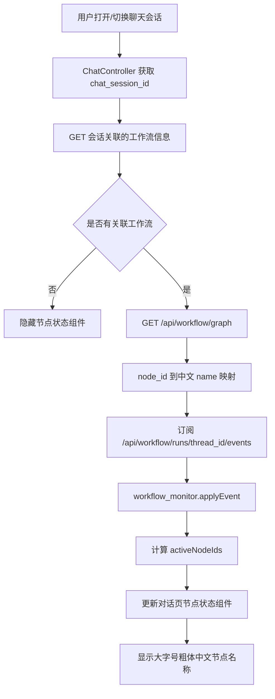

> ⚠️ **历史文档(2026-11-04 单流水线架构收敛后失效)**:本文档描述的聊天 Web /
> OpenStoryline Web / human 模式 / mcode-zcode 档位链路已删除;现行架构见 `README.md`
> 与 `docs/integration/architecture_decision_record.md`。内容保留仅作历史记录。

# 对话框显示 LangGraph 当前运行节点——执行设计文档

> 项目：[`wayyet/auto-video-editor`](https://github.com/wayyet/auto-video-editor)  
> 分支：`main`  
> 设计日期：2026-11-03  
> 目标页面：OpenStoryline Web 对话页（`http://127.0.0.1:7860/`）  
> 需求类型：前端展示增强 + 会话/工作流关联补齐

---

## 1. 需求目标

在对话页中，当 LangGraph 工作流正在执行时，在当前 Assistant 回复区域显示当前正在运行的节点名称。

显示要求：

1. 使用**大字号、粗黑体**，让节点名称成为对话区内醒目的状态信息。
2. 显示节点的**中文名称**，名称以 Node Map 的节点元数据为准。
3. 节点变化时实时更新，不需要刷新页面。
4. 工作流执行完成、失败或等待人工操作时，正确切换状态，不能继续显示已经结束的节点。
5. 普通聊天没有关联 LangGraph 工作流时，不显示该区域。
6. 不改变现有聊天正文、MCode Agent 执行面板、LangGraph 节点图及工作流业务逻辑。

### 1.1 截图对应关系

| 截图 | 当前界面 | 本次改动 |
|---|---|---|
| 第一张：OpenStoryline 对话页 | Assistant 回复区已有 MCode Agent 执行状态面板和普通聊天正文 | 在当前轮 Assistant 回复区域增加独立的 LangGraph 节点状态区域 |
| 第二张：Node Map | 展示完整 LangGraph 图、节点卡片、订阅状态及运行路径 | 复用它的节点 ID、中文名称和实时事件数据，不另建一份节点清单 |

**预期显示示例：**

```text
当前运行节点
探测 OpenStoryline
```

并行执行时：

```text
当前运行节点（并行）
生成文案
生成配音
推荐文本
```

等待人工操作时：

```text
等待人工操作
人工调整镜头顺序①
```

完成时：

```text
工作流已完成
```

---

## 2. 当前项目实现核对

以下结论基于仓库 `main` 分支当前源码、README 和两张界面截图。

### 2.1 对话页现有结构

| 文件 | 当前职责 | 本次改动方向 |
|---|---|---|
| `web/index.html` | 对话页 HTML，包含 `#chat` 容器，加载 `app.js` | 原有页面容器保持不变 |
| `web/static/app.js` | `ChatUI`、`WsClient`、聊天事件处理及消息渲染 | 增加工作流状态组件和 SSE 生命周期管理 |
| `web/static/style.css` | 对话消息、气泡、布局和 Agent 面板样式 | 增加节点名称的大字号黑体样式 |
| `agent_fastapi.py` | 聊天 WebSocket、会话状态和 Agent 事件路由 | 只补充必要的会话关联数据，不把 LangGraph 事件混入 MCode 事件 |

当前聊天 WebSocket 使用：

```text
/ws/sessions/{session_id}/chat
```

前端 `ChatController.onWsEvent()` 处理 `assistant.start`、`assistant.delta`、`assistant.end` 等事件；MCode / ZCode 执行过程则走各自的事件适配器。

`ChatUI.startAssistantMessage()` 创建 `.msg.assistant` 和 `.bubble`。MCode 执行面板是独立组件，不能把 LangGraph 节点状态直接塞进 MCode 面板，否则会混淆两类不同的执行过程。

### 2.2 当前 LangGraph 实时追踪链路

项目已经具备完整的 LangGraph 节点事件链路，本次不需要重新实现。

```mermaid
flowchart LR
    A[LangGraph compiled graph] --> B[workflow_runner.run_with_events]
    B --> C[WorkflowStreamAdapter]
    C --> D[标准 node.* / run.* 事件]
    D --> E[(PostgreSQL workflow_run_events)]
    E --> F[GET /api/workflow/runs/{thread_id}/events]
    F --> G[SSE EventSource]
    G --> H[workflow_monitor.mjs]
    H --> I[Node Map 实时渲染]
    H --> J[对话页节点状态组件：本次新增]
```

相关实现：

- `monitoring/workflow_runner.py`：通过 LangGraph `astream()` 捕获 task 生命周期，转换为标准事件。
- `monitoring/workflow_events.py`：定义事件类型、结构校验和 payload 脱敏规则。
- `monitoring/workflow_event_store.py`：将事件写入 PostgreSQL `workflow_run_events`。
- `web/api_workflow.py`：提供运行快照及 SSE 订阅接口。
- `web/static/workflow_monitor.mjs`：前端纯逻辑状态归约器，处理事件去重、节点状态、重试和并行节点。
- `web/node_map/node_map.html`：Node Map 页面，已经使用同一套 SSE 和状态归约器。

### 2.3 现有事件类型

| 事件 | 现有语义 | 对话框展示处理 |
|---|---|---|
| `run.started` | 工作流启动 | 初始化工作流状态 |
| `run.resumed` | 工作流恢复 | 恢复显示活动节点 |
| `node.started` | 节点开始执行 | 将该节点加入活动节点集合 |
| `node.progress` | 节点进度更新 | 保持当前节点，必要时更新辅助状态 |
| `node.retrying` | 节点重试 | 保留该节点并标记重试状态 |
| `node.resumed` | 节点从 interrupt 恢复 | 将该节点重新加入活动集合 |
| `node.succeeded` | 节点执行完成 | 从活动集合移除该节点 |
| `node.failed` | 节点执行失败 | 从活动集合移除，并显示失败状态 |
| `node.waiting_input` | 节点等待人工或网页输入 | 显示等待类型及对应节点名称 |
| `run.interrupted` | 工作流被 interrupt 挂起 | 显示等待人工操作，不显示为执行中 |
| `run.completed` | 工作流完成 | 清除活动节点，显示完成 |
| `run.failed` | 工作流失败 | 清除活动节点，显示失败 |

标准事件使用 `node_id` 标识真实节点；事件本身不携带 Node Map 的中文名称。中文名称应由图 Schema 进行映射。

### 2.4 不能忽略的 ID 问题

当前系统至少存在以下三种 ID：

| ID | 用途 | 示例/格式 |
|---|---|---|
| `chat_session_id`（当前代码中称 `session_id`） | 浏览器聊天会话 | 32 位十六进制字符串 |
| `thread_id` | LangGraph checkpoint 和工作流事件的关联键 | 如 `video-001`，按工作流接口规则校验 |
| `turn_id` | 一次聊天请求/回复的 ID | 单轮随机 ID |

**当前聊天会话 ID、LangGraph `thread_id` 和聊天 `turn_id` 不是同一个概念。**

现有 `POST /api/workflow/runs` 虽然可接收 `session_id`，并把它写入工作流初始 State，但 `workflow_run_events` 仍然只按 `thread_id` 存储和查询事件；现有事件表没有聊天会话 ID 字段。聊天 WebSocket 也不会自动收到 `node.started` 等 LangGraph 事件。

因此，不能在前端直接使用 `session_id` 拼 SSE URL，也不能使用 `turn_id` 代替 `thread_id`。本次实施必须先建立明确的会话—工作流关联。

### 2.5 运行时数据库现状

当前项目运行时持久化统一使用 PostgreSQL：

- `chat_sessions` 保存聊天会话。
- `workflow_runs` 保存工作流线程的最新状态。
- `workflow_run_events` 保存逐节点事件序列。
- SQLite / `SqliteSaver` 属于历史实现，README 已明确说明当前版本不再支持。

本设计沿用 PostgreSQL，不增加 SQLite 数据库或本地事件文件。

---

## 3. 总体设计

### 3.1 方案概述

采用“**会话关联 + 现有 SSE + 现有状态归约 + 对话页独立组件**”的方式。

1. 在工作流初始 State 中增加可选字段 `chat_session_id`，专门保存实际聊天会话 ID。
2. 增加 PostgreSQL 关联表，记录一个聊天会话当前关联的工作流线程。
3. `workflow_runner` 在工作流启动、恢复、挂起和结束时维护关联信息。
4. 对话页根据当前聊天会话 ID 查询关联的 `thread_id`。
5. 前端从 `/api/workflow/graph` 读取节点 Schema，建立 `node_id -> name` 映射。
6. 前端订阅现有 SSE 接口，并复用 `/static/workflow_monitor.mjs` 的 `applyEvent()`、`activeNodeIds()` 等逻辑。
7. 在 Assistant 回复区域显示一个独立的节点状态组件。

### 3.2 架构图



### 3.3 设计边界

本次只负责对话页显示，不修改：

- LangGraph 节点执行顺序、条件边、并行分支和业务函数。
- Node Map 的图布局、拖动、缩放和节点卡片样式。
- MCode / ZCode 自身的执行面板和工具卡片。
- 用户聊天正文的 Markdown 渲染逻辑。
- 工作流 checkpoint 和现有事件的基本语义。

---

## 4. 会话与工作流线程关联设计

### 4.1 新增字段：`chat_session_id`

在工作流初始 State 中新增一个可选字段：

```python
class WorkflowState(TypedDict, total=False):
    # 实际发起本工作流的聊天会话 ID。
    # 与现有 session_id、thread_id、turn_id 分开保存。
    chat_session_id: str
```

约束：

- `chat_session_id` 必须是当前聊天系统生成的 32 位十六进制会话 ID。
- 保留现有 `state.session_id` 的含义，不将它重命名或替换为聊天会话 ID。
- `thread_id` 仍然只作为 LangGraph checkpoint / 事件查询键。
- `turn_id` 仍然只代表一次聊天请求。
- 新字段必须是可选字段，老 checkpoint 没有该字段时，节点和 runner 必须使用 `.get("chat_session_id")` 安全读取。

### 4.2 工作流启动入口透传

需要覆盖所有可能启动工作流的入口，避免只有 Web API 启动时才能显示。

**Web API 启动：**

现有 `POST /api/workflow/runs` 请求体增加 `chat_session_id`：

```json
{
  "thread_id": "video-web-001",
  "session_id": "原有工作流业务 session_id，保持旧语义",
  "chat_session_id": "0123456789abcdef0123456789abcdef",
  "video_input_path": "inputs/demo.mp4"
}
```

服务端将其写入：

```python
state["chat_session_id"] = chat_session_id
```

**CLI 启动：**

`scripts/run_workflow.py` 增加可选参数：

```powershell
--chat-session-id 0123456789abcdef0123456789abcdef
```

参数存在时，将值写入初始 State 的 `chat_session_id`。未传入时保持现有行为，不创建聊天关联。

如果 Agent 通过脚本启动工作流，调用脚本的一方必须把当前聊天会话 ID 透传给该参数；否则无法安全地把该工作流归属到某个聊天窗口。

### 4.3 PostgreSQL 关联表

新增迁移表：`workflow_chat_links`。

建议结构：

```sql
CREATE TABLE IF NOT EXISTS workflow_chat_links (
    chat_session_id TEXT PRIMARY KEY
        REFERENCES chat_sessions(session_id) ON DELETE CASCADE,
    thread_id       TEXT NOT NULL,
    run_id          TEXT,
    status          TEXT NOT NULL
        CHECK (status IN ('running', 'waiting_human', 'completed', 'failed')),
    updated_at      TIMESTAMPTZ NOT NULL DEFAULT now()
);

CREATE INDEX IF NOT EXISTS idx_workflow_chat_links_thread
    ON workflow_chat_links (thread_id);
```

约定：

- 每个聊天会话保存最近一次关联的工作流线程。
- 新工作流启动时，按 `chat_session_id` upsert，更新 `thread_id`、`run_id` 和状态。
- 工作流恢复时更新状态为 `running`。
- interrupt 时更新为 `waiting_human`。
- 正常结束时更新为 `completed`。
- 异常结束时更新为 `failed`。
- 完成和失败后保留最后一次关联信息，便于刷新页面后仍能显示终态；新工作流启动后再覆盖。
- 不存储 prompt、工具参数、模型输出或视频文件内容。

> 约束说明：本方案按“一个聊天会话显示最近一次工作流”的产品语义设计。如果同一聊天会话将来允许多个工作流真正并行运行，需要把主键改为复合键，并让查询接口返回工作流列表；不能让多个 thread 的事件无分组地混合显示。

### 4.4 关联信息写入时机

关联信息应在 `monitoring/workflow_runner.py` 中统一维护，而不是只放在 `web/api_workflow.py`。

原因：当前 CLI 和 Web 启动最终都会经过统一 runner；若只在 Web API 写关联，CLI 启动的工作流会漏掉关联。

推荐处理顺序：

1. 首次执行时，从 `initial_state.get("chat_session_id")` 取聊天会话 ID。
2. 恢复执行时，从 `graph.aget_state(config).values.get("chat_session_id")` 读取 checkpoint 中保存的 ID。
3. 在 runner 产生首个运行事件前，创建或更新 `workflow_chat_links`。
4. 按 `run.started`、`run.resumed`、`run.interrupted`、`run.completed`、`run.failed` 更新关联状态。
5. 数据库关联写入失败时记录明确日志；对话页不能将未确认的关联当成成功关联。

---

## 5. 后端接口设计

### 5.1 新增关联查询接口

新增只读接口：

```http
GET /api/workflow/chat-sessions/{chat_session_id}/run
```

成功且有关联时返回：

```json
{
  "available": true,
  "chat_session_id": "0123456789abcdef0123456789abcdef",
  "thread_id": "video-web-001",
  "run_id": "run-uuid",
  "status": "running",
  "updated_at": "2026-11-03T02:30:00Z"
}
```

没有关联时返回：

```json
{
  "available": true,
  "run": null
}
```

错误处理：

| 情况 | HTTP 状态 | 前端处理 |
|---|---:|---|
| 找到关联 | 200 | 订阅返回的 `thread_id` |
| 尚无关联 | 200 | 隐藏节点状态组件 |
| 会话 ID 格式错误 | 400 | 不订阅 |
| PostgreSQL / 关联表不可用 | 503 | 显示“工作流状态暂不可用”，不能伪造节点 |

安全要求：沿用现有 `/api/workflow/*` 的同源校验；会话 ID 必须经过格式校验，不能直接拼接未经校验的 SQL。

### 5.2 复用现有接口

| 接口 | 用途 | 本次是否新增 |
|---|---|---|
| `GET /api/workflow/graph` | 读取当前编译图的节点 Schema 和中文名称 | 否 |
| `GET /api/workflow/runs/{thread_id}` | 获取运行快照 | 否 |
| `GET /api/workflow/runs/{thread_id}/events` | 订阅节点 SSE 事件 | 否 |
| `GET /api/workflow/chat-sessions/{chat_session_id}/run` | 从聊天会话解析工作流线程 | **是** |

**禁止使用** `POST /api/workflow/runs` 作为页面订阅入口。页面刷新、切换会话、订阅 SSE 都不能启动或重启工作流。

### 5.3 Schema 数据映射

当前 `/api/workflow/graph` 返回的节点数据包含：

```json
{
  "id": "launch_openstoryline",
  "name": "探测 OpenStoryline",
  "kind": "task",
  "enabled": true,
  "reachable": true
}
```

前端生成映射：

```javascript
const nodeNameById = new Map(
  graph.nodes.map((node) => [node.id, node.name || node.id])
);
```

事件到达后：

```javascript
const displayName = nodeNameById.get(event.node_id) || event.node_id;
```

规则：

- `node_id` 是程序标识；`name` 是用户可读名称。两者必须分开。
- 不在 `app.js` 中硬编码整份中文节点名称表。
- 优先使用当前图 Schema 的 `name`。
- Schema 找不到节点时，降级显示原始 `node_id`，同时记录开发日志；不得因映射缺失导致整个事件流崩溃。
- Schema 缓存至少区分 `workflow_id`、`mode`、`schema_version`，避免 human / auto 模式或 Schema 更新后继续使用旧映射。

---

## 6. 前端实现设计

### 6.1 组件位置

在第一张截图中的对话区，放在当前轮 Assistant 回复区域内：

- 位于 MCode Agent 执行面板之后（若该轮存在 MCode 面板）。
- 位于 Assistant 正文气泡之前。
- 与普通聊天正文分离，不写入 Markdown 内容。
- 一轮 Assistant 回复只创建一个节点状态组件；工具调用导致正文分段时，不重复创建组件。

建议 DOM 结构：

```html
<div class="msg assistant workflow-node-msg" role="status" aria-live="polite">
  <div class="workflow-node-indicator">
    <div class="workflow-node-indicator__label">当前运行节点</div>
    <div class="workflow-node-indicator__names">
      <div class="workflow-node-indicator__name">探测 OpenStoryline</div>
    </div>
  </div>
</div>
```

节点名称组件应作为独立消息行或稳定的 turn 级节点管理，不能直接塞进 `currentAssistant.bubbleEl`。这样 `flushAssistantSegment()`、Markdown 重渲染或工具卡片插入时，不会把节点状态清掉或重复插入。

### 6.2 样式要求

在 `web/static/style.css` 的聊天消息样式区域增加样式。

建议初始样式：

```css
.workflow-node-msg {
  justify-content: flex-start;
  padding-top: 8px;
  padding-bottom: 4px;
}

.workflow-node-indicator {
  width: 100%;
  min-width: 0;
}

.workflow-node-indicator__label {
  margin-bottom: 6px;
  color: var(--muted);
  font-size: 13px;
  font-weight: 600;
  line-height: 1.4;
}

.workflow-node-indicator__names {
  display: flex;
  flex-direction: column;
  gap: 4px;
}

.workflow-node-indicator__name {
  color: var(--text, #111);
  font-family: "Microsoft YaHei", "PingFang SC", system-ui, sans-serif;
  font-size: 26px;
  font-weight: 900;
  line-height: 1.35;
  letter-spacing: 0;
  overflow-wrap: anywhere;
}

.workflow-node-indicator[data-state="retrying"]
.workflow-node-indicator__name {
  text-decoration: underline;
  text-decoration-style: dotted;
  text-underline-offset: 4px;
}

.workflow-node-indicator[data-state="waiting"] .workflow-node-indicator__name {
  opacity: 0.9;
}

@media (max-width: 700px) {
  .workflow-node-indicator__name {
    font-size: 22px;
  }
}
```

视觉要求：

- 节点名称为主要信息，推荐 `26px`、`font-weight: 900`。
- 小标题“当前运行节点”使用较小字号，不与节点名称争夺视觉焦点。
- 颜色跟随现有主题变量，浅色背景下必须呈现近黑色字体。
- 节点名称很长时允许换行，不能横向撑破聊天区域。
- 并行节点逐行展示，不把多个长名称挤在一行。
- 不使用固定高度，不遮挡聊天输入框。

### 6.3 前端模块职责

建议新增：

```text
web/static/workflow_chat_indicator.mjs
```

模块负责：

1. 以当前 `chat_session_id` 请求关联查询接口。
2. 获取当前工作流 `thread_id`。
3. 读取 `/api/workflow/graph`，建立 `node_id -> name` 映射。
4. 创建和关闭 `EventSource`。
5. 将 SSE 事件交给现有 `workflow_monitor.mjs` 的状态归约逻辑。
6. 根据当前活动节点集合更新 DOM。
7. 处理加载、无关联、等待、失败、完成和断线状态。

不要在新模块中再造一套节点状态机。状态计算尽量复用：

```javascript
import {
  createMonitorState,
  applyEvent,
  activeNodeIds,
  API_PATHS,
} from "/static/workflow_monitor.mjs";
```

### 6.4 事件订阅规则

使用现有 SSE URL：

```javascript
const url = API_PATHS.runEvents(threadId);
const source = new EventSource(url);
```

订阅事件至少包括：

```javascript
const eventTypes = [
  "snapshot",
  "store_error",
  "run.started",
  "run.resumed",
  "run.interrupted",
  "run.completed",
  "run.failed",
  "node.started",
  "node.succeeded",
  "node.failed",
  "node.waiting_input",
  "node.resumed",
  "node.retrying",
  "node.progress",
  "branch.selected",
];
```

处理方式：

1. 将 SSE `event` 类型、`lastEventId` 和 JSON data 组合成标准事件对象。
2. 调用 `applyEvent(monitor, event)`。
3. `applied=false` 时不重复更新 UI。
4. 获取 `activeNodeIds(monitor)`。
5. 通过 Schema 映射成中文节点名称。
6. 更新当前状态组件。

现有 `activeNodeIds()` 已支持 `running` 和 `retrying` 状态，并且允许返回多个节点 ID，正好满足并行执行场景。

### 6.5 活动节点显示规则

| 归约后的状态 | 显示规则 |
|---|---|
| 一个 `running` 节点 | 显示一个大字号中文节点名称 |
| 多个 `running` 节点 | 显示全部活动节点，标题标记“并行” |
| `retrying` 节点 | 保留节点名称，状态提示为“重试中” |
| `node.waiting_input` | 从“执行中”列表移出，转入“等待输入/人工操作”区域 |
| `run.interrupted` | 显示等待状态和对应关卡节点名称 |
| `node.resumed` | 重新显示为正在执行 |
| `node.succeeded` | 移除已完成节点；若另一个节点仍在运行，只显示仍活动的节点 |
| `node.failed` | 移除活动状态，显示失败提示；不继续显示为运行中 |
| `run.completed` | 清空活动节点，显示“工作流已完成” |
| `run.failed` | 清空活动节点，显示“工作流失败” |
| `store_error` / HTTP 503 | 显示“工作流状态暂不可用”，不可推测节点 |
| 无工作流关联 | 隐藏整个组件 |

**并行处理原则：** LangGraph 存在 fan-out / fan-in，多节点可能同时执行。因此不能用“最后收到的 `node.started`”覆盖前一个活动节点。必须根据状态归约后的活动节点集合展示。

### 6.6 工作流状态组件生命周期

| 时机 | 操作 |
|---|---|
| 页面加载并恢复当前聊天会话 | 查询会话关联；若有工作流则回放 SSE 历史 |
| 收到 `assistant.start` | 以当前聊天会话 ID 查询/刷新工作流关联 |
| 关联信息尚未生成 | 在本轮 Agent 执行期间有限间隔重试查询；不启动工作流 |
| 找到新 `thread_id` | 关闭旧订阅，重置 reducer，再订阅新线程 |
| 收到 SSE 节点事件 | 更新节点状态组件 |
| 切换聊天会话 | 关闭旧 EventSource，取消旧会话查询任务，清空旧节点状态 |
| 当前会话关联的工作流完成/失败 | 显示终态，停止继续轮询关联信息 |
| 新工作流启动 | 根据新的关联记录切换至新 `thread_id` |
| 用户刷新页面 | 重新获取关联并利用 SSE 历史重放恢复 UI |

注意：EventSource 只能对应一个当前 `thread_id`。切换会话或切换工作流时，必须先关闭旧连接，防止旧会话事件污染当前对话。

### 6.7 与现有 Assistant / MCode 面板的关系

现有 UI 语义应保持如下：

```text
用户消息

MCode Agent 执行面板（仅 MCode / ZCode turn 存在）

当前运行节点（仅关联 LangGraph 工作流时显示）
探测 OpenStoryline

Assistant 正文
我正在分析工作流……
```

说明：

- MCode / ZCode 面板描述 Agent Runtime 自己的状态和工具过程。
- LangGraph 节点区域描述视频剪辑工作流的节点执行状态。
- 两个组件可以同时存在，但必须分开展示。
- 普通 LLM 聊天或没有工作流关联的 Agent turn，不显示 LangGraph 节点区域。

---

## 7. 节点名称映射清单

第二张截图是完整 LangGraph 工作流图。当前中文展示名由 `monitoring/workflow_graph.py` 的 `_NODE_META` 提供。以下列出主要工作流节点，供实现和验收对照。

> 前端运行时必须以 `/api/workflow/graph` 返回的 Schema 为准。此表是设计核对清单，不是要求前端复制维护的硬编码表。

### 7.1 工作流入口与装配 QC

| node_id | 对话框显示名称 |
|---|---|
| `START` | 开始 |
| `launch_openstoryline` | 探测 OpenStoryline |
| `open_preview` | 打开预览 |
| `checkpoint0_storyline_plan` | 人工规划确认关卡⓪ |
| `import_video` | 网页导入视频（文件握手） |
| `get_storyboard_plan` | 读取分镜规划 |
| `generate_draft` | 生成剪映草稿 |
| `assembly_discover_and_probe` | 素材发现与探测 |
| `assembly_asr_and_visual_observe` | ASR 与视觉观察 |
| `assembly_build_timeline` | 装配时间线 |
| `assembly_validate_render_qc` | 渲染与质量检查 |
| `assembly_repair_loop` | QC 修复回路 |
| `assembly_write_report` | 写 QC 报告 |

### 7.2 剪辑调整、字幕与封面

| node_id | 对话框显示名称 |
|---|---|
| `node_06_human_reorder` | 人工调整镜头顺序① |
| `node_07_speed_fit` | 时长适配（35s） |
| `escalate_guardrail_failure` | 护栏失败升级 |
| `bridge_snapshot2` | 桥接快照2 |
| `node_08_add_subtitles` | 添加中文字幕 |
| `node_08b_add_subtitles_en` | 添加英文字幕 |
| `node_10_inject_text_fx` | 注入中文花字 |
| `node_10b_inject_text_fx_en` | 注入英文花字 |
| `node_14_make_covers` | 生成封面 |
| `node_15_localize_covers_en` | 封面英文本地化 |
| `node_16a_translate_and_check` | 翻译与布局检测 |
| `node_checkpoint3_layout_review` | 布局人工复核③ |
| `node_17_inject_english_tts` | 注入英文 TTS |
| `fork_draft_for_english_branch` | 复制英文分支草稿 |

### 7.3 特效与交付

| node_id | 对话框显示名称 |
|---|---|
| `node_09_inject_fx` | 注入特效 |
| `node_11_inject_sticker` | 注入贴纸 |
| `node_12_human_add_bgm` | 人工添加 BGM② |
| `node_13_adjust_volume` | 音量调节 |
| `join_before_delivery` | 交付前 QA 闸门 |
| `END` | 结束 |

### 7.4 OpenStoryline / Storyline 节点

| node_id | 对话框显示名称 |
|---|---|
| `storyline_load_media` | 载入媒体 |
| `storyline_search_media` | 检索素材 |
| `storyline_search_web_topic` | 网页话题检索 |
| `storyline_split_shots` | 分镜切分 |
| `storyline_local_asr` | 本地 ASR |
| `storyline_speech_rough_cut` | 语音粗剪 |
| `storyline_understand_clips` | 理解片段 |
| `storyline_filter_clips` | 过滤片段 |
| `storyline_group_clips` | 片段分组 |
| `storyline_generate_script` | 生成文案 |
| `storyline_script_template_recommendation` | 文案模板推荐 |
| `storyline_generate_voiceover` | 生成配音 |
| `storyline_select_bgm` | 选择 BGM |
| `storyline_recommend_transition` | 推荐转场 |
| `storyline_recommend_text` | 推荐文本 |
| `storyline_plan_timeline_pro` | 时间线规划 |
| `storyline_generate_ai_transition` | 生成 AI 转场 |
| `storyline_plan_timeline_ai_transition` | AI 转场时间线规划 |
| `storyline_render_video` | 渲染视频 |
| `storyline_qa_gate` | 剧情 QA 闸门 |
| `storyline_join` | 剧情结果汇合 |

### 7.5 特殊节点规则

- `clean_cache`（清理缓存）虽然注册在图 Schema 中，但它是由 Web「清理缓存」按钮手动触发的运维节点，主工作流没有入边/出边，也不参与普通 LangGraph 流程执行。不要把它当成普通工作流的“当前运行节点”。
- `START` / `END` 是图终端标记，不是普通业务 task。通常不应显示成正在执行的节点。
- `assembly_*` 节点是否参与执行取决于 `ASSEMBLY_QC_GATE_ENABLED`。
- `human` / `auto` 模式的实际节点集合可能不同。必须读取当前编译图 Schema，不得假设每种模式都经过相同节点。

---

## 8. 关键异常与边界处理

| 场景 | 正确处理 | 禁止行为 |
|---|---|---|
| 聊天会话没有关联工作流 | 隐藏状态组件 | 使用 `session_id` 猜测 `thread_id` |
| 工作流正在并行运行 | 同时显示所有活动节点 | 只显示最后收到的节点 |
| 节点进入 interrupt | 显示等待人工操作及对应节点 | 显示成“执行中” |
| 节点重试 | 显示节点名称和重试状态 | 当成一个新节点或清空历史状态 |
| 页面刷新 | 根据关联接口和 SSE 历史恢复 | 再次 POST 启动工作流 |
| SSE 自动重连 | 利用 `Last-Event-ID` 和 reducer 游标去重 | 重放时重复插入多个状态组件 |
| 切换聊天会话 | 关闭旧 SSE 并重置状态 | 继续显示旧会话节点 |
| 事件存储不可用 | 明确提示状态暂不可用 | 静默显示上一次缓存的节点名称 |
| Schema 缺失某个 node_id | 回退显示 node_id 并记录告警 | 让事件处理抛异常或页面崩溃 |
| 工作流已经结束 | 清空活动节点并显示终态 | 继续保留最后一个运行节点作为当前节点 |
| `clean_cache` 被手动调用 | 不纳入主工作流当前节点组件 | 将其误认为主图中的正常节点执行 |

---

## 9. 建议修改文件清单

### 9.1 后端

| 文件 | 改动 | 优先级 |
|---|---|---|
| `state.py` | 增加可选 `chat_session_id` 字段 | P0 |
| `db/migrations.py` | 增加 `workflow_chat_links` 表迁移 | P0 |
| `monitoring/workflow_chat_link_store.py`（新增） | 实现会话与 thread 关联的 upsert / query / 状态更新 | P0 |
| `monitoring/workflow_runner.py` | 启动、恢复和终态时维护关联；从 checkpoint 恢复时读取 `chat_session_id` | P0 |
| `web/api_workflow.py` | 增加关联查询 GET 接口；`POST /runs` 接收 `chat_session_id` 并写入初始 State | P0 |
| `scripts/run_workflow.py` | 增加可选 `--chat-session-id` 参数并写入 State | P1 |

### 9.2 前端

| 文件 | 改动 | 优先级 |
|---|---|---|
| `web/static/workflow_chat_indicator.mjs`（新增） | 关联查询、Schema 映射、SSE 生命周期、节点名称渲染 | P0 |
| `web/static/app.js` | 在当前聊天会话和 Assistant turn 生命周期中初始化、更新、销毁组件 | P0 |
| `web/static/style.css` | 增加大字号黑体节点名称样式和响应式布局 | P0 |
| `web/index.html` | 通常无需改动；如需模块入口或静态资源版本号，再做最小修改 | P2 |
| `web/static/workflow_monitor.mjs` | 优先复用现有导出；只有确实缺少能力时才扩展 | P1 |

### 9.3 测试

| 测试文件建议 | 覆盖内容 | 优先级 |
|---|---|---|
| `tests/unit/test_workflow_chat_link_store.py` | 关联写入、查询和状态更新 | P0 |
| `tests/unit/test_workflow_chat_indicator.mjs` | node_id 名称映射、状态归约和并行节点渲染数据 | P0 |
| `tests/integration/test_workflow_chat_link.py` | runner 启动、resume、interrupt、completed、failed 的关联记录 | P0 |
| `web/tests/workflow_chat_indicator.test.mjs` | SSE 事件、会话切换、断线重连和旧事件去重 | P1 |
| 现有聊天 UI 回归测试 | 普通 LLM、MCode、ZCode 和工具卡片流程不受影响 | P0 |

---

## 10. 分阶段执行计划

### 阶段一：建立关联数据（P0）

1. 在 `WorkflowState` 添加可选 `chat_session_id`。
2. 编写 `workflow_chat_links` 数据库迁移。
3. 新增 `workflow_chat_link_store.py`。
4. 明确 `chat_session_id` 格式校验和 thread 关联查询规则。
5. 为新增 State 字段添加旧 checkpoint 兼容测试。

**完成条件：** 可以通过聊天会话 ID 查询到其最近一次工作流 `thread_id`；没有关联时返回空结果。

### 阶段二：统一 runner 写入关联（P0）

1. 在 `run_with_events()` 中读取初始 State 的 `chat_session_id`。
2. 恢复执行时从 checkpoint State 读取 `chat_session_id`。
3. 工作流开始/恢复时更新关联状态。
4. interrupt / completed / failed 时更新状态。
5. Web API 和 CLI 均能透传 `chat_session_id`。

**完成条件：** 无论从 Web 还是 CLI 启动，只要传入 `chat_session_id`，都能正确建立同一条关联；旧工作流不传该字段时仍能照常运行。

### 阶段三：关联查询接口（P0）

1. 新增 `GET /api/workflow/chat-sessions/{chat_session_id}/run`。
2. 接入同源检查和会话 ID 校验。
3. 增加无记录、数据库不可用和无效 ID 测试。
4. 确认接口只读，不会启动、恢复或修改工作流。

**完成条件：** 对话页仅凭当前会话 ID 就能取得正确 `thread_id`。

### 阶段四：前端节点追踪模块（P0）

1. 新增 `workflow_chat_indicator.mjs`。
2. 调用关联查询接口获取 `thread_id`。
3. 调用 `/api/workflow/graph` 获取当前图 Schema。
4. 复用 `workflow_monitor.mjs` reducer。
5. 使用现有 SSE 接口订阅事件。
6. 生成单节点、并行节点、等待和终态显示数据。
7. 处理 503、断线重连、会话切换和新工作流替换旧工作流。

**完成条件：** 浏览器能持续接收与当前聊天会话关联的工作流节点变化，不重复消费事件。

### 阶段五：对话区 UI（P0）

1. 在 Assistant 当前轮消息区域添加稳定的节点状态行。
2. 确保它位于 MCode 面板后、Assistant 正文前。
3. 节点名称使用 26px、900 字重的黑体风格。
4. 并行节点逐行显示。
5. 工作流终态和异常提示正常显示。
6. 不改变普通聊天气泡和输入框的布局行为。

**完成条件：** 实际页面的显示位置和字号符合第一张截图所要求的区域及视觉层级。

### 阶段六：回归与验收（P0）

按第 11 节执行完整验收。只有在普通聊天、MCode / ZCode、LangGraph 单节点、并行节点、interrupt、resume 和错误恢复场景全部通过后，才视为交付。

---

## 11. 验收标准

### 11.1 功能验收

| 编号 | 操作 | 预期结果 |
|---|---|---|
| TC-01 | 在聊天会话关联一个 LangGraph 工作流 | 当前 Assistant 回复区域出现节点状态组件 |
| TC-02 | 触发 `launch_openstoryline` | 显示粗体“探测 OpenStoryline” |
| TC-03 | 节点从 A 切换到 B | A 从活动状态移除，显示 B |
| TC-04 | 同一个 superstep 并行启动多个节点 | 所有运行节点同时显示，不能互相覆盖 |
| TC-05 | 节点发生 retry | 名称保持，状态标识切换为重试中 |
| TC-06 | 节点进入 `node.waiting_input` | 显示等待人工/网页输入状态，不显示为运行中 |
| TC-07 | 工作流从 interrupt 恢复 | 对应节点重新显示为运行中 |
| TC-08 | 收到 `run.completed` | 清空活动节点，显示“工作流已完成” |
| TC-09 | 收到 `run.failed` | 清空活动节点，显示“工作流失败” |
| TC-10 | 切换到另一个聊天会话 | 旧会话的节点名称立即清除，不能串流污染 |
| TC-11 | 刷新正在运行的对话页 | 重新订阅后能通过历史事件恢复当前活动节点 |
| TC-12 | SSE 断线后自动重连 | 按 `Last-Event-ID` 补发，不重复插入节点状态或倒退状态 |
| TC-13 | 普通聊天，没有工作流关联 | 不显示节点状态组件 |
| TC-14 | MCode / ZCode Agent 触发工作流 | MCode / ZCode 面板与 LangGraph 节点区域同时存在且职责清楚 |
| TC-15 | 数据库事件服务不可用 | 显示状态不可用提示，不显示旧节点冒充当前节点 |
| TC-16 | human / auto 模式切换 | 节点名称映射来自当前图 Schema，不使用另一个模式的旧数据 |
| TC-17 | 工作流节点名很长或窗口较窄 | 名称正常换行，不溢出、不遮挡输入区 |

### 11.2 视觉验收

- 节点名称明显大于普通聊天正文。
- 节点名称粗体，建议 26px / 900 字重。
- 浅色背景下文字为黑色或接近黑色。
- 标题“当前运行节点”字号明显小于节点名称。
- 组件位于当前 Assistant 回复区域，不覆盖用户消息、输入框或右侧开发者栏。
- 并行时多行排列，名称之间有清晰间距。
- 状态组件与 MCode Agent 执行面板有独立容器，不互相嵌套或复用错误状态。

### 11.3 兼容性验收

- 老 checkpoint 缺少 `chat_session_id` 时可以正常恢复。
- 不传 `--chat-session-id` 时，CLI 现有工作流行为不变。
- 不传 `chat_session_id` 的 `/api/workflow/runs` 旧调用保持兼容。
- 现有 Node Map 页面不受影响。
- 现有 `/api/workflow/runs/{thread_id}/events` 协议不需要改变。
- `workflow_events.ALLOWED_PAYLOAD_KEYS` 不需要增加 `node_name` 或 `chat_session_id`；节点名称由 Schema 映射。
- PostgreSQL 是唯一持久化数据库，不引入 SQLite 或本地 JSON 作为运行时状态真相。

---

## 12. 实现注意事项

1. **不要把“最近一次 node.started”当成唯一当前节点。** 并行图可能同时有多个 running 节点。
2. **不要通过聊天正文解析节点名称。** 必须使用事件中的 `node_id` 和图 Schema 的 `name`。
3. **不要把 MCode Agent 的 `turn_id` 当作 LangGraph `thread_id`。** 两者属于不同链路。
4. **不要将聊天 `session_id` 强行当作工作流 `thread_id`。** 必须通过关联表显式映射。
5. **不要在刷新页面时启动工作流。** 页面只查询关联和订阅 SSE。
6. **不要在 `ChatUI` 每次创建新 Markdown bubble 时重复创建节点组件。** 状态组件应属于稳定的 Assistant turn 容器。
7. **不要维护第二份节点显示名称表。** `/api/workflow/graph` 已返回节点元数据。
8. **不要改变现有 `session_id` 字段语义。** 新增独立的 `chat_session_id`，避免破坏视频素材目录、工作流 State 和旧 checkpoint。
9. **不要在数据库不可用时静默沿用旧节点名称。** 应显示状态不可用，防止用户误判工作流仍在运行。
10. **新增 State 字段必须覆盖旧 checkpoint 兼容测试。** 访问新字段统一使用 `.get()`。

---

## 13. 源码依据

下列文件均来自仓库 `main` 分支；设计中的接口、字段和模块职责以这些源码为依据。

| 源码 | 核对内容 |
|---|---|
| [`README.md`](https://github.com/wayyet/auto-video-editor/blob/main/README.md) | 当前持久化方案、工作流运行入口、Node Map 和实时追踪说明 |
| [`web/index.html`](https://github.com/wayyet/auto-video-editor/blob/main/web/index.html) | 对话页 `#chat` 容器和前端入口 |
| [`web/static/app.js`](https://github.com/wayyet/auto-video-editor/blob/main/web/static/app.js) | `ChatUI`、Assistant 消息、MCode 面板、WebSocket 事件路由 |
| [`web/static/style.css`](https://github.com/wayyet/auto-video-editor/blob/main/web/static/style.css) | 聊天消息与气泡布局 |
| [`agent_fastapi.py`](https://github.com/wayyet/auto-video-editor/blob/main/agent_fastapi.py) | 聊天会话、WebSocket 及 Agent 事件适配 |
| [`state.py`](https://github.com/wayyet/auto-video-editor/blob/main/state.py) | 工作流 State 字段定义 |
| [`graph.py`](https://github.com/wayyet/auto-video-editor/blob/main/graph.py) | LangGraph 节点注册、主图结构、human / auto 路由 |
| [`monitoring/workflow_runner.py`](https://github.com/wayyet/auto-video-editor/blob/main/monitoring/workflow_runner.py) | `astream()` 事件捕获、节点 start/end、retry、resume 和并行 task 处理 |
| [`monitoring/workflow_events.py`](https://github.com/wayyet/auto-video-editor/blob/main/monitoring/workflow_events.py) | 标准事件类型、payload 白名单和 SSE 帧格式 |
| [`monitoring/workflow_event_store.py`](https://github.com/wayyet/auto-video-editor/blob/main/monitoring/workflow_event_store.py) | PostgreSQL 事件落库和 thread 事件查询 |
| [`monitoring/workflow_graph.py`](https://github.com/wayyet/auto-video-editor/blob/main/monitoring/workflow_graph.py) | 节点中文名称 `_NODE_META` 与编译图 Schema |
| [`web/api_workflow.py`](https://github.com/wayyet/auto-video-editor/blob/main/web/api_workflow.py) | Graph、运行快照、启动和 SSE API |
| [`web/static/workflow_monitor.mjs`](https://github.com/wayyet/auto-video-editor/blob/main/web/static/workflow_monitor.mjs) | `applyEvent()`、`activeNodeIds()`、事件游标去重和多节点状态归约 |
| [`web/node_map/node_map.html`](https://github.com/wayyet/auto-video-editor/blob/main/web/node_map/node_map.html) | 第二张截图对应的 Node Map 订阅与节点展示实现 |
| [`db/migrations.py`](https://github.com/wayyet/auto-video-editor/blob/main/db/migrations.py) | PostgreSQL 现有 `chat_sessions`、`workflow_runs`、`workflow_run_events` 表迁移 |
| [`monitoring/runs_table.py`](https://github.com/wayyet/auto-video-editor/blob/main/monitoring/runs_table.py) | 工作流运行状态和人工关卡台账 |
| [`scripts/run_workflow.py`](https://github.com/wayyet/auto-video-editor/blob/main/scripts/run_workflow.py) | CLI 工作流入口及 `thread_id` 初始化 |

---

## 14. 最终交付定义

完成本设计后，用户在 OpenStoryline 对话页中可以直接看到当前 LangGraph 工作流的实际执行节点，例如：

<pre>
当前运行节点
探测 OpenStoryline
</pre>

节点切换时，显示内容随 SSE 实时更新；并行时同时显示多个节点；人工关卡、重试、完成、失败和断线状态均有明确表现。

**验收的关键不是“页面出现一段大字”，而是这段大字始终对应当前聊天会话实际关联的 LangGraph `thread_id` 和真实节点状态。**
