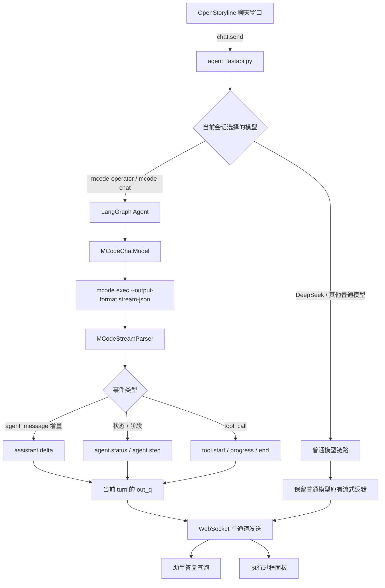
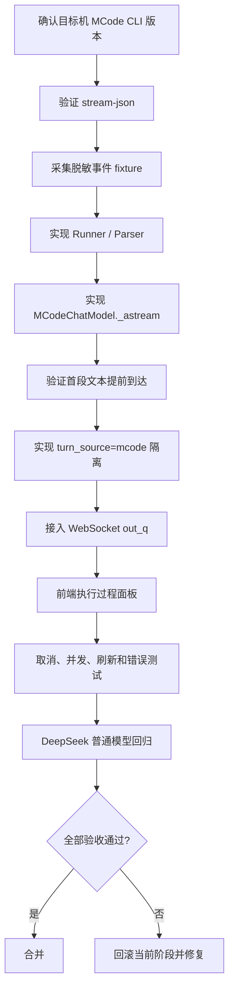

# OpenStoryline：MCode Agent 流式输出与中间过程展示改造执行设计

> **项目**：[`wayyet/auto-video-editor`](https://github.com/wayyet/auto-video-editor)  
> **分支**：`main`  
> **模块**：OpenStoryline Web、MCode Agent、LangGraph、WebSocket  
> **文档类型**：源码分析与执行设计  
> **设计日期**：2026-10-31  
> **核心要求**：聊天窗口展示 MCode Agent 自身的实时输出和可观察执行过程，不得把 DeepSeek 普通模型的输出误显示成 MCode Agent 的过程。

---

## 1. 目标与最终结论

本次改造不是给聊天窗口增加一个“思考中”动画，而是建立一条真实、可验证的 MCode Agent 流式事件链路：

1. MCode CLI 产生结构化流事件。
2. `MCodeChatModel` 实时读取并解析事件。
3. OpenStoryline 将 MCode 事件送入当前会话、当前 turn 的事件队列。
4. WebSocket 将事件发给浏览器。
5. 前端把助手文本、执行状态和工具调用分别展示。

**必须满足：**

- 用户选择 `mcode-operator` 或 `mcode-chat` 后，过程事件必须来自该轮实际启动的 `mcode exec` 子进程。
- 不得把普通 DeepSeek LLM 的 `assistant.delta`、模型调用日志或工具事件伪装成 MCode Agent 事件。
- MCode 的实时助手文本应在 CLI 进程退出前显示。
- 工具调用、工具结果摘要、阶段状态进入独立的“执行过程”区域，不混入最终答复正文。
- 保留普通 DeepSeek / OpenAI 兼容模型原有链路，不改变其默认行为。
- 不展示模型隐藏思维链；只展示公开文本增量、结构化状态、工具事件和安全摘要。

**推荐实现：使用 MCode CLI 的 `--output-format stream-json` 作为首选传输协议，重构 `MCodeChatModel` 的异步流式实现，并增加严格的 `source=mcode` 事件路由。** 不再把 `--output-format json` 的最终结果模式当成真正的流式输出。

---

## 2. 当前代码问题与根因

### 2.1 当前 MCode 调用链

当前仓库中，MCode 适配器位于：

`openstoryline/src/open_storyline/mcode_chat_model.py`

其主要流程是：

```text
MCodeChatModel
  └─ 启动 mcode exec
       └─ --output-format json
            └─ 等待进程结束
                 └─ 解析最终 exec.result
                      └─ 返回完整 AIMessage
```

当前实现有 `_generate()` / `_agenerate()` 等一次性生成路径，但没有真正的 `_stream()` / `_astream()` 增量消费路径。子进程输出即使被持续读取，也只是避免 stdout/stderr 管道阻塞；如果内容一直缓存在进程内部，前端仍然要等进程退出后才能拿到最终文本。

### 2.2 LangGraph 和 WebSocket 已有基础能力

当前 `openstoryline/agent_fastapi.py` 已调用：

```python
sess.agent.astream(
    {"messages": _merged_messages},
    context=sess.client_context,
    stream_mode=["messages", "updates"],
)
```

当前代码在 `messages` 模式下检查：

```python
meta.get("langgraph_node") == "model"
```

然后将文本增量放入：

```python
out_q.put(("assistant.delta", delta))
```

WebSocket 主循环通过统一发送路径向前端发送事件。当前 `openstoryline/web/static/app.js` 已处理：

- `assistant.start`
- `assistant.delta`
- `assistant.flush`
- `assistant.end`
- `tool.start`
- `tool.progress`
- `tool.end`

所以，前端已有基础的文本流式显示能力，WebSocket 也已有事件队列。问题在于 MCode 模型层没有向 LangGraph 提供真正的增量事件，同时现有通用 `langgraph_node == "model"` 判断没有明确的 MCode 来源隔离。

### 2.3 必须修复的根因

| 编号 | 问题 | 影响 | 本次处理 |
|---|---|---|---|
| P0-1 | MCode 使用最终 JSON 输出模式 | 只能在 CLI 退出后显示最终答案 | 切换到已验证的 `stream-json` 事件协议 |
| P0-2 | `MCodeChatModel` 缺少真实 `_astream()` | LangGraph 无法及时消费 MCode 文本 | 实现异步流式生成 |
| P0-3 | WebSocket 只按 `langgraph_node=model` 发送通用 delta | 无法证明内容来自 MCode，容易与普通模型混淆 | 增加显式来源标记和 MCode 专用事件分支 |
| P1-1 | MCode 自己执行 MCP 工具 | OpenStoryline 原有 MCP sink 看不到这些工具 | 从 MCode `tool_call` 事件建立工具事件适配 |
| P1-2 | 执行过程与最终答复没有独立视图 | 中间事件可能混入聊天文本 | 增加可折叠执行过程面板 |
| P1-3 | 执行事件缺少 turn 级关联 | 并发会话可能串线 | 使用 `session_id + turn_id + run_id + seq` 隔离 |

---

## 3. MCode 流式协议依据与采用策略

### 3.1 实测协议规范（mcode CLI 0.6.12）

本节所有断言都来自**本机实测**，不是从上游仓库推断的：

- CLI 版本 `0.6.12`，实跑 `mcode exec --output-format stream-json`；
- 脱敏样本已落盘：`openstoryline/tests/fixtures/mcode_stream/`；
- 协议回归由 `openstoryline/tests/test_mcode_stream_parser.py` 守着。

上游仓库链接降级为补充参考。

#### 3.1.1 CLI 能力

```text
mcode --version    → 0.6.12
mcode exec --help  → --output-format <format>    output format: text, json, or stream-json
```

结论：`stream-json` 在本机版本**已确认可用**，不再是待验证项。

#### 3.1.2 事件顺序（强不变量）

```text
exec.started
  → session.started | session.resumed
    → turn.started
      → item.started / item.updated / item.completed   （可多轮）
        → turn.completed | turn.failed
          → exec.completed    ← 恒为最后一条
```

投影器在 `exec.completed` 之后再来事件会直接报错，所以 `exec.completed` 必然收尾。

#### 3.1.3 envelope 字段

每行事件都带同一组字段：

| 字段 | 类型 | 说明 |
|---|---|---|
| `schemaVersion` | int | 协议版本，当前只认 `1` |
| `sequence` | int | 同一轮内单调递增 |
| `timestampMs` | int | 毫秒时间戳 |
| `runId` | string | 本次 CLI 调用标识 |
| `sessionId` | string | MCode 会话标识 |
| `turnId` | string | Agent turn 标识 |
| `type` | string | 事件类型，见下表 |

`sessionId` / `runId` / `turnId` 三个在**一轮之内完全相同**，可用于一致性校验（见 §5.2）。

#### 3.1.4 事件表

| 事件 | 含义 | 本项目处理方式 |
|---|---|---|
| `exec.started` | CLI 执行开始 | 更新运行状态 |
| `session.started` / `session.resumed` | 会话创建或恢复 | 记录 MCode session 标识 |
| `turn.started` | Agent turn 开始 | 更新阶段状态 |
| `item.started` | 一个输出项开始 | **可能携带首段文本**，见 §3.1.7 |
| `item.updated` | 输出项更新 | 消费 `contentDelta` 或工具状态变化 |
| `item.completed` | 输出项完成 | 收口过程项，带该项完整 `content` |
| `turn.completed` | 当前 turn 成功完成 | 更新完成状态和耗时 |
| `turn.failed` | 当前 turn 失败 | 更新错误状态 |
| `exec.completed` | 整个 CLI 调用完成 | 处理最终结果和进程收尾 |

#### 3.1.5 item 类型与 item.id 规则

| `item.type` | 含义 | 额外字段 |
|---|---|---|
| `agent_message` | Agent 对用户可见的消息文本 | `contentDelta` / `content` |
| `reasoning` | **模型隐藏思维链原文** | `contentDelta` / `content` |
| `tool_call` | 工具调用信息 | `toolCall` 对象 |

`item.id` 规则：

- 文本类 item 形如 `<uuid>:message`、`<uuid>:reasoning`；
- **同一个 uuid 下的 `:message` 与 `:reasoning` 属于同一段 agent 输出**（脱敏时必须保持这个共享关系）；
- 工具类 item 的 `item.id` 直接是 `call_xxx`，与 `toolCall.id` 相同。

#### 3.1.6 `toolCall.status` 枚举

取值来自本机 0.6.12 安装包内的状态定义
（`Start:1, Finished:2, Failed:3, Preparing:4, Prepared:5`）：

| status | 枚举名 | 实测携带字段 | 语义 | 映射为 |
|---|---|---|---|---|
| 4 | Preparing | — | 工具准备中 | `tool.start`（pending） |
| 5 | Prepared | — | 准备完成待执行 | `tool.progress` |
| 1 | Start | `input` | 开始执行 | `tool.progress`（running） |
| 2 | Finished | `output` | 执行完成 | `tool.end`（`is_error=false`） |
| 3 | Failed | `error` | 执行失败 | `tool.end`（`is_error=true`） |

`toolCall` 的字段集合：`id`、`name`、`status`，以及按状态出现的 `input` / `output` / `error`。
`toolCall.output` 的形状是 `{"content":[{"type":"text","text":...}], "details":{...}}`。

#### 3.1.7 三个必须记住的坑

**坑一：首段文本在 `item.started` 里，不在 `item.updated` 里。**

投影器对同一个 `item.id` **首次**出现时发 `item.started`，其后才是 `item.updated`；
而首段文本就装在 `item.started` 的 `contentDelta` 里。

```text
{"type":"item.started","item":{"id":"u1:message","type":"agent_message","contentDelta":"Checking"}}
{"type":"item.updated","item":{"id":"u1:message","type":"agent_message","contentDelta":" for notes.txt"}}
```

只认 `item.updated` → **每条助手消息的第一段都会被丢弃**。
文本增量必须**同时**接受 `item.started` 与 `item.updated`，两者都读 `item.contentDelta`；
`item.completed` 的 `item.content` 只用于一致性校验。

**坑二：工具生命周期由 `toolCall.status` 驱动，不由 `item.started` / `item.completed` 配对驱动。**

工具项的收尾状态（Finished / Failed）同样走 `item.updated`。
必须新增状态迁移表：`tool.start` 在 4/5/1 首次出现时发一次，`tool.end` 在 2/3 时发一次。

**坑三：一轮里可能有**多条** `agent_message` item。**

实测一轮里出现过 3 条 `agent_message`（两句过程性说明 + 一句最终答复）。
每条各有自己的 `item.id`，各有自己的增量拼接。
**最终正文取最后一条 `agent_message`**，它等于 `exec.completed.result.output`。

#### 3.1.8 其它已确认的事实

- `turn.completed.model` 是**对象**（`providerId` / `modelId` / `variant` / `providerSource` / `providerKind`），不是字符串；
- `usage` 比常见形态多一项 `cacheReadTokens`；
- `exec.completed.result` 含 `schemaVersion` / `type:"exec.result"` / `status` / `output` / `model` / `usage` / `durationMs`；
- 最终正文有两个权威来源：`exec.completed.result.output` 与最后一条 `agent_message` 的 `item.content`，实测二者完全一致；
- `reasoning` 确实会**实时流出原始思维链**，必须服务端丢弃。

#### 3.1.9 fixture 与回归

| 文件 | 行数 | 内容 |
|---|---|---|
| `openstoryline/tests/fixtures/mcode_stream/sample_lightweight_ok.jsonl` | 12 | `--mode lightweight` 最小成功流（无工具调用） |
| `openstoryline/tests/fixtures/mcode_stream/sample_standard_toolcall.jsonl` | 56 | `--mode standard` 含 `reasoning` + 3 个工具调用 + 多段 delta |

脱敏规则：删除 `sessionId` / `runId` / `turnId` 的真实值、绝对路径、命令原文、工具输出原文、思维链原文；
保留事件类型、`item.type`、`item.id` 的相对关系、`toolCall.name`、`toolCall.status`、`contentDelta` 的长度分布。
`contentDelta` 与 `content` 换成**等长填充**，因此「增量拼接 == 最终正文」这条不变量在 fixture 上依然成立。

脱敏脚本随 fixture 入库：`openstoryline/tests/fixtures/mcode_stream/sanitize_stream_json.py`，
原始样本不进仓库。

参考（补充，非权威）：
- [MiniMax Code CLI 参数定义](https://github.com/MiniMax-AI/minimax-code/blob/main/packages/tui/src/cli/contract.ts)
- [MiniMax Code stream-json 事件类型](https://github.com/MiniMax-AI/minimax-code/blob/main/packages/code-sdk/src/types.ts)
- [MiniMax Code 事件解析器](https://github.com/MiniMax-AI/minimax-code/blob/main/packages/code-sdk/src/protocol.ts)
- [MiniMax Code 子进程事件读取实现](https://github.com/MiniMax-AI/minimax-code/blob/main/packages/code-sdk/src/exec-process.ts)

### 3.2 协议采用要求

优先使用：

```text
mcode exec --input - --output-format stream-json
```

其他原有参数继续沿用项目配置，例如：

```text
--permission <permission>
--max-steps <max_steps>
--timeout <timeout>
--cwd <mcode工作目录>
--mode <standard|lightweight>
```

注意：

1. `stream-json` 是否可用 —— **已在本机 0.6.12 实测确认可用**（见 §3.1.1），不再是待验证项。
2. 实际 CLI 输出已保存为脱敏 fixture：`openstoryline/tests/fixtures/mcode_stream/`（见 §3.1.9），
   并由单元测试做回归；不能仅凭上游仓库的 `main` 分支推断用户机器安装版本完全一致。
3. 只接受 `schemaVersion=1` 且字段符合协议约定的事件。
   **`schemaVersion` 缺失 ≠ 版本不兼容**：缺失只说明「这一行不是协议事件」，跳过并记诊断即可；
   存在但不是 1 才说明上游改了协议，必须明确失败 —— 绝不能当成空文本继续跑。
4. 未知事件应安全跳过并写入诊断日志；协议版本不兼容时明确失败或降级。
5. `final_json` 只作为兼容降级模式，不能标记为“实时流式”。
6. **Windows 上不能用 shell 管道喂 stdin。** 实跑 `mcode exec --input -` 配 PowerShell 管道读不到内容，
   CLI 报 `A prompt, --input -, or at least one --file is required.` 并以退出码 2 结束。
   生产代码必须用 `asyncio.create_subprocess_exec(stdin=PIPE)` 直接写字节
   （本仓库 `mcode_chat_model.py` 的 `_write_stdin()` 已是这个写法，不受影响）。

配置建议：

```toml
[mcode]
streaming_transport = "auto"       # auto | stream_json | final_json
show_execution_trace = true
max_trace_events = 300
max_event_text_chars = 2000
```

配置必须合并到现有 MCode 配置对象，不得再创建一套重复配置。

### 3.3 关于 reasoning 事件的安全边界

协议存在 `item.type=reasoning`，但这不代表应把该字段的原始内容直接显示给用户。

**禁止将原始隐藏思维链、逐步内部推理文本直接发送到浏览器。**

本次界面中“思考摘要”应由可观察事件生成，例如：

- 正在分析用户任务。
- 正在读取素材信息。
- 正在调用某个工具。
- 工具执行完成，得到多少条结果。
- 正在整理最终答复。

这些状态必须对应真实事件或真实执行阶段，不能定时伪造。若上游未来提供明确的、面向用户的安全摘要字段，可以在确认语义后显示；不得默认把 `reasoning.content` 或 `reasoning.contentDelta` 当作摘要。

---

## 4. 目标架构



### 4.1 设计原则

- 普通模型分支与 MCode 分支明确区分。
- MCode 原始事件只能由当前 `MCodeChatModel` 对应的 CLI 进程产生。
- 所有事件必须带来源 `source=mcode`。
- 每个 turn 使用独立事件回调或运行时上下文，不允许使用跨请求的全局可变回调。
- 事件进入当前 WebSocket handler 的 `out_q`，仍由单一发送协程发送。
- 最终答复、过程摘要和工具事件分别处理，不相互拼接。

### 4.2 事件流分层

| 数据类型 | 数据来源 | 前端位置 |
|---|---|---|
| Agent 可见文本 | `item.type=agent_message` 的 `contentDelta` | 助手答复气泡 |
| 执行状态 | `exec.started`、`turn.started`、`turn.completed`、`turn.failed` | 执行过程面板 |
| 阶段摘要 | 根据真实事件映射出的有限状态 | 执行过程面板 |
| 工具调用 | `item.type=tool_call` | 工具卡片 |
| 工具结果摘要 | 工具事件中的安全输出摘要 | 工具卡片 |
| 最终答复 | LangGraph 最终 AIMessage / MCode 最终结果 | 助手答复气泡，只保留一份 |
| 原始 reasoning | `item.type=reasoning` | 不直接展示 |

---

## 5. 必须新增的 MCode 来源隔离机制

这是本次最重要的改造点。**不能仅依靠 `langgraph_node == "model"` 判断来源。**

### 5.1 服务端确定模型来源

在 WebSocket 收到 `chat.send` 后，服务端应从当前会话的已生效配置中确定本轮模型类型：

```python
turn_source = "mcode" if session_model in {
    "mcode-operator",
    "mcode-chat",
} else "llm"
```

上面是逻辑示意。实际判断必须使用项目现有模型配置对象和模型工厂结果，不要只信任浏览器传入的模型名称。

为当前 turn 创建不可变上下文：

```python
@dataclass(frozen=True)
class AgentStreamContext:
    session_id: str
    turn_id: str
    run_id: str
    source: str
```

其中 `source` 由服务端根据实际模型实例确定，不接受 CLI 事件或浏览器任意覆盖。

### 5.2 MCode 专用事件回调

`MCodeChatModel` 启动 CLI 时，注入当前 turn 的事件回调：

```python
async def on_mcode_event(event: MCodeEvent) -> None:
    await out_q.put(("mcode.event", event))
```

要求：

- 回调只在当前 MCode 调用生命周期内有效。
- 事件携带服务端生成的 `session_id`、`turn_id`、`run_id`。
- 对 CLI 事件的 `runId/sessionId/turnId` 做一致性校验。
- 每条事件保留上游 `sequence`，并在服务端增加单调递增的 WebSocket `seq`。
- 普通模型不注册该回调，也不能写入 `mcode.event` 队列。

### 5.3 禁止 DeepSeek 事件进入 MCode 展示通道

WebSocket 的 `pump_agent()` 必须按本轮真实模型来源分支处理：

```python
if mode == "messages":
    msg_chunk, meta = chunk

    if turn_source == "mcode":
        # MCode 文本已由 MCode CLI 事件回调送入 mcode.event。
        # 不再把 LangGraph 的同一份模型 chunk 作为普通 assistant.delta 发送。
        continue

    if meta.get("langgraph_node") == "model":
        delta = extract_text_delta(msg_chunk)
        if delta:
            await out_q.put(("assistant.delta", delta))
```

上述代码为设计示意，实施时需要结合当前 `pump_agent()` 和 `_astream()` 的具体实现调整。

关键约束：

1. `turn_source=mcode` 时，通用模型消息流不得再被当作 MCode 过程事件发送。
2. `turn_source=llm` 时，保留现有 DeepSeek / OpenAI 兼容模型流式逻辑。
3. MCode 专用回调只接受当前 turn 中实际启动的 MCode 子进程事件。
4. 不允许在 MCode 分支失败时静默回退到 DeepSeek，再把 DeepSeek 输出显示为 MCode。
5. 如需模型回退，必须作为新的模型来源显式通知前端；本次默认不启用自动回退。
6. UI 的过程面板显示来源标识“ MCode Agent ”，普通模型消息不进入该面板。

### 5.4 最终文本去重

MCode 的 `agent_message.contentDelta` 和 LangGraph `AIMessageChunk` 可能表示同一份文本。必须指定唯一的 WebSocket 文本来源。

推荐规则：

- MCode turn：浏览器实时文本只由 MCode CLI 事件回调转发的 `assistant.delta` 产生。
- LangGraph `messages` chunk：仍供 LangChain / LangGraph 内部流式机制使用，但 WebSocket 层不重复发送。
- LangGraph `updates`：仍用于收集最终消息、更新 `sess.lc_messages` 和现有状态。
- `assistant.end.data.text`：用于最终一致性校验或补齐确实缺失的尾段，不得无条件再追加完整答案。
- `final_json` 降级模式：仅在 CLI 完成后显示最终文本，并明确标记“当前 CLI 不支持实时文本流”。

---

## 6. MCode 事件解析与转换

### 6.1 新增模块

新增（**阶段 B 已落地**）：

- `openstoryline/src/open_storyline/mcode_events.py`
- `openstoryline/src/open_storyline/mcode_stream_parser.py`
- `openstoryline/src/open_storyline/mcode_runner.py`

模块职责：

| 模块 | 职责 | 状态 |
|---|---|---|
| `mcode_events.py` | 事件模型：`MCodeEvent` / `MCodeItem` / `MCodeToolCall` / `MCodeToolStatus` / `MCodeSchemaError` | 已实现 |
| `mcode_stream_parser.py` | 按行解析 `stream-json`，校验 schemaVersion 和事件结构，丢弃 reasoning | 已实现 |
| `mcode_runner.py` | 启动 CLI、stdin 输入、stdout/stderr 异步读取、取消、超时、进程清理 | 已实现 |
| `MCodeEventAdapter` | 将上游事件映射为 OpenStoryline 内部事件 | 阶段 D |
| `MCodeChatModel` | 将 agent_message 增量转换为 `AIMessageChunk`，保持 LangChain 接口兼容 | 阶段 C |

阶段 B 的三个模块**不接主链路**：生产代码仍走旧的 `--output-format json` 路径，
删掉这三个文件即可完整回滚。

### 6.2 Runner 要求

- 使用 `asyncio.create_subprocess_exec()`。
- 不使用 `shell=True` 拼接用户输入。
- stdout、stderr 使用独立异步读取任务，避免管道死锁。
- stdout 按行读取；支持 CRLF、空行和跨读取块的半行。
- 用**增量 UTF-8 解码器**：一个中文字符可能横跨两个读取块，逐块 decode 会把它劈成乱码。
- stderr 只保留有限长度尾部作为诊断，不作为助手文本。
- 设置最大行长度、最大事件数和最大输出字节数；超限后**继续抽干管道**（提前收手会让子进程卡在写管道上，表现成「超时」）。
- CLI 退出、协议失败、取消、超时均要进入确定的收尾路径。
- 取消时终止 MCode 进程及其子孙进程，确认进程退出。
- 进程退出后设置有界 drain 时间，避免子进程继承管道导致永远等待。
- **消费方提前退出必须显式收尾**：`async with runner:` 或 `await runner.aclose()`。
  只写 `async for ... break` 的话，异步生成器要等 GC 才关闭，进程树会晚一会儿才被回收。

### 6.3 Parser 要求

解析每一行 JSON：

1. 必须是 JSON object。
2. `schemaVersion` 存在时必须等于当前支持版本；**缺失**只说明「不是协议事件」，跳过并记诊断。
3. 必须包含 `type`、`sessionId`、`runId`、`turnId` 和序号字段。
4. `item.*` 事件必须有合法 `item.id` 和 `item.type`。
5. `exec.completed` 必须有合法的 `result`。
6. 未知事件保留诊断信息并跳过，不向浏览器透传原始对象。
7. 版本不兼容时触发明确错误，不将协议异常当作空文本。
8. `item.type == "reasoning"` 的事件**整条丢弃**，原文不进事件对象。

### 6.4 事件映射规则

| MCode 上游事件 | 内部事件 | WebSocket 事件 |
|---|---|---|
| `exec.started` | `status.running` | `agent.status` |
| `session.started` / `session.resumed` | `session.ready` | 可选 `agent.step` |
| `turn.started` | `turn.running` | `agent.status` |
| `item.started` + `agent_message.contentDelta` | **文本增量（首段）** | `assistant.delta` |
| `item.updated` + `agent_message.contentDelta` | 文本增量（后续） | `assistant.delta` |
| `item.completed` + `agent_message.content` | 文本项结束 | 用于一致性校验 |
| `item.*` + `tool_call`（`status` 4/5/1） | 工具开始 / 进行中 | `tool.start` / `tool.progress` |
| `item.*` + `tool_call`（`status` 2） | 工具完成 | `tool.end`（`is_error=false`） |
| `item.*` + `tool_call`（`status` 3） | 工具失败 | `tool.end`（`is_error=true`） |
| `turn.completed` | `turn.completed` | `agent.status` |
| `turn.failed` | `turn.failed` | `agent.status` + `error` |
| `exec.completed` | `exec.completed` | `assistant.end` 收口依据 |

三条硬规则：

1. **`item.started` 与 `item.updated` 都要读 `item.contentDelta`。**
   首段文本在 `item.started` 里，只认 `item.updated` 会丢掉每条消息的第一段（见 §3.1.7 坑一）。
2. **工具生命周期由 `toolCall.status` 枚举驱动**，不是由 `item.started` / `item.completed` 配对驱动
   （见 §3.1.6 与 §3.1.7 坑二）。
3. **一轮里可能有多条 `agent_message`**，最终正文取最后一条，等于 `exec.completed.result.output`。

`reasoning` 事件**整条丢弃**，不映射成任何文本 delta，也不进事件对象。
若需要显示“思考摘要”，只能根据真实执行状态和工具事件生成短状态描述。

---

## 7. WebSocket 事件协议

外层格式继续沿用当前 WebSocket 结构：

```json
{
  "type": "agent.status",
  "data": {
    "source": "mcode",
    "session_id": "session-id",
    "turn_id": "turn-id",
    "run_id": "run-id",
    "seq": 12,
    "status": "running",
    "phase": "tool_execution",
    "message": "正在执行素材分析工具"
  }
}
```

### 7.1 事件清单

| 事件 | 必需字段 | 前端用途 |
|---|---|---|
| `assistant.start` | `turn_id`、`source` | 初始化本轮消息 |
| `assistant.delta` | `source`、`run_id`、`seq`、`delta` | 显示真实文本增量 |
| `agent.status` | `source`、`status`、`phase` | 显示运行状态 |
| `agent.step` | `source`、`step_id`、`title`、`status` | 显示执行步骤 |
| `tool.start` | `source`、`tool_call_id`、`name` | 创建工具卡片 |
| `tool.progress` | `source`、`tool_call_id`、`message` | 更新工具状态 |
| `tool.end` | `source`、`tool_call_id`、`is_error`、`summary` | 结束工具卡片 |
| `assistant.flush` | `source` | 封口当前文本段 |
| `assistant.end` | `source`、`status`、`text` | 结束本轮 |
| `error` | `source`、`message`、`code` | 展示可理解错误 |

### 7.2 状态枚举

`status` 采用固定枚举：

- `queued`
- `running`
- `waiting_tool`
- `completed`
- `failed`
- `cancelled`
- `timed_out`

`phase` 可采用：

- `initializing`
- `analyzing`
- `tool_execution`
- `synthesizing`
- `completed`

阶段必须由真实事件映射，不允许使用定时器模拟模型进度。

### 7.3 顺序与背压

- 同一个 WebSocket handler 继续使用单一 `out_q`。
- 所有事件包含 `run_id` 和单调递增 `seq`。
- 状态更新允许合并；工具结束、失败、取消、最终答复不允许丢弃。
- 队列必须有上限，防止 CLI 高频输出耗尽内存。
- WebSocket 断开时沿用当前任务生命周期语义，不因 UI 断开而意外重复执行任务。
- 重连恢复应通过快照或有界 trace 记录，不可盲目重放已展示的 delta。

---

## 8. 前端展示设计

### 8.1 聊天窗口结构

每轮 MCode 对话分为两个视觉区域：

```text
┌──────────────────────────────────────┐
│ MCode Agent · 正在运行                │
│                                      │
│ 执行过程  ▾                           │
│  ✓ 已启动 MCode Agent                 │
│  ✓ 正在分析任务                       │
│  ● 正在调用：素材读取工具              │
│  ○ 等待工具结果                       │
│                                      │
│ 助手答复                               │
│ 正在输出的可见文本……                   │
└──────────────────────────────────────┘
```

- “执行过程”区域：显示状态、阶段、工具调用、工具摘要、耗时。
- “助手答复”区域：只显示 MCode 的用户可见文本。
- 执行过程默认展开；用户可以折叠。
- 面板标题明确显示 `MCode Agent`，避免与 DeepSeek 普通模型混淆。
- 普通模型沿用现有聊天气泡和工具卡片，不显示 MCode 标识。

### 8.2 修改文件

修改：

- `openstoryline/web/static/app.js`
- `openstoryline/web/static/style.css`

前端要求：

1. 在现有 WebSocket `onEvent` 分发器增加 `agent.status`、`agent.step`。
2. `assistant.delta` 校验 `source` 与当前 turn 一致。
3. MCode turn 的事件按 `run_id + seq` 去重和排序。
4. 工具卡片复用现有 `upsertToolCard()`，增加来源字段 `source=mcode`。
5. 执行过程面板不把事件写入聊天正文。
6. 完成、失败、取消、超时都要关闭 loading 状态。
7. 失败时保留已显示的部分文本和已完成的工具过程。
8. 页面刷新后从独立 trace snapshot 恢复执行过程，不将 trace 伪装成普通 assistant message。

---

## 9. 具体代码改造清单

### P0：MCode 真正流式输出

#### T1. CLI 协议验证

目标机器执行：

```powershell
mcode --version
mcode exec --help
```

确认 `--output-format stream-json` 可用，并采集脱敏样本，至少覆盖：

- `exec.started`
- `turn.started`
- `item.updated` 的 `agent_message.contentDelta`
- `tool_call` 事件
- `turn.completed`
- `exec.completed`
- `turn.failed`

输出样本放入测试 fixture，不提交用户凭证、完整 prompt、敏感路径或原始环境变量。

#### T2. 实现 Runner 和 Parser

新增：

- `openstoryline/src/open_storyline/mcode_runner.py`
- `openstoryline/src/open_storyline/mcode_stream_parser.py`
- `openstoryline/src/open_storyline/mcode_events.py`

实现异步读取、协议校验、事件映射、取消和进程树清理。

#### T3. 修改 MCodeChatModel

修改：

`openstoryline/src/open_storyline/mcode_chat_model.py`

要求：

- 增加 `_astream()`。
- 保留 `_generate()` / `_agenerate()` 兼容调用。
- 流式模式使用 `--output-format stream-json`。
- 将 `agent_message.contentDelta` 转换成 `AIMessageChunk`。
- 同时通过当前 turn 的回调推送状态和工具事件。
- 不能将 reasoning 原始内容转成 `AIMessageChunk`。
- 保证最终结果与增量文本一致，不重复、不丢字。
- CLI 不支持 stream-json 时按配置降级到 `final_json`，并向 UI 发送降级状态。

#### T4. 首段提前到达测试

使用 fake CLI 输出：

```text
事件 1：agent_message.contentDelta = "第一段"
等待 1 秒
事件 2：agent_message.contentDelta = "第二段"
事件 3：turn.completed
事件 4：exec.completed
```

验收必须证明：第一段文本在 fake CLI 进程退出前已经从 `_astream()` 产出，并经 WebSocket 到达浏览器。

### P1：来源隔离和 WebSocket

#### T5. 修改 `openstoryline/agent_fastapi.py`

- 根据实际模型实例确定 `turn_source`。
- 为 MCode turn 创建独立事件回调。
- 将 MCode 事件写入当前 turn 的 `out_q`。
- 在 WebSocket 主循环统一归一化并发送事件。
- MCode turn 禁止再次转发 LangGraph 的同一份通用模型 delta。
- 普通模型分支保留现有 `langgraph_node == "model"` 逻辑。
- MCode 运行失败时不得自动将 DeepSeek 输出混入当前 MCode 事件流。
- 保留现有 `assistant.flush`、工具卡片和取消处理语义。

#### T6. 修改前端事件处理

修改 `app.js` 和 `style.css`：

- 新增 MCode 执行过程面板。
- 显示来源标识、状态、阶段、工具调用、结果摘要。
- MCode 文本增量只进入助手答复气泡。
- 按 `run_id + seq` 去重。
- 普通模型事件不得显示为 MCode 事件。

### P2：trace 记录与恢复

#### T7. 有界执行记录

建议独立保存过程记录，不要将每条过程事件写入 `sess.history`。

单条记录建议：

```json
{
  "session_id": "…",
  "turn_id": "…",
  "run_id": "…",
  "seq": 12,
  "timestamp_ms": 1793400000000,
  "source": "mcode",
  "type": "tool.end",
  "status": "completed",
  "summary": "已读取 5 个素材文件"
}
```

要求：

- 每轮默认最多 300 条事件。
- 单条摘要默认最多 2000 字符。
- 对状态事件合并去重。
- 所有字段写入前脱敏。
- 不保存 API key、环境变量、系统提示、完整 prompt 或未经清理的 stderr。
- trace 存储失败不能把已经成功的 Agent turn 改成失败。

---

## 10. 测试与验收标准

### 10.1 单元测试

| ID | 场景 | 验收标准 |
|---|---|---|
| UT-01 | stream-json 单行解析 | 正确解析 schemaVersion=1 事件 |
| UT-02 | JSON 行跨读取块 | 拼接完整后再解析，不误报无效 JSON |
| UT-03 | agent_message 多次增量 | 按顺序产出，不等待 CLI 退出 |
| UT-04 | 最终结果与增量并存 | 不重复、不丢字 |
| UT-05 | reasoning 事件 | 原始内容不进入前端 delta |
| UT-06 | tool_call 事件 | 正确映射 start/progress/end |
| UT-07 | 未知事件 | 跳过并记录诊断，不导致整轮崩溃 |
| UT-08 | 协议版本不兼容 | 明确失败或按配置降级 |
| UT-09 | stderr 大量输出 | stdout/stderr 均被排空，内存有上限 |
| UT-10 | 取消和超时 | MCode 进程树退出，状态正确 |

### 10.2 来源隔离测试

| ID | 场景 | 验收标准 |
|---|---|---|
| SRC-01 | 选择 `mcode-operator` | 前端收到的过程事件全部为 `source=mcode` |
| SRC-02 | 选择 `mcode-chat` | 前端收到的过程事件全部为 `source=mcode` |
| SRC-03 | 选择 DeepSeek | 不出现 MCode Agent 执行面板事件 |
| SRC-04 | MCode turn 内 LangGraph 发出 model chunk | WebSocket 不重复发送该 chunk |
| SRC-05 | MCode CLI 失败 | 不自动显示 DeepSeek 内容冒充 MCode 输出 |
| SRC-06 | 两个会话并发 | session_id、turn_id、run_id 严格隔离 |
| SRC-07 | CLI 事件 ID 不匹配 | 丢弃事件并记录安全诊断 |

### 10.3 WebSocket 与 UI 测试

| ID | 场景 | 验收标准 |
|---|---|---|
| WS-01 | MCode 首段文本 | CLI 退出前浏览器已收到 `assistant.delta` |
| WS-02 | 状态与文本混合 | 状态进执行过程面板，文本进助手答复 |
| WS-03 | 工具调用 | 工具卡片状态顺序正确 |
| WS-04 | 取消 | loading 停止，保留已显示内容 |
| WS-05 | 异常 | 显示错误摘要，不丢失此前文本 |
| WS-06 | 普通 DeepSeek 模型 | 原有文本流和工具展示无回归 |
| WS-07 | 刷新/重连 | 恢复 trace 不重复插入答复文本 |

### 10.4 人工验收

1. 选择 `mcode-operator`，发送一个需要执行多步工具操作的任务。
2. 打开浏览器开发者工具 Network → WebSocket。
3. 确认收到的事件带 `source=mcode`。
4. 确认首个 `assistant.delta` 早于 `exec.completed`。
5. 确认执行过程面板显示真实工具调用和状态。
6. 确认浏览器没有收到来自普通 DeepSeek 分支的 MCode 过程事件。
7. 取消任务，确认 MCode 进程树已退出。
8. 切换到 DeepSeek，确认原有流式功能正常，且不出现 MCode 面板。

**验收证据必须包含 CLI 版本、脱敏 stream-json fixture、测试结果和 WebSocket 事件时间线。** 仅有最终答复正确，不代表流式改造完成。

---

## 11. 风险与回滚

| 风险 | 控制措施 |
|---|---|
| 部署版本不支持 stream-json | 启动时能力检测，降级 final_json 并明确提示 |
| 上游事件协议升级 | schemaVersion 校验，fixture 回归 |
| MCode 和 LangGraph 双路重复输出 | MCode turn 只由专用事件回调向 WebSocket 输出文本 |
| DeepSeek 内容混入 MCode | 服务端 turn_source 严格隔离，禁止隐式 fallback |
| 工具输出包含敏感信息 | allowlist、摘要化、脱敏、长度限制 |
| CLI 子进程残留 | 取消/超时终止进程树并实测 |
| 普通模型回归 | 保留原分支，执行 DeepSeek 回归测试 |

### 回滚步骤

1. 将 `streaming_transport` 切换为 `final_json`。
2. 关闭 `show_execution_trace`。
3. 保留原有 `_generate()` / `_agenerate()` 兼容路径。
4. 若前端事件面板有问题，只回滚 UI 与事件适配，不必回滚已验证的 CLI Parser。
5. 回滚后验证 MCode 最终结果和普通模型聊天均可正常使用。

---

## 12. 推荐实施顺序



实施顺序不能倒置。必须先确认真实协议并实现数据源，再做前端展示；不能先做“思考中”动画掩盖后端没有事件的问题。

---

## 13. 参考源码

### auto-video-editor

- [MCode 模型适配器](https://github.com/wayyet/auto-video-editor/blob/main/openstoryline/src/open_storyline/mcode_chat_model.py)
- [Agent 构建](https://github.com/wayyet/auto-video-editor/blob/main/openstoryline/src/open_storyline/agent.py)
- [WebSocket 与 LangGraph 流处理](https://github.com/wayyet/auto-video-editor/blob/main/openstoryline/agent_fastapi.py)
- [前端 WebSocket 事件处理](https://github.com/wayyet/auto-video-editor/blob/main/openstoryline/web/static/app.js)
- [前端样式](https://github.com/wayyet/auto-video-editor/blob/main/openstoryline/web/static/style.css)
- [MCode 模型测试](https://github.com/wayyet/auto-video-editor/tree/main/openstoryline/tests)

### MiniMax Code 官方协议

- [CLI 参数定义](https://github.com/MiniMax-AI/minimax-code/blob/main/packages/tui/src/cli/contract.ts)
- [stream-json 事件类型](https://github.com/MiniMax-AI/minimax-code/blob/main/packages/code-sdk/src/types.ts)
- [事件解析器](https://github.com/MiniMax-AI/minimax-code/blob/main/packages/code-sdk/src/protocol.ts)
- [子进程事件读取与取消实现](https://github.com/MiniMax-AI/minimax-code/blob/main/packages/code-sdk/src/exec-process.ts)

### 本机实测证据（阶段 A）

| 项 | 值 |
|---|---|
| CLI 版本 | `0.6.12` |
| 可执行文件 | `[mcode].bin` 指向的 `mcode.cmd`（本机绝对路径不入库） |
| 协议版本 | `schemaVersion = 1` |
| 采集命令 | `mcode exec --mode <standard\|lightweight> --output-format stream-json --permission <policy> --timeout <n>s --cwd <dir> "<prompt>"` |
| 原始样本 | **不入库**（含绝对路径、命令原文、工具 stdout、思维链原文） |
| 脱敏 fixture | `openstoryline/tests/fixtures/mcode_stream/sample_lightweight_ok.jsonl`（12 行）<br>`openstoryline/tests/fixtures/mcode_stream/sample_standard_toolcall.jsonl`（56 行） |
| 脱敏脚本 | `openstoryline/tests/fixtures/mcode_stream/sanitize_stream_json.py` |
| 协议回归 | `openstoryline/tests/test_mcode_stream_parser.py` |
| Runner 回归 | `openstoryline/tests/test_mcode_runner.py` |

Windows 上采集样本时，prompt 必须**整体加引号**。
`mcode.cmd` 是个 `%*` 转发 shim，参数不加引号会被按空格拆开，
CLI 报 `too many arguments for 'exec'. Expected 1 argument but got N`。

---

## 14. 最终交付定义

本次改造只有同时满足以下条件才算完成：

1. MCode CLI 的真实结构化事件可以被 OpenStoryline 实时读取。
2. MCode Agent 的可见文本在 CLI 结束前显示。
3. MCode 的状态和工具过程显示在独立执行过程面板。
4. DeepSeek 普通模型事件不会进入 MCode 展示通道。
5. MCode turn 不会因 LangGraph 通用消息流而重复输出文本。
6. 取消、超时、错误、并发和刷新场景行为正确。
7. 普通 DeepSeek / OpenAI 兼容模型原有功能无回归。

**核心验收标准：屏幕展示的每一条 MCode 过程事件，都能追溯到本轮 MCode CLI 的真实事件；任何 DeepSeek 普通模型事件都不能冒充 MCode Agent 的过程输出。**

---

## 15. 分阶段执行开发任务

本节是**可执行的**任务清单。§12 是顺序视图，本节是落地清单。
每个阶段独立可交付、可验收、可回滚；阶段之间不并行写同一文件。

### 阶段 A —— 协议基线与脱敏 fixture（不动生产链路）✅ 已执行

**目标**：把「协议是什么」固化成仓库内可回归的事实。

| 编号 | 任务 | 状态 |
|---|---|---|
| A-1 | 记录 `mcode --version` 与 `mcode exec --help` 输出到 §3.1 / §13 | ✅ |
| A-2 | 采集脱敏样本，落 `openstoryline/tests/fixtures/mcode_stream/` | ✅ |
| A-3 | 脱敏：删除真实 id / 绝对路径 / 命令原文 / 输出原文；保留事件类型、`item.type`、`item.id` 相对关系、`toolCall.name`、`toolCall.status`、`contentDelta` 长度分布 | ✅ |

**产出物**

- `openstoryline/tests/fixtures/mcode_stream/sample_lightweight_ok.jsonl`（12 行）
- `openstoryline/tests/fixtures/mcode_stream/sample_standard_toolcall.jsonl`（56 行）
- `openstoryline/tests/fixtures/mcode_stream/sanitize_stream_json.py`（脱敏脚本，可复现 fixture）
- 本文 §3.1 协议规范表、§13 实测证据

**验收**

- fixture 每行都能被 `json.loads` 解析 ✅
- `grep` 校验不含 `C:\Users\`、`mvs_`、`exec_turn_` ✅（0 命中）
- 原始样本不进仓库 ✅

**回滚点**：仅新增测试数据文件，删目录即回滚。

### 阶段 B —— 事件模型 / Parser / Runner（新增模块，不接主链路）✅ 已执行

**目标**：把「怎么读」做出来并测通，主链路仍走旧 `json` 模式。

| 编号 | 任务 | 落点 |
|---|---|---|
| B-1 | `MCodeEvent` / `MCodeItem` / `MCodeToolCall` / `MCodeToolStatus`（枚举 1–5）/ `MCodeSchemaError` | `openstoryline/src/open_storyline/mcode_events.py` |
| B-2 | 按行解析 NDJSON；`schemaVersion` 存在但不是 1 就抛错；半行跨 chunk 拼接；`item.started` 与 `item.updated` 都产出 `content_delta`；`reasoning` 整条丢弃且不抛错；未知 `type` 记诊断后跳过 | `openstoryline/src/open_storyline/mcode_stream_parser.py` |
| B-3 | `asyncio.create_subprocess_exec` 启动；stdout / stderr 独立异步读；stdout 按行 yield 事件；取消 / 超时走进程树清理（复用 `mcode_chat_model.py` 的 `_kill_tree` / `_terminate_then_kill_async`）；有界 drain | `openstoryline/src/open_storyline/mcode_runner.py` |
| B-4 | 单元测试 | `openstoryline/tests/test_mcode_stream_parser.py`、`test_mcode_runner.py` |

**产出物**：3 个新模块 + 2 个测试文件。

**验收**

- UT-01…UT-10 全绿（对照 §10.1）✅ 44 条
- 用阶段 A 的 `sample_standard_toolcall.jsonl` 回归：最后一条 `agent_message` 的增量拼接 == `exec.completed.result.output` ✅
- 「首段文本在 `item.started`」有专门用例守着 ✅
- 生产链路零改动：`mcode_chat_model.py` / `agent_fastapi.py` 未改，仍走 `--output-format json` ✅

**回滚点**：新文件未被主链路引用，删除即回滚。

### 阶段 C —— `MCodeChatModel` 真正流式化（未执行）

**目标**：模型层能按增量吐出文本，且不破坏既有调用方式。

- C-1 `mcode_chat_model.py` 的 `--output-format json` 改为按 `streaming_transport` 取值（`stream_json` / `final_json`）。
- C-2 实现 `_astream()`：消费 Runner 事件，`agent_message.contentDelta` → `AIMessageChunk(content=delta)`；`reasoning` **不**转 `AIMessageChunk`。
- C-3 保留 `_generate()` / `_agenerate()` 原路径。
- C-4 事件回调注入通道：加一个 **sink provider** 字段（不写死在实例上）—— agent 按 session 缓存，每 turn 必须能换 sink。
- C-5 能力检测：启动前探测 CLI 是否支持 `stream-json`；不支持则降级 `final_json` 并发降级状态。

**验收**：UT-03/UT-04 全绿；「首段 `assistant.delta` 早于 CLI 进程退出」用例通过。
**回滚点**：`streaming_transport = "final_json"` 一行回滚。

### 阶段 D —— 来源隔离与 WebSocket 接线（未执行）

**目标**：MCode 事件进同一个 `out_q`，且**绝不**与普通模型混淆。

- D-1 服务端判定 `turn_source`：用 `_resolve_mcode_tier()` + `is_mcode_model()`，以**服务端会话配置**为准，不信任浏览器传参。
- D-2 `out_q` 新增 `kind = "mcode.event"`；主循环新增分支：文本 → `assistant.delta`（带 `source`/`run_id`/`seq`）；状态 → `agent.status`；工具 → `tool.start`/`tool.progress`/`tool.end`（`server="MCode Agent"`）。
- D-3 **MCode turn 抑制 LangGraph 通用 delta**，避免同一份文本双发。
- D-4 工具事件适配器：按 §3.1.6 的 status 枚举表驱动 start/progress/end；工具输出摘要化 + 长度截断。
- D-5 收口：`exec.completed.result.output` 作为 `assistant.end.text`。

**验收**：SRC-01…SRC-07 全绿；MCode turn 内 LangGraph 发出的 model chunk **不**被 WebSocket 重复转发。
**回滚点**：关闭 `source=mcode` 事件注册开关，退回旧 `json` 路径。

### 阶段 E —— 前端执行过程面板与全量验收（未执行）

**目标**：过程与正文分离展示，并完成回归。

- E-1 `app.js` 的 `onEvent` 分发器新增 `agent.status` / `agent.step` 分支；`assistant.delta` 校验 `source` 与当前 turn 一致；按 `run_id + seq` 去重与排序。
- E-2 `style.css`：执行过程面板样式（可折叠、默认展开、来源标识「MCode Agent」）。
- E-3 工具卡片复用 `upsertToolCard()`，补 `source` 字段。
- E-4 trace 有界记录：每轮 ≤ 300 条、单条摘要 ≤ 2000 字符、写入前脱敏；**不写进 `sess.history`**；trace 写失败不得把成功的 turn 改成失败。
- E-5 回归：普通 DeepSeek 分支零回归。
- E-6 人工验收：产出 CLI 版本 + fixture + 测试结果 + WebSocket 事件时间线四件套证据。

**验收**：WS-01…WS-07 全绿；UT/SRC 全绿；普通模型无回归。
**回滚点**：前端面板可单独回滚，保留已验证的 Parser。

### 阶段门禁

- **不得倒置**：先确认真实协议（A）→ 实现数据源（B、C）→ 再做接线（D）与前端（E）。
- **每阶段结束必须**：测试全绿 + 产出物落盘 + 回滚步骤可执行。
- 阶段 A、B 已完成并满足上述条件；C、D、E 尚未开始。
