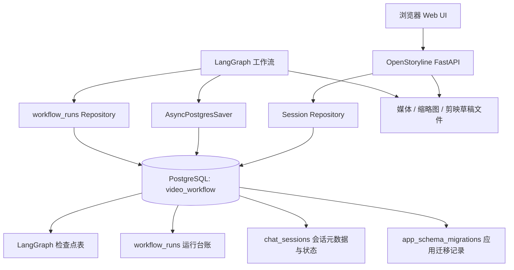

# auto-video-editor：PostgreSQL 统一改造设计开发方案

> 项目：[`wayyet/auto-video-editor`](https://github.com/wayyet/auto-video-editor)  
> 目标分支：`main`  
> 文档日期：2026-10-29  
> 参考背景：历史对话“分析数据库职责”及《auto-video-editor 数据库数量与职责分析》《auto-video-editor 对话历史故障分析与重设计执行方案》  
> 文档性质：设计与开发方案；本文不代表代码已完成改造。

## 1. 结论摘要

**结论：改造可行，建议实施。总体可行性高，工程复杂度中等偏高。** 项目已经具备 LangGraph `AsyncPostgresSaver` 和 PostgreSQL `workflow_runs` 台账表，因此不需要从零引入 PostgreSQL。真正的工作主要有三部分：删除 SQLite 检查点运行分支、将 OpenStoryline 会话 JSON 文件迁入 PostgreSQL、将浏览器本地历史列表改为服务端 API。

本方案将“只保留 PostgreSQL”定义为：

1. **运行时唯一数据库技术为 PostgreSQL**，不再提供 SQLite 检查点后端或 SQLite 会话库。
2. 工作流检查点、工作流运行台账、聊天会话元数据及可恢复会话状态，统一保存到**同一个 PostgreSQL 数据库**。
3. 不允许在 PostgreSQL 不可用时静默切换到 SQLite、JSON 文件或浏览器 `localStorage` 作为权威数据源。
4. 视频、图片、音频、剪映草稿、缩略图等大型文件仍保存在文件系统或对象存储中；PostgreSQL 只保存路径、标识及必要的元数据。这不是保留第二个数据库。
5. 单元测试可以使用进程内 `InMemorySaver`，但它不得成为运行环境的持久化后端。生产、开发和集成测试均使用 PostgreSQL 持久化。
6. 迁移阶段可以用一次性工具只读旧 SQLite 文件。该工具不属于应用运行时；数据验收完成后，运行环境中不再保留或读取 SQLite 数据库文件。

**建议目标数据库：** `video_workflow`。仓库当前 `.env.example` 使用 `langgraph`，而 PostgreSQL 集成测试默认使用 `video_workflow`，需要统一配置，避免不同脚本连到不同数据库。

## 2. 当前 `main` 分支审查结果

本节依据仓库当前可见源码及“分析数据库职责”历史文档整理。关键文件链接均指向 `main` 分支。

| 当前持久化职责 | 当前实现 | 主要问题 | 目标实现 |
|---|---|---|---|
| LangGraph 检查点 | `config.py` 默认 `CHECKPOINTER_BACKEND="sqlite"`；`make_checkpointer()` 有 SQLite 分支；`graph.py::get_checkpointer()` 已有 PostgreSQL 异步保存器 | 同一个项目保留两条持久化路径；默认行为仍可能创建 `checkpoints/<thread_id>.sqlite` | 统一由 `AsyncPostgresSaver` 写入 PostgreSQL |
| 工作流运行台账 | `monitoring/runs_table.py` 使用同一 `POSTGRES_URI` 写入 `workflow_runs` | 每次操作单独建立同步连接；表初始化错误会降级为 warning/no-op；没有统一迁移入口 | 保留 PostgreSQL 表，纳入版本化数据库迁移、索引、健康检查及错误策略 |
| OpenStoryline 会话状态 | `openstoryline/agent_fastapi.py` 将会话状态序列化到 `outputs/<session_id>/session_state.json`；`SessionStore` 先查进程内存，缺失时再读 JSON 文件 | 会话恢复依赖本地文件目录；多实例部署时不共享本地磁盘；当前保存失败只记录 warning，可能造成用户以为已保存 | 会话状态通过 PostgreSQL repository 读写，使用 `JSONB` 保存可恢复状态 |
| 侧栏“对话历史” | `openstoryline/web/static/app.js` 使用 `openstoryline_session_list_v1` 存储历史列表；`openstoryline_session_id` 存当前会话 ID | 历史列表属于浏览器本地数据，无法自动跨浏览器/配置文件共享；后端缺少权威的会话列表查询 | 新增服务端会话列表 API，前端从 PostgreSQL 查询并渲染；`localStorage` 最多保留当前会话 ID 和界面偏好 |
| 依赖与配置 | `pyproject.toml`、`requirements.txt` 声明 `langgraph-checkpoint-sqlite`；`.env.example` 提示不设置后端变量就使用 SQLite | SQLite 依赖、配置、测试和文档容易留下隐式回退路径 | 移除运行时 SQLite 依赖与配置；`POSTGRES_URI` 为唯一数据库连接配置 |

### 2.1 已有基础

- `graph.py::get_checkpointer()` 已通过 `AsyncPostgresSaver.from_conn_string()` 建立异步保存器，并调用 `await saver.setup()`。
- `pyproject.toml` 已声明 `langgraph-checkpoint-postgres` 与 `psycopg[binary,pool]`。
- `monitoring/runs_table.py` 已经使用 `POSTGRES_URI` 写入 PostgreSQL 的 `workflow_runs`。
- 仓库已有 `scripts/setup_postgres.ps1`、`scripts/setup_postgres_schema.py`、`scripts/verify_postgres.py`、`tests/integration/test_postgres_checkpointer.py` 等 PostgreSQL 相关脚本或测试，可作为改造基础。

### 2.2 关键现状判断

当前实现并不是“SQLite 与 PostgreSQL 两个数据库始终同时运行”。它是**工作流检查点的两种可选后端**，再叠加聊天状态 JSON 文件和浏览器本地历史。`workflow_runs` 是 PostgreSQL 中的一张表，不是一个额外数据库实例。

如果只修改 `CHECKPOINTER_BACKEND` 为 PostgreSQL，而不改 `ChatSession`、`SessionStore` 和前端历史列表，则仍然无法实现统一持久化。因此本方案把后端状态保存、会话列表 API、前端历史加载和旧数据迁移视为同一个改造范围。

## 3. 可行性分析

| 改造项 | 可行性 | 复杂度 | 判断依据与风险 |
|---|---|---|---|
| LangGraph 检查点全部使用 PostgreSQL | 高 | 中 | 项目已实现 `AsyncPostgresSaver`；需要删除默认 SQLite 分支，并调整调用者、测试及配置 |
| `workflow_runs` 纳入 PostgreSQL 统一管理 | 高 | 低至中 | 当前已使用 PostgreSQL；主要补齐版本化迁移、索引、连接生命周期及错误处理 |
| `session_state.json` 改存 PostgreSQL `JSONB` | 高 | 中 | 当前已有集中序列化/恢复逻辑，可沿用状态格式；需处理旧 JSON 导入、并发覆盖和持久化失败 |
| 侧栏历史改为服务端数据源 | 高 | 中 | 前端已有会话创建、按 ID 加载等逻辑；需新增列表/重命名/删除等服务端能力并调整 UI 数据流 |
| 旧 SQLite 检查点迁移 | 可行，但需先做验证样例 | 中至高 | 必须保留 checkpoint ID、父子关系、元数据、待写入项和 interrupt/resume 行为；不能只复制 SQLite 表或只迁移最新状态 |
| 旧聊天 JSON 迁移 | 高 | 中 | 能遍历旧会话文件并导入 PostgreSQL；需处理损坏文件、重复导入、字段版本和敏感值脱敏 |
| 删除 SQLite 运行时依赖 | 高 | 中 | 需全仓搜索调用、配置、测试、脚本和文档，避免 `build_graph()` 或测试辅助代码继续隐式创建 SQLite |

### 3.1 为什么推荐改造

- **数据源统一**：检查点、运行台账和聊天历史使用同一个服务端数据库，减少本地文件和浏览器状态造成的数据分裂。
- **跨浏览器可用**：服务器端保存会话目录后，不同浏览器访问同一服务时可以读取相同历史列表。
- **适合多进程/多实例**：会话数据不再依赖某个进程的内存字典或某一台机器的本地会话文件。
- **降低维护成本**：删除 SQLite 后端分支、对应依赖、配置和部署说明，减少测试矩阵。
- **继续使用已验证组件**：LangGraph 官方提供 PostgreSQL saver，且项目当前已经集成它。

### 3.2 必须接受的成本

- PostgreSQL 将成为核心运行依赖；数据库未启动、连接池耗尽或连接配置错误时，持久化功能必须明确失败，不能静默改写到文件。
- 大型视频/图片/音频本身不应全部塞入 `JSONB` 或 checkpoint。数据库只保存文件引用；LangGraph state 中也应尽量保存路径和必要元数据，而非媒体二进制。
- 需要建立数据库备份、恢复演练、迁移版本和连接池容量管理。
- 旧 SQLite checkpoint 的迁移需要单独验收；如果没有可验证的迁移器，不得在未备份的情况下直接删除旧文件。

## 4. 目标架构



**部署约束：** 目标是一个 PostgreSQL 数据库 `video_workflow`，不是“PostgreSQL + SQLite”，也不是 PostgreSQL 中再连接第二个数据库。多个数据职责使用不同表和 repository 进行隔离。

初次改造建议先沿用 `AsyncPostgresSaver` 默认使用的 PostgreSQL schema，避免额外改造其 `search_path`。如果以后需要 schema 级隔离，可以作为独立改动实施，并对 `AsyncPostgresSaver.setup()` 的 schema/search path 行为单独测试。

## 5. 数据职责和表设计

### 5.1 LangGraph 检查点表

继续由 `AsyncPostgresSaver.setup()` 管理。常见表包括：

- `checkpoints`
- `checkpoint_blobs`
- `checkpoint_writes`
- `checkpoint_migrations`

这些是 LangGraph saver 的内部存储结构。**应用代码不应自行复制或改写这些表的结构**，也不应与 `chat_sessions` 混用。LangGraph 升级时，应由对应版本的 saver 负责其数据库迁移。

### 5.2 `workflow_runs`：工作流运行台账

继续使用 PostgreSQL。建议通过版本化迁移统一创建或调整，避免仅依赖 `runs_table.init_schema()` 在启动时尝试建表。

建议字段：

| 字段 | 类型 | 用途 |
|---|---|---|
| `thread_id` | `TEXT PRIMARY KEY` | LangGraph 线程 ID |
| `video_name` | `TEXT NOT NULL` | 视频名称或任务标识 |
| `current_checkpoint` | `TEXT NULL` | 当前人工关卡，例如 `①`、`②`、`③` |
| `status` | `TEXT NOT NULL` | `running`、`suspended`、`completed`、`failed` |
| `updated_at` | `TIMESTAMPTZ NOT NULL` | 最后更新时间 |

实施时补充 `status` 合法值约束和 `(status, updated_at DESC)` 索引。现有数据迁移时要检查 `TIMESTAMP` 到 `TIMESTAMPTZ` 的时区语义，不能未经核对直接转换。

### 5.3 `chat_sessions`：聊天会话主表

第一阶段建议把会话元数据与完整可恢复状态放在同一张表，以减少迁移和恢复流程的复杂度。字段建议如下：

| 字段 | 类型 | 说明 |
|---|---|---|
| `session_id` | `TEXT PRIMARY KEY` | 兼容当前 32 位十六进制 session ID |
| `title` | `TEXT NOT NULL` | 侧栏显示标题 |
| `title_source` | `TEXT NOT NULL` | 标题来源，例如 `auto` 或 `manual` |
| `state_json` | `JSONB NOT NULL` | 聊天历史、LangChain 消息、模型设置、媒体登记等可恢复状态 |
| `message_count` | `INTEGER NOT NULL` | 消息数量，供列表展示 |
| `last_message_preview` | `TEXT NOT NULL` | 最后一条消息预览 |
| `created_at` | `TIMESTAMPTZ NOT NULL` | 创建时间 |
| `updated_at` | `TIMESTAMPTZ NOT NULL` | 最后更新时间，用于历史排序 |
| `deleted_at` | `TIMESTAMPTZ NULL` | 软删除标记；非空时不显示在默认列表 |
| `version` | `BIGINT NOT NULL` | 乐观并发控制版本号 |

建议的索引：

```sql
CREATE INDEX IF NOT EXISTS idx_chat_sessions_active_updated
    ON chat_sessions (updated_at DESC)
    WHERE deleted_at IS NULL;
```

主表建表迁移示例：

```sql
CREATE TABLE IF NOT EXISTS chat_sessions (
    session_id TEXT PRIMARY KEY
        CHECK (session_id ~ '^[0-9a-f]{32}$'),
    title TEXT NOT NULL DEFAULT '新对话',
    title_source TEXT NOT NULL DEFAULT 'auto'
        CHECK (title_source IN ('auto', 'manual')),
    state_json JSONB NOT NULL DEFAULT '{}'::jsonb,
    message_count INTEGER NOT NULL DEFAULT 0
        CHECK (message_count >= 0),
    last_message_preview TEXT NOT NULL DEFAULT '',
    created_at TIMESTAMPTZ NOT NULL DEFAULT now(),
    updated_at TIMESTAMPTZ NOT NULL DEFAULT now(),
    deleted_at TIMESTAMPTZ NULL,
    version BIGINT NOT NULL DEFAULT 1
        CHECK (version >= 1)
);

CREATE INDEX IF NOT EXISTS idx_chat_sessions_active_updated
    ON chat_sessions (updated_at DESC)
    WHERE deleted_at IS NULL;
```

这段 SQL 是目标设计示例，正式实施前需要确认当前会话 ID 的格式，并与旧文件中的状态字段完成映射后再应用。

### 5.4 状态大小与媒体数据

`state_json` 只保存可序列化的业务状态和媒体引用，例如本地路径、媒体 ID、缩略图路径、文件名和时间戳。禁止直接保存完整视频/音频/图片二进制。

如果会话状态后续增长过快，可在第二阶段把消息拆到 `chat_messages` 表；本次先保留当前 `ChatSession` 的序列化契约，以降低一次性改造风险。

### 5.5 应用迁移表

新增 `app_schema_migrations` 表，记录已应用的应用层 SQL 迁移版本。数据库初始化流程分开处理：

1. 应用迁移脚本负责 `app_schema_migrations`、`workflow_runs`、`chat_sessions` 和索引。
2. `AsyncPostgresSaver.setup()` 负责 LangGraph 自己的 checkpoint 表和版本迁移。
3. 不要手工把 LangGraph 内部表加入应用迁移脚本，以免与 saver 的版本管理冲突。

## 6. 配置设计

### 6.1 唯一连接配置

保留当前使用范围较广的 `POSTGRES_URI`，作为工作流检查点、运行台账和聊天会话 repository 的唯一数据库连接来源。首轮改造不建议同时引入 `DATABASE_URL`、`SESSION_DB_URL` 等多个数据库变量。

`.env.example` 目标示例：

```dotenv
# 唯一持久化数据库：PostgreSQL
POSTGRES_URI=postgresql://video_app:<从密钥管理器注入的密码>@localhost:5432/video_workflow

# 不再设置 CHECKPOINTER_BACKEND；应用运行时始终使用 PostgreSQL
```

注意：上面 `<从密钥管理器注入的密码>` 是说明性占位符，不能原样作为真实密码。实际部署应通过环境变量或密钥管理器注入密码，不要提交真实凭证到 Git。

### 6.2 删除的配置与路径

- 删除 `CHECKPOINTER_BACKEND=sqlite|postgres` 这种可选后端机制。
- 删除运行时依赖 `CHECKPOINTER_DB_DIR` 和 `checkpoints/<thread_id>.sqlite` 的路径逻辑。
- 移除 `.env.example` 中“未设置就保留 SQLite 默认值”的说明。
- 统一 `.env.example`、`tests/integration/test_postgres_checkpointer.py`、PowerShell 脚本和文档里的数据库名称。测试应优先读取 `TEST_POSTGRES_URI`，避免误写入开发数据库。

## 7. 代码改造清单

### 7.1 `config.py`：彻底删除 SQLite 后端

当前 `make_checkpointer()` 包含 `memory`、`sqlite`、`postgres` 分支，其中 PostgreSQL 分支会提示改用 `graph.get_checkpointer()`。目标改为：

- 删除 SQLite 分支、`sqlite3` 导入、`SqliteSaver` 导入和本地文件创建逻辑。
- 不再把 `CHECKPOINTER_BACKEND` 默认值设置成 `sqlite`。
- 把 `POSTGRES_URI` 未设置作为启动错误，而不是回退到本地数据库。
- 通过明确的构造入口获得 PostgreSQL saver；避免保留一个看起来可用、实际上只能提示报错的 `make_checkpointer("postgres")` 接口。

### 7.2 `graph.py`：运行时必须注入 PostgreSQL saver

保留 `get_checkpointer()` 的异步上下文管理器和 `await saver.setup()`。修改 `build_graph()` 的默认行为：

- 生产/开发工作流入口必须先进入 `async with get_checkpointer() as saver`，然后调用 `build_graph(checkpointer=saver)`。
- 不允许 `checkpointer=None` 时自动建立 SQLite saver。
- 更稳妥的做法是 `checkpointer=None` 时直接抛出清晰异常；单元测试必须显式注入 `InMemorySaver` 或 mock saver，防止漏掉数据库配置后静默以无持久化方式运行。
- 检查所有调用 `build_graph()` 的脚本、测试和开发工具，并逐个迁移。

### 7.3 `scripts/run_workflow.py` 与启动流程

- 开发模式和生产模式都统一走 PostgreSQL，不再根据 `WORKFLOW_ENV` 选择 SQLite/内存持久化。
- 启动前执行 PostgreSQL 连接检查和应用 schema migration。
- 运行工作流之前初始化 saver；saver 或 schema 初始化失败必须中止启动。
- 对 `AsyncPostgresSaver`、数据库连接池和 FastAPI 生命周期明确关闭顺序，避免连接泄漏。
- 不应把“运行台账写入失败可以 warning/no-op”的现有策略复制到关键会话持久化路径。台账是否允许降级，应单独定义；检查点和聊天状态不允许静默丢失。

### 7.4 `monitoring/runs_table.py`

- 保留 `workflow_runs` 业务职责。
- 将建表/索引交给应用迁移脚本，而不是仅在每次启动时用 `CREATE TABLE IF NOT EXISTS` 作为完整迁移机制。
- 优化连接管理，避免每次 `upsert_run()` 都新建一条短连接；根据调用方是同步还是异步，使用适当的连接池。
- 错误等级分开：关键状态记录失败应进入日志、指标及告警；不能让“数据库不可达”被无声地当作正常完成。
- 保持 `thread_id`、checkpoint 和运行状态之间的语义一致，避免恢复工作流时台账显示错误状态。

### 7.5 `openstoryline/agent_fastapi.py`：从 JSON 文件迁到 PostgreSQL

改造 `ChatSession` 和 `SessionStore`：

- 把状态序列化/反序列化逻辑与持久化后端分开，建立 `SessionRepository` 接口。
- 新建 PostgreSQL repository，负责 `create/get/list/update/rename/soft_delete`。
- `SessionStore` 负责运行期对象缓存和锁；PostgreSQL 是持久化事实来源，不能把进程内 `_sessions` 当成唯一存储。
- `save_session_state()` 不再调用 `save_state_atomic()` 写 `session_state.json`；改为事务内更新 `state_json`、`updated_at`、`message_count` 和 `last_message_preview`。
- 保留旧 JSON 的读取能力仅用于一次性迁移工具。迁移结束后，应用运行路径不应继续从 `session_state.json` 恢复会话。
- 如果 PostgreSQL 保存失败，应向调用层返回明确错误并阻止显示“已保存”；不能只写 warning 后继续假定数据已持久化。
- 复用当前敏感信息脱敏逻辑。旧状态导入和新状态保存都必须脱敏 API Key、Token、密码等内容。

### 7.6 并发及多实例

当前 `SessionStore` 的 `asyncio.Lock` 只保护单个进程，不能协调多个进程或服务器。改造后：

- 每次更新用 `version` 做乐观并发控制，例如 `UPDATE ... WHERE session_id = %s AND version = %s`，成功后递增版本号。
- 若影响行数为 0，说明状态已被其他请求更新，应重新读取并按明确策略合并或返回冲突；不能直接覆盖新状态。
- 在单进程内保留 per-session lock，减少同一会话的并发写入。
- 避免在每个 token 到达时完整写入大块 `state_json`。按用户消息完成、工具调用结果落地、关键状态变化等边界保存；如果需要流式中断恢复，要明确保存频率和可接受的数据损失窗口。
- 所有 `INSERT`、`UPDATE` 查询使用参数化 SQL，不拼接用户输入。

### 7.7 `openstoryline/web/static/app.js`：服务端历史为唯一事实来源

- `SESSION_LIST_KEY = "openstoryline_session_list_v1"` 不再作为权威历史目录。
- 应用启动时调用 `GET /api/sessions`，用返回结果渲染侧栏。
- 新建会话后从服务端拿到 `session_id` 和元数据；保存会话后刷新或局部更新列表。
- 切换会话仍调用现有的按 ID 查询接口，但内容必须来自 PostgreSQL。
- 重命名、软删除及历史分页使用服务端 API，避免前端只改本地数组。
- `openstoryline_session_id` 可以继续保存当前选中的会话 ID；语言、侧栏展开状态等纯 UI 偏好可以继续保存在 `localStorage`。
- 如果用户已有旧的 `localStorage` 历史数据，应由迁移/兼容逻辑完成一次性对账，不能把以后新增的数据继续只写在浏览器。

### 7.8 依赖与仓库清理

- 从 `pyproject.toml` 删除 `langgraph-checkpoint-sqlite`。
- 从 `requirements.txt`、`requirements-local-dev.txt`、相关 lock 文件和部署安装步骤中删除 SQLite checkpointer 运行时依赖。
- 删除仅服务于 SQLite 后端的代码和默认路径。
- 搜索全部 `SqliteSaver`、`langgraph.checkpoint.sqlite`、`sqlite3.connect`、`CHECKPOINTER_BACKEND`、`CHECKPOINTER_DB_DIR`、`*.sqlite`，逐项判断是否属于运行时、测试、迁移工具或历史文档。
- `scripts` 中的旧 SQLite 检查点导入器若用于迁移，应放入独立目录并标明“一次性、只读旧库、不得被应用启动流程调用”；迁移完成后可移除。
- 测试中无必要的 `import sqlite3` 也应删除，避免造成仍使用 SQLite 的误解。

## 8. 服务端 API 设计

保持已有会话创建与按 ID 加载接口的兼容性，在此基础上补齐会话目录能力。具体路由需先与当前 FastAPI 路由核对，避免重复定义。

| 方法 | 路由 | 用途 |
|---|---|---|
| `POST` | `/api/sessions` | 创建新会话并在 PostgreSQL 写入初始状态 |
| `GET` | `/api/sessions` | 查询会话列表，支持分页；默认过滤软删除记录并按 `updated_at DESC` 排序 |
| `GET` | `/api/sessions/{session_id}` | 加载指定会话完整状态 |
| `PATCH` | `/api/sessions/{session_id}` | 更新标题等元数据；手动标题不得被自动标题覆盖 |
| `DELETE` | `/api/sessions/{session_id}` | 软删除会话，保留审计/恢复能力；按明确保留策略再做物理清理 |

`GET /api/sessions` 建议默认返回轻量列表字段，不返回完整 `state_json`，避免加载历史列表时读取大量对话内容。完整状态只通过按 ID 查询接口读取。

列表响应字段建议：`session_id`、`title`、`title_source`、`created_at`、`updated_at`、`message_count`、`last_message_preview`。分页可以先实现 `limit` + `cursor`；若使用 `offset`，需要注意会话频繁更新排序时可能发生页间重复或遗漏。

## 9. 数据迁移方案

迁移目标不是把旧 SQLite 文件原样复制到 PostgreSQL，而是通过 saver/repository 的接口迁移数据，并验证业务行为。

### 9.1 迁移前准备

1. 固定当前 Git commit 和依赖版本，暂停所有可能写入 checkpoint 或 session 的服务。
2. 完整备份现有 PostgreSQL 数据库、`checkpoints/` 下所有 SQLite 文件、`outputs/**/session_state.json`、必要的配置文件以及会话关联媒体文件。
3. 记录迁移前数量：SQLite 文件数、每个文件中的 thread/checkpoint 数量、运行中的/挂起的任务数、会话 JSON 文件数和解析失败数。
4. 准备独立的迁移目标数据库或可恢复备份，迁移测试不得直接覆盖唯一生产数据。
5. 迁移期间冻结写入，避免旧程序继续更新 SQLite，而新程序已经开始更新 PostgreSQL，造成双数据源分叉。

### 9.2 SQLite checkpoint 到 PostgreSQL

**推荐使用 LangGraph saver 的公开接口迁移，而不是直接复制/转换内部表。** SQLite saver 与 PostgreSQL saver 的内部存储布局并不保证相同。

迁移器至少需要验证：

- 每个源 `thread_id` 是否存在目标记录。
- 每个 checkpoint 的 `checkpoint_id`、父 checkpoint 关系和 metadata 是否保留。
- 相关 pending writes（尚未完全提交的节点写入）是否保留。
- `get_tuple` / `list` / 状态历史读取是否能返回预期结果。
- `interrupt` 后的工作流能否在 PostgreSQL 中恢复，并从正确的节点继续执行。

推荐分层处理：

1. 优先迁移所有 `running` / `suspended` 线程，并以真实挂起任务执行恢复测试。
2. 如果产品需要完整的历史状态查询，再迁移全部 checkpoint 历史；如果已完成线程不需要恢复，可以将其历史作为只读备份归档，不必把所有历史 checkpoint 都导入活动数据库。
3. 迁移工具必须幂等，至少按 `thread_id + checkpoint_id` 识别重复导入，并能输出失败清单。
4. 在真实数据上验证 `interrupt/resume` 成功前，不得删除旧 SQLite 文件。

如发现旧 checkpoint 使用的序列化类型或 LangGraph 版本不兼容，应在**原依赖版本不变**的条件下先完成迁移 PoC。不要同时升级 LangGraph、变更 State 字段和迁移数据库，否则故障难以定位。

### 9.3 `session_state.json` 到 `chat_sessions`

1. 遍历配置的旧输出根目录，查找 `*/session_state.json`。
2. 用兼容旧格式的解析器读取文件，提取 `session_id`、创建/更新时间、标题候选、消息数量、最后消息预览和完整可恢复状态。
3. 进行敏感值脱敏及 JSON 可序列化校验，再写入 `chat_sessions.state_json`。
4. 以 `session_id` 幂等导入；重复执行不得复制会话或清空已更新状态。
5. 对损坏/无法解析的文件输出清单和原因；不可以静默跳过后声称迁移成功。
6. 将媒体路径作为引用保留，验证对应文件是否仍存在；媒体缺失应记录为数据问题，不能把文件内容写进 PostgreSQL。
7. 抽样比较旧 JSON 与导入后状态，确认消息回放、工具轨迹、模型配置、媒体登记和会话恢复正常。

### 9.4 `localStorage` 历史对账

当前 `localStorage` 只在各浏览器本地保存侧栏元数据，不能由服务器直接读取其他浏览器里的值。迁移应以服务器现存 JSON 会话文件为基础建立完整会话目录。当前用户浏览器的本地列表可以做一次性对账，用于补充标题或排序元数据，但只有服务器已验证存在的会话 ID 才能更新数据库，不能只凭客户端提供的 ID 创建任意会话记录。

导入完成后，浏览器列表必须以 `GET /api/sessions` 返回的数据为准。不能保留“服务端列表 + 每个浏览器另一份独立权威列表”的双写设计。

### 9.5 切换与清理顺序

1. 先完成数据库迁移和校验，再发布只支持 PostgreSQL 的新版本。
2. 停止旧版程序并确认没有后台工作流继续写旧 SQLite/JSON。
3. 启动新版本，执行 PostgreSQL 健康检查、schema 迁移、saver setup 和核心流程测试。
4. 确认会话列表、会话读取、挂起恢复、运行台账均正常后，才把旧文件从活动运行路径移走。
5. 旧文件可在验收窗口内保存在离线备份位置用于回滚；验收完成后按数据保留策略销毁。它们不得继续作为新程序的读取回退来源。

## 10. 测试与验收标准

### 10.1 单元测试

- `build_graph()` 未注入 saver 时失败明确，不会创建 SQLite 文件，也不会静默退化为无持久化。
- 节点逻辑可以用显式 `InMemorySaver` 或 mock saver 测试，但不把它作为集成/生产持久化证明。
- PostgreSQL repository 对创建、加载、更新、软删除、分页、标题来源和版本冲突的行为有单元测试。
- 对敏感字段脱敏、JSON 序列化失败、数据库异常及损坏旧会话文件有测试。

### 10.2 PostgreSQL 集成测试

必须有可用的 PostgreSQL 测试数据库。建议使用独立变量 `TEST_POSTGRES_URI`，CI 中未配置时直接失败或明确跳过，不得把测试数据写入开发库。

验收用例：

1. `AsyncPostgresSaver.setup()` 首次执行与重复执行都成功。
2. 启动工作流并执行到 `interrupt` 后，关闭运行上下文，再重启并恢复，验证状态和下一节点正确。
3. 新建会话后，另一条数据库连接或新应用实例能够读取完整状态。
4. 完成一轮对话后刷新浏览器，侧栏历史仍存在。
5. 在另一浏览器/配置文件登录同一服务，能读取同一会话列表。
6. 修改会话标题后重启，标题、更新时间和排序不丢失。
7. 软删除后默认列表不再显示该会话；根据产品权限仍可按恢复接口找回。
8. 模拟 PostgreSQL 不可达，服务明确报告持久化失败，不创建 SQLite 文件、不写回 JSON 作为替代。
9. 并发更新同一会话时，不发生静默覆盖；冲突路径有重试或明确错误。
10. 迁移脚本重复执行不造成重复数据或覆盖迁移后新增的数据。

### 10.3 静态检查与发布前扫描

执行仓库全局搜索，确保运行时没有留下 SQLite 路径：

```bash
rg -n "SqliteSaver|langgraph\.checkpoint\.sqlite|sqlite3\.connect|CHECKPOINTER_BACKEND|CHECKPOINTER_DB_DIR|session_state\.json|openstoryline_session_list_v1" .
```

注意：迁移工具和历史文档可能保留这些字符串。审查目标是：应用启动路径、正常会话保存路径和工作流执行路径不再调用 SQLite/JSON 文件存储；一次性迁移工具必须与运行时隔离。

同时确认：

- PostgreSQL 集成测试全部通过，不能把数据库不可达导致的 skip 当作功能通过。
- `git grep` 与依赖清单确认没有运行时 SQLite checkpointer 依赖。
- 各启动脚本使用同一个 `POSTGRES_URI` 配置来源。
- `checkpoints/*.sqlite` 不在新程序执行后重新生成。
- 旧 JSON 文件不再被正常会话加载逻辑读取。

## 11. 风险与应对

| 风险 | 影响 | 应对措施 |
|---|---|---|
| 检查点迁移遗漏 pending writes 或父 checkpoint 关系 | 挂起任务无法正确恢复 | 使用 saver 公共接口迁移；对真实 interrupt/resume 做端到端验收 |
| 代码仍有默认 SQLite 分支 | 某些启动方式继续把数据写到本地 | 删除后端选择开关；`build_graph()` 未注入 saver 时 fail-fast；执行全仓扫描 |
| 会话状态更新并发覆盖 | 最新聊天或工具事件丢失 | per-session lock + PostgreSQL `version` 乐观锁；冲突时重载/重试 |
| 数据库不可用时静默降级 | 用户误以为记录已保存 | 对 checkpoint 和会话状态使用 fail-closed；增加健康检查、告警和可见错误 |
| 大型状态频繁写 `JSONB` | 数据库膨胀、写入变慢 | 数据库只存元数据和引用；限制保存频率，后续按需拆分消息表 |
| 历史列表仍由 `localStorage` 主导 | 跨浏览器问题继续存在 | 服务端列表 API 成为唯一事实来源；本地数据仅做一次性对账 |
| SQLite 与 PostgreSQL 的默认数据库名不一致 | 读写到不同数据库，导致数据缺失 | 统一 `POSTGRES_URI`、脚本、测试和文档中的目标 DB 名称 |
| LangGraph 版本升级与数据库迁移同时发生 | 恢复错误难定位 | 先固定当前依赖完成迁移，再单独升级依赖 |

## 12. 推荐实施顺序

### 阶段 A：基线与迁移验证

- 固定 `main` 分支 commit 和依赖版本。
- 盘点全部 SQLite 文件、旧会话 JSON 和本地历史键。
- 对 `SqliteSaver` → `AsyncPostgresSaver` 建立最小 PoC，先验证 checkpoint history、pending writes 和 interrupt/resume。
- 统一测试库与开发库配置，确认可恢复备份。

### 阶段 B：数据库结构与会话 Repository

- 建立应用层 SQL 迁移机制和 `chat_sessions` 表。
- 将 `workflow_runs` 纳入版本化迁移。
- 实现 PostgreSQL session repository、事务写入、版本控制和错误处理。
- 为旧 `session_state.json` 编写一次性、幂等导入脚本。

### 阶段 C：统一工作流检查点

- 删除 `config.py` 的 SQLite saver 分支和默认 SQLite 设置。
- 调整 `graph.py`、`scripts/run_workflow.py` 和所有调用者，确保运行时使用 `get_checkpointer()`。
- 调整测试：单测显式注入内存 saver，持久化集成测试使用 PostgreSQL。
- 执行 checkpoint 数据迁移和恢复验收。

### 阶段 D：对话历史前后端改造

- 改造 `SessionStore`、会话创建/读取/保存/标题更新/软删除逻辑。
- 新增 `GET /api/sessions` 并完成分页。
- 改造前端启动、切换、刷新、新建、重命名和删除流程。
- 将 `localStorage` 历史列表降为兼容迁移输入，不再参与日常权威读写。

### 阶段 E：验收和移除旧存储

- 执行全量单测、PostgreSQL 集成测试和完整人工关卡恢复测试。
- 模拟 PostgreSQL 断连，确认应用不会回退 SQLite/JSON。
- 检查活动目录不再生成 SQLite 文件，正常会话请求不再读写 `session_state.json`。
- 验收通过后清理运行环境中的旧 SQLite 文件和旧 JSON 会话副本；按备份保留策略归档或销毁迁移备份。

## 13. 回滚策略

回滚应回滚应用版本并恢复 PostgreSQL 备份，不应让新旧版本长期双写不同存储。

- 切换前备份 PostgreSQL、SQLite checkpoint 文件及旧会话 JSON。
- 新版本刚切换、尚未产生新数据时，可恢复上一应用版本并使用切换前备份。
- 新版本已经写入新的 PostgreSQL 会话/检查点后，若必须回到旧版本，需先把 PostgreSQL 中新增的状态反向导出到旧格式或明确接受回到切换点的数据损失；**不能直接启动旧版并假定旧 SQLite/JSON 自动包含新数据**。
- 回滚演练应验证至少一个挂起工作流和一个聊天会话可恢复。

## 14. 最终决策建议

建议采用以下决策：

1. **一个 PostgreSQL 数据库作为唯一权威持久化层**：`video_workflow`。
2. LangGraph 检查点统一使用 `AsyncPostgresSaver`；SQLite 不作为运行时备选。
3. `workflow_runs`、`chat_sessions` 和应用迁移记录保存在同一 PostgreSQL 数据库，通过表和 repository 分离职责。
4. OpenStoryline 会话状态从 JSON 文件迁入 `chat_sessions.state_json JSONB`；侧栏历史改为服务端查询。
5. 媒体和剪映草稿仍保存在文件系统/对象存储，数据库只存引用。
6. 先证明旧 checkpoint 可以安全迁移并成功 resume，再删除旧 SQLite 活动文件。

该方案可行。主要技术风险不在 PostgreSQL 本身，而在**检查点迁移的完整性、会话状态的并发保存，以及前端历史数据源切换**。按上述顺序分阶段实施，可以把风险控制在可验证的边界内。

## 15. 参考资料与代码入口

### 项目源码

- [`config.py`](https://github.com/wayyet/auto-video-editor/blob/main/config.py)：`CHECKPOINTER_BACKEND`、`make_checkpointer()` 和 `POSTGRES_URI` 配置。
- [`graph.py`](https://github.com/wayyet/auto-video-editor/blob/main/graph.py)：`get_checkpointer()`、`AsyncPostgresSaver.setup()` 和 `build_graph()`。
- [`scripts/run_workflow.py`](https://github.com/wayyet/auto-video-editor/blob/main/scripts/run_workflow.py)：工作流入口，需要检查开发/生产路径是否存在 SQLite 分支。
- [`monitoring/runs_table.py`](https://github.com/wayyet/auto-video-editor/blob/main/monitoring/runs_table.py)：PostgreSQL `workflow_runs` 台账表。
- [`openstoryline/agent_fastapi.py`](https://github.com/wayyet/auto-video-editor/blob/main/openstoryline/agent_fastapi.py)：`ChatSession`、JSON 状态序列化/恢复和 `SessionStore`。
- [`openstoryline/web/static/app.js`](https://github.com/wayyet/auto-video-editor/blob/main/openstoryline/web/static/app.js)：`openstoryline_session_id`、`openstoryline_session_list_v1` 与历史列表逻辑。
- [`pyproject.toml`](https://github.com/wayyet/auto-video-editor/blob/main/pyproject.toml) 和 [`requirements.txt`](https://github.com/wayyet/auto-video-editor/blob/main/requirements.txt)：移除 SQLite checkpointer 运行时依赖。
- [`tests/integration/test_postgres_checkpointer.py`](https://github.com/wayyet/auto-video-editor/blob/main/tests/integration/test_postgres_checkpointer.py)：PostgreSQL 检查点测试基线。

### 官方文档

- [LangGraph Checkpoint / Persistence 参考](https://langchain-ai.github.io/langgraph/reference/checkpoints/)：说明 SQLite 与 PostgreSQL saver 的定位和接口。
- [AsyncPostgresSaver `setup()` 参考](https://reference.langchain.com/python/langgraph.checkpoint.postgres/aio/AsyncPostgresSaver/setup)：说明 PostgreSQL saver 的初始化和迁移职责。
- [LangGraph Postgres checkpoint 实现](https://github.com/langchain-ai/langgraph/blob/main/libs/checkpoint-postgres/README.md)：说明 PostgreSQL saver 的连接和初始化注意事项。

---

**文档状态：待评审、待实施。** 本文是数据库统一改造设计，不表示仓库代码已经修改，也不表示旧数据已经迁移。
