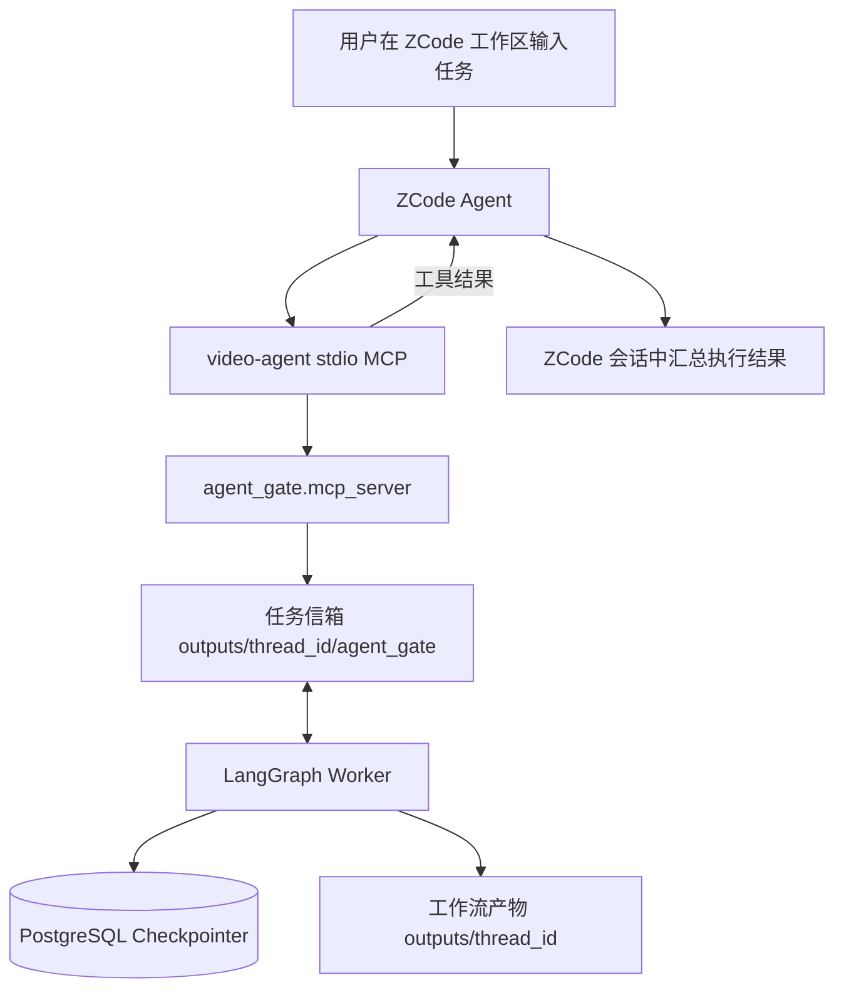

> ⚠️ **历史文档(2026-11-04 单流水线架构收敛后失效)**:本文档描述的旧网页聊天端驱动 mcode/zcode 链路(①对话回合循环)已删除;现行架构与 mcode 无人值守用法(`agent_gate drive`)见 `README.md` 与 `docs/integration/architecture_decision_record.md`。内容保留仅作历史记录。

# OpenStoryline 接入 ZCode Agentic 执行设计

> **文档状态**：设计评审版（可执行的 MCP 接入方案 + 内嵌 Agent 方案的前置条件）  
> **生成日期**：2026-10-31  
> **目标仓库**：[`wayyet/auto-video-editor`](https://github.com/wayyet/auto-video-editor)  
> **目标分支**：`main`  
> **核查基线**：`e1961003912a7a8368763e9f490ec5169c3603c8`（2026-10-31）

---

## 1. 设计结论

本次需求中的“ZCode”指智谱 Z.ai 推出的 **ZCode Agentic Development Environment（ADE）及其自研 ZCode Agent**，不是单独的 GLM 模型 API。

核对仓库代码与 ZCode 官方文档后，结论如下：

1. **可以立即接入 ZCode Agent**：让 ZCode 作为 MCP 客户端，连接仓库已经实现的 `video-agent` stdio MCP 服务。调用链为：

   `ZCode Agent → video-agent MCP → agent_gate → LangGraph worker`

2. **当前不能把真正的 ZCode Agent 作为 OpenStoryline 的内嵌下拉选项直接执行**：已核查的 ZCode 官方公开文档说明了桌面 Agent、MCP、Remote、Bot Channel 和 Hooks，但没有找到供第三方应用直接启动/驱动 ZCode Agent 的受支持 CLI、Headless、SDK、HTTP 或 ACP 调用契约。不能照搬 `mcode exec` 方式虚构 `zcode exec`。

3. **GLM API 与 ZCode Agent 必须分开命名**：OpenStoryline 可以通过现有 OpenAI 兼容模型配置接入 GLM API，但那只是模型调用，不等于运行 ZCode Agent 的规划、工具调度和执行工作流。

4. **不建议先在“LLM 模型”下拉框里放一个不可执行的 ZCode 选项**。应把“模型供应商”和“外部 Agent 运行时”分层。等 Z.ai 提供正式的外部 Agent 调用接口后，再实现 OpenStoryline 内嵌的 `ZCode Agent` 运行时适配器。

因此本设计分为三个阶段：

| 阶段 | 目标 | 状态 |
|---|---|---|
| P0 | ZCode 桌面 Agent 通过 `video-agent` MCP 驱动现有 LangGraph 工作流 | **当前可落地，推荐先实施** |
| P1 | 可选：在 OpenStoryline 中增加独立的 GLM API 模型预设 | 现有 Custom Model 可配置；可按需做 UI 优化 |
| P2 | ZCode Agent 真正成为 OpenStoryline 内可选择、可流式展示的 Agent Runtime | **等待 Z.ai 发布受支持的外部调用接口** |

## 2. 项目现状（`main` 分支）

### 2.1 OpenStoryline 前端模型选择器

相关代码：

- [`openstoryline/agent_fastapi.py`](https://github.com/wayyet/auto-video-editor/blob/e1961003912a7a8368763e9f490ec5169c3603c8/openstoryline/agent_fastapi.py)
- [`openstoryline/web/static/app.js`](https://github.com/wayyet/auto-video-editor/blob/e1961003912a7a8368763e9f490ec5169c3603c8/openstoryline/web/static/app.js)
- [`openstoryline/src/open_storyline/agent.py`](https://github.com/wayyet/auto-video-editor/blob/e1961003912a7a8368763e9f490ec5169c3603c8/openstoryline/src/open_storyline/agent.py)
- [`openstoryline/src/open_storyline/config.py`](https://github.com/wayyet/auto-video-editor/blob/e1961003912a7a8368763e9f490ec5169c3603c8/openstoryline/src/open_storyline/config.py)

当前左侧模型窗口由后端会话快照提供模型列表，前端 `applySnapshotModels()` 根据 `llm_models` / `chat_models` 动态创建 `<option>`。因此，普通模型选项的增加主要由后端模型列表控制，不需要为每个模型单独写一套前端控件。

当前代码中的模型列表逻辑：

```python
mcode_tiers = _mcode_tiers_available(self.cfg)
self.chat_models = _dedup_models([default_llm] + mcode_tiers + [CUSTOM_MODEL_KEY])
self.vlm_models = _dedup_models([default_vlm] + mcode_tiers + [CUSTOM_MODEL_KEY])
```

`_mcode_tiers_available()` 只有在 `[mcode].cwd` 已配置且目录存在时，才返回：

- `mcode-operator`：完整 Agent 能力，使用 MCode standard 模式。
- `mcode-chat`：轻量对话，使用 MCode lightweight 模式。

选中 MCode 后，`agent.py` 在 API Key 校验之前进行分流，使用 `MCodeChatModel`；LLM/VLM 共用这个模型实例，LangChain `tools=[]`，不连接 OpenStoryline 的 8001 MCP。MCode 自己通过操作员目录中的 `.mcp.json` 加载 `video-agent` 工具。

### 2.2 MCode 与 Claude Code 当前接入层级

仓库还存在独立的 `agent_gate`：

- [`agent_gate/launcher.py`](https://github.com/wayyet/auto-video-editor/blob/e1961003912a7a8368763e9f490ec5169c3603c8/agent_gate/launcher.py)
- [`agent_gate/cli.py`](https://github.com/wayyet/auto-video-editor/blob/e1961003912a7a8368763e9f490ec5169c3603c8/agent_gate/cli.py)
- [`agent_gate/mcp_server.py`](https://github.com/wayyet/auto-video-editor/blob/e1961003912a7a8368763e9f490ec5169c3603c8/agent_gate/mcp_server.py)
- [`agent_gate/scaffold.py`](https://github.com/wayyet/auto-video-editor/blob/e1961003912a7a8368763e9f490ec5169c3603c8/agent_gate/scaffold.py)

当前支持情况需要区分：

| Agent / 模型 | `agent_gate drive` | OpenStoryline 左侧模型下拉 | 说明 |
|---|---:|---:|---|
| 内置 OpenAI 兼容模型 | — | 是 | `ChatOpenAI` 调用模型 API |
| 自定义 OpenAI 兼容模型 | — | 是 | Custom Model，填写模型名、Base URL、API Key |
| MCode Agent | 是 | 是 | 内嵌接入已有 `MCodeChatModel`，另有 `agent_gate` 外部驱动模式 |
| Claude Code | 是 | **否** | `ClaudeLauncher` / `agent_gate drive --agent claude`；当前不是 OpenStoryline 下拉选项 |
| ZCode Agent | **否** | **否** | 本次待新增；目前可作为 MCP 客户端连接 `video-agent` |

> 不能把“Claude Code 已经可通过 `agent_gate drive` 使用”理解为“Claude Code 已经出现在 OpenStoryline LLM 下拉框”。这两个入口的生命周期、事件流和配置机制不同。

### 2.3 `video-agent` MCP 服务已经具备的能力

`agent_gate/mcp_server.py` 使用 FastMCP 提供 stdio MCP 服务，核心工具包括：

| MCP 工具 | 用途 |
|---|---|
| `run_start` | 启动指定 `thread_id` 的 LangGraph worker |
| `run_status` | 查询工作流状态及下一步动作 |
| `gate_next_tasks` | 领取当前待处理的 LLM 任务 |
| `gate_get_task` | 获取任务全文 |
| `gate_submit_result` | 提交模型处理结果，worker 收到后继续执行 |

这套机制把 Agent 与 LangGraph worker 解耦：ZCode 负责理解任务、调用 MCP 并提交答案；worker 负责执行视频工作流。现有 MCode 与 Claude Code 也可以使用同一个 MCP 服务。

## 3. ZCode 官方能力核查

### 3.1 ZCode 的产品边界

ZCode 官方将其定位为围绕 GLM-5.3 的 ADE，包含自研 ZCode Agent、长任务执行、工具调用、项目上下文以及桌面端/Remote/Bot Channel 等能力。它不是简单的 Chat Completions UI。

参考：

- [ZCode 官方文档首页](https://zcode.z.ai/cn/docs)
- [智谱 BigModel：ZCode 与 GLM Coding Plan](https://docs.bigmodel.cn/cn/coding-plan/tool/zcode)

### 3.2 官方确认支持的 MCP 集成方式

ZCode 官方 MCP 文档确认：

- MCP 可将外部工具接入 ZCode Agent。
- 支持 `stdio` 本地命令，以及远程 HTTP / SSE 服务。
- 可以通过设置页面新建 MCP Server，也可以粘贴完整 JSON 配置。
- 支持 `mcpServers` 标准配置结构。
- 支持工作区级 `.agents/mcp.json`，配置键为 `mcpServers`。
- 工作区 MCP 会在打开工作区时自动连接。

文档：<https://zcode.z.ai/cn/docs/mcp-services>

### 3.3 MCP 配置文件优先级

官方文档列出了以下配置路径：

| 作用域 | 文件路径 | 配置键 |
|---|---|---|
| 用户级原生配置 | `~/.zcode/cli/config.json` | `mcp.servers` |
| 工作区原生配置 | `<项目根>/.zcode/config.json` | `mcp.servers` |
| 用户级兼容配置 | `~/.agents/mcp.json` | `mcpServers` |
| 工作区兼容配置 | `<项目根>/.agents/mcp.json` | `mcpServers` |

**重要优先级规则**：同一个作用域中，只要 `.zcode` 原生配置已经包含任意 MCP Server，ZCode 就会整体跳过同作用域的 `.agents/mcp.json`，不会逐项合并。

因此：

- 没有现存工作区 `.zcode/config.json` MCP 配置时，可以使用 `<repo>/.agents/mcp.json`。
- 如果 `<repo>/.zcode/config.json` 已配置 MCP，必须把 `video-agent` 合并进 `.zcode/config.json` 的 `mcp.servers`，不能只新建 `.agents/mcp.json`。
- 不要覆盖用户已经配置好的 MCP 服务。

文档：<https://zcode.z.ai/cn/docs/mcp-services>

### 3.4 Hooks 不能作为 ZCode Agent API

ZCode Hooks 是本地子进程协议：ZCode 通过 stdin 发送 JSON，Hook 通过退出码和 stdout JSON 返回结果。官方明确说明 Hook 不会获得可直接调用 ZCode 模型的内部对象。

因此，Hooks 可用于安全检查、注入上下文和工具调用前后处理，但**不能当作 ZCode Agent 的模型调用 API**，也不能据此实现 `ZCodeChatModel`。

文档：<https://zcode.z.ai/cn/docs/hooks>

### 3.5 模型 API 与 Agent Runtime 的区别

ZCode 支持 BigModel / Z.ai 账号登录，也支持 API Key 和第三方 OpenAI / Anthropic 兼容模型供应商。BigModel 官方 ZCode 接入指引中，GLM Coding Plan 的接口配置为：

- OpenAI 兼容 Coding Plan：`https://open.bigmodel.cn/api/coding/paas/v4`
- Anthropic 兼容接口：`https://open.bigmodel.cn/api/anthropic`

这类接口是模型供应商连接方式，不等于第三方程序能启动 ZCode Agent。对本项目的视频规划/素材理解任务，不应仅因 URL 名称中含 `coding` 就默认使用 Coding Plan endpoint；应按所订阅套餐的使用范围和官方最新规则选择 endpoint。

如果只需要在 OpenStoryline 调用 GLM 模型，可单独配置普通模型 API。例如 BigModel 通用 OpenAI 兼容 API 的 Base URL 为：

`https://open.bigmodel.cn/api/paas/v4`

这条路径应在 UI 中标识为 `GLM API` / `BigModel GLM`，不能标识成 `ZCode Agent`。

参考：

- <https://docs.bigmodel.cn/cn/coding-plan/tool/zcode>
- <https://docs.bigmodel.cn/cn/best-practice/case/ai-search-engine>
- <https://zcode.z.ai/cn/docs/configuration>

## 4. 推荐架构

### 4.1 P0：先复用现有 `video-agent` MCP



责任划分：

| 组件 | 职责 |
|---|---|
| ZCode Agent | 理解用户指令、规划执行步骤、调用 `video-agent` MCP、提交任务答案 |
| `video-agent` MCP | 校验参数并调用 `agent_gate` 服务层 |
| `agent_gate` | 维护任务信箱、启动/查询 worker、校验任务及媒体路径 |
| LangGraph worker | 执行视频工作流、遇到需要模型的节点时生成 Gate 任务 |
| PostgreSQL | 保存 LangGraph checkpoint 与项目会话状态（沿用当前生产配置） |

本阶段不修改 OpenStoryline 的 `ChatOpenAI`、`MCodeChatModel` 或 WebSocket 事件协议。ZCode 先作为独立外部操作员运行，降低对现有工作流的影响。

### 4.2 为什么不把 ZCode 当成 `MCodeChatModel` 的平替

MCode 已有明确的 `mcode exec` 子进程调用方式、stdin/stdout 约定、stream-json 事件协议及进程取消机制。ZCode 官方文档当前没有提供对应的外部 Agent 启动/调用契约。

直接假设存在 `zcode exec`、调用桌面应用私有 HTTP 端点、抓取内部 IPC，或读取 ZCode 私有 OAuth 凭据，都不属于受支持的集成方式。此类实现会造成版本脆弱、认证风险和不可测试的运行时依赖。

### 4.3 P1：可选 GLM API 模型预设

这条路径与 ZCode Agent 接入独立，可以在需要时实施：

```text
OpenStoryline 左侧模型下拉
    └── GLM API（BigModel）
          └── ChatOpenAI
                └── BigModel OpenAI-compatible API
```

建议菜单标识：

- `GLM API / BigModel`：模型服务。
- `ZCode Agent`：外部 Agent Runtime（在正式桥接接口未具备前，仅提供“通过 ZCode MCP 接入”的说明，不作为可执行模型项）。

配置建议：

- Base URL 使用官方通用 API endpoint，按所选账号/地区填写。
- API Key 存在 `config.toml.local` 或服务端环境变量，不写入受 Git 跟踪的 `config.toml`。
- LLM 与 VLM 如果都使用 GLM，必须分别验证模型是否支持对应的文本/图像输入。
- 不将 Coding Plan 专属 endpoint 默认套用到视频规划/素材理解任务。

## 5. P0 执行步骤：配置 ZCode 连接 `video-agent`

### 5.1 前置条件

1. 已安装 ZCode 桌面应用，并完成 Z.ai 或 BigModel 账号/API Key 配置。
2. `auto-video-editor` 仓库依赖已按项目 README 安装。
3. 主仓 Python 虚拟环境存在，且可导入 `agent_gate`、LangGraph 和 MCP 依赖。
4. 已准备测试视频，且视频文件位于服务端媒体白名单目录下。
5. PostgreSQL 已按当前生产启动方式就绪；不要为本次接入另建 SQLite/第二套 checkpoint 数据库。

### 5.2 选择 ZCode MCP 配置入口

推荐优先使用 ZCode UI：

1. 打开 ZCode。
2. 进入 **设置 → MCP 服务器**。
3. 选择新增 MCP Server。
4. 作用域选择“工作区”。
5. 类型选择 `stdio（本地命令）`。
6. 填入本节 5.3 的 `command`、`args` 和 `env`。
7. 保存并确认 `video-agent` 状态为启用。

也可以使用完整配置 JSON，或者在满足配置优先级要求时写入工作区 `<repo>/.agents/mcp.json`。

### 5.3 MCP 配置示例

将以下占位符替换成真实绝对路径。示例为 Windows 环境：

```json
{
  "mcpServers": {
    "video-agent": {
      "command": "<ABSOLUTE_REPO_ROOT>/.venv/Scripts/python.exe",
      "args": [
        "-m",
        "agent_gate.mcp_server",
        "--outputs-root",
        "<ABSOLUTE_REPO_ROOT>/outputs",
        "--graph-factory",
        "graph:build_graph"
      ],
      "env": {
        "PYTHONPATH": "<ABSOLUTE_REPO_ROOT>",
        "AGENT_GATE_REPO_ROOT": "<ABSOLUTE_REPO_ROOT>",
        "PYTHONUTF8": "1",
        "AGENT_GATE_MEDIA_ROOTS": "<ABSOLUTE_REPO_ROOT>/inputs;<ABSOLUTE_REPO_ROOT>/tests/fixtures"
      }
    }
  }
}
```

字段说明：

| 字段 | 要求 |
|---|---|
| `command` | 指向主仓 `.venv/Scripts/python.exe` 的绝对路径；不要使用未确认的 `python` 裸命令 |
| `args` | 启动仓库现有 `agent_gate.mcp_server`，不创建新 server 实现 |
| `--outputs-root` | 必须指向当前仓库正在使用的 `outputs` 根目录 |
| `PYTHONPATH` | 指向 `auto-video-editor` 仓库根目录，使子进程可导入 `agent_gate`、`graph` 等模块 |
| `AGENT_GATE_REPO_ROOT` | 与仓库根目录一致 |
| `PYTHONUTF8` | 固定设为 `1`，避免 Windows 控制台编码问题 |
| `AGENT_GATE_MEDIA_ROOTS` | **必须配置**。Windows 用分号分隔多个绝对路径；路径必须与实际素材目录匹配 |

`AGENT_GATE_MEDIA_ROOTS` 是安全白名单，不是可选搜索目录。仓库当前 `agent_gate/safety.py` 在该变量未设置时会拒绝所有外部媒体路径。默认示例仅授权 `inputs` 和 `tests/fixtures`；如果项目素材保存在其他目录，必须由管理员明确加入白名单，不允许为了“先跑通”而授权整个磁盘。

如果运行环境不是 Windows，应将 `command` 改成该系统虚拟环境 Python 的绝对路径，并按系统路径分隔符调整 `AGENT_GATE_MEDIA_ROOTS`。

### 5.4 检查 ZCode 配置文件优先级

如使用文件配置而不是 UI：

- 默认候选：`<repo>/.agents/mcp.json`。
- 如果 `<repo>/.zcode/config.json` 已包含 `mcp.servers`，应将 `video-agent` 合并到这个原生文件中：

```json
{
  "mcp": {
    "servers": {
      "video-agent": {
        "command": "<ABSOLUTE_PYTHON_EXE>",
        "args": [
          "-m",
          "agent_gate.mcp_server",
          "--outputs-root",
          "<ABSOLUTE_REPO_ROOT>/outputs",
          "--graph-factory",
          "graph:build_graph"
        ],
        "env": {
          "PYTHONPATH": "<ABSOLUTE_REPO_ROOT>",
          "AGENT_GATE_REPO_ROOT": "<ABSOLUTE_REPO_ROOT>",
          "PYTHONUTF8": "1",
          "AGENT_GATE_MEDIA_ROOTS": "<ABSOLUTE_REPO_ROOT>/inputs;<ABSOLUTE_REPO_ROOT>/tests/fixtures"
        }
      }
    }
  }
}
```

- 若现有 `.zcode/config.json` 还有其他字段，必须保留并只合并 `mcp.servers.video-agent`，不要用上面的最小示例覆盖整个文件。
- 用户级全局 MCP 配置可放在 `~/.agents/mcp.json` 或 `~/.zcode/cli/config.json`，但本项目优先推荐工作区级配置，减少对其他项目的影响。

### 5.5 启动与验证流程

1. 在 ZCode 中打开 `auto-video-editor` 仓库根目录作为工作区。
2. 检查设置 → MCP 服务器，确认 `video-agent` 已加载、启用且无启动错误。
3. 在 ZCode 对话中要求 Agent 列出 `video-agent` 可用工具，确认以下工具均可见：
   - `run_start`
   - `run_status`
   - `gate_next_tasks`
   - `gate_get_task`
   - `gate_submit_result`
4. 使用一个全新的测试 `thread_id`，先调用 `run_status(thread_id)`，确认状态为未启动或可启动状态。
5. 选择白名单目录内的测试视频，要求 ZCode 使用 `run_start(thread_id, video_path)` 启动工作流。
6. ZCode 轮询 `run_status`，按 `next_action` 处理任务；出现 `answer_tasks` 时调用 `gate_next_tasks`，理解任务后提交 `gate_submit_result`。
7. 如果 `next_action` 为 `ask_human`，停止自动处理并向用户报告人工关卡；不得尝试调用未授权的 `human_resume`。
8. 最终状态为 `done` 后，核对 `outputs/<thread_id>/` 的工作流产物与 PostgreSQL checkpoint。

> `thread_id` 必须符合 `agent_gate.safety.safe_thread_id()` 规则：以字母数字开头，仅包含字母、数字、下划线和连字符，长度 1–64。每次验收使用新 ID，避免复用已有运行状态。

### 5.6 单消费者约束

同一个 `thread_id` 的任务信箱不能由多个 Agent 同时消费。MCode、Claude Code、ZCode 若并行连接同一线程，可能争抢 `gate_next_tasks`，导致任务被另一消费者领取。

**运行规则：一个 `thread_id` 同一时刻只允许一个外部 Agent 操作员。**切换 Agent 前，先确认当前 Agent 已完成或停止，检查 worker 与任务信箱状态，再由下一个 Agent 接管。

## 6. P2：未来把 ZCode Agent 集成到 OpenStoryline 左侧选择器

此阶段只有在 Z.ai 公布并支持第三方应用调用 ZCode Agent 的接口后才能实施。当前先定义边界和代码改造点，不提前编造调用命令。

### 6.1 目标 UI

不建议继续把所有能力混在单一“LLM 模型”概念里。建议在左侧窗口内分成两个区块：

```text
LLM 模型
  模型服务
    DeepSeek / Qwen / GLM API / 自定义模型

  Agent Runtime
    MCode Agent
    Claude Code
    ZCode Agent（官方 Bridge 可用后启用）
```

普通模型只负责文本/多模态模型推理；Agent Runtime 自带规划、工具调用与执行循环。两类能力应在 UI 标签和后端配置中明确区分。

### 6.2 未来需要新增或修改的代码

| 文件 | 设计改动 |
|---|---|
| `openstoryline/src/open_storyline/config.py` | 新增 `ZCodeConfig`，只配置官方支持的命令/SDK/服务地址、工作区、超时、事件传输等，不存储或读取 ZCode 私有凭据 |
| `openstoryline/agent_fastapi.py` | 新增 `_zcode_available()`；根据官方客户端是否存在、配置是否有效及健康检查结果，决定是否向 Agent Runtime 选择器暴露选项 |
| `openstoryline/src/open_storyline/agent.py` | 在 `validate_api_key()` 前增加 ZCode Agent 分支；当 ZCode 自身拥有 MCP 工具时，OpenStoryline 不得重复把同一组 `video-agent` 工具挂到 LangChain agent |
| `openstoryline/src/open_storyline/zcode_agent_adapter.py` | 新增官方接口适配器，统一启动、输入、输出、错误、超时、取消和会话映射 |
| `openstoryline/src/open_storyline/zcode_event_adapter.py` | 将官方事件协议转换为内部 Agent 事件；若官方接口没有流式过程事件，则只显示状态与最终文本，不伪造工具执行 trace |
| `openstoryline/web/static/app.js` | 支持 Agent Runtime 类型展示、可用状态、禁用原因与执行来源恢复 |
| `openstoryline/web/static/mcode_panel.mjs` | 将 MCode 专属的执行面板策略泛化为 Agent 来源策略，或新增可复用的 ZCode panel adapter；避免将 ZCode 事件错误标成 MCode |
| `openstoryline/tests/` | 新增 ZCode 接线、运行时协议、事件路由和取消测试，并保留 MCode 回归测试 |

### 6.3 建议的适配器契约

以下是项目内部抽象，不代表 ZCode 官方 API：

```python
class AgentRuntimeAdapter(Protocol):
    async def healthcheck(self) -> RuntimeHealth: ...

    async def run(
        self,
        *,
        session_id: str,
        turn_id: str,
        prompt: str,
        context: AgentRuntimeContext,
        emit: AgentEventSink,
    ) -> AgentRunResult: ...

    async def cancel(self, *, session_id: str, turn_id: str) -> None: ...
```

适配器只有在底层官方 API 能提供对应能力时，才实现可选功能。比如官方没有取消接口，就不能仅关闭 HTTP 请求后宣称 Agent 子任务也被取消；官方没有工具事件，就不能伪造工具开始/结束事件。

### 6.4 必须解决的多 Agent 并发问题

P0 中 ZCode 是独立 MCP 客户端；P2 中 OpenStoryline 可能直接代管 ZCode Agent。两种模式只能选一种作为某个 `thread_id` 的操作入口。

实施 P2 前，建议在 `agent_gate` 增加线程级操作员租约（lease）：

- 以 `thread_id` 为 key，记录 owner、run_id、取得时间、租约过期时间。
- `run_start` / `gate_next_tasks` 对应的消费流程必须检查 owner。
- 同一线程被其他 Agent 占用时返回稳定错误码 `operator_already_claimed`。
- Agent 正常退出、取消、超时后释放租约；进程崩溃后由 TTL 回收。
- 租约要有原子性（PostgreSQL 唯一约束或事务），不能只用进程内锁。

这不是 P0 连接 ZCode MCP 的必需改造，但在 OpenStoryline 同时支持多种 Agent Runtime 之前应列为 P2 的 P0 子任务。

## 7. 安全与运行约束

1. **不读取 ZCode 私有登录信息**：ZCode 账号登录、API Key、套餐额度由 ZCode 自身管理。OpenStoryline 不应访问 ZCode 私有配置或复用内部 OAuth Token。
2. **MCP 是可执行入口**：打开带 MCP 配置的工作区，意味着允许 ZCode 启动配置中的本地命令。启用前必须检查 `command`、`args`、`env` 和脚本来源。
3. **媒体路径强制白名单**：`AGENT_GATE_MEDIA_ROOTS` 只授权确有需要的目录；服务端仍要执行 `safe_media_path()` 校验。
4. **人工关卡不可绕过**：默认 `video-agent` 不注册 `human_resume`。ZCode 收到 `ask_human` 时必须停下来请求人工处理。
5. **不开放 outputs 任务文件写权限**：Agent 应通过 MCP 工具操作信箱，不应直接读写 `*.task.json`、`*.result.json` 或 checkpoint 内部文件。
6. **密钥不入 Git**：GLM API Key 或其他服务凭证放在本机 `config.toml.local`、环境变量或 ZCode 自身配置中。
7. **不静默回退**：ZCode MCP 不可用时应明确报错；不能悄悄退回 DeepSeek、GLM API 或其他 Agent。
8. **不混淆身份**：用户选择 `GLM API` 就显示模型来源；用户通过 MCP 使用 ZCode 时显示 ZCode Agent；两者不可共用一个来源标识。

## 8. 测试与验收

### 8.1 P0 功能验收

| ID | 测试场景 | 通过标准 |
|---|---|---|
| ZC-P0-01 | ZCode 加载 `video-agent` MCP | MCP Server 启动成功，工具列表完整 |
| ZC-P0-02 | `run_status` 查询新线程 | 返回结构化状态，不出现连接异常 |
| ZC-P0-03 | 白名单视频启动 worker | `run_start` 返回成功，worker 开始执行 |
| ZC-P0-04 | worker 产生模型任务 | ZCode 能通过 `gate_next_tasks` 领取任务 |
| ZC-P0-05 | 任务结果提交 | `gate_submit_result` 校验通过，worker 继续执行 |
| ZC-P0-06 | 非白名单媒体路径 | 服务端拒绝，返回 `media_path_not_allowed` 或对应安全错误码 |
| ZC-P0-07 | 未配置媒体白名单 | 服务端拒绝，返回 `media_roots_unset` |
| ZC-P0-08 | 人工关卡 | Agent 停止自动推进并提示用户 |
| ZC-P0-09 | 线程 ID 非法 | 服务端拒绝，不允许目录穿越 |
| ZC-P0-10 | 单线程 Agent 竞争 | 验收期间严格只允许一个消费者；若实现租约，第二个消费者收到 `operator_already_claimed` |
| ZC-P0-11 | 工作流完成 | 状态为 `done`，产物和 PostgreSQL checkpoint 均可核查 |

### 8.2 现有测试回归

本次 P0 主要使用现有 MCP Server，不需要更改 OpenStoryline 的模型执行链路。配置验证后仍应执行已有测试集，确认无环境/依赖回归：

```powershell
# 在仓库根目录，使用主仓虚拟环境
.\.venv\Scripts\python.exe -m pytest tests -q

# agent_gate 测试必须单独运行，避免 fixtures 影子包污染主测试导入
.\.venv\Scripts\python.exe -m pytest agent_gate\tests -q -p no:cacheprovider

# OpenStoryline 测试使用它自己的虚拟环境
.\openstoryline\.venv\Scripts\python.exe -m pytest openstoryline\tests -q
```

P0 配置接入不应修改已通过的测试预期；若没有修改代码，不应为了“支持 ZCode”而新增一个伪造的 ZCode ChatModel 单测。

### 8.3 P2 内嵌 Agent 验收

在官方调用接口确认后，新增以下自动化验收：

- 无官方客户端/未配置时，不显示可执行的 ZCode Agent 选项。
- 官方客户端健康检查失败时，UI 显示明确禁用原因，不自动切换其他模型。
- 一次会话的 prompt、上下文、session_id 和 thread_id 映射正确。
- 成功、失败、超时、用户取消、进程崩溃均有确定状态。
- 如果有官方流式事件，测试文本增量、工具事件去重、事件顺序和最终输出一致性。
- MCode、Claude Code、普通 ChatOpenAI 与 GLM API 路径均无回归。
- 同一个 `thread_id` 不能被多个 Agent 同时消费。

## 9. 实施顺序

### P0：当前实施

1. 选择一个专用测试线程和白名单测试视频。
2. 在 ZCode 工作区 MCP 配置中添加 `video-agent`。
3. 配置正确的主仓 Python、`outputs` 路径和 `AGENT_GATE_MEDIA_ROOTS`。
4. 在 ZCode UI 验证 MCP 启动和工具列表。
5. 按 5.5 流程执行一次完整工作流。
6. 按 8.1 验收表记录结果。

**P0 不需要修改仓库 Python 代码，也不需要增加新的模型下拉项。**当前已有的 `agent_gate.mcp_server` 就是连接边界。

### P1：可选 GLM API 预设

仅当用户确实需要在 OpenStoryline 页面直接调用 GLM 模型时实施：

1. 确认 BigModel / Z.ai 的 API 账号、额度和模型权限。
2. 复用 Custom Model 先验证 `ChatOpenAI` 兼容性。
3. 再决定是否增加 `GLM API` 预设及表单默认值。
4. 明确 UI 名称不是 `ZCode Agent`。
5. 增加文本、图像、结构化输出和超时测试。

### P2：内嵌 ZCode Agent

只有在 Z.ai 官方提供外部调用接口并明确授权第三方集成后开始：

1. 固化官方接口文档、版本和认证方式。
2. 定义 `ZCodeAgentAdapter` 的命令/HTTP/SDK 调用协议。
3. 实现后端配置、健康检查和运行时分流。
4. 统一 Agent trace 来源标识和前端展示。
5. 实现线程级租约，避免与 MCode / Claude / 外部 ZCode MCP 消费者争抢任务。
6. 完成 8.3 全部测试后再把 ZCode Agent 设为可选项。

## 10. 交付边界

本设计交付以下内容：

- P0 ZCode Desktop 到当前 `video-agent` MCP 的连接架构与配置示例。
- ZCode MCP 配置路径、优先级、媒体白名单和单消费者约束。
- P1 GLM API 与 ZCode Agent 的区分原则。
- P2 OpenStoryline 内嵌 ZCode Agent 的代码改造点、运行时契约和验收标准。

本设计**不宣称**当前已经实现 ZCode Agent 在 OpenStoryline 左侧下拉框中的内嵌运行。当前官方公开资料缺少可供项目调用的 Agent Runtime 接口；在接口正式可用前，P0 MCP 接入是可支持、风险较低且可以立即执行的方案。

---

## 11. 参考资料

### 项目代码（固定到本次核查 commit）

- [auto-video-editor main commit `e196100`](https://github.com/wayyet/auto-video-editor/commit/e1961003912a7a8368763e9f490ec5169c3603c8)
- [OpenStoryline README](https://github.com/wayyet/auto-video-editor/blob/e1961003912a7a8368763e9f490ec5169c3603c8/openstoryline/README.md)
- [OpenStoryline agent_fastapi.py](https://github.com/wayyet/auto-video-editor/blob/e1961003912a7a8368763e9f490ec5169c3603c8/openstoryline/agent_fastapi.py)
- [OpenStoryline agent.py](https://github.com/wayyet/auto-video-editor/blob/e1961003912a7a8368763e9f490ec5169c3603c8/openstoryline/src/open_storyline/agent.py)
- [agent_gate launcher.py](https://github.com/wayyet/auto-video-editor/blob/e1961003912a7a8368763e9f490ec5169c3603c8/agent_gate/launcher.py)
- [agent_gate mcp_server.py](https://github.com/wayyet/auto-video-editor/blob/e1961003912a7a8368763e9f490ec5169c3603c8/agent_gate/mcp_server.py)
- [agent_gate scaffold.py](https://github.com/wayyet/auto-video-editor/blob/e1961003912a7a8368763e9f490ec5169c3603c8/agent_gate/scaffold.py)
- [agent_gate safety.py](https://github.com/wayyet/auto-video-editor/blob/e1961003912a7a8368763e9f490ec5169c3603c8/agent_gate/safety.py)

### ZCode / BigModel 官方文档

- [ZCode 文档首页](https://zcode.z.ai/cn/docs)
- [ZCode 安装](https://zcode.z.ai/cn/docs/install)
- [ZCode 连接模型](https://zcode.z.ai/cn/docs/configuration)
- [ZCode MCP 服务](https://zcode.z.ai/cn/docs/mcp-services)
- [ZCode Hooks](https://zcode.z.ai/cn/docs/hooks)
- [ZCode Remote Control](https://zcode.z.ai/cn/docs/remote-control)
- [BigModel：在 ZCode 中使用 GLM Coding Plan](https://docs.bigmodel.cn/cn/coding-plan/tool/zcode)
- [BigModel：通用 API Base URL 示例](https://docs.bigmodel.cn/cn/best-practice/case/ai-search-engine)

