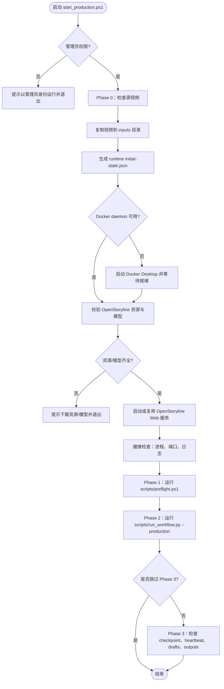
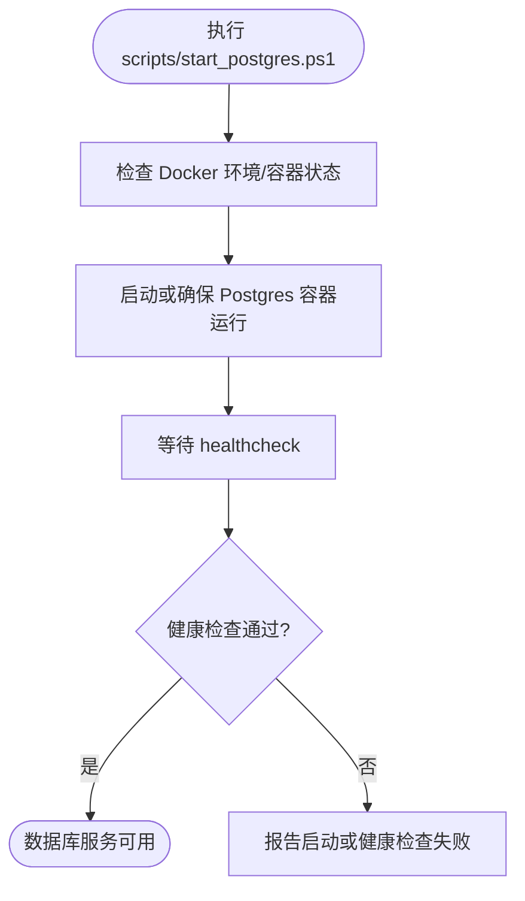
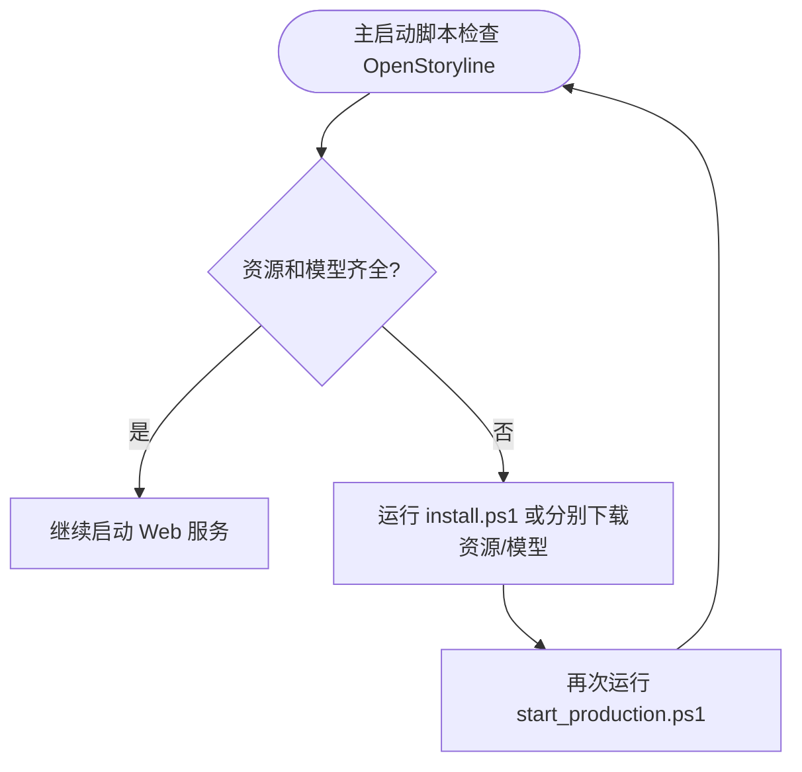
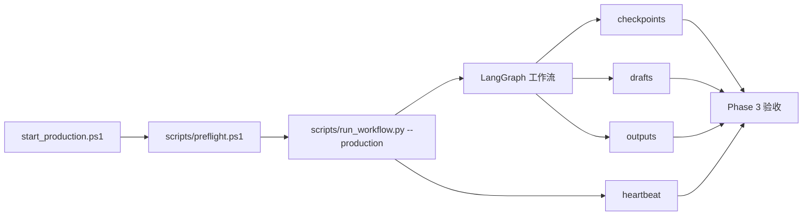

# auto-video-editor 一键启动脚本分析

- **仓库**：https://github.com/wayyet/auto-video-editor
- **分支**：`main`
- **分析日期**：2026-10-21
- **范围**：区分“启动完整工作流”的入口脚本与“启动依赖服务/执行安装”的辅助脚本。

## 1. 结论

目前仓库中，明确承担**完整生产工作流一键启动**职责的入口是：

- [`start_production.ps1`](https://github.com/wayyet/auto-video-editor/blob/main/start_production.ps1)

该脚本的头部注释明确说明，它封装 Phase 0～3：准备视频输入与初始状态、执行预检、运行生产工作流、检查运行产物。脚本要求在**管理员 Windows PowerShell** 中运行。

其他相关脚本属于辅助操作，不应与完整工作流入口混为一谈：

| 脚本 | 用途 | 是否独立启动完整工作流 |
|---|---|---|
| `start_production.ps1` | 完整生产工作流入口 | **是** |
| `stop_production.ps1` | 停止生产工作流相关进程 | 否，属于停止脚本 |
| `scripts/start_postgres.ps1` | 启动本地 Postgres Docker 容器并等待健康检查 | 否，只启动数据库依赖 |
| `scripts/stop_postgres.ps1` | 停止 Postgres 容器；可选移除容器 | 否，只停止数据库依赖 |
| `scripts/check_docker_proxy.ps1` | 检查 Docker 代理；可选重启 Docker Desktop | 否，故障排查辅助脚本 |
| `scripts/setup_postgres_schema.py` | 初始化/设置 Postgres schema | 否，数据库初始化脚本 |
| `scripts/verify_postgres.py` | 验证数据库版本、数据库与 checkpoint 表 | 否，验证脚本 |
| `scripts/preflight.ps1` | 生产工作流运行前的环境检查，由启动流程调用 | 否，预检子步骤 |
| `scripts/run_workflow.py` | 实际调用生产工作流的 Python 入口，由启动流程调用 | 否，核心执行子步骤 |

> 说明：README 公开列出了 `start_postgres.ps1`、`stop_postgres.ps1`、`check_docker_proxy.ps1` 等操作命令；`start_production.ps1` 的脚本注释则明确列出它调用的预检与工作流执行阶段。这里按职责分类，而不是把所有 `.ps1` / `.py` 脚本都称作“一键启动脚本”。

## 2. 主入口：`start_production.ps1`

### 2.1 调用方式

在仓库根目录，用**以管理员身份运行**的 Windows PowerShell 执行：

```powershell
.\start_production.ps1
```

常见参数：

```powershell
# 自定义 LangGraph thread_id
.\start_production.ps1 -ThreadId video-002

# 跳过 Phase 3 验收检查
.\start_production.ps1 -SkipPhase3

# 仅显示计划，不执行实际操作
.\start_production.ps1 -WhatIf
```

脚本默认参数中包含本机路径，例如源视频路径和 OpenStoryline 目录。因此在其他机器上运行前，应检查脚本参数默认值是否与本机目录结构一致。

### 2.2 主流程图



### 2.3 各阶段说明

1. **权限检查**：检查当前 PowerShell 是否以管理员身份运行；不满足时退出。
2. **准备输入**：检查源视频存在，将其复制到 `inputs` 目录，并生成 `initial-state.json`。
3. **Docker 检查**：检查 Docker daemon；不可用时尝试启动 Docker Desktop 并等待就绪。Docker 在该启动流程中主要用于 Postgres。
4. **OpenStoryline 依赖检查**：检查 `openstoryline/resource/` 与 `openstoryline/.storyline/models/`。缺失时脚本提示先下载资源/模型。
5. **启动 OpenStoryline Web**：检查 Web 端口是否已监听；已启动则复用，否则启动 Uvicorn Web 服务。
6. **健康检查**：检查 Web 进程、端口和日志。
7. **预检**：执行 `scripts/preflight.ps1`。
8. **工作流执行**：执行 `scripts/run_workflow.py --production`，并传入 thread ID 和初始状态 JSON。
9. **验收**：默认检查 checkpoint、heartbeat、drafts 和 outputs；传入 `-SkipPhase3` 可跳过。

## 3. 辅助脚本流程图

### 3.1 Postgres 启动脚本

README 给出的命令：

```powershell
.\scripts\start_postgres.ps1
```

它用于启动本地 EDB Postgres Docker 容器并等待 healthcheck。它**不是**完整工作流启动入口。



### 3.2 OpenStoryline 安装/资源准备脚本

主启动脚本发现 OpenStoryline 资源或模型缺失时，会提示手动执行：

```powershell
.\openstoryline\scripts\download_resources.ps1
.\openstoryline\scripts\download_models.ps1

# 或使用项目提供的一键安装脚本
.\openstoryline\scripts\install.ps1
```

这些是**依赖安装/资源准备脚本**，并非 `auto-video-editor` 工作流的主启动入口。



## 4. 主入口的执行链



这里的 `preflight.ps1` 与 `run_workflow.py` 是主入口编排的子步骤；直接运行它们不等价于完整的一键启动，因为输入准备、Docker/OpenStoryline 启动及最终验收由主入口统一负责。

## 5. 运行前检查清单

- [ ] 在仓库根目录运行命令。
- [ ] 使用管理员身份启动 Windows PowerShell。
- [ ] 检查 `start_production.ps1` 中的默认源视频路径、输入目录及 OpenStoryline 路径。
- [ ] 确认 Docker Desktop 已安装，并允许脚本启动 Docker 服务。
- [ ] 确认 OpenStoryline 的 Python 虚拟环境、代码、资源和模型已准备好。
- [ ] 首次运行可先执行 `.\start_production.ps1 -WhatIf` 查看计划。
- [ ] 需要核验完整运行结果时，不要使用 `-SkipPhase3`。

## 6. 参考源码

- 仓库主页与 README：<https://github.com/wayyet/auto-video-editor>
- 主启动脚本：<https://github.com/wayyet/auto-video-editor/blob/main/start_production.ps1>
- 停止脚本：<https://github.com/wayyet/auto-video-editor/blob/main/stop_production.ps1>
- README 中的 Postgres 启停与 Docker 代理自检说明：<https://github.com/wayyet/auto-video-editor/blob/main/README.md>

## 7. 分析边界

本文根据 `main` 分支当前可见的 README 与 `start_production.ps1` 源码整理。主启动脚本的阶段划分和关键依赖检查有源码注释及实现支持；辅助脚本的详细内部逻辑应以对应脚本文件为准。由于部分脚本是被主入口调用的子步骤，本文将其标记为“辅助脚本”，避免把它们误认为独立的一键启动入口。
