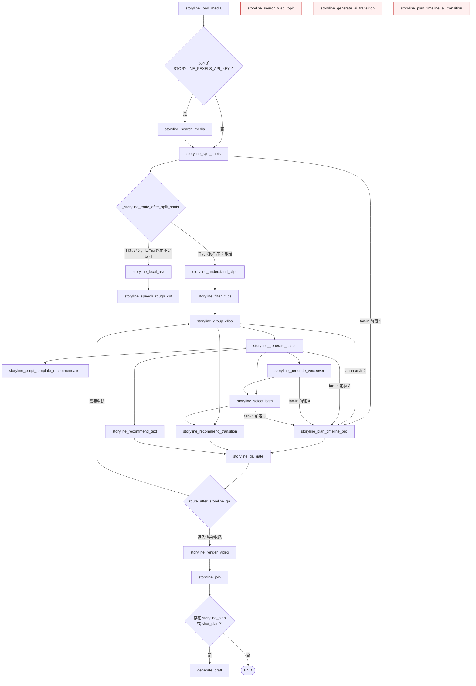

# auto-video-editor：LangGraph Nodes、Edges 与 State 分析

> 分析对象：[`wayyet/auto-video-editor`](https://github.com/wayyet/auto-video-editor)，`main` 分支。  
> 代码基准：检查时 `main` 指向提交 [`c8e64e8`](https://github.com/wayyet/auto-video-editor/commit/c8e64e8f11d9187893da491e409e7c74f646635b)（2026-10-19）。  
> 主要依据：[`graph.py`](https://github.com/wayyet/auto-video-editor/blob/main/graph.py)、[`state.py`](https://github.com/wayyet/auto-video-editor/blob/main/state.py)、[`config.py`](https://github.com/wayyet/auto-video-editor/blob/main/config.py)。本文优先依据代码实现；仓库 README 的旧版拓扑说明不完全反映当前 `main`。

## 1. 结论摘要

这个项目不是单一路径的 LangGraph，而是一个包含**人工模式、自动模式、双语并行编辑、循环护栏、装配质检和人工中断恢复**的状态图。

核心机制如下：

1. `StateGraph(WorkflowState)` 定义图。`nodes` 执行具体工作，`edges` 决定执行顺序。
2. `open_preview` 之后通过 `_route_mode` 分流：默认 `human`，也可设置 `STORYLINE_MODE=auto`。
3. 人工模式先等待用户在 OpenStoryline 网页中完成规划；自动模式走 `nodes/storyline/` 中的剧情线生成图。
4. 两种模式最终都进入 `generate_draft`，之后默认执行 6 节点装配质检通道，再进入剪映草稿编辑流程。
5. 字幕完成后分成中文与英文两条分支。英文分支可能触发关卡③。两条分支都完成后，才进入统一的特效、贴纸、BGM、音量和交付 QA 尾链。
6. `WorkflowState` 保存节点之间传递的数据；checkpointer 保存执行快照，使 `interrupt/resume` 可以从人工关卡继续。

## 2. 图的整体结构

### 2.1 总体流程图

```mermaid
flowchart TD
    START([START]) --> launch[launch_openstoryline]
    launch --> preview[open_preview]
    preview --> mode{_route_mode\nSTORYLINE_MODE}

    mode -->|human 默认| cp0[checkpoint0_storyline_plan\n关卡⓪：人工规划]
    cp0 --> imp[import_video\n等待网页端手动导入]
    imp --> plan[get_storyboard_plan\n读取分镜规划产物]
    plan --> plan_ok{存在 storyline_plan\n或 shot_plan？}
    plan_ok -->|是| draft[generate_draft]
    plan_ok -->|否| END0([END])

    mode -->|auto| load[storyline_load_media]
    load --> autoGraph[[自动剧情线子图\n见第 3 节详细图]]
    autoGraph --> joinStory[storyline_join]
    joinStory --> auto_ok{存在 storyline_plan\n或 shot_plan？}
    auto_ok -->|是| draft
    auto_ok -->|否| END1([END])

    draft --> qcOn{ASSEMBLY_QC_GATE_ENABLED？\n默认 true}
    qcOn -->|true| discover[assembly_discover_and_probe]
    discover --> observe[assembly_asr_and_visual_observe]
    observe --> timeline[assembly_build_timeline]
    timeline --> validate[assembly_validate_render_qc]
    validate --> qcRoute{route_after_assembly_qc}
    qcRoute -->|未达标且可重试| repair[assembly_repair_loop]
    repair --> validate
    qcRoute -->|达标或重试到上限| report[assembly_write_report]
    report --> cp1[node_06_human_reorder\n关卡①：人工调整]
    qcOn -->|false| cp1

    cp1 --> fit[node_07_speed_fit\n时长护栏：目标 35 秒]
    fit --> fitRoute{route_after_speed_fit}
    fitRoute -->|达标| bridge[bridge_snapshot2]
    bridge --> zh[ node_08_add_subtitles\n中文 ASR/字幕 ]
    fitRoute -->|未达标且可重试| fit
    fitRoute -->|重试超限| escalate[escalate_guardrail_failure]
    escalate --> END2([END])

    zh --> cn[中文线：node_10_inject_text_fx]
    cn --> cover[node_14_make_covers]
    cover --> localize[node_15_localize_covers_en]

    zh --> fork[fork_draft_for_english_branch]
    fork --> translate[node_16a_translate_and_check]
    translate --> enSub[node_08b_add_subtitles_en]
    enSub --> enFx[node_10b_inject_text_fx_en]
    enFx --> layout{layout_issues_detected？}
    layout -->|是| cp3[node_checkpoint3_layout_review\n关卡③：人工校对]
    cp3 --> tts[node_17_inject_english_tts]
    layout -->|否| tts

    localize --> fanin{{中文线与英文线都完成}}
    tts --> fanin
    fanin --> fx[node_09_inject_fx]
    fx --> sticker[node_11_inject_sticker]
    sticker --> cp2[node_12_human_add_bgm\n关卡②：人工选曲]
    cp2 --> volume[node_13_adjust_volume]
    volume --> finalQA[join_before_delivery\n交付前 QA]
    finalQA --> END([END])
```

> 注：`clean_cache` 虽然已注册为节点，但代码刻意不把它接到 `START`，避免每次运行自动清理缓存。它供 OpenStoryline Web UI 的“清理缓存”接口显式调用，不属于图的默认执行链。

### 2.2 人工关卡与运行模式

| 关卡/模式 | 触发位置 | 作用 |
|---|---|---|
| 关卡⓪ | `checkpoint0_storyline_plan` | `human` 模式下等待用户完成 OpenStoryline 的规划；随后由网页端触发视频导入，图侧读取规划产物。 |
| 关卡① | `node_06_human_reorder` | 用户人工调整剪映草稿中的镜头顺序。 |
| 关卡② | `node_12_human_add_bgm` | 用户人工选择/确认 BGM。 |
| 关卡③ | `node_checkpoint3_layout_review` | 仅当 `layout_issues_detected` 为真时触发，供人工检查英文字幕布局。 |
| `human` | `STORYLINE_MODE` 默认值 | 保留人工规划、网页导入和读盘流程。 |
| `auto` | `STORYLINE_MODE=auto` | 跳过关卡⓪及人工导入链，自动运行剧情线子图。 |

人工关卡使用 LangGraph 的 `interrupt/resume` 机制，因此需要 checkpointer。`WorkflowState` 是节点数据状态；`thread_id` 则通过 LangGraph 的 `configurable.thread_id` 区分具体执行会话。

## 3. 自动模式剧情线子图

自动模式从 `storyline_load_media` 开始。它与普通视频编辑节点使用同一个 `WorkflowState`，并将剧情线结果写入 `storyline_*` 字段。

### 3.1 自动模式边的语义

- **条件边**：`_route_mode`、`_storyline_route_after_load_media`、`_storyline_route_after_split_shots`、`route_after_storyline_qa`、`_route_after_storyline_join` 会根据配置或状态决定下一节点。
- **可选素材搜索**：只有 `STORYLINE_PEXELS_API_KEY` 非空时，`storyline_load_media` 才会先经过 `storyline_search_media`，之后仍到 `storyline_split_shots`。
- **并行分支**：`storyline_generate_script` 会分流到文案模板推荐、配音、BGM 和文字风格推荐；`storyline_group_clips` 也会触发转场推荐。
- **Fan-in（多前驱汇合）**：`add_edge([多个前驱], 目标节点)` 表示目标节点要等待列表中的所有前驱完成。时间线节点等待 `split_shots`、`group_clips`、`generate_script`、`generate_voiceover`、`select_bgm`；QA 节点等待时间线、转场推荐、文字推荐全部完成。
- **QA 循环**：`storyline_qa_gate` 的条件边可回到 `storyline_group_clips` 重试，也可进入 `storyline_render_video`，之后到 `storyline_join`。

### 3.2 当前源码中已知不可达节点

| 节点 | 当前状态 | 源码原因/影响 |
|---|---|---|
| `storyline_search_web_topic` | 已注册，但没有任何入边或出边 | 目前不会执行。 |
| `storyline_generate_ai_transition` | 已注册，但没有任何入边或出边 | 目前不会执行。 |
| `storyline_plan_timeline_ai_transition` | 已注册，但没有任何入边或出边 | 目前不会执行；fan-in 使用的是 `storyline_plan_timeline_pro`。 |
| `storyline_local_asr` | 有条件边映射目标，但运行时不可达 | `_storyline_route_after_split_shots` 的两个分支都返回 `storyline_understand_clips`，所以不会返回 `storyline_local_asr`。 |
| `storyline_speech_rough_cut` | 结构上由 `storyline_local_asr` 指向，但当前不可达 | 上游 `storyline_local_asr` 当前不会被路由选中。 |
| `clean_cache` | 注册但不接入图的 `START` 链 | 这是有意设计：避免每次 `graph.invoke()` 都自动删除缓存；通过 Web UI 的清理接口显式调用。 |

上述“不可达”是按 `graph.py` 当前连边和条件路由判断，不代表这些节点模块不存在，也不代表未来版本仍会如此。

## 4. 节点分类清单

### 4.1 启动、规划与草稿生成

| 节点 | 职责 |
|---|---|
| `launch_openstoryline` | 启动或检查 OpenStoryline 服务；自动模式可跳过 Web UI 子进程。 |
| `open_preview` | 打开/准备预览环境。 |
| `checkpoint0_storyline_plan` | 人工模式下等待规划完成。 |
| `import_video` | 向网页端发起握手并等待用户在网页端点击“导入视频”；节点本身不直接导入媒体文件。 |
| `get_storyboard_plan` | 读取 OpenStoryline 写入的分镜/时间线产物。 |
| `generate_draft` | 将规划产物映射为剪映草稿；节点封装器会在测试草稿已存在时跳过重写。 |
| `clean_cache` | 显式清理缓存的入口；不在默认执行边上。 |

### 4.2 装配质检通道（默认开启）

| 节点 | 职责 |
|---|---|
| `assembly_discover_and_probe` | 发现媒体并探测基础信息。 |
| `assembly_asr_and_visual_observe` | 语音识别与画面观察，整理装配输入。 |
| `assembly_build_timeline` | 构建时间线文件。 |
| `assembly_validate_render_qc` | 校验时间线、渲染预览并进行 QC。 |
| `assembly_repair_loop` | 针对 QC 问题执行修复，然后返回校验节点。 |
| `assembly_write_report` | 写入质检报告，再进入关卡①。 |

`config.ASSEMBLY_QC_GATE_ENABLED` 默认是 `true`。设为 `false` 时，这 6 个节点仍会注册，但不进入执行链，`generate_draft` 会直接连接 `node_06_human_reorder`。

### 4.3 草稿编辑、双语分支和交付

| 节点 | 职责 |
|---|---|
| `node_06_human_reorder` | 关卡①：人工重排镜头。 |
| `node_07_speed_fit` | 时长护栏，将视频目标总时长压到不超过 35 秒，并维护重试计数。 |
| `bridge_snapshot2` | 将快照②路径写回 State，供字幕及后续英文分支使用。 |
| `node_08_add_subtitles` | 生成/注入中文字幕，并把中文 ASR 分段写入 `asr_segments_zh`。 |
| `node_10_inject_text_fx` | 中文线注入文字样式/花字。 |
| `node_14_make_covers` | 生成中文封面资源。 |
| `node_15_localize_covers_en` | 生成英文封面资源；此节点是中文线的末端。 |
| `fork_draft_for_english_branch` | 从快照创建独立英文草稿分支。 |
| `node_16a_translate_and_check` | 翻译中文字幕并检测布局；结果包括 `layout_issues` / `layout_issues_detected`。 |
| `node_08b_add_subtitles_en` | 将英文字幕注入英文分支草稿。 |
| `node_10b_inject_text_fx_en` | 英文分支注入花字/字幕动画；在条件判断关卡③之前执行。 |
| `node_checkpoint3_layout_review` | 关卡③：仅在布局检测发现问题时中断等待人工校对。 |
| `node_17_inject_english_tts` | 英文语音合成；失败时按设计不应阻塞中文主线。 |
| `node_09_inject_fx` | 两条分支汇合后注入转场/视频特效。 |
| `node_11_inject_sticker` | 注入贴纸资源。 |
| `node_12_human_add_bgm` | 关卡②：人工选曲/确认 BGM。 |
| `node_13_adjust_volume` | 调整音量。 |
| `join_before_delivery` | 交付前 QA，记录 `join_qa_issues` 并结束主图。 |
| `escalate_guardrail_failure` | 时长护栏重试超限时写错误日志并结束，不再进入正常字幕链。 |

## 5. Edges：边的类型与关键路由

LangGraph 中的边可分为三类：

1. **固定边 `add_edge(A, B)`**：A 完成后进入 B，例如 `launch_openstoryline → open_preview`。
2. **条件边 `add_conditional_edges(A, router, mapping)`**：调用路由函数，根据 State 或配置选择目标节点，例如模式选择、时长重试、布局校对。
3. **多前驱汇合边 `add_edge([A, B], C)`**：C 需等待 A 和 B 都完成。项目使用它处理中文/英文线汇合，以及自动模式中的时间线和 QA 输入汇合。

### 5.1 关键条件边

| 路由函数 | 来源节点 | 分支规则 |
|---|---|---|
| `_route_mode` | `open_preview` | `STORYLINE_MODE=auto` → `storyline_load_media`；否则 → `checkpoint0_storyline_plan`。 |
| `_route_after_import` | `get_storyboard_plan` | 有 `storyline_plan` 或 `shot_plan` → `generate_draft`；否则 `END`。 |
| `_storyline_route_after_load_media` | `storyline_load_media` | 配置 `STORYLINE_PEXELS_API_KEY` → `storyline_search_media`；否则 `storyline_split_shots`。 |
| `_storyline_route_after_split_shots` | `storyline_split_shots` | 当前代码无论是否有 `storyline_media_artifact` 都返回 `storyline_understand_clips`。 |
| `route_after_assembly_qc` | `assembly_validate_render_qc` | 未达标且仍可重试时进入 `assembly_repair_loop`；通过或触及重试上限时写报告。 |
| `route_after_speed_fit` | `node_07_speed_fit` | 总时长 ≤ 35 秒 → 桥接快照②并进入字幕节点；未达标且未超限 → 回到自身；重试超限 → `escalate_guardrail_failure`。 |
| `route_after_translate` | `node_10b_inject_text_fx_en` | `layout_issues_detected=true` → 关卡③；否则直接进入英文 TTS。 |
| `route_after_storyline_qa` | `storyline_qa_gate` | QA 决定回到 `storyline_group_clips` 重试，或进入 `storyline_render_video`。 |
| `_route_after_storyline_join` | `storyline_join` | 有规划产物 → `generate_draft`；没有则结束。 |

## 6. State：`WorkflowState` 数据结构

`state.py` 使用 `TypedDict(total=False)` 定义 `WorkflowState`。这表示字段总体上都是可选的，适合节点只返回它修改的字段，也有利于兼容旧 checkpoint。节点通过读取当前 State、返回字典更新部分字段来传递数据。

### 6.1 字段按业务域归类

| 数据域 | 主要字段 | 用途 |
|---|---|---|
| 会话和输入 | `session_id`、`video_input_path` | 标识任务和输入视频。 |
| 缓存与 OpenStoryline | `cache_cleaned`、`cache_cleaned_paths`、`openstoryline_pid`、`openstoryline_mcp_endpoint`、`openstoryline_web_url`、`openstoryline_ready`、`preview_opened` | 跟踪服务启动、预览和缓存操作。 |
| 规划与草稿 | `shot_plan`、`storyline_plan`、`draft_path`、`draft_encryption_status`、`draft_version_strategy`、`draft_source_normalized_path`、`_draft_dir_override` | 在剧情线/人工分镜输出与剪映草稿之间传递数据。注意：`storyline_plan` 是规划对象；`storyline_timeline_plan` 是自动剧情线阶段产物路径，两者不是同一个字段。 |
| 护栏与快照 | `snapshot2_path`、`retry_counts`、`reorder_notified`、`bgm_notified`、`volume_adjusted` | 记录 35 秒护栏重试、快照以及部分节点的幂等/处理状态。 |
| 日志 | `status_log`、`error_log` | 记录状态标签和错误。二者使用 append-only reducer，兼容增量列表和完整列表，且去重。 |
| 中文字幕/ASR | `asr_segments_zh`、`asr_segments_zh_written` | 保存中文 ASR 字幕分段，供字幕注入及英文翻译节点使用。 |
| 英文字幕/配音 | `subtitle_segments_en`、`subtitle_srt_path`、`en_dub_audio_path`、`en_audio_path` | 保存翻译字幕、SRT 路径和英文配音产物。 |
| 封面 | `covers` | 保存封面比例、中文/英文封面路径及文字区域信息。 |
| 关卡③布局复核 | `layout_issues`、`layout_issues_detected`、`checkpoint3_triggered`、`preview_video_path`、`subtitle_qc_evidence_frames` | 保存布局异常、预览视频和证据帧，并决定是否中断等待人工。 |
| 交付 QA | `join_qa_issues`、`final_video_path` | 保存交付前 QA 发现的问题及最终视频路径字段。当前 `final_video_path` 在 State 中定义为占位字段。 |
| 监控 | `heartbeat_id` | 标识心跳监控实例。 |
| 手动导入握手 | `import_video_status`、`import_video_media_path`、`import_video_web_session_id`、`import_video_filename` | 保存网页导入的状态、媒体路径、会话 ID 和文件名。 |
| 剧情线集成 | `storyline_session_id`、`storyline_transport`、`storyline_tools_snapshot`、`storyline_artifacts`、`storyline_error_code`、`storyline_outputs_root`、`reuse_skill_name` | 保存 OpenStoryline/FireRed 会话、能力工具快照、产物索引和错误状态。 |
| 自动剧情线产物 | `storyline_media_artifact`、`storyline_shots_artifact`、`storyline_understanding_artifact`、`storyline_filtered_clips`、`storyline_groups_artifact`、`storyline_script_artifact`、`storyline_voiceover_artifact`、`storyline_bgm_selection`、`storyline_transition_plan`、`storyline_text_style_plan`、`storyline_timeline_plan`、`storyline_asr_artifact`、`storyline_rough_cut_artifact`、`storyline_ai_transition_artifact`、`storyline_web_topic_artifact`、`storyline_render_smoke_test_path`、`storyline_qa_retry_count`、`storyline_targets` | 在 19 节点剧情线子图中传递产物路径、计划对象、QA 计数和目标参数。 |
| 装配 QC | `assembly_media_artifact`、`assembly_transcript_artifact`、`assembly_ingest_artifact`、`assembly_timeline_path`、`assembly_timeline_validation_path`、`assembly_preview_path`、`assembly_qc_report_path`、`assembly_report_path`、`assembly_qc_status`、`assembly_qc_retry_count`、`assembly_repair_evidence_path` | 保存装配质检每个阶段的产物路径、状态、重试次数和修复证据。 |

### 6.2 Reducer：解决并行分支的并发写入

Reducer 是 State 字段的合并规则。没有 reducer 的字段通常遵循 LangGraph 默认的单值写入语义；有 reducer 的字段则按自定义逻辑合并多个节点写入的值。

- **`_append_unique`**：用于 `status_log` 和 `error_log`。支持节点返回“新增条目”或“旧列表 + 新条目”两种写法，合并时只追加新内容并去重，减少并行节点写日志时重复或覆盖的问题。
- **`_last_wins`**：用于多数 `storyline_*` 产物字段和 `assembly_*` 产物字段。它采用最后一个非空写入值，目的是允许 fan-in 附近多个上游在同一执行步写共享产物键，避免 `InvalidUpdateError`。
- **没有 reducer 的字段**：例如 `storyline_qa_retry_count`、`assembly_qc_retry_count`，设计为单一节点或不同执行步骤维护，避免不必要的合并。

### 6.3 State 的典型流转

## 7. Checkpointer 与恢复

`build_graph()` 最终调用 `g.compile(checkpointer=checkpointer)`。当调用方没有传入 saver 时，会通过 `make_checkpointer()` 选择后端。

- 默认配置是 SQLite：文件位置为 `checkpoints/<thread_id>.sqlite`（目录由 `config.CHECKPOINTER_DB_DIR` 指定）。
- `backend="memory"` 用于进程内临时状态，不提供持久化。
- 配置 `WORKFLOW_ENV=production` 时，`resolve_checkpointer_backend()` 将后端解析为 PostgreSQL；PostgreSQL 生产路径应使用 `graph.get_checkpointer()` 异步上下文管理器，由它处理 `AsyncPostgresSaver.setup()` 和连接池生命周期。
- 恢复时必须沿用同一个 `configurable.thread_id`，并通过 `Command(resume=...)` 恢复中断的执行。换一个 `thread_id` 会创建另一条 checkpoint 轨迹。

## 8. 值得注意的代码/文档风险

1. **README 拓扑说明较旧**：README 标题与前几节仍写 Week 2/Week 3 的“13+1 节点”，但 `graph.py` 已包含剧情线自动模式、双语分支和 Phase 5 的装配 QC 通道。分析当前运行行为应优先看 `graph.py`。
2. **剧情线子图有不可达节点**：见第 3.2 节。若预期执行网页主题搜索、AI 转场或 AI 时间线规划，当前连边尚未实现。
3. **音频分支条件尚未完成**：`_storyline_route_after_split_shots` 两个分支返回相同节点，导致本应可选的 `storyline_local_asr → storyline_speech_rough_cut` 不会执行。
4. **端到端草稿生成存在已记录的契约风险**：仓库 2026-10-19 的最新设计执行计划提交记录了 D9 问题：`storyline_plan_timeline_pro` 产出的 Timeline 字段/类型与 `CanonicalTimeline` 校验契约不一致，可能导致 `node_05` 校验失败、`draft_path=None`，从而无法生成最终剪映草稿。这里引用的是仓库最新提交中的问题记录，不是本次重新运行测试的结论；应先修复映射契约并补回归测试，再将完整工作流视为已验收。
5. **SQLite/PostgreSQL 不应混为一谈**：本地默认 SQLite；生产环境逻辑切换到 PostgreSQL，但生产后端要走 `get_checkpointer()` 的异步初始化路径。

## 9. 建议阅读顺序

1. 先读 [`graph.py`](https://github.com/wayyet/auto-video-editor/blob/main/graph.py)：查看 `build_graph()` 内所有 `add_node`、`add_edge`、`add_conditional_edges`。
2. 再读 [`state.py`](https://github.com/wayyet/auto-video-editor/blob/main/state.py)：理解字段以及 `_append_unique` / `_last_wins` reducer。
3. 最后读 [`config.py`](https://github.com/wayyet/auto-video-editor/blob/main/config.py)：核对 `STORYLINE_MODE`、`ASSEMBLY_QC_GATE_ENABLED`、护栏重试和 checkpointer 设置。

---

**参考源码**

- [`graph.py`（StateGraph 装配、节点和边）](https://github.com/wayyet/auto-video-editor/blob/main/graph.py)
- [`state.py`（WorkflowState、Reducer）](https://github.com/wayyet/auto-video-editor/blob/main/state.py)
- [`config.py`（运行模式、checkpointer 和 QC 开关）](https://github.com/wayyet/auto-video-editor/blob/main/config.py)
- [`README.md`（项目说明；拓扑说明有旧内容）](https://github.com/wayyet/auto-video-editor/blob/main/README.md)
- [`2026-10-19 最新提交`](https://github.com/wayyet/auto-video-editor/commit/c8e64e8f11d9187893da491e409e7c74f646635b)
