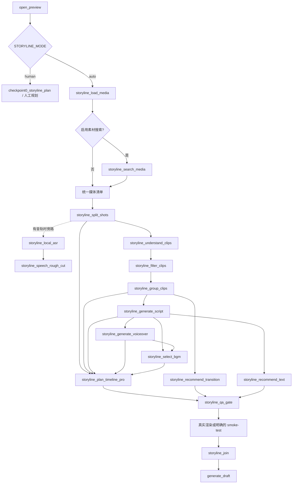

# auto-video-editor `main` 分支：LangGraph 节点调用链与未接入模块审计

> 审计对象：[`wayyet/auto-video-editor`](https://github.com/wayyet/auto-video-editor)，`main` 分支。  
> 代码快照：`0ad006195e24b84ee70dc491e2def224bf889fda`（2026-10-19）。  
> 分析范围：用户提供的 `Video Editing Workflow` 节点截图、主 `graph.py`、`nodes/storyline/`、`storyline_capabilities/`、MCP 适配/服务代码。  
> 方法：静态阅读代码和图的注册/边关系；没有在用户机器上启动模型、MCP 服务或跑完整视频。因此，本文中的“不可达”指当前代码拓扑下没有执行路径，不等价于声称该模块从未被外部程序手动调用。

## 一、结论摘要

1. **`storyline_load_media` 不是每次工作流都会调用。** `config.py` 的 `STORYLINE_MODE` 默认值是 `human`。只有启动 Python 进程前设置 `STORYLINE_MODE=auto`，`open_preview` 后才会进入自动剪辑子图。
2. **自动剪辑子图目前有 3 个明确的“已注册但没有任何边”的节点：** `storyline_search_web_topic`、`storyline_generate_ai_transition`、`storyline_plan_timeline_ai_transition`。即使打开 `STORYLINE_ENABLE_AI_TRANSITION=1`，也不会令这两个 AI 转场节点自动进入图。
3. **ASR 分支不可达。** `_storyline_route_after_split_shots()` 的 `if` 和 `else` 都返回 `storyline_understand_clips`。所以 `storyline_local_asr`、`storyline_speech_rough_cut` 当前不会由这条图执行；而且 `speech_rough_cut` 之后也没有接回主干的边。
4. **有些节点“会运行”，但不代表功能已经实现。** `storyline_script_template_recommendation` 是 no-op（只写状态）；`storyline_render_video` 默认 no-op，开启 smoke-test 标志后也只写 JSON 占位文件，不会生成真实 MP4。
5. **当前 auto-mode 的 `storyline_*` 节点走本地 Python capability，不是通过 MCP 调用。** `storyline/firered_adapter.py` 明确标注为参考清单，不参与运行时调用；`mcp_clients/openstoryline_client.py` 已移除。独立的 OpenStoryline Web UI / MCP 服务仍在仓库中，但不等同于 auto-mode 子图。
6. **截图与当前代码还有关键拓扑差异。** 截图里的 `Search Media → Load Media` 关系，与当前代码不一致；当前代码是 `Load Media →（可选）Search Media → Split Shots`。这条可选搜索分支存在 API Key 名称和产物 schema 两个问题，按当前代码很可能无法为下游提供有效媒体清单。

## 二、`storyline_load_media` 的真实调用位置

### 2.1 入口链路

主图定义在 [`graph.py`](https://github.com/wayyet/auto-video-editor/blob/main/graph.py)：

- `build_graph()` 调用 `_build_state_graph()`，然后 `compile()`，得到已编译的 LangGraph。
- `_build_state_graph()` 用 `g.add_node("storyline_load_media", storyline_load_media_node)` 注册节点。
- 入口边是 `START → launch_openstoryline → open_preview`。
- `open_preview` 之后通过条件边 `_route_mode` 进行分流。
- `_route_mode()` 只有在 `STORYLINE_MODE == "auto"` 时才返回 `storyline_load_media`；否则返回 `checkpoint0_storyline_plan`。

主入口脚本是 [`scripts/run_workflow.py`](https://github.com/wayyet/auto-video-editor/blob/main/scripts/run_workflow.py)，它构造初始 state 后调用 `g.invoke(...)` 或 `g.ainvoke(...)`。正常执行不是 Python 代码直接调用 `storyline_load_media_node()`，而是 LangGraph 沿边调度该节点。

### 2.2 模式决定是否触发

配置定义在 [`config.py`](https://github.com/wayyet/auto-video-editor/blob/main/config.py)：

```python
STORYLINE_MODE = os.environ.get("STORYLINE_MODE", "human").lower().strip()
```

因此，**默认 human-mode 不会经过 `storyline_load_media`**。它会走旧的人工路径：

```text
open_preview
  → checkpoint0_storyline_plan
  → import_video
  → get_storyboard_plan
  → generate_draft
```

auto-mode 才进入：

```text
open_preview
  → storyline_load_media
  → 可选 storyline_search_media
  → storyline_split_shots
  → storyline_understand_clips
  → storyline_filter_clips
  → storyline_group_clips
  → 文案 / 配音 / BGM / 时间线规划
  → storyline_qa_gate
  → storyline_render_video（当前是占位）
  → storyline_join
  → generate_draft
```

设置模式的 PowerShell 示例（必须在启动 Python 之前设置）：

```powershell
$env:STORYLINE_MODE = "auto"
```

### 2.3 节点本身做什么

[`nodes/storyline/node_load_media.py`](https://github.com/wayyet/auto-video-editor/blob/main/nodes/storyline/node_load_media.py) 中，`storyline_load_media_node()`：

1. 从 `state["video_input_path"]` 组装输入路径。
2. 直接调用本地函数 `storyline_capabilities.load_media.load_media(...)`。
3. 把结果写入 `outputs/<job>/storyline/load_media.json` 一类的产物文件。
4. 将文件路径放到 `state["storyline_media_artifact"]`，并追加 `status_log`。

这条执行路径没有调用 MCP client，也没有通过 `call_tool()` 访问 OpenStoryline MCP server。

## 三、截图节点与当前代码逐项对照

| 截图节点 | 当前代码对应 | 当前调用状态 | 审计结论 |
|---|---|---|---|
| Search Media | `storyline_search_media` / `storyline_capabilities/search_media.py` | 条件触发 | 只在 `STORYLINE_PEXELS_API_KEY` 非空时走到，但当前存在环境变量名及产物字段不匹配问题，见第六节。 |
| Load Media | `storyline_load_media` | auto-mode 可达 | 直接调用本地 `cap_load_media`，不是通过 MCP。human-mode 不会走此节点。 |
| Split Shots | `storyline_split_shots` | auto-mode 主链可达 | 调本地镜头切分能力；结果写入 `storyline_shots_artifact`。 |
| Understand Clips | `storyline_understand_clips` | auto-mode 主链可达 | 读取媒体清单和镜头切分产物，生成理解结果。 |
| Filter Clips | `storyline_filter_clips` | auto-mode 主链可达 | 位于理解节点之后。 |
| Group Clips | `storyline_group_clips` | auto-mode 主链可达 | 生成分组；也是 QA 超时/超长重试时的回跳位置。 |
| Generate Script | `storyline_generate_script` | auto-mode 可达 | 脚本生成节点；下游并行触发模板推荐、配音、BGM 与文字推荐。 |
| Recommend Script Template | `storyline_script_template_recommendation` | 会被调度，但 no-op | 当前只追加状态日志，不产生模板推荐结果，也不影响已经执行过的 `generate_script`。 |
| Generate Voiceover | `storyline_generate_voiceover` | auto-mode 可达 | 走本地 capability；默认 TTS client 是 `StubTTSClient`，真实语音合成不能仅凭节点可达就视为已接通。 |
| Select BGM | `storyline_select_bgm` | auto-mode 可达 | 参与后续时间线规划，并作为转场推荐的前置依赖之一。 |
| Recommend Text | `storyline_recommend_text` | auto-mode 可达 | 输出 `storyline_text_style_plan`，并与时间线、转场推荐一起进入 QA 汇合点。 |
| Recommend Transition | `storyline_recommend_transition` | auto-mode 可达 | 输出 `storyline_transition_plan`，供时间线规划与 QA 汇合使用。 |
| Generate AI Transition | `storyline_generate_ai_transition` | **不可达** | 已注册但没有入边/出边；设置 AI 转场 flag 也不会改变图的连通关系。 |
| Plan Timeline | 实际使用 `storyline_plan_timeline_pro` | auto-mode 可达 | 当前主路径走 Pro 规划节点，不是旧的基础 `plan_timeline` 节点。 |
| AI Transition Timeline | `storyline_plan_timeline_ai_transition` | **不可达** | 已注册但没有入边/出边；不会覆盖 Pro 时间线结果。 |
| Render Video | `storyline_render_video` | 图上可达，但真实渲染未接通 | 默认直接跳过；开启 smoke-test 后写 JSON 占位，不会生成真实 MP4，也不把 MP4 作为最终交付传递下去。 |

截图里的 Search Media 关系画成了指向 Load Media 的连线；当前 `graph.py` 的真实边则是 `storyline_load_media` 之后分流到 `storyline_search_media` 或 `storyline_split_shots`。这不是纯展示差异，而是会影响媒体清单如何合并的问题。

## 四、LangGraph 中明确不可达或没有下游消费的节点

### 4.1 已注册，但图中没有任何边

| 节点 | 文件 | 当前状态 / 影响 |
|---|---|---|
| `storyline_search_web_topic` | [`nodes/storyline/node_search_web_topic.py`](https://github.com/wayyet/auto-video-editor/blob/main/nodes/storyline/node_search_web_topic.py) | 已 `add_node`，但 `graph.py` 没有任何边引用它。即使其本地搜索 capability 已实现，也不会通过该 LangGraph 执行。 |
| `storyline_generate_ai_transition` | [`nodes/storyline/node_generate_ai_transition.py`](https://github.com/wayyet/auto-video-editor/blob/main/nodes/storyline/node_generate_ai_transition.py) | 没有入边和出边，AI 转场生成节点不会运行。其 capability 默认也仍是 stub。 |
| `storyline_plan_timeline_ai_transition` | [`nodes/storyline/node_plan_timeline_ai_transition.py`](https://github.com/wayyet/auto-video-editor/blob/main/nodes/storyline/node_plan_timeline_ai_transition.py) | 没有入边和出边；AI 转场版时间线不可能由当前主图生成。 |

### 4.2 有边，但由当前路由条件挡住

| 节点 | 当前状态 | 原因 |
|---|---|---|
| `storyline_local_asr` | 当前不可达 | `_storyline_route_after_split_shots()` 中 `if media_artifact` 和 `else` 都返回 `storyline_understand_clips`，没有任何输入条件会选择该节点。 |
| `storyline_speech_rough_cut` | 当前不可达 | 只有 `storyline_local_asr → storyline_speech_rough_cut` 这条入边；上游 ASR 不可达，且粗剪节点没有返回主线的出边。 |

代码注释将该位置描述为“有语音时走 ASR 旁路”，但实现并没有完成 `has_audio` 检测与并行分支。**不能只把其中一个 `return` 改成 ASR 节点名**：这样会让路由选择 ASR 分支时绕过 `understand_clips` 主链，并且 `speech_rough_cut` 产物仍没有汇入后续节点。应设计成视觉主链必走，ASR 作为条件旁路，并明确其结果由哪个下游节点消费。

### 4.3 节点能运行，但能力仍是占位

| 模块 | 代码证据 | 实际效果 |
|---|---|---|
| 文案模板推荐 | [`nodes/storyline/node_script_template_recommendation.py`](https://github.com/wayyet/auto-video-editor/blob/main/nodes/storyline/node_script_template_recommendation.py) | 函数只返回状态日志，不调用推荐算法、不产出推荐模板。并且它在 `generate_script` 之后执行，不能反向影响本轮脚本生成。 |
| 视频渲染 | [`nodes/storyline/node_render_video.py`](https://github.com/wayyet/auto-video-editor/blob/main/nodes/storyline/node_render_video.py) | `STORYLINE_ENABLE_RENDER_SMOKE_TEST` 默认为 `0`，默认 no-op；打开后写 `render_smoke_*.json`，内容明确标注为 stub，不是真实 MP4。 |
| 配音合成 | [`storyline_capabilities/generate_voiceover.py`](https://github.com/wayyet/auto-video-editor/blob/main/storyline_capabilities/generate_voiceover.py) / `tts_runner.py` | 默认 TTS client 为 `StubTTSClient`；缺少真实 client 接入时会生成占位音频/时长信息。需要检查输出中的 stub 标记，不能只凭 `status_log` 判断配音已真实完成。 |
| AI 转场生成 | [`storyline_capabilities/ai_transition_client.py`](https://github.com/wayyet/auto-video-editor/blob/main/storyline_capabilities/ai_transition_client.py) | 默认 client 是 `StubAITransitionClient`；即使未来把节点接入图，当前默认实现仍不能生成真实 AI 转场视频。 |

## 五、MCP、工具客户端与独立服务的调用边界

### 5.1 auto-mode 主图不再经 MCP 调用 OpenStoryline 节点

以下代码关系可以确认 auto-mode 的本地化路径：

- `nodes/storyline/node_load_media.py` 直接 import `storyline_capabilities.load_media`。
- 其他 `nodes/storyline/node_*.py` 也分别直接 import `storyline_capabilities` 下的函数。
- [`storyline/firered_adapter.py`](https://github.com/wayyet/auto-video-editor/blob/main/storyline/firered_adapter.py) 的模块说明明确写着：迁移后仅作工具注册表参考，不参与 graph 运行时调用。
- 该文件说明 `OpenStorylineMCPClient` 已删除；当前 `mcp_clients/` 目录中也没有 `openstoryline_client.py`。
- [`nodes/node_02_launch_openstoryline.py`](https://github.com/wayyet/auto-video-editor/blob/main/nodes/node_02_launch_openstoryline.py) 明确规定 auto-mode 跳过 vendored Web UI 启动。

因此，`.env.example` 中残留的 MCP 配置说明、适配器里的 `TOOL_REGISTRY` 清单，不能被理解为 `storyline_*` 自动剪辑节点正在通过 MCP 执行。

### 5.2 仓库中的 MCP 服务仍存在，但属于独立调用路径

以下是另一条独立路径：

- [`openstoryline/src/open_storyline/mcp/server.py`](https://github.com/wayyet/auto-video-editor/blob/main/openstoryline/src/open_storyline/mcp/server.py) 创建 MCP server，并通过 `register_tools` 注册工具。
- [`openstoryline/src/open_storyline/mcp/register_tools.py`](https://github.com/wayyet/auto-video-editor/blob/main/openstoryline/src/open_storyline/mcp/register_tools.py) 扫描 `config.toml` 里的 `available_nodes`，注册节点工具，同时注册 `read_node_history` 与 `write_skills`。
- [`openstoryline/src/open_storyline/agent.py`](https://github.com/wayyet/auto-video-editor/blob/main/openstoryline/src/open_storyline/agent.py) 使用 `MultiServerMCPClient` 连接配置的 MCP server，再把工具交给 agent。
- [`agent_gate/mcp_server.py`](https://github.com/wayyet/auto-video-editor/blob/main/agent_gate/mcp_server.py) 是项目中另一个独立的 MCP 入口，服务于 `agent_gate` 的任务/生命周期控制，不是 `storyline_load_media` 子图的一部分。

这意味着这些 MCP 代码并不一定是死代码；它们可以服务于单独启动的 Web UI/Agent 或 `agent_gate`。但**不能将它们算作 auto-mode LangGraph 子图里的实际调用**。

### 5.3 MCP 工具清单与当前能力的差异

[`openstoryline/config.toml`](https://github.com/wayyet/auto-video-editor/blob/main/openstoryline/config.toml) 的 `available_nodes` 包含 `PlanTimelineProNode`，但没有列出旧的 `PlanTimelineNode`。所以即使 MCP server 正常启动，按当前白名单也不会暴露基础 `plan_timeline` 节点工具；而主 LangGraph auto-mode 使用的是本地 `storyline_plan_timeline_pro`。

### 5.4 图中会调用的客户端，也不等于真实远端能力已连接

主图的中文/英文封面分支会调用 `mcp_clients/` 中的客户端封装，但目前默认实现仍是 Mock：

- [`mcp_clients/jianying_cover_client.py`](https://github.com/wayyet/auto-video-editor/blob/main/mcp_clients/jianying_cover_client.py)：默认 `MockJianyingCoverClient` 使用 Pillow 产图；`HTTPJianyingCoverClient` 的方法仍抛 `NotImplementedError`。
- [`mcp_clients/firered_image_edit_client.py`](https://github.com/wayyet/auto-video-editor/blob/main/mcp_clients/firered_image_edit_client.py)：默认 `MockFireRedImageEditClient` 把中文封面图片复制为英文版本；`HTTPFireRedImageEditClient.edit()` 尚未实现。

因此，“封面节点执行过”不等于“真实剪映服务 / FireRed 图片编辑 MCP 已经执行”。

## 六、另外发现的高优先级问题

### P0-1：Search Media 条件使用的 API Key 环境变量不一致

[`graph.py`](https://github.com/wayyet/auto-video-editor/blob/main/graph.py) 的 `_storyline_route_after_load_media()` 检查：

```python
os.environ.get("STORYLINE_PEXELS_API_KEY", "").strip()
```

但 [`storyline_capabilities/search_media.py`](https://github.com/wayyet/auto-video-editor/blob/main/storyline_capabilities/search_media.py) 的默认取值是 `PEXELS_API_KEY`。这导致：

- 只设置 `PEXELS_API_KEY` 时，图不会进入搜索分支。
- 只设置 `STORYLINE_PEXELS_API_KEY` 时，虽然路由进入搜索分支，但 capability 仍可能读不到 Key。

应统一命名，并增加覆盖“未设置、设置正确、设置错误”三种状态的测试。

### P0-2：Search Media 产物字段与下游期望不一致

[`storyline_capabilities/search_media.py`](https://github.com/wayyet/auto-video-editor/blob/main/storyline_capabilities/search_media.py) 返回的字段是 `search_media`、`preview_urls`、`error_code`、`message`。但 [`nodes/storyline/node_split_shots.py`](https://github.com/wayyet/auto-video-editor/blob/main/nodes/storyline/node_split_shots.py) 从 manifest 读取的是：

```python
media_list = manifest.get("media", [])
```

同时，`storyline_search_media_node()` 会把 `storyline_media_artifact` 更新为搜索结果 JSON 的路径，而不是把下载结果合并到原始 `load_media` 清单。按当前输出 schema，下游会读到空 `media_list`。这条分支需要明确产物契约：把搜索下载的媒体转换成统一 `media[]` 条目，并与用户原始视频的 `media[]` 合并，再交给 `split_shots`。

### P0-3：ASR 路由和数据流没有完成

除了两条条件分支都返回 `storyline_understand_clips`，`storyline_speech_rough_cut` 产物 `storyline_rough_cut_artifact` 没有连接进 `group_clips` 或 `plan_timeline_pro`。应先确定粗剪结果是否应改变镜头集合/时间线，再补齐对应边和 state schema，而不是只让节点“可达”。

### P1-1：打开 AI Transition 开关并不能启用节点

`.env.example` 和 `config.py` 中存在 `STORYLINE_ENABLE_AI_TRANSITION`，但 `graph.py` 没有将 `storyline_generate_ai_transition` 或 `storyline_plan_timeline_ai_transition` 接到任意路径。这个开关当前不能让 AI 转场进入 LangGraph 主流程，应接边、补测试，或明确标记为未交付配置。

### P1-2：Render Video 名称与实际产物不符

图里的 `storyline_render_video` 连接在 QA 后、`storyline_join` 前；但它不是实际渲染节点。即使启用 `STORYLINE_ENABLE_RENDER_SMOKE_TEST=1`，它也只写一个说明为 stub 的 JSON，随后主线继续 `storyline_join → generate_draft`。如果产品目标是输出 MP4，需实现真实渲染、输出路径、失败状态和最终交付校验；如果目标只是生成剪映草稿，应将该节点改名为 smoke-test/占位节点，避免造成已渲染成片的误判。

### P1-3：推荐脚本模板目前没有业务效果

`storyline_script_template_recommendation` 目前只写状态日志，而且在 `generate_script` 后执行。建议明确以下二者之一：

- 模板推荐是生成脚本的输入：将推荐前置到 `generate_script` 之前，并将推荐结果传入脚本生成能力。
- 模板推荐只是后处理建议：保留为后置节点，但将结果写入独立字段/产物，并增加真实实现与消费者。

## 七、建议的处理顺序

1. **先锁定预期运行模式。** 说明生产默认究竟应该是 `human` 还是 `auto`。如果目标是截图中的自动流程，必须确认 `STORYLINE_MODE=auto` 在进程启动前已生效。
2. **修正 Search Media 分支。** 统一 API Key 名称；统一媒体 manifest schema；确保搜索结果与输入视频合并后，下游仍能拿到 `media[]`。
3. **重构 ASR 旁路。** 视觉主链必须继续执行；有音轨时再并行 ASR；将粗剪结果明确合并回规划节点；补齐有音频、无音频、ASR 失败三组图级测试。
4. **对所有已注册节点做“有边/有消费者”审计。** 至少检查 `storyline_search_web_topic`、两个 AI Transition 节点、`storyline_script_template_recommendation`。不能只检查 `add_node` 是否存在。
5. **区分真实实现与 stub。** 对 TTS、AI 转场、视频渲染、封面 HTTP client 分别输出 `provider/mode/is_stub` 等明确状态；验收测试不能只验证节点结束或文件存在。
6. **重新生成并检查图。** 检查 human/auto 两种模式的节点拓扑，并增加测试验证：不可达节点不应被误报为完成；feature flag 打开时相应节点确实可达并产出符合 schema 的真实产物。

## 八、建议的目标拓扑

下面是对当前设计意图的建议，不表示现有代码已经如此执行：



需注意：图中 `Search Media` 的输出应先转换并合并为统一媒体清单；ASR 粗剪如何影响时间线必须先定义好数据契约。图中虚线表示条件旁路，不是当前代码里已经接通的边。

## 九、关键源码索引

- [主 LangGraph：`graph.py`](https://github.com/wayyet/auto-video-editor/blob/main/graph.py)
- [模式、Feature Flags：`config.py`](https://github.com/wayyet/auto-video-editor/blob/main/config.py)
- [工作流入口：`scripts/run_workflow.py`](https://github.com/wayyet/auto-video-editor/blob/main/scripts/run_workflow.py)
- [Load Media 节点](https://github.com/wayyet/auto-video-editor/blob/main/nodes/storyline/node_load_media.py) / [Load Media capability](https://github.com/wayyet/auto-video-editor/blob/main/storyline_capabilities/load_media.py)
- [Search Media 节点](https://github.com/wayyet/auto-video-editor/blob/main/nodes/storyline/node_search_media.py) / [Search Media capability](https://github.com/wayyet/auto-video-editor/blob/main/storyline_capabilities/search_media.py)
- [Split Shots 节点](https://github.com/wayyet/auto-video-editor/blob/main/nodes/storyline/node_split_shots.py)
- [ASR 节点](https://github.com/wayyet/auto-video-editor/blob/main/nodes/storyline/node_local_asr.py) / [Speech Rough Cut 节点](https://github.com/wayyet/auto-video-editor/blob/main/nodes/storyline/node_speech_rough_cut.py)
- [AI 转场节点](https://github.com/wayyet/auto-video-editor/blob/main/nodes/storyline/node_generate_ai_transition.py) / [AI 转场时间线节点](https://github.com/wayyet/auto-video-editor/blob/main/nodes/storyline/node_plan_timeline_ai_transition.py)
- [Render Video 节点](https://github.com/wayyet/auto-video-editor/blob/main/nodes/storyline/node_render_video.py)
- [模板推荐节点](https://github.com/wayyet/auto-video-editor/blob/main/nodes/storyline/node_script_template_recommendation.py)
- [MCP 适配器参考表](https://github.com/wayyet/auto-video-editor/blob/main/storyline/firered_adapter.py)
- [OpenStoryline MCP 注册](https://github.com/wayyet/auto-video-editor/blob/main/openstoryline/src/open_storyline/mcp/register_tools.py) / [MCP server](https://github.com/wayyet/auto-video-editor/blob/main/openstoryline/src/open_storyline/mcp/server.py) / [Agent MCP client](https://github.com/wayyet/auto-video-editor/blob/main/openstoryline/src/open_storyline/agent.py)
- [OpenStoryline MCP 工具白名单](https://github.com/wayyet/auto-video-editor/blob/main/openstoryline/config.toml)
- [FireRed 图片编辑客户端封装](https://github.com/wayyet/auto-video-editor/blob/main/mcp_clients/firered_image_edit_client.py) / [剪映封面客户端封装](https://github.com/wayyet/auto-video-editor/blob/main/mcp_clients/jianying_cover_client.py)
- [项目 `.env.example`](https://github.com/wayyet/auto-video-editor/blob/main/.env.example)

