# auto-video-editor 工作流流程图与实时节点追踪：功能设计及开发执行计划

> 分析分支：`main`  
> 分析日期：2026-10-20  
> 项目地址：<https://github.com/wayyet/auto-video-editor>  
> 目标：在现有节点图界面基础上，展示项目真实的 LangGraph 工作流拓扑，并在执行期间实时显示节点状态、分支走向、人工等待、重试和异常。

## 1. 结论

**推荐方案：复用现有 `node_map.html` 的可视化交互，新增真实工作流拓扑数据、统一运行事件、事件持久化和 SSE 实时推送。** 不建议另起一套只负责画图的前端，也不应通过轮询 `status_log` 猜测当前节点。

原因：

1. 仓库已有可拖拽节点图页面，支持展开/折叠、重置布局、SVG 连线和浏览器本地布局保存。
2. `openstoryline/web/node_map/workflow.json` 当前包含 **14 个 OpenStoryline 子流程节点**，并非 `graph.py` 中的完整 LangGraph 工作流；它是静态定义，没有接入执行事件。
3. 主工作流在 `graph.py` 中通过 `StateGraph(WorkflowState)` 构建，包含 human/auto 双模式、条件边、并行分支、汇合屏障、质检重试和 `interrupt` 人工关卡。
4. `scripts/run_workflow.py` 当前通过 `invoke()` / `ainvoke()` 执行，不向前端提供逐节点实时事件。
5. 项目已有 `monitoring/runs_table.py` 记录挂起线程，但它是运行台账，不是逐节点事件流。应扩展观察能力，不要把它误当作节点执行记录。

**关键设计原则：图的静态拓扑从编译后的 LangGraph 图生成，实时状态从 LangGraph 执行事件获取。** 前者回答“有哪些节点和边”，后者回答“实际执行到哪里”。两者必须分开。

## 2. 当前代码结构与差距

| 位置 | 当前职责 | 本次设计如何使用 |
|---|---|---|
| [`graph.py`](https://github.com/wayyet/auto-video-editor/blob/main/graph.py) | 构建并编译主 `StateGraph`，定义普通边、条件边、分支与汇合 | 从编译后的图提取拓扑；统一执行入口在这里调用的 runner 外层接管 |
| [`state.py`](https://github.com/wayyet/auto-video-editor/blob/main/state.py) | 定义 `WorkflowState` 和状态字段 | 作为运行参数/业务状态来源；不将其完整内容直接发给浏览器 |
| [`scripts/run_workflow.py`](https://github.com/wayyet/auto-video-editor/blob/main/scripts/run_workflow.py) | 命令行入口，进行 pre-flight 后调用 `invoke` 或 `ainvoke` | 改为复用统一 `WorkflowRunner`，并继续保留 CLI 行为 |
| [`openstoryline/web/node_map/node_map.html`](https://github.com/wayyet/auto-video-editor/blob/main/openstoryline/web/node_map/node_map.html) | 黑色主题节点图；拖拽节点、展开/折叠、SVG 连线、重置布局 | 作为主要前端实现基础，添加状态样式和 SSE 事件消费 |
| [`openstoryline/web/node_map/workflow.json`](https://github.com/wayyet/auto-video-editor/blob/main/openstoryline/web/node_map/workflow.json) | 定义 14 个 OpenStoryline 节点、依赖及 `next_nodes` | 保留为 OpenStoryline 子流程图；新增完整主工作流图数据，避免把两者混为一谈 |
| [`monitoring/runs_table.py`](https://github.com/wayyet/auto-video-editor/blob/main/monitoring/runs_table.py) | 在 PostgreSQL 中记录 `thread_id`、当前人工关卡及运行状态 | 继续用于挂起线程查询；新增事件明细表或等价的事件存储接口 |
| [`tests/integration/test_graph_compiles.py`](https://github.com/wayyet/auto-video-editor/blob/main/tests/integration/test_graph_compiles.py) | 验证图可编译，且有 `invoke`、`stream`、`ainvoke` 等接口 | 在该测试基础上增加流事件和运行可视化相关测试 |

### 2.1 现有节点图页面能复用什么

当前 `node_map.html` 已具备以下能力：

- 深色背景、节点卡片和带箭头的 SVG 连线。
- 拖拽节点调整布局；单击节点标题展开或折叠。
- `Expand All`、`Collapse All`、`Reset Layout` 操作。
- 从 JSON 读取节点定义，并将节点位置/折叠状态保存到 `localStorage`。
- 根据 `dependencies` 和 `next_nodes` 生成连线。

这些能力与截图的交互基本一致，应优先保留。当前缺失的是**完整主工作流拓扑、真实执行状态、事件订阅、异常/等待状态和运行历史**。

### 2.2 当前状态字段不等于运行事件

`WorkflowState.status_log` 和 `error_log` 可以记录业务状态与错误信息，但不能可靠地表达：

- 某节点何时开始、何时结束、耗时多久；
- 两个并行节点是否同时运行；
- 条件边实际选中了哪条路径；
- 节点是否因 `interrupt` 挂起；
- 某节点是否是质检重试、重放或恢复执行；
- 浏览器断线后，如何补回已发生的事件。

不要把业务日志当成执行生命周期。应从 LangGraph 的 task/update 事件构建标准化事件，再投影成页面状态。

## 3. 功能范围

### 3.1 必须实现

1. **完整拓扑**：展示主工作流的所有有效节点、分支、循环、并行边和汇合点；human/auto 两条模式路径均可查看。
2. **实时定位**：节点开始执行时立即标记为“执行中”，完成后标记“已完成”；实时更新当前活动节点和已执行路径。
3. **并行状态**：允许多个节点同时处于“执行中”。LangGraph 存在并行分支，页面不能强制显示成单线程流水线。
4. **人工等待**：区分 `interrupt` 人工关卡、等待 OpenStoryline 网页操作、普通执行中状态。
5. **条件分支与重试**：标明运行时实际选中的路径；质检/护栏重试时显示循环次数及重试历史。
6. **异常可见**：节点失败时突出显示错误节点、错误摘要和时间；错误详情可展开。
7. **恢复与重连**：页面刷新或 SSE 断线后，根据 `Last-Event-ID` 和持久化事件补齐状态。
8. **保留既有交互**：继续支持拖拽、展开/折叠、布局重置。
9. **数据安全**：前端只获取经过筛选的节点摘要，不能直接暴露完整 `WorkflowState`、凭据、提示词、媒体数据或任意文件内容。

### 3.2 本次不做

- 不重写 LangGraph 节点业务逻辑。
- 不把流程图变成工作流编辑器；前端不允许改变节点边并写回生产图。
- 不另造任务调度/队列系统来替代 LangGraph。
- 不将静态 OpenStoryline 14 节点图冒充整个项目的主工作流。
- 不改变现有 checkpoint、`thread_id`、`interrupt/resume` 的业务语义。

## 4. 建议的流程图界面

在截图已有的顶部工具栏基础上，新增运行状态区域：

- **工作流选择**：`完整 LangGraph 工作流` / `OpenStoryline 子流程`。
- **运行标识**：`run_id`、`thread_id`、human/auto 模式、开始时间、总耗时。
- **当前状态**：运行中、等待人工操作、已完成、失败、中断。
- **当前节点**：单个或多个活动节点。并行执行时显示活动节点数量，不能只选一个节点显示。
- **进度概览**：已完成节点数、执行中节点数、等待节点数、失败节点数。
- **视图操作**：保留展开全部、折叠全部、重置布局；增加“跟随当前节点”开关。

### 4.1 节点状态与连线

| 状态 | 建议样式 | 触发条件 |
|---|---|---|
| 未开始 | 深灰节点 | 尚未收到该节点的启动事件 |
| 执行中 | 蓝色边框/柔和脉冲 | 收到 `node.started`，尚未收到完成事件 |
| 已完成 | 绿色状态标记 | 收到 `node.succeeded` |
| 等待人工操作 | 紫色或琥珀色状态标记 | 收到 interrupt，或节点明确报告等待外部 UI 操作 |
| 重试中 | 橙色标记及次数 | 节点因 QC/护栏逻辑再次执行 |
| 失败 | 红色边框 | 收到节点异常或执行器捕获到失败 |
| 跳过/分支未命中 | 灰色虚线/低对比度 | 运行结束后确认节点未执行，或当前模式下节点未连接 |

连线同时体现三种信息：普通拓扑边、已走过的路径、当前活动路径。未命中的条件分支只在执行状态确定后弱化；不要在运行一开始就把未来分支判为“跳过”。

### 4.2 点击节点的详情

详情区域只展示已知且经过白名单处理的字段：

- 节点 ID、显示名称、分组/阶段。
- 当前状态、开始/结束时间、耗时、尝试次数。
- 上游触发节点或条件分支摘要。
- 精简的输入/输出摘要，例如产物数量、文件名、状态码；默认隐藏完整内容。
- 错误类型、脱敏后的错误摘要、日志引用。
- 如果处于人工等待，显示等待原因和对应关卡编号（⓪、①、②、③）。

### 4.3 图的数据模型

建议前端统一使用以下字段，不直接依赖当前 `workflow.json` 的私有结构：

```json
{
  "workflow_id": "auto_video_editor_main",
  "schema_version": 1,
  "mode": "auto",
  "nodes": [
    {
      "id": "assembly_validate_render_qc",
      "name": "渲染与质量检查",
      "group": "assembly_qc",
      "description": "检查时间线、渲染产物及质量指标",
      "kind": "task",
      "enabled": true
    }
  ],
  "edges": [
    {
      "id": "assembly_validate_render_qc->assembly_repair_loop",
      "from": "assembly_validate_render_qc",
      "to": "assembly_repair_loop",
      "kind": "conditional",
      "label": "未达标且仍可重试"
    }
  ]
}
```

这是**建议的 API 响应格式示例**，不是声称当前仓库已经存在上述字段。节点和边应由编译后的图提取，并通过节点元数据注册表补充中文名、阶段、解释和条件边标签。

## 5. 工作流现状与需要展示的分支

主图的确切节点和边以 `graph.py` 当前编译结果为准。以下是便于理解的阶段图；开发时应由程序生成全量拓扑，避免维护两份不一致的边定义。

### 5.1 主流程概览

```mermaid
flowchart TD
    START([START]) --> launch_openstoryline[launch_openstoryline]
    launch_openstoryline --> open_preview[open_preview]
    open_preview --> mode{STORYLINE_MODE}

    mode -->|human| cp0[checkpoint0_storyline_plan / interrupt ⓪]
    cp0 --> import_video[import_video / 等待网页导入]
    import_video --> get_plan[get_storyboard_plan]
    get_plan --> has_plan{存在 storyline_plan 或 shot_plan?}
    has_plan -->|是| draft[generate_draft]
    has_plan -->|否| END1([END])

    mode -->|auto| load_media[storyline_load_media]
    load_media --> media_route{是否配置 Pexels Key?}
    media_route -->|是| search_media[storyline_search_media]
    media_route -->|否| split_shots[storyline_split_shots]
    search_media --> split_shots

    split_shots --> understand[storyline_understand_clips]
    split_shots -. 条件分支，须核实可达性 .-> local_asr[storyline_local_asr]
    local_asr --> rough_cut[storyline_speech_rough_cut]
    understand --> filter[storyline_filter_clips]
    filter --> group[storyline_group_clips]
    group --> script[storyline_generate_script]
    script --> template[storyline_script_template_recommendation]
    script --> voice[storyline_generate_voiceover]
    script --> bgm[storyline_select_bgm]
    script --> text[storyline_recommend_text]
    group --> timeline[storyline_plan_timeline_pro]
    script --> timeline
    voice --> bgm
    voice --> timeline
    bgm --> transition[storyline_recommend_transition]
    bgm --> timeline
    transition --> qa[storyline_qa_gate]
    text --> qa
    timeline --> qa
    qa -->|重试| group
    qa -->|继续| render[storyline_render_video]
    render --> join_storyline[storyline_join]
    join_storyline -->|有计划| draft
    join_storyline -->|无计划| END2([END])

    draft --> qc_flag{ASSEMBLY_QC_GATE_ENABLED?}
    qc_flag -->|启用| discover[assembly_discover_and_probe]
    discover --> observe[assembly_asr_and_visual_observe]
    observe --> timeline2[assembly_build_timeline]
    timeline2 --> validate[assembly_validate_render_qc]
    validate -->|未达标且可重试| repair[assembly_repair_loop]
    repair --> validate
    validate -->|通过或达到上限| report[assembly_write_report]
    report --> reorder[node_06_human_reorder / interrupt ①]
    qc_flag -->|关闭| reorder

    reorder --> speed[node_07_speed_fit]
    speed -->|需要重试| speed
    speed -->|超限| guardrail[escalate_guardrail_failure]
    guardrail --> END3([END])
    speed -->|达标| bridge[bridge_snapshot2]
    bridge --> subtitles[node_08_add_subtitles]

    subtitles --> cn_fx[node_10_inject_text_fx]
    cn_fx --> covers[node_14_make_covers]
    covers --> cover_en[node_15_localize_covers_en]

    subtitles --> fork[fork_draft_for_english_branch]
    fork --> translate[node_16a_translate_and_check]
    translate --> en_subtitles[node_08b_add_subtitles_en]
    en_subtitles --> en_fx[node_10b_inject_text_fx_en]
    en_fx --> layout_route{布局是否需要人工复核?}
    layout_route -->|需要| cp3[node_checkpoint3_layout_review / interrupt ③]
    cp3 --> tts[node_17_inject_english_tts]
    layout_route -->|不需要| tts

    cover_en --> join_fx((并行汇合))
    tts --> join_fx
    join_fx --> fx[node_09_inject_fx]
    fx --> sticker[node_11_inject_sticker]
    sticker --> bgm_human[node_12_human_add_bgm / interrupt ②]
    bgm_human --> volume[node_13_adjust_volume]
    volume --> delivery[join_before_delivery]
    delivery --> END4([END])
```



**注意：**

- 图中展示的是主要业务拓扑，实际页面应从 `g.get_graph()` 等编译图接口生成完整节点和边，不能直接复制此 Mermaid 作为运行时数据源。
- `storyline_split_shots` 后的 `storyline_local_asr` / `storyline_speech_rough_cut` 路径，在 `graph.py` 的当前注释中被标记为条件路由尚有可达性问题。开发时要用实际代码和运行测试核实，并在图上把不可达/未启用节点标注出来，不能假装它们一定会执行。
- `ASSEMBLY_QC_GATE_ENABLED=False` 时，6 个 assembly QC 节点虽可能被注册，但不接入主执行路径；UI 必须显示为禁用/未连通状态，而不是运行中的步骤。
- human/auto 模式通过条件边选择不同路径；不能根据节点数量或固定百分比计算“进度”。
- `node_15_localize_covers_en` 与 `node_17_inject_english_tts` 并行完成后，才能进入 `node_09_inject_fx`。界面应同时高亮并行节点，再显示汇合。

### 5.2 人工关卡要特殊处理

| 关卡/节点 | 当前语义 | 前端展示 |
|---|---|---|
| `checkpoint0_storyline_plan` | human 模式的规划确认关卡，使用 LangGraph `interrupt` | 紫色“等待人工规划”，保留当前线程和 checkpoint |
| `import_video` | 等待用户在 OpenStoryline 页面手动触发“导入视频”；不是普通自动导入节点 | 蓝色转为琥珀色“等待网页操作”；节点内部应发出等待/恢复事件 |
| `node_06_human_reorder` | 关卡①，人工调整镜头顺序 | “等待人工调整 ①” |
| `node_checkpoint3_layout_review` | 关卡③，只有布局检测命中问题才触发 | 条件未命中时走旁路；触发后显示“等待布局复核 ③” |
| `node_12_human_add_bgm` | 关卡②，人工添加 BGM | “等待人工添加 BGM ②” |

LangGraph `interrupt` 的挂起不是节点失败。恢复时应沿用同一 `thread_id` 与 checkpointer，追加 `run.resumed` 事件，不要新建空白状态重新执行。

## 6. 推荐技术架构

```mermaid
flowchart LR
    graph[LangGraph 编译图] --> schema[GraphSchemaService]
    schema --> graph_api[GET /api/workflow/graph]

    trigger[CLI / UI 启动或恢复] --> runner[WorkflowRunner]
    runner --> stream[LangGraph stream / astream]
    stream --> parser[WorkflowEventAdapter]
    parser --> store[(WorkflowEventStore)]
    parser --> broadcaster[EventBroadcaster]
    store --> sse[SSE Events API]
    broadcaster --> sse
    sse --> browser[node_map.html]
    graph_api --> browser
```

### 6.1 组件职责

#### A. `GraphSchemaService`：静态图数据

- 接收 `build_graph(...)` 返回的已编译图。
- 用 `compiled_graph.get_graph()` 取得节点和边，统一转换为前端 JSON。
- 将 START、END、条件边、分组和子流程规范化。
- 从节点元数据注册表获取中文显示名、描述、阶段和条件边标签。
- 根据实际配置标出当前模式、被禁用的 QC 通道以及注册但未连通的节点。
- **不要从 `workflow.json` 手工复制完整主图拓扑**，否则代码改边后流程图会过期。

建议新文件：`monitoring/workflow_graph.py`（名称可在实现时按项目结构调整）。

#### B. `WorkflowRunner`：统一执行入口

- 统一封装图的首次运行和恢复运行。
- 使用 LangGraph 的流式接口消费节点生命周期事件。
- 继续传入原来的 checkpointer 和 `configurable.thread_id`。
- 不改变现有节点业务函数和重试策略。
- CLI 和 Web API 都调用这个 runner，避免一套路径能显示、另一套路径没有事件。

建议新文件：`monitoring/workflow_runner.py`。

#### C. `WorkflowEventAdapter`：把 LangGraph 事件转成稳定协议

优先使用 LangGraph `stream_mode` 中的 `tasks` 和 `updates`：`tasks` 用于识别节点启动、结束、错误或中断，`updates` 用于读取节点返回的状态增量。项目当前使用本地 LangGraph 源码/版本，开发前应先验证所使用版本支持的事件结构；官方文档中 `version="v2"` 的统一事件格式适用于 LangGraph 1.1 及以后版本。

伪代码示例：

```python
async for part in graph.astream(
    initial_state,
    config=run_config,
    stream_mode=["tasks", "updates"],
    version="v2",
):
    if part["type"] == "tasks":
        await event_adapter.handle_task_event(part["data"])
    elif part["type"] == "updates":
        await event_adapter.handle_state_update(part["data"])
```

以上代码是接口设计示例；在合并前要针对仓库实际安装的 LangGraph 版本编写契约测试。`tasks` 模式需要 checkpointer，项目的正常运行路径已有 SQLite/PostgreSQL checkpointer 机制；测试路径若使用无 checkpointer 图，应明确降级策略或用支持 checkpointer 的测试 saver。

节点异常仍必须由 runner 外层 `try/except` 捕获并写入失败事件，不能只依赖某一种流事件一定会携带异常。

#### D. `WorkflowEventStore`：事件持久化

新增事件明细存储，与现有 `workflow_runs` 台账分工：

- `workflow_runs`：保留当前线程的最新状态、当前人工关卡和更新时间。
- `workflow_run_events`：保存逐节点事件序列，支持浏览器重连和回放。

开发环境可用独立共享 SQLite 文件；生产环境可在 `POSTGRES_URI` 指向的 PostgreSQL 中建表。不要直接把事件记录散落写入各个 `checkpoints/<thread_id>.sqlite` 文件，否则事件查询不方便聚合。

建议字段：

| 字段 | 说明 |
|---|---|
| `run_id` | 一次完整业务运行的标识；恢复运行时保持关联 |
| `thread_id` | LangGraph checkpoint 线程 ID |
| `seq` | 同一 `run_id` 下递增的事件序号，供 SSE `id` / `Last-Event-ID` 使用 |
| `event_type` | 标准事件名称，如 `node.started` |
| `node_id` | 对应的 LangGraph 节点名；运行级事件可为空 |
| `occurred_at` | UTC 时间戳 |
| `attempt` | 该节点的尝试次数/重试轮次 |
| `payload_json` | 已过滤的摘要字段，不能存储完整敏感 State |

为 `(run_id, seq)` 建唯一索引，为 `(thread_id, occurred_at)` 建查询索引。事件存储不可用时，应记录 warning 并明确提示“实时历史不可用”；不要静默把已开始的任务显示为成功。

#### E. SSE API：实时推送

本功能只需要服务端到浏览器的单向事件，优先用 Server-Sent Events（SSE），无需引入 WebSocket。

建议端点：

| HTTP | 路径 | 作用 |
|---|---|---|
| `GET` | `/api/workflow/graph?mode=human` | 返回完整图的节点、边和元数据；`mode` 可选 `human` / `auto` |
| `POST` | `/api/workflow/runs` | 启动运行，返回 `run_id`、`thread_id`；必须调用统一 runner |
| `GET` | `/api/workflow/runs/{run_id}` | 查询运行状态、当前节点和进度摘要 |
| `GET` | `/api/workflow/runs/{run_id}/events` | SSE 事件流；支持 `Last-Event-ID` 重连补发 |
| `POST` | `/api/workflow/runs/{run_id}/resume` | 若由该 API 负责恢复，则通过原 `thread_id` 执行 `Command(resume=...)`；否则仅查询外部恢复后的事件 |

不要让 `GET .../events` 本身启动工作流。启动与订阅必须分开，避免浏览器自动重连造成工作流重复执行。

事件持久化和 SSE 推送应解耦：runner 先追加事件，再通知实时订阅者。若 Web UI 与 LangGraph 位于不同进程，SSE 服务应能从共享事件存储补发事件；不能只依赖进程内的 `asyncio.Queue`。

> 仓库中的 `openstoryline/src/open_storyline/server.py` 是基于 `FastMCP` 的 MCP 服务入口，不是现成的 FastAPI 工作流监控 API。实施时应把监控端点加到真正承载网页的 HTTP 服务，或新增一个由 `WorkflowRunner` 执行图的轻量监控 API，再由现有页面访问它。不要未经确认就把 FastAPI 路由塞进 MCP 入口。

#### F. 前端节点图

建议继续改造 `openstoryline/web/node_map/node_map.html`，并把较多 JavaScript 迁移到独立的 `workflow_monitor.js`（若当前静态资源组织允许）。

前端执行流程：

1. 请求 `GET /api/workflow/graph`，创建节点和边。
2. 调用 `GET /api/workflow/runs/{run_id}` 获取当前快照，避免从空白状态开始。
3. 建立 SSE 连接，依 `id/seq` 顺序应用事件。
4. 更新节点状态、活动边、运行概览和节点详情。
5. SSE 断线后带 `Last-Event-ID` 重连；重连期间先补历史事件，再接收新事件。
6. 如果选择“跟随当前节点”，仅当活动节点落在视口外时才滚动；手动拖动或查看其他节点时暂停自动跟随。

`localStorage` 布局 key 应包含 `workflow_id`、`mode` 和 `schema_version`，避免完整图与现有 14 节点子流程共用布局数据。

## 7. 标准事件协议

### 7.1 事件类型

| 事件 | 触发时机 | UI 处理 |
|---|---|---|
| `run.started` | 运行启动 | 清空该运行的临时状态，初始化计时器和节点状态 |
| `node.started` | LangGraph task 开始 | 节点标记为执行中；记录开始时间、attempt、触发来源 |
| `node.progress` | 节点主动报告阶段进度，可选 | 更新节点详情，不必频繁改变拓扑 |
| `node.succeeded` | 节点正常结束 | 节点标记完成，记录结束时间与耗时 |
| `node.waiting_input` | 节点等待 interrupt 或外部 UI 操作 | 节点显示等待人工/外部操作，不当作失败 |
| `node.resumed` | 挂起节点恢复执行 | 节点从等待状态转为执行中 |
| `node.failed` | 节点或 runner 捕获到异常 | 节点显示失败和脱敏后的异常摘要 |
| `node.retrying` | 重试即将开始 | 增加 attempt，保留上一次执行耗时/错误 |
| `branch.selected` | 条件边选路结果可确定时 | 高亮实际选中的边；未命中路径不立即标成失败 |
| `run.interrupted` | 图因人工关卡挂起 | 运行级状态显示等待，保留 thread/checkpoint |
| `run.resumed` | 已挂起运行续跑 | 恢复运行状态和耗时统计 |
| `run.completed` | 图正常走到终点 | 显示成功完成 |
| `run.failed` | 图异常退出 | 显示失败，并提供错误定位 |

### 7.2 SSE 消息示例

```text
id: 42
event: node.started
data: {"run_id":"run-abc","thread_id":"video-001","node_id":"assembly_build_timeline","attempt":1,"occurred_at":"2026-10-20T07:20:30Z"}

id: 43
event: node.succeeded
data: {"run_id":"run-abc","thread_id":"video-001","node_id":"assembly_build_timeline","attempt":1,"duration_ms":1250,"summary":{"timeline_items":12}}

```

以上是协议示例，不是现有项目真实运行日志。

### 7.3 事件解析规则

1. **task start**：发 `node.started`；如同一超步启动多个节点，多个节点均标记执行中。
2. **task result**：无异常、无 interrupt 时发 `node.succeeded`；包含 interrupt 时发 `node.waiting_input` 和 `run.interrupted`。
3. **state update**：只将白名单字段转成 `summary`，不把整个 state 原样推送给浏览器。
4. **Python 异常**：runner 捕获异常并发 `node.failed` / `run.failed`，记录异常类型、短摘要和日志关联 ID。
5. **循环重试**：同一 `node_id` 再次启动时，递增 attempt；保留此前历史，不覆盖成“只执行过一次”。
6. **恢复运行**：继续使用原 `thread_id` 和 checkpointer；事件序号继续递增。
7. **外部网页等待**：`import_video` 的等待握手不是普通 `interrupt`。应在该节点开始轮询等待和收到结果时发自定义进度事件，或通过统一事件适配器识别该状态。
8. **路由选择**：若当前 LangGraph 流事件没有直接给出可用的条件边结果，就在路由函数附近用轻量事件钩子/自定义事件报告选择结果；不应仅根据节点 ID 猜测条件边。

## 8. 建议的代码改动清单

> 文件名是建议方案；实际实施前先确认当前 Web UI 的 HTTP 托管入口和实际运行进程，再决定监控 API 放置位置。

| 文件 | 改动 |
|---|---|
| `monitoring/workflow_graph.py`（新增） | 从编译图生成全量节点/边 JSON；附加显示元数据；标注孤立/禁用节点 |
| `monitoring/workflow_events.py`（新增） | 事件类型、事件字段校验、敏感字段过滤、事件序列化 |
| `monitoring/workflow_event_store.py`（新增） | SQLite/PostgreSQL 事件追加、按 `run_id` 分页查询、按 `seq` 补发 |
| `monitoring/workflow_runner.py`（新增） | 统一封装首次执行、恢复执行、stream/astream 消费、异常处理和事件发布 |
| `monitoring/runs_table.py`（调整） | 继续维护运行最新状态；按需补充 run_id 或状态更新入口，但不要把逐节点事件塞成覆盖式单行记录 |
| `scripts/run_workflow.py`（调整） | 将当前 `invoke` / `ainvoke` 调用迁移到共享 runner；保留原 CLI 参数和退出码 |
| `openstoryline/web/node_map/node_map.html`（调整） | 加入工作流切换、状态图例、运行信息、节点状态和 SSE 订阅 |
| `openstoryline/web/static/workflow_monitor.js`（可选新增） | 将事件处理、DOM 更新和重连逻辑从 HTML 拆出 |
| `openstoryline/web/node_map/workflow.json`（调整策略） | 继续作为 14 节点 OpenStoryline 子流程定义；主工作流由 API 动态返回，不覆盖原文件 |
| `tests/unit/monitoring/test_workflow_events.py`（新增） | 覆盖事件映射、脱敏、attempt 和异常状态 |
| `tests/integration/test_workflow_stream_events.py`（新增） | 验证真实图流式执行、条件分支、并行节点、interrupt/resume 和事件补发 |
| `tests/integration/test_workflow_graph_schema.py`（新增） | 验证图 JSON 与编译图中的节点/边保持一致 |
| 前端测试（新增） | 验证节点状态变更、SSE 断线重连、布局保存和手动拖动行为 |

## 9. 开发执行计划

### 阶段 0：固定基线并验证执行入口

1. 在本地拉取 `main`，记录 commit SHA、Python 版本、实际 LangGraph 源码路径与版本。
2. 确认所有触发主图的入口：CLI、定时任务、Web/MCP 工具或其他脚本。每个入口都应经过共享 runner。
3. 跑现有图编译测试和关键 interrupt/resume 集成测试，保存基线。
4. 确认承载 `node_map.html` 的真实 HTTP 服务入口；MCP 服务与页面服务是否同进程需要实际验证。
5. 用最小测试图验证 `stream_mode=["tasks", "updates"]` 的事件结构、异常和 interrupt 形态；版本不支持 `version="v2"` 时先适配，不要把示例直接当成已验证代码。

**交付物：** 基线报告、已确认的运行入口清单、LangGraph 事件样例。

### 阶段 1：拓扑自动生成

1. 实现 `GraphSchemaService`，从 `compiled_graph.get_graph()` 转换节点和边。
2. 给节点名建立元数据注册表，提供中文名称、阶段、描述、类别和关卡信息。
3. 处理 START/END、条件边、并行 fan-out/fan-in、回路、孤立节点和配置关闭的 QC 节点。
4. 增加 `/api/workflow/graph`，或提供等价的页面数据接口。
5. 用测试确保 API 返回的可执行节点、边与编译图一致。

**交付物：** `GET /api/workflow/graph` 可返回主图拓扑。

### 阶段 2：执行事件和持久化

1. 实现共享 `WorkflowRunner`，用 `stream` / `astream` 收集 task 生命周期与 state updates。
2. 实现事件适配器，统一节点启动、结束、等待、失败、重试、路由和运行级事件。
3. 在 SQLite 开发后端与 PostgreSQL 生产后端创建事件明细存储。
4. 增加事件序号、UTC 时间戳、run_id/thread_id 关联与敏感字段白名单。
5. 改造 `scripts/run_workflow.py`，确保 CLI 运行也发布同样的事件。
6. 对 `import_video` 的人工网页握手增加等待状态事件。

**交付物：** 不依赖前端也能通过测试脚本观察完整的节点事件序列。

### 阶段 3：SSE 接口

1. 增加启动/查询/订阅端点，并将启动和事件订阅分开。
2. SSE 在推送前写事件存储，支持 `Last-Event-ID` 补发。
3. 浏览器断线重连后，先读取缺失事件，再切换到实时事件。
4. 对运行已经结束、当前挂起、尚无事件、事件存储不可用等情况定义明确响应。
5. 加上本机服务的访问控制和来源限制；默认只允许受信任的本机/内部来源访问。

**交付物：** 使用 curl 或集成测试能持续接收运行事件并在断线后续传。

### 阶段 4：节点图实时化

1. 保留原有深色主题、卡片样式、SVG 连线、拖拽和布局持久化。
2. 新增完整主图/子流程图切换与运行状态图例。
3. 将事件应用到节点状态和边状态；同时支持多个并行活动节点。
4. 增加当前节点跟随开关、运行统计、节点详情和错误摘要。
5. 对人工等待和 QC 重试提供单独的图标/颜色，不把它们混成普通成功/失败。
6. 根据 schema version 隔离不同流程的布局缓存。

**交付物：** 工作流运行过程中，页面能实时定位节点和显示路径。

### 阶段 5：回归与验收

1. 自动分支与人工分支各跑一次完整集成测试。
2. 覆盖 assembly QC 重试、node_07 护栏重试、并行 fan-in 和自动/人工模式切换。
3. 覆盖关卡⓪/①/②/③ 的挂起与恢复；确认恢复不重复执行不该重复的副作用。
4. 覆盖节点失败、SSE 断线、刷新页面、事件补发和运行结束后的历史查看。
5. 验证 UI 不会泄漏完整 state、密钥、提示词或不应展示的文件内容。
6. 对现有 14 节点 OpenStoryline 地图做回归，确保旧链接、布局保存和节点折叠没有被破坏。

**交付物：** 测试报告、已知限制清单、启动与排错说明。

## 10. 验收标准

| 编号 | 验收标准 | 验证方式 |
|---|---|---|
| AC-01 | 页面能展示当前编译图中的所有节点和边，包括条件分支、回环和汇合 | 比较 API schema 与 `compiled_graph.get_graph()` |
| AC-02 | 节点启动后可及时显示为执行中，完成后显示已完成 | 使用包含 sleep 的测试节点观察状态变化 |
| AC-03 | 并行分支执行时，所有活动节点均能同时高亮 | 构造两个并行测试节点并验证 |
| AC-04 | 条件路由和重试能够反映真实执行路径 | 运行 QC 通过/失败两套测试用例 |
| AC-05 | interrupt 表现为等待人工操作，而不是失败 | 对关卡⓪/①/②/③ 做挂起与恢复测试 |
| AC-06 | `import_video` 等待网页操作时显示独立的等待状态 | 等待握手文件前后观察事件和 UI |
| AC-07 | 浏览器刷新或 SSE 断线后，状态可以恢复且不重复启动工作流 | 使用 `Last-Event-ID` 做端到端测试 |
| AC-08 | CLI 和 Web/API 触发的同类运行均会产生一致事件 | 分别通过两种入口执行同一测试图 |
| AC-09 | 关闭 assembly QC 后，未连接节点显示为禁用/未参与，而非执行中 | 测试 `ASSEMBLY_QC_GATE_ENABLED=False` |
| AC-10 | 原 14 节点 OpenStoryline 图继续可查看，布局缓存互不冲突 | 手工回归与前端测试 |
| AC-11 | API 不返回完整 WorkflowState 或敏感文件内容 | 事件白名单/脱敏单测 |
| AC-12 | 原有工作流执行、checkpoint 和 resume 测试不回归 | 执行项目现有测试套件 |

## 11. 主要风险与处理

### 11.1 同一节点可能执行多次

`node_07_speed_fit`、assembly QC 相关节点和 `storyline_qa_gate` 等路径可能因条件边重跑。不能仅用 `node_id -> status` 覆盖历史；应至少维护 `attempt`、开始/结束时间和最终状态。

### 11.2 并行节点不等于一条直线

主图包含并行分支和列表形式的 fan-in。UI 必须支持一个 superstep 内多个活动节点；汇合边必须符合编译图的依赖关系，不能为了布局方便把节点改成串行。

### 11.3 interrupt 和外部 UI 等待不同

LangGraph `interrupt` 通过 checkpointer 保存挂起状态；`import_video` 是等待 Web UI 握手的流程。事件模型需区分两种等待类型，否则页面可能一直显示“执行中”。

### 11.4 不要只靠内存队列

SSE 连接会断开，工作流进程与页面服务也可能分属不同进程。仅保存于 `asyncio.Queue` 的事件无法重连补发。应先持久化并分配序号，再推送；内存广播器只作为实时加速层。

### 11.5 避免为可视化重复执行图

浏览器加载流程图和订阅事件不应触发 `invoke()`。启动必须是显式 `POST`，事件订阅只是只读。页面刷新不能产生第二次 workflow run。

### 11.6 拓扑数据不能依赖人工同步

不能把 Mermaid 或 JSON 文件作为 `graph.py` 的第二份主定义。静态 JSON 可以保留给原有 14 节点子图，但完整主图必须由实际编译拓扑生成，并通过测试防止漂移。

### 11.7 事件数据需脱敏

不要把整个 `WorkflowState`、大型 ASR 内容、提示词、密钥或绝对路径原样推到浏览器。事件只记录白名单字段；异常信息和文件路径根据访问权限进行脱敏。

### 11.8 本地监控服务的接入点要先确认

项目中的 MCP `FastMCP` 服务与网页静态资源不应未经核实就混为同一个 HTTP 应用。如果节点图页面由外部/ vendored Web 服务承载，则需要确认正确路由入口、端口、进程和 CORS/反向代理配置；监控 API 必须能读取同一份事件存储，并让实际运行主图的 runner 产出事件。

## 12. 推荐实施顺序

按风险从低到高：

1. **先实现事件协议与拓扑 API**，不修改前端；使用测试脚本确认事件准确。
2. **再把所有图执行入口接入统一 runner**，验证 CLI、并行、条件边和 interrupt/resume。
3. **最后改现有节点图界面并接 SSE**，这样前端只消费稳定 API，不需要知道 LangGraph 内部事件的差异。

不要先把节点卡片染色再补后端事件。否则很容易得到一张外观正确、但显示路径与实际执行不一致的静态图。

## 13. 参考资料

### 项目代码

- 主工作流构建：<https://github.com/wayyet/auto-video-editor/blob/main/graph.py>
- State 定义：<https://github.com/wayyet/auto-video-editor/blob/main/state.py>
- CLI 执行入口：<https://github.com/wayyet/auto-video-editor/blob/main/scripts/run_workflow.py>
- 现有节点图 HTML：<https://github.com/wayyet/auto-video-editor/blob/main/openstoryline/web/node_map/node_map.html>
- 现有子流程 JSON：<https://github.com/wayyet/auto-video-editor/blob/main/openstoryline/web/node_map/workflow.json>
- 运行台账：<https://github.com/wayyet/auto-video-editor/blob/main/monitoring/runs_table.py>
- 图编译测试：<https://github.com/wayyet/auto-video-editor/blob/main/tests/integration/test_graph_compiles.py>

### LangGraph 官方资料

- Streaming（包括 `updates`、`tasks`、`debug`、统一事件格式）：<https://docs.langchain.com/oss/python/langgraph/streaming>
- `get_stream_writer` 与自定义进度事件：<https://github.com/langchain-ai/langgraph/blob/main/libs/langgraph/langgraph/config.py>

---

## 最终建议

以 `graph.py` 编译后的真实拓扑作为流程图数据源，以 `tasks` / `updates` 流事件作为执行状态数据源，用持久化事件存储和 SSE 负责从后端传递到现有节点图页面。保留当前 OpenStoryline 14 节点图作为子流程视图，另增完整主工作流视图。这样既能复用截图中的 UI，也能正确显示条件分支、并行执行、重试和人工挂起。
