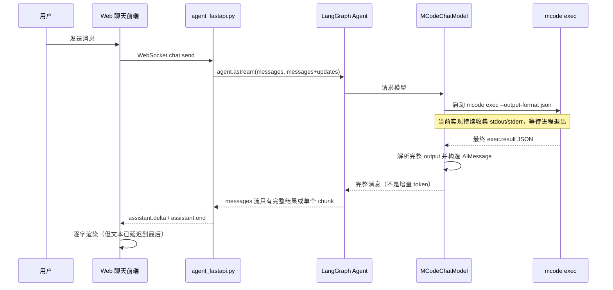
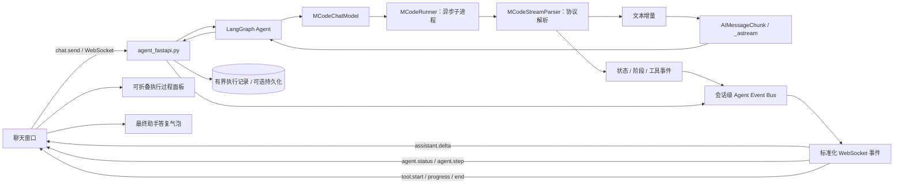
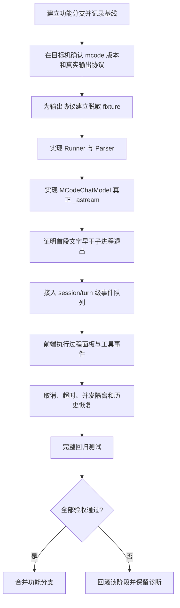

# auto-video-editor：mcode Agent 中间过程流式展示执行设计

> **项目**：[`wayyet/auto-video-editor`](https://github.com/wayyet/auto-video-editor)  
> **分支**：`main`  
> **模块**：OpenStoryline Web 聊天窗口、`MCodeChatModel`、WebSocket 事件流  
> **日期**：2026-10-21  
> **文档类型**：源码分析与实施设计；不是已完成代码的测试报告

---

## 1. 结论

当前“选择 `mcode-operator` 后，长时间没有输出，最后只显示完整答复”有明确的源码原因：

1. **mcode 适配器按一次性调用实现。** `openstoryline/src/open_storyline/mcode_chat_model.py` 的核心流程是启动 `mcode exec`、等待子进程结束、收集完整 stdout，再解析 `exec.result` JSON，最后生成一条完整 `AIMessage`。没有实现 `_stream()` / `_astream()`。
2. **LangGraph 的流式通道已经存在，但上游没有增量。** `openstoryline/agent_fastapi.py` 的 WebSocket handler 已经调用 `sess.agent.astream(..., stream_mode=["messages", "updates"])`，并将收到的文本增量转成 `assistant.delta` 事件。mcode 适配器只在子进程退出后给出完整内容，因此该通道拿不到逐步文本。
3. **前端已有文本流式渲染。** `openstoryline/web/static/app.js` 已实现 `assistant.start`、`assistant.delta`、`assistant.end` 的处理和 Markdown 增量渲染。主要问题不是聊天气泡不会渲染，而是 mcode 没有提供可供渲染的增量数据。
4. **mcode 自己的工具事件也没有接入。** mcode 使用其工作目录中的 MCP 配置调用工具；现有工具卡片事件则主要由 OpenStoryline 自己的 MCP 拦截器产生。因此只修复文本流仍不足以显示 mcode 的完整执行过程。

**建议方案：保留现有 WebSocket 与聊天消息协议，重构 mcode 子进程适配器，增加标准化的运行事件通道，并在聊天窗口增加可折叠的“执行过程”视图。**

“执行过程”应显示可观察的状态、阶段、工具调用、工具结果摘要和最终文字增量；不应承诺展示模型隐藏的内部思维链，也不应通过伪造“思考文字”营造实时推理的假象。

---

## 2. 源码证据与根因定位

### 2.1 当前调用链



### 2.2 关键文件与职责

| 文件 | 当前行为 | 对本问题的影响 |
|---|---|---|
| `openstoryline/src/open_storyline/mcode_chat_model.py` | `_build_command()` 使用 `--output-format json`；`_generate()` / `_agenerate()` 缓冲完整输出并在进程结束后解析 | **直接根因：模型层没有真正的增量输出** |
| `openstoryline/src/open_storyline/agent.py` | `mcode` 模式构造 `MCodeChatModel`；mcode 工具由其自己的 MCP 配置负责，LangChain `tools=[]` | OpenStoryline 的 LangChain 工具回调无法天然观察 mcode 内部工具调用 |
| `openstoryline/agent_fastapi.py` | WebSocket 聊天使用 LangGraph `astream()`，经 `out_q` 统一发送事件 | 可复用，不建议另建一套并发发送机制 |
| `openstoryline/web/static/app.js` | 有 `appendAssistantDelta()`、`finalizeAssistant()`，并处理 `assistant.start/delta/end` 和 `tool.start/progress/end` | 基础流式显示能力已有；需要补充执行事件视图与状态处理 |
| `openstoryline/tests/test_mcode_chat_model.py` | 覆盖模型桥接、结果解析等行为 | 应增加真流式解析、提前输出、取消和不重复输出测试 |
| `openstoryline/tests/test_web_mcode_wiring.py` | 覆盖网页所选 mcode 档位是否接入正确模型分支 | 应增加 WebSocket 事件回归测试 |

### 2.3 根因拆分

#### P0：子进程输出被缓冲到结束

当前 `stdout` / `stderr` 虽然由读取线程或异步任务持续排空，但数据被累积在内存列表中。程序等待 `proc.wait()` 成功后，才将完整 stdout 合并、解析 JSON，再返回 `AIMessage`。

**持续读取管道，不等于将内容持续发送给前端。** 现有代码只解决了防止管道堵塞的问题，没有建立输出事件的实时转换路径。

此外，`ChatModel` 未实现真正的 `_astream()`。基类不能凭空拆出子进程内部的文本；`astream()` 因此无法给出模型真实产生时的逐段输出。

#### P1：当前 JSON 模式可能只提供最终结果

命令指定 `--output-format json`，当前解析器围绕最终 `exec.result` 结构设计。该模式不能被直接视作逐事件流协议。

不能假设所有安装版本的 MiniMax Code 都支持同样的流式事件格式。实现前必须在目标机器执行：

```powershell
mcode --version
mcode exec --help
mcode --help
```

并保存脱敏后的实际输出样本，确认当前 CLI 版本支持的输出模式、事件类型、换行边界、错误输出位置与取消行为。若当前版本不支持结构化流输出，应优先评估其官方支持的 ACP/其他流式接口；不能将“定时打印运行状态”冒充 token 级流式输出。

#### P1：工具调用来源不一致

普通模型的工具事件由 OpenStoryline 自己的 MCP 路径产生，现有 `mcp` sink 会将工具进度放入 WebSocket 事件队列。mcode 则通过独立子进程和自身 MCP 配置执行工具，当前应用无法自动捕获这些工具事件。

所以新设计需要为 mcode 建立事件适配层，并统一转换成已有的 `tool.start`、`tool.progress`、`tool.end` 和新的 `agent.status` / `agent.step` 事件。只有当 CLI/ACP 实际提供了相应事件时，才显示工具详情；不能根据最终文本猜测“调用了哪个工具”。

#### P2：用户可见性和持久化不足

当前已有最终聊天历史的持久化机制，但中间执行事件没有完整、稳定的规范化模型。设计上需要将“最终对话文本”与“执行过程日志”分开保存，避免每条状态更新都被当成一条正式助手答复。

---

## 3. 设计目标与边界

### 3.1 目标

- mcode 能真正输出增量文本时，聊天气泡应在生成过程中更新，不必等待整个 CLI 进程退出。
- 用户能够看到当前状态、阶段摘要、工具调用开始/结束、可用的进度和错误信息。
- 执行事件与最终回答分离；工具运行前后，聊天气泡不会拼接错乱。
- 同一会话可取消、超时和恢复；不同会话事件严格隔离。
- 不改变普通 OpenAI 兼容模型的既有调用链和默认行为。
- 现有 `assistant.start/delta/flush/end`、`tool.start/progress/end` 协议尽量向后兼容。
- 中间事件应有长度上限、脱敏规则和可配置持久化策略。

### 3.2 非目标

- 不展示模型未向外部接口提供的隐藏思维链。
- 不将 `stderr` 原样展示给用户；只展示经过过滤的错误摘要，详细日志写入服务端日志。
- 不在本次重构里改动 LangGraph 工作流拓扑、`agent_gate` 的任务协议或视频剪辑节点。
- 不将“Agent 正在工作”动画或定时占位句描述为模型的真实推理过程。

---

## 4. 目标架构



### 4.1 模块职责

| 模块 | 职责 | 约束 |
|---|---|---|
| `MCodeRunner` | 启动子进程，读取 stdout/stderr，支持取消、超时、进程树清理 | 使用 `asyncio.create_subprocess_exec()`；不得把 `shell=True` 用于拼接用户输入 |
| `MCodeStreamParser` | 将真实 CLI 输出拆成结构化事件；处理半行、无效 JSON、未知类型和结束状态 | 协议识别须根据目标版本与 fixture；未知事件不能使整轮崩溃 |
| `MCodeChatModel._astream()` | 将文本事件转为 `AIMessageChunk`，供 LangGraph `astream(messages)` 消费 | 同一段文字只能输出一次；最终消息与增量不能双写 |
| Agent Event Bus | 以 `session_id + turn_id + run_id` 隔离状态/工具事件 | 禁止使用会跨请求串线的共享全局回调 |
| WebSocket normalizer | 将底层事件转换成稳定的前端协议 | 复用现有 `out_q` 单通道发送机制 |
| `ExecutionTraceView`（前端组件/模块） | 显示状态、阶段、工具卡片与错误；支持折叠和清理 | 不把每条状态更新加入聊天正文 |
| `ExecutionTraceStore` | 有界保存脱敏后的事件摘要，供刷新后查看 | 不保存密钥、环境变量、原始完整 prompt 或未过滤 stderr |

### 4.2 子进程与解析策略

建议把进程生命周期和协议解析拆开，避免 `MCodeChatModel` 同时负责进程、解析、LangChain 消息转换和 UI 事件。

建议接口形态：

```python
@dataclass
class MCodeEvent:
    type: str
    run_id: str
    timestamp: float
    text: str | None = None
    phase: str | None = None
    tool_name: str | None = None
    tool_call_id: str | None = None
    payload: dict[str, object] | None = None

class MCodeRunner:
    async def run_stream(self, prompt: str):
        """异步产生原始输出行、进程退出和 stderr 摘要。"""

class MCodeStreamParser:
    def feed_line(self, line: str) -> list[MCodeEvent]:
        """把一行真实 CLI 输出转换为零个或多个规范事件。"""
```

以上是接口设计示意，不是已验证可直接复制到现有项目的完整实现。具体事件字段必须依据目标机上的 CLI/ACP 样本确定；不要把猜测出的 JSON schema 直接投入生产。

实现时应做到：

1. 使用独立任务持续读取 stdout 与 stderr，防止任一管道被填满。
2. stdout 按协议解析；stderr 作为诊断来源，不自动当成助手文本。
3. 若协议为逐行 JSON，按换行缓冲；一条 JSON 被拆成多个 OS 读块时，必须先拼接再解析。
4. 对每条事件附上 `session_id`、`turn_id`、`run_id`、`seq`，方便追踪和排序。
5. 正常退出后读取最终状态；异常退出保留已经产生的安全文本和事件，并发送标准错误事件。
6. 用户取消或超时后终止 mcode 及其子孙进程，等待清理结束；记录取消结果，避免孤儿进程。
7. 对输出大小、单行长度、运行时长和事件数量设置上限。

### 4.3 流式协议选择与兼容模式

在目标机器验证前，不要把 `stream-json` 或 ACP 当作对所有版本都已确认可用的前提。

推荐提供配置：

```toml
[mcode]
streaming_transport = "auto"       # auto | cli_stream | acp | final_json
show_execution_trace = true
persist_execution_trace = true
max_trace_events = 300
max_event_text_chars = 2000
```

配置字段需与现有 `MCodeConfig` 实际结构合并，不要重复创建第二份 mcode 配置。

行为定义：

- `auto`：启动时探测当前版本和能力，选择已验证的流式传输方式。
- `cli_stream`：只在 `mcode exec --help` 明确支持且本项目已有对应 fixture/集成测试时启用。
- `acp`：只有在目标版本支持、并完成协议适配与取消测试后启用。
- `final_json`：兼容现有 `--output-format json` 的最终结果模式；UI 显示“当前 CLI 接口仅提供最终结果”，仍显示运行状态，不伪称 token 流式。

若不能安全判断能力，`auto` 必须退回 `final_json` 并记录清楚原因，不应静默丢失输出或误报“流式已启用”。

---

## 5. 统一事件协议

所有后端到前端的消息继续采用现有外层结构：

```json
{
  "type": "agent.status",
  "data": {
    "session_id": "…",
    "turn_id": "…",
    "run_id": "…",
    "seq": 12,
    "status": "running",
    "message": "正在分析素材清单"
  }
}
```

`session_id`、`turn_id`、`run_id` 必须由服务端生成或校验，不接受模型任意指定。`seq` 为当前 turn 单调递增的序号。

| 事件 | 用途 | 前端行为 |
|---|---|---|
| `assistant.start` | 一轮开始 | 创建助手答复气泡，显示运行状态 |
| `assistant.delta` | 真正的文字增量 | 更新当前助手气泡 |
| `agent.status` | 运行中、排队、取消、超时等状态 | 更新执行面板状态行 |
| `agent.step` | 解析、规划、工具执行等可观察阶段事件 | 向执行过程列表追加/更新一项 |
| `tool.start` | 工具调用开始 | 创建工具卡片并显示安全参数摘要 |
| `tool.progress` | 工具提供的进度更新 | 更新工具卡片状态与进度 |
| `tool.end` | 工具结束 | 标记成功、失败或取消，并显示摘要 |
| `assistant.flush` | 助手当前文字段结束，但整轮未结束 | 封口当前气泡，准备展示工具过程或后续文字 |
| `assistant.end` | 整轮完成或按约定中断 | 结束生成状态；保存最终可见文本 |
| `error` | 发生错误 | 显示可理解的错误摘要和已有部分输出 |

### 5.1 `agent.status` 建议字段

```json
{
  "status": "running",
  "phase": "tool_execution",
  "message": "正在执行素材分析工具",
  "source": "mcode"
}
```

`status` 采用有限枚举，例如 `queued`、`running`、`waiting_tool`、`completed`、`failed`、`cancelled`、`timed_out`。`phase` 为可选阶段标识；用户可读文本必须经过长度限制和脱敏。

### 5.2 事件处理规则

- **一轮一条最终答复链路**：流式文本只从 `assistant.delta` 进入助手气泡；过程事件只进入执行面板/工具卡片。
- `assistant.end.data.text` 如存在，应与前面已经输出的增量进行一致性处理；不得无条件再追加一遍完整答案。
- 工具调用前沿用 `assistant.flush`，使工具执行和前后的助手文本保持分段。
- 断线后，运行任务的处理语义应与现有实现一致；重新连接时通过 session snapshot 或受控的事件恢复接口获取当前状态，不能盲目重放导致重复气泡。
- 事件写入和发送必须有背压/队列上限；客户端变慢时合并高频状态更新，但不能丢掉最终状态、错误和工具结束事件。
- 未知事件记入服务端诊断日志并跳过，不可直接将未经清理的原始 payload 推给浏览器。

---

## 6. 聊天窗口交互重设计

### 6.1 视觉层次

每一轮 mcode 请求分为三部分：

1. **助手答复区**：实时显示可公开输出的文字增量；结束后作为正常聊天消息保留。
2. **执行过程面板**：紧邻本轮答复，默认展开或显示一行摘要；可折叠。显示状态、阶段时间、工具调用、简短结果和错误，不混入最终答复正文。
3. **工具卡片**：复用现有 `tool.start/progress/end` 视觉组件，统一处理来源为 `mcode` 的工具事件。

运行中的建议文案：

- `正在启动 Agent…`
- `正在执行：分析素材`
- `工具已完成：媒体信息读取`
- `已完成，用时 38 秒`
- `已取消`
- `当前 mcode 接口未提供文字增量；任务仍在执行，完成后显示结果`

这些属于 UI 状态，不应伪装为模型生成的“思考内容”。

### 6.2 前端实现原则

修改 `openstoryline/web/static/app.js` 和 `openstoryline/web/static/style.css`：

- 保留 `appendAssistantDelta()` 与 Markdown 渲染路径。
- 在 `onEvent` 分发器中增加 `agent.status`、`agent.step`；复用现有工具卡片管理逻辑。
- 给当前消息或 turn 建立稳定的 trace 容器，以 `run_id + seq` 更新/去重。
- 折叠状态只影响界面，不删除当前运行记录。
- 结束、取消、失败三条路径都要停止 loading 状态；错误时保留已经显示的部分答复。
- 历史会话加载时，最终答复仍从既有 history 恢复；执行过程按单独的 trace 数据恢复，避免每个过程事件变成一条 assistant message。

### 6.3 限制过程信息暴露

可展示：已产生的文字增量、公开的阶段名称、工具调用名称、经过清理的参数摘要、工具返回的简短摘要、耗时和状态。

不展示：隐藏思维链、完整系统提示、认证信息、环境变量、内部配置文件内容、未经脱敏的命令输出、超长文件内容。工具参数可能包含本地路径，应按 UI 需求仅展示文件名或安全相对路径。

---

## 7. 建议修改文件与实施任务

以下路径基于当前 `main` 分支结构。实施前先创建功能分支，并保留原测试结果。

### P0：实现真实增量文本

#### T1. 新增子进程运行器和协议解析器

建议新增：

- `openstoryline/src/open_storyline/mcode_runner.py`
- `openstoryline/src/open_storyline/mcode_stream_parser.py`

任务：

- 收集目标机的 `mcode --version`、`mcode exec --help` 和最小真实输出样本。
- 选定并记录已验证的 CLI/ACP 传输方式。
- 用异步子进程读取输出，逐事件转换；保留 timeout、取消和进程树清理。
- 为 stdout 分块、stderr 大量输出、无效行、进程异常退出、无最终事件建立 fixture。

#### T2. 扩展 `MCodeChatModel`

修改 `openstoryline/src/open_storyline/mcode_chat_model.py`：

- 增加真正的 `_astream()`，将 parser 产出的文本事件转换成 `AIMessageChunk`。
- 在模型调用时，将状态/阶段/工具事件发送给当前 turn 的事件回调；回调应使用可显式注入的配置或运行时上下文，不要用全局可变变量。
- 继续保留 `_generate()` / `_agenerate()` 或其兼容包装，确保 `invoke()`、`ainvoke()` 和现有调用者继续可用。
- 定义单一文本来源：流式路径不重复发最终完整文本；最终结果只用于校验/补全缺失尾段，且需按明确策略防止重复。
- 在无流能力时使用最终结果模式，并使后端能通知 UI 当前是 `final_json`。

#### T3. 测试真正的“先输出、后完成”

增加测试，证明：

1. mock CLI 先输出一段文字，等待 1 秒，再输出第二段并退出；
2. `_astream()` 在子进程退出前已产生第一段；
3. 合并增量与最终答复一致且无重复；
4. JSON/协议解析失败会产生可诊断错误；
5. 普通模型分支未被影响。

验收门槛：不能只断言“最终字符串正确”；必须断言第一个增量在模拟子进程结束之前到达。

### P1：统一 Agent 状态和工具事件

#### T4. 增加会话/轮次级事件回调

修改 `openstoryline/agent_fastapi.py`：

- 在现有 `out_q` 生命周期内关联 `session_id`、`turn_id`、`run_id`。
- 将 mcode 事件放入现有队列，统一由 WebSocket 主循环发送。
- 继续保证同一个 WebSocket 不会被多个任务并发 `send_json`。
- 将 mcode 的工具事件规范为现有 `tool.start/progress/end` 协议。
- 无可靠工具事件时只显示“Agent 正在运行”等状态，不推断工具细节。

#### T5. 建立独立的执行过程 UI

修改：

- `openstoryline/web/static/app.js`
- `openstoryline/web/static/style.css`

任务：

- 新增 `agent.status` 与 `agent.step` 渲染器。
- 复用现有工具卡片，不重复实现另一套工具组件。
- 状态事件可合并，终态事件必须保留。
- 处理取消、超时、异常、网络断线、刷新和重连。
- 执行过程不得进入 `sess.history` 里的普通助手消息内容。

#### T6. 增加前后端集成测试

- 断言选中 `mcode-operator` 后，产生的状态和文本事件确实来自 mcode 分支。
- 两个 session 并发运行时，各自的事件不交叉。
- 工具开始、进度、结束的顺序稳定。
- 已有普通模型的 MCP 工具卡片无回归。

### P2：执行记录、诊断与兼容模式

#### T7. 执行过程持久化

先确定一个小而稳定的数据结构，再实现存储；不要直接把全部原始 CLI 输出写入 session history。

建议记录：

```json
{
  "session_id": "…",
  "turn_id": "…",
  "run_id": "…",
  "seq": 12,
  "ts": 1792584000.0,
  "type": "tool.end",
  "source": "mcode",
  "status": "completed",
  "summary": "已读取 5 个视频片段"
}
```

约束：

- 每轮最多保留 `max_trace_events` 条事件，默认 300 条；对高频状态更新优先合并。
- 每条文本摘要限制长度；所有内容进入存储前脱敏。
- 不存储 API key、token、系统提示、原始完整 prompt 或任意环境变量。
- 执行记录清理策略需与当前会话/历史清理功能明确关联，不要误删最终聊天记录。
- 事件存储失败不应把已完成的模型任务标记为失败，但要留下诊断日志。

#### T8. 能力检测与 UI 反馈

- 启动日志打印 CLI 版本、选择的传输类型和降级原因（敏感信息除外）。
- UI 在真正流式和最终结果模式下有明确差异。
- 不支持流式时不阻塞功能使用，但必须明确告知用户，不得无限显示“正在思考”。
- 配置变更需要有默认值与兼容测试；不应将绝对路径或本机凭证写入受版本控制的配置。

---

## 8. 推荐实施顺序



**不要先重做前端动画。** 优先建立真实的增量数据源和协议解析，再接 WebSocket 与 UI。否则界面会有过程面板，却没有可信的过程事件可展示。

---

## 9. 测试与验收标准

### 9.1 单元测试

| ID | 场景 | 验收标准 |
|---|---|---|
| UT-01 | JSON/事件被拆分成多个 OS 读取块 | Parser 能在完整事件到齐后正确解析 |
| UT-02 | 一个进程输出多个文字事件 | `_astream()` 按序增量产出，不等进程退出 |
| UT-03 | 增量输出后还有最终 JSON | 最终答复与增量合并一致，不重复、不丢字 |
| UT-04 | stderr 含大量文本 | stdout 与 stderr 均被排空；内存与单行长度有上限 |
| UT-05 | 无效 JSON 或未知事件 | 记录诊断并按策略继续或明确失败，不崩溃吞错 |
| UT-06 | 用户取消、超时 | mcode 子孙进程结束；状态落为 `cancelled` / `timed_out` |
| UT-07 | CLI 不支持流式 | 降级为 `final_json`，UI 文案准确 |
| UT-08 | 普通 LLM 模型 | 原有调用、工具事件和最终答复行为不变 |

### 9.2 WebSocket / 前端测试

| ID | 场景 | 验收标准 |
|---|---|---|
| WS-01 | mcode 首段文字到达 | 浏览器在进程退出前收到并显示 `assistant.delta` |
| WS-02 | 状态与文本混合 | 状态进执行面板，文字进助手气泡 |
| WS-03 | mcode 工具事件 | 有真实底层事件时，显示正确的 start/progress/end 顺序 |
| WS-04 | 两个会话同时生成 | 各自 `run_id` 和事件完全隔离 |
| WS-05 | 生成中取消 | 停止指示器；保留已可见的部分答复；无孤儿进程 |
| WS-06 | 生成中页面刷新/重连 | 恢复的是最终历史与有界执行记录，不重复插入消息 |
| WS-07 | 错误发生在部分输出后 | 显示已有文本和可理解错误；该轮退出 loading 状态 |
| UI-01 | 普通模型回归 | 现有模型的文本渲染、工具卡片、消息历史无变化 |

### 9.3 手动验收流程

1. 选择 `mcode-operator`，发送一条会持续执行至少数秒的任务。
2. 使用浏览器开发者工具的 Network → WebSocket 检查消息时间线；核对首条 `assistant.delta` 是否早于该轮执行结束。
3. 如果 CLI 支持真实过程事件，确认执行面板持续更新；如果只支持最终 JSON，确认 UI 明确显示兼容模式而不是虚构过程内容。
4. 测试取消、超时和错误；通过系统进程工具确认 mcode 进程树已退出。
5. 新开两个独立会话并发请求，确认事件不串线。
6. 切回原有非 mcode 模型，确认回归结果一致。

### 9.4 交付证据

完成后至少提交：

- CLI 版本与输出协议的脱敏记录；
- Parser fixture；
- 单元测试与 WebSocket 集成测试结果；
- 普通模型回归测试结果；
- 取消后进程树已结束的证据；
- 一段开发者工具 WebSocket 事件时间线，证明“先到增量，后结束”。

未在目标 Windows 环境运行的测试必须标注“未验证”，不可用 mock 单测替代真实 CLI 协议验证。

---

## 10. 风险与控制措施

| 风险 | 控制措施 |
|---|---|
| CLI 版本差异导致事件格式变化 | 启动能力检测；使用真实版本 fixture；未知事件可诊断处理 |
| 同时消费 stdout/stderr 导致死锁 | 两条管道独立异步读取；测试 stderr 大量输出 |
| 最终输出重复 | 定义唯一文本来源；以差分/结束标记或最终结果校验，严禁直接追加全量答案 |
| WebSocket 事件乱序 | 单个会话单一 `out_q`；每事件带 `seq` |
| 不同会话的回调交叉 | 每次请求显式注入 turn-scoped callback，不使用全局可变 sink |
| 工具参数或日志泄露隐私 | allowlist 字段、摘要化、脱敏、最大长度限制 |
| 任务取消后仍有子进程 | 明确进程树清理逻辑；增加 Windows 实机取消测试 |
| 普通模型被重构破坏 | mcode 适配优先局部化；必须执行普通模型回归 |
| 模型没有公开进度事件 | 展示真实运行状态和耗时；不伪造推理文本 |

---

## 11. 回滚方案

1. 新功能使用配置 `streaming_transport` 与 `show_execution_trace` 控制；提供 `final_json` 和关闭 trace 的回退组合。
2. 保留原来的 `_generate()` / `_agenerate()` 兼容路径，流式路径出现兼容性问题时可退回最终结果调用。
3. 分三个独立阶段提交：
   - Commit A：Runner、Parser 和 `_astream()`；
   - Commit B：后端事件协议与前端执行过程面板；
   - Commit C：执行记录持久化和重连恢复。
4. 如果 Commit B 引发 UI 回归，回滚 B，不必丢弃已验证的模型流式适配。
5. 回滚后确认普通模型和 mcode 最终结果模式仍可执行；不要删除用户原有会话数据或 checkpoint。

---

## 12. 最终优先级

| 优先级 | 必须完成的事项 | 完成定义 |
|---|---|---|
| **P0** | 确认真实 CLI 流式协议；实现 Runner / Parser / `_astream()` | 首段真实文本在 CLI 进程结束前到达 WebSocket |
| **P1** | 接入会话级状态和工具事件；前端执行过程视图 | 状态、公开阶段事件与工具事件显示正确且不混入最终答复 |
| **P1** | 取消、超时、并发隔离与普通模型回归 | 无孤儿进程、无串线、非 mcode 行为不回归 |
| **P2** | 有界持久化、刷新恢复、诊断信息 | 刷新后能恢复执行摘要；不泄漏敏感信息 |

**最终验收的关键指标不是界面上是否出现“思考中”字样，而是：真实的流式文字和执行事件能否在发生时被接收、按序展示，并且在取消、失败和重连时保持正确。**

---

## 13. 参考源码

- [mcode 模型适配器 `mcode_chat_model.py`](https://github.com/wayyet/auto-video-editor/blob/main/openstoryline/src/open_storyline/mcode_chat_model.py)
- [OpenStoryline Agent 构建 `agent.py`](https://github.com/wayyet/auto-video-editor/blob/main/openstoryline/src/open_storyline/agent.py)
- [WebSocket 与 LangGraph 流处理 `agent_fastapi.py`](https://github.com/wayyet/auto-video-editor/blob/main/openstoryline/agent_fastapi.py#L3374)
- [聊天前端流式渲染 `app.js`](https://github.com/wayyet/auto-video-editor/blob/main/openstoryline/web/static/app.js#L1114)
- [前端 WebSocket 事件处理 `app.js`](https://github.com/wayyet/auto-video-editor/blob/main/openstoryline/web/static/app.js#L4359)
- [既有 mcode 接入验证报告](https://github.com/wayyet/auto-video-editor/blob/main/docs/%E5%88%86%E6%9E%90/auto-video-editor_mcode_%E6%89%A7%E8%A1%8C%E8%AE%A1%E5%88%92%E9%AA%8C%E8%AF%81%E6%8A%A5%E5%91%8A.md)
- [MiniMax Code 官方仓库（用于确认目标版本 CLI 能力）](https://github.com/MiniMax-AI/minimax-code)
