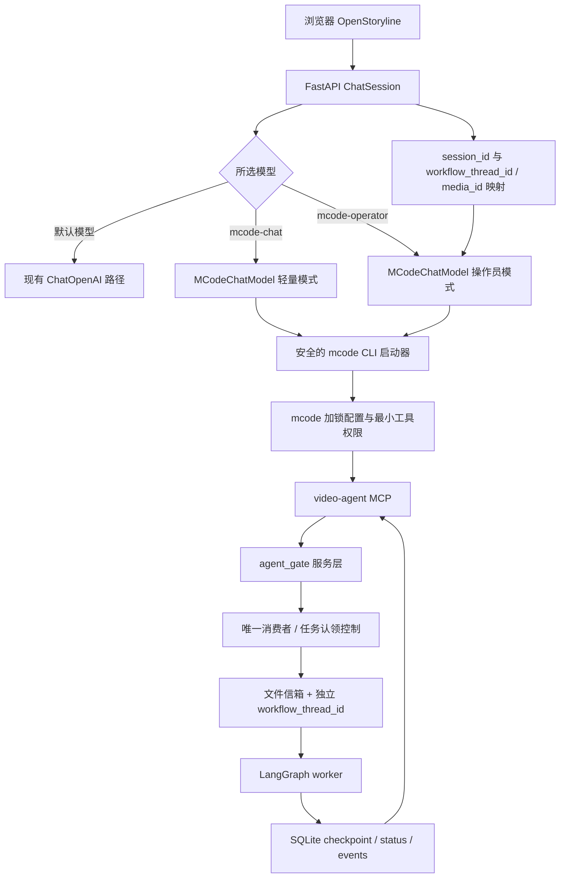

# OpenStoryline 接入 mcode / agent_gate 执行计划验证报告

- **评审对象**：`wayyet/auto-video-editor` 的 `main` 分支；文档《网页端驱动 mcode：把 OpenStoryline 接进 agent_gate 的消费型 MCP 链路》
- **评审日期**：2026-10-21
- **评审方式**：基于 GitHub `main` 分支源码和执行计划的静态核对
- **评审结论**：**不建议按当前计划直接实施。需要先修正 P0 问题，再开始编码。**

> 本报告评审的是设计和源码的一致性，不代表已经在目标 Windows 主机运行了测试。当前评审无法访问仓库外的 `video-ops/.mcp.json`、`video-ops/AGENTS.md` 和本机 mcode 加锁配置，因此涉及这些文件的现状只按计划中的描述分析，未独立验证。

## 1. 总体结论

方案的总体方向可行：让 OpenStoryline 充当前端和对话历史容器，由 mcode 进程作为真正的 Agent，通过 `video-agent` MCP 调用 `agent_gate`，由独立 worker 执行 LangGraph 工作流。这能复用现有文件信箱与任务校验，不必再在 LangChain 侧实现一套任务消费者。

但当前计划有 **4 个上线前必须解决的 P0 问题**：

1. **模型选择没有接通实际的 Agent 构建路径。** 当前 `ChatSession.ensure_agent()` 对非自定义模型仍调用 `_resolve_builtin_model_override()`，该函数读取 `config.toml` 的模型配置，不读取用户选择的 `chat_model_key`。因此，仅在下拉框增加 `mcode-operator` 并修改该函数的文字说明，不足以让 `build_agent()` 收到 mcode 模型标识。
2. **把网页 `session_id` 固定当 `thread_id`，无法支持同一聊天会话启动第二个新工作流。** `agent_gate` 的 `mode=start` 明确要求该线程没有既有状态和 checkpoint；否则返回 `already_used`。
3. **计划允许两个操作员同时消费同一信箱，却没有任务认领机制。** 当前 `gate_next_tasks` 读取未完成任务列表时不会标记所有权；两个消费者可能读取并处理同一个任务。这不是“先到先得”，而是可能重复处理、重复消耗模型额度并产生提交竞争。
4. **mcode 运行权限没有形成硬隔离。** 计划只设置 `--permission smart`，没有把 mcode 加锁配置通过 `--config` 传给 CLI。仓库现有说明明确指出 `--permission` 不是关闭内置 Bash、文件读写和联网能力的安全边界。

此外还有线程/素材上下文缺失、skills 工具被静默忽略、Windows 进程取消、可执行文件发现、验收状态值等问题。细节见下文。

## 2. 当前项目真实结构

### 2.1 OpenStoryline 现有调用链

当前 `openstoryline/src/open_storyline/agent.py` 中的 `build_agent()` 大致做以下事情：

1. 根据 `llm_override` 或 `config.toml` 读取 LLM 配置，并调用 `validate_api_key()`。
2. 读取 VLM 配置并再次调用 `validate_api_key()`。
3. 创建两个 `ChatOpenAI` 模型实例。
4. 建立配置中的 Storyline MCP 连接并调用 `client.get_tools()`。
5. 调用 `load_skills()` 加载 skillkit 工具，再将 `tools + skills` 传入 `create_agent()`。

源码：[`openstoryline/src/open_storyline/agent.py`](https://github.com/wayyet/auto-video-editor/blob/main/openstoryline/src/open_storyline/agent.py#L146-L243)

网页会话在 `ChatSession.ensure_agent()` 中决定 `llm_override`、`vlm_override`，然后调用 `build_agent()`。当前模型下拉项主要是默认模型和 `__custom__`；`ensure_agent()` 对非自定义模型通过 `_resolve_builtin_model_override()` 读取配置，而不是直接将任意下拉选项作为模型名。

源码：[`openstoryline/agent_fastapi.py` 模型解析](https://github.com/wayyet/auto-video-editor/blob/main/openstoryline/agent_fastapi.py#L121-L175)、[`ChatSession.ensure_agent()`](https://github.com/wayyet/auto-video-editor/blob/main/openstoryline/agent_fastapi.py#L1937-L1987)

### 2.2 agent_gate / 文件信箱调用链

`agent_gate` 通过 MCP 对外提供 `run_start`、`run_status`、`gate_next_tasks`、`gate_get_task`、`gate_submit_result` 等工具。`run_start` 会启动独立 worker；worker 调用 LangGraph 图，LLM 请求则由 `GateLLMClient` 写入文件信箱并等待 Agent 回答。

源码：[`agent_gate/mcp_server.py`](https://github.com/wayyet/auto-video-editor/blob/main/agent_gate/mcp_server.py#L66-L163)、[`agent_gate/README.md`](https://github.com/wayyet/auto-video-editor/blob/main/agent_gate/README.md#L1-L9)

每个工作流线程对应自己的 `outputs/<thread_id>/agent_gate` 目录和 checkpoint。仓库安全说明明确写出：`mode=start` 时，如果已有 status 或 checkpoint，则返回 `already_used`，需要换新 ID，或者按当前状态选择恢复模式。

源码：[`agent_gate/README.md` 安全模型](https://github.com/wayyet/auto-video-editor/blob/main/agent_gate/README.md#L91-L103)、[`agent_gate/runner.py`](https://github.com/wayyet/auto-video-editor/blob/main/agent_gate/runner.py)

## 3. 问题清单与修正建议

优先级定义：**P0** = 开始实施前必须解决；**P1** = 合并前必须解决；**P2** = 验收前应修复或明确降级范围。

| 编号 | 优先级 | 问题 | 影响 | 修正建议 |
|---|---|---|---|---|
| F-01 | **P0** | `mcode-operator` / `mcode-chat` 选择未真正接通 `ensure_agent()` | UI 可能显示 mcode，但后端仍创建配置里的 `deepseek-v4-pro`，继续触发 API Key 校验或 401 | 在 `ChatSession.ensure_agent()` 里显式分支处理 mcode 选项，直接构造 `{"model": "mcode-operator"}` 或 `{"model": "mcode-chat"}`，不经过默认模型解析；增加完整接线测试。不要只修改 `_resolve_builtin_model_override()` 的注释或假设。 |
| F-02 | **P0** | 把每个网页 `session_id` 永久当作工作流 `thread_id` | 同一会话首次启动成功后，再启动一个独立视频任务会因已有 status/checkpoint 被拒绝；正在人工关卡中的工作流也不能直接当成新工作流启动 | 区分 `chat_session_id` 和 `workflow_thread_id`。每个新工作流生成独立、稳定的 thread ID，并把它与网页会话、素材 ID 和工作流状态持久化关联。继续/恢复现有工作流时显式使用 `resume` 或 `continue_after_crash`，不能再次 `start`。 |
| F-03 | **P0** | 网页 mcode 与 `agent_gate drive` 可能同时消费相同任务 | 当前任务列表没有认领/租约字段；两个消费者都可能读取相同 pending task。提交端是读取后再写入结果，不能把这种竞争视为“先到先得” | 首选在一个 thread 上强制**单消费者**，并在 UI / `drive` 运行约定中阻止并发；若必须支持多消费者，需要增加原子 claim/lease、owner、过期回收和幂等提交，并配套竞争测试。若坚持“不改 agent_gate”，就必须明确禁止同一 thread 的双操作员并发。 |
| F-04 | **P0** | mcode 权限未硬隔离 | 计划使用 `permission="smart"`，但没有在命令中传入 `--config` 加锁配置；mcode 仍可能拥有 Bash、读写文件、联网等内置工具。仅靠 `AGENTS.md` 提示词不是安全边界 | 增加 `config` 配置项，向 `mcode exec` 传入已验证的 `--config <locked-config>`；确认锁定配置仍包含需要的 provider/model 及 `video-agent` MCP。缩小工具白名单，验证不能通过 Bash/文件工具绕过限制。禁止把锁定配置或认证内容提交到 Git。 |
| F-05 | **P1** | `MCodeChatModel` 没有会话/素材/工作流标识参数 | 计划的模型构造示例只传 `cwd`、`mode` 等选项，但端到端流程又要求 prompt 中包含当前 session 的 thread ID 和素材目录；静态 `BRIDGE_SYSTEM_PROMPT` 自身无法知道每个请求的 ID | 在创建模型时传入或以显式运行时上下文注入 `workflow_thread_id`、`media_dir`、素材清单；prompt 构造函数需显式接收这些参数。不能依赖模型从 UI 附件元数据中自行推断。 |
| F-06 | **P1** | 把 OpenStoryline skills 当成“仅提示词” | `load_skills()` 使用 `SkillManager` 和 `create_langchain_tools()` 返回 LangChain 工具；但计划里的 `MCodeChatModel.bind_tools()` 直接 `return self`，会忽略传入的 skills 工具。网页端原有能力可能静默消失 | 明确 mcode 模式的能力边界。需要的 skill 工具必须有可调用的 MCP/CLI 替代接口；否则不要把它们加入 `create_agent()` 假装仍然可用，并在 UI 中标出哪些能力不可用。增加回归测试验证工具可达性。 |
| F-07 | **P1** | mcode 可执行文件查找复用了 `shutil.which()`，没有使用项目已有解析器 | 仓库文档指出 mcode 常安装在 `~/.minimax-code`，可能不在 PATH；只依赖 `shutil.which()` 会导致启动时报找不到程序 | 复用 [`agent_gate/agent_bin.py`](https://github.com/wayyet/auto-video-editor/blob/main/agent_gate/agent_bin.py#L111-L160) 的 `resolve_agent_bin("mcode")` / `resolve_executable()`，支持环境变量、PATH 和约定安装目录；对无效显式路径报清楚的错误。 |
| F-08 | **P1** | 同步 `_generate()` 与 WebSocket 取消语义不匹配 | 计划声称 WebSocket 断开或超时会杀掉 mcode 整个进程树，但仅有同步子进程调用/普通超时并不能自动保证子进程树被清理；默认 `astream()` 会退化为完整结果后一次返回，长任务期间前端没有增量输出 | 优先采用 `asyncio.create_subprocess_exec()` 的异步执行路径，并在取消/超时处理里显式终止进程树（Windows 使用可验证的进程树终止方案；POSIX 使用进程组）。为 stdout/stderr 设置可控的读取和日志策略；若不做 token 流式输出，应在 UI 显示明确的“正在执行”状态和超时提示。 |
| F-09 | **P1** | 为 mcode 引入的 MCP 容错代码可能改变普通模型的故障语义 | 计划一方面说 DeepSeek 分支行为不变，另一方面又将公共的 `client.get_tools()` 改成“失败就跳过”。对非 mcode 模型而言，8001 不可用后系统可能悄悄以零工具启动 | mcode 分支既然不创建 Storyline MCP 客户端，就无需通过全局捕获异常来解决它的问题。若确实需要通用容错，应明确配置“必需/可选”服务器；必需 server 失败时应让启动失败并给出错误，不能静默删掉核心工具。 |
| F-10 | **P1** | 上传素材复制策略前后矛盾且缺少数据生命周期 | §6.6 建议只在 mcode 模式复制，但又推荐无条件复制。无条件复制会使所有模型都多占一份磁盘空间；大文件、重名、失败重试、删除和清理也未定义 | 仅在用户发起工作流时，按已确认的素材 ID 将文件复制到白名单目录。目标名使用安全生成的唯一名；通过临时文件 + 原子替换完成；验证复制前后大小/哈希；复制失败时不启动工作流；定义工作流完成后的保留/清理政策。 |
| F-11 | **P1** | 相对素材路径可能被解析到错误目录 | `run_start` 的工具说明要求 `video_path` 是绝对路径；计划部分示例却使用 `inputs/<sid>/xxx.mp4`。mcode 的工作目录是外部 `video-ops` 目录时，相对路径可能从错误的 cwd 解析，从而被白名单拒绝或找不到文件 | 在服务端从已登记素材路径生成规范的绝对路径，并传给 `run_start`；不要让模型拼接文件系统路径。将最终传给 MCP 的路径与白名单根进行验证。 |
| F-12 | **P2** | 验收状态值与真实实现不一致 | 计划 A6 说 `status.json` 的 `state` 可为 `waiting_human` 或 `done`；当前状态枚举是 `waiting_human`、`completed`、`failed` 等，不是 `done` | 把 A6 的 `done` 改为 `completed`；状态断言应从 `agent_gate/protocol.py` 的常量读取，避免再出现文案漂移。 |
| F-13 | **P2** | 回归测试不足以覆盖最关键的接线风险 | 如果只对 `build_agent()` 的 mcode 分支做单测，即使 `ChatSession.ensure_agent()` 没把所选模型传进去，单测仍可能通过 | 加端到端组件测试：设置 session 的 `chat_model_key`，调用 `ensure_agent()`，断言最终模型是 `MCodeChatModel`、未调用 LLM/VLM Key 校验、未连接 8001，并确认普通模型仍走原逻辑。 |
| F-14 | **P2** | mcode 配置把本机绝对路径写入受版本控制的 `config.toml` | `E:/Documents/kuaishou/video-ops` 仅适用于特定主机。其他机器 clone 后会失败，或错误地操作其他目录 | 绝对路径放进 `config.toml.local` 或环境变量；提交的 `config.toml` 只保留安全的示例值。启动时检查路径存在、`.mcp.json` 存在且指向预期仓库。 |
| F-15 | **P2** | Prompt 历史按“最近 N×2 条非系统消息”裁切，不保证完整对话轮次 | 遇到不成对消息、系统消息或后续工具消息时，可能保留不完整上下文；而 standard 模式每轮约 21K 输入 token，历史长度控制尤其重要 | 按完整的 Human/AI 对话轮次裁切，并增加字符/token 上限；超过上限时优先保留系统提示、当前请求和最近完整轮次。记录实际输入长度，避免每轮无限增长。 |

## 4. 计划内部需要统一的地方

### 4.1 模型分支描述与真实 API 不一致

计划建议修改 `_resolve_builtin_model_override()` 来识别 mcode。但当前函数签名是 `_resolve_builtin_model_override(kind, cfg_block)`，只从配置块取 `model/base_url/api_key`；它没有收到网页用户选中的 `chat_model_key`。真正的选择入口在 `ChatSession.ensure_agent()`。

**应修改的真正入口**：`openstoryline/agent_fastapi.py` 中 `ChatSession.ensure_agent()`，而不只是 `_resolve_builtin_model_override()`。

### 4.2 “保留 skills”与 `bind_tools()` 行为冲突

当前 `skills_io.py` 的 `load_skills()` 会返回 `create_langchain_tools(manager)` 生成的工具。计划让 `MCodeChatModel.bind_tools()` 忽略所有传入工具，却又让 `create_agent()` 继续接收 `tools + skills`。这会造成接口表面上仍有 skills，实际 mcode 不会调用这些 LangChain 工具。

**处理方式**：明确 mcode 模式不使用哪些 OpenStoryline 工具，并提供替代接口；不应将“工具被忽略”描述成“skill 只是提示词”。

### 4.3 上传复制范围矛盾

计划在 §6.6 提到“仅在 mcode 模式下复制”，随后又称“推荐无条件复制”。两个要求不应同时存在。

**建议**：在启动工作流之前复制当前已选素材，而不是用户每次上传就无条件复制。这样能保留 OpenStoryline 普通聊天/原有模型的行为，并且只为确实需要 `agent_gate` 白名单访问的素材创建副本。

### 4.4 `done` 状态名错误

当前 [`agent_gate/protocol.py`](https://github.com/wayyet/auto-video-editor/blob/main/agent_gate/protocol.py#L26-L34) 定义 `STATE_COMPLETED = "completed"`。计划验收表的 `done` 是错误值，按它写测试会造成假失败。

## 5. 推荐的修订后架构



### 5.1 标识符模型

不要把“聊天会话”和“工作流运行”当成同一个实体。

| 标识符 | 生命周期 | 作用 |
|---|---|---|
| `session_id` | 网页聊天会话 | 保存对话和上传素材状态 |
| `workflow_thread_id` | 一次可恢复的 LangGraph 工作流 | 映射 `outputs/<thread_id>/`、checkpoint、status 与 tasks |
| `media_id` | 单个上传素材 | 找到 OpenStoryline 存储的真实文件，再复制到白名单目录 |

一次聊天可启动多个工作流；一个工作流可以经历多次人工关卡和恢复。每个新的工作流使用新 `workflow_thread_id`，继续原工作流才复用已有 ID。

### 5.2 工具消费者模型

首阶段应采用最简单可验证的约束：**一个 workflow thread 在任意时刻只能有一个任务消费者**。

- 如果网页端 `mcode-operator` 正在驱动某个 thread，不允许 `agent_gate drive` 同时处理同一个 thread。
- 如果将来需要多个消费者，必须先在 `agent_gate` 增加原子任务认领和租约，不应仅在 prompt 里要求 Agent“不要抢任务”。
- `gate_next_tasks` 返回任务之前必须明确任务归属语义；“读出 pending 列表”不是认领。

### 5.3 mcode 安全启动

- 通过统一的 `agent_gate.agent_bin.resolve_agent_bin("mcode")` 解析可执行文件。
- 通过配置项显式传入 `--config <locked-config>`，不能把 `--permission smart` 当作隔离机制。
- 仅开放所需的 `video-agent` MCP 工具。不要默认允许 Agent 使用 Bash、任意文件读写和联网工具。
- `workflow_thread_id`、白名单内的绝对素材路径由服务端生成，并作为可信桥接上下文注入；不要让模型自行构造这些值。
- WebSocket 断开、用户取消或执行超时时，必须终止 mcode 进程树并留下可诊断日志。

## 6. 修订后的实施顺序

### P0：先修设计，不开始完整编码

1. 在 `ChatSession.ensure_agent()` 接通两个 mcode 模型选项；以测试证明所选模型确实到达 `build_agent()`。
2. 引入 `workflow_thread_id`，区分聊天会话与工作流；定义新建、继续、从崩溃恢复和人工关卡恢复的状态转换。
3. 确定同一 thread 的消费者互斥方案：先实现单消费者限制；如必须并发，改造 `agent_gate` 信箱协议。
4. 为 mcode 增加锁定配置参数，证明 Bash/文件写入等非必要工具不能被模型调用。
5. 明确素材映射，模型只接收服务端生成的白名单绝对路径。

### P1：实现与单测

1. 实现 `MCodeChatModel`，包含 JSON 结果解析、错误映射、输入大小限制和可观测日志。
2. 采用异步子进程管理；测试取消、超时和进程树清理。
3. 处理 mcode 模式与现有 skills 工具的兼容关系，避免静默丢失功能。
4. 使用项目统一的 mcode 可执行文件解析器。
5. 避免更改普通模型的 MCP 失败策略；确需容错时按“必需/可选 server”显式配置。

### P2：素材与 UI 集成

1. 仅在用户启动处理任务时，把已选素材复制到白名单根目录。
2. 采用唯一目标文件名、原子复制、哈希或大小校验以及失败回滚。
3. 在网页端显示 mcode 模式、运行中状态、取消状态和可理解的错误。
4. 更新 `openstoryline/README.md`，写明 Windows 配置、加锁配置、安全边界和恢复方式。

## 7. 验收测试应增加的项目

| 测试 | 必须验证的结果 |
|---|---|
| 模型选项接线 | 选 `mcode-operator` 后创建的确实是 `MCodeChatModel(mode="standard")`；选 `mcode-chat` 后是 lightweight；不得继续使用 DeepSeek override |
| API Key 旁路 | mcode 模式不调用 LLM/VLM 的 API Key 验证；普通模型路径仍按原逻辑验证 |
| 多工作流 | 同一个网页 session 启动两个新工作流时得到不同 `workflow_thread_id`，两者输出和 checkpoint 互不覆盖 |
| 恢复工作流 | `waiting_human` 只能走合法 resume；`failed/crashed` 只能走合法 continue；不能用 `start` 覆盖已有 thread |
| 任务消费者互斥 | 同一任务不能被两个消费者同时成功认领；重复提交行为可预测且幂等 |
| 路径安全 | MCP 获得的是服务端生成的绝对路径；越过 `AGENT_GATE_MEDIA_ROOTS` 的路径被拒绝 |
| mcode 安全配置 | 实际进程命令包含锁定配置；验证 Bash/任意文件写入/任意联网能力已禁用或严格受控 |
| 可执行文件解析 | mcode 不在 PATH 但在约定安装目录时仍能启动；显式错误路径应给出明确错误 |
| 取消/超时 | 取消 WebSocket 或超时后，mcode 子进程与子孙进程都退出，没有孤儿进程；worker 已领任务的恢复语义明确 |
| skills 行为 | 需要的 skills 在 mcode 模式下可实际调用，或 UI 明确告知不可用；不允许仅因 `bind_tools()` 忽略工具而测试通过 |
| 状态断言 | 完成状态使用 `completed`，人工关卡使用 `waiting_human` |
| 普通模型回归 | DeepSeek / 自定义模型路径仍符合改动前的模型选择、MCP 连接与错误语义 |

## 8. 建议的测试命令

按仓库当前的测试隔离约定，分别执行，不要把 `agent_gate/tests` 与主仓 `tests/` 混在同一次 pytest 调用中。

```powershell
cd E:\Documents\kuaishou\auto-video-editor

# OpenStoryline 新增测试：使用它自己的 venv
.\openstoryline\.venv\Scripts\python.exe -m pytest openstoryline\tests -q

# agent_gate 测试：独立运行
.\.venv\Scripts\python.exe -m pytest agent_gate\tests -q -p no:cacheprovider

# 主仓原有测试：独立运行
.\.venv\Scripts\python.exe -m pytest tests -q
```

注意：上述是实施后的验证命令，本次评审**没有运行这些测试**。验收报告应记录各套件通过/失败/跳过的逐用例差异，而不只记录汇总数字。

## 9. 最终意见

**这份计划目前属于“架构方向可行，但执行计划尚未达到可直接实施的状态”。** 最主要的风险不是 mcode CLI 本身，而是 OpenStoryline 的模型选择接线、工作流线程身份和任务消费者所有权没有设计完整；再叠加 mcode 缺少硬权限隔离，直接实施可能出现“UI 显示已切换但仍调用 DeepSeek”、同会话无法启动第二个工作流、重复消费任务，或 Agent 获得超出预期的本机操作权限等问题。

建议先完成第 6 节中的 P0 修改，并以第 7 节的测试作为退出门槛，再进入 P1 实施。若严格要求不修改 `agent_gate`，则第一阶段必须限制为单消费者模式，不应接受同一任务信箱被网页 mcode 与 `drive` 并发读取。

## 10. 参考源码与资料

- 执行计划原文：[网页端驱动 mcode：把 OpenStoryline 接进 agent_gate 的消费型 MCP 链路](https://github.com/wayyet/auto-video-editor/blob/main/docs/%E5%88%86%E6%9E%90/%E7%BD%91%E9%A1%B5%E7%AB%AF%E9%A9%B1%E5%8A%A8%20mcode%EF%BC%9A%E6%8A%8A%20OpenStoryline%20%E6%8E%A5%E8%BF%9B%20agent_gate%20%E7%9A%84%E6%B6%88%E8%B4%B9%E5%9E%8B%20MCP%20%E9%93%BE%E8%B7%AF.md)
- [`openstoryline/src/open_storyline/agent.py`](https://github.com/wayyet/auto-video-editor/blob/main/openstoryline/src/open_storyline/agent.py#L146-L243)
- [`openstoryline/agent_fastapi.py` 模型解析与 ChatSession](https://github.com/wayyet/auto-video-editor/blob/main/openstoryline/agent_fastapi.py#L121-L175)
- [`ChatSession.ensure_agent()`](https://github.com/wayyet/auto-video-editor/blob/main/openstoryline/agent_fastapi.py#L1937-L1987)
- [`openstoryline/src/open_storyline/skills/skills_io.py`](https://github.com/wayyet/auto-video-editor/blob/main/openstoryline/src/open_storyline/skills/skills_io.py)
- [`agent_gate/mcp_server.py`](https://github.com/wayyet/auto-video-editor/blob/main/agent_gate/mcp_server.py#L66-L163)
- [`agent_gate/README.md` 安全模型与 thread 生命周期](https://github.com/wayyet/auto-video-editor/blob/main/agent_gate/README.md#L91-L103)
- [`agent_gate/launcher.py` mcode 权限配置](https://github.com/wayyet/auto-video-editor/blob/main/agent_gate/launcher.py#L133-L160)
- [`agent_gate/agent_bin.py` 统一的可执行文件解析器](https://github.com/wayyet/auto-video-editor/blob/main/agent_gate/agent_bin.py#L111-L160)
- [`agent_gate/protocol.py` worker 状态常量](https://github.com/wayyet/auto-video-editor/blob/main/agent_gate/protocol.py#L26-L34)
- [LangChain `BaseChatModel` 参考](https://reference.langchain.com/python/langchain-core/language_models/chat_models/BaseChatModel)
- [Python `subprocess` 文档](https://docs.python.org/3/library/subprocess.html)
