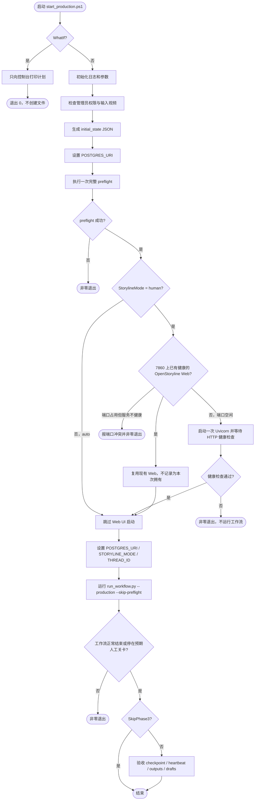

# auto-video-editor 启动脚本统一与修复执行计划

> **文档类型：** 工程执行计划（本文件是实施方案，不代表仓库代码已修改）  
> **执行状态：** ✅ **已于 2026-10-21 执行完毕**(提交在 `main`)。
>   本文中「删除 `scripts/start_local.ps1`」等条目均已落地,下文的 `start_local.ps1`
>   引用是**计划文本的历史记录**,不是现行操作指引。  
>   现行用法见 [`README.md`](../../README.md) 的「启动入口」章节。  
> **项目：** [wayyet/auto-video-editor](https://github.com/wayyet/auto-video-editor)  
> **基准分支：** `main`  
> **基准日期：** 2026-10-21  
> **参考文档：** 历史文档《auto-video-editor 启动脚本分析》

## 1. 目标与范围

本次改造的目标是让项目只有一个完整工作流启动入口，并修复启动脚本分析中的 7 类问题。

1. 删除 `scripts/start_local.ps1`。
2. 将根目录 `start_production.ps1` 定为唯一的完整工作流启动入口。
3. 消除 PowerShell 与 Python 之间重复执行 preflight 的问题。
4. 修复 `PostgresUri`、`THREAD_ID` 传递和 `STORYLINE_MODE` 默认行为。
5. 按方案 A 统一 OpenStoryline Web 的启动、健康检查和进程所有权。
6. 让关键健康检查失败时立即失败，避免带着未就绪的服务启动工作流。
7. 让 `-WhatIf` 真正不产生文件和进程副作用。

### 1.1 “只保留一个启动脚本”的定义

**只保留一个完整工作流启动入口，不等于删除所有辅助脚本。** 下列文件仍是生产启动链的依赖，应保留：

- `scripts/preflight.ps1`：执行环境预检。
- `scripts/start_postgres.ps1`：由 preflight 调用，负责启动本地 Postgres 容器。
- `scripts/run_workflow.py`：建立并执行 LangGraph 工作流。
- `scripts/stop_postgres.ps1`：停止 Postgres 容器时使用。
- `stop_production.ps1`：生产工作流的配套停止入口，不是第二个启动入口。

本次直接删除的是 `scripts/start_local.ps1`。其他只有在确认没有生产路径、测试或维护流程依赖后，才可以列入删除清单；不得因为文件名含有 `start` 就删除共享依赖。

## 2. 当前实现结论

核对 `main` 分支后，确认以下实现与历史分析中的问题相符：

- `start_production.ps1` 先调用 `scripts/preflight.ps1`；随后调用 `scripts/run_workflow.py --production`，但没有传入 `--skip-preflight`。Python 入口会再次执行 preflight。
- `start_production.ps1` 声明了 `$PostgresUri`，但当前未明确设置 `$env:POSTGRES_URI`；Phase 3 查询还会读取 `$env:THREAD_ID`，脚本未设置该变量。
- 生产脚本会先探测 `127.0.0.1:7860`，端口开放时将服务标记为复用。但健康检查仍要求本次运行的 `$OsWebLog` 包含 Uvicorn 启动标记；复用进程通常没有该日志文件，可能等待 180 秒后仍只输出 warning 并继续。
- `nodes/node_02_launch_openstoryline.py` 在 `human` 模式下会直接调用 `subprocess.Popen()`，未先检测现有 Web；生产脚本已启动 Web 时，节点仍可能再次启动 Uvicorn。
- `stop_production.ps1` 在发现 PID 文件标记为 `reused=true` 时，会跳过 PID 路径，但仍会执行命令行兜底扫描。因此它仍可能终止本次启动前就存在、且被复用的 Web 进程。
- `start_production.ps1` 未显式设置 `STORYLINE_MODE`，行为可能受当前 PowerShell 会话环境影响；`config.py` 在未设置时默认使用 `human`。
- OpenStoryline 健康检查超时目前只是 warning，工作流仍会继续。
- `-WhatIf` 在判断开关之前就创建 `logs` 目录和日志文件，不属于严格无副作用的 dry-run。

## 3. 目标启动架构

### 3.1 职责划分

- `start_production.ps1`：唯一完整启动入口；管理启动参数、输入状态、Docker/preflight、OpenStoryline Web 启动与健康检查、Python 工作流调用和启动后验收。
- `node_02_launch_openstoryline.py`：不再启动操作系统进程。`human` 模式下只检查现有 Web 是否可用并在 state 中记录复用结果；不可用时记录错误，让图的下游按既定逻辑处理。`auto` 模式继续跳过 Web UI。
- `stop_production.ps1`：只停止本次启动且明确归本次运行所有的进程；不得杀掉复用的外部进程。
- `scripts/preflight.ps1`：仍作为唯一一次完整环境预检的执行者；Python 入口保留自己的默认 preflight 能力，供直接运行或其他受支持调用场景使用。

### 3.2 目标流程图



### 3.3 OpenStoryline Web 方案 A 的约束

本次采用指定的方案 A：**由 `start_production.ps1` 负责启动和健康检查，`node_02` 发现现有 Web 后复用。** 为避免双重进程管理，具体约束如下：

1. `human` 模式下，生产脚本先检查 `GET http://127.0.0.1:7860/` 是否返回 HTTP 200。
2. 如果现有服务健康，直接复用；不再启动新的 Uvicorn，也不要求复用服务必须拥有本次运行生成的日志文件或 PID。
3. 如果端口空闲，生产脚本启动一次 Uvicorn，并等待端口、HTTP 健康检查和本次启动进程存活条件满足。
4. 如果端口被占用，但 HTTP 检查不通过，视为端口冲突并失败退出。不得擅自终止未知进程，也不得继续运行工作流。
5. `node_02` 不再调用 `subprocess.Popen()`。它只探测和记录服务状态；发现服务不可用时记录 `openstoryline_ready=False` 和错误，不自行补启动。
6. `auto` 模式继续不依赖 Web UI，生产脚本不启动 Web；但 `openstoryline` 资源/模型是否需要校验，仍按自动剧情线实际依赖执行，不因跳过 Web 而一并删除资源校验。
7. PID 文件必须区分“本次启动拥有的进程”和“复用的外部进程”。`stop_production.ps1` 对 `reused=true` 的 Web 不得执行 PID kill 或命令行兜底 kill。

## 4. 第 7 节问题逐项修复方案

## 4.1 preflight 和 Postgres 会重复执行

**优先级：P0**  
**主要文件：** `start_production.ps1`、`scripts/run_workflow.py`

### 当前问题

生产脚本显式调用一次 `scripts/preflight.ps1`。之后运行 Python 时未传 `--skip-preflight`，Python 的 `_main_async()` 会再次执行 `_maybe_preflight()`。重复预检会重复检查 Docker、启动/检查 Postgres、验证连接和确保 schema。

### 修复步骤

1. 保留生产脚本 Phase 1 的完整 preflight，作为生产启动链唯一一次完整预检。
2. 确认 `scripts/preflight.ps1` 成功后，调用 Python 时追加 `--skip-preflight`。
3. 不删除 `scripts/run_workflow.py` 中 `_maybe_preflight()`；直接运行 Python 时仍应保留默认的安全检查行为。
4. 不再调用 `scripts/start_postgres.ps1` 作为独立的第二条启动路径。Postgres 统一由 `scripts/preflight.ps1` 的 Step 4 管理。
5. 更新 `-WhatIf` 输出，让计划明确显示“preflight 执行一次；Python 内部 preflight 跳过”。

### 目标调用

```powershell
& $VenvPy $RunScript `
    --production `
    --skip-preflight `
    --thread-id $ThreadId `
    --initial-state-json $StateJson
```

### 验收标准

- 一次 `start_production.ps1` 运行中，完整 preflight 只执行一次。
- Postgres 容器启动/健康检查只由该次 preflight 负责。
- Python 日志出现内部 preflight 已跳过的标记。
- preflight 失败时，不调用 `run_workflow.py`。

## 4.2 生产版 `-PostgresUri` 参数未生效

**优先级：P0**  
**主要文件：** `start_production.ps1`、必要时 `scripts/preflight.ps1`、`scripts/start_postgres.ps1`

### 当前问题

脚本声明了 `$PostgresUri`，但没有在 preflight 和 Python 执行前将其写入 `$env:POSTGRES_URI`。preflight 可能自行填入默认 URI，导致传入的值没有生效。

另一个约束是：当前 `scripts/start_postgres.ps1` 将容器用户名、密码、数据库名和端口固定为 `postgres`、`devpass`、`langgraph`、`5432`。仅改变连接字符串不会自动修改已有容器或命名卷中的数据库账号。

### 修复步骤

1. 在调用 preflight 之前，将 `$PostgresUri` 显式赋值给 `$env:POSTGRES_URI`。
2. 在 Python 工作流和 Phase 3 验收查询期间，确保子进程继承同一个 URI。
3. 对连接字符串做非空和格式校验；日志只记录脱敏后的 URI，不输出密码。
4. 明确参数支持范围：默认 URI 对应现有本地容器配置。若需要支持其他主机、账号或数据库，必须同步改造 Postgres 容器配置与 preflight 的目标选择；不能仅修改 `POSTGRES_URI` 后假设容器凭据也发生变化。
5. 在一个子进程调用完成后恢复原环境变量，避免脚本被其他 PowerShell 脚本调用时污染调用方环境。

### 验收标准

- 默认 URI 与当前 `edb-postgres16` 配置一致。
- 自定义 URI 要么被完整传入预检和工作流，要么在启动早期被明确拒绝；不得静默回退到另一个 URI。
- 日志不泄露数据库密码。

## 4.3 生产版 checkpoint 验收缺少 `THREAD_ID`

**优先级：P0**  
**主要文件：** `start_production.ps1`

### 当前问题

Phase 3 的 Python 查询读取 `os.environ['THREAD_ID']`，但生产脚本未设置该变量。查询会抛出 `KeyError`，异常被捕获后只打印“查询失败”，导致验收结果看似结束、实际没有按指定线程查询 checkpoint。

### 修复步骤

1. Phase 3 查询前将 `$ThreadId` 显式传入查询子进程环境：`$env:THREAD_ID = $ThreadId`。
2. 保留 SQL 参数化形式：`WHERE thread_id = %s`，不要把线程 ID 拼接进 SQL 字符串。
3. 查询结束后恢复原来的 `THREAD_ID` 环境值。
4. 区分“查询结果为 0 条”和“查询本身失败”。若 checkpoint 查询是发布验收的必要条件，查询异常应使脚本返回非零退出码；若只是诊断项，则必须明确标注验收未完成，不得打印为成功。

### 验收标准

- 使用 `-ThreadId video-002` 时，查询只统计 `video-002` 的 checkpoint。
- 不再出现 `KeyError: 'THREAD_ID'`。
- 数据库不可连接或查询失败时，日志状态清楚可辨，不会被误报为验收成功。

## 4.4 生产版可能重复启动 OpenStoryline Web

**优先级：P0**  
**主要文件：** `start_production.ps1`、`nodes/node_02_launch_openstoryline.py`、`stop_production.ps1`、相关单测

### 当前问题

生产脚本的 Phase 0.6 已启动或复用 `127.0.0.1:7860`。但 `node_02_launch_openstoryline.py` 的 `human` 分支仍会无条件调用 `subprocess.Popen()`。第二次启动可能因端口占用而失败，节点又可能因为旧服务仍返回 HTTP 200 而报告 ready，造成错误 PID 和日志状态。

同时，生产脚本在复用模式下没有本次新建的 Web 日志，但现有健康检查仍要求该日志包含 Uvicorn startup 标记。`stop_production.ps1` 的命令行兜底还可能杀掉复用的外部进程。

### 修复步骤

1. **生产脚本负责服务生命周期。** `start_production.ps1` 是唯一会启动 Web 进程的层。
2. `human` 模式下先请求 `http://127.0.0.1:7860/`。HTTP 200 即按现有 Web 复用处理，不启动第二个进程。
3. 端口空闲时才启动 Uvicorn；服务启动后通过 HTTP 健康检查验证可用性。对于本次启动的进程，可以额外检查 PID 和日志，但日志标记不能替代 HTTP 检查。
4. 对复用服务，不要求本次运行专属的日志文件或 PID；健康条件应以端口可达和 HTTP 检查成功为主。
5. 重构 `launch_openstoryline_service()`：移除 human 模式的 `subprocess.Popen()` 启动逻辑。该节点只执行健康探测并更新 state；健康时写入类似 `node_02_openstoryline_reused` 的状态标记，PID 未知时保持 `openstoryline_pid=None`。
6. 若 `node_02` 健康检查失败，记录 `openstoryline_ready=False` 及可操作的错误说明，不自行启动第二个 Web。
7. 在 `graph.py` 中为 `launch_openstoryline` 后增加状态门禁：human 模式下服务未就绪时，不得继续打开浏览器或进入人工关卡。
8. 在 `scripts/run_workflow.py` 中检查图返回的最终 state；若因 `openstoryline_ready=False` 提前终止，输出明确错误并返回非零退出码，避免把提前终止误报为成功。
9. 明确 PID 文件中的所有权字段，例如 `reused` 或 `owned_by_current_run`。只有标记为本次启动所有的进程，才可在停止脚本中终止。
10. 修改 `stop_production.ps1`：如果 PID 文件标记为 `reused=true`，跳过 Web 的 PID 终止和命令行兜底终止；不要因为“停止本项目”而关闭启动前已存在的共享 Web。
11. 更新 `tests/unit/test_node_02_launch_openstoryline.py` 和 `tests/integration/test_interrupt_resume.py`，删除对“节点负责启动进程”的假设，改为验证服务复用、失败状态和失败时的图路由。

### 验收标准

- Web 已健康运行时，生产脚本和 `node_02` 都不会再启动第二个 Uvicorn。
- 端口空闲时，Web 只启动一次。
- 复用模式不会等待本次不存在的日志文件 180 秒。
- `stop_production.ps1` 不会终止复用的外部 Web。
- Web 未就绪时，state、日志和退出状态一致；图不会继续进入人工关卡，Python 入口返回非零状态。

## 4.5 `STORYLINE_MODE` 在启动入口间不一致

**优先级：P1**  
**主要文件：** `start_production.ps1`、`config.py`、README 和启动文档

### 当前问题

`start_local.ps1` 有 `-StorylineMode` 参数并默认设置为 `auto`；生产脚本没有该参数，通常继承调用 shell 的变量，未设置时才由 `config.py` 默认成 `human`。两条入口的行为不一致。

### 修复步骤

1. 在 `start_production.ps1` 增加显式参数，并限制有效值为 `human` 或 `auto`：

   ```powershell
   [ValidateSet('auto', 'human')]
   [string]$StorylineMode = 'human'
   ```

2. 默认采用 `human`，保持目前 `config.py` 的默认语义，避免静默改变现有生产行为。
3. 启动 Python 工作流前显式设置 `$env:STORYLINE_MODE = $StorylineMode`，不要依赖调用方 shell 的隐式状态。
4. `human` 模式才启动/检查 OpenStoryline Web；`auto` 模式跳过 Web UI 生命周期，因为 `node_02` 本身在 auto 模式就是旁路节点。
5. 在同一 PowerShell 进程中调用脚本时，调用结束后恢复原来的环境变量。
6. 更新帮助文本和文档中的命令示例，明确标出两种模式的使用方式。

### 用法目标

```powershell
# 默认 human 模式
.\start_production.ps1 -ThreadId video-001

# 明确选择 auto 模式
.\start_production.ps1 -ThreadId video-002 -StorylineMode auto
```

### 验收标准

- 不设置环境变量时，生产启动模式稳定为 `human`。
- `-StorylineMode auto` 能明确进入 auto 路由，并跳过 Web UI 的启动与健康检查。
- 无效模式在启动前被参数校验拒绝。

## 4.6 OpenStoryline 健康检查超时不阻止执行

**优先级：P0**  
**主要文件：** `start_production.ps1`

### 当前问题

生产脚本最多等待 180 秒；条件不满足时只输出 warning，仍继续执行 preflight 和工作流。人工模式依赖网页服务时，这会让下游在服务不可用的情况下继续运行。

### 修复步骤

1. `human` 模式下，将健康检查超时视为启动失败，返回明确的非零退出码；建议为“健康检查超时”分配独立退出码，例如 `22`，并在文档记录。
2. 保留现有“新启动进程提前退出”的错误处理，同时打印 Web 日志尾部，便于诊断。
3. 健康判断使用分支化条件：
   - **本次启动的服务：** 端口可达、HTTP `GET /` 返回 200、本次启动的 PID 存活；日志作为诊断信息。
   - **复用服务：** 端口可达且 HTTP `GET /` 返回 200；不要求本次进程 PID 或本次启动日志。
4. 若 7860 端口被占用但 HTTP 健康检查失败，立即以端口冲突退出，不杀未知进程，不调用 Python 工作流。
5. `auto` 模式跳过 Web 启动和对应健康检查，不把不需要的 Web UI 当作 auto 工作流的阻塞条件。

### 验收标准

- human 模式健康检查失败时，`run_workflow.py` 不会被调用。
- human 模式健康检查成功时，才进入 Python 工作流。
- auto 模式不会因为 Web UI 不可用而失败。
- 超时日志提供端口、URL、是否复用、进程状态和最近日志等诊断信息。

## 4.7 `-WhatIf` 不完全无副作用

**优先级：P1**  
**主要文件：** `start_production.ps1`

### 当前问题

当前脚本在判断 `-WhatIf` 前就创建 `logs` 目录、初始化日志，并调用会写日志文件的 `Write-Phase`。因此 dry-run 仍会产生文件。

### 修复步骤

1. 将 `-WhatIf` 分支前移，确保在创建 `logs` 目录、写日志文件、生成 initial-state JSON 之前执行。
2. `-WhatIf` 路径仅使用 `Write-Host` 或专用的控制台输出函数，不调用写入 `$LogFile` 的 `Write-Phase`。
3. dry-run 只解析路径、打印计划和参数，不调用 Docker、preflight、OpenStoryline、Python 工作流或 Phase 3 查询。
4. 更新输出内容，使其展示当前 `StorylineMode`、Postgres URI 的脱敏版本、是否会启动/复用 Web，以及是否会执行 Phase 3。

### 验收标准

- 执行 `.\start_production.ps1 -WhatIf` 前后，`logs` 目录及其中的文件没有新增或修改。
- 不会生成 `runtime\initial_state_*.json`，不会启动任何服务或子进程。
- 输出的计划与真实执行路径一致。

## 5. 删除 `scripts/start_local.ps1` 与清理引用

**优先级：P0**  
**主要文件：** `scripts/start_local.ps1`、`README.md`、`docs/`、`scripts/README.md`（若存在）、相关测试/CI 文件

### 执行步骤

1. 在删除前搜索仓库内的所有引用：

   ```powershell
   git grep -n -I -E 'start_local(\.ps1)?' -- .
   ```

2. 将仍用于当前操作指引的启动命令统一改为根目录入口：

   ```powershell
   .\start_production.ps1
   ```

3. 将原本只由 `start_local.ps1` 提供的模式选择能力，迁移到 `start_production.ps1 -StorylineMode`；将 `-PostgresUri` 的有效性和 `-WhatIf` 的语义同步写入文档。
4. 删除 `scripts/start_local.ps1`，并移除测试、CI、示例配置中仅服务于该入口的引用。
5. 对历史归档文档采取区别处理：若它用于记录旧实现，可以保留对旧脚本的历史描述，但必须明确标注为历史内容，不得作为现行操作步骤。
6. 再次运行 `git grep`，确认当前安装/运行指南中没有要求用户调用已删除的脚本。
7. 检查 `scripts/start_postgres.ps1`、`scripts/preflight.ps1`、`scripts/run_workflow.py`、`stop_production.ps1` 的依赖关系；这些文件有生产用途，不能作为“相关脚本”一并删除。

### 删除后的操作入口

```powershell
# 启动完整生产工作流
.\start_production.ps1

# 按指定线程 ID 启动
.\start_production.ps1 -ThreadId video-002

# 选择自动剧情线
.\start_production.ps1 -ThreadId video-002 -StorylineMode auto

# 只查看计划
.\start_production.ps1 -WhatIf

# 停止生产工作流（停止入口保留）
.\stop_production.ps1
```

## 6. 文件修改清单

| 文件 | 操作 | 主要内容 |
|---|---|---|
| `scripts/start_local.ps1` | 删除 | 移除重复的完整工作流启动入口 |
| `start_production.ps1` | 修改 | 只执行一次 preflight；设置 URI 和线程环境变量；增加模式参数；按模式管理 Web；健康检查 fail-fast；无副作用 WhatIf；修复进程所有权记录 |
| `nodes/node_02_launch_openstoryline.py` | 修改 | 移除 Web 进程启动逻辑；human 模式只检测并复用现有服务；auto 模式继续旁路 |
| `graph.py` | 修改 | 检查 node_02 的 ready 状态；服务不可用时不进入 `open_preview` 和人工关卡 |
| `scripts/run_workflow.py` | 小幅修改 | 保留 `--skip-preflight`；识别 node_02 失败造成的提前终止并返回非零退出码 |
| `stop_production.ps1` | 修改 | 复用的 Web 不得被停止脚本杀掉；修正 Web PID/命令行兜底的所有权判断及过时日志说明 |
| `tests/unit/test_node_02_launch_openstoryline.py` | 修改 | 验证服务复用、服务不可用、auto 模式和不启动子进程 |
| `tests/integration/test_interrupt_resume.py` | 修改 | 删除对 node_02 负责 Popen 启动服务的测试夹具，确保人工关卡恢复流程仍通过 |
| `tests/integration/test_assembly_qc_graph.py` | 修改 | **实施期补加**：图级测试须桩掉 node_02 的 HTTP 探测（见下方「实施期新增发现」） |
| `tests/integration/test_no_auto_import_video.py` | 修改 | **实施期补加**：同上 |
| `README.md`、`docs/`、`scripts/README.md`（若存在） | 修改 | 统一启动用法、参数、模式、错误处理和删除入口的说明 |
| `scripts/preflight.ps1` | 保留；必要时小幅修改 | 继续负责生产环境预检；保证使用传入的 URI，避免记录密码 |
| `scripts/start_postgres.ps1` | 保留；必要时扩展 | 保留 Postgres 容器管理职责；若要支持任意自定义 URI，必须同步设计账号/数据库配置，而非仅改环境变量 |
| `scripts/run_workflow.py` | 保留 | 保留 `--skip-preflight` 参数和 Python 直接执行时的预检保护 |

### 实施期新增发现（2026-10-21 执行时补充）

> 以下是执行本计划时**实测发现、原计划未覆盖**的问题,已一并修复。

1. **图级集成测试必须桩掉 node_02 的 HTTP 探测。**
   `tests/integration/test_assembly_qc_graph.py`（3 例）与
   `tests/integration/test_no_auto_import_video.py`（3 例）此前**没有**任何
   node_02 桩 —— 它们能通过,是因为旧 node_02 会自己 `Popen` 一个 uvicorn
   并等它就绪。改成"只探测"后,这两份文件在**本机 :7860 没有 Web 在跑**时
   会让门禁直接 END,表现为"图没产出任何东西"/"图没发出 import_video_request.json"。
   修法:给这两个文件加 autouse fixture `monkeypatch.setattr(m2, "_wait_for_ready", lambda url, t: True)`
   —— 与仓库里其余 8 份图级测试的写法一致。**反证已验**:去掉桩 → 6 例失败;加回桩 → 全绿。
2. **`GRANT` 必须在目标库里做,不能在维护库里做。**
   在维护库(`postgres`)里执行 `GRANT ALL ON SCHEMA public TO <user>` 会留下一条
   **跨库依赖**,之后 `DROP ROLE` 会被 Postgres 拒绝(`role cannot be dropped because
   some objects depend on it`)。修法:用管理员凭据连**目标库**再授权
   (`scripts/align_postgres.py` 的 `_grant_public_schema`)。
3. **`[System.Uri]` 解析非法 URI 时,`.Port` 等属性会抛异常。**
   `Get-PostgresTarget` 必须整体包在 try/catch 里,否则非法 URI 会让
   `preflight.ps1` / `start_production.ps1` 崩在"不能对值为 Null 的表达式调用方法",
   而不是给出"URI 非法 → 退出码 19"的清晰提示。

## 7. 实施顺序

### 阶段 0：建立基线

- 在干净工作区新建修复分支，例如 `fix/unify-production-startup`。
- 保存当前 `main` 分支提交号和 `git status` 输出。
- 对照第 6 节清单确认脚本路径、测试路径和文档引用。

### 阶段 1：先修正生产入口

1. 增加 `-StorylineMode` 参数，并将默认值设为 `human`。
2. 在 preflight 前设置并校验 `POSTGRES_URI`。
3. 调整 preflight 调用和 Python 命令，只保留一次完整 preflight。
4. 修复 Phase 3 的 `THREAD_ID` 环境变量传递。
5. 将 `-WhatIf` 变成不创建文件的 dry-run。
6. 重写 OpenStoryline Web 探测/启动/健康检查逻辑，并显式记录 `reused` 与进程所有权。
7. 健康检查失败时终止启动流程，不再只 warning 后继续。

### 阶段 2：消除 LangGraph 节点的启动副作用

1. 修改 `nodes/node_02_launch_openstoryline.py`，移除 `Popen()` 启动逻辑。
2. human 模式下只探测 Web；健康则标记复用，不健康则写入错误 state。
3. auto 模式维持现有旁路语义。
4. 更新节点单测及集成测试夹具。

### 阶段 3：修复停止脚本和入口文档

1. 修改 `stop_production.ps1`，对 `reused=true` 的 Web 不执行任何 Web 进程终止路径。
2. 更新停止日志，区分本次启动、复用、未发现进程等状态。
3. 执行 `git grep` 检索启动脚本引用，更新 README 和维护文档。
4. 删除 `scripts/start_local.ps1`。

### 阶段 4：验证、审查和合并

1. 执行静态检查和节点测试。
2. 按第 8 节验证矩阵完成 dry-run、复用服务、启动新服务、失败退出和停止服务检查。
3. 检查日志、PID 文件、环境变量恢复行为。
4. 检查 `git diff --check`、删除文件清单和文档命令。
5. 确认所有验收标准通过后再合并修复分支。

## 8. 测试与验收清单

### 8.1 自动化测试

从仓库根目录执行：

```powershell
.\.venv\Scripts\python.exe -m pytest tests\unit\test_node_02_launch_openstoryline.py tests\integration\test_interrupt_resume.py -q
```

同时按项目已有测试入口运行相关 LangGraph、Postgres checkpointer 和启动相关测试。提交前执行：

```powershell
git diff --check
```

### 8.2 必测场景

| 场景 | 操作/条件 | 通过标准 |
|---|---|---|
| preflight 去重 | 生产入口完整运行一次 | 完整 preflight 只出现一次；Python 内部显示跳过 |
| 默认数据库连接 | 使用默认 `-PostgresUri` | preflight 和工作流使用相同 URI，数据库配置匹配 |
| 自定义数据库连接 | 传入非默认 `-PostgresUri` | 参数被传递并得到支持，或在启动早期明确拒绝；不能静默回退 |
| checkpoint 查询 | `-ThreadId video-002` | 查询使用 `video-002`，不出现 `THREAD_ID` 缺失 |
| Web 已健康运行 | 先启动 OpenStoryline，再运行生产脚本 | 直接复用，不启动第二个 Uvicorn，不等待不存在的本次日志 |
| Web 尚未运行 | 7860 端口空闲、human 模式 | 生产脚本只启动一个 Web，HTTP 健康检查成功后才运行工作流 |
| 端口冲突 | 7860 被其他服务占用且 HTTP 健康检查失败 | 明确报错并非零退出；不杀未知进程、不运行工作流 |
| node_02 复用 | human 模式，Web 返回 HTTP 200 | state 标记 ready/reused；不调用 `subprocess.Popen()` |
| node_02 服务不可用 | human 模式，Web 健康检查失败 | 返回 not-ready 和错误日志；图不进入 open_preview/人工关卡，Python 入口返回非零退出码 |
| auto 模式 | 使用 `-StorylineMode auto` | Web UI 不启动；LangGraph 进入 auto 路由 |
| stop 复用保护 | PID 文件标记 `reused=true` | `stop_production.ps1` 不杀被复用的 Web 进程 |
| 健康检查超时 | human 模式下服务无法就绪 | 生产脚本非零退出，Python 工作流没有启动 |
| WhatIf 无副作用 | 运行 `-WhatIf` 并比较文件状态 | 不新建日志、初始状态文件，不调用外部服务或子进程 |
| 脚本引用清理 | 删除后搜索 `start_local` | 现行文档和脚本不再要求调用该入口；历史归档如保留必须有历史标识 |

### 8.3 PowerShell 语法检查

在仓库根目录运行：

```powershell
$tokens = $null
$errors = $null
[System.Management.Automation.Language.Parser]::ParseFile(
    (Resolve-Path '.\start_production.ps1'),
    [ref]$tokens,
    [ref]$errors
) | Out-Null
if ($errors.Count -gt 0) {
    $errors | Format-List
    exit 1
}
'PowerShell syntax OK'
```

### 8.4 启动入口和引用复核

```powershell
# 只打印计划，不应创建文件或启动服务
.\start_production.ps1 -WhatIf

# 搜索旧入口引用
git grep -n -I -E 'start_local(\.ps1)?' -- .

# 检查工作区差异
git status --short
git diff --check
```

注意：第二个命令若命中明确标注为历史归档的说明，不一定要求删除历史记录；但 README、运维手册和现行脚本不得继续将 `scripts/start_local.ps1` 作为可用入口。

## 9. 回滚与风险控制

- 所有变更先在独立分支完成，不直接在 `main` 上试改。
- 不删除 Postgres 命名卷，不清理 `outputs/`、`drafts/`、`checkpoints/` 或既有视频素材。
- Web 复用检测失败时采用 fail-closed：报告端口冲突，不强行杀掉未知进程。
- `stop_production.ps1` 只对本次运行拥有的进程执行终止；复用的 Web 必须保留。
- 若 node_02 的改造影响人工关卡恢复，先恢复该节点实现并保留生产脚本单一进程管理边界，再逐项修复测试；不要通过重新加入无条件 `Popen()` 来绕过测试失败。
- 若修改 Postgres 自定义 URI 支持范围，必须同时验证容器账号、数据库、端口和持久化卷的实际配置，避免只改客户端连接串造成连接失败。

## 10. 完成定义

以下条件全部满足，才视为本次修复完成：

- [ ] `scripts/start_local.ps1` 已删除，且现行文档/脚本/CI 不再调用它。
- [ ] `start_production.ps1` 是唯一完整工作流启动入口。
- [ ] 生产启动链仅执行一次完整 preflight。
- [ ] `PostgresUri` 与 `ThreadId` 被正确传递，验收查询没有变量缺失。
- [ ] `StorylineMode` 可显式选择，默认行为确定，不受旧 shell 环境意外影响。
- [ ] 方案 A 已落实：生产脚本管理 Web，node_02 只检测和复用，不再启动第二个进程。
- [ ] 复用服务不会被停止脚本误杀。
- [ ] human 模式 Web 健康检查失败会阻断工作流；auto 模式不依赖 Web UI。
- [ ] `-WhatIf` 不创建或修改日志、状态文件，不启动外部进程。
- [ ] 节点单测、人工关卡集成测试、静态检查和手动验收均通过。

## 11. 代码参考

- [`start_production.ps1`](https://github.com/wayyet/auto-video-editor/blob/main/start_production.ps1)
- [`scripts/start_local.ps1`](https://github.com/wayyet/auto-video-editor/blob/main/scripts/start_local.ps1)
- [`scripts/preflight.ps1`](https://github.com/wayyet/auto-video-editor/blob/main/scripts/preflight.ps1)
- [`scripts/start_postgres.ps1`](https://github.com/wayyet/auto-video-editor/blob/main/scripts/start_postgres.ps1)
- [`scripts/run_workflow.py`](https://github.com/wayyet/auto-video-editor/blob/main/scripts/run_workflow.py)
- [`nodes/node_02_launch_openstoryline.py`](https://github.com/wayyet/auto-video-editor/blob/main/nodes/node_02_launch_openstoryline.py)
- [`graph.py`](https://github.com/wayyet/auto-video-editor/blob/main/graph.py)
- [`stop_production.ps1`](https://github.com/wayyet/auto-video-editor/blob/main/stop_production.ps1)
- [`tests/unit/test_node_02_launch_openstoryline.py`](https://github.com/wayyet/auto-video-editor/blob/main/tests/unit/test_node_02_launch_openstoryline.py)
- [`tests/integration/test_interrupt_resume.py`](https://github.com/wayyet/auto-video-editor/blob/main/tests/integration/test_interrupt_resume.py)
- [`config.py`](https://github.com/wayyet/auto-video-editor/blob/main/config.py)
