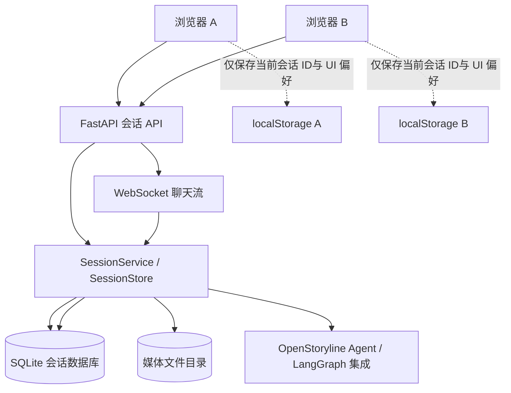
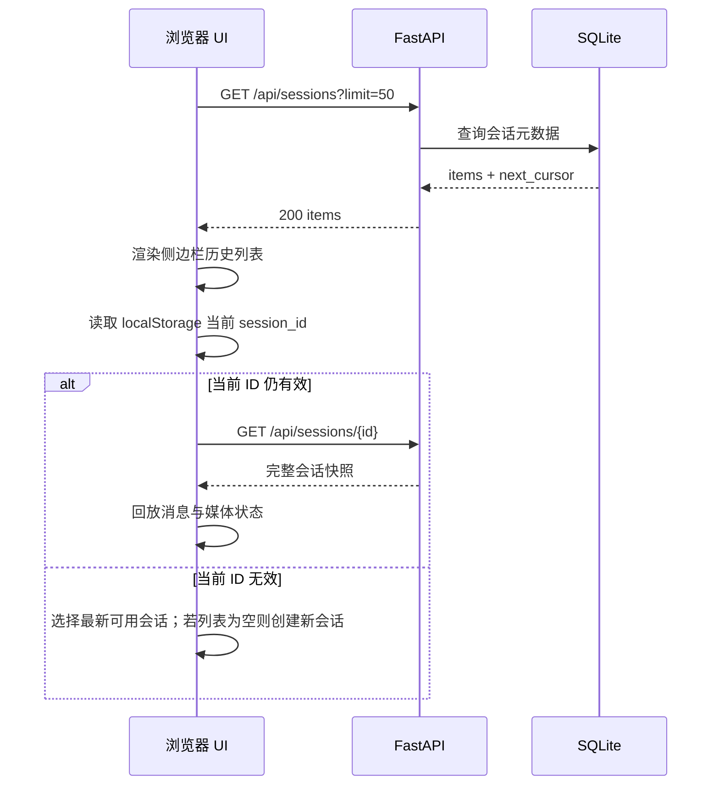

# auto-video-editor 对话历史故障分析与重设计执行方案

> 项目：[`wayyet/auto-video-editor`](https://github.com/wayyet/auto-video-editor)  
> 分支：`main`  
> 页面：截图左侧「对话历史」；实际 UI 位于仓库内嵌的 OpenStoryline Web。  
> 文档目的：定位跨浏览器与项目重启后的历史记录问题，定义可执行的重设计与验收方案。

## 1. 结论摘要

当前问题的核心不是 LangGraph Checkpointer，而是**聊天记录列表的权威数据源放在浏览器 `localStorage` 中**。

代码已确认以下事实：

1. `openstoryline/web/static/app.js` 使用 `openstoryline_session_list_v1` 保存侧边栏历史列表；代码注释直接标记为 `localStorage, per-browser`。这意味着不同浏览器、不同浏览器配置文件、不同站点来源之间不会共享列表。
2. 后端有 `POST /api/sessions` 创建会话、`GET /api/sessions/{session_id}` 读取指定会话，但没有 `GET /api/sessions` 列出全部会话的接口。新浏览器即使连接到同一后端，也无法主动枚举旧会话。
3. 后端确实会把单个会话保存到 `cfg.project.outputs_dir/<session_id>/session_state.json`，并在按 ID 读取时尝试从磁盘恢复。因此，**服务端单会话状态已经有文件持久化设计，但缺少服务端历史目录/索引接口**。
4. `auto-video-editor` 的 `config.py::make_checkpointer()` 保存的是 LangGraph 工作流执行状态，默认 SQLite 文件为 `checkpoints/<thread_id>.sqlite`；它不能直接提供截图中的聊天列表、标题、摘要或会话分页。

### 根因分级

| 问题 | 判断 | 说明 |
|---|---|---|
| 更换浏览器后看不到旧历史 | **已确认是架构缺陷** | 历史列表由浏览器自己的 `localStorage` 维护；服务端没有会话列表 API。 |
| 重启项目后看不到历史列表 | **存在多个可能原因，需按第 3 节核验** | 正常情况下，同一浏览器、同一站点来源的 `localStorage` 不会因后端进程重启而自动清空。若列表整体消失，优先检查站点来源、浏览器存储和服务端数据目录。 |
| 重启后当前会话恢复失败 | **代码路径可解释** | 当前浏览器记住的 `session_id` 对应文件不存在或不可读时，恢复会失败；前端对 404 会移除该会话的本地列表项。 |
| 保存失败但用户未得到明确错误 | **存在可观测性问题** | `SessionStore.save_session_state()` 捕获写文件异常后只记录 warning，不继续向 API 调用者报告明确失败。 |

**推荐方案：以服务端 SQLite 会话存储为唯一真相来源。** 前端 `localStorage` 只保存当前选中的会话 ID 和少量 UI 偏好，不再负责维护历史列表。这样，同一服务端上的不同浏览器能看到同一份历史；后端重启后也能从持久化数据库重建列表。

---

## 2. `main` 分支代码核查

### 2.1 前端目前怎样保存历史

文件：[`openstoryline/web/static/app.js`](https://github.com/wayyet/auto-video-editor/blob/main/openstoryline/web/static/app.js)

当前使用的关键键：

```javascript
const SESSION_ID_KEY = "openstoryline_session_id";
const SESSION_LIST_KEY = "openstoryline_session_list_v1";
```

`_loadSessionHistory()` 从 `localStorage` 读取列表；`_saveSessionHistory()` 把列表写回 `localStorage`，并仅保留最新的 50 个会话。`_renderSessionHistory()` 负责把列表渲染进 `#sessionHistoryList`。

启动流程 `bootstrap()` 会先读取并渲染本地列表，再尝试用 `SESSION_ID_KEY` 恢复当前会话。该流程没有先请求服务端获取完整历史列表。

另外，`_saveSessionHistory()` 捕获存储异常后静默忽略。因此在无痕模式、浏览器禁用站点存储或存储空间异常等情况下，用户可能看不到明确提示。

### 2.2 后端目前怎样保存会话

文件：[`openstoryline/agent_fastapi.py`](https://github.com/wayyet/auto-video-editor/blob/main/openstoryline/agent_fastapi.py)

当前 REST 会话接口包括：

| 接口 | 现有用途 |
|---|---|
| `POST /api/sessions` | 创建会话，返回新会话快照 |
| `GET /api/sessions/{session_id}` | 按已知 ID 读取并恢复会话 |
| `POST /api/sessions/{session_id}/clear` | 清空该会话聊天内容，但不等于删除会话 |

目前没有 `GET /api/sessions`。所以后端没有向新浏览器提供“列出历史会话”的途径。

`ChatSession.state_file_path_for()` 将会话状态路径解析为：

```text
<cfg.project.outputs_dir>/<session_id>/session_state.json
```

`save_state_atomic()` 先写入同目录临时文件，再通过 `os.replace()` 原子替换目标文件。`SessionStore.get()` 在内存中没有对应会话时，会尝试从这个文件恢复。

需要注意：上述存储目录由配置中的 `cfg.project.outputs_dir` 决定。若启动方式、配置文件或工作目录导致此路径发生变化，旧会话文件即使仍存在，也可能不在当前服务读取的位置。

### 2.3 LangGraph Checkpointer 与聊天历史不是一回事

文件：[`config.py`](https://github.com/wayyet/auto-video-editor/blob/main/config.py)、[`graph.py`](https://github.com/wayyet/auto-video-editor/blob/main/graph.py)

| 存储 | 当前职责 | 不应承担的职责 |
|---|---|---|
| OpenStoryline 会话状态 `session_state.json` | 保存聊天历史、模型上下文、媒体登记和会话状态 | 不能自动发现所有会话，当前缺少列表 API |
| LangGraph SQLite/Postgres Checkpointer | 保存图执行状态、中断点和恢复所需数据 | 不负责截图中的聊天侧栏、标题、摘要、会话排序 |
| 浏览器 `localStorage` | 记住当前会话 ID、前端历史列表等浏览器本地状态 | 不适合作为跨浏览器的唯一历史索引 |

不要通过调整 `thread_id` 或清理 LangGraph checkpoint 来修复侧栏历史。这样容易误伤工作流恢复数据，却无法补上会话列表接口。

---

## 3. 重启后历史不显示：现场核查步骤

当前代码足以确认跨浏览器缺陷，但不能仅凭截图判断重启后整份列表消失的具体运行时原因。请按以下顺序检查，先取证，再改代码。

### 3.1 核对页面来源是否一致

在浏览器地址栏核对完整 URL。以下地址属于不同的站点来源（origin），浏览器不会共享 `localStorage`：

- `http://127.0.0.1:7860`
- `http://localhost:7860`
- `http://<局域网IP>:7860`

协议、主机名或端口变化都可能让页面读到另一份空的本地存储。新设计应避免依赖这个行为，而不是要求用户始终使用同一 URL。

### 3.2 检查浏览器本地列表

在开发者工具的 **Application / Storage → Local Storage** 中查看：

- `openstoryline_session_list_v1`
- `openstoryline_session_id`

判定方法：

| 观察结果 | 结论方向 |
|---|---|
| 列表键不存在或内容为空 | 前端列表未成功写入、被清除，或当前 origin 与之前不同 |
| 列表键有会话 ID，但侧栏为空 | 检查 `bootstrap()` 是否运行、`_renderSessionHistory()` 是否报错，以及 DOM `#sessionHistoryList` 是否存在 |
| 列表有 ID，点击后请求返回 404 | 检查服务端输出目录、会话状态文件是否存在以及 ID 是否有效 |
| 请求返回 503 / 500 | 会话状态文件可能不可读、JSON 损坏或服务端存储异常，应保留记录并显示错误，不应静默删除 |

### 3.3 检查服务端数据文件

在当前 OpenStoryline 配置所指向的 `cfg.project.outputs_dir` 下，检查历史会话目录中是否存在：

```text
<outputs_dir>/<session_id>/session_state.json
```

还需检查服务日志中是否有 `failed to persist session state`、`session state read failed`、`session state json invalid` 等告警。

不要在未备份这些文件前点击“清理缓存”或手工删除 `outputs`、`.storyline`、`checkpoints` 目录。

### 3.4 对“重启后消失”的判断原则

同一浏览器、同一 origin 下，后端进程重启本身不应清除 `localStorage`。如果侧栏在每次启动后都为空，优先怀疑：

1. 页面被用不同的主机名或端口打开；
2. 浏览器配置清理了站点数据，或本地存储不可用；
3. 当前部署的 `outputs_dir` 改变，导致已保存会话无法恢复；
4. 会话文件写入失败，而现有后端只在日志中记录错误。

无论现场最终是哪一种，服务端缺少历史列表 API 都是需要修复的确定性问题。

---

## 4. 重设计目标与原则

### 4.1 功能目标

1. 同一服务端上的 Edge、Chrome 等浏览器访问时，展示相同的历史会话列表。
2. 页面刷新、关闭浏览器、重启 OpenStoryline / auto-video-editor 后，历史列表和聊天内容均可恢复。
3. 支持新建、切换、重命名、软删除、分页和失败重试。
4. 单个会话读取失败时，只把该项标记为“暂不可用”；不清空整份历史，不自动删除记录。
5. 历史列表的展示元数据与完整会话状态有明确的数据所有权，避免前后端各存一份并互相覆盖。
6. 保留已有 `session_state.json` 数据的迁移能力；迁移成功前不删除旧文件。

### 4.2 架构原则

- **服务端为唯一真相来源**：会话列表和会话内容必须来自同一服务端存储层。
- **浏览器只保存 UI 状态**：`localStorage` 最多保存当前会话 ID、语言或界面配置，不保存权威历史目录。
- **持久化失败必须可见**：保存失败时 API 应返回失败状态并记录结构化日志；不能只在服务端吞掉异常。
- **稳定的数据目录**：数据库路径通过明确配置确定，不能依赖当前启动命令的工作目录。
- **非破坏式迁移**：旧 JSON 先导入、校验、对账和备份，确认后才考虑清理。
- **单会话故障隔离**：某一份会话损坏不能导致整个侧栏无法加载。
- **访问边界清楚**：如果服务被局域网其他设备访问，必须引入身份认证和用户隔离；不能直接把所有人的历史暴露给任意客户端。

---

## 5. 目标架构

### 5.1 架构图



### 5.2 持久化方案

推荐在服务端建立一个独立 SQLite 数据库，例如通过 `OPENSTORYLINE_SESSION_DB` 显式配置完整路径。默认路径应落在用户数据目录，而不是临时目录、浏览器缓存目录或容易被“清理缓存”删除的目录。

建议默认路径策略：

- Windows：`%LOCALAPPDATA%\OpenStoryline\data\sessions.sqlite3`
- Linux：`~/.local/share/openstoryline/sessions.sqlite3`
- macOS：`~/Library/Application Support/OpenStoryline/sessions.sqlite3`

如果项目已有统一的数据目录配置，则优先复用该配置；启动时应记录最终解析出的数据库路径。禁止每次启动在不同的当前工作目录下自动创建一份新的数据库。

数据库建议使用 SQLite WAL 模式（Write-Ahead Logging，提升读写并发能力），并设置合理的 busy timeout。SQLite 是本地单实例优选；若未来需要多服务实例共享数据，再评估 PostgreSQL，不要在当前故障修复中直接引入不必要的分布式组件。

### 5.3 数据模型

第一阶段采用一张 `chat_sessions` 表存储会话元数据和可恢复的完整状态 JSON，避免同一份历史同时写文件和写两张数据库表造成一致性问题。

```sql
CREATE TABLE IF NOT EXISTS chat_sessions (
    id            TEXT PRIMARY KEY,
    owner_id      TEXT NOT NULL DEFAULT 'local',
    title         TEXT NOT NULL DEFAULT '新对话',
    title_source  TEXT NOT NULL DEFAULT 'auto',
    created_at    INTEGER NOT NULL,
    updated_at    INTEGER NOT NULL,
    last_preview  TEXT NOT NULL DEFAULT '',
    message_count INTEGER NOT NULL DEFAULT 0,
    has_user      INTEGER NOT NULL DEFAULT 0,
    status        TEXT NOT NULL DEFAULT 'active',
    state_version INTEGER NOT NULL DEFAULT 1,
    state_json    TEXT NOT NULL,
    deleted_at    INTEGER
);

CREATE INDEX IF NOT EXISTS idx_chat_sessions_owner_updated
    ON chat_sessions(owner_id, status, updated_at DESC);
```

字段说明：

- `id`：沿用现有 32 位十六进制 `session_id`，兼容当前前端深链。
- `owner_id`：单用户本地模式使用固定 `local`；若加入登录，必须从已验证的身份中取值，不能信任请求体传入值。
- `title` / `last_preview`：用于侧栏，无需每次读取所有完整消息才能渲染。
- `state_json`：复用当前 `ChatSession.dump_state()` / 序列化结构，保留 `history`、`lc_messages_serialized`、媒体登记等字段。
- `state_version`：为将来升级状态结构提供迁移依据。
- `status` / `deleted_at`：支持软删除，误删可恢复；物理清理放到独立维护流程。

`history` 仍保留在 `state_json` 中，第一阶段不再额外建 `messages` 表。待未来需要全文检索、审计查询或海量会话优化时，再单独设计消息明细表。

### 5.4 数据更新规则

1. 创建会话时，在一个数据库事务中插入元数据和初始 `state_json`，成功提交后再向客户端返回 201。
2. 用户消息、助手完整回复、工具状态等完成持久化时，更新 `state_json`、`updated_at`、`last_preview`、`message_count`、`has_user`。
3. 不要每收到一个流式 token 就执行一次完整数据库写入；应按消息状态变更/合适的批次保存，避免高频写放大。
4. 标题自动取第一条有效用户消息并截断；用户手动重命名后，`title_source='manual'`，后续消息不得覆盖手动标题。
5. 列表默认按 `updated_at DESC, id DESC` 排序；如希望“新建时间固定排序”，则统一改为 `created_at DESC, id DESC`，前后端不可各自排序。
6. 保存异常要返回明确 5xx，并保留旧版本数据；不要捕获异常后假装成功。

---

## 6. API 设计

保留当前接口兼容性，在现有 API 上新增列表、更新和删除能力。

### 6.1 列表接口

```http
GET /api/sessions?limit=50&cursor=<opaque-cursor>&status=active
```

返回示例：

```json
{
  "items": [
    {
      "id": "32位十六进制 session id",
      "title": "帮我剪一条旅行视频",
      "created_at": 1792570000,
      "updated_at": 1792570300,
      "last_preview": "先分析这几段素材……",
      "message_count": 8,
      "has_user": true,
      "status": "active"
    }
  ],
  "next_cursor": null
}
```

要求：

- `limit` 默认 50，最大 100；使用游标分页，不要一次返回全部完整聊天内容。
- 只返回列表元数据；完整 `state_json` 不通过列表接口暴露。
- 数据库查询失败时返回 5xx，而不是 `200` + 空列表，避免前端把故障显示成“暂无历史”。
- 未配置认证时仅限本机单用户运行；若允许远程访问，必须按 `owner_id` 过滤。

### 6.2 现有及新增接口

| 方法与路径 | 行为 | 备注 |
|---|---|---|
| `POST /api/sessions` | 创建会话并持久化 | 现有接口，返回完整快照或精简创建结果 |
| `GET /api/sessions` | 列出历史会话 | **新增，修复跨浏览器列表缺失的关键接口** |
| `GET /api/sessions/{session_id}` | 读取完整会话 | 保留现有接口 |
| `PATCH /api/sessions/{session_id}` | 重命名会话 | 新增；只允许更新可编辑字段 |
| `DELETE /api/sessions/{session_id}` | 软删除会话 | 新增；默认不物理删除媒体文件 |
| `POST /api/sessions/{session_id}/clear` | 清空会话消息 | 保留，但 UI 必须与“删除会话”区分 |

错误语义：

- `404`：该用户下不存在此会话，或会话已被软删除。
- `409`：状态版本冲突或不允许的状态变更。
- `422`：请求字段不合法。
- `500/503`：持久化或存储服务失败。前端必须保留本地显示的记录，并提供重试。

---

## 7. 前端改造设计

目标文件：`openstoryline/web/static/app.js`、必要时 `openstoryline/web/index.html`。

### 7.1 新的页面初始化流程



页面启动时应先加载服务器端列表。列表加载状态至少包括：

- `loading`：显示“正在加载历史会话”；
- `success + empty`：显示“暂无历史会话”；
- `success + items`：显示列表；
- `error`：显示“历史加载失败”和重试入口，不显示成空列表。

### 7.2 `localStorage` 的职责调整

保留：

```javascript
const SESSION_ID_KEY = "openstoryline_session_id";
```

移除它作为权威历史来源的职责：

```javascript
const SESSION_LIST_KEY = "openstoryline_session_list_v1";
```

迁移完成后，`SESSION_LIST_KEY` 只可用于一次性迁移/临时缓存，不能决定历史列表最终显示内容。侧栏必须始终由 `GET /api/sessions` 的响应驱动。

### 7.3 会话切换与错误处理

- 点击列表项后调用 `GET /api/sessions/{id}`，成功才切换当前会话。
- 读取失败时保留该项，并展示可重试的状态；不能因为一次临时网络失败就删掉历史记录。
- 只有服务端明确返回 404 且列表接口确认该会话已不存在/已删除，才刷新列表。
- 恢复当前 `session_id` 失败时，应从服务端列表选择最新可用会话；列表为空时再新建。不要在服务端暂时返回 503 时，用空快照覆盖旧历史。
- “创建新对话”只创建一条新的服务端记录；如果当前已有空白新对话，可复用它，避免不断产生空会话。
- 标题、预览和排序只在一个地方计算：推荐由服务端统一生成，前端负责展示。

### 7.4 兼容旧浏览器历史

升级后首次启动时，可把当前浏览器的 `openstoryline_session_list_v1` 作为**迁移提示**，逐个调用服务端 `GET /api/sessions/{id}`：

1. 服务端已存在：保留并使用服务端元数据；
2. 服务端不存在：标记为“旧记录不可恢复”，不伪造聊天内容；
3. 服务端暂时不可用：不删除本地记录，提示稍后重试；
4. 迁移完成后，后端列表成为唯一来源。其他浏览器不需要迁移，因为它们可以直接请求服务端列表。

---

## 8. 后端实现拆分

### 8.1 建议职责

```text
openstoryline/
├── agent_fastapi.py                 # FastAPI 路由、WebSocket 事件适配
└── src/open_storyline/storage/
    ├── session_manager.py            # SessionService / SessionStore 接口
    ├── session_sqlite.py             # 新增：SQLite repository、事务、迁移
    └── session_legacy_json.py        # 新增或拆分：读取旧 session_state.json
```

实际文件名可遵循仓库现有结构，但必须把“API 路由”“会话业务逻辑”“持久化实现”分开，避免继续把数据库读写逻辑堆在 `agent_fastapi.py` 中。

### 8.2 存储抽象

建立以下方法，前端 API 和 WebSocket 共用同一服务：

```python
class SessionRepository:
    async def create(self, initial_state: dict) -> dict: ...
    async def get(self, session_id: str, owner_id: str) -> dict | None: ...
    async def list(self, owner_id: str, limit: int, cursor: str | None) -> dict: ...
    async def save(self, session_id: str, owner_id: str, state: dict) -> None: ...
    async def rename(self, session_id: str, owner_id: str, title: str) -> dict: ...
    async def soft_delete(self, session_id: str, owner_id: str) -> None: ...
```

这是接口草案，不要求照搬类型定义；实现需与项目当前 Python 版本和异步调用约定一致。

### 8.3 持久化失败不能再静默吞掉

当前 `SessionStore.save_session_state()` 捕获异常后仅记录 warning。重设计应明确区分：

- **成功**：事务提交后才返回成功；
- **可重试失败**：返回 503，并记录 `session_id`、操作名、数据库错误类别；
- **数据损坏**：返回 503/500，保留原始数据和备份；
- **会话不存在**：返回 404。

日志不得记录 API Key、完整敏感提示词或大段消息正文。可以记录消息数量、状态版本、耗时和错误类别。

---

## 9. 历史数据迁移计划

### 阶段 A：备份与盘点

1. 停止写入会话的 Web 服务，或先实现只读迁移锁，避免迁移期间状态持续变化。
2. 备份当前 `cfg.project.outputs_dir` 中所有 `*/session_state.json`。
3. 汇总有效文件数、JSON 损坏数、会话 ID 重复/不匹配数。
4. 导出旧浏览器 `openstoryline_session_list_v1` 的会话 ID 作为辅助清单，但不要把浏览器列表作为服务器迁移的唯一输入。

### 阶段 B：兼容导入

1. 新建 SQLite 数据库并执行 schema migration。
2. 遍历旧会话目录，读取 `session_state.json`，验证 `session_id` 与目录名一致。
3. 从 `history` 计算标题、最后消息预览、消息数量、`has_user` 和时间戳；旧状态缺字段时使用明确默认值。
4. 使用 `INSERT ... ON CONFLICT DO NOTHING` 导入，保证重复运行幂等，不覆盖数据库中更新的会话。
5. 记录导入报告：总数、成功数、跳过数、失败原因和备份位置。

### 阶段 C：切换与对账

1. 启用 SQLite 列表和会话读取路径。
2. 前端改为启动即调用 `GET /api/sessions`。
3. 对账数据库会话数量、旧 JSON 数量、抽样会话消息数和媒体登记表。
4. 保留 JSON 文件一个版本周期，不立即删除。
5. 通过验收后，再决定是否停止向 JSON 写入；未完成切换前避免两套存储同时作为权威来源。

---

## 10. 执行阶段与优先级

### P0：现场确认与可观测性（先做）

- [ ] 检查运行 URL/origin 是否稳定。
- [ ] 在浏览器存储中记录 `SESSION_LIST_KEY` 是否存在、长度及解析错误。
- [ ] 检查服务端 `outputs_dir` 的实际绝对路径。
- [ ] 对 `save_state_atomic()` 失败增加可识别的结构化错误日志；禁止假成功。
- [ ] 现存 JSON 与日志先备份，不执行清理操作。

### P1：后端会话目录能力

- [ ] 加入 SQLite schema 和 `OPENSTORYLINE_SESSION_DB` 配置。
- [ ] 实现 `SessionRepository.list()`，支持 `limit`、游标和稳定排序。
- [ ] 增加 `GET /api/sessions`，只返回元数据。
- [ ] 创建、读取、保存、重命名、软删除统一经过同一存储抽象。
- [ ] 将保存失败映射为明确 HTTP 错误，不静默吞掉。
- [ ] 增加旧 `session_state.json` 的幂等迁移工具和报告。

### P2：前端列表重构

- [ ] `bootstrap()` 改为先请求服务端列表。
- [ ] 新增 loading、empty、error、retry UI 状态。
- [ ] 去掉以 `localStorage` 为权威列表的逻辑。
- [ ] 保留 `SESSION_ID_KEY` 作为当前会话提示。
- [ ] 处理 404 与 503：缺失记录可刷新；暂时不可用记录必须保留。
- [ ] 增加重命名和软删除操作，确认操作前有明确反馈。

### P3：测试与发布

- [ ] 完成第 11 节测试矩阵。
- [ ] 备份 SQLite 数据库和旧 JSON 文件。
- [ ] 先在单用户本机模式发布；确认稳定后再开放局域网访问。
- [ ] 记录数据库路径、迁移计数、API 版本和回滚步骤。

---

## 11. 测试矩阵与验收标准

| 编号 | 场景 | 预期结果 |
|---|---|---|
| TH-01 | 创建会话并发送一组消息 | 数据库存在该会话；标题、预览、更新时间正确 |
| TH-02 | 刷新同一页面 | 历史列表与聊天消息恢复 |
| TH-03 | 关闭再启动浏览器 | 历史列表从服务端恢复，不依赖原浏览器列表缓存 |
| TH-04 | 用另一个浏览器打开相同服务端 | 出现同一份历史列表；点击旧会话可回放聊天记录 |
| TH-05 | 重启 OpenStoryline 后端 | 同一批会话仍可列出与读取 |
| TH-06 | 改用 `localhost` / `127.0.0.1` 访问 | 只要访问同一个后端，列表仍一致 |
| TH-07 | 删除/损坏一个会话状态 | 只影响该会话；其他历史正常展示；错误可见 |
| TH-08 | SQLite 暂时不可写/磁盘满 | API 返回错误，不返回假成功；前端显示重试提示 |
| TH-09 | 服务端列表 API 返回 500/503 | UI 显示加载失败，不伪装成“暂无历史” |
| TH-10 | 列表超过 50 条 | 分页正确，最新会话顺序稳定，无重复、无遗漏 |
| TH-11 | 重命名后继续聊天 | 手动标题不被后续消息自动覆盖 |
| TH-12 | 软删除后刷新并重启 | 默认列表不显示已删除项；数据库可按维护策略恢复 |
| TH-13 | 对同一批旧 JSON 重复执行迁移 | 不重复创建会话、不覆盖较新的数据库状态 |
| TH-14 | 当前会话 ID 无效但服务端列表可用 | 自动选中最新有效会话；不清空整份列表 |
| TH-15 | 仅 LangGraph checkpoint 存在、无聊天会话记录 | 侧栏不应把 checkpoint 伪装成聊天历史 |

发布验收必须同时满足：

- 同一后端、不同浏览器看到相同列表；
- 重启后列表和会话消息都能恢复；
- 保存失败、列表加载失败和单会话损坏都有明确反馈；
- 旧数据迁移报告可审计，旧文件在验收完成前未删除；
- 所有现有 OpenStoryline、聊天 WebSocket、媒体上传和 auto-video-editor 工作流集成测试通过。

---

## 12. 回滚与数据安全

1. 改造前备份 SQLite 数据库（若已创建）以及所有旧 `session_state.json`。
2. 使用配置开关选择存储实现，例如 `OPENSTORYLINE_SESSION_STORE=sqlite|legacy_json`；开关默认值在发布说明中明确，不要静默切换。
3. 如果新存储验证失败，停止写入新存储，切回 `legacy_json` 并确认旧会话仍可读取。
4. 回滚期间禁止自动删除或覆盖旧 JSON 文件。SQLite 数据库也保留，用于排查和再次迁移。
5. “清空聊天”“软删除会话”“清理缓存”必须是三个不同操作，界面文案和后端接口不能互相复用。
6. 如果要让局域网设备访问服务，必须增加认证和会话所有权过滤，并重新评审媒体文件 URL、上传接口和模型配置的访问边界。

---

## 13. 相关源代码

- [`openstoryline/web/static/app.js`](https://github.com/wayyet/auto-video-editor/blob/main/openstoryline/web/static/app.js)：`SESSION_LIST_KEY`、`_loadSessionHistory()`、`_saveSessionHistory()`、`bootstrap()`、`_renderSessionHistory()`、会话切换与恢复逻辑。
- [`openstoryline/web/index.html`](https://github.com/wayyet/auto-video-editor/blob/main/openstoryline/web/index.html)：左侧 `#sessionHistoryPanel` / `#sessionHistoryList` DOM。
- [`openstoryline/agent_fastapi.py`](https://github.com/wayyet/auto-video-editor/blob/main/openstoryline/agent_fastapi.py)：`ChatSession.state_file_path_for()`、`save_state_atomic()`、`SessionStore`、`POST /api/sessions`、`GET /api/sessions/{session_id}`。
- [`openstoryline/README.md`](https://github.com/wayyet/auto-video-editor/blob/main/openstoryline/README.md)：内嵌 OpenStoryline 的目录、运行方式、`outputs/<session_id>` 产物位置说明。
- [`config.py`](https://github.com/wayyet/auto-video-editor/blob/main/config.py)：auto-video-editor 的 LangGraph Checkpointer 配置，与聊天历史存储职责不同。
- [`graph.py`](https://github.com/wayyet/auto-video-editor/blob/main/graph.py)：LangGraph 工作流装配及中断恢复说明。

## 14. 最终建议

优先完成 **P1 + P2**：增加服务端 `GET /api/sessions`，将侧栏历史数据源切换为服务端持久化存储，并把会话保存错误从静默 warning 改为可观测、可重试的失败。

不要把 `localStorage` 改成 `sessionStorage` 或仅简单换成另一种浏览器存储来“修复”问题：这仍然无法跨浏览器共享。也不要用 LangGraph Checkpointer 替代聊天会话库。正确边界是：**OpenStoryline Session Store 管聊天历史，LangGraph Checkpointer 管工作流恢复**。
