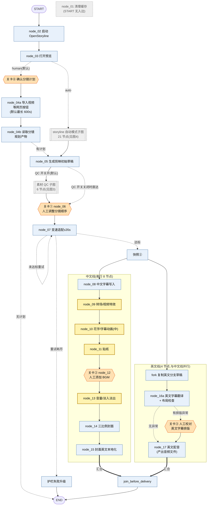
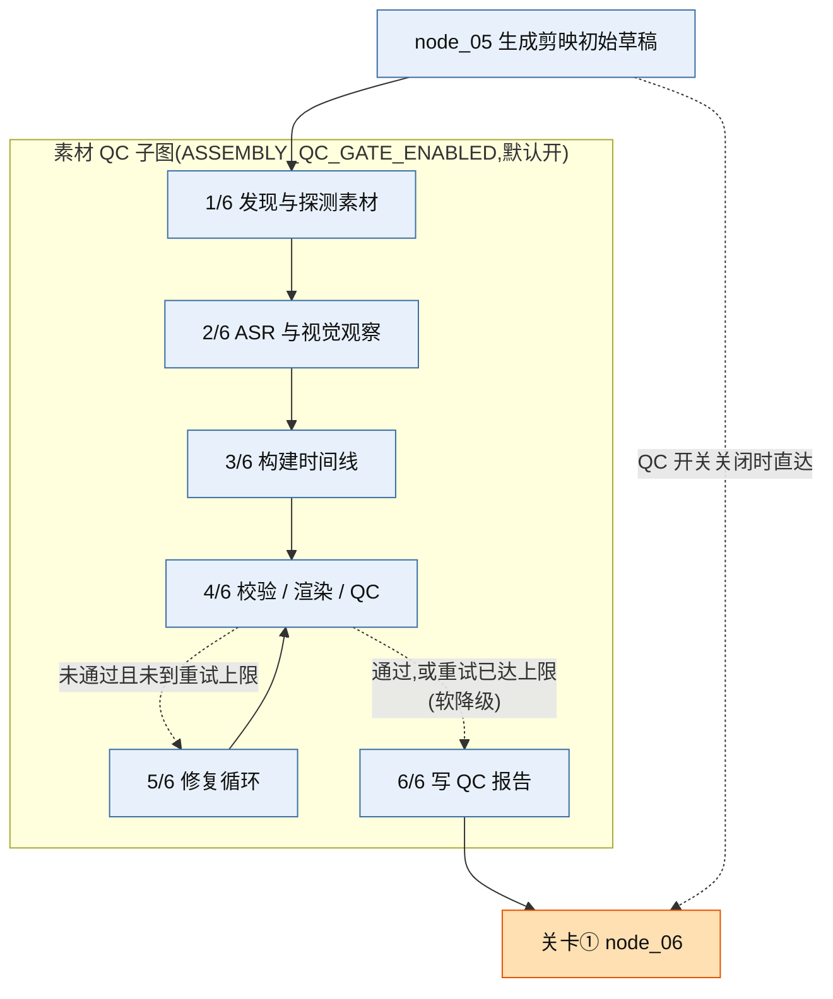
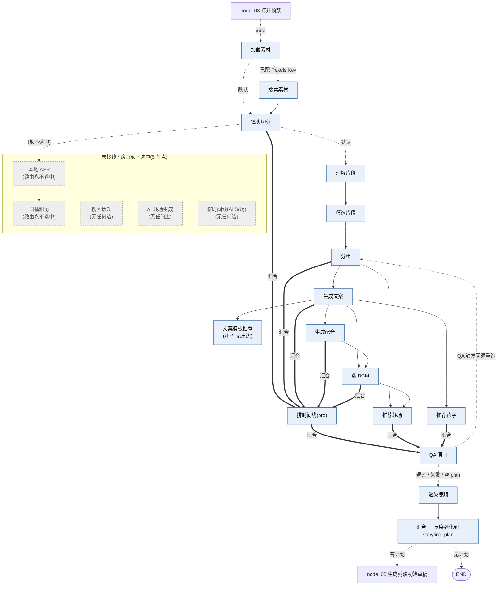

# auto-video-editor 节点调序与全量工作流设计执行计划

> 基线:`wayyet/auto-video-editor` 的 `main` @ `4c5b04289c45883718ddad7a6630d57be36db3c6`(2026-10-01 22:38 +0800)
> 日期:2026-10-11 · 参考:附件《auto-video-editor节点全量核查与冗余合并设计执行计划.md》
> 状态:**已在沙箱原型验证**(补丁应用到干净副本;新增 4 条守护测试全绿;全量回归与基线一致)。**未在 Windows + 剪映 5.9.0 真机验证**,见 §6 的 WP6。
> 基线变化:首次分析基于 `b00201b`(2026-09-30)。此后 `main` 前进了 1 个提交 `4c5b042`(把 node_04 拆成 04a / 04b)。本文的数字、补丁、测试、实证、图,都已按 `4c5b042` 重新生成并重新验证。
> 配套:《auto-video-editor节点调序-代码与脚本包.zip》(补丁、代码、测试、实证 / 分析 / 画图脚本)。本文不贴完整代码,代码都在压缩包里。

---

## 0. 一页结论

### 做什么

| 你的要求 | 设计动作 |
|---|---|
| 英文线(16a)补上与 node_08、node_10 同类的节点 | 新增 `node_08b_add_subtitles_en`(英文字幕写入英文草稿)和 `node_10b_inject_text_fx_en`(英文花字 / 动画) |
| 调整 node_10 的调用顺序 | 中文线 `08 → 10` 紧邻;英文线 `16a → 08b →(关卡③)→ 10b → 17` |
| 09 / 11 / 12 / 13 推迟到 node_17 之后 | 列表型汇合:`[15, 17] → 09 → 11 → 12 → 13 → join_before_delivery` |
| 画出全部节点和工作流 | §4 四张图 + §5 全部 53 个节点清单 |

### 为什么必须这样做(调序前 main 的实测问题)

1. **英文草稿里没有任何字幕文本素材**。只补 node_10 会是空操作,所以必须先补 08b。
2. **关卡③ 一触发,整图崩溃**:`InvalidUpdateError: At key 'subtitle_srt_path'`。
3. **先后顺序靠"超步碰巧"**:没有任何一条边保证 09 ~ 13 在 node_17 之后。

### 验证结果

| 项 | 结果 |
|---|---|
| 新拓扑整图运行(正常路径 / 关卡③ 路径) | 都跑到 END;无并发写冲突 |
| 汇合屏障 | node_09 在 step 23 才触发(node_15 在 step 20,node_17 在 step 22),只触发 1 次 |
| 英文草稿 | 5 条英文字幕 + 花字;关卡③ 人工改的句子保住,SRT 非空 |
| 补丁应用到干净副本 | `git apply --check` 通过(CRLF 工作区也通过) |
| 新增 4 条守护测试 | 新图 4 passed / 旧图 4 failed |
| 全量回归 | 单元 789 passed(与基线一致);集成 63 passed(= 基线 59 + 新增 4)。基线自带的 4 条失败(单元 3、集成 1)调序前后是同一批,见 §7.1 |

### 需要你确认(默认已采用推荐项,切换成本见 §9)

| # | 问题 | 推荐 |
|---|---|---|
| D1 | 尾链(09 / 11 / 12 / 13)作用于哪份草稿 | **A:仅中文主草稿**(与调序前行为一致,只改顺序) |
| D2 | 关卡③ 与英文花字 10b 谁先 | **A:先关卡③,后 10b**(花字只对人工校对后的文本跑一次) |

---

## 1. 需求与口径

### 1.1 需求 → 设计动作

| # | 你的要求 | 设计动作 | 落点 |
|---|---|---|---|
| 1 | 英文线补与 node_08 同类的节点 | 新增 `node_08b_add_subtitles_en`:把 `subtitle_segments_en` 写成英文草稿的 `materials.texts` | 16a 之后 |
| 2 | 英文线补 node_10 | 新增 `node_10b_inject_text_fx_en`:与中文 node_10 共用同一个核心函数 | 关卡③ 之后、node_17 之前 |
| 3 | 调整 node_10 的调用顺序 | 中文线 `08 → 10`(原来是 `08 → 09 → 10`) | §3.1 |
| 4 | 09 / 11 / 12 / 13 推迟到 node_17 之后 | `add_edge([15, 17], 09)` 做汇合屏障,再串行 `09 → 11 → 12 → 13` | 尾链 |
| 5 | 画出全部节点和工作流 | 4 张图 + 53 节点清单 | §4、§5 |

### 1.2 与你的描述、与附件的差异

| 项 | 你的描述 / 附件 | main 实际 |
|---|---|---|
| node_17 名称 | `node_17_inject_english_tts_stub`,`nodes/node_17_inject_english_tts_stub.py` | 已更名为 `node_17_inject_english_tts`,文件 `nodes/node_17_inject_english_tts.py`。本文按 main 实名 |
| node_04 | 附件里是 `node_04_import_and_plan`(`nodes/node_04_import_and_plan.py`) | 最新 main 已拆成 `node_04a_import_video`(等网页【导入视频】按钮)和 `node_04b_get_storyboard_plan`(读规划产物)。本文按 main 实名 |
| 节点总数 | 附件口径 21 个,只覆盖主链 | 注册节点 **51** 个(主链 24 个含关卡⓪ + QC 6 + storyline 21);调序后 **53** 个 |
| 英文字幕写入草稿 | 你的描述里只有 node_08(中文字幕写入),英文侧没有对应节点 | 实测 16a 不创建字幕文本素材,英文草稿因此没有字幕(见 F1) |

---

## 2. 现状核查(main @ 4c5b042)

### 2.1 规模与可达性

| 项 | 数值 | 说明 |
|---|---|---|
| 注册节点 | 51 | `graph.py::_build_state_graph` 里的 `add_node` |
| 普通边 / 条件边 | 41 / 9 | 汇合已用列表型 `add_edge([...], x)` 写法 |
| 人工模式 + QC 开,可达 | 29 | `STORYLINE_MODE=human`、`ASSEMBLY_QC_GATE_ENABLED=true` 都是 config.py 的默认值 |
| 自动模式 + QC 开,静态可达 | 44 | |
| **四种配置都不可达** | 4 | `clean_cache`(START 无入边,仅 Web UI 按钮触发)、`storyline_search_web_topic`、`storyline_generate_ai_transition`、`storyline_plan_timeline_ai_transition` |
| 静态可达但路由永不选中 | 2 | `storyline_local_asr`、`storyline_speech_rough_cut`(graph.py 注释自述"当前不可达,有意保留") |

"可达"来自 AST 静态分析(`04_分析脚本/reach.py`):条件边映射里的目标都算可达。

### 2.2 实测发现

| 编号 | 现象 | 证据 | 影响 |
|---|---|---|---|
| F1 | 英文分支草稿里没有英文字幕文本素材 | 实证 1:fork 后、16a 之后 `materials.texts` 都是 0 条。快照②取自 node_08 之前;16a 的 `_write_marker` 只给**已有**的 texts 补 `text_en` | 关卡③ 无字幕可校对;resume 后 `subtitle_en.srt` 被重写成 **0 字节** |
| F2 | 关卡③ 触发时整图崩溃 | 实证 2(调序前 / 关卡③ 路径):step 19 报 `InvalidUpdateError: At key 'subtitle_srt_path'`。node_10 返回整份 state(含 16a 刚写的 `subtitle_srt_path`),与关卡③ 同一超步并发写同一个键 | 英文字幕有排版问题时整条流程崩。现有测试没拦住:`test_checkpoint3_interrupt_and_resume_path` 里 `c3_seen` 只赋值、从未断言 |
| F3 | 先后顺序靠"超步碰巧" | 实证 2:16a(step 18)只因比 node_08(step 17)晚一个超步才拿到 `asr_segments_zh`;node_09(step 18)跑在 node_17(step 19)之前;11 / 12 / 13 在 17 之后只是时间巧合 | 英文线一变长或变短,顺序就变。无法保证"09 ~ 13 在 17 之后" |
| F4 | node_17 只合成音频文件,不写草稿 | 读代码:`nodes/node_17_inject_english_tts.py` 里没有任何草稿写入(`apply_and_write` / `write_draft` / `materials` / `draft_content` 均无命中) | "先配音、后调音量"对英文草稿暂无实际音轨可调。**本次不改**,列入 WP7 |
| F5 | `subtitle_scout_report` 没在 `state.py` 声明 | 实证 4:node_08 写出该键,整图跑完 state 里是 `None` | 08b 只能用默认字幕样式。要与中文同款,须先在 `state.py` 声明该键 |
| F6 | 测试对节点顺序不设防 | 调序后不改任何旧测试,单元 789 passed、集成 59 passed 与基线完全相同(集成另有新增的 4 条);新守护测试放到旧图上 4 条全失败 | 必须配套新增守护测试(§7) |

### 2.3 调序前的执行顺序(实测超步)

同一 step 内的节点并行。只列 step 16 以后:

```text
step 16: bridge_snapshot2
step 17: fork_draft_for_english_branch ‖ node_08_add_subtitles
step 18: node_09_inject_fx ‖ node_16a_translate_and_check
step 19: node_10_inject_text_fx ‖ node_17_inject_english_tts
step 20: node_11_inject_sticker
step 21: node_12_human_add_bgm
step 22: node_13_adjust_volume
step 23: node_14_make_covers
step 24: node_15_localize_covers_en
step 25: join_before_delivery
```

---

## 3. 目标设计

### 3.1 新顺序

| 段 | 顺序 |
|---|---|
| 公共前段(不变) | 02 → 03 →(关卡⓪)→ 04 → 05 →(QC 6 节点)→ 关卡① → 07 → 快照② → **08** |
| 中文线 | 08 → **10** → 14 → 15 |
| 英文线 | 08 → fork → 16a → **08b** →(条件)关卡③ → **10b** → 17 |
| 汇合 + 尾链 | `[15, 17] ⇒ 09 → 11 → 12(关卡②)→ 13 → join_before_delivery(QA)→ END` |

### 3.2 前后对照(实测超步,正常路径)

| 节点 | 调序前 step | 调序后 step | 变化 |
|---|---|---|---|
| node_08 中文字幕 | 17 | 17 | 不变 |
| node_10 花字(中) | 19 | 18 | -1 |
| fork 英文分支草稿 | 17 | 18 | +1 |
| node_14 封面 | 23 | 19 | -4 |
| node_16a 英文翻译 + 布局检查 | 18 | 19 | +1 |
| node_08b 英文字幕写入(新增) | — | 20 | 新增 |
| node_15 封面英文本地化 | 24 | 20 | -4 |
| node_10b 花字(英)(新增) | — | 21 | 新增 |
| node_17 英文配音 | 19 | 22 | +3 |
| node_09 转场 / 特效 | 18 | 23 | +5 |
| node_11 贴纸 | 20 | 24 | +4 |
| node_12 关卡② BGM | 21 | 25 | +4 |
| node_13 音量 | 22 | 26 | +4 |
| join_before_delivery(QA) | 25 | 27 | +2 |

关卡③ 路径(强制英文排版异常)的新顺序:关卡③ 在 step 21,10b 在 22,17 在 23,09 在 24,关卡② 在 26,13 在 27,QA 在 28。

### 3.3 设计决策

| 编号 | 决策 | 理由 |
|---|---|---|
| D-1 | 汇合屏障前移:`add_edge([node_15, node_17], node_09)`(列表型,一次调用) | 两线都完成才触发尾链首节点,只触发 1 次;不再靠超步碰巧 |
| D-2 | `join_before_delivery` 改为单前驱,放在尾链末端 | 它的职责是交付前 QA,应在音量等全部完成之后 |
| D-3 | 显式边 `node_08 → fork`(原来是 `bridge_snapshot2 → fork`) | 16a 读 node_08 产出的 `asr_segments_zh`:把隐式依赖写成边。fork 仍复制快照②,英文草稿保持"纯视频" |
| D-4 | 新增 08b,独立于 16a | 16a 含翻译 API 调用,不宜再加草稿写入。08b 整表替换 `materials.texts`,重放结果相同(幂等) |
| D-5 | 10b 放在关卡③ 之后 | 花字只对人工校对后的最终文本跑一次;关卡③ resume 只需读写 SRT |
| D-6 | node_10 拆成核心 `apply_text_fx` + 中文 / 英文两个入口 | 一份实现、两个图节点;英文入口用独立的 done 标记,否则 `status_log` 的去重 reducer 会把中英两条 done 合并成一条 |
| D-7 | 08b / 10b 只返回变更字段(delta) | 08b 与中文线的 node_15 同超步(step 20),返回整份 state 会让同一个键被写两次(与 F2 同类故障)。10b 目前单独占一个超步;但它在与中文线并行的英文线上,任何一条线增减节点都会改变超步对齐,所以同样只返回变更字段 |
| D-8 | 抽 `make_text_material` 供 node_08 与 08b 共用 | 消除重复;node_08 输出逐字段不变,原有单测照常通过 |

关键接线(摘自补丁后的 `graph.py`,其余代码见压缩包 `01_代码改动/`):

```python
# ---- 2026-10 调序:中文线 08 → 10 → 14 → 15;英文线 fork → 16a → 08b → [③] → 10b → 17;
#      两线汇合后才跑尾链 09 → 11 → 12(②) → 13 → join_before_delivery(QA)→ END ----
# 中文线
g.add_edge("node_08_add_subtitles", "node_10_inject_text_fx")
g.add_edge("node_10_inject_text_fx", "node_14_make_covers")
g.add_edge("node_14_make_covers", "node_15_localize_covers_en")

# 英文线:显式依赖 08(16a 读 08 产出的 asr_segments_zh)——不再靠"超步顺序碰巧满足"
g.add_edge("node_08_add_subtitles", "fork_draft_for_english_branch")
g.add_edge("fork_draft_for_english_branch", "node_16a_translate_and_check")
g.add_edge("node_16a_translate_and_check", "node_08b_add_subtitles_en")
g.add_conditional_edges(
    "node_08b_add_subtitles_en",
    route_after_translate,
    {
        "node_checkpoint3_layout_review": "node_checkpoint3_layout_review",
        "node_10b_inject_text_fx_en": "node_10b_inject_text_fx_en",
    },
)
g.add_edge("node_checkpoint3_layout_review", "node_10b_inject_text_fx_en")
g.add_edge("node_10b_inject_text_fx_en", "node_17_inject_english_tts")

# 汇合 + 尾链起点:列表语法 → 中文线(15)与英文线(17)都到才触发 node_09,只触发一次
g.add_edge(
    ["node_15_localize_covers_en", "node_17_inject_english_tts"],
    "node_09_inject_fx",
)
# 尾链(作用于中文主草稿 state["draft_path"])
g.add_edge("node_09_inject_fx", "node_11_inject_sticker")
g.add_edge("node_11_inject_sticker", "node_12_human_add_bgm")
g.add_edge("node_12_human_add_bgm", "node_13_adjust_volume")
# 交付前 QA 闸门:单前驱,不再承担 fan-in
g.add_edge("node_13_adjust_volume", "join_before_delivery")
```

### 3.4 并行安全规则(给以后改图的人)

- 同一超步内的节点,不得写同一个无 reducer 的键。
- 主链 26 个节点已用 `04_分析脚本/ret_kinds.py` 静态核对(结果见 `ret_kinds_new.txt`):
  - **返回整份 state**(`{**state, ...}`)共 17 个:01、02、03、关卡⓪、04a、04b、05(`generate_draft`)、关卡①、07、08、09、10(中文)、11、关卡②、13、`bridge_snapshot2`、`escalate_guardrail_failure`。
  - **只返回变更字段**共 9 个:fork、14、15、16a、08b、关卡③、10b、17、`join_before_delivery`。
  - 子图(assembly 6 个、storyline 21 个)本次没改,也没有逐个核对。
- 调序后,同一超步里"整份 + 变更字段"混跑只有一处:node_10(中文,整份)与 fork(变更字段),都在 step 18。fork 只写 `draft_dir_en_branch` 和 `status_log`:前者是 `NotRequired` 字段,本仓库默认入口(`scripts/run_workflow.py`)不预置它,此时 state 里还没有它;后者有去重 reducer。所以不会写冲突。调序前的 08 ‖ fork(step 17)靠的是同一个条件。
- 其余两组并行(14 ‖ 16a、15 ‖ 08b)两边都只返回变更字段。
- 新增的并行节点一律只返回变更字段。
- 汇合一律用列表型 `add_edge([a, b], x)`。多次独立 `add_edge` 指向同一节点 = 任一前驱完成就触发。
- 带 `interrupt()` 的节点:中断之前不放有副作用的写操作,或做成幂等(沿用既有约定)。

### 3.5 行为变化清单

1. 英文草稿现在有英文字幕和花字(此前为空)。
2. 关卡③ 人工校对的内容会保留到 `subtitle_en.srt`(此前被重写成 0 字节)。
3. 关卡③ 触发不再崩溃。
4. 关卡② 一定晚于关卡③:② 在尾链,尾链要等英文线(含 ③ 与 17)走完才开始。实测挂起序列 ① → ③ → ②。调序前两条线互相独立,② 与 ③ 会不会撞进同一超步,只看各自的节点数。
5. 封面(14 / 15)提前到 node_10 之后,不再等 BGM 和音量。
6. 09 / 11 / 12 / 13 只在两条线都完成后串行执行(12 是人工关卡②)。
7. `join_before_delivery` 成为最后一站 QA。
8. 中文草稿的素材**条数**不变:实测 texts / transitions / video_effects / stickers 的条数调序前后都是 5 / 1 / 1 / 5。只比对了条数,没有逐字段比对。

---

## 4. 工作流图

图例:蓝 = 不变;六边形 = 人工关卡(橙色;关卡② 同时被推迟,在图 2 里显示为黄色六边形);绿 = 新增;黄 = 位置或职责调整;灰虚线 = 未接线 / 折叠块。实线 = 普通边;虚线 = 条件边;粗线 = 汇合屏障(列表型 fan-in)。

### 图 1:现状主链(调序前,人工模式)



### 图 2:目标主链(调序后)

```mermaid
flowchart TD
  START([START])
  END_([END])
  clean_cache["node_01 清理缓存<br/>(START 无入边)"]
  launch_openstoryline["node_02 启动 OpenStoryline"]
  open_preview["node_03 打开预览"]
  checkpoint0_storyline_plan{{"关卡⓪ 确认分镜计划"}}
  import_video["node_04a 导入视频<br/>等网页按钮<br/>(默认最长 600s)"]
  get_storyboard_plan["node_04b 读取分镜<br/>规划产物"]
  generate_draft["node_05 生成剪映初始草稿"]
  node_06_human_reorder{{"关卡① node_06<br/>人工调整分镜顺序"}}
  node_07_speed_fit["node_07 变速适配≤35s"]
  escalate_guardrail_failure["护栏失败升级"]
  bridge_snapshot2["快照②"]
  AUTO[["storyline 自动模式子图<br/>21 节点(见图4)"]]
  QC[["素材 QC 子图<br/>6 节点(见图3)"]]
  subgraph ZH["中文线(4 节点)"]
    direction TB
    node_08_add_subtitles["node_08 中文字幕写入"]
    node_10_inject_text_fx["node_10 花字/字幕动画(中)"]
    node_14_make_covers["node_14 三比例封面"]
    node_15_localize_covers_en["node_15 封面英文本地化"]
  end
  subgraph EN["英文线(6 节点,与中文线并行)"]
    direction TB
    fork_draft_for_english_branch["fork 复制英文分支草稿"]
    node_16a_translate_and_check["node_16a 英文字幕翻译<br/>+ 布局检查"]
    node_08b_add_subtitles_en["node_08b 英文字幕写入<br/>英文草稿(新增)"]
    node_checkpoint3_layout_review{{"关卡③ 人工校对<br/>英文字幕排版"}}
    node_10b_inject_text_fx_en["node_10b 花字/字幕动画<br/>(英,新增)"]
    node_17_inject_english_tts["node_17 英文配音<br/>(产出音频文件)"]
  end
  subgraph TAIL["尾链(两线汇合后串行,作用于中文主草稿)"]
    direction TB
    node_09_inject_fx["node_09 转场/视频特效"]
    node_11_inject_sticker["node_11 贴纸"]
    node_12_human_add_bgm{{"关卡② node_12<br/>人工添加 BGM"}}
    node_13_adjust_volume["node_13 音量/淡入淡出"]
    join_before_delivery["join_before_delivery<br/>交付前 QA 闸门"]
  end
  START --> launch_openstoryline
  launch_openstoryline --> open_preview
  open_preview -.->|"human(默认)"| checkpoint0_storyline_plan
  open_preview -.->|"auto"| AUTO
  checkpoint0_storyline_plan --> import_video
  import_video --> get_storyboard_plan
  get_storyboard_plan -.->|"有计划"| generate_draft
  get_storyboard_plan -.->|"无计划"| END_
  AUTO --> generate_draft
  generate_draft -->|"QC 开关开(默认)"| QC
  QC --> node_06_human_reorder
  generate_draft -.->|"QC 开关关闭时直达"| node_06_human_reorder
  node_06_human_reorder --> node_07_speed_fit
  node_07_speed_fit -.->|"未达标重试"| node_07_speed_fit
  node_07_speed_fit -.->|"重试耗尽"| escalate_guardrail_failure
  escalate_guardrail_failure --> END_
  node_07_speed_fit -.->|"达标"| bridge_snapshot2
  bridge_snapshot2 --> node_08_add_subtitles
  node_08_add_subtitles --> node_10_inject_text_fx
  node_10_inject_text_fx --> node_14_make_covers
  node_14_make_covers --> node_15_localize_covers_en
  node_08_add_subtitles -->|"显式依赖 asr_segments_zh"| fork_draft_for_english_branch
  fork_draft_for_english_branch --> node_16a_translate_and_check
  node_16a_translate_and_check --> node_08b_add_subtitles_en
  node_08b_add_subtitles_en -.->|"有排版异常"| node_checkpoint3_layout_review
  node_08b_add_subtitles_en -.->|"无异常"| node_10b_inject_text_fx_en
  node_checkpoint3_layout_review --> node_10b_inject_text_fx_en
  node_10b_inject_text_fx_en --> node_17_inject_english_tts
  node_15_localize_covers_en ==>|"汇合屏障:两线都完成才触发"| node_09_inject_fx
  node_17_inject_english_tts ==>|"汇合屏障"| node_09_inject_fx
  node_09_inject_fx --> node_11_inject_sticker
  node_11_inject_sticker --> node_12_human_add_bgm
  node_12_human_add_bgm --> node_13_adjust_volume
  node_13_adjust_volume --> join_before_delivery
  join_before_delivery --> END_
  classDef same fill:#e8f1fb,stroke:#3b6ea5,color:#111
  classDef gate fill:#ffe0b2,stroke:#e65100,color:#111
  classDef newn fill:#c8f7c5,stroke:#2e7d32,stroke-width:2px,color:#111
  classDef moved fill:#fff3b0,stroke:#b8860b,stroke-width:2px,color:#111
  classDef dead fill:#eeeeee,stroke:#888,stroke-dasharray:4 3,color:#555
  class launch_openstoryline,open_preview,import_video,get_storyboard_plan,generate_draft,node_07_speed_fit,escalate_guardrail_failure,bridge_snapshot2,node_08_add_subtitles,node_16a_translate_and_check,node_17_inject_english_tts same
  class checkpoint0_storyline_plan,node_06_human_reorder,node_12_human_add_bgm,node_checkpoint3_layout_review gate
  class node_08b_add_subtitles_en,node_10b_inject_text_fx_en newn
  class node_09_inject_fx,node_11_inject_sticker,node_12_human_add_bgm,node_13_adjust_volume,node_10_inject_text_fx,node_14_make_covers,node_15_localize_covers_en,join_before_delivery,fork_draft_for_english_branch moved
  class clean_cache,AUTO,QC dead
```



### 图 3:素材 QC 子图(6 节点,`ASSEMBLY_QC_GATE_ENABLED` 默认开)



### 图 4:自动模式 storyline 子图(21 节点)



四张图合计覆盖全部 53 个节点:图 2 含 26 个主链节点,图 3 含 6 个 QC 节点,图 4 含 21 个 storyline 节点。

---

## 5. 全节点清单(调序后 53 个)

状态说明:新增 / 顺序调整 / 代码调整 / 不变 / 未接线。"序"为调序后的主链顺序。

### 5.1 主链(26 个)

| 序 | 节点 | 文件 | 职责 | 状态 |
|---|---|---|---|---|
| 1 | `clean_cache` | `nodes/node_01_clean_cache.py` | 清理缓存;START 无入边,仅 Web UI 按钮触发 | 未接线 |
| 2 | `launch_openstoryline` | `nodes/node_02_launch_openstoryline.py` | 启动 OpenStoryline 服务并等待就绪 | 不变 |
| 3 | `open_preview` | `nodes/node_03_open_preview.py` | 打开 OpenStoryline Web 预览;按模式分流 | 不变 |
| 4 | `checkpoint0_storyline_plan` | `nodes/node_checkpoint0_storyline_plan.py` | 关卡⓪:人工确认分镜计划(人工模式) | 不变 |
| 5 | `import_video` | `nodes/node_04a_import_video.py` | 等网页【导入视频】按钮(轮询握手文件,只发请求 + 等结果,不碰媒体) | 不变(基线新增节点) |
| 6 | `get_storyboard_plan` | `nodes/node_04b_get_storyboard_plan.py` | 读 OpenStoryline 的 plan_timeline_pro 产物,拍平为 CanonicalTimeline | 不变(基线新增节点) |
| 7 | `generate_draft` | `graph.py` 内嵌 | 生成剪映初始草稿(`graph.py` 内嵌包装,调 `nodes/node_05_generate_draft.py`) | 不变 |
| 8 | `node_06_human_reorder` | `nodes/node_06_human_reorder.py` | 关卡①:人工调整分镜顺序 | 不变 |
| 9 | `node_07_speed_fit` | `nodes/node_07_speed_fit.py` | 变速压缩到 ≤35s;未达标自循环重试 | 不变 |
| 10 | `escalate_guardrail_failure` | `graph.py` 内嵌 | 护栏重试耗尽后的兜底终止 | 不变 |
| 11 | `bridge_snapshot2` | `graph.py` 内嵌 | 把快照②路径写入 state | 不变 |
| 12 | `node_08_add_subtitles` | `nodes/node_08_add_subtitles.py` | ASR + 中文字幕写入;写出 `asr_segments_zh` | 代码调整(行为不变) |
| 13 | `node_10_inject_text_fx` | `nodes/node_10_inject_text_fx.py` | 花字 / 字幕动画(中文草稿) | 顺序调整 + 代码调整 |
| 14 | `node_14_make_covers` | `nodes/node_14_make_covers.py` | 三比例封面并发渲染 | 顺序调整(提前) |
| 15 | `node_15_localize_covers_en` | `nodes/node_15_localize_covers_en.py` | 封面英文本地化 | 顺序调整(提前) |
| 16 | `fork_draft_for_english_branch` | `nodes/node_fork_english_branch.py` | 复制快照②为英文分支草稿 | 顺序调整(入边改为 08) |
| 17 | `node_16a_translate_and_check` | `nodes/node_16a_translate_and_check.py` | 英文字幕翻译 + 布局检查 | 不变(出边改为 → 08b) |
| 18 | `node_08b_add_subtitles_en` | `nodes/node_08b_add_subtitles_en.py` | 英文字幕写入英文分支草稿 | **新增** |
| 19 | `node_checkpoint3_layout_review` | `nodes/node_checkpoint3_layout_review.py` | 关卡③:人工校对英文字幕排版(条件触发) | 不变(入边改为来自 08b) |
| 20 | `node_10b_inject_text_fx_en` | `nodes/node_10_inject_text_fx.py` | 花字 / 字幕动画(英文草稿) | **新增** |
| 21 | `node_17_inject_english_tts` | `nodes/node_17_inject_english_tts.py` | 英文配音:合成音频文件(不写草稿) | 不变 |
| 22 | `node_09_inject_fx` | `nodes/node_09_inject_fx.py` | 转场 / 视频特效注入 | 顺序调整(推迟到 17 之后) |
| 23 | `node_11_inject_sticker` | `nodes/node_11_inject_sticker.py` | 贴纸注入 | 顺序调整(推迟) |
| 24 | `node_12_human_add_bgm` | `nodes/node_12_human_add_bgm.py` | 关卡②:人工添加 BGM | 顺序调整(推迟) |
| 25 | `node_13_adjust_volume` | `nodes/node_13_adjust_volume.py` | 音量 / 淡入淡出 | 顺序调整(推迟) |
| 26 | `join_before_delivery` | `nodes/node_join_before_delivery.py` | 交付前 QA 闸门:检查交付物是否齐全 | 顺序调整(改为尾链末端)+ 说明更新 |

### 5.2 素材 QC 子图(6 个)

| 节点 | 文件 | 职责 | 状态 |
|---|---|---|---|
| `assembly_discover_and_probe` | `nodes/assembly/node_discover_and_probe.py` | 发现并探测素材 | 不变 |
| `assembly_asr_and_visual_observe` | `nodes/assembly/node_asr_and_visual_observe.py` | ASR 与视觉观察 | 不变 |
| `assembly_build_timeline` | `nodes/assembly/node_build_timeline.py` | 构建时间线 | 不变 |
| `assembly_validate_render_qc` | `nodes/assembly/node_validate_render_qc.py` | 校验 / 渲染 / QC | 不变 |
| `assembly_repair_loop` | `nodes/assembly/node_repair_loop.py` | QC 未通过时的修复循环 | 不变 |
| `assembly_write_report` | `nodes/assembly/node_write_report.py` | 写 QC 报告 | 不变 |

### 5.3 自动模式 storyline 子图(21 个)

| 节点 | 文件 | 职责 | 状态 |
|---|---|---|---|
| `storyline_load_media` | `nodes/storyline/node_load_media.py` | 加载素材 | 不变 |
| `storyline_search_media` | `nodes/storyline/node_search_media.py` | 搜索素材(已配 Pexels Key 时才走) | 不变 |
| `storyline_search_web_topic` | `nodes/storyline/node_search_web_topic.py` | 搜索话题 | 未接线(无任何边) |
| `storyline_split_shots` | `nodes/storyline/node_split_shots.py` | 镜头切分 | 不变 |
| `storyline_local_asr` | `nodes/storyline/node_local_asr.py` | 本地 ASR | 路由永不选中 |
| `storyline_speech_rough_cut` | `nodes/storyline/node_speech_rough_cut.py` | 口播粗剪 | 路由永不选中 |
| `storyline_generate_ai_transition` | `nodes/storyline/node_generate_ai_transition.py` | AI 转场生成 | 未接线(无任何边) |
| `storyline_understand_clips` | `nodes/storyline/node_understand_clips.py` | 理解片段 | 不变 |
| `storyline_filter_clips` | `nodes/storyline/node_filter_clips.py` | 筛选片段 | 不变 |
| `storyline_group_clips` | `nodes/storyline/node_group_clips.py` | 片段分组 | 不变 |
| `storyline_generate_script` | `nodes/storyline/node_generate_script.py` | 生成文案 | 不变 |
| `storyline_script_template_recommendation` | `nodes/storyline/node_script_template_recommendation.py` | 文案模板推荐(叶子节点,无出边) | 不变 |
| `storyline_generate_voiceover` | `nodes/storyline/node_generate_voiceover.py` | 生成配音 | 不变 |
| `storyline_select_bgm` | `nodes/storyline/node_select_bgm.py` | 选择 BGM | 不变 |
| `storyline_recommend_transition` | `nodes/storyline/node_recommend_transition.py` | 推荐转场 | 不变 |
| `storyline_recommend_text` | `nodes/storyline/node_recommend_text.py` | 推荐花字 | 不变 |
| `storyline_plan_timeline_pro` | `nodes/storyline/node_plan_timeline_pro.py` | 排时间线(pro) | 不变 |
| `storyline_plan_timeline_ai_transition` | `nodes/storyline/node_plan_timeline_ai_transition.py` | 排时间线(AI 转场) | 未接线(无任何边) |
| `storyline_render_video` | `nodes/storyline/node_render_video.py` | 渲染视频 | 不变 |
| `storyline_qa_gate` | `nodes/storyline/qa_gate.py` | QA 闸门:需回退时回到分组重跑,否则经渲染到汇合 | 不变 |
| `storyline_join` | `nodes/storyline/join_storyline.py` | 汇合:反序列化 timeline_plan 到 storyline_plan | 不变 |

---

## 6. 执行计划

估算为经验值,非实测,按"从零手工实现"算:WP0 ~ WP5 约 7 小时,WP6 真机约 2 ~ 3 小时,合计约 9 ~ 10 小时。用压缩包的话,WP0 ~ WP4 只需应用补丁并跑测试;WP5 仍要手工改。

| 包 | 内容 | 文件 | 估时 | 验收 |
|---|---|---|---|---|
| WP0 | 准备基线 | — | 0.5 h | 工作区干净;基线测试结果已记录 |
| WP1 | 抽共用构造 + 新增 08b | `nodes/_subtitle_texts.py`(新)、`nodes/node_08_add_subtitles.py`(改)、`nodes/node_08b_add_subtitles_en.py`(新) | 1.5 h | node_08 原有单测全绿 |
| WP2 | node_10 拆核心 + 英文入口 | `nodes/node_10_inject_text_fx.py` | 1 h | node_10 原有单测全绿 |
| WP3 | 改图 | `graph.py`、`nodes/node_join_before_delivery.py`(仅说明) | 1.5 h | 图可编译;`ast_graph.py` 提取 53 节点;`gen_mermaid.py` 双向校验通过 |
| WP4 | 守护测试 | `tests/integration/test_reorder_topology.py` | 1.5 h | 4 passed;回到旧图时 4 failed |
| WP5 | 文案同步 | `README.md` §4.6、`tests/integration/test_week4_graph.py:124` 注释 | 1 h | 无旧顺序描述 |
| WP6 | Windows + 剪映 5.9.0 真机验收 | — | 2 ~ 3 h | 见下方清单 |
| WP7 | 后续(不在本次范围) | — | — | 见 §8 |

WP0 ~ WP5 对应的代码已经在压缩包里,一次应用即可(PowerShell,先 `cd` 到解压后的目录):

```powershell
[Console]::OutputEncoding = [System.Text.UTF8Encoding]::new($false)
$env:PYTHONUTF8 = '1'
$pkg  = (Get-Location).Path
$repo = 'E:\Documents\kuaishou\auto-video-editor'
Set-Location -LiteralPath $repo
git status --short
git switch main
git pull --ff-only
git switch -c feat/reorder-en-branch-and-tail
$patch = Join-Path $pkg '02_补丁\reorder-en-branch-and-tail.patch'
git apply --check $patch
git apply $patch
git status --short
.\.venv\Scripts\python.exe -m pytest tests\integration\test_reorder_topology.py
.\.venv\Scripts\python.exe -m pytest tests\unit tests\integration -m "not slow and not admin"
```

- 第一个 `git status --short` 必须为空。应用后应看到 4 个 `M` 和 3 个 `??`。
- 仓库的 `pyproject.toml` 已设 `addopts = "-q --strict-markers"`,pytest 命令里不要再写 `-q`。再写会变成 `-qq`,最后看不到 `N passed` 汇总行。
- `main` 若已比 `4c5b042` 新:先 `git apply --check $patch`;不通过就把 `git apply $patch` 换成 `git apply --3way $patch`。
- WP5 的文案修改(README §4.6、测试注释)是手工改,补丁不含。

**WP6 真机验收清单**(Windows + 剪映 5.9.0,真实 ASR / 翻译 / TTS):

1. 英文草稿能在剪映中打开,有英文字幕,花字生效。
2. 人为制造一句超长英文 → 触发关卡③ → 在剪映里改一句 → resume → `subtitle_en.srt` 含这句修改。
3. 关卡② 只在 09、11 之后挂起;添加 BGM 后 13 正常。
4. 交付物齐全:三比例中英封面、`subtitle_en.srt`、中文草稿含转场 / 特效 / 贴纸 / BGM / 音量。
5. 发布前先做 R1 的挂起线程盘点(§8)。

---

## 7. 测试计划

### 7.1 现有测试的影响(实测)

- 调序后**不改任何旧测试**。调序前:单元 789 passed / 3 failed / 25 skipped;集成 59 passed / 1 failed / 6 skipped / 5 deselected / 3 xfailed / 4 xpassed。调序后:单元 789 passed / 3 failed / 25 skipped;集成 63 passed / 1 failed / 6 skipped / 5 deselected / 3 xfailed / 4 xpassed。唯一差别是集成多了新增的 4 条通过。
- 基线自带 4 条失败,调序前后是同一批,与本次无关,都是沙箱(Linux)环境造成的:
  - `test_node_01_clean_cache.py` 2 条:断言里写死了 Windows 反斜杠路径(如 `endswith("auto-video-editor\\mypkg\\__pycache__")`),POSIX 路径必然不匹配。
  - `test_subtitle.py::test_build_jieba_does_not_split_inside_word` 1 条:沙箱没装 `jieba`(`ModuleNotFoundError`);`requirements.txt`、`pyproject.toml` 都没有声明它。
  - `test_no_auto_import_video.py::test_button_click_unblocks_graph_and_import_succeeds` 1 条:node_02 在沙箱里找不到 `openstoryline/.venv/Scripts/python.exe`,OpenStoryline 未就绪;node_04b 走兜底分支,用例末尾的断言不成立。
- 你本机的基线以实际运行为准。README 自述的基线(877 通过 / 0 失败 / 0 错误 / 11 跳过)是依赖齐全(含 ffmpeg)、包含慢用例的完整运行,且没有随 `4c5b042` 更新;本文沙箱的数字不含 slow / admin 用例,也没有 ffmpeg 与 jieba,口径不同,不能直接对比。
- 结论:旧测试对顺序不设防,所以必须新增守护测试。

### 7.2 新增 4 条守护测试

文件:`tests/integration/test_reorder_topology.py`。用真实节点整图运行,只屏蔽节点 2 / 3 的进程拉起;ASR / 翻译 / TTS 走仓库默认 Mock。

| 测试 | 钉住什么 |
|---|---|
| `test_new_nodes_registered` | 08b、10b 已注册 |
| `test_execution_order_after_reorder` | 中文线 08 < 10 < 14 < 15;英文线 08 < fork < 16a < 08b < 10b < 17;09 晚于 15 与 17,且 09 < 11 < 12 < 13 < QA;关键节点各执行 1 次;挂起序列 ① → ② |
| `test_english_draft_gets_subtitles_and_text_fx` | 英文草稿字幕条数 = `subtitle_segments_en`;`track_name`、`content == text_en`、花字生效;中文草稿不受影响 |
| `test_checkpoint3_path_no_parallel_conflict_and_human_edit_survives` | 关卡③ 路径不崩;挂起序列 ① → ③ → ②;③ < 10b < 17 < 09;人工改的句子进入非空 SRT |

预期:在你本机,调序后的通过数 = 调序前的通过数 + 4,其余不变。这是推算,未在你的机器上跑过。

### 7.3 同步文案(无逻辑影响)

- `README.md` §4.6(第 326 行起):英文分支拓扑图与说明,含 `route_after_translate` 的描述(调序后它挂在 08b 之后,无异常走向 10b)。
- `tests/integration/test_week4_graph.py:124` 的注释:旧顺序 `节点 13 → 14 → 15 → [fork → 16 …]`。
- `graph.py` 顶部拓扑文档字符串(补丁已改)。

---

## 8. 风险与回滚

| 编号 | 风险 | 证据 / 影响 | 应对 |
|---|---|---|---|
| R1 | **在途线程**:旧版本挂起在关卡② / ③ 的线程,不能直接用新版本恢复 | 实证 3:旧版挂起在②,新版恢复后只执行 12 → 13 → QA,封面 0 条,QA 报"封面缺失";挂起在①的线程可直接恢复(封面 3 条,QA 无问题) | 发布前盘点挂起线程:`monitoring/runs_table.py::list_suspended()`(需 Postgres 环境)。② / ③ 的线程先在旧版跑完,或作废重跑 |
| R2 | 英文线变长(6 节点 vs 中文线 4 节点) | 汇合要等英文线;但其中只有关卡③ 是条件人工节点,其余为自动节点 | WP6 真机观察总耗时 |
| R3 | 沙箱用 Mock 服务、Linux,未在 Windows + 剪映真机验证 | 实证不覆盖真实 ASR / 翻译 / TTS 的耗时与失败路径 | 执行 WP6 |
| R4 | F4、F5 遗留 | node_17 不写草稿;`subtitle_scout_report` 未声明 | 列入 WP7,不阻塞本次 |
| R5 | `main` 继续前进,补丁冲突 | 本文首次分析后 `main` 已前进过 1 次(`b00201b` → `4c5b042`),补丁已按新基线重做。冲突通常集中在 `graph.py` 的边块与文档字符串 | 用 `git apply --3way`;冲突时对照 §3.3 的关键接线手工合并 |

回滚:分支未合并前 `git switch main`;已合并则 `git revert <合并提交>`。本次不新增 state 字段,回滚不涉及 checkpoint 数据迁移。回滚时同样先清空挂起线程(未实测)。

**WP7 后续(不在本次范围)**:

1. node_17 真正把英文配音写进草稿(F4),让"先配音后调音量"对英文草稿生效。
2. `join_before_delivery` 增加 `en_audio_path` 检查。
3. 在 `state.py` 声明 `subtitle_scout_report`,让英文字幕与中文同款样式(F5)。
4. 清理 4 个不可达节点(§2.1)。

---

## 9. 待确认(各 2 个选项,已按推荐项设计)

| # | 选项 | 说明 | 切换成本(估算) |
|---|---|---|---|
| D1 | **A(推荐)** 尾链仅作用于中文主草稿 | 与调序前行为一致,只改顺序 | — |
| D1 | B 中英两份草稿各跑一遍 | 英文草稿也加转场 / 贴纸 / BGM / 音量;需新增 4 个英文实例节点,BGM 人工要做两次,或另设计"一次选曲、两份写入" | 约 +1 个工作日 |
| D2 | **A(推荐)** 先关卡③,后 10b | 花字只对人工校对后的最终文本跑一次 | — |
| D2 | B 先 10b,后关卡③ | 人工校对时能看到最终花字效果;resume 后需确认样式没被改坏 | 约 0.5 h:改 3 条边,并把条件路由挂到 10b 上 |

---

## 附录 A:实证记录

### A.1 环境

沙箱:Linux · Python 3.13.16 · langgraph 1.2.9 · pytest 9.1.1 · 依赖按仓库 `requirements.txt` 安装。ASR / 翻译 / TTS 走仓库默认 Mock;只屏蔽节点 2 / 3 的进程拉起(与仓库集成测试同一写法)。与你本机的差别:Windows、真实服务、剪映真机。复现:`03_实证脚本/run_all_proofs.py`(见压缩包 README)。

### A.2 实证 1:英文草稿缺字幕(调序前 main)

```text
[fork] en_branch = en_branch_proofsess_20261009_2 ...
[fork] 英文草稿 materials.texts 条数 = 0
[16a ] 返回键 = ['layout_issues', 'layout_issues_detected', 'layout_issues_source', 'status_log', 'subtitle_segments_en', 'subtitle_srt_path']
[16a ] subtitle_segments_en 条数 = 2
[16a ] 之后英文草稿 materials.texts 条数 = 0   <-- 关键
[16a ] 之后英文草稿 tracks 条数 = 0
[16a ] subtitle_en.srt 存在 = True | 行数 = 7
[cp3 ] resume 后从草稿还原的字幕段数 = 0
[cp3 ] 重写后 subtitle_en.srt 字节数 = 0
```

### A.3 实证 2:整图超步顺序

调序前 / 关卡③ 路径(崩溃处):

```text
[人工] 英文草稿 materials.texts 为空 —— 剪映里没有任何英文字幕可校对
!! 运行中断: InvalidUpdateError At key 'subtitle_srt_path': Can receive only one value per step. Use an Annotated key to handle multiple values.
!! 出错时最后记录的超步 step 19 = ['node_10_inject_text_fx', 'node_checkpoint3_layout_review', 'node_10_inject_text_fx', 'node_checkpoint3_layout_review']
```

调序后 / 关卡③ 路径:

```text
[人工] 已把英文草稿第 1 条字幕改为 'HUMAN FIXED LINE'(草稿共 5 条字幕)

===== 仓库 ave_verify | 场景 cp3 =====
挂起序列(每次 interrupt 的关卡标签): [['⓪'], ['①'], ['③'], ['②']]
--- 超步表(同一 step 内并行) ---
step 16: ['bridge_snapshot2']
step 17: ['node_08_add_subtitles']
step 18: ['fork_draft_for_english_branch', 'node_10_inject_text_fx']
step 19: ['node_14_make_covers', 'node_16a_translate_and_check']
step 20: ['node_08b_add_subtitles_en', 'node_15_localize_covers_en']
step 21: ['node_checkpoint3_layout_review', 'node_checkpoint3_layout_review']
step 22: ['node_10b_inject_text_fx_en']
step 23: ['node_17_inject_english_tts']
step 24: ['node_09_inject_fx']
step 25: ['node_11_inject_sticker']
step 26: ['node_12_human_add_bgm', 'node_12_human_add_bgm']
step 27: ['node_13_adjust_volume']
step 28: ['join_before_delivery']
--- 关键节点执行次数 --- {'node_08_add_subtitles': 1, 'node_10_inject_text_fx': 1, 'node_10b_inject_text_fx_en': 1, 'node_08b_add_subtitles_en': 1, 'node_09_inject_fx': 1, 'node_16a_translate_and_check': 1, 'node_17_inject_english_tts': 1, 'join_before_delivery': 1}
--- 英文草稿 materials.texts 条数 = 5
     text-en-1 | HUMAN FIXED LINE | track: Subtitles_en | style.outline: True | entrance: {'name': '乱码故障', 'is_vip': True, 'duration_s': 1.0, 'resource_id': '7325648367747338802', 'effect_id': '40877554', 'md5': '00b40103690bfb45e0125592b6ec0f5c'}
     text-en-2 | [EN] Mock 字幕 2 (seed=1) | track: Subtitles_en | style.outline: True | entrance: {'name': '乱码故障', 'is_vip': True, 'duration_s': 1.0, 'resource_id': '7325648367747338802', 'effect_id': '40877554', 'md5': '00b40103690bfb45e0125592b6ec0f5c'}
     text-en-3 | [EN] Mock 字幕 3 (seed=1) | track: Subtitles_en | style.outline: True | entrance: {'name': '乱码故障', 'is_vip': True, 'duration_s': 1.0, 'resource_id': '7325648367747338802', 'effect_id': '40877554', 'md5': '00b40103690bfb45e0125592b6ec0f5c'}
--- subtitle_en.srt 字节数 = 293
    首行内容: HUMAN FIXED LINE
--- 中文草稿 materials.texts 条数 = 5 | transitions=1 | video_effects=1 | stickers=5
--- status_log(_done 标记顺序) ---
     ['node_05_generate_draft_done', 'node_02_launch_openstoryline_done', 'assembly_write_report_done', 'node_08_add_subtitles_done', 'node_10_inject_text_fx_done', 'node_14_make_covers_done', 'node_16a_translate_done', 'node_08b_add_subtitles_en_done', 'node_15_localize_covers_en_done', 'node_10b_inject_text_fx_en_done', 'node_17_inject_english_tts_done', 'node_09_inject_fx_done', 'node_11_inject_sticker_done', 'join_before_delivery_done']
```

说明:超步表里,关卡③(step 21)和关卡②(step 26)各出现两次。原因是它们先挂起,resume 后节点从头再进一次(`interrupt()` 的机制),不是并发跑了两份。

### A.4 实证 3:在途线程(旧版挂起 → 新版恢复)

挂起在关卡②:

```text
[ave_before] 已在关卡②挂起并退出进程;挂起序列=[['⓪'], ['①'], ['②']];已跑到 step 21
   已执行节点: ['bridge_snapshot2', 'fork_draft_for_english_branch', 'node_06_human_reorder', 'node_07_speed_fit', 'node_08_add_subtitles', 'node_09_inject_fx', 'node_10_inject_text_fx', 'node_11_inject_sticker', 'node_12_human_add_bgm', 'node_16a_translate_and_check', 'node_17_inject_english_tts']

[ave_verify] 新进程读到挂起快照:next=['node_12_human_add_bgm']
   恢复后依次执行: [['node_12_human_add_bgm'], ['node_13_adjust_volume'], ['join_before_delivery']]
   结束: True | 后续又挂起: []
   covers 条数 = 0 | 英文封面齐全 = False
   join_qa_issues = ['封面缺失:需3种比例,实际 0 种']
```

挂起在关卡①:

```text
[ave_before] 已在关卡①挂起并退出进程;挂起序列=[['⓪'], ['①']];已跑到 step 14
   已执行节点: ['node_06_human_reorder']

[ave_verify] 新进程读到挂起快照:next=['node_06_human_reorder']
   恢复后依次执行: [['node_06_human_reorder'], ['node_07_speed_fit'], ['bridge_snapshot2'], ['node_08_add_subtitles'], ['fork_draft_for_english_branch', 'node_10_inject_text_fx'], ['node_14_make_covers', 'node_16a_translate_and_check'], ['node_08b_add_subtitles_en', 'node_15_localize_covers_en'], ['node_10b_inject_text_fx_en'], ['node_17_inject_english_tts'], ['node_09_inject_fx'], ['node_11_inject_sticker'], ['node_12_human_add_bgm', 'node_12_human_add_bgm'], ['node_13_adjust_volume'], ['join_before_delivery']]
   结束: True | 后续又挂起: [['②']]
   covers 条数 = 3 | 英文封面齐全 = True
   join_qa_issues = []
```

### A.5 实证 4:`subtitle_scout_report` 被丢弃

```text
state.py 是否声明 subtitle_scout_report: False
整图运行后 state 里的 subtitle_scout_report = None
```

---

## 附录 B:附带发现(不在本次范围)

1. **自动模式有两个节点各有 2 条独立入边**:`storyline_select_bgm`(来自 `storyline_generate_script`、`storyline_generate_voiceover`)和 `storyline_recommend_transition`(来自 `storyline_group_clips`、`storyline_select_bgm`)。按 LangGraph 语义,独立入边 = 任一前驱完成就触发,可能多次执行。**这是静态检出,本次没有实跑自动模式子图**,建议单独核实。
2. 4 条基线失败的原因见 §7.1。
3. 本次原型的"调序后"副本除补丁里的 7 个文件外没有任何其他改动。

## 附录 C:配套压缩包

| 目录 | 内容 |
|---|---|
| `01_代码改动/` | 7 个文件的完整新版本(4 修改 + 3 新增) |
| `02_补丁/` | 同一份改动的 git 补丁 |
| `03_实证脚本/` | 4 个实证脚本、一键复现脚本、本次运行输出 |
| `04_分析脚本/` | AST 提取节点与边、可达性分析、整份 state / 变更字段静态核对(`ret_kinds.py`)、对应的 json 与输出 |
| `05_图表/` | Mermaid 生成与校验脚本、4 张 `.mmd` |
| `06_文档生成/` | 本文的模板、清单导出脚本、生成脚本(数字与图都由真实输出填充,并带断言) |
| `07_测试记录/` | 调序前 / 后的 pytest 完整输出、全新克隆上的合并运行输出、环境版本 |
| `README.md` | 应用、验证、复现的 PowerShell 命令 |
