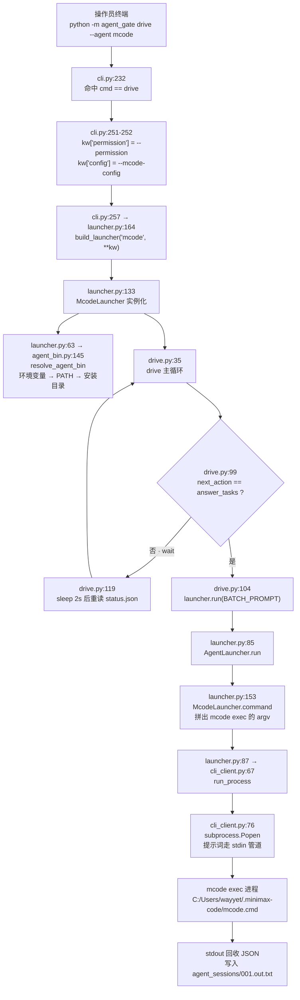
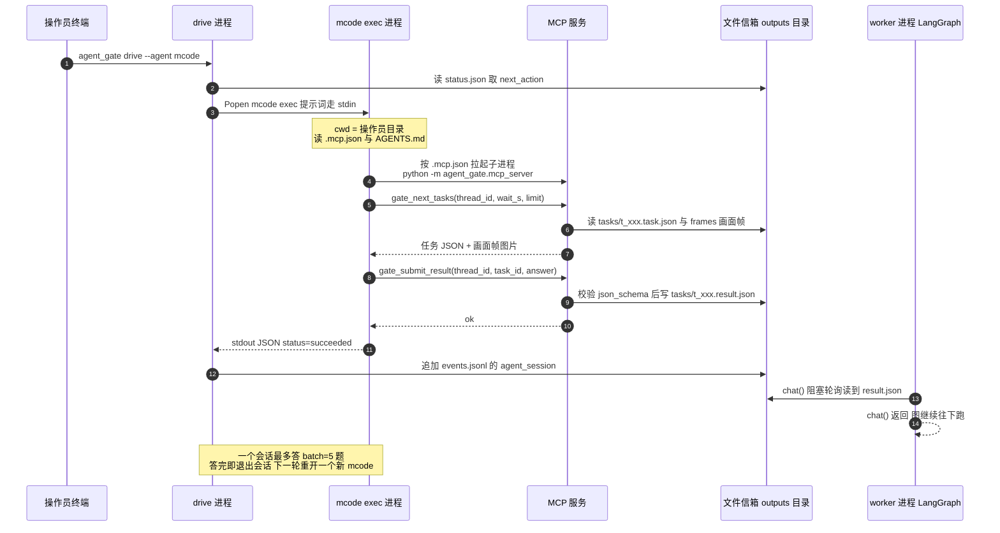
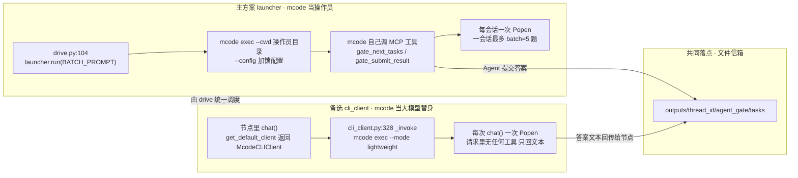
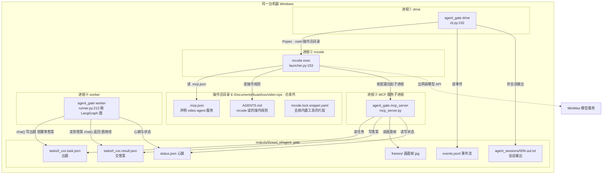

# mcode Agent 启动与调用全链路（含计划分析）

> 仓库：`E:\Documents\kuaishou\auto-video-editor`
> 交付包：`D:\Agent驱动auto-video-editor_交付包`
> 核对时间：2026-10-20
> 图源文件：`docs/分析/mcode-agent-图表/*.mmd`（已用 mermaid 11.17.2 官方解析器校验通过）

---

## 0. 结论速览

1. **mcode 在一个地方启动**：`agent_gate/cli_client.py:76` 的 `subprocess.Popen`。
   在它之上有 **2 条互斥的调用路径**，都汇到这一行：

   | 路径 | 用途 | 入口 | 谁调用 mcode |
   | --- | --- | --- | --- |
   | **主方案 launcher** | mcode 当**操作员**，自己调 MCP 工具领任务、交答案 | `cli.py:232` → `drive.py:104` | `agent_gate drive` 进程 |
   | **备选 cli_client** | mcode 当**大模型替身**，每次 `chat()` 拉一次只回文本 | `factory.py:34` → `cli_client.py:328` | worker 进程内的节点代码 |

2. **主方案是本仓库实际验收过的那条**（实测 `v006`：出题 12、收答案 12、mcode 会话 4 次、最终 `completed`）。
   备选路径代码在仓库里、测试也覆盖，但**没有跑过真实主图**。

3. **计划已全部落地**（P0–P9 全部通过），`docs/integration/Agent驱动auto-video-editor_设计与执行计划.md` 是主文档。
   但它 **104 KB / 72 个代码块里 0 个 mermaid**，架构图全是 ASCII 文本围栏；
   交付包 `1_文档/图预览/` 的 4 张 PNG 复制到 `docs/分析/图预览/` 后 **没有被任何文档引用**。
   本文补的就是这块断层。

4. **计划本身有一处内在矛盾**：§1 Non-goals 写「不修项目既有缺陷」，但 P8 实跑被项目自身的 D7/D9/D10 打挂。
   实际执行选择修是对的，**但计划里应该有一条「P8 被项目缺陷阻塞时的逃生条款」**，否则执行者会卡在「守 Non-goals」和「P8 必须过」之间。

---

## 1. 计划分析

### 1.1 计划要做什么

把交付包里的 `agent_gate` 参考实现落地进本仓库，让 **MiniMax Code / Claude Code 直接启动并驱动本项目跑完整视频工作流**，
替代项目内部原先的 LLM API 接入方案（默认 `StubLLMClient` 返回假数据）。

落地后，仓库里 **11 处** `chat()` 调用在 `--backend gate` 下由 Agent 程序作答
（**行号为 2026-10-20 现行代码实测**，与计划 §3.1 的清单已有偏移，见 §1.8）：

| # | 文件 | 行 | 形式 |
| --- | --- | --- | --- |
| 1 | `assembly_capabilities/build_timeline.py` | 268 | `chat_json` |
| 2 | `storyline_capabilities/understand_clips.py` | 171 | `effective.chat`（逐镜头描述）← **原硬编码 Stub，已改** |
| 3 | `storyline_capabilities/understand_clips.py` | 221 | `chat_text`（总体总结） |
| 4 | `storyline_capabilities/generate_script.py` | 58 | `chat_json` |
| 5 | `storyline_capabilities/generate_voiceover.py` | 99 | `chat_json` |
| 6 | `storyline_capabilities/recommend_text.py` | 90 | `chat_json` |
| 7 | `storyline_capabilities/recommend_transition.py` | 62 | `chat_json` |
| 8 | `storyline_capabilities/filter_clips.py` | 102 | `chat_json` |
| 9 | `storyline_capabilities/group_clips.py` | 103 | `chat_json` |
| 10 | `storyline_capabilities/bgm_selector.py` | 225 | `chat_json`（`select_bgm.py:110` 也走这里） |
| 11 | `storyline_capabilities/speech_rough_cut.py` | 76 | `chat_json` |

> 接入补丁改了 2 个文件：
> - `understand_clips.py:109` — `effective = client or get_default_client()`；`:171` 用 `effective.chat(...)`；
>   `:210` 触发条件改为 `if desc_lines and (client is not None or not isinstance(effective, StubLLMClient)):`
> - `select_bgm.py:106` — `llm_client = get_default_client()`，`:107-108` 仅当它是 `StubLLMClient` 时才回退到
>   `StubLLMClient(default_caption='{"bgm_id": ""}')`
>
> 两处都**保持默认 Stub 行为不变** —— 这是既有单测不回归的前提。

### 1.2 计划的优点（值得保留的做法）

| 做法 | 为什么好 |
| --- | --- |
| **9 阶段硬串行，每阶段有退出门槛 + 回退命令** | 可中断、可续跑；出问题能精确定位到阶段，不用从头来 |
| **P5 设成「分水岭」**：先 `--backend stub` 证明主图能跑到人工关卡，再接 Agent | 避免把「主图本身跑不通」误判成「agent_gate 适配失败」。诊断顺序还明确写了「不要一上来就把错误归因到适配层」 |
| **安全问题一次性修 + 补负向测试**，不留「先原样落地再修」 | 避免了「接入故障」和「安全修复」互相污染、无法归因 |
| **文件信箱而不是在 `chat()` 里 `interrupt()`** | 仓库 11 处 `chat()` 外面**全都**包了 `except Exception`，而 `GraphInterrupt` 继承 `Exception` → 会被吞掉，图不会暂停。阻塞等待不抛异常，绕开这个坑 |
| **Non-goals 显式列出**（不改拓扑、不做 Postgres、不装 Claude Code） | 防止范围膨胀 |
| **skip 必须记为 skip，不能算 pass** | 防止把「claude 没装所以用例被跳过」当成回归通过 |
| **`task_id` 由请求内容哈希而来** | 崩溃重启后 `read_result` 命中即复用 → 天然幂等，不会重复问 Agent |

### 1.3 实际执行情况：P0–P9 全部通过

仓库当前状态（已核对）：

| 项 | 状态 |
| --- | --- |
| `agent_gate/` 包 | ✅ 已落地，且**已超出交付包 kit**（含 P3 安全修复 + 新增 `agent_bin.py`） |
| `agent_gate/safety.py` | ✅ 存在（计划 §6 F1 要求） |
| 4 个新安全测试 | ✅ `test_path_safety.py` / `test_lifecycle.py` / `test_schema_failclosed.py` / `test_input_guard.py` 全在 |
| 接入补丁 | ✅ `understand_clips.py:109` 有 `effective = client or get_default_client()`；`select_bgm.py:106` 有 `llm_client = get_default_client()` |
| `requirements.txt` | ✅ `mcp==1.26.0` / `jsonschema==4.26.0`，失效注释已修正 |
| 操作员目录 | ✅ `E:\Documents\kuaishou\video-ops`（`.mcp.json` / `AGENTS.md` / `CLAUDE.md` / `.claude/` / `mcode.lock.snippet.yaml`） |
| 加锁配置 | ✅ `%USERPROFILE%\.minimax\config.locked.yaml`（在仓库外） |
| 主文档 | ✅ `docs/integration/Agent驱动auto-video-editor_设计与执行计划.md`（104 KB） |

实测运行 `v006` 的 `events.jsonl` 事件统计（**本次一手核对**）：

| 事件 | 次数 | 含义 |
| --- | --- | --- |
| `task_created` | 12 | 出题 12 次 |
| `task_answered` | 12 | **Agent 作答 12 次，全部被收** |
| `agent_session` | 4 | mcode 起了 4 个会话 |
| `worker_started` | 4 | 首次启动 + 3 次人工 resume 后重启 |
| `waiting_human` | 3 | 依次到达人工关卡 ① → ③ → ② |
| `completed` | 1 | 图跑完 |
| `drive_finished` | 1 | `outcome=ask_human` → **drive 退出码 10** |
| `worker_failed` | 0 | ✅ 无 |

`status.json`：`state=completed`、`error=null`。

### 1.4 计划执行中的偏差（计划里没写、但实际做了）

| # | 偏差 | 原因 | 评价 |
| --- | --- | --- | --- |
| 1 | **新增 `agent_gate/agent_bin.py`**（计划里完全没这个模块） | Windows 的 `CreateProcess` **不做 PATHEXT 补全**，裸名 `mcode` 必 `WinError 2`，即使 `mcode.CMD` 就在 PATH 里。首次 P8 跑 `v005` 直接退出码 4（stalled） | ✅ **正确的补洞**。改成「环境变量 → PATH → 约定俗成的安装目录」三级查找，`PATH` 里没有也能找到 `~/.minimax-code/mcode.cmd` |
| 2 | **修了项目自身缺陷 D5 / D6 / D7 / D9 / D10** | 计划 §1 Non-goals 明写「不修项目既有缺陷」，但 P8 实跑被 D7（`Path(state["draft_path"])` 没有 None 防御）打挂 | ⚠️ **与 Non-goals 冲突**。见 §1.5 |
| 3 | MCP `run_start` 删掉 `initial_state_file` 参数 | 计划 §6 F2 已规定，属于按计划执行 | ✅ |
| 4 | `config.locked.yaml` 里 `permissionMode` / `dataContribution` 人工收紧 | `mcode-lock` 脚本**不会**自动做，计划 §P4 清单里已列为「人工收紧」 | ⚠️ 见 §1.6 建议 |

### 1.5 计划的一处内在矛盾（建议下次补条款）

**冲突点**：

- §1 Non-goals 第 2 条：「**不修**项目既有缺陷（审查版 §4.2），只记录、不混入本次接入」
- §7 P8 退出门槛：「`drive` 退出码 10 → 人工 resume → 退出码 0」

**实际**：D9 造成 `draft_path=None` → D7 抛 `TypeError` → worker 失败 → **P8 一定过不了**。
在「守 Non-goals」和「P8 必须过」之间，执行者只有一条路：**修**。实际执行选了修，是对的。

**建议**：在 Non-goals 里补一条逃生条款 ——

> 「若 P8 实跑被项目自身缺陷阻塞（worker `failed`，且栈帧全在仓库业务代码里），
> 允许**就地修复并单独 commit**，但必须：① 栈帧证据留档；② 单独成 commit 便于回退；
> ③ 在验收报告里写明「这是项目缺陷修复，不是接入层修复」。」

这样执行者既不违反 Non-goals，也不会卡住。

### 1.6 计划里其他可改进点

1. **`mcode-lock` 应该自动收紧 `permissionMode` / `dataContribution`。**
   现在脚本只追加「去掉内置工具」片段，这两项要人工改（计划 §P4 清单里已标注「脚本不会自动做」）。
   既然是「加锁」，锁的语义就应该由脚本保证，人工只做复核。

2. **`图预览` 与文档断链。** 交付包 `1_文档/图预览/` 的 4 张 PNG 与主文档里的 ASCII 架构图**内容重复但没打通**：
   PNG 没被任何 md 引用，主文档也没用 mermaid。本文用 mermaid 补上这一层（mermaid 源码在 md 里可直接渲染，PNG 反而是派生物）。

3. **Linux 结论不可复用。** 计划 §10.3 明确「交付包在 Linux 沙箱跑过 89 测试；本机是 Windows，不复用该结论」——
   这条写得很对，实际执行也确实重新测了。

### 1.7 仍未闭环的（诚实清单）

| 项 | 状态 |
| --- | --- |
| **A1-8 剪映客户端人工过目** | ⚠️ 只验了一半。本机**没装剪映**，草稿 JSON 结构完整、双写一致，但「能在剪映里打开」需在装了剪映 5.9.0 的机器上补做 |
| **字幕文字内容** | ⚠️ 是 Mock。本机未配云端 ASR（`ASR_NOT_CONFIGURED`），`node_08` 用 `Mock 字幕 N` 兜底。**轨道排布**真实，**文字**需接真实 ASR |
| **Claude Code** | ❌ 本机未装、未验。`@needs_claude` 用例是 **skip**，不是 pass |
| **Postgres 生产路径** | ❌ 未实现、未验证。worker 命中 `WORKFLOW_ENV=production` 会**显式拒绝启动**（退出码 3），不静默降级 |
| **F5 镜头描述任务无 schema** | ⚠️ 刻意不改。gate 里是文本任务，只校验非空。验收时需人工核对该字段实际产出 |
| **真实模型答案质量** | ❌ 无法自动化，需人工判断 |

---

## 1.8 计划里一处已失效的清单（对照时的坑）

计划 §3.1「11 处 LLM 调用点」列了 12 行路径。核对现行代码后发现两处问题：

1. **行号全部漂移了。** 计划写于节点调序重构之前，现在的实际行号见 §1.1 的表。
   按计划里的旧行号去 `grep` 会找不到 —— **对照时以现行代码为准**。

2. **`select_bgm.py` 不构成独立调用点。** 计划把它单列成一条，但它的
   `rank_candidates_with_llm(...)`（`select_bgm.py:110`）实际落在 `bgm_selector.py:225` 的 `chat_json` 里 ——
   两条指的是**同一处**。所以 12 行 → 实际 **11 处**，与计划标题里的数字吻合。
   改 `select_bgm.py` 的意义在于**把 client 传下去**（`select_bgm.py:106`），
   而不是新增一个 `.chat()`。

> 这也说明计划的**数字**（11 处）是对的，**明细**（行号与拆分方式）需要按现状更新。

---

## 2. mcode 在什么地方启动

### 2.1 总览：只有一个真正的进程创建点

```
agent_gate/cli.py:232      drive 子命令
        ↓
agent_gate/cli.py:257      build_launcher("mcode", **kw)
        ↓
agent_gate/launcher.py:164 build_launcher → McodeLauncher
        ↓
agent_gate/drive.py:104    launcher.run(BATCH_PROMPT)      ← 主方案
        ↓
agent_gate/launcher.py:85  AgentLauncher.run
        ↓
agent_gate/launcher.py:87  run_process(self.command(), ...)
        ↓
agent_gate/cli_client.py:67  run_process
        ↓
agent_gate/cli_client.py:76  subprocess.Popen  ← ★ mcode 进程在这里诞生
```

`subprocess.Popen` 之后就是操作系统的事了。**agent_gate 自己不持有 mcode 的逻辑**，它只管：
起进程 → 喂提示词 → 收 stdout → 记事件 → 判断有没有进展。

### 2.2 启动参数是怎么拼出来的

`agent_gate/launcher.py:153` `McodeLauncher.command()`：

```python
cmd = [self.executable, "exec", "--input", "-", "--output-format", "json",
       "--permission", self.permission, "--max-steps", str(self.max_steps),
       "--timeout", f"{max(1, int(self.session_timeout_s))}s", "--cwd", self.project_dir]
if self.config:
    cmd += ["--config", self.config]
if self.model:
    cmd += ["--model", self.model]
```

默认参数下实际执行的是：

```
mcode exec
  --input -
  --output-format json
  --permission smart
  --max-steps 120
  --timeout 900s
  --cwd E:/Documents/kuaishou/video-ops
  --config C:/Users/wayyet/.minimax/config.locked.yaml
```

| 参数 | 值 | 作用 |
| --- | --- | --- |
| `exec` | — | 非交互模式，跑一个 prompt 就退出，不进 TUI |
| `--input -` | — | **提示词走 stdin**。因为 Windows 命令行有长度上限，而且 `claude --allowedTools` 这类可变参数后面的提示词会被当成工具名 |
| `--output-format json` | — | stdout 最后一行是 JSON，`summarize_output()` 从里面取 `status` / `durationMs` / `error` |
| `--permission smart` | 默认 | mcode 的权限策略。**注意**：`smart`/`full`/`off` 三种对 MCP、bash、write **实测都放行** → 这是软护栏，硬隔离要靠 `--config` |
| `--max-steps 120` | 默认 | 单会话最多 120 步 assistant 调用 |
| `--timeout 900s` | 默认 | 单会话超时，由 `--session-timeout-s` 控制 |
| `--cwd <操作员目录>` | `$OPS` | **mcode 从这里读 `.mcp.json` 和 `AGENTS.md`** |
| `--config <加锁配置>` | `config.locked.yaml` | **硬隔离**。`--config` 会**整个替换** mcode 默认配置，所以加锁配置必须自带 provider 和模型 |

### 2.3 可执行文件路径怎么找到的

`agent_gate/launcher.py:63` → `agent_gate/agent_bin.py:145` `resolve_agent_bin()`：

```
环境变量  →  PATH  →  约定俗成的安装目录
AGENT_GATE_MCODE_BIN    shutil.which()    ~/.minimax-code/mcode.cmd
```

**为什么要三级**：Windows 的 `CreateProcess` **不做 PATHEXT 补全**。裸名 `mcode` 一定 `WinError 2`，
即使 `mcode.CMD` 就在 PATH 里也一样。本机 mcode 装在 `C:\Users\wayyet\.minimax-code\`，该目录**默认不在 PATH**。

> 实测踩坑：2026-10-20 首次 P8 跑 `v005`，`drive` 退出码 4（stalled），
> 会话日志里是 `找不到可执行文件 'mcode':[WinError 2]`。
> 临时解法是加 PATH 或设 `AGENT_GATE_MCODE_BIN`；`agent_bin.py` 是根治。

### 2.4 提示词怎么送进去

`agent_gate/cli_client.py:81`：

```python
out, err = p.communicate(stdin_text.encode("utf-8"), timeout=timeout_s)
```

提示词是 `drive.py:24` 的 `BATCH_PROMPT` 模板，渲染后形如：

```
你是 video-agent 流水线的「大模型」。thread_id=v006。
只做一件事:答题。步骤:
1. 调 gate_next_tasks(thread_id="v006", wait_s=5, limit=5) 取待办任务。
2. 对返回的每个任务:读它的 prompt 和图片,按要求产出答案,调 gate_submit_result 提交。
3. 本会话累计答完 5 个任务,或者取不到任务,就立刻结束。
   返回里 deferred_tasks 大于 0 表示还有任务因为图片太多没给你:累计不到 5 个时,再取一次。
不要等人工关卡,不要调用任何 resume,不要启动新运行。
```

### 2.5 超时与超时后怎么办

`agent_gate/cli_client.py:82`：

```python
except subprocess.TimeoutExpired as e:
    _kill_tree(p)      # cli_client.py:52
    p.communicate()
    raise CLIBackendTimeout(...)
```

`_kill_tree()` 在 Windows 上用 `taskkill /F /T /PID`（**杀整棵进程树**，因为 mcode 自己会拉起 MCP 服务子进程），
其他系统用 `os.killpg` 杀进程组。

超时不会让 `drive` 崩掉：`launcher.py:89-92` 捕获后返回一个 `timed_out=True` 的 `LaunchResult`，
`drive.py:110` 判断「本会话 `answered_tasks` 没增加」→ 连续 2 次没进展 → 退出码 4（stalled）。

---

## 3. mcode 被谁调用

### 3.1 路径 A（主方案）：`agent_gate drive` 进程调用

**调用者**：`agent_gate drive` 这个**前台 Python 进程**（不是 worker）。

```
cli.py:232   cmd == "drive"
cli.py:251   kw["permission"] = args.permission
cli.py:252   kw["config"] = args.mcode_config
cli.py:253   if not args.mcode_config: warnings.append(...)   ← 没给加锁配置会告警
cli.py:257   build_launcher(args.agent, **kw)
cli.py:256   res = drive(thread_id=..., launcher=..., ...)
```

**`drive()` 主循环**（`drive.py:35`）每次读 `status.json` 的 `next_action` 决定动作：

| `next_action` | `drive.py` 行为 |
| --- | --- |
| `answer_tasks` | **`drive.py:104` 拉起一个 mcode 会话** ← 唯一调 mcode 的地方 |
| `wait` | `drive.py:119` sleep 2 秒后重读 |
| `start_run` | 起 worker（`mode="start"`），**不起 mcode** |
| `restart_worker` | 起 worker（`mode="continue_after_crash"`），**不起 mcode** |
| `ask_human` | 退出码 **10**，等人 |
| `done` | 退出码 0 |
| `report_failure` | 退出码 1 |

**为什么要一会话一进程**（`drive.py:1-9` 的注释）：
每个会话的上下文会越攒越大（每个视频任务带 ~6 张图），会话也会因 `--max-steps` / 超时 / 额度而结束。
任务协议是无状态的（`task_id` 由请求内容哈希而来），所以「结束了就再拉起一个」天然安全。

### 3.2 路径 B（备选）：worker 进程内的节点代码调用

**调用者**：跑 LangGraph 的 **worker 进程**里的业务节点。

```
runner.py:212   run_worker()
runner.py:151   client = build_client(backend, mb)      ← factory.py:18
factory.py:34   if b == "mcode-cli": return McodeCLIClient()
runner.py:186   install_client(client) → set_default_client(client)
                ↓
业务节点里：understand_clips() / generate_script() / ...
  → get_default_client() 拿到 McodeCLIClient
  → chat(...)             → cli_client.py:328 _invoke
                           → cli_client.py:307 build_command
                           → cli_client.py:189 _run
                           → cli_client.py:67  run_process
                           → cli_client.py:76  subprocess.Popen
```

这条路 mcode 拼的命令不一样（`cli_client.py:304`）：

```
mcode exec --input - --output-format json --permission smart --max-steps 8
         --timeout 600s --cwd <临时目录> --mode lightweight
         [--system-prompt-file <文件>] [--output-schema <文件>] [--file <每张图>]
```

关键差别：

- `--mode lightweight` → **请求里不带任何工具**，这是硬隔离（claude 那边靠 `--tools ""`）
- 代价：lightweight 会**忽略** `--system-prompt-file`，所以适配器把系统提示词并进用户提示（`cli_client.py:297`）
- **每次 `chat()` 一次 Popen** → 慢、贵、有启动开销
- `temperature` / `top_p` / `max_tokens` **传不进 CLI，会被忽略**

> 现状：路径 B 代码在仓库里、kit 测试覆盖，但**没有跑过真实主图**。

### 3.3 谁**不**调用 mcode

| 角色 | 起 mcode 吗 | 说明 |
| --- | --- | --- |
| `agent_gate worker`（跑 LangGraph 图） | ❌ | worker 只跑图 + 收发任务文件。`runner.py:426` 的 `subprocess.Popen` 起的是**它自己**（`python -m agent_gate worker`），不是 mcode |
| `agent_gate.mcp_server`（MCP 服务） | ❌ | 只是工具服务，被 mcode 调用 |
| 真人在终端 `agent_gate resume` | ❌ | 放行人工关卡。`cli.py:258` 强制要求交互终端，非 TTY 直接返回 `need_human_terminal` |

**一个容易搞混的点**：`resume` 也会起一个 worker 进程，但**不会**起 mcode。
人工放行之后，是 `drive` 重新拉起 mcode 会话继续答题。

---

## 4. mcode 起来之后做了什么

```
mcode exec --cwd E:/Documents/kuaishou/video-ops
   │
   ├─ 读 <OPS>/.mcp.json     → 知道要拉起 MCP 服务 video-agent
   │    命令: <repo>/.venv/Scripts/python.exe -m agent_gate.mcp_server
   │          --outputs-root <repo>/outputs --graph-factory graph:build_graph
   │    env: PYTHONPATH / AGENT_GATE_REPO_ROOT / STORYLINE_MODE=auto
   │         / AGENT_GATE_MEDIA_ROOTS / PATH
   │
   ├─ 读 <OPS>/AGENTS.md      → 操作规则（工具说明、next_action 含义、答题规则、禁止项）
   │
   ├─ 调 gate_next_tasks(thread_id, wait_s, limit)
   │    → 拿任务 JSON + 画面帧图片（jpg，走 MCP Image 内容块）
   │
   ├─ 读 prompt + 看图片 → 生成答案
   │
   └─ 调 gate_submit_result(thread_id, task_id, answer)
        → 服务端用 Draft7Validator 校验 json_schema
        → 通过则写 tasks/t_xxx.result.json
```

**mcode 的角色是「操作员」，不是「大模型」**——它自己领任务、自己看图、自己交答案。
仓库里 11 处 `chat()` 调用只是**把请求变成任务文件**，然后阻塞等答案。

### 4.1 实测输出长什么样

`outputs/v006/agent_gate/agent_sessions/001.out.txt`（真实文件，已核对）：

```json
{
  "schemaVersion": 1, "type": "exec.result",
  "status": "succeeded",
  "output": "thread v006 的 5 个任务已全部答完,按规则结束。\n\n| 任务 | 节点 | 画面内容 | 美学分 |\n|---|---|---|---|\n| t_ea226f5219d00816 | storyline_understand_clips | 彩条测试卡+跳变数字 | 0.62 |\n...",
  "model": {"providerId": "minimax", "modelId": "MiniMax-M3.1-Flash-Preview",
            "variant": "thinking", "providerKind": "minimax-api-key"},
  "durationMs": 32765
}
```

注意 `modelId` 是 `MiniMax-M3.1-Flash-Preview`——加锁配置里写的是 `defaultModel: minimax/MiniMax-M3.1-Flash`，
实际跑起来用的是 Preview 变体。**这一点计划里没有记录，属于加锁配置与实际用模型的偏差，值得留意。**

---

## 5. 图

> 4 张图的 mermaid 源码：`docs/分析/mcode-agent-图表/*.mmd`
> 渲染好的 PNG：`docs/分析/mcode-agent-图表/png/*.png`
> 语法已用 mermaid 11.17.2 官方解析器校验通过（8 张，0 失败：4 个 .mmd + 文档内 4 个代码块）。

### 5.1 图1：mcode 启动点——代码调用链



### 5.2 图2：运行期时序——一次 drive 会话



### 5.3 图3：mcode 的两种用法



### 5.4 图4：进程与文件拓扑



> 交付包的 `1_文档/图预览/` 已有 4 张同主题 PNG（组件图 / 时序图 / 决策循环 / drive 无人值守），
> 已复制到 `docs/分析/图预览/`。本文的 4 张图是**同一套视角的 mermaid 源码版**，
> 额外补了交付包没画的两点：**① 精确到 file:line 的启动点；② 备选路径 cli_client 的位置。**

---

## 6. 实操命令

### 6.1 跑一次无人值守（主方案）

```powershell
$REPO = "E:\Documents\kuaishou\auto-video-editor"
$OPS  = "E:\Documents\kuaishou\video-ops"
$PY   = "$REPO\.venv\Scripts\python.exe"
$VIDEO = "$REPO\tests\fixtures\30s.mp4"

# mcode 不在 PATH 也能跑（agent_bin.py 会去 ~/.minimax-code 找），显式指定更省事
$env:AGENT_GATE_MCODE_BIN = "C:\Users\wayyet\.minimax-code\mcode.cmd"

# ⚠️ 下面两个必须设在 **drive 进程自己的环境**里，不能只写在 .mcp.json 里。
#    .mcp.json 的 env 只作用于 MCP server 子进程；worker 是 drive 用
#    `env = dict(os.environ)` 派生的（runner.py:415），拿不到 .mcp.json 的值。
#
#    1) AGENT_GATE_MEDIA_ROOTS —— 素材白名单。缺了 drive 在写 initial_state.json 时
#       就被 safety.safe_media_path() 拒掉，直接退出码 1 + code=media_roots_unset。
#    2) STORYLINE_MODE=auto   —— config.py 在**模块导入时**读它（config.py:268）。
#       缺了走 human 模式，图的第一个节点就是关卡⓪（纯人工关卡），
#       一个 LLM 任务都不产生 → **mcode 一次都不会被拉起**（sessions=0）。

$env:AGENT_GATE_MEDIA_ROOTS = "$REPO\inputs;$REPO\tests\fixtures"
$env:STORYLINE_MODE = "auto"

& $PY -m agent_gate drive --thread-id v006 --agent mcode `
   --project-dir $OPS --mcode-config "$env:USERPROFILE\.minimax\config.locked.yaml" `
   --outputs-root "$REPO\outputs" --graph-factory graph:build_graph --video $VIDEO
$LASTEXITCODE
```

> 线程号必须用**新的**：`spawn_worker(mode="start")` 要求 `status.json` 与 checkpoint 都不存在，
> 同一个 thread-id 再跑一次会被拒（`already_used`）。

**2026-10-20 实跑记录（thread `v011`）**：3 个 mcode 会话全部 `returncode=0 / succeeded`
（71.7s / 71.4s / 141.6s），11 个任务全部答完、`degraded_tasks=0`，
退出码 10 停在关卡①，且关卡 payload 里的 `draft_path` **不是 None**
（`outputs\v011\drafts\draft_content.json` 真实存在）——
即 P8 报告里那个「`Path(None)` 崩溃」的阻断点在本次已经不复现。

**退出码含义**（`drive.py:21-22`）：

| 码 | 含义 |
| --- | --- |
| 0 | 完成 |
| 1 | 流水线失败 |
| 2 | 缺少输入（没给 `--video` 也没给 `--initial-state-file`） |
| 3 | 超出预算（会话数或总时长） |
| 4 | Agent 没进展（连续 2 个会话没提交任何答案） |
| 5 | worker 崩溃且不能自动恢复 |
| **10** | **停在人工关卡，等真人** ← 正常，不是失败 |

### 6.2 人工关卡放行

```powershell
& $PY -m agent_gate status --thread-id v006 --outputs-root "$REPO\outputs"

& $PY -m agent_gate resume --thread-id v006 --outputs-root "$REPO\outputs" `
   --graph-factory graph:build_graph --checkpoint "①" --value true
```

- 终端打不出 `①` 时用码点：`--checkpoint ([string][char]0x2460)`
- `resume` 在非交互终端会返回 `need_human_terminal` —— **这是设计的安全边界，不要用 `--force-no-tty` 绕过**
- 放行后重跑 6.1 的 `drive` 继续

### 6.3 查发生了什么

```powershell
& $PY -m agent_gate status --thread-id v006 --outputs-root "$REPO\outputs"
& $PY -m agent_gate events --thread-id v006 --outputs-root "$REPO\outputs" --limit 50
Get-Content "$REPO\outputs\v006\agent_gate\worker.log" -Tail 40
Get-Content "$REPO\outputs\v006\agent_gate\agent_sessions\001.out.txt"
```

### 6.4 生成 / 刷新加锁配置

```powershell
& $PY -m agent_gate mcode-lock `
  --base "$env:USERPROFILE\.minimax\config.yaml" `
  --out "$env:USERPROFILE\.minimax\config.locked.yaml"
```

> 输出文件含和 `--base` 一样的明文 API key，**绝不入库**。
> 脚本只追加「去掉内置工具」片段；`permissionMode` 与 `dataContribution` 要**人工收紧**
> （当前值：`permissionMode: auto`、`dataContribution.enabled: false`）。

---

## 7. 排查手册

| 症状 | 根因 | 处理 |
| --- | --- | --- |
| `找不到可执行文件 'mcode':[WinError 2]` | Windows `CreateProcess` 不做 PATHEXT 补全；本机 mcode 不在 PATH | 已根治（`agent_bin.py`）。临时：设 `AGENT_GATE_MCODE_BIN` 指向 `mcode.cmd` |
| `drive` 退出码 4（stalled） | 连续 2 个会话 `answered_tasks` 没增加 | 看 `agent_sessions/00N.err.txt`；常见是 mcode 起不来或 MCP 工具没加载 |
| mcode 起来了但没有工具 | `.mcp.json` 路径不对 / `PYTHONPATH` 缺仓库根 | 核对 `<OPS>/.mcp.json` 的 `command`、`env.PYTHONPATH`、`env.AGENT_GATE_REPO_ROOT` |
| worker 静默走 human 模式 | `config.py` **导入时**读 `STORYLINE_MODE` | `.mcp.json` 的 `env.STORYLINE_MODE=auto` 必须写；`--cwd` 决定从哪读 `.mcp.json` |
| `mcp` 服务起不来 | 依赖没装 | `pip install mcp==1.26.0 jsonschema==4.26.0` |
| `timeout` 杀不干净 | mcode 派生了 MCP 服务子进程 | 已处理：`_kill_tree` 用 `taskkill /F /T` 杀整棵树 |
| `pytest` 批量失败但代码没改 | `STORYLINE_MODE` 被设成 `auto`，换了另一张图 | 跑测试用默认 `human`，跑 drive 才设 `auto` |

---

## 8. 附：关键文件速查

| 文件 | 职责 | 与 mcode 的关系 |
| --- | --- | --- |
| `agent_gate/cli.py` | CLI 入口（9 个子命令） | `:232` drive、`:212` mcode-lock、`:257` 建 launcher |
| `agent_gate/launcher.py` | 把 Agent 程序拉起来的封装 | `:133` McodeLauncher、`:153` 拼 argv、`:85` 跑一次 |
| `agent_gate/cli_client.py` | **唯一真正 `Popen` 的地方** + 备选 CLI 后端 | `:67` run_process、`:76` Popen、`:283` McodeCLIClient |
| `agent_gate/agent_bin.py` | 外部可执行文件解析（Windows 坑） | `:145` resolve_agent_bin |
| `agent_gate/drive.py` | 无人值守主循环 | `:104` 拉起 mcode 会话 |
| `agent_gate/mcp_server.py` | MCP 服务（stdio），6~7 个工具 | 被 mcode 调用 |
| `agent_gate/gate_client.py` | `GateLLMClient`：把 chat() 变成任务文件 + 阻塞等答案 | worker 侧，**不**起 mcode |
| `agent_gate/runner.py` | worker 进程 + 起 worker 的父进程逻辑 | `:212` run_worker、`:360` spawn_worker、`:426` Popen（起的是 worker 自己） |
| `agent_gate/factory.py` | 后端选择 | `:24` gate、`:34` mcode-cli |
| `agent_gate/scaffold.py` | 生成操作员目录 + 加锁配置 | 产出 `.mcp.json` / `AGENTS.md` |
| `agent_gate/safety.py` | 路径与标识符白名单（唯一校验入口） | 保护文件信箱不被穿越 |
| `docs/分析/mcode-agent-图表/*.mmd` | 本文的 4 张图源码 | 已通过 mermaid 11.17.2 校验 |
