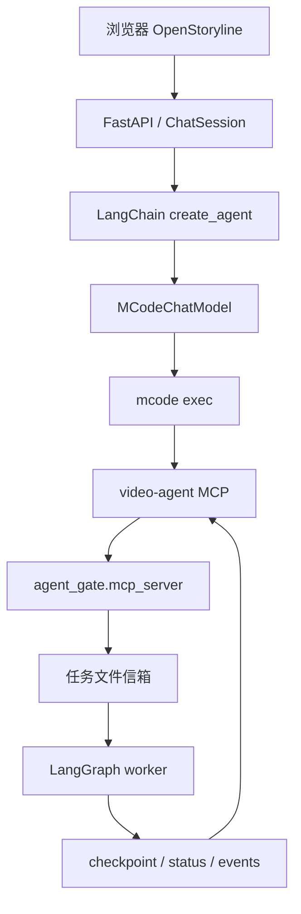

# 网页端驱动 mcode：接入 OpenStoryline 与 agent_gate 的消费型 MCP 链路（执行计划修订版）

- **目标仓库**：[`wayyet/auto-video-editor`](https://github.com/wayyet/auto-video-editor)，`main` 分支
- **修订日期**：2026-10-21
- **修订依据**：[`auto-video-editor_mcode_执行计划验证报告.md`](https://github.com/wayyet/auto-video-editor/blob/main/docs/%E5%88%86%E6%9E%90/auto-video-editor_mcode_%E6%89%A7%E8%A1%8C%E8%AE%A1%E5%88%92%E9%AA%8C%E8%AF%81%E6%8A%A5%E5%91%8A.md)
- **文档状态**：执行计划；不是实现报告，不表示代码已经修改或测试已经通过
- **本次处理范围**：吸收验证报告中除用户明确排除的 4 项 P0 以外的修订意见

> 本文只修订执行计划，不实现代码、不修改仓库文件、不执行 Git 操作。仓库外的 `video-ops/.mcp.json`、`video-ops/AGENTS.md` 和本机 mcode 配置均不由本计划直接修改。

## 0. 本次明确排除的事项

按照本次需求，以下 4 项不纳入本轮整改任务，也不作为本轮验收门槛：

1. P0：模型选择没有真正接通 `ChatSession.ensure_agent()`。
2. P0：聊天会话 ID 与工作流 ID 未分离。
3. P0：多个 Agent 可能重复消费同一任务，缺少原子认领机制。
4. P0：mcode 未通过 `--config` 加锁配置实现硬权限隔离。

本次不会围绕上述事项新增实现步骤或验收断言。原计划中相关假设暂时保留；因此，本修订版**不代表完整功能已经具备端到端可用性，也不代表安全隔离或并发消费问题已经解决**。如后续要处理这些问题，应单独制定任务与验收标准。

## 1. 目标与范围

### 1.1 目标

- 保留原计划中的 OpenStoryline 网页端、`MCodeChatModel`、mcode CLI 和 `video-agent` MCP 集成方向。
- 依据验证报告修正其余设计缺口，避免技能工具被静默丢弃、普通模型 MCP 行为被意外改变、mcode 无法定位、取消后遗留子进程、素材路径不可靠及验收断言错误等问题。
- 将实现任务拆成可独立验证的阶段，并分别运行 OpenStoryline、`agent_gate` 和主仓测试。

### 1.2 范围内

| 项目 | 处理要求 |
|---|---|
| `MCodeChatModel` | 规定 prompt 构造、CLI 结果解析、输入长度限制、错误映射、同步与异步执行的资源清理要求 |
| mcode 可执行文件 | 复用 `agent_gate/agent_bin.py` 的解析入口和已有命令约定，不只依赖 `shutil.which()` |
| OpenStoryline skills | 不再把 LangChain skill 工具错误描述为“仅提示词”；明确 mcode 模式下的能力边界 |
| MCP 加载 | 不新增会改变普通模型失败语义的通用“连接失败就跳过”逻辑 |
| 素材准备 | 只在实际启动处理任务时准备素材副本；使用唯一文件名、原子复制、完整性校验和失败回滚 |
| 路径校验 | 由服务端生成规范化绝对路径，并校验路径位于 `AGENT_GATE_MEDIA_ROOTS` 允许的目录中 |
| 配置文件 | 主配置只放通用默认值；主机专属路径放在 `config.toml.local`，不得把密钥或机器路径写入公共配置 |
| 对话历史 | 按完整对话轮次裁切，并设置字符长度上限；保留系统提示和当前用户输入 |
| 错误、取消与日志 | 明确超时、取消、退出码、错误输出、子进程树回收和网页端状态提示 |
| 测试文档 | 纠正 `completed` 状态名；增加针对以上项目的测试和人工验收证据 |

### 1.3 明确不做

- 不修改 `agent_gate` 的任务协议或加入原子 claim/lease 机制。
- 不重构 `session_id` 与工作流标识的关系；本轮沿用原计划约定。
- 不新增 mcode 加锁配置，也不声称 `--permission smart` 能形成硬权限边界。
- 不修改 mcode 本体、不安装 Claude Code、不扩展到其他 Agent。
- 不修复 DeepSeek 占位符 API Key 导致的既有 401。
- 不直接修改仓库外 `video-ops` 文件；只列出必要的人工配置检查项。
- 不改动 `outputs/`、`checkpoints/`、`logs/`、`inputs/` 中已有数据。
- 不提交 Git，不新建分支，不改变工作区状态。

## 2. 已核对的项目事实

### 2.1 当前调用链



网页端负责接收用户指令和展示结果；mcode 是消费型 MCP 客户端；`agent_gate` 负责任务文件信箱和 worker 生命周期。网页端不应再直接挂载另一套 `video-agent` 消费工具，否则会增加任务竞争面，也需要解决网页端 LLM 的凭证问题。

### 2.2 相关实现位置

- `openstoryline/src/open_storyline/agent.py`：`build_agent()`、模型构建和 Storyline MCP 连接。
- `openstoryline/agent_fastapi.py`：网页会话、模型下拉和 `ChatSession` 生命周期。
- `openstoryline/src/open_storyline/config.py`：TOML 配置加载；支持 `config.toml.local` 覆盖主配置。
- `openstoryline/src/open_storyline/skills/skills_io.py`：加载 skills 并生成 LangChain 工具。
- `agent_gate/agent_bin.py`：`resolve_agent_bin("mcode")` / `resolve_executable()`。
- `agent_gate/launcher.py`：mcode CLI 参数构造；当前实现指出 `--permission` 不是工具硬隔离机制。
- `agent_gate/protocol.py`：任务和 worker 状态常量，包括 `waiting_human`、`completed`、`failed`、`crashed`。
- `agent_gate/mcp_server.py`、`agent_gate/runner.py`：MCP 接口、worker 启动与状态控制。

以上是静态源码核对结果，不等于已经在目标 Windows 主机运行端到端测试。

## 3. 修订后的设计约定

### 3.1 mcode 模式与现有 LangChain 工具的边界

`MCodeChatModel.bind_tools()` 返回 `self` 只解决 LangChain 调用接口兼容问题，不会把传入的 LangChain 工具变成 mcode 可用工具。因此：

- mcode 模式不应把 `load_skills()` 返回的 LangChain 工具继续传入 `create_agent()`，同时又宣称 skills 仍可用。
- mcode 分支应使用 `tools=[]`，并且不要把无法被 mcode 调用的 LangChain skills 加到工具列表中。
- 本轮不实现 skills 到 MCP 的适配器。网页端文档需说明：OpenStoryline 的 LangChain skill 工具在 mcode 模式下不可直接调用；mcode 只能使用其自身配置的工具和项目中的指令文件。
- 增加测试，确保 mcode 分支没有悄悄把不可调用的 skill 工具交给 `create_agent()`。

### 3.2 普通模型 MCP 失败语义保持不变

原计划提出将 `client.get_tools()` 改成逐 server 调用、失败就跳过。验证报告指出，这会改变非 mcode 模型的行为：原本应因必需 MCP 服务不可用而失败的场景，可能悄悄以空工具集启动。

修订后的处理方式：

- mcode 分支按既有设计不建立 OpenStoryline 的 8001 Storyline MCP 连接。
- DeepSeek / 自定义模型分支保留现有 MCP 加载流程和失败语义，不在本次加入全局 fail-open 容错。
- 若未来确需“必需/可选 MCP server”策略，应单独增加显式配置和相应测试；不得把连接异常一律降级为 warning。

### 3.3 mcode CLI 定位与启动

- 使用仓库已有的 `resolve_agent_bin("mcode")` 作为唯一定位入口；不要仅调用 `shutil.which("mcode")`。
- 必须覆盖环境变量、PATH、约定安装目录和显式错误路径场景。
- 复用 `agent_gate/launcher.py` 的 CLI 参数约定。Windows 下 `.CMD` 的启动方式必须经过真实子进程测试，不能假设裸命令名可直接交给 `CreateProcess`。
- 找不到程序时应给出明确错误；不静默回退到 DeepSeek 或其他模型。

### 3.4 素材复制时机与完整性

不能在每次上传时都无条件复制大文件。修订为：

1. 用户明确启动视频处理任务后，服务端读取已登记的素材 ID 和源文件路径。
2. 服务端生成目标目录 `inputs/<session_id>/`，目标文件名使用安全生成的唯一名称，不能直接信任用户文件名中的路径片段。
3. 复制到同目录的临时文件；复制完成后验证文件大小，建议同时计算源文件和目标文件的 SHA-256。
4. 校验成功后使用原子替换将临时文件改为最终文件名。
5. 任何一步失败，都不调用 `run_start`；清理本次生成的临时文件，并向网页端返回可理解的错误。
6. 不覆盖同名既有文件，不删除用户上传的源文件。`inputs/` 已由项目规则忽略入库，不应提交测试素材或运行时副本。

### 3.5 绝对路径由服务端生成

- mcode 不应根据提示词自行拼接相对素材路径。
- 服务端从已登记的素材记录取得源文件，再生成规范化的绝对目标路径。
- 将绝对路径传给 `run_start` 前，必须验证路径存在、是普通文件，并位于允许的媒体根目录内。
- 路径白名单检查必须处理 `..`、符号链接/路径规范化和大小写差异等边界；不能只做字符串前缀比较。
- 如果素材不在白名单内，明确拒绝启动，不通过扩大白名单来绕过校验。

### 3.6 配置的主机隔离

`config.py` 已支持三层配置：`config.toml`、同目录 `config.toml.local`、模型相关环境变量。主机专属 mcode 路径写入本机覆盖文件，不写进公共默认配置。

公共 `openstoryline/config.toml` 只保留中性默认值，例如：

```toml
[mcode]
cwd = ""
bin = ""
mode = "standard"
max_steps = 120
timeout_s = 900
history_turns = 10
max_prompt_chars = 60000
```

本机 `openstoryline/config.toml.local` 示例：

```toml
[mcode]
cwd = "E:/Documents/kuaishou/video-ops"
bin = "C:/Users/<本机用户>/.minimax-code/mcode.cmd"
```

说明：

- `<本机用户>` 只是占位文本，执行前必须替换成真实本机路径。
- 不要把 `config.toml.local`、令牌、密钥或加锁配置加入 Git。
- 应为 `MCodeConfig` 增加类型校验，并在启动时验证 `cwd` 存在、目录中包含预期的 `.mcp.json` 和 `AGENTS.md`。
- `bin` 为空时才调用 `resolve_agent_bin("mcode")`；若用户显式填写了错误路径，必须报错，不应静默继续搜索其他程序。

### 3.7 prompt 历史裁切

旧计划按“最近 `history_turns * 2` 条非系统消息”裁切，不能保证保留完整轮次。修订为：

- 系统消息去重后放在 prompt 最前。
- 历史以完整的 Human/AI 对话轮次为单位裁切；孤立消息、工具消息和多模态内容不得误当成完整对话轮次。
- 保留最近 `history_turns` 个完整轮次，并额外设置 `max_prompt_chars` 上限。
- 当前用户消息必须保留在末尾，不能因为历史裁切而丢失。
- 若仅系统提示和当前用户消息就超过上限，应返回明确的输入过长错误，不可静默截断当前用户输入。
- 多模态附件不直接序列化进 prompt；只传入服务端已验证的素材路径和素材清单。
- 为不同类型的消息、不成对历史、超长当前输入和历史长度边界编写单测。

### 3.8 状态名称与断言

`agent_gate/protocol.py` 的完成状态是 `completed`，不是 `done`。验收代码应优先从状态常量导入值，至少保证：

- 人工关卡：`waiting_human`
- 正常完成：`completed`
- 运行失败：`failed`
- 崩溃状态：`crashed`

不要在测试或文档中自行定义另一套状态字符串。

## 4. 文件变更清单

### 4.1 新增文件

```text
openstoryline/src/open_storyline/mcode_chat_model.py
openstoryline/tests/conftest.py
openstoryline/tests/test_mcode_chat_model.py
openstoryline/tests/test_agent_mcode_branch.py
```

测试应使用假 mcode 可执行文件或 monkeypatch，不需要消耗真实模型调用额度。

### 4.2 修改文件

| 文件 | 修订内容 |
|---|---|
| `openstoryline/src/open_storyline/agent.py` | 增加 mcode 分支；mcode 分支不建立 8001 MCP 连接；不把不可调用的 skills 工具加入 `create_agent()`；普通模型路径保留原来的 MCP 错误语义 |
| `openstoryline/agent_fastapi.py` | 按原计划保留网页端相关接线工作；为执行模型提供明确的会话素材上下文；素材副本改为在任务启动阶段准备，而不是每次上传时无条件复制 |
| `openstoryline/src/open_storyline/config.py` | 增加 `MCodeConfig` 和 `Settings.mcode`；验证 `cwd`、`bin`、超时、历史长度等配置 |
| `openstoryline/config.toml` | 增加不含主机私有路径的 `[mcode]` 默认段 |
| `openstoryline/README.md` | 记录配置方式、能力边界、测试命令、素材复制规则和故障排查 |
| `openstoryline/tests/` | 覆盖 CLI 解析、进程取消、prompt 裁切、素材校验和 mcode 分支能力边界 |

### 4.3 仓库外的人工检查项

目标机器需确认以下文件存在且配置符合预期，但本次不自动修改它们：

- `E:\Documents\kuaishou\video-ops\.mcp.json`
- `E:\Documents\kuaishou\video-ops\AGENTS.md`
- 用户本机的 mcode 安装位置和登录状态

不得把仓库外文件复制进仓库，也不得把认证内容写入计划文档或测试日志。

## 5. 关键组件规格

### 5.1 `MCodeChatModel`

建议字段：

```python
class MCodeChatModel(BaseChatModel):
    cwd: str
    mode: Literal["standard", "lightweight"] = "standard"
    max_steps: int = 120
    timeout_s: int = 900
    permission: str = "smart"  # 本轮沿用原计划；不代表硬权限隔离
    mcode_bin: str | None = None
    history_turns: int = 10
    max_prompt_chars: int = 60000
    extra_args: list[str] = []
```

实现要求：

1. 实现 `_llm_type`、`bind_tools()` 和必要的同步/异步生成接口。
2. `bind_tools()` 可以返回 `self`，但必须用注释说明它只满足 LangChain 接口，不会把 LangChain 工具注册到 mcode。
3. `_messages_to_prompt()` 负责完整轮次裁切、系统提示去重、长度限制和当前消息保留。
4. `_parse_exec_json()` 负责从 stdout 中解析结果 JSON，校验 `status` 和 `output` 字段。
5. 若 stdout 混入诊断文本，只允许按明确定义的策略寻找合法结果 JSON；解析失败时记录受限长度的日志，不把无限长度 stdout 直接塞进错误信息。
6. 非 `succeeded` 状态转换为 `MCodeExecError`，保留可诊断的 status 和安全截断后的错误原因。
7. 记录耗时、返回状态、输出长度和退出码；不要记录 API 凭证或完整的敏感素材内容。

### 5.2 CLI 参数构造

沿用项目现有命令参数约定，具体参数以目标机器 `mcode exec --help` 和 `agent_gate/launcher.py` 为准：

```text
mcode exec --input - --output-format json
            --permission <permission>
            --max-steps <max_steps>
            --timeout <timeout_s>s
            --cwd <video-ops>
            [--mode standard|lightweight]
            --append-system-prompt <bridge prompt>
```

- prompt 通过 stdin 输入，不放进命令行参数，避免命令行长度限制和日志泄露。
- 子进程 stdout/stderr 显式使用 UTF-8 解码策略。
- Windows `.cmd` 执行必须用测试确认有效的启动方式，不能直接把 `mcode` 裸命令名假设为可执行文件。
- 应设置 stdout/stderr 的读取策略，避免子进程输出过大导致内存无限增长。
- 不实现增量 token 流式输出时，网页端必须显示明确的执行中状态；不能让用户误以为连接卡死。

### 5.3 同步、异步与取消

不能只依赖同步 `_generate()` 的超时参数，就宣称 WebSocket 断开时子进程树一定被清理。

- 提供可被 LangChain async 路径调用的异步执行实现，优先使用 `asyncio.create_subprocess_exec()`。
- 同步接口若仍需支持，也必须复用统一的启动、超时和进程清理逻辑。
- 超时时先尝试正常终止；宽限期结束后强制终止进程树。
- Windows 使用经过集成测试验证的进程树终止方式；POSIX 使用进程组方式。不能只终止最外层 shell 而留下 mcode 子进程。
- 处理任务取消、WebSocket 断开、超时和应用关闭四种场景，并确保临时文件句柄和日志资源关闭。
- 已被 worker 接受的任务可能继续存在于信箱；取消 mcode 不应被描述成等价于取消 LangGraph worker。网页端错误提示必须区分两者。

### 5.4 服务端上下文注入

桥接 prompt 需要接收显式上下文，不应只依靠静态 `BRIDGE_SYSTEM_PROMPT` 推断动态值。

本轮采用原计划约定的 `session_id`，并明确传入：

- 当前网页会话标识；
- 当前任务关联的素材 ID 和经校验的绝对路径；
- 操作员目录；
- 用户本轮请求和经过裁切的历史对话。

本轮不重新设计聊天 ID 与工作流 ID 的映射关系。`session_id` 不能由模型根据自然语言自行猜测或修改；文件系统路径应由服务端提供。

### 5.5 `build_agent()` 的 mcode 分支

- mcode 分支跳过 LLM/VLM API Key 校验，因为此分支由本机 mcode CLI 执行。
- 使用 `MCodeChatModel` 构建相应模型对象。
- 不连接 OpenStoryline 8001 Storyline MCP 服务。
- `tools=[]`，并且不把 OpenStoryline 的 LangChain skills 工具传入 `create_agent()`。
- 非 mcode 分支保持现有行为，不因本次 mcode 接入而静默忽略 MCP 连接错误。
- 测试需确认 mcode 分支没有调用 API Key 校验、没有连接 8001、没有向 agent 注册不可调用的 LangChain skills。

> 模型选择入口的重新设计属于本次明确排除的 P0 范围。本节只规定 mcode 分支被调用后的行为，不声称网页模型选择接线已通过端到端验收。

## 6. 状态、失败与恢复

### 6.1 失败处理表

| 场景 | 预期处理 |
|---|---|
| mcode 可执行文件不存在 | 抛出明确的 `MCodeExecError`；不得静默回退到其他模型 |
| 显式 `bin` 路径无效 | 直接报告配置路径错误；不要掩盖为“未安装”或静默换用 PATH 中另一个程序 |
| `mcode exec` 超时 | 终止子进程树，写日志并向网页端返回超时错误 |
| 用户取消 / WebSocket 断开 | 尝试清理 mcode 子进程树；准确说明 worker 任务可能仍在运行 |
| stdout 不是合法 JSON | 返回可诊断的解析错误；日志只保留截断片段和退出码 |
| `status != succeeded` | 返回 `MCodeExecError`，带状态名和截断后的错误原因 |
| mcode 的 `video-agent` MCP 不可用 | 显示工具调用失败，不把它伪装成成功处理 |
| 8001 Storyline MCP 不可用且当前使用 mcode | mcode 分支不建立该连接，不应因此阻断启动 |
| 8001 Storyline MCP 不可用且使用普通模型 | 沿用原行为，不静默退化为零工具启动 |
| 素材不存在、复制失败或不在白名单 | 不启动 worker；清理本次临时文件并显示具体原因 |
| worker 状态为 `completed` | 识别为完成；不可使用 `done` 代替 |

### 6.2 日志要求

日志至少记录：

- `session_id`、执行开始和结束时间；
- CLI 退出码、JSON `status`、耗时；
- 素材 ID、目标路径校验结果，不记录素材内容；
- 超时、取消和进程树回收结果；
- MCP 工具不可用时的错误摘要。

日志不得记录访问令牌、密钥或本机加锁配置内容。原始 stdout/stderr 应限制长度并清理控制字符。

## 7. 实施顺序

### 阶段 A：配置和边界先行

1. 增加 `MCodeConfig` 和 `[mcode]` 配置段。
2. 将主机专属 `cwd` / `bin` 放进 `config.toml.local`。
3. 验证 `cwd`、`.mcp.json`、`AGENTS.md` 和 mcode CLI 是否存在。
4. 明确 mcode 分支不支持 OpenStoryline 的 LangChain skills 工具；更新文档。

**退出门槛**：配置加载单测通过；公共配置不含本机专属路径和凭证；配置缺失时返回可理解错误。

### 阶段 B：实现 `MCodeChatModel`

1. 实现 CLI 命令组装及统一可执行文件解析。
2. 实现完整轮次 prompt 裁切和 `max_prompt_chars` 检查。
3. 实现 JSON 解析、状态验证和错误映射。
4. 实现同步/异步子进程调用、超时、取消和子进程树清理。
5. 使用假 CLI 覆盖成功、坏 JSON、非成功状态、退出码非零、超时和乱码输出。

**退出门槛**：`test_mcode_chat_model.py` 全绿；取消/超时用例确认不存在孤儿 mcode 进程。

### 阶段 C：接入 `build_agent()`

1. 增加 mcode 分支并跳过 LLM/VLM API Key 校验。
2. mcode 分支不连接 8001。
3. mcode 分支不注册 LangChain skills 工具。
4. 保持普通模型 MCP 加载及异常语义不变。
5. 增加 monkeypatch 测试验证分支行为。

**退出门槛**：mcode 分支测试全绿；普通模型相关测试无新增失败；没有全局“任一 MCP 失败都跳过”的行为变化。

### 阶段 D：素材准备和路径检查

1. 在用户明确启动工作流时准备素材副本，不在上传时无条件复制。
2. 采用唯一文件名、临时文件、原子替换和完整性检查。
3. 使用服务端登记的素材路径生成绝对目标路径。
4. 校验真实路径位于允许根目录，路径逃逸时拒绝。
5. 复制失败时不调用 `run_start`，并回收本次产生的临时文件。

**退出门槛**：正常复制、同名文件、缺失源文件、复制失败、越权路径和校验失败用例全部通过。

### 阶段 E：网页端状态与文档

1. 展示“正在执行”、成功、失败、超时和取消状态。
2. 对不流式的 mcode 调用展示等待状态，不能长时间无反馈。
3. 更新 `openstoryline/README.md`：配置、本机路径、工具边界、素材策略、错误排查和测试命令。
4. 所有状态断言使用 `agent_gate/protocol.py` 中的常量或与常量一致的值。

**退出门槛**：本轮范围内的手工验收有日志、状态文件或测试输出等可观察证据；文档不声称被排除的 P0 已经解决。

## 8. 自动测试与验收标准

### 8.1 OpenStoryline 单元测试

使用 OpenStoryline 自己的虚拟环境，不使用主仓 venv 代替：

```powershell
cd E:\Documents\kuaishou\auto-video-editor
.\openstoryline\.venv\Scripts\python.exe -m pytest openstoryline\tests -q
```

建议用例：

| 用例 | 断言 |
|---|---|
| `test_prompt_keeps_system_messages_first` | 系统消息去重并位于 prompt 最前 |
| `test_prompt_keeps_last_user_message` | 当前用户消息始终完整保留在最后 |
| `test_prompt_truncates_complete_turns` | 裁切以完整 Human/AI 轮次为单位，不只按消息数量切片 |
| `test_prompt_handles_unpaired_messages` | 孤立消息和工具消息不会伪装成完整对话轮次 |
| `test_prompt_rejects_oversized_current_message` | 当前请求超限时显式失败，不静默丢字 |
| `test_parse_exec_json_takes_valid_result` | stdout 混入杂行时按约定取合法结果 JSON |
| `test_parse_exec_json_rejects_garbage` | 非 JSON 输出转换为 `MCodeExecError` |
| `test_model_raises_on_non_succeeded_status` | 非 `succeeded` 状态抛异常并保留 status |
| `test_resolve_agent_bin_uses_project_resolver` | 调用项目统一的 mcode 解析器 |
| `test_explicit_invalid_bin_fails` | 显式错误路径不会静默回退 |
| `test_timeout_kills_process_tree` | 超时后主进程和子进程均退出 |
| `test_cancel_kills_process_tree` | async task 取消后清理进程树 |
| `test_mcode_branch_skips_api_key_validation` | mcode 分支不调用 LLM/VLM API Key 校验 |
| `test_mcode_branch_does_not_connect_8001` | mcode 分支不创建 8001 MCP 客户端 |
| `test_mcode_branch_does_not_register_langchain_skills` | mcode 分支不注册无法被 mcode 调用的 LangChain skills |
| `test_non_mcode_mcp_failure_semantics_unchanged` | 普通模型路径不会因本次修改而静默跳过必需 MCP server |
| `test_media_copy_is_atomic_and_verified` | 复制经过完整性校验后才进入最终路径 |
| `test_media_copy_failure_prevents_run_start` | 复制失败时 worker 不启动 |
| `test_media_path_must_be_under_allowed_root` | 越过允许根目录的路径被拒绝 |
| `test_status_uses_completed_constant` | 完成状态使用 `completed`，不使用 `done` |

### 8.2 agent_gate 回归

```powershell
cd E:\Documents\kuaishou\auto-video-editor
.\.venv\Scripts\python.exe -m pytest agent_gate\tests -q -p no:cacheprovider
```

本轮不修改 `agent_gate` 任务协议，但仍需运行现有测试，确认 mcode 集成没有意外改变 `agent_gate` 行为。

### 8.3 主仓测试

```powershell
cd E:\Documents\kuaishou\auto-video-editor
.\.venv\Scripts\python.exe -m pytest tests -q
```

若特定集成测试依赖 `STORYLINE_MODE`，按仓库当前要求设置为 `human` 或不设置，并在测试记录中写明环境。不能仅因 pytest 退出码为 0 就认定所有测试真正执行；必须记录通过、失败、跳过数量和跳过原因。

### 8.4 手工验收

| 编号 | 动作 | 通过标准 |
|---|---|---|
| H1 | 启动 OpenStoryline | `GET /` 返回 HTTP 200 |
| H2 | 直接调用 mcode 模型测试入口或单测中的假 CLI | 能返回规范化 AIMessage；不依赖真实模型额度 |
| H3 | 检查配置错误场景 | `cwd` 不存在、`.mcp.json` 缺失或 `bin` 错误时有明确错误 |
| H4 | 启动任务并准备素材 | 仅在启动处理任务时复制；源文件不被移动或删除 |
| H5 | 检查目标素材 | 目标为白名单目录内的绝对路径，文件大小或 SHA-256 校验通过 |
| H6 | 注入复制失败或越权路径 | `run_start` 未被调用，网页端显示具体失败原因 |
| H7 | 触发超时或取消 | mcode 子进程树被清理；若 worker 已启动，状态提示不会误称 worker 已取消 |
| H8 | 检查状态输出 | 人工关卡显示 `waiting_human`，正常结束显示 `completed` |
| H9 | 使用普通模型分支进行回归 | 原 MCP 加载和失败语义未因 mcode 改动而变化 |

**本轮不以网页模型选择端到端切换成功作为验收结论**，因为该模型接线问题已被用户明确排除。相关测试或手工步骤可以记录为未覆盖/待后续处理，不能标成已修复。

## 9. 未决风险与记录方式

| 项目 | 本轮处理 | 记录要求 |
|---|---|---|
| 模型选择未真正接通 | 用户明确排除 | 不声称已解决；本轮报告注明未验证网页端模型选择端到端链路 |
| chat session 与 workflow thread 混用 | 用户明确排除 | 沿用原计划约定；不新增身份映射设计或测试门槛 |
| 两个消费者可能处理同一任务 | 用户明确排除 | 不改任务认领协议；不宣称具备单消费者保证或原子认领能力 |
| mcode 无硬权限隔离 | 用户明确排除 | 沿用原 `permission="smart"` 规划；明确它不是硬权限边界，不声称工具权限已隔离 |
| mcode standard 模式输入开销较高 | 本轮保留 | 记录实测耗时和用量，不做无数据支持的性能承诺 |
| lightweight 对 `--append-system-prompt` 的支持 | 待目标机器验证 | 先用最小测试确认；若不生效，桥接说明放入 user prompt 并重新测试 |
| mcode 多会话并发上限 | 暂不改造 | 记录并发进程数、耗时和错误，后续按实测决定是否增加信号量 |
| 仓库外 `.mcp.json` / `AGENTS.md` 变化 | 本轮只检查 | 在人工验收结果中记录文件是否存在，不提交其内容 |

## 10. 完成标准

本执行计划的“完成”只表示本轮纳入范围的代码修改、测试和文档均有证据，不代表被排除的 P0 风险已经解决。

完成前需满足：

1. OpenStoryline 新增测试通过；失败项均已定位，不以跳过测试代替通过。
2. `agent_gate/tests` 与主仓 `tests` 分别执行，并记录通过/失败/跳过数。
3. CLI 定位、超时、取消、进程树清理、素材复制与路径白名单都有自动化测试。
4. mcode 分支不静默丢弃 skills 能力，也不影响普通模型 MCP 错误语义。
5. 状态断言使用 `completed` 等真实状态值。
6. 公共配置不包含本机专属路径、密钥或认证内容。
7. 文档明确列出本轮排除项，并且没有把未验证的行为写成已通过。
8. 不修改 Git 状态，不提交代码；最终交付为修订后的 Markdown 执行计划和测试结果记录模板。

## 11. 参考资料

- [原执行计划](https://github.com/wayyet/auto-video-editor/blob/main/docs/%E5%88%86%E6%9E%90/%E7%BD%91%E9%A1%B5%E7%AB%AF%E9%A9%B1%E5%8A%A8%20mcode%EF%BC%9A%E6%8A%8A%20OpenStoryline%20%E6%8E%A5%E8%BF%9B%20agent_gate%20%E7%9A%84%E6%B6%88%E8%B4%B9%E5%9E%8B%20MCP%20%E9%93%BE%E8%B7%AF.md)
- [执行计划验证报告](https://github.com/wayyet/auto-video-editor/blob/main/docs/%E5%88%86%E6%9E%90/auto-video-editor_mcode_%E6%89%A7%E8%A1%8C%E8%AE%A1%E5%88%92%E9%AA%8C%E8%AF%81%E6%8A%A5%E5%91%8A.md)
- [`openstoryline/src/open_storyline/agent.py`](https://github.com/wayyet/auto-video-editor/blob/main/openstoryline/src/open_storyline/agent.py)
- [`openstoryline/agent_fastapi.py`](https://github.com/wayyet/auto-video-editor/blob/main/openstoryline/agent_fastapi.py)
- [`openstoryline/src/open_storyline/config.py`](https://github.com/wayyet/auto-video-editor/blob/main/openstoryline/src/open_storyline/config.py)
- [`openstoryline/src/open_storyline/skills/skills_io.py`](https://github.com/wayyet/auto-video-editor/blob/main/openstoryline/src/open_storyline/skills/skills_io.py)
- [`agent_gate/agent_bin.py`](https://github.com/wayyet/auto-video-editor/blob/main/agent_gate/agent_bin.py)
- [`agent_gate/launcher.py`](https://github.com/wayyet/auto-video-editor/blob/main/agent_gate/launcher.py)
- [`agent_gate/protocol.py`](https://github.com/wayyet/auto-video-editor/blob/main/agent_gate/protocol.py)
- [`agent_gate/mcp_server.py`](https://github.com/wayyet/auto-video-editor/blob/main/agent_gate/mcp_server.py)
- [LangChain `BaseChatModel` 文档](https://reference.langchain.com/python/langchain-core/language_models/chat_models/BaseChatModel)
- [Python `asyncio` 子进程文档](https://docs.python.org/3/library/asyncio-subprocess.html)
