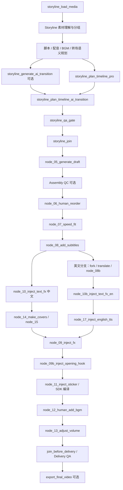

# auto-video-editor 接入 pyJianYingDraft：剪映效果模块迁移设计与分阶段执行计划

> **文档类型**：设计审查与开发执行计划  
> **分析日期**：2026-11-21  
> **目标仓库**：[`wayyet/auto-video-editor`](https://github.com/wayyet/auto-video-editor)  
> **目标分支**：`main`  
> **替代库**：[`GuanYixuan/pyJianYingDraft`](https://github.com/GuanYixuan/pyJianYingDraft)  
> **迁移范围**：原生转场、视频特效、视频动画、字幕、文本动画、花字、贴纸、文字气泡效果，以及 AI 转场视频片段进入剪映草稿的适配。  
> **核心决策**：保留 LangGraph 工作流和业务节点职责，将目标效果的剪映草稿对象构建统一迁移到 `pyJianYingDraft`；不把 `pyJianYingDraft` 当作 AI 工作流引擎或视频渲染引擎。

---

## 0. 已确认的两项重点约束

本计划将以下两项作为强制架构约束，后续实现不得绕过。

### 约束 A：pyJianYingDraft 的模板导入轨道不能任意追加效果

`pyJianYingDraft` 的模板模式会将原草稿轨道包装为导入轨道（`ImportedTrack` / `EditableTrack`）。README 明确说明：导入轨道与 SDK 新建轨道分开管理；不能在导入轨道上新增片段、转场、淡入淡出或特效。模板模式主要提供素材替换、文本内容替换、轨道导入和素材元数据提取等受限能力。

源码也体现了这一限制：

- `TrackType.video`、`audio`、`text` 被标记为可导入编辑类型，但这不等于它们可以像新建 `Track` 一样自由追加所有效果。
- `TrackType.sticker`、`effect`、`filter` 的导入类型不允许修改。
- `get_imported_track()` 返回的导入媒体轨道主要供 `replace_material_by_seg()` 等模板替换接口使用，不应假设它就是一个可直接调用 `VideoSegment.add_transition()` 的普通 SDK 轨道。
- 新建的 SDK 轨道则由 `append_track()` / `insert_track()` 创建，可通过 `ScriptFile.add_segment()` 添加对应类型的片段。

**架构决定：目标效果不得直接写入模板导入轨道。** 采用“读取现有草稿并提取时间线 → 转成项目内部规范化构建说明 → 用 pyJianYingDraft 新建受控草稿和受控轨道 → 原子发布”的编译模式。对剪映人工调整，需要先解析并纳入构建说明，再重新由 SDK 构建；不得在导入轨道上强行追加转场、动画、特效或贴纸。

### 约束 B：AI 转场与剪映原生转场属于两种不同产物

必须区分：

1. **剪映原生转场**：剪映内置的转场资源，由 `TransitionType` / `VideoSegment.add_transition()` 表达，附着于相邻视频片段的边界。
2. **AI 生成转场**：Provider 生成的真实 MP4 视频文件，由 `storyline_plan_timeline_ai_transition` 作为普通视频 Clip 插入 Canonical Timeline，最终由 SDK 的 `VideoMaterial` + `VideoSegment` 作为普通视频片段写入视频轨道。

**架构决定：保留 AI 转场生成与物化节点，不把 AI 转场伪装成 `TransitionType`。** 只迁移其进入剪映草稿的构建方式：AI 生成结果继续作为普通视频片段；剪映原生转场则作为视频片段的 transition 附加效果。

---

## 1. 执行摘要

### 1.1 目标

当前 `auto-video-editor` 已有完整的 LangGraph 自动剪辑编排，但多个效果模块仍自行构造剪映原生 JSON：

- 字幕：构造 `materials.texts` 和 text track。
- 花字：构造 `materials.effects(type=text_effect)` 并绑定 `extra_material_refs`。
- 文本动画：构造 `materials.material_animations` 并绑定文本片段。
- 原生转场：构造 `materials.transitions` 并绑定到视频片段。
- 视频特效：构造 `materials.video_effects` 并绑定到视频片段。
- 贴纸：构造 `materials.stickers` 并绑定到视频片段。

本次将上述草稿对象的构建职责迁移到 `pyJianYingDraft` 的 `ScriptFile`、`Track`、`VideoSegment`、`TextSegment`、`StickerSegment` 等 API。AI 素材理解、脚本生成、资源推荐、任务路由、人工关卡、QA、审计和交付逻辑仍由 `auto-video-editor` 自己负责。

### 1.2 推荐架构

推荐采用 **“LangGraph 产出效果计划 + pyJianYingDraft 统一编译草稿 + auto-video-editor 安全发布”**：

1. LangGraph 节点继续计算字幕、转场、特效、动画、贴纸及气泡的业务决策。
2. 目标效果节点不再各自直接改写 `draft_content.json`，而是更新每份草稿独立的 `DraftBuildSpec`（JSON 构建说明）。
3. 在 `node_11` 汇总点，由统一编译器读取人工调整后的时间线快照和全部效果说明，使用 pyJianYingDraft 创建受控视频、音频、文本和贴纸轨道。
4. 编译器通过 `ScriptFile.dumps()` 得到 SDK 序列化结果，再交由现有 `safe_write_draft()` / `draft_ops` 完成原子双写、快照、完整性校验、回滚和变更审计。
5. 中文主草稿和英文分支草稿使用相同编译入口，分别构建，不共享会互相覆盖的文件或 SDK 对象。

### 1.3 不在本次范围内整体替换的模块

以下能力继续留在 `auto-video-editor`：

- LangGraph 主图、条件路由、fan-out / fan-in、checkpoint 和人工关卡。
- Storyline 素材理解、脚本、配音、BGM 推荐、转场语义推荐。
- AI 转场 Provider 调用、预算、授权、缓存、生成 MP4 和审计清单。
- Canonical Timeline、业务资源白名单、资源准入、缓存校验与效果策略。
- 草稿快照、原子写入、双写、审计、回滚和发布。
- 最终 MP4 的 FFmpeg 导出链路。

`pyJianYingDraft` 只作为剪映草稿结构的对象化构建 SDK，不替代以上业务能力。

---

## 2. 源码基线与历史依据

### 2.1 仓库版本基线

| 项目 | 分支 | 本次核对的 HEAD / 版本依据 | 说明 |
|---|---|---|---|
| `wayyet/auto-video-editor` | `main` | `fa6768ff7d201b211196c2fc97f12d1594919c8a` | 2026-11-21 的仓库最新提交记录；包含当日花字渲染问题处理文档 |
| `GuanYixuan/pyJianYingDraft` | `main` | `1e228479dda361e312e85f6037002346cf6dca9a` | 2026-10-14 的 0.3.1 版本提交；README 标明 pip 安装和功能范围 |

> 版本说明：上述 SHA 是本次读取到的仓库提交基线。正式开发开始前仍须执行一次 `git fetch` / `git rev-parse origin/main`，锁定真正开始开发时的提交，不能把文档生成日的 SHA 永久视为后续分支 HEAD。

### 2.2 auto-video-editor 重点源码

| 路径 | 当前职责 | 本次处理 |
|---|---|---|
| `graph.py` | LangGraph 节点注册、拓扑、分支和汇合 | 保留主流程；必要时调整“效果计划”和“最终编译”的职责边界 |
| `nodes/node_05_generate_draft.py` | 初始剪映草稿生成 | 改为通过 SDK 创建初始受控草稿 |
| `nodes/node_06_human_reorder.py` | 人工调整镜头顺序 | 保留；后续由时间线提取器读取人工调整结果 |
| `nodes/node_07_speed_fit.py` | 镜头变速/时长适配 | 保留算法；补充 SDK 构建前的时间线快照 |
| `nodes/node_08_add_subtitles.py` | 中文字幕创建 | 改为构建字幕计划，不再直接写原生 JSON |
| `nodes/node_08b_add_subtitles_en.py` | 英文字幕创建 | 同步改为构建英文字幕计划 |
| `nodes/node_09_inject_fx.py` | 原生转场、视频特效 | 改为效果计划节点；SDK 编译时添加转场和视频特效 |
| `nodes/node_09b_inject_opening_hook.py` | 开场标题、开场特效和文字动画 | 改为开场装饰计划，由 SDK 编译 |
| `nodes/node_10_inject_text_fx.py` | 中文文本动画、花字 | 改为中文文字装饰计划，由 SDK 编译 |
| `nodes/node_10b_inject_text_fx_en.py` | 英文文本动画、花字 | 改为英文文字装饰计划，由 SDK 编译 |
| `nodes/node_11_inject_sticker.py` | 贴纸注入 | 升级为 SDK 草稿编译汇合节点，并注入贴纸/文字气泡 |
| `nodes/_subtitle_texts.py` | 现有原生字幕 material/segment 构造器 | 迁移字段映射；完成验证后停止承担最终 JSON 构造 |
| `nodes/_text_flower.py` | 花字资源选择、缓存和引用 | 保留业务资源准入/缓存检查，移除原生 JSON 构造职责 |
| `jy_common/native_fx.py` | 原生转场、视频特效、贴纸、动画等 JSON 构造 | 分阶段退役目标效果构造函数；保留未迁移模块所需函数 |
| `jy_common/sticker_resolver.py` | 贴纸资源解析 | 保留资源选择逻辑，改为输出 SDK `StickerSegment` 所需参数 |
| `nodes/_draft_io.py` | 草稿读写、写入入口和结构工具 | 保留，并提供 SDK 编译结果的统一安全发布入口 |
| `draft_ops/atomic_writer.py` | 原子写入、双文件保护 | 保留，不用 SDK 的普通 `save()` 替代 |
| `storyline/mapper.py` | Canonical Timeline 到初始剪映草稿结构映射 | 调整为输出 `DraftBuildSpec` / SDK 编译器所需的规范化时间线数据 |

### 2.3 pyJianYingDraft 重点 API

| 文件 | API / 类型 | 迁移用途 |
|---|---|---|
| `pyJianYingDraft/script_file.py` | `ScriptFile`, `dumps()`, `dump()`, `save()` | 草稿对象和序列化 |
| `pyJianYingDraft/draft_folder.py` | `DraftFolder.create_draft()`、`load_template()` | 创建草稿、模板读取和素材元数据检查 |
| `pyJianYingDraft/_script_file_tracks.py` | `append_track()`、`insert_track()` | 创建受控轨道 |
| `pyJianYingDraft/_script_file_segments.py` | `ScriptFile.add_segment()` | 向 SDK 新建轨道追加视频、文本、贴纸片段 |
| `pyJianYingDraft/video_segment.py` | `VideoSegment`、`add_transition()`、`add_effect()`、`add_animation()`、`StickerSegment` | 视频转场、视频特效、视频动画和贴纸 |
| `pyJianYingDraft/text_segment.py` | `TextSegment`、`TextStyle`、`TextBorder`、`TextBackground`、`TextShadow`、`TextBubble`、`TextEffect` | 字幕、文本样式、文字气泡、花字和文本动画 |
| `pyJianYingDraft/track.py` | `TrackType`、`TrackSpec`、`TrackRef` | 视频、音频、文本、贴纸轨道定义 |
| `pyJianYingDraft/template_mode.py` | `ImportedTrack`、`EditableTrack`、`import_track()` | 模板导入限制和旧草稿读取 |

---

## 3. 当前工作流节点与效果模块定位

### 3.1 当前主流程

当前 `graph.py` 的相关主链可简化为：



### 3.2 节点—能力—替换 API 对照

| 功能 | 当前节点 / 模块 | 当前写入方式 | pyJianYingDraft 对应 API | 处理决策 |
|---|---|---|---|---|
| 中文字幕 | `node_08_add_subtitles`、`_subtitle_texts.py` | `materials.texts` + text track | `TextSegment`、`TextStyle`、`TextBorder`、`TextBackground`、`TextShadow`、`ScriptFile.add_segment()` | 替换草稿构建；字幕内容和时间分配算法保留 |
| 英文字幕 | `node_08b_add_subtitles_en` | 英文 text material + text track | 同上 | 与中文共用 `SubtitleSpec` 和 SDK 字段映射 |
| 文本入场动画 | `node_10` / `node_10b` | `materials.material_animations`，kind=`in` | `TextSegment.add_animation(TextIntro, duration)` | 扩展支持入场、出场、循环动画；资源准入仍由项目维护 |
| 文本花字 | `node_10` / `node_10b`、`_text_flower.py` | `materials.effects(type=text_effect)` + `extra_material_refs` | `TextSegment.add_effect(effect_id)` | 仅当 SDK 参数口径和资源 ID 对应关系通过验证后启用 |
| 文字气泡 | 当前没有独立自动注入节点 | 尚未形成自动化模块 | `TextSegment.add_bubble(effect_id, resource_id)` | 新增 `TextBubbleSpec` 和资源库；首期并入文字装饰计划 |
| 文本描边/背景/阴影 | `node_08` 样式构造 | 原生文本 style 字段 | `TextBorder`、`TextBackground`、`TextShadow` | 迁移参数映射；必须做真实剪映视觉回归 |
| 原生转场 | `node_09_inject_fx`、`jy_common/native_fx.py` | `materials.transitions` + 视频段 refs | `VideoSegment.add_transition(TransitionType, duration)` | 替换原生转场 material 构造；修正挂载到前一段的差异 |
| 视频特效 | `node_09_inject_fx` | `materials.video_effects` + 视频段 refs | `VideoSegment.add_effect(VideoSceneEffectType / VideoCharacterEffectType, params)` | 对资源池做 enum 覆盖率准入；不支持资源不得伪装成功 |
| 视频片段动画 | 当前没有与 SDK 对等的通用节点 | 尚未发现完整的通用视频动画注入工作流 | `VideoSegment.add_animation(IntroType / OutroType / GroupAnimationType, duration)` | 纳入 `node_09` 效果计划，增加新能力 |
| 贴纸 | `node_11_inject_sticker`、`sticker_resolver.py` | `materials.stickers`，当前挂到视频段 refs | `StickerSegment(resource_id, Timerange)` + `TrackType.sticker` | 改为独立 SDK 贴纸轨；先解决当前占位资源库 |
| AI 转场 | `node_generate_ai_transition`、`node_plan_timeline_ai_transition` | 生成 MP4 并物化为普通 timeline clip | `VideoMaterial` + `VideoSegment` | 保留生成/授权/缓存；只迁移最终普通视频片段构建 |

### 3.3 关键节点职责边界

**`node_08` 只负责字幕业务数据，不再直接负责原生 JSON。** 其输入仍来自 `storyline_script_artifact`、旁白分组和当前视频片段的时间范围；句子切分、时间分配、中文/英文样式选择继续使用项目逻辑。输出变为 `SubtitleSpec`。

**`node_10` / `node_10b` 负责文本装饰决策，不再直接拼装 `materials.effects`。** 输出文本动画、花字和气泡的资源 ID、动画类型、时间范围、准入状态等结构化数据。

**`node_09` 负责视频段效果决策。** 原生转场、视频特效和视频片段动画仍由此处按边界和片段选取；实际 SDK 对象由统一编译器创建。

**`node_11` 升级为效果汇合后的 SDK 草稿编译入口。** 它汇集当前草稿时间线快照、中文/英文字幕计划、视频效果计划、开场标题计划和贴纸/气泡计划，创建两份最终可供人工检查的剪映草稿。

---

## 4. pyJianYingDraft 能力核对与限制

### 4.1 字幕与文本样式

`TextSegment` 负责一个文本片段。其样式对象支持字号、粗体、斜体、下划线、颜色、透明度、对齐、竖排、字符间距、行间距、自动换行和最大行宽。描边、背景、阴影分别由 `TextBorder`、`TextBackground`、`TextShadow` 表达。

迁移时不能直接把当前项目 `style` 字典原样传入 SDK。至少需要以下映射层：

| auto-video-editor 字段 | SDK 字段 | 迁移要求 |
|---|---|---|
| `size` | `TextStyle.size` | 建立基准样本，不假设两个版本单位完全一致 |
| `bold` | `TextStyle.bold` | 可直接映射 |
| `color` | `TextStyle.color` | 转成 RGB 三元组，范围 0–1 |
| `align` | `TextStyle.align` | 当前 auto 的 `align=1` 语义须与 SDK 对齐后映射 |
| `border.color/width` | `TextBorder` | SDK 内部会做宽度换算，需 A/B 验证 |
| 背景 | `TextBackground` | 首次启用必须测试圆角、宽高、偏移和透明度 |
| 阴影 | `TextShadow` | 验证扩散、距离、角度和 alpha |
| 位置 `transform_y` | `ClipSettings` / 文本片段位置相关属性 | 需要核对 `ClipSettings` 坐标系，不能直接把 `transform_y` 填入不相干字段 |

**要求：** 保留现有剪映已验证的字幕默认样式作为 golden sample（基准样本）。迁移验收比较同一视频、同一句文字、同一画布尺寸下的字号、位置、行宽、描边和阴影，不以 JSON 结构相同代替视觉验收。

### 4.2 花字

SDK 提供 `TextSegment.add_effect(effect_id)`。当前上游实现会创建 `TextEffect`，其导出字段把 `effect_id` 同时作为 `resource_id` 使用。

这意味着：

- auto 资源记录中的 `effect_id` 和 `resource_id` 相同，才可直接使用该接口。
- 如果某条花字资源两者不同，当前 `add_effect()` 的参数不足以无损表达该资源；必须扩展 SDK 或将该资源标为不支持，不能静默丢失 `resource_id`。
- README 对花字功能的表述是“目前仅支持一部分花字效果”，不能把 SDK 有 `add_effect()` 等同于任意花字资源都可用。
- 当前 `TextSegment` 只有一个 `effect` 属性；同一文本片段不能假设可通过多次 `add_effect()` 叠加多个花字。需要多个花字叠加时，应先扩展 SDK 或拆分文本片段并验证视觉层级。
- 本地 `Cache/artistEffect/<effect_id>/<md5>` 目录、manifest hash、客户端预览实证仍然是项目资源准入要求，SDK 不替代这些检查。

**结合历史“分析剪映项目差异”与 2026-11-21 花字截图证据：** 用户已确认在当前剪映客户端 UI 中选择某个花字效果可以正常预览并保存到草稿。因此不能笼统认定当前客户端不支持花字。应以同一个 `effect_id/resource_id` 对比 UI 写入与 SDK 写入结果，区分资源包问题、资源授权问题和 SDK 序列化差异。

### 4.3 文字气泡

SDK 提供 `TextSegment.add_bubble(effect_id, resource_id)`，两个 ID 分开传入，适合项目新增的 `TextBubbleSpec`。

设计要求：

- 新增 `templates/text_bubble_resource_library.json`，至少包含名称、`effect_id`、`resource_id`、可用剪映版本、缓存/授权要求和验证状态。
- 资源 ID 必须来自真实剪映样本或经验证的资源元数据，不允许硬编码猜测。
- 与花字一样，气泡资源采用结构、缓存、授权、客户端预览四态验证。
- 当前 `TextSegment` 只有一个 `bubble` 属性；同一文本片段不支持假定可挂载多个气泡效果。
- 气泡只按业务规则挂到指定字幕，不自动对所有字幕启用。

### 4.4 文本动画和视频动画

文本动画由 `TextSegment.add_animation()` 支持 `TextIntro`、`TextOutro`、`TextLoopAnim`。SDK 文档要求：如果同时添加入场/出场动画和循环动画，应先添加入场/出场，再添加循环动画。

视频动画由 `VideoSegment.add_animation()` 支持 `IntroType`、`OutroType` 和 `GroupAnimationType`。

迁移要求：

- 将当前只注入文本入场动画的逻辑扩展为 `in` / `out` / `loop` 三类计划。
- 新增视频段 `in` / `out` / `group` 动画计划，不把视频动画误写到 text track。
- 资源枚举必须在项目启动或资源加载时完成覆盖率校验；候选动画必须通过本地缓存和 GUI 样本验证。
- 当前 `Cache/effect` 资源完整性检查继续保留。仅目录存在不代表资源包完整；需要 manifest SHA-256 与 GUI 预览证据。

### 4.5 原生转场

SDK `VideoSegment.add_transition()` 的上游注释明确指出：转场应添加在**前面的片段**上。当前 auto 的边界 `i → i+1` 转场则绑定到**后一段** `segments[i+1]`。

迁移必须以边界为单位重新映射：

```text
边界 i → i+1
旧实现：transition material ref 绑定 segments[i+1]
SDK 实现：segments[i].add_transition(TransitionType, duration=...)
```

这是行为差异，不只是 API 替换。必须增加单边界、连续多边界、首边界、末边界和 overlap 转场回归测试。还要检查 SDK 的 `is_overlap` 与当前资源库 `is_overlap` 是否一致。

### 4.6 视频特效

SDK `VideoSegment.add_effect()` 接受 `VideoSceneEffectType` 或 `VideoCharacterEffectType`，并允许传入 0–100 的参数列表。当前项目使用 `fx_template.json` 白名单和 `fx_resource_library.json` 资源记录；两边不应假设枚举资源完全一致。

实施前必须构建资源交叉表：

| 校验项 | 规则 |
|---|---|
| 资源身份 | `name`、`effect_id`、`resource_id` 与 SDK metadata 对应 |
| 参数定义 | 数量、顺序、范围和默认值一致 |
| 类型 | 场景特效与人物特效分类一致 |
| 资源版本 | SDK metadata 版本与当前剪映资源可用版本匹配 |
| 覆盖结果 | `supported`、`unsupported`、`needs_sdk_extension` 三态，不允许静默跳过 |

如果 auto 白名单中的视频特效无法映射到 SDK 枚举，则必须先选择以下处理：扩展/固定一个 pyJianYingDraft fork 增加可注册 metadata 的能力，或将该资源暂时标为不支持。**不得为了声称迁移完成而保留原来的原生 JSON 写入器作为隐形后备。**

### 4.7 贴纸

SDK 提供 `StickerSegment(resource_id, Timerange)`，并允许把片段添加到新建的 `TrackType.sticker` 轨道。与 auto 当前“把 sticker material ref 挂到 video segment”的写法不同，SDK 使用独立贴纸轨道表达贴纸时间线。

当前 auto 的 `templates/sticker_template.json` 仍存在 `_reverse_engineering_pending: true`，其中 `PLACEHOLDER_*` 是占位资源。`node_11` 当前按 fail-closed 原则拒绝无效占位 ID。

因此贴纸迁移有两个前置条件：

1. 先通过剪映 UI 创建真实贴纸草稿，提取并复核 `resource_id`。
2. 用 `StickerSegment` 生成隔离样例，确认资源在指定剪映客户端中能显示、保存、关闭后重开仍存在。

不得把 `PLACEHOLDER_*` 传给 SDK。

### 4.8 pyJianYingDraft 的版本兼容范围

上游 README 标明 Windows 支持草稿生成、模板模式和自动导出，但具体受剪映客户端版本影响；Linux/macOS 可创建草稿和使用模板模式，自动导出不支持。README 还指出新版剪映的 `draft_content.json` 可能不是明文 JSON，模板模式可能需要 `fallback_loader`。

本项目应把 SDK 使用范围限定为**Windows 环境下的草稿生成和对象化序列化**。当前最终视频导出仍走项目现有 FFmpeg exporter，不依赖 SDK 的 GUI 自动导出。对于非明文草稿，必须先明确读取器方案；不得直接将解析失败当作空草稿。

---

## 5. 目标架构

### 5.1 核心流程：效果计划与草稿编译分离

```mermaid
flowchart TD
    A[Canonical Timeline / node_05 初始草稿] --> B[人工调整 / node_06]
    B --> C[node_07 speed fit]
    C --> D[Timeline Snapshot Extractor]
    D --> E[DraftBuildSpec 基础时间线]
    E --> F[node_08 / 08b SubtitleSpec]
    F --> G[node_10 / 10b TextDecorationSpec]
    G --> H[node_09 VideoEffectSpec]
    H --> I[node_09b OpeningHookSpec]
    I --> J[node_11 SDK Draft Compiler]
    J --> K[pyJianYingDraft ScriptFile]
    K --> L[SDK dumps()]
    L --> M[auto safe_write_draft]
    M --> N[JSON 结构校验 / 双文件校验 / 快照审计]
    N --> O[中文草稿 + 英文草稿]
    O --> P[node_12 人工添加 BGM]
    P --> Q[node_13 音量处理]
    Q --> R[Delivery QA]
```

### 5.2 为什么不让每个节点分别打开模板并追加效果

如果节点 08 先创建 text track，节点 10 随后重新 `load_template()`，节点 10 取得的是导入文本轨道，而不是之前进程内的可变 `TextSegment` / SDK `Track` 对象。模板导入轨道无法按 SDK 文档自由追加文本效果或动画。

若每个节点都直接编辑 JSON，又会继续保留目前多个模块各自构造剪映私有结构的问题，迁移目标无法达成。

因此，使用声明式（declarative）效果计划：各节点只写入自己的 JSON 计划文件；最终汇合节点在一次 SDK 构建过程中创建所有 SDK 对象和受控轨道。这样既满足模板轨道约束，也不需要把 Python 对象跨 LangGraph checkpoint 序列化。

### 5.3 DraftBuildSpec 数据契约

建议每份草稿有独立的 `draft_build_spec.json`，中文和英文不共享同一个可变文件。建议结构如下（字段为设计契约，具体 Pydantic 类需在实现阶段落地）：

```json
{
  "schema_version": 1,
  "job_id": "<thread_id>",
  "language": "zh",
  "canvas": {"width": 1080, "height": 1920, "fps": 30},
  "timeline": {
    "source_draft_path": "<当前任务草稿路径>",
    "source_snapshot_sha256": "<sha256>",
    "clips": [
      {
        "clip_id": "clip-001",
        "source_path": "<media path>",
        "source_in_us": 0,
        "source_duration_us": 5000000,
        "target_start_us": 0,
        "target_duration_us": 5000000,
        "speed": 1.0,
        "volume": 1.0,
        "order": 0,
        "ai_transition_pair": null
      }
    ]
  },
  "subtitles": [],
  "text_decorations": [],
  "video_effects": [],
  "video_animations": [],
  "transitions": [],
  "stickers": [],
  "compile": {
    "input_fingerprint": "<sha256>",
    "last_compiled_fingerprint": null,
    "compiler_version": "pyjy-adapter-v1"
  }
}
```

关键约定：

- 时间统一用微秒（`us`），避免毫秒与微秒混用；Canonial Timeline 的毫秒值只在边界处转换。
- 每个效果必须引用稳定业务 ID（如 `clip_id`、`subtitle_id`），不得依赖数组位置长期定位。
- 资源未准入时要明确写 `unsupported` / `degraded` 状态，不创建空素材或假资源。
- 文件路径只保存在任务产物/构建说明中，不写入监控事件；遵守项目现有日志隐私约定。
- `input_fingerprint` 覆盖时间线、字幕、资源 ID、动画参数、SDK 版本和模板版本。指纹未变化时不重复编译；变化时从空白 SDK 草稿完整重建，避免重复 upsert 和残留 refs。

### 5.4 编译与写入伪代码

以下表示目标调用顺序，具体方法参数以锁定版本的 SDK 源码为准：

```python
import json
import pyJianYingDraft as draft

folder = draft.DraftFolder(str(jianying_drafts_root))
script = folder.create_draft(
    draft_name,
    width=spec.canvas.width,
    height=spec.canvas.height,
    fps=spec.canvas.fps,
    allow_replace=False,
)

video_track = script.append_track(
    draft.TrackSpec(draft.TrackType.video, name="video_main")
)
text_track = script.append_track(
    draft.TrackSpec(draft.TrackType.text, name="subtitles")
)
sticker_track = script.append_track(
    draft.TrackSpec(draft.TrackType.sticker, name="stickers")
)

# 根据 DraftBuildSpec 创建 VideoMaterial / VideoSegment。
# 对每个原生转场边界，把 transition 添加到前一个 VideoSegment。
# 对视频效果和视频动画，调用对应 VideoSegment 方法。
# 对字幕创建 TextSegment，再添加文本动画、花字和气泡。
# 对贴纸创建 StickerSegment，放入独立 sticker track。

sdk_payload = json.loads(script.dumps())

# 不直接调用 script.save() 作为生产提交入口。
# 用项目已有安全写入和验证流程完成落盘。
safe_write_draft(draft_dir, sdk_payload)
```

**说明：** `ScriptFile.add_segment()` 在添加片段时会把关联素材自动登记到 `ScriptMaterial` 对应素材桶。这是迁移后优先使用 SDK 的关键收益之一。生产实现中不得再另行手工拼装相同素材 JSON。

### 5.5 安全写入边界

`pyJianYingDraft` 的 `ScriptFile.dump()` / `save()` 是普通文件写入接口，不包含本项目已有的快照、双写、验证、回滚和 `draft_mutations` 审计。必须采用：

```text
DraftBuildSpec
  → pyJianYingDraft ScriptFile
  → ScriptFile.dumps()
  → json.loads()
  → safe_write_draft(draft_dir, payload)
  → verify_draft_loadable()
  → 成功 / 快照恢复
```

不得为了迁移 SDK 而删除或绕过以下现有保护：

- `check_jianying_not_running()`（按当前项目定义决定写入时行为）。
- `snapshot_before_edit()` / `restore_from_snapshot()`。
- `atomic_write_draft_pair()` 对 `draft_content.json` 和 `draft_info.json` 的双写。
- `verify_draft_loadable()`。
- `draft_mutations` 审计和草稿身份/角色标签。

---

## 6. 重点功能的详细迁移设计

### 6.1 字幕：node_08 / node_08b

**保留的业务逻辑：**

- 中文字幕文本来自 `storyline_script_artifact` 的逐组旁白。
- 视频段与 group 的映射继续使用当前源范围匹配算法，以适应关卡 ① 的人工调整和 node 07 的时间变化。
- 旁白按标点切句，按当前算法分配字幕时间区间。
- 英文字幕继续走翻译结果和英文分支逻辑。
- scout / storyline 推荐样式仍由项目能力层负责，并统一转换到 `SubtitleSpec`。

**替换的写入逻辑：**

- `_subtitle_texts.make_text_material()` 不再成为最终 `materials.texts` 的唯一写入器。
- 生成 `SubtitleSpec`：文本、起止时间、语言、字体、颜色、描边、背景、阴影、对齐、换行和位置。
- SDK 编译器用 `TextSegment` 构建文本片段并添加到新建的 `TrackType.text` 轨道。

**新增测试：**

- 中文、英文、中英混排、换行、标点和超长文本。
- 0 时长、负时长、字幕超出成片时长和相邻字幕重叠。
- 1080×1920 和 1920×1080 等画布。
- 当前默认样式与 SDK 映射样式的同屏 A/B。

### 6.2 花字与文字气泡：node_10 / node_10b

**保留的业务逻辑：**

- `job_id` 确定性选择资源。
- 中文和英文分支采用同样的资源选择口径。
- `verified`、缓存目录、manifest SHA-256 和资源授权检查继续执行。
- 不处理人工 UUID 文本；只处理项目拥有的字幕 ID。
- 资源失败时非破坏性降级，不清除草稿中已有人工效果。

**改造后的数据：**

```text
TextDecorationSpec
  subtitle_id
  text_effect: {effect_id, resource_id, resource_name, verification}
  text_bubble: {effect_id, resource_id, resource_name, verification}
  animations: [{kind: in|out|loop, sdk_enum, duration_us}]
```

**限制：**

- 花字 `effect_id != resource_id` 时，当前上游 `TextSegment.add_effect(effect_id)` 不能直接无损表达，先标记 `needs_sdk_extension`。
- 不能只凭资源缓存目录存在就标记花字可渲染。
- 文字气泡必须同时传入 `effect_id` 和 `resource_id`。
- 花字、气泡、动画可以同时存在于同一个 `TextSegment` 的能力，需要对同一条字幕做组合回归测试，不能分别单测通过后就假设组合必然正确。

**资源库：**

- 保留 `templates/text_flower_resource_library.json`，调整为 SDK 适配字段和验证状态。
- 新增 `templates/text_bubble_resource_library.json`。
- 资源状态至少拆为 `structure_verified`、`cache_verified`、`license_verified`、`client_preview_verified`。
- 每条验证记录需写 `effect_id`、`resource_id`、剪映版本、验证时间、测试草稿 ID 和缓存 manifest SHA-256。

### 6.3 原生转场：node_09

项目仍负责语义映射、资源选择、时长限制、开场加强和 all-cut 保底策略。SDK 负责创建真正的 `Transition` 并附加到对应视频片段。

**边界映射必须改为前一段：**

```python
# boundary[i] 表示 video_segments[i] -> video_segments[i + 1]
left_segment.add_transition(transition_type, duration=duration_us)
```

在 SDK 编译器中禁止采用旧版 `segments[i + 1]` 的绑定方式。

**资源池覆盖：**

- 对 `fx_resource_library.json` 逐条与 SDK `TransitionType` metadata 比较。
- 精确比较 `effect_id`、`resource_id`、名称、默认时长和 `is_overlap`。
- 对没有 SDK 枚举的资源建立 `unsupported` 清单；不得自动映射到同名但不同 ID 的转场。
- 当前 `VideoSegment` 只有一个 `transition` 属性，重复添加会抛出异常；同一视频片段不能假设可同时承载多个原生转场。
- 只有通过剪映 UI 保存/重开验证的资源才可进入生产资源池。

**回归测试：**

- 两个视频段、三个视频段、单视频段（`not_applicable`）。
- 连续两个转场、首边界 whip、all-cut fade fallback。
- overlap 和 non-overlap。
- 片段不足以容纳转场时的 duration clamp。
- 中文与英文双稿相同 job_id 时转场资源一致。

### 6.4 视频特效与视频动画：node_09

`VideoSegment.add_effect()` 和 `VideoSegment.add_animation()` 在视频片段对象上调用，不允许误加到音频轨或文本轨。

**视频特效：**

- 使用 SDK 的 `VideoSceneEffectType` / `VideoCharacterEffectType`。
- `fx_template.json` 继续作为项目策略白名单；SDK metadata 作为实际 API 可用性白名单。
- 只有双白名单交集才可写入；强度参数需转换到 SDK 规定的 0–100。
- 保留项目当前“首段、尾段及部分中间段克制点缀”的策略，避免恢复过去全片堆叠特效的问题。

**视频动画：**

- 新增 `video_animations` 配置计划。
- 支持 SDK 当前枚举覆盖的 `intro`、`outro` 和 `group` 动画。
- 动画时长必须小于等于片段目标时长，并遵守 enum metadata 的默认时长。
- 每个动画 ID 和缓存资源必须通过项目预检；无缓存或未验证状态不能标记 applied。

### 6.5 AI 转场：保留生成链、迁移视频片段构建

保留：

- `nodes/storyline/node_generate_ai_transition.py`。
- `nodes/storyline/node_plan_timeline_ai_transition.py`。
- Provider 授权、预算、pair 范围、缓存、`ai_transition.json` 审计。

变更：

- `node_plan_timeline_ai_transition` 继续将真实生成的 MP4 注册为 `source_media` 并插入普通 Clip。
- `DraftBuildSpec.timeline.clips` 将 AI 生成片段标记为 `ai_transition_pair`，保留来源 `from_clip_id` / `to_clip_id` 和 artifact 引用。
- SDK 编译器为该 clip 创建 `VideoMaterial` 和 `VideoSegment`。
- AI 转场视频片段之间仍可按需要应用普通原生转场，但这属于两个独立效果，不得互相替代。

**验收必须确认：**

- AI 转场 MP4 在草稿中是独立普通视频片段。
- 视频片段起止时间、源范围、速度、画幅和相邻片段保持一致。
- AI 生成失败时回到基础时间线，不生成占位转场。
- QA 能区分 `ai_transition_generated`、`ai_transition_materialized` 和 `native_transition_applied`。

### 6.6 贴纸：node_11

- 从字幕时间范围和关键词匹配结果产生 `StickerSpec`。
- SDK 通过 `StickerSegment(resource_id, Timerange)` 创建贴纸片段。
- 使用新建 `TrackType.sticker` 轨道，不向模板导入的 sticker track 追加。
- 贴纸时间范围以对应字幕或指定镜头为基准，按项目既有重叠匹配规则生成。
- 贴纸的资源 ID 不合法、占位或未经客户端验证时 fail-closed，不写入。

**当前资源库必须先处理：** `templates/sticker_template.json` 的 `_reverse_engineering_pending` 当前为 true，`sticker_by_keyword` 中有 `PLACEHOLDER_*`。P0 任务是从剪映 UI 样本导出真实贴纸 ID 并验证，不应在没有真实 ID 的情况下宣称贴纸迁移完成。

### 6.7 `node_11` 统一编译与双草稿

`node_11` 从单纯的“贴纸注入节点”提升为“草稿效果编译节点”。

输入：

- 当前中文/英文草稿路径。
- node 07 后的时间线快照。
- 中文和英文字幕计划。
- 中文和英文文本装饰计划。
- 视频转场、视频特效和视频动画计划。
- 开场标题计划。
- 贴纸计划和气泡计划。

输出：

- 中文 SDK 草稿路径、SDK 编译结果摘要。
- 英文 SDK 草稿路径、SDK 编译结果摘要。
- `build_fingerprint`、资源支持率、降级明细和验证状态。

中文与英文编译必须串行或使用完全隔离的 `ScriptFile` / 输出目录，禁止两个并发分支对同一草稿目录写入。

---

## 7. 时间线重建与人工编辑兼容设计

### 7.1 为什么必须加入 Timeline Snapshot Extractor

初始草稿由 node 05 生成后，工作流可能经过人工镜头排序（node 06）和速度适配（node 07）。最终 SDK 编译不能简单重新使用最初的 Canonical Timeline，否则会丢失用户在剪映中做出的顺序调整和时间变化。

因此，node 07 后必须读取当前草稿并提取真实视频段，形成 `TimelineSnapshot`：

- 视频素材路径/素材身份。
- `material_id` 与 segment 的关联。
- source timerange、target timerange。
- 播放速度、静音/音量。
- 裁剪、缩放、位置、旋转等当前项目确实需要保留的字段。
- 用户调序后的 segment 顺序。
- AI 转场 clip 的来源审计信息。

### 7.2 能力保留分级

不能承诺 SDK 重建会自动保留剪映 JSON 中所有未知字段。需要建立字段保留矩阵：

| 数据类别 | 首期策略 | 说明 |
|---|---|---|
| 视频路径、源范围、目标范围、速度 | 必须完整保留 | 编译基础 |
| 用户镜头顺序 | 必须完整保留 | node 06 的主要人工结果 |
| 画布尺寸、帧率 | 必须保留 | 草稿基础属性 |
| 裁剪、缩放、旋转、音量 | 必须建立映射和测试 | 缺少映射时不得静默丢弃 |
| 关键帧、复杂调色、蒙版、复合片段 | 逐项审查 | SDK 不支持的字段需列入兼容清单 |
| 未知素材桶/人工高级效果 | 默认保留原数据或阻断重建 | 不得无提示删除人工效果 |

**重点：** 如果当前草稿含有 SDK 无法表达的人工高级效果，编译器不得静默生成一个缺失这些效果的新草稿。应按策略返回 `unsupported_manual_feature`，暂停编译并保留原草稿；之后再决定扩展 SDK 或对相应轨道采用可证明安全的迁移方法。

### 7.3 不允许的实现方式

- 不允许为了“绕过模板轨道限制”直接篡改 `ImportedTrack.raw_data` 后宣称是 SDK 标准 API。
- 不允许删除未知 track/material 后重建，导致人工剪辑成果丢失。
- 不允许只按素材数组顺序推断 segment 顺序；必须读取实际时间线时间。
- 不允许忽略 `source_timerange` 与 `target_timerange` 的差异。
- 不允许在 node 11 重建后仍引用旧草稿中的 material ID。

---

## 8. 项目代码调整清单

### 8.1 新增模块建议

| 新路径 | 职责 |
|---|---|
| `jianying_sdk/__init__.py` | SDK 适配层对外入口 |
| `jianying_sdk/compiler.py` | `DraftBuildSpec` 到 `ScriptFile` 的统一编译 |
| `jianying_sdk/spec.py` | `DraftBuildSpec`、`TimelineSnapshot`、`SubtitleSpec` 等 Pydantic 模型 |
| `jianying_sdk/timeline_extractor.py` | 读取 node 07 后草稿并提取时间线 |
| `jianying_sdk/style_mapper.py` | auto 字幕样式到 SDK 文本样式的映射 |
| `jianying_sdk/resource_registry.py` | SDK Enum 与项目资源库交叉验证 |
| `jianying_sdk/verification.py` | 资源缓存、manifest、客户端版本与渲染验证前置检查 |
| `jianying_sdk/fingerprint.py` | BuildSpec 内容哈希与重复编译跳过 |
| `jianying_sdk/publisher.py` | SDK dumps 与现有 safe writer 的桥接 |
| `nodes/_draft_build_spec.py` | 各工作流节点读写 build spec 的幂等公共函数 |
| `templates/text_bubble_resource_library.json` | 文字气泡资源库 |
| `templates/sdk_resource_compatibility.json` | 项目资源与 SDK metadata 支持矩阵 |

### 8.2 修改模块建议

| 文件 | 预期变更 |
|---|---|
| `graph.py` | 保留现有主拓扑；明确 node 07 后快照、node 08/09/10/09b 计划输出和 node 11 编译汇合关系 |
| `nodes/node_05_generate_draft.py` | 使用 `DraftFolder.create_draft()` 创建 SDK 初始草稿，仍由现有安全写入器发布 |
| `nodes/node_07_speed_fit.py` | 保留变速算法；在完成后产出时间线快照或触发 extractor |
| `nodes/node_08_add_subtitles.py` | 由 JSON material 构造改为更新中文字幕计划 |
| `nodes/node_08b_add_subtitles_en.py` | 改为更新英文字幕计划 |
| `nodes/node_09_inject_fx.py` | 只产出 transition / video effect / video animation spec |
| `nodes/node_09b_inject_opening_hook.py` | 只产出 opening title / effect / animation spec |
| `nodes/node_10_inject_text_fx.py` | 只产出中文 text animation / flower / bubble spec |
| `nodes/node_10b_inject_text_fx_en.py` | 只产出英文 text animation / flower / bubble spec |
| `nodes/node_11_inject_sticker.py` | 汇总资源计划并调用 SDK 编译器，同时处理 sticker track |
| `nodes/_subtitle_texts.py` | 逐步迁移为 `SubtitleSpec` 构造器；旧 JSON 构造器标记 deprecated 后移除 |
| `nodes/_text_flower.py` | 保留资源选择/缓存验证；移除花字 material JSON 构造 |
| `jy_common/native_fx.py` | 目标功能的原生 JSON builder 在对应阶段验收通过后删除或只保留兼容读取 |
| `nodes/_draft_io.py` | 增加 SDK payload 安全发布接口；现有 write/verify/audit 不变 |

### 8.3 依赖与版本锁定

- 先将 `pyJianYingDraft` 固定到已审查版本 `0.3.1` 对应的上游提交，不直接跟随浮动 `main`。
- 在 `pyproject.toml` / lock 文件里锁定依赖版本和来源。
- 固定运行 Python 版本，按本项目当前运行时核对与 SDK 支持版本，不因 README 推荐 Python 3.8/3.11 就擅自改变项目解释器。
- 如必须扩展 SDK（例如动态 effect metadata、花字双 ID 或稳定 ID factory），建立单独 fork / patch commit，记录上游 commit、补丁差异和回归测试。
- 禁止把未锁定的 GitHub HEAD 直接作为生产依赖。

---

## 9. 分阶段开发与执行计划

### 阶段 0：源码基线、资源覆盖和行为冻结（P0）

**目标：** 开发前先确认 SDK 实际可用范围，不在未知资源覆盖率下大规模改节点。

任务：

- [ ] 拉取两个仓库并记录 `main` 当前 HEAD；记录 SDK 0.3.1 对应 commit。
- [ ] 建立 auto 资源池到 SDK metadata 的资源交叉表：转场、视频特效、视频动画、文本动画、花字、贴纸、气泡。
- [ ] 对所有 SDK 不支持或参数不匹配的资源标注 `unsupported` / `needs_sdk_extension`。
- [ ] 收集当前剪映客户端可正常应用的字幕、转场、花字、贴纸和文字气泡 golden sample。
- [ ] 对每个 golden sample 保存原始 `draft_content.json`、相关资源元数据、缓存文件清单及 SHA-256。
- [ ] 明确当前手工调序、speed-fit、中文/英文分支和 node 12 BGM 人工操作的真实输入/输出约束。
- [ ] 确认 `draft_info.json` 与 `draft_content.json` 双写约定仍然适用，并验证 `DraftFolder.create_draft()` 生成的草稿目录结构。

交付物：`sdk_resource_compatibility.json`、golden sample 集、节点输入输出冻结说明。

通过标准：资源覆盖率有实数统计；所有不支持资源都有明确状态；没有任何目标功能以名称相似作为 ID 映射依据。

### 阶段 1：SDK 适配层与安全发布（P0）

**目标：** 先打通“SDK 创建受控草稿 → 项目安全发布”。

任务：

- [ ] 新增 `jianying_sdk/` 模块骨架。
- [ ] 实现 `DraftFolder.create_draft()` 和受控 `TrackSpec` 创建封装。
- [ ] 实现 `ScriptFile.dumps()` 到 `safe_write_draft()` 的发布桥接。
- [ ] 保留 `draft_meta_info.json` 等 SDK 创建文件，不让安全写入器误删。
- [ ] 实现 `build_fingerprint`；相同输入指纹不重复重建，避免每次重试产生新的随机 UUID 和无意义文件变化。
- [ ] 编译失败时原子回滚，不覆盖当前有效草稿。
- [ ] 新增单元测试：SDK 输出 JSON 可解析、素材/轨道引用闭合、双写内容一致、失败回滚、重复指纹跳过。

交付物：SDK adapter、publisher、单测和一个无效果的最小草稿。

通过标准：生成的草稿能由指定剪映客户端打开；现有快照、双写、校验、回滚、审计测试全部通过。

### 阶段 2：时间线提取和初始草稿迁移（P0）

**目标：** 确保 SDK 重建不会丢失 node 06 / node 07 的人工和算法时间线变化。

任务：

- [ ] 将 `node_05_generate_draft` 的初始草稿创建改为 SDK `VideoSegment` / `AudioSegment`。
- [ ] 开发 `TimelineSnapshotExtractor`，读取 node 07 后当前有效草稿。
- [ ] 将每个视频片段标准化为 path、source range、target range、speed、volume、order 和必要的 clip settings。
- [ ] 增加人工调序前后对照测试。
- [ ] 增加 speed-fit 前后对照测试，验证 SDK 重建后的总时长不变。
- [ ] 对 SDK 无法表达的人工高级字段返回明确兼容错误，不静默丢弃。
- [ ] 为中英草稿建立独立快照和唯一写入锁。

交付物：Timeline Snapshot Extractor、时间线字段映射表、回归报告。

通过标准：同一个测试任务 SDK 重建前后镜头顺序、源范围、目标范围、速度、画面位置和总时长一致；所有不支持字段可见、可定位。

### 阶段 3：字幕与文本样式迁移（P1）

**目标：** 先把字幕基础轨道稳定迁移到 SDK。

任务：

- [ ] `node_08` 输出 `SubtitleSpec`，不再直接写 `materials.texts`。
- [ ] `node_08b` 复用同一模型，输出英文字幕计划。
- [ ] 实现 `style_mapper.py`，将默认样式、scout 建议和 storyline 样式统一转成 SDK `TextStyle` 等对象。
- [ ] SDK 编译器创建新文本轨道并添加 `TextSegment`。
- [ ] 验证描边、背景、阴影、位置、换行和中英字体。
- [ ] 对照旧草稿与新草稿输出结构和剪映 GUI 预览。

交付物：字幕 SDK 后端、样式映射单测、截图对照和回归报告。

通过标准：字幕内容、时间范围、视觉位置和样式达到现有基准；关闭/重开草稿后仍正常显示；中英分支不互相覆盖。

### 阶段 4：文本动画、花字和文字气泡迁移（P1）

**目标：** 将 node 10 / 10b 的文本装饰改为 SDK `TextSegment`。

任务：

- [ ] 将 `node_10` / `node_10b` 改为更新 `TextDecorationSpec`。
- [ ] 添加文本入场、出场、循环动画的 SDK 编译逻辑，确保执行顺序正确。
- [ ] 花字资源校验 `effect_id` 与 `resource_id` 是否满足 SDK `add_effect()` 的限制。
- [ ] 新增文字气泡资源库和 `add_bubble()` 编译逻辑。
- [ ] 同一个字幕同时应用动画 + 花字 + 气泡做组合测试。
- [ ] 使用同资源 UI 手工样本与 SDK 生成样本对比，保存后关闭并重新打开剪映验证。
- [ ] 未通过预览的资源仅做资源级禁用或降级，不关闭全部花字功能。

交付物：文本装饰 adapter、文字气泡资源库、同资源 A/B 报告。

通过标准：至少一组经过 GUI 验证的花字、一组气泡以及入场/出场/循环动画样例通过；失败资源不会被报告为成功。

### 阶段 5：原生转场、视频特效和视频动画迁移（P1）

**目标：** 迁移 node 09 的视频效果能力。

任务：

- [ ] 原生转场按前一片段挂载，完成旧版后一片段挂载到 SDK API 的边界映射。
- [ ] 资源库逐条映射到 `TransitionType`，核验 `effect_id/resource_id/is_overlap/default_duration`。
- [ ] 视频特效资源逐条映射到 `VideoSceneEffectType` / `VideoCharacterEffectType`。
- [ ] 将强度范围转换为 SDK 要求的 0–100 参数。
- [ ] 增加视频入场、出场和组合动画计划及编译逻辑。
- [ ] 保留项目按首尾和部分中间片段克制添加效果的策略。
- [ ] 完成中文/英文双稿同任务资源选择一致性测试。

交付物：视频效果 SDK 后端、资源覆盖率报告、转场边界回归报告。

通过标准：无转场错挂、无片段时长越界、无未知资源误映射；视频特效与动画均能在剪映 UI 中预览和重开。

### 阶段 6：AI 转场与贴纸迁移（P1）

**目标：** 保持 AI 转场业务链不变，将成片 Clip 和贴纸改由 SDK 构建。

任务：

- [ ] 保留 AI 转场 Provider、审批、预算、缓存和 `ai_transition.json`。
- [ ] 将 AI 转场 MP4 纳入 `TimelineSnapshot`，编译成普通 `VideoSegment`。
- [ ] 验证 AI 转场 pair 两端相邻、预算吸收后时长正确。
- [ ] 使用剪映 UI 采集真实贴纸 `resource_id`，替换占位 `sticker_template.json` 数据。
- [ ] 将贴纸改为 `StickerSegment` 和独立 sticker track。
- [ ] 以字幕时间范围/镜头范围验证贴纸位置、时长、层级和遮挡顺序。

交付物：AI 转场 SDK clip 编译测试、贴纸真实资源库和 GUI 验收记录。

通过标准：AI 转场在时间线上是普通视频段；贴纸能显示并保存在草稿；占位 ID 被完全阻断。

### 阶段 7：双语主链集成与人工关卡验证（P0/P1）

**目标：** 将所有 SDK 能力接入现有工作流并验证人工操作不丢失。

任务：

- [ ] 中文和英文 `DraftBuildSpec` 独立存储与编译。
- [ ] 将 node 11 作为唯一 SDK 目标效果编译写入入口。
- [ ] 验证 node 12 人工添加 BGM 时，SDK 已生成草稿可正常打开和编辑。
- [ ] 验证 node 13 现有音量节点写回后不损坏 SDK 编译的目标效果字段。
- [ ] 验证 delivery QA 识别目标效果状态：计划、已编译、结构通过、客户端预览通过分开记录。
- [ ] 检查老 checkpoint 恢复时 `DraftBuildSpec` schema 兼容，旧线程无 spec 时明确迁移或走旧后端，不静默创建空计划。

交付物：端到端双语任务记录、人工关卡测试记录、交付 QA 报告。

通过标准：从素材导入到人工 BGM 关卡完整跑通；中英草稿各自能打开、效果可见、音画同步、无重复轨道；任务重试不生成重复素材。

### 阶段 8：灰度切换与旧构造器退役（P2）

**目标：** 完成生产切换并清理旧实现。

任务：

- [ ] 新增后端开关，允许按任务灰度启用 SDK 编译器。
- [ ] 对同一个 `DraftBuildSpec` 分别使用旧后端和 SDK 后端，比较草稿结构和客户端表现。
- [ ] 观察灰度期失败率、资源降级率、编译耗时、草稿损坏率和回滚次数。
- [ ] 所有目标效果达到准入门槛后，将 SDK 后端设为默认。
- [ ] 删除目标功能对应的旧 JSON material 构造器和重复代码。
- [ ] 未迁移模块保留旧实现，禁止一次性清空整个 `jy_common/native_fx.py`。
- [ ] 更新 README、架构图、环境变量、资源库文档和开发执行记录。

交付物：灰度验收报告、默认后端切换 PR、旧代码清理 PR。

通过标准：连续灰度任务达到团队设定的成功率门槛，且出现异常时能够按任务回滚到旧后端。

---

## 10. 测试与验收矩阵

### 10.1 SDK 结构级测试

| 功能 | 结构断言 |
|---|---|
| 字幕 | text track 存在；每个 `TextSegment` 对应正确文本和时间；所有 material/ref 闭合 |
| 花字 | `TextEffect` 关联到目标 TextSegment；effect/resource ID 匹配；无孤儿素材 |
| 气泡 | `TextBubble` 使用正确的 `effect_id/resource_id`；ref 唯一且有效 |
| 文本动画 | in/out/loop 类型、开始时间和持续时间正确；同段多个动画顺序正确 |
| 视频动画 | 动画绑定到对应 VideoSegment，而不是文本或音频片段 |
| 原生转场 | boundary `i→i+1` 绑定 `segments[i]`；时长与 overlap 属性正确 |
| 视频特效 | 资源 enum、参数数量/范围、目标片段均正确 |
| 贴纸 | sticker track 存在；片段时间范围与目标字幕/镜头匹配；真实 ID 非占位 |
| AI 转场 | 作为普通视频素材和视频段存在；pair 溯源信息完整；无假 transition material |

### 10.2 剪映 GUI 渲染验收

结构级测试通过后，必须在指定剪映版本进行 GUI 验收：

1. 打开 SDK 创建的草稿。
2. 定位对应时间线片段，确认效果确实显示。
3. 播放检查入场、出场、循环动画和转场边界。
4. 保存草稿并退出。
5. 重新打开同一草稿，再次检查效果。
6. 记录剪映版本、资源 ID、账号授权/下载状态、缓存 manifest hash 和测试草稿 ID。

禁止用“JSON 中存在 material”“调用 SDK 没有抛异常”或“文件保存成功”替代 GUI 渲染验收。

### 10.3 最终交付验收

- [ ] 中文主草稿可打开，中文字幕正确。
- [ ] 英文分支草稿可打开，英文字幕正确。
- [ ] 原生转场落在正确边界。
- [ ] 视频特效和视频动画作用于指定视频段。
- [ ] 文本动画、花字、气泡能显示且重开后保留。
- [ ] 贴纸能显示、时间准确、没有占位资源。
- [ ] AI 转场是普通视频片段，生成失败能安全降级。
- [ ] 人工镜头调整、speed-fit 结果未丢失。
- [ ] 人工 BGM 操作不受影响。
- [ ] 双语草稿不会因并发编译互相覆盖。
- [ ] `draft_content.json` / `draft_info.json` 双写一致。
- [ ] 原子写入、快照、回滚、审计均正常。
- [ ] Delivery QA 能区分“计划存在、SDK 已编译、结构验证、客户端预览验证”。

### 10.4 状态字段建议

不要用一个 `done` 标签表示整个效果链路成功。建议将结果拆成：

- `planned`：工作流已生成效果计划。
- `resource_verified`：资源 ID、缓存、授权和 SDK metadata 通过预检。
- `sdk_compiled`：SDK 对象已构建并序列化。
- `draft_structure_verified`：草稿素材和片段引用闭合，双文件写入通过。
- `client_preview_verified`：指定剪映版本 GUI 预览和重开验证通过。
- `degraded` / `unsupported`：资源或能力无法迁移，保留原因。

上述状态必须按效果类型和资源身份分别记录。

---

## 11. 风险与回滚

| 风险 | 影响 | 应对措施 |
|---|---|---|
| 模板导入轨道不可自由追加效果 | 迁移后的节点无法直接编辑既有轨道 | 使用时间线提取 + 新建受控 SDK 轨道；无法保留字段时阻断而非静默丢失 |
| 原生转场挂载方向变化 | 转场错位或作用于错误片段 | 边界映射改为前一段，增加专项回归 |
| SDK Enum 与项目资源库不完全一致 | 某些转场/视频特效/动画无法用 SDK API 表达 | 建立资源覆盖率矩阵；缺失资源禁用或扩展 SDK，不做名称猜测 |
| 花字 API 将 effect_id 同时作为 resource_id | 部分花字资源 ID 无法无损表达 | 资源级校验；必要时扩展 SDK 双 ID 接口 |
| 贴纸资源仍为占位 ID | 草稿载入失败或空贴纸 | P0 先采集真实 ID；严格 fail-closed |
| SDK 对文本样式的单位换算不同 | 字号、描边、位置发生偏差 | style mapper + golden sample A/B + GUI 验收 |
| SDK 普通 save 不具备项目级写入保护 | 草稿损坏、双文件不一致 | 只取 `dumps()` 结果，统一经过 `safe_write_draft()` |
| SDK 生成随机 UUID | 每次编译产生不同 JSON，难以重放比较 | 使用 BuildSpec fingerprint；相同指纹跳过编译，变更时整体重建 |
| 人工高级效果不在 SDK 支持范围 | 重建时丢失用户内容 | 建立兼容矩阵；不支持时阻断重建并保留原草稿 |
| 中文/英文并发写入冲突 | 草稿覆盖或 LangGraph 同超步写入冲突 | 每个分支独立 spec 和目录；node 11 控制编译顺序与锁 |
| 剪映客户端资源缓存缺失/不完整 | SDK JSON 合法但 GUI 显示丢失 | 继续执行 cache manifest 检查，GUI 预览单独验收 |

### 11.1 回滚策略

1. 通过 `DRAFT_BUILDER_BACKEND=legacy|pyjianyingdraft` 控制后端（变量名为建议值，实施时按配置规范统一）。
2. 首期默认 `legacy`，完成阶段验收后对测试任务启用 `pyjianyingdraft`。
3. SDK 编译失败或出现不支持人工字段时，不覆盖当前有效草稿，保留原草稿并写明确错误状态。
4. 出现视觉退化时按功能资源级关闭（例如单条花字资源），不全局关闭全部字幕/花字能力。
5. 回退旧后端时，不批量重写历史草稿，不删除人工 UUID 素材、文本、贴纸或效果。
6. 只有当某个效果类别在 SDK 后端连续通过结构、GUI、重开和双语回归后，才移除该类别的旧 JSON 构造代码。

---

## 12. 完成标准与优先级

### P0：架构可行性和不丢数据

- [ ] 确认 SDK 与当前 Python / Windows / 剪映版本兼容。
- [ ] 建立模板轨道限制下的时间线提取与重建方案。
- [ ] 证明 node 06 人工调序和 node 07 speed-fit 不丢失。
- [ ] 证明 SDK `dumps()` 可通过现有 `safe_write_draft()` 安全发布。
- [ ] 解决真实贴纸资源 ID；占位 ID 完全禁止。
- [ ] AI 转场始终作为普通视频片段，不能混入原生转场枚举。

### P1：目标效果迁移

- [ ] 字幕与中英文本轨由 SDK 构建。
- [ ] 文本入场、出场和循环动画由 SDK 构建。
- [ ] 花字与文字气泡由 SDK 构建并经过同资源 GUI 对照。
- [ ] 原生转场按 SDK 前段挂载语义迁移。
- [ ] 视频特效和视频动画通过 SDK metadata 覆盖矩阵。
- [ ] 贴纸通过独立 sticker track 构建。
- [ ] node 11 成为目标效果唯一编译入口。

### P2：生产化与清理

- [ ] 双草稿完整编译与灰度切换。
- [ ] 构建指纹、资源审计、兼容报告和失败回滚完善。
- [ ] 目标原生 JSON builder 分批退役。
- [ ] 更新项目文档、节点说明和执行记录。

---

## 13. 最终技术决策

### 13.1 推荐方案

**采用“保留 LangGraph + pyJianYingDraft 统一草稿编译 + auto-video-editor 安全发布”的方案。**

具体执行顺序：

1. 先解决模板导入轨道不可追加效果的限制，建立时间线提取与 SDK 全量重建。
2. 先迁移字幕，验证 `ScriptFile`、`TextSegment` 和安全发布流程。
3. 再迁移文本动画、花字和气泡。
4. 然后迁移转场、视频特效和视频动画，重点验证转场挂载方向与 SDK Enum 覆盖率。
5. 再迁移贴纸独立轨和 AI 转场普通视频片段。
6. 最后在 node 11 汇总编译中文、英文两份草稿，并通过人工关卡和交付 QA。

### 13.2 不建议的做法

- 不建议把 `pyJianYingDraft` 直接作为 LangGraph 节点调度器。
- 不建议每个节点都 `load_template()` 后尝试向导入轨道追加 SDK 效果。
- 不建议把 AI 生成 MP4 变成虚构的 `TransitionType`。
- 不建议在未核对 Enum metadata 前按名称把项目资源映射到 SDK enum。
- 不建议直接调用 `ScriptFile.save()` 覆盖生产草稿，绕过项目现有 `safe_write_draft()`。
- 不建议保留旧 JSON builder 作为 SDK 失败时的静默 fallback；两套写入结果必须明确报告并由配置控制。
- 不建议未确认 SDK 可表达的字段前就整体重建人工草稿。

---

## 14. 参考源码与资料

### auto-video-editor

- [graph.py](https://github.com/wayyet/auto-video-editor/blob/main/graph.py)
- [node_05_generate_draft.py](https://github.com/wayyet/auto-video-editor/blob/main/nodes/node_05_generate_draft.py)
- [node_08_add_subtitles.py](https://github.com/wayyet/auto-video-editor/blob/main/nodes/node_08_add_subtitles.py)
- [node_08b_add_subtitles_en.py](https://github.com/wayyet/auto-video-editor/blob/main/nodes/node_08b_add_subtitles_en.py)
- [node_09_inject_fx.py](https://github.com/wayyet/auto-video-editor/blob/main/nodes/node_09_inject_fx.py)
- [node_09b_inject_opening_hook.py](https://github.com/wayyet/auto-video-editor/blob/main/nodes/node_09b_inject_opening_hook.py)
- [node_10_inject_text_fx.py](https://github.com/wayyet/auto-video-editor/blob/main/nodes/node_10_inject_text_fx.py)
- [_text_flower.py](https://github.com/wayyet/auto-video-editor/blob/main/nodes/_text_flower.py)
- [node_11_inject_sticker.py](https://github.com/wayyet/auto-video-editor/blob/main/nodes/node_11_inject_sticker.py)
- [sticker_template.json](https://github.com/wayyet/auto-video-editor/blob/main/templates/sticker_template.json)
- [native_fx.py](https://github.com/wayyet/auto-video-editor/blob/main/jy_common/native_fx.py)
- [_draft_io.py](https://github.com/wayyet/auto-video-editor/blob/main/nodes/_draft_io.py)
- [atomic_writer.py](https://github.com/wayyet/auto-video-editor/blob/main/draft_ops/atomic_writer.py)
- [node_generate_ai_transition.py](https://github.com/wayyet/auto-video-editor/blob/main/nodes/storyline/node_generate_ai_transition.py)
- [node_plan_timeline_ai_transition.py](https://github.com/wayyet/auto-video-editor/blob/main/nodes/storyline/node_plan_timeline_ai_transition.py)
- [storyline/mapper.py](https://github.com/wayyet/auto-video-editor/blob/main/storyline/mapper.py)

### pyJianYingDraft

- [README / 功能清单 / 模板模式说明](https://github.com/GuanYixuan/pyJianYingDraft/blob/main/README.md)
- [script_file.py](https://github.com/GuanYixuan/pyJianYingDraft/blob/main/pyJianYingDraft/script_file.py)
- [draft_folder.py](https://github.com/GuanYixuan/pyJianYingDraft/blob/main/pyJianYingDraft/draft_folder.py)
- [video_segment.py](https://github.com/GuanYixuan/pyJianYingDraft/blob/main/pyJianYingDraft/video_segment.py)
- [text_segment.py](https://github.com/GuanYixuan/pyJianYingDraft/blob/main/pyJianYingDraft/text_segment.py)
- [track.py](https://github.com/GuanYixuan/pyJianYingDraft/blob/main/pyJianYingDraft/track.py)
- [template_mode.py](https://github.com/GuanYixuan/pyJianYingDraft/blob/main/pyJianYingDraft/template_mode.py)
- [_script_file_segments.py](https://github.com/GuanYixuan/pyJianYingDraft/blob/main/pyJianYingDraft/_script_file_segments.py)
- [_script_file_template.py](https://github.com/GuanYixuan/pyJianYingDraft/blob/main/pyJianYingDraft/_script_file_template.py)

### 历史对话/历史分析依据

- 历史对比资料：《auto-video-editor_vs_pyJianYingDraft_剪映草稿特效分析与执行计划.md》（对应历史对话“分析剪映项目差异”）。
- 花字渲染证据修订资料：《auto-video-editor_花字渲染审查与开源替代方案_20261121_截图证据修订版.md》。其中用户截图证明当前剪映 UI 至少有部分花字可以正常应用和保存；花字兼容性必须按具体资源身份验证。

> 本文为静态源码审查和迁移计划，不代表已经在用户本机安装 SDK、运行项目测试或启动剪映完成真机验收。阶段 0–2 完成前，不应直接把 SDK 编译器切换为生产默认实现。
