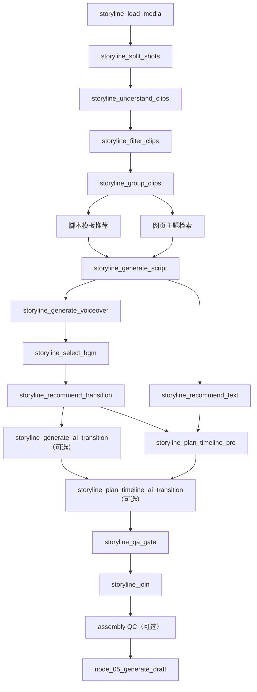
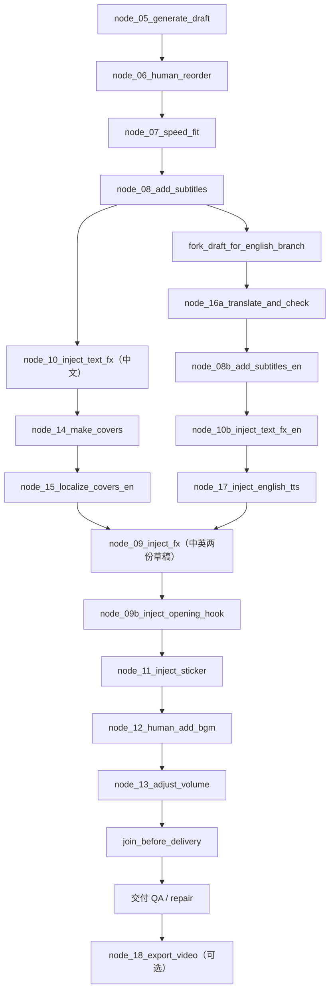
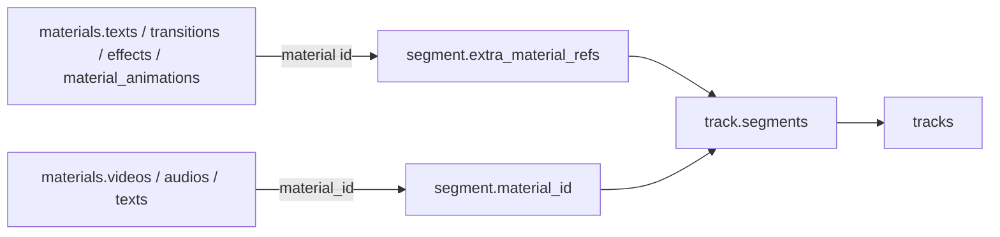

# auto-video-editor 与 pyJianYingDraft：剪映草稿特效能力对比、设计与执行计划

> **审查对象**：
> - `wayyet/auto-video-editor`：`main`，审查快照 commit `fa6768ff7d201b211196c2fc97f12d1594919c8a`（2026-11-21）
> - `GuanYixuan/pyJianYingDraft`：`main`，审查快照 commit `1e228479dda361e312e85f6037002346cf6dca9a`（README / 包版本 0.3.1）
> - **审查范围**：剪映草稿构建、原生轨道与素材结构、字幕文本、花字、文本/视频动画、转场、视频特效、资源缓存、草稿写入发布与 MP4 导出。
> - **审查方法**：基于两个仓库上述 commit 的 README、源代码、工作流图和测试代码进行静态审查；本报告没有在本会话中运行全量 pytest，也没有在本机启动剪映做真机渲染。因此，代码结构和单测覆盖情况可以确认，但实际渲染结论必须以指定剪映版本的 GUI 验收为准。

---

## 1. 结论摘要

### 1.1 两个项目的定位不同，不宜直接替换

`auto-video-editor` 是一个**自动化剪辑工作流系统**：LangGraph 负责编排素材理解、脚本、配音、BGM、时间线规划、草稿生成、字幕/花字/动画/转场注入、人工关卡、质量检查和交付。它用自己的 `jy_common/native_fx.py`、`storyline/native_draft.py`、`nodes/_draft_io.py` 等模块构造和修改剪映原生草稿 JSON。

`pyJianYingDraft` 是一个**剪映草稿 Python SDK**：提供 `DraftFolder`、`ScriptFile`、`Track`、`VideoSegment`、`TextSegment`、`Transition` 等对象化 API，供调用方明确构建轨道和片段，再序列化成剪映草稿。

目前没有证据表明 `auto-video-editor` 把 `pyJianYingDraft` 当作运行时依赖直接调用。当前仓库只 vendored（内置）了该项目的部分元数据模块，供 VIP 资源库构建或复用；真正执行草稿写入的是 `auto-video-editor` 自己的原生 JSON 构造与写入代码。因此，合理方向是**保留 LangGraph 工作流和现有原生草稿管线，选择性吸收 pyJianYingDraft 的 API 设计与能力模型**，而不是整体改成调用 SDK。

### 1.2 功能层面的主要结论

| 功能 | auto-video-editor 当前实现 | pyJianYingDraft 当前实现 |
|---|---|---|
| 草稿/轨道/片段 | 自己构建原生 JSON；上游使用 Canonical Timeline | `ScriptFile` / `Track` / `Segment` 对象化 API |
| 字幕文本 | node 08 写入原生 `materials.texts` 与 text track | `TextSegment` 添加到 text track |
| 花字 | node 10 / 10b 写入 `materials.effects(type=text_effect)`，并用 `extra_material_refs` 绑定 | `TextSegment.add_effect(effect_id)`，写入文本样式和花字素材引用 |
| 文本动画 | node 10 / 10b 当前主要写入文字入场动画 | 文本入场、出场、循环动画均有 API |
| 视频动画 | 当前工作流未发现与 pyJianYingDraft 同等的通用视频片段动画注入节点 | `VideoSegment.add_animation()` 支持 in/out/group |
| 原生转场 | node 09 按时间线边界和语义资源池注入 | `VideoSegment.add_transition()` 按片段添加转场 |
| 视频特效 | node 09 从白名单和资源库解析后挂到视频片段 | `VideoSegment.add_effect()` / 独立 effect track |
| AI 生成转场 | 有独立生成、缓存、授权、时间线物化链路 | 未见同等的 AI 视频生成编排能力；主要使用剪映内置转场资源 |
| 草稿发布与保护 | 原子双写、快照、校验、回滚、正式草稿库发布/注册 | `ScriptFile.dump/save` 负责序列化写文件；不提供同等的 LangGraph 发布与审计管线 |
| 工作流/监控/人工关卡 | LangGraph 节点、checkpoint、QA、人工关卡和监控事件 | SDK 本身不负责业务工作流编排 |

### 1.3 最高优先级风险：花字写入成功，不等于剪映能正确渲染

当前 `auto-video-editor` 的 `main` 最新提交（2026-11-21）记录了一个已定位问题：在便携版剪映 **5.9.0.11632** 中，花字写入层和 UUIDv5/素材引用层验证通过，但客户端无法加载 `TextStyle v13.9.0 / InfoSticker v6.3.0` 资源格式，渲染时静默退化为普通文本。提交说明建议在支持的剪映客户端升级前，考虑暂时关闭 `TEXT_FLOWER_ENABLED`；这属于提交中的处置建议，不应误读成该开关已在代码中默认关闭。

**工程结论**：花字验收必须分成两层：

1. **草稿结构验收**：JSON 合法、花字素材条目存在、text segment 引用正确、重放幂等。
2. **剪映渲染验收**：指定版本的剪映真正显示目标花字，保存/关闭/重新打开后仍然显示，不能只凭草稿文件中有 `text_effect` 就判定成功。

参考：[`auto-video-editor` 最新提交及根因说明](https://github.com/wayyet/auto-video-editor/commit/fa6768ff7d201b211196c2fc97f12d1594919c8a)。

---

## 2. auto-video-editor 剪映草稿相关架构

### 2.1 工作流分层

项目的相关逻辑可以分成五层：

| 层 | 核心目录/文件 | 职责 |
|---|---|---|
| 业务编排层 | `graph.py`、`nodes/storyline/` | LangGraph 节点和边；组织素材理解、计划、配音、字幕、特效和交付 |
| 时间线与计划层 | `storyline/contract.py`、`storyline/mapper.py`、`storyline_capabilities/` | Canonical Timeline、镜头片段、字幕样式计划、转场计划、AI 转场计划 |
| 草稿原生结构层 | `storyline/native_draft.py`、`jy_common/native_text.py`、`jy_common/native_fx.py` | 将业务时间线转换为剪映 `materials`、`tracks`、`segments` 等原生结构 |
| 草稿变更与保护层 | `nodes/_draft_io.py`、`draft_ops/` | 读取、修改、审计、原子双写、快照、校验、回滚和发布 |
| 资源与兼容层 | `templates/`、`jy_common/template_library.py`、`vendor/pyJianYingDraft/metadata/` | 资源元数据、白名单、VIP 资源索引、花字和动画缓存校验 |

关键代码入口：

- [`graph.py`](https://github.com/wayyet/auto-video-editor/blob/main/graph.py)
- [`nodes/node_05_generate_draft.py`](https://github.com/wayyet/auto-video-editor/blob/main/nodes/node_05_generate_draft.py)
- [`storyline/mapper.py`](https://github.com/wayyet/auto-video-editor/blob/main/storyline/mapper.py)
- [`storyline/native_draft.py`](https://github.com/wayyet/auto-video-editor/blob/main/storyline/native_draft.py)
- [`jy_common/native_fx.py`](https://github.com/wayyet/auto-video-editor/blob/main/jy_common/native_fx.py)
- [`nodes/_draft_io.py`](https://github.com/wayyet/auto-video-editor/blob/main/nodes/_draft_io.py)

### 2.2 LangGraph 主工作流：从素材理解到草稿生成

当前 auto-only 工作流的主链可简化为：



说明：

- `storyline_recommend_text` 生成的是按 group 输出的字幕样式建议，例如字体、字号、颜色和位置；它**不是**花字写入节点。
- `storyline_recommend_transition` 生成的是转场语义/建议；它**不是**直接改剪映草稿的节点。
- `storyline_plan_timeline_pro` 把 clip、配音、BGM、转场语义和字幕样式组合成 Canonical Timeline。
- AI 转场开启时，图中会加入生成节点和最终时间线物化节点；默认门禁要求功能开关和本次任务授权，默认生产路径不发起 Provider 外呼，也不产生假占位转场。
- QA 通过后进入 `storyline_join`，再经过可选 assembly QC，然后交给 node 05 生成剪映草稿。

### 2.3 草稿落盘后的特效节点链



注意：

- node 08 后分成中文和英文两条支路；node 10 和 node 10b 分别处理各自草稿的文字动画与花字。
- node 09 在两条支路汇合后运行，在同一节点内按顺序处理中文主草稿和英文分支草稿，确保同一 `job_id` 下的转场资源选择一致。
- node 11 是贴纸，不是花字；贴纸资源与花字资源属于不同的 `materials` 桶和资源类别。
- node 18 是最终 MP4 导出节点，不是剪映草稿生成或发布节点；默认导出开关关闭时会显式返回 `skipped`。

工作流边的实现位置：[`graph.py#L628-L709`](https://github.com/wayyet/auto-video-editor/blob/main/graph.py#L628-L709)、[`graph.py#L711-L850`](https://github.com/wayyet/auto-video-editor/blob/main/graph.py#L711-L850)。

---

## 3. auto-video-editor 的草稿数据与模块职责

### 3.1 剪映原生草稿的核心数据关系

两个项目最终都围绕剪映草稿的几个基本对象工作：

- `materials`：素材/效果元数据集合，例如 `videos`、`audios`、`texts`、`transitions`、`video_effects`、`material_animations`、`effects`、`stickers`。
- `tracks`：时间线轨道，例如 video、audio、text。
- `segments`：轨道上的具体片段，含素材引用、时间范围和附加引用。
- `extra_material_refs`：片段对动画、转场、特效、花字、贴纸等附加素材的引用关系。
- 时间：剪映草稿内部主要采用微秒；auto 的 Canonical Timeline 以毫秒表达，再由 mapper/native converter 转换为微秒。

可把关系理解为：



这也是两个实现可相互比较的基础：**素材定义和轨道片段引用必须同时正确**。只有素材条目、没有 segment 引用，效果可能成为孤立素材；只有引用、没有对应 material，也会形成断链。

### 3.2 node 05：初始草稿生成与正式发布

主要文件：`nodes/node_05_generate_draft.py`。

职责：

1. 从 `assembly_final_plan`、`storyline_plan` 或 legacy `shot_plan` 中选择本轮最终剪辑计划。
2. 校验草稿加密状态和计划完整性；空镜头时间线会 fail-closed，拒绝生成空草稿。
3. 使用 `storyline.mapper` / `storyline.native_draft` 将业务时间线转换为剪映原生 JSON。
4. 通过 `safe_write_draft` 写入 staging 草稿；必要时写入 sidecar 保存无法映射的辅助信息。
5. 在发布开关启用且任务 ID 有效时，通过 `draft_ops.draft_publisher.publish_draft` 将草稿复制到剪映草稿库并注册，回填正式草稿路径。

一个重要设计点：`storyline/mapper.py` 不负责最终写入真正的文本轨道。它会在中间 timeline 中保留字幕文本/样式元数据，但原生文本轨道的写入由 node 08 执行。这避免了先生成一套临时 text 轨道、再被原生转换丢弃的历史问题。

代码：[`node_05_generate_draft.py#L62-L100`](https://github.com/wayyet/auto-video-editor/blob/main/nodes/node_05_generate_draft.py#L62-L100)、[`node_05_generate_draft.py#L206-L265`](https://github.com/wayyet/auto-video-editor/blob/main/nodes/node_05_generate_draft.py#L206-L265)、[`node_05_generate_draft.py#L327-L355`](https://github.com/wayyet/auto-video-editor/blob/main/nodes/node_05_generate_draft.py#L327-L355)。

### 3.3 node 08：生成原生字幕文本轨道

主要文件：`nodes/node_08_add_subtitles.py`、`jy_common/native_text.py`。

职责：

- 从最终草稿和当前时间线中构造中文字幕素材。
- 将文本内容、字体、字号、颜色、描边、排版等写入原生 text material。
- 创建/替换本节点拥有的文本轨道 `track-text-1`；保留其他人工创建的 text 轨道。
- 在相关场景下写入中文配音轨道。
- 为后续翻译提供字幕文本段落元数据。

节点边界：node 08 是字幕**文本片段**的主要生产者；它不负责选择花字资源，不负责把花字资源加入 `materials.effects`。这部分交由 node 10 / node 10b。

代码：[`node_08_add_subtitles.py#L340-L424`](https://github.com/wayyet/auto-video-editor/blob/main/nodes/node_08_add_subtitles.py#L340-L424)、[`node_08_add_subtitles.py#L870-L959`](https://github.com/wayyet/auto-video-editor/blob/main/nodes/node_08_add_subtitles.py#L870-L959)、[`jy_common/native_text.py`](https://github.com/wayyet/auto-video-editor/blob/main/jy_common/native_text.py)。

### 3.4 node 10 / node 10b：文字动画和花字

主要文件：

- `nodes/node_10_inject_text_fx.py`
- `nodes/_text_flower.py`
- `jy_common/native_fx.py`
- `templates/text_resource_library.json`
- `templates/text_flower_resource_library.json`

node 10 负责中文主草稿，node 10b 负责英文分支。两者共用 `apply_text_fx()`：读草稿、注入动画、注入花字，再通过统一写入入口提交。

#### A. 文本入场动画

当前实现主要给项目自己生成的正文字幕（`text-zh-*`、`text-en-*`）选择一个可用的 VIP 入场动画：

1. 从 `text_resource_library.json` 的 `intro` 列表中筛选候选。
2. 按资源元数据、`verified` 状态及本地缓存目录检查可用性。
3. 使用 `job_id` 作为确定性选择 seed，避免同一任务重放时随机漂移；中英文分支共用 seed。
4. 构造 `materials.material_animations` 条目，动画类型为 `in`。
5. 将动画素材 ID 写入对应 text segment 的 `extra_material_refs`。
6. 用确定性 ID upsert，防止重试产生重复素材；清理只针对我方标识的旧动画，不碰人工添加的动画。

**当前能力边界**：node 10 的实际注入逻辑主要是文本入场动画；没有看到它像 pyJianYingDraft 那样完整提供文字出场 `out`、循环 `loop` 以及通用视频片段 in/out/group 动画 API。不能把“底层 JSON 可能容纳动画”误判成“工作流已经提供这些功能”。

#### B. 花字效果

`nodes/_text_flower.py` 将花字作为独立的原生素材注入：

1. 仅处理我方正文字幕，不处理 `hook-title-*` 开场标题，也不处理人工 UUID 文本。
2. 从 `text_flower_resource_library.json` 选择资源；目前资源池中仅见一个已验证条目“互动立体”。
3. 校验 `enabled`、`verified`、`effect_id`、`resource_id`、`md5` 和 `Cache/artistEffect/<effect_id>/<md5>` 目录；并验证缓存 manifest SHA-256。
4. 构造 `materials.effects` 中 `type=text_effect` 的条目。
5. 使用 UUIDv5 从字幕 material ID 派生花字 material ID，确保重复执行稳定。
6. 把花字 ID 追加至字幕 text segment 的 `extra_material_refs`。
7. 仅在本轮真正写入了新花字后清理过期的我方花字；资源不可用时走降级，不删除原来已经存在的花字。

当前花字资源池配置中，“互动立体”为 VIP/订阅资源，资源身份为 `effect_id/resource_id=7407340226189757733`，MD5 为 `c093f229a5b9529beab4d27c00bc0c4f`。因此这不是一个完全脱离剪映客户端资源包、只写几段 JSON 就能保证显示的纯文本样式。

资源与逻辑代码：[`nodes/_text_flower.py#L196-L280`](https://github.com/wayyet/auto-video-editor/blob/main/nodes/_text_flower.py#L196-L280)、[`node_10_inject_text_fx.py#L183-L248`](https://github.com/wayyet/auto-video-editor/blob/main/nodes/node_10_inject_text_fx.py#L183-L248)、[`node_10_inject_text_fx.py#L252-L318`](https://github.com/wayyet/auto-video-editor/blob/main/nodes/node_10_inject_text_fx.py#L252-L318)、[`text_flower_resource_library.json`](https://github.com/wayyet/auto-video-editor/blob/main/templates/text_flower_resource_library.json)。

### 3.5 node 09：原生转场和视频特效

主要文件：`nodes/node_09_inject_fx.py`、`jy_common/native_fx.py`、`templates/fx_template.json`、`templates/fx_resource_library.json`。

#### A. 原生转场

- node 09 读取 Canonical Timeline 中的 `transition_in` / `transition_out` 语义。
- 每个相邻视频片段之间形成一个边界，边界数量为 `max(video_segments - 1, 0)`。
- 当前段的 `transition_out` 优先；没有时回退到下一段的 `transition_in`。
- 语义经过 `transition_semantic_map` 映射到转场池，再根据 `job_id` 和边界序号确定性轮换具体资源。
- 通过 `fx_resource_library.json` 精确查询真实转场 `resource_id`、`effect_id`、默认时长和 overlap 属性。
- 转场时长会按相邻片段时长做限制；资源无法解析时不写假资源，记录降级信息。
- 如果交付要求必须有转场，而所有边界均为硬切，会使用配置的保底策略（例如首边界回退 fade）。
- 有开场强调指令时，首个边界会优先使用 whip 语义；只有资源实际解析并写入后才记为生效。

**特别注意挂载方向**：auto-video-editor 将边界 `i → i+1` 的转场素材引用绑定到**后一段**（`segments[i+1]`）。pyJianYingDraft 的 `VideoSegment.add_transition()` 文档则写明转场应添加到**前面的片段**。这属于需要真机对照验证的差异，不应直接改动方向而不做回归测试。

#### B. 视频特效

- 通过 `fx_template.json` 中的 `video_effects` 白名单确定允许使用的特效。
- 白名单名称必须在资源库 `video_effects` 分区精确命中，防止同名转场/视频特效跨分类误用。
- 当前按首段、尾段和部分中间段选择特效，避免每个镜头都堆叠效果。
- 将特效素材写入 `materials.video_effects`，并把引用放入对应 video segment 的 `extra_material_refs`。
- 用确定性 ID upsert；过期清理仅针对我方命名规则，不修改人工效果。

代码：[`node_09_inject_fx.py#L257-L435`](https://github.com/wayyet/auto-video-editor/blob/main/nodes/node_09_inject_fx.py#L257-L435)、[`jy_common/native_fx.py#L58-L114`](https://github.com/wayyet/auto-video-editor/blob/main/jy_common/native_fx.py#L58-L114)。

### 3.6 Storyline 推荐转场与 AI 转场不是同一类东西

项目有两种“转场”概念：

| 类型 | 产物 | 最终进入剪映草稿的方式 |
|---|---|---|
| 剪映原生转场 | 剪映内置转场资源元数据（resource/effect ID） | node 09 写入 `materials.transitions` 并绑定到 video segment |
| AI 生成转场 | Provider 生成的短视频文件和 `ai_transition.json` 审计清单 | `node_plan_timeline_ai_transition` 将视频作为普通 clip 插入时间线，再由 mapper 生成普通视频素材与视频 segment |

AI 转场生成需要功能开关和任务明确授权；单个 pair 生成失败会降级，不应伪造一个剪映原生转场素材。它与 pyJianYingDraft 的 `TransitionType` 资源枚举并非同一能力。

代码：[`node_generate_ai_transition.py`](https://github.com/wayyet/auto-video-editor/blob/main/nodes/storyline/node_generate_ai_transition.py)、[`node_plan_timeline_ai_transition.py`](https://github.com/wayyet/auto-video-editor/blob/main/nodes/storyline/node_plan_timeline_ai_transition.py)。

### 3.7 草稿写入、审计和正式发布

`nodes/_draft_io.py` 将 node 08/09/10/11 的常见读写逻辑统一到 `apply_and_write()`；`draft_ops/atomic_writer.py` 和 `draft_ops/draft_publisher.py` 提供更完整的保护。

主要行为包括：

- 检查剪映进程状态，严格模式下剪映正在运行就拒绝写入，避免和 GUI 人工编辑冲突。
- 写入前快照草稿目录。
- 对 `draft_content.json` 和 `draft_info.json` 做原子写入；两文件内容按项目约定保持一致。
- 回读 JSON 并验证；失败时回滚快照。
- 记录 draft mutations 审计，包含各 material 桶计数和花字内容/引用的 SHA 指纹。
- staging 草稿通过校验后，再复制/发布到配置的剪映正式草稿库，执行发布后回读校验并维护注册信息。

这部分是 auto-video-editor 相对单纯草稿 SDK 的明显工程化增强。

代码：[`nodes/_draft_io.py#L217-L320`](https://github.com/wayyet/auto-video-editor/blob/main/nodes/_draft_io.py#L217-L320)、[`draft_ops/atomic_writer.py`](https://github.com/wayyet/auto-video-editor/blob/main/draft_ops/atomic_writer.py)、[`draft_ops/draft_publisher.py#L74-L119`](https://github.com/wayyet/auto-video-editor/blob/main/draft_ops/draft_publisher.py#L74-L119)、[`draft_ops/draft_publisher.py#L186-L250`](https://github.com/wayyet/auto-video-editor/blob/main/draft_ops/draft_publisher.py#L186-L250)。

### 3.8 node 18：MP4 导出

`node_18_export_video.py` 位于交付 QA 之后。它读取权威中文主草稿并调用 `draft_ops.draft_exporter.run_export()`；`FINAL_EXPORT_ENABLED` 默认关闭，关闭时写明 `skipped`。因此，**草稿发布到剪映草稿库**和**将草稿渲染成 MP4**是两件独立的事。

代码：[`node_18_export_video.py`](https://github.com/wayyet/auto-video-editor/blob/main/nodes/node_18_export_video.py)。

---

## 4. pyJianYingDraft 的相关设计与 API

### 4.1 对象模型

pyJianYingDraft 把剪映草稿中的实体包装成 Python 对象：

| 对象/模块 | 作用 |
|---|---|
| `DraftFolder` | 管理剪映草稿根目录；新建草稿、加载模板、复制模板 |
| `ScriptFile` | 草稿主体；维护画布尺寸、FPS、时长、materials 和 tracks；负责序列化 |
| `TrackType` / `Track` | 轨道类型与片段集合；添加时校验片段类型及时间重叠 |
| `VideoSegment` | 视频片段；支持动画、特效、滤镜、蒙版、混合模式、转场等 |
| `TextSegment` | 文本片段；支持字体样式、描边、背景、阴影、气泡、花字和文字动画 |
| `SegmentAnimations` | 管理一个片段上的动画集合 |
| `Transition` / metadata enums | 封装剪映原生转场元数据和时长 |
| `ScriptMaterial` | 聚合各种 material，最后导出到剪映 `materials` 桶 |

参考源码：[`script_file.py`](https://github.com/GuanYixuan/pyJianYingDraft/blob/main/pyJianYingDraft/script_file.py)、[`draft_folder.py`](https://github.com/GuanYixuan/pyJianYingDraft/blob/main/pyJianYingDraft/draft_folder.py)、[`track.py`](https://github.com/GuanYixuan/pyJianYingDraft/blob/main/pyJianYingDraft/track.py)。

### 4.2 花字和文本气泡

- `TextSegment.add_effect(effect_id)` 创建 `TextEffect`。
- `TextEffect.export_json()` 将素材类型写为 `text_effect`，并标记 `source_platform=1`。
- 花字素材通过 `extra_material_refs` 关联文本片段。
- 文本的 `content.styles` 也会写入 `effectStyle` 信息。
- `TextSegment.add_bubble(effect_id, resource_id)` 创建文本气泡（`text_shape`），与花字不是同一类素材。
- README 提醒：花字/气泡等素材元信息可以从已有模板草稿提取；`inspect_material()` 可帮助提取 resource ID。

源码：[`text_segment.py#L178-L212`](https://github.com/GuanYixuan/pyJianYingDraft/blob/main/pyJianYingDraft/text_segment.py#L178-L212)、[`text_segment.py#L255-L435`](https://github.com/GuanYixuan/pyJianYingDraft/blob/main/pyJianYingDraft/text_segment.py#L255-L435)、[`_script_file_segments.py#L51-L151`](https://github.com/GuanYixuan/pyJianYingDraft/blob/main/pyJianYingDraft/_script_file_segments.py#L51-L151)。

### 4.3 文本动画与视频动画

`animation.py` 定义通用 `Animation` 和 `SegmentAnimations`：

- 视频动画类型：`in`、`out`、`group`。
- 文本动画类型：`in`、`out`、`loop`。
- 每个动画有开始偏移和持续时间，单位为微秒。
- 一个片段不能添加两个相同类型的动画；视频组合动画不能与入场/出场动画同时存在；文本循环动画有额外约束。
- `TextSegment.add_animation()` 和 `VideoSegment.add_animation()` 将动画对象纳入 `materials.material_animations`，并写入片段附加引用。

源码：[`animation.py#L14-L141`](https://github.com/GuanYixuan/pyJianYingDraft/blob/main/pyJianYingDraft/animation.py#L14-L141)、[`video_segment.py#L502-L529`](https://github.com/GuanYixuan/pyJianYingDraft/blob/main/pyJianYingDraft/video_segment.py#L502-L529)。

### 4.4 转场、视频特效和滤镜

- `VideoSegment.add_transition()` 绑定原生转场；API 注释指出转场应添加到前一个视频片段。
- `VideoSegment.add_effect()` 添加视频特效。
- `VideoSegment.add_filter()` 添加滤镜。
- `ScriptFile.add_segment()` 会将这些对象聚合到相应 `materials` 桶，同时把引用写入片段。
- SDK 通过 `metadata/transition_meta.py`、`metadata/video_scene_effect.py`、`metadata/filter_meta.py` 等内置元数据枚举来暴露资源类型。

源码：[`video_segment.py#L300-L342`](https://github.com/GuanYixuan/pyJianYingDraft/blob/main/pyJianYingDraft/video_segment.py#L300-L342)、[`video_segment.py#L533-L657`](https://github.com/GuanYixuan/pyJianYingDraft/blob/main/pyJianYingDraft/video_segment.py#L533-L657)、[`script_material.py#L100-L151`](https://github.com/GuanYixuan/pyJianYingDraft/blob/main/pyJianYingDraft/script_material.py#L100-L151)。

### 4.5 草稿模板和导出限制

`DraftFolder` 支持创建草稿、加载已有草稿作为模板、复制模板后再修改。模板模式可以保留一部分复杂特性并替换文本/素材；但 README 同时说明，导入的轨道并非都允许任意修改，且新版剪映的模板 JSON 可能需要 `fallback_loader`。

README 还说明其 GUI 自动导出依赖旧版剪映可见控件，官方文档口径是剪映 6 及以下版本、Windows UI 自动化路径；在新版剪映上通常不可用。因此不能简单认为 pyJianYingDraft 的 `JianyingController` 是跨版本导出方案。

参考：[`pyJianYingDraft README`](https://github.com/GuanYixuan/pyJianYingDraft#readme)、[`draft_folder.py`](https://github.com/GuanYixuan/pyJianYingDraft/blob/main/pyJianYingDraft/draft_folder.py)。

---

## 5. 两个项目逐项比较

### 5.1 草稿生成和工作流

| 对比项 | auto-video-editor | pyJianYingDraft | 结论 |
|---|---|---|---|
| 上游输入 | 自然语言任务、素材理解结果、Canonical Timeline、最终计划 | Python 调用方显式创建素材/轨道/片段 | 上游抽象不同 |
| 编排 | LangGraph 主图、条件边、并行分支、人工关卡、checkpoint、QA/retry | SDK 不承担业务级工作流调度 | auto 强在自动化编排 |
| 草稿对象 | dict/JSON 和项目内部 mapper/native adapter | `ScriptFile` 等 Python 对象 | py API 更直观、类型化程度更高 |
| 新建草稿 | node05 生成 staging，再发布到草稿库 | `DraftFolder.create_draft()` 创建目录和 `ScriptFile` | 都能生成草稿，但发布治理不同 |
| 修改已有草稿 | 主要由项目自有 JSON 读写和定向 patch 管理 | `load_template` / `duplicate_as_template` / 替换接口 | py 模板编辑能力更明确 |
| 写入保护 | 快照、原子双写、校验、回滚、互斥和 mutation audit | `dump/save` 序列化写文件 | auto 工程保护更完整 |

### 5.2 字幕、花字、动画

| 对比项 | auto-video-editor | pyJianYingDraft | 差异判断 |
|---|---|---|---|
| 文本片段创建 | node08 先生成字幕 material 和 text track | `TextSegment` + `ScriptFile.add_segment()` | 两者均支持原生 text track |
| 字体/样式 | 从推荐样式计划和本地字体配置落到原生文本 JSON | `TextStyle`、`FontType`、`TextBorder`、`TextBackground`、`TextShadow` 等对象 | py 的样式 API 更完整、显式 |
| 花字结构 | `materials.effects` 的 `text_effect` + text segment `extra_material_refs` | `TextEffect`，输出 `text_effect`，并关联文本段；同时 `content.styles.effectStyle` 记录效果 | 底层素材关系相近；高层 API 不同 |
| 花字选择 | 受控 JSON 资源池、VIP 标记、`verified`、缓存 manifest 和 deterministic pool | 通过 `effect_id` 显式调用，通常从模板提取素材元数据 | auto 自动选取治理更强；py 交给调用方选择更灵活 |
| 花字覆盖范围 | 当前只针对我方 `text-zh-*` / `text-en-*` 正文字幕 | `TextSegment` 实例可单独加花字 | py 的调用粒度更通用 |
| 文本动画 | node10/10b 当前主要实现 `in` 入场动画 | `in` / `out` / `loop` 均有 API | py 覆盖面更完整 |
| 视频动画 | 当前工作流未发现等价的通用视频动画节点 | `VideoSegment.add_animation()` 支持 `in` / `out` / `group` | py 更完整 |
| 动画资源 | `text_resource_library` + Cache/effect + verified guard | 枚举元数据和动画对象序列化 | 资源验证策略不同 |
| 故障降级 | 缺资源时不伪造素材、不清掉旧花字，并返回状态/审计信息 | 多数错误由对象 API 校验抛出；调用方负责降级策略 | auto 更强调工作流可恢复性 |

**重要差异**：auto-video-editor 花字构造器当前重点是 `materials.effects` 的独立 `text_effect` material 和片段引用；pyJianYingDraft 的 `TextSegment.export_material()` 还会在文本 `content.styles[0]` 中写入 `effectStyle`。这意味着不能只比较 `effects` 桶中都有 `text_effect` 就断言两个构造路径字节级等价。应以剪映实际创建并保存的 Golden Sample 对照关键字段，并按客户端版本做渲染验收。

### 5.3 转场、视频特效和 AI 转场

| 对比项 | auto-video-editor | pyJianYingDraft | 差异判断 |
|---|---|---|---|
| 原生转场资源 | 语义映射 → 池 → 精确匹配资源 → `materials.transitions` | `TransitionType` 元数据枚举 → `Transition` 对象 | 都写剪映原生转场 |
| 转场应用粒度 | 自动按相邻 clip 边界注入 | 调用方对指定 `VideoSegment` 添加 | auto 自动化更强，py 控制粒度更明确 |
| 转场挂载侧 | 当前代码写到边界的后一段 segment | API 注释要求转场挂到前一段 segment | 必须做真机对照验证 |
| 时长治理 | 根据邻接 clip 时长钳制，含 all-cut fallback 和语义策略 | 支持显式 duration 或 metadata 默认时长 | auto 自动治理更多 |
| 视频特效 | 白名单、资源库分区精确匹配、按位置点缀 | `add_effect()` 可明确选择 effect enum 并设参数 | 两者都支持；控制接口不同 |
| 滤镜 | 当前 node09 主链重点是转场和 VFX；未发现与 py 完全一致的统一滤镜对象 API | `add_filter()` 和 FilterSegment | py 的滤镜 API 更清晰 |
| AI 生成转场 | 有 Provider 授权、生成文件、缓存、失败降级、时间线插入 | 未见同等视频生成流程 | auto 独有业务能力，不等同内置转场 |

### 5.4 轨道、模板、资源、发布和导出

| 对比项 | auto-video-editor | pyJianYingDraft | 结论 |
|---|---|---|---|
| 轨道类型校验 | 通过自己的草稿结构操作和测试约束 | `TrackType` 与 `Track.add_segment()` 显式校验类型/重叠 | py 对象 API 更严格直观 |
| 时间范围 | Canonical Timeline → mapper → 原生 µs | API 的 `Timerange`/便捷时间函数，最终也是 µs | 底层时间单位一致 |
| 资源来源 | 项目资源 JSON、缓存目录、资源身份/manifest 校验 | 库内元数据枚举和模板元信息提取 | auto 更强调环境缓存核验；py 更强调枚举/API |
| 模板读取 | 没有发现与 `DraftFolder` 相同的通用模板对象 API；主要围绕项目自己的生成和 patch | 模板加载/复制/替换功能是 SDK 的明确能力 | py 更适合模板编辑场景 |
| 草稿发布 | 支持正式草稿库目录发布、注册和发布后校验 | `dump/save` 写入草稿文件 | auto 发布链更完整 |
| 并发写保护 | 检查剪映进程、快照、回滚、审计 | SDK 写文件本身不提供同样的工作流级互斥 | auto 更适合无人值守服务 |
| MP4 导出 | 独立 `node_18`，FFmpeg 类渲染路径，可配置且默认关闭 | GUI 自动导出依赖旧版可见 UI 控件 | 导出实现路线不同 |

---

## 6. 相同点与不同点总结

### 6.1 相同点

1. 两者最终都要生成剪映可识别的草稿 JSON，而不是只生成一份普通视频编辑描述。
2. 都围绕 `materials`、`tracks`、`segments`、material ID 和 `extra_material_refs` 建立素材与时间线片段关系。
3. 都能表达文本、花字/文本效果、动画、转场、视频特效和贴纸等剪映原生资源。
4. 都依赖剪映认识的 `effect_id`、`resource_id` 等资源身份；缓存/客户端版本影响最终效果能否加载。
5. 时间线效果必须和片段时间范围及素材引用对应，不能只增加 material 条目。

### 6.2 不同点

1. **架构层次不同**：auto 是工作流系统；py 是通用 SDK。两者不处于同一个替换层级。
2. **抽象方式不同**：auto 更多通过 Timeline、字典、原生 JSON 和 node 注入；py 通过 Python 类和方法表达编辑意图。
3. **自动化策略不同**：auto 使用语义规划、资源池轮换、任务 seed、资源白名单、失败降级和审计；py 更偏调用方显式指定效果和片段。
4. **功能覆盖不同**：py 在文本出场/循环动画、视频动画、滤镜、片段级操作及模板修改 API 上更完整；auto 在自动生成工作流、AI 转场、双语分支、QA、checkpoint、草稿安全发布方面更强。
5. **持久化和可恢复性不同**：auto 的草稿写入和发布有事务保护及变更审计；py 的 `dump/save` 更轻量。
6. **客户端兼容策略不同**：auto 当前有针对资源缓存及花字资源完整性的额外守卫，但最新提交仍暴露客户端版本不兼容的渲染风险；py README 也明确提到新版剪映模板读取和 GUI 导出限制。

---

## 7. 当前项目需要补齐/验证的问题

按风险和用户可见影响排序：

### P0：先解决花字渲染兼容性，再扩充花字池

- [ ] 确认目标生产客户端的准确版本、安装类型（正式版/便携版）和系统平台。
- [ ] 在当前 `TEXT_FLOWER_ENABLED` 配置下，区分“写入成功”“剪映打开成功”“实际渲染成功”“保存重开后仍然成功”四种状态。
- [ ] 对最新提交指出的剪映便携版 5.9.0.11632 做复现；升级候选客户端后，用同一个花字 Golden Sample 对照。
- [ ] 对不支持的客户端版本增加 capability gate：不能渲染时不应仅因 JSON 写入成功就报告花字成功。
- [ ] 在客户端兼容矩阵明确之前，建议生产默认关闭花字注入或按版本白名单开启；保留旧花字，不在降级路径清理既有素材。
- [ ] 在状态和监控中分别记录 `draft_written` 与 `render_verified`，禁止将两者合并为一个成功标志。

### P1：转场挂载方向真机验证

- [ ] 固定一组只有两个视频片段、只有一个转场的最小草稿。
- [ ] 分别生成“引用挂在前段”和“引用挂在后段”两个草稿版本。
- [ ] 在目标剪映版本打开、播放、保存、关闭、重新打开，并检查转场面板与渲染结果。
- [ ] 确认是否存在不同剪映版本/转场类型的挂载方向差异。
- [ ] 以实测结果为准决定是否修改 auto `segments[i+1]` 的绑定位置；同时更新 JSON fixture、单测和真机证据。

### P1：补齐文本动画和视频动画的能力面

- [ ] node 10 当前先写入动画 material，再查找对应 text segment；若 segment 缺失，会记录“动画素材已写但未绑定”，留下无引用素材。建议调整为与花字相同的 **segment 先行** 顺序：先定位目标 segment，再写 material 和 ref；找不到 segment 就不产生 material。
- [ ] 在业务层定义动画意图：`kind in/out/loop/group`、目标 segment ID、duration、资源身份、适用客户端版本。
- [ ] 文本动画补充 `out` 和 `loop` 的设计及冲突校验；当前不能简单把动画 metadata 换成另一个 kind 就认为生效。
- [ ] 视频 segment 增加 `in/out/group` 能力，覆盖 pyJianYingDraft 已提供的基本对象能力。
- [ ] 对入场/出场动画时长进行片段时长钳制；明确 loop 与 in/out 的可组合规则。
- [ ] 引入真实资源包完整性校验与 GUI 渲染验收；缓存目录存在不等于资源包完整或客户端可加载。

### P2：统一花字/动画/转场的资源管理和构造契约

- [ ] 用统一 `ResourceIdentity` 描述 `name/effect_id/resource_id/md5/category/vip/verified/client_compatibility`。
- [ ] 按素材种类隔离缓存路径，例如文字动画 `Cache/effect` 与花字 `Cache/artistEffect`，不允许混用。
- [ ] 对资源包记录 manifest SHA-256，并对客户端版本、资源版本和验证日期建立审计记录。
- [ ] 资源解析失败一律 fail-closed：不写占位 ID、不产生孤儿 material、不删除原有可用效果。
- [ ] 统一使用确定性 ID、upsert、引用去重和只清理我方受控素材的规则。

### P2：建立 SDK 对照适配层，而不是直接替换草稿生成主链

建议引入一个内部的“效果意图层”（可命名为 `JianyingEffectIntent` / `NativeEffectPlan`），由工作流节点产生编辑意图，再由当前原生 JSON renderer 落盘。该层可参考 pyJianYingDraft 的对象模型，但不强制引入为运行时依赖。

建议的最小对象：

```python
from dataclasses import dataclass
from typing import Literal

@dataclass(frozen=True)
class ResourceIdentity:
    name: str
    effect_id: str
    resource_id: str
    md5: str
    category: str
    client_min_version: str | None = None

@dataclass(frozen=True)
class TextEffectIntent:
    text_material_id: str
    resource: ResourceIdentity

@dataclass(frozen=True)
class AnimationIntent:
    target_segment_id: str
    kind: Literal["in", "out", "loop", "group"]
    duration_us: int
    resource: ResourceIdentity

@dataclass(frozen=True)
class TransitionIntent:
    left_segment_id: str
    right_segment_id: str
    semantic: str
    duration_us: int | None = None
    resource: ResourceIdentity | None = None
```

设计约束：

- 工作流节点只负责决定“想对哪个片段加什么效果”，不直接散落拼装多套原生字典。
- Native renderer 负责 material/segment 序列化、ID、缓存路径和引用关系。
- 对同一意图重复执行必须幂等；不能出现 material 重复、引用重复或误删人工素材。
- renderer 版本、剪映客户端版本、Golden Sample 版本都要可追踪。
- pyJianYingDraft 作为能力对照和 API 设计参考；只有当适配原型验证出明确收益时，再考虑以可选依赖方式集成。

---

## 8. 分阶段设计与执行计划

> 本节是后续工程实施计划，不代表以下变更已经完成。建议每阶段先实现最小垂直切片，再进入下一阶段。

| 阶段 | 目标 | 主要工作项 | 验收标准 |
|---|---|---|---|
| 阶段 0：基线固化 | 固定现状和证据 | 记录两个仓库 commit；整理节点图；提取现有花字/动画/转场 Golden Sample；记录剪映版本与缓存路径 | 文档、版本、最小草稿、资源 manifest 可复现 |
| 阶段 1：花字渲染兼容 | 处理 P0 风险 | 验证 5.9 便携版问题；升级候选版本对照；增加客户端 capability gate；花字默认策略按兼容矩阵决策 | 支持版本可正确显示；不支持版本显式降级，不伪成功、不破坏旧花字 |
| 阶段 2：转场挂载验证 | 确定前段/后段约定 | 生成双版本最小草稿；在剪映 GUI 对比；明确边界索引与挂载侧；更新 node09 实现与 fixture（仅在实测需要时） | 两段最小案例及多段时间线真机播放正常；保存重开后转场仍在 |
| 阶段 3：动画能力扩展 | 补齐文本和视频动画 | 新增 Text out/loop、Video in/out/group 意图；实现资源筛选、时长校验、引用写入和幂等清理 | 动画结构测试、冲突测试、真机渲染测试通过；不支持资源显式降级 |
| 阶段 4：资源库和缓存治理 | 资源身份统一 | 统一 ResourceIdentity；扩展客户端版本、资源版本、manifest；规范两类缓存目录；加强资源导入/校验脚本 | 资源 ID、MD5、缓存 manifest 和客户端兼容性一致；缓存损坏时拒绝注入 |
| 阶段 5：pyJianYingDraft 对照适配 | 验证复用价值 | 用相同小草稿分别走当前 renderer 和 SDK API；比较 text/flower/animation/transition JSON；评估模板模式、对象 API的复用边界 | 输出字段差异报告；确认不引入运行时依赖或限定为可选适配 |
| 阶段 6：工作流与交付回归 | 保证全链稳定 | 跑 node08/09/10/10b 单测与双语集成测试；运行完整工作流；验证发布、快照、回滚、导出状态 | 双语时间轴一致；效果引用无断链；草稿可加载；交付状态准确 |
| 阶段 7：文档和发布 | 形成可运维机制 | 更新 README、资源库说明、客户端兼容矩阵、故障排查手册、监控指标 | 开发者能追踪效果选择、资源版本、写入状态和渲染验收状态 |

### 8.1 必须补充的自动化测试

**文本/花字**

- [ ] 无 text segment 时不产生花字 material。
- [ ] 花字池为空、资源字段缺失、缓存目录缺失、manifest 不匹配时 fail-closed。
- [ ] 花字开关关闭时不清理已有人工花字和历史有效花字。
- [ ] 同一任务重放两次，material 数量、extra refs 和 JSON 内容不重复增长。
- [ ] 中文和英文草稿使用同一资源选择策略，但每条 text material 派生独立 ID。
- [ ] 非我方正文 text material、开场标题和人工 UUID 文本不被自动覆盖。
- [ ] `materials.effects` 与 `extra_material_refs` 一一对应；无孤儿、无悬空引用。

**文本/视频动画**

- [ ] `in/out/loop/group` 的时间范围、片段边界和组合约束正确。
- [ ] 动画 duration 大于 segment duration 时按规则钳制或报错。
- [ ] 无缓存/无验证资源时明确降级，不写悬空路径。
- [ ] 对已有人工动画不覆盖、不删除。

**转场/视频特效**

- [ ] 0 个视频片段、1 个视频片段、2 个视频片段和多个视频片段的边界数量正确。
- [ ] 每个边界最多一条原生转场引用；边界语义不会错位。
- [ ] 比较前段/后段挂载方案的真实剪映显示和渲染结果。
- [ ] all-cut fallback、opening boost、资源解析失败及视频特效白名单为空时状态准确。
- [ ] 中英文双稿使用一致的语义和资源选择结果，时间线边界对应正确。

**草稿生命周期**

- [ ] `draft_content.json` 和 `draft_info.json` 内容一致且 JSON 可解析。
- [ ] 写入失败能够回滚至快照；发布后回读一致。
- [ ] 剪映进程运行时写入互斥策略按配置严格执行。
- [ ] mutation audit 能识别 material 内容变化而非只比较数量。
- [ ] node18 的 skipped/failed/succeeded 与草稿发布状态互不混淆。

### 8.2 真机验收矩阵

| 验收维度 | 最小样本 | 必须检查的结果 |
|---|---|---|
| 花字 | 一条中文 text + 一条英文 text | 花字面板/画面效果正确；保存重开后仍正确 |
| 文本动画 | 一条文本分别设置 in/out/loop | 动画种类与持续时间正确，播放效果正确 |
| 视频动画 | 一个短视频片段分别设置 in/out/group | 画面动画真实生效，时间范围正确 |
| 原生转场 | 两个短视频片段 + 一个转场 | 转场挂载方向、面板显示和播放效果正确 |
| VFX | 一个视频片段 + 一个真实视频特效 | 强度、目标片段及资源加载正常 |
| 双语草稿 | 同一时间线中英分支 | 对应镜头、转场和效果选择一致，文本内容正确 |
| 保存恢复 | 每类效果各一份草稿 | 剪映 GUI 保存、退出、重启后再打开，效果仍存在 |

客户端矩阵至少记录：剪映版本号、安装类型（正式/便携）、Windows 版本、资源包是否完整、缓存路径、是否需要二次打开、实际渲染结论。

---

## 9. 推荐的最终技术方案

1. **保留 LangGraph 作为编排层**：它解决的是任务分支、并行等待、失败恢复、人工关卡、QA 和审计，不是 pyJianYingDraft 的职责范围。
2. **保留 auto-video-editor 现有原生 JSON 写入/发布链**：现有 `safe_write_draft`、草稿双写、快照、回滚和 publish registry 是生产系统的重要能力，不应因引入 SDK 而丢失。
3. **吸收 pyJianYingDraft 的对象模型**：优先借鉴 `TextSegment`、`SegmentAnimations`、`VideoSegment`、`Transition` 的接口边界和参数校验方式，在项目内部构建 Intent/Renderer 层。
4. **先做客户端兼容治理，再扩展特效种类**：当前花字渲染失败的根因在具体剪映客户端加载资源能力，继续扩充资源池无法解决客户端不兼容。
5. **用 Golden Sample + GUI 实测作为最终真值**：单元测试只能证明 JSON 构造符合预期，不能证明每个剪映版本都会加载并渲染。
6. **明确区分原生转场和 AI 转场**：原生转场属于剪映资源效果；AI 转场属于外部生成的视频片段，两者在素材层、时间线层和运维成本上都不同。

### 建议优先级

**推荐执行顺序**

**阶段 0 → 阶段 1（花字兼容）→ 阶段 2（转场挂载方向）→ 阶段 3（动画补齐）→ 阶段 4（资源治理）→ 阶段 5（SDK 对照适配）→ 阶段 6/7（全链回归和发布）**。

不建议第一步就把 `pyJianYingDraft` 接成运行时草稿引擎；这会把对象模型收益和草稿发布/事务保护风险混在一起，增加排障变量。先用同一份最小草稿做双实现对照，证明某一能力确实需要 SDK，再局部引入。

---

## 10. 主要代码与资料索引

### auto-video-editor

- [README.md](https://github.com/wayyet/auto-video-editor/blob/main/README.md)
- [graph.py](https://github.com/wayyet/auto-video-editor/blob/main/graph.py)
- [node_05_generate_draft.py](https://github.com/wayyet/auto-video-editor/blob/main/nodes/node_05_generate_draft.py)
- [node_08_add_subtitles.py](https://github.com/wayyet/auto-video-editor/blob/main/nodes/node_08_add_subtitles.py)
- [node_09_inject_fx.py](https://github.com/wayyet/auto-video-editor/blob/main/nodes/node_09_inject_fx.py)
- [node_10_inject_text_fx.py](https://github.com/wayyet/auto-video-editor/blob/main/nodes/node_10_inject_text_fx.py)
- [_text_flower.py](https://github.com/wayyet/auto-video-editor/blob/main/nodes/_text_flower.py)
- [native_fx.py](https://github.com/wayyet/auto-video-editor/blob/main/jy_common/native_fx.py)
- [native_draft.py](https://github.com/wayyet/auto-video-editor/blob/main/storyline/native_draft.py)
- [_draft_io.py](https://github.com/wayyet/auto-video-editor/blob/main/nodes/_draft_io.py)
- [draft_publisher.py](https://github.com/wayyet/auto-video-editor/blob/main/draft_ops/draft_publisher.py)
- [test_native_text_effect.py](https://github.com/wayyet/auto-video-editor/blob/main/tests/unit/test_native_text_effect.py)
- [test_text_flower_dual_draft.py](https://github.com/wayyet/auto-video-editor/blob/main/tests/integration/test_text_flower_dual_draft.py)
- [main 最新提交：花字渲染失败根因](https://github.com/wayyet/auto-video-editor/commit/fa6768ff7d201b211196c2fc97f12d1594919c8a)

### pyJianYingDraft

- [README.md](https://github.com/GuanYixuan/pyJianYingDraft#readme)
- [script_file.py](https://github.com/GuanYixuan/pyJianYingDraft/blob/main/pyJianYingDraft/script_file.py)
- [draft_folder.py](https://github.com/GuanYixuan/pyJianYingDraft/blob/main/pyJianYingDraft/draft_folder.py)
- [track.py](https://github.com/GuanYixuan/pyJianYingDraft/blob/main/pyJianYingDraft/track.py)
- [text_segment.py](https://github.com/GuanYixuan/pyJianYingDraft/blob/main/pyJianYingDraft/text_segment.py)
- [animation.py](https://github.com/GuanYixuan/pyJianYingDraft/blob/main/pyJianYingDraft/animation.py)
- [video_segment.py](https://github.com/GuanYixuan/pyJianYingDraft/blob/main/pyJianYingDraft/video_segment.py)
- [script_material.py](https://github.com/GuanYixuan/pyJianYingDraft/blob/main/pyJianYingDraft/script_material.py)

---

**报告结论**：两个项目的底层目标相同，都是生成剪映可识别的原生草稿素材与轨道关系；但 auto-video-editor 的核心价值在自动规划、编排、资源治理、容错和发布，pyJianYingDraft 的核心价值在通用对象化剪辑 API 和模板操作。推荐保持职责分层、局部借鉴，而不是整体替换。花字兼容性和转场挂载方向必须先通过目标剪映客户端真机验证。
