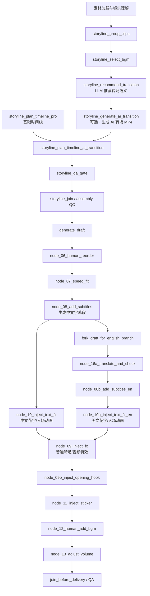
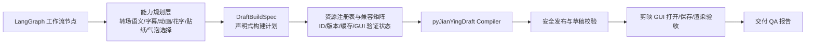

# auto-video-editor 效果工作流与 pyJianYingDraft 对比分析、设计及执行计划

> **分析日期：** 2026-11-21  
> **代码基线：** `wayyet/auto-video-editor` 的 `main` 分支；`GuanYixuan/pyJianYingDraft` 的 `main` 分支。  
> **分析范围：** 转场、视频特效、AI 转场、字幕、花字、动画、贴纸素材、文字气泡效果，以及两项目的工作流/功能模块对比。  
> **说明：** 本文依据分析日期可访问的仓库代码、README、模板与配置进行静态审查；没有在本次任务中运行剪映 GUI 或实际生成草稿，因此“代码具备写入逻辑”不等同于“目标剪映版本已经实机验证渲染成功”。

---

## 1. 结论摘要

两个项目处于不同抽象层，但并非完全独立：`auto-video-editor` 负责理解任务、规划剪辑、组织 LangGraph 工作流并生成/修订草稿；`pyJianYingDraft` 负责以 Python 对象/API 构造剪映草稿中的轨道、片段、转场、特效、动画、字幕和贴纸。`auto-video-editor` 已经有 `jianying_sdk` 适配层，将 `DraftBuildSpec` 编译为 `pyJianYingDraft.ScriptFile`，因此后者已经是前者可选的底层草稿构建后端。

### 1.1 功能现状一览

| 功能 | auto-video-editor 的模块/节点 | 当前代码状态 | pyJianYingDraft 能力 | 判断 |
|---|---|---|---|---|
| 普通转场 | `storyline_recommend_transition`、`node_09_inject_fx`、`jy_common/native_fx.py` | 已有语义推荐、资源池选择、原生草稿注入；受资源库和资源 ID 校验约束 | `VideoSegment.add_transition(TransitionType, duration=...)` | **双方支持**；前者偏自动规划，后者偏显式 API |
| 视频特效 | `node_09_inject_fx`、`jy_common/native_fx.py` | 已有白名单、挂载位置、强度和资源校验；当前以片段特效为主 | `VideoSegment.add_effect()`、`ScriptFile.add_effect()`，并支持滤镜 | **双方支持**；后者的通用手动控制范围更广 |
| AI 转场 | `storyline_generate_ai_transition`、`storyline_plan_timeline_ai_transition`、`storyline_capabilities/ai_transition_provider.py` | 已有真实生成 Provider 接口和 MP4 物化流程；付费外呼需要授权、Provider 和密钥 | 没有 AI 生成/Provider 工作流；可把外部生成的 MP4 当普通视频片段加入草稿 | **仅 auto-video-editor 提供生成编排** |
| 中文字幕 | `node_08_add_subtitles`、`nodes/_subtitle_texts.py` | 从脚本旁白与时间线生成字幕；**不再对原视频语音执行 ASR** | `ScriptFile.import_srt()`，或直接构造 `TextSegment` | **双方能写字幕**；字幕内容来源/生成方式不同 |
| 英文字幕 | `node_16a_translate_and_check`、`node_08b_add_subtitles_en` | 先翻译，再要求 `subtitle_translation_status == "real"` 才落正式字幕；无源字幕时正常跳过 | 可导入英文 SRT 或构造 TextSegment；不提供翻译模型 | auto 有翻译编排，SDK 只负责写入 |
| 花字 | `node_10_inject_text_fx`、`node_10b_inject_text_fx_en`、`nodes/_text_flower.py` | 原生花字路径已接入；默认启用，但必须通过 GUI 验证和本地缓存校验 | `TextSegment.add_effect(effect_id)` | **双方支持**；auto 自动选取和审计，SDK 由调用方指定 ID |
| 文本动画 | `node_10_inject_text_fx`、`node_10b_inject_text_fx_en` | 已接入字幕入场动画；只对项目自有字幕生效，并要求资源已验证、缓存存在 | `TextSegment.add_animation(TextIntro/TextOutro/TextLoopAnim, ...)` | **双方支持**；SDK 支持入场/出场/循环，auto 当前主要落入场动画 |
| 视频片段动画 | `node_09_inject_fx`、`DraftBuildSpec.video_animations`、SDK compiler | Schema 和编译器已有能力，但 `node_09` 当前导出 `video_animations=[]`，没有实际资源选择/注入链 | `VideoSegment.add_animation(IntroType/OutroType/GroupAnimationType, ...)` | SDK 能力更完整；auto 当前自动链未启用 |
| 贴纸素材 | `node_11_inject_sticker`、`jy_common/sticker_resolver.py`、`templates/sticker_template.json` | 节点存在，但模板资源仍为 `PLACEHOLDER_*`；19 位真实资源 ID 校验失败时 fail-closed，不写入 | `StickerSegment(resource_id, Timerange)` | **代码入口都有，auto 当前资源配置未完成** |
| 文字气泡 | `DraftBuildSpec.text_decorations.text_bubble`、`jianying_sdk/compiler.py` | 数据模型和编译器消费端存在，但当前 `node_10` 生成 spec 时没有填充 `text_bubble`，缺少自动选取/资源验证/配置入口 | `TextSegment.add_bubble(effect_id, resource_id)` | SDK API 可用；auto 当前只有编译预留，未形成工作流闭环 |

### 1.2 优先级判断

1. **先保证字幕源和时间线正确。** 当前中文字幕来自生成脚本的旁白文本，不是从原始视频音轨识别出来；若产品目标包含“原视频语音转字幕”，需单独恢复/新增 ASR 输入节点，不能依赖现有 `node_08` 名称推断。
2. **再补齐资源型功能的真实资源数据。** 贴纸模板仍为占位值；气泡虽有 SDK 接口和编译器字段，但缺少 node/spec 生产端。
3. **统一 legacy 与 SDK 编译结果。** `DRAFT_BUILDER_BACKEND` 默认值是 `legacy`；切换到 `pyjianyingdraft` 前必须做同一份任务的草稿结构和 GUI 渲染对照。
4. **视频片段动画属于未完成接入，不应标为已自动化。** SDK 有编译入口，但当前 auto 的效果 spec 发射器显式传 `video_animations=[]`。
5. **AI 转场应保持可选且显式授权。** 已有生成流程，但接入第三方付费 API；默认配置下不会发起生成请求。

---

## 2. 两个项目的定位和集成关系

### 2.1 auto-video-editor：工作流编排层

`auto-video-editor` 当前采用 auto-only 的 LangGraph StateGraph 单流水线。它不是单纯的剪映草稿生成函数，而是先处理素材、镜头理解、脚本、配音、BGM、转场语义和时间线，再生成剪映草稿，最后补充字幕装饰、特效和贴纸并经过交付 QA。

从效果链路看，可以拆成两个阶段：

- **草稿前规划阶段：** `storyline_recommend_transition` 推荐转场语义；AI 转场分支可生成真实 MP4 并将其插入 Canonical Timeline；`storyline_qa_gate` 检查最终时间线后，再交给 `generate_draft`。
- **草稿后注入阶段：** `node_08_add_subtitles` 生成中文字幕；中文/英文分支分别处理文本动画和花字；两分支汇合后 `node_09_inject_fx` 写普通转场和视频特效；`node_11_inject_sticker` 处理贴纸；尾部再执行人工 BGM 关卡、音量和交付 QA。

### 2.2 pyJianYingDraft：草稿构造 SDK

`pyJianYingDraft` 提供 `ScriptFile`、`TrackSpec`、`VideoSegment`、`TextSegment`、`StickerSegment` 等对象，由调用代码明确决定：创建哪些轨道、片段从何时开始、持续多久、应用什么转场/效果/动画、字幕文本是什么、使用哪个资源 ID。

它不负责：

- 理解视频内容并决定镜头顺序；
- 调用 LLM 生成剪辑脚本或推荐转场语义；
- 执行 AI 视频生成或管理第三方生成费用；
- 自动执行 LangGraph 节点、checkpoint、重试、分支汇合和交付 QA；
- 自动执行 ASR 或字幕翻译。

它负责把调用方给出的剪辑意图转化为剪映草稿数据结构。README 的功能列表明确列出转场、视频片段特效/滤镜、视频动画、文本动画、贴纸、文字气泡、花字和 SRT 字幕导入等能力。

### 2.3 两者的直接集成点

`auto-video-editor/jianying_sdk/compiler.py` 的职责就是将 `DraftBuildSpec` 编译为 `pyJianYingDraft.ScriptFile`：

1. 从 `DraftBuildSpec` 创建空白 `ScriptFile`；
2. 创建受控视频、音频、字幕、贴纸轨道；
3. 将视频/音频时间线编译为 SDK Segment；
4. 应用转场、视频特效、视频动画；
5. 应用字幕、文本动画、花字和气泡；
6. 创建贴纸片段并写入贴纸轨道；
7. 序列化草稿并执行 payload 校验。

因此推荐的长期分工是：**LangGraph 节点负责“决定要做什么”，DraftBuildSpec 负责“声明要写什么”，pyJianYingDraft compiler 负责“把声明编译成剪映草稿”。**

---

## 3. auto-video-editor 的工作流节点与模块

### 3.1 与本次功能直接相关的工作流顺序



说明：图中 AI 转场两个节点是否接入由 `STORYLINE_ENABLE_AI_TRANSITION` 在**建图时**决定；开关改变后应重启工作流进程。普通转场/视频特效节点 `node_09_inject_fx` 位于中文/英文分支汇合之后，因此可在同一节点中处理两份草稿。

### 3.2 普通转场：语义推荐与草稿注入是两件事

**规划节点：** `nodes/storyline/node_recommend_transition.py` 调用 `storyline_capabilities/recommend_transition.py`。

- 输入包括分组镜头主题、BGM 选择和用户转场要求。
- LLM 输出每个 group 的 `transition_in` / `transition_out` 语义标签。
- 输出受控词表校验；异常或无效结果会回落到默认语义并留下 warning。
- 这一步只生成“采用哪类转场”的计划，不代表转场素材已经写进剪映草稿。

**落地节点：** `nodes/node_09_inject_fx.py`。

- 从最终 Canonical Timeline/`storyline_plan` 读取相邻视频片段的边界语义。
- 用 `templates/fx_template.json` 的语义映射找到转场池，再从 `templates/fx_resource_library.json` 的 `transitions` 段选出具体资源。
- 使用 `sha256(job_id|boundary_index|pool_key)` 进行确定性池轮换。同一个任务重试时，选择结果可复算，避免每次重跑都换不同转场。
- 仅对通过资源库解析且 `resource_id` 为 19 位数字的条目落草稿；缺失或非法条目降级跳过。
- 用 `jy_common/native_fx.build_native_transition_material()` 构建原生转场 material，并在视频片段的 `extra_material_refs` 中建立引用。
- 有 `required_features.transitions=True` 且所有边界都为硬切的场景，会按规则回退至少一个 `fade`，避免 QA 将“用户要求转场但没有转场”误判为成功。

**需要关注的实现差异：** legacy JSON 注入路径把转场引用写在后一段视频片段上；SDK 编译路径依据 `pyJianYingDraft` 的语义，将转场附加到边界前一段片段（`VideoSegment.add_transition()` 的文档明确要求附加在“前面的”片段上）。两条路径的最终剪映表现必须用同一组样本做对照验收，不要仅凭 JSON 引用位置推断实际显示结果。

### 3.3 视频特效：白名单控制，避免全片滥用

主要实现：`nodes/node_09_inject_fx.py` 与 `jy_common/native_fx.py`。

- 特效候选来自 `fx_template` 的 `video_effects` 白名单，并在资源库 `video_effects` 区域精确匹配，避免同名转场资源误命中特效资源。
- 只在固定位置挂载：首段、尾段，以及中间索引 `i % 3 == 0` 的片段（0-based，即首段、尾段和第 4、7、10……段）。
- 强度值限制在 `[0, 1]`，资源 ID 必须有效；无候选或解析失败时降级，不写无效素材。
- 采用 `vfx-N` 确定性 ID，重放时清理旧的我方特效引用，不删除用户手工添加的 UUID 素材。

这是一种有意克制的自动点缀策略，不等同于“所有视频片段都套一层特效”。`pyJianYingDraft` 则提供更底层、更自由的能力：`VideoSegment.add_effect()` 对单个视频片段添加场景/人物特效，也可以通过 `ScriptFile.add_effect()` 创建独立特效轨道；此外还支持 `add_filter()`。

### 3.4 AI 转场：生成 MP4，再物化为时间线片段

相关节点和模块：

- `nodes/storyline/node_generate_ai_transition.py`
- `nodes/storyline/node_plan_timeline_ai_transition.py`
- `storyline_capabilities/ai_transition_provider.py`
- `storyline_capabilities/ai_transition_media.py`
- `storyline_capabilities/ai_transition_prompt.py`

执行过程：

1. 根据相邻 group 的边界生成 pair（前一组最后一个 clip → 后一组第一个 clip）。默认范围为 `group_boundaries`，不是对每个镜头边界都生成。
2. 抽取首尾帧、检查画幅兼容性，并组合提示词。`storyline_transition_plan` 只作为提示信息使用。
3. 任务未获批准时，只输出 pair 数量、预计时长和费用风险，**不调用 Provider**。
4. 获批后再解析 Provider。当前代码实现 MiniMax Hailuo-02 Provider，API Key 从服务端环境变量 `MINIMAX_API_KEY` 读取。
5. 成功生成并通过媒体复检的 MP4 会写入 `ai_transition.json`，并按输入哈希缓存；失败、未配置 Provider 或画幅不兼容时显式标记降级/跳过。
6. `storyline_plan_timeline_ai_transition` 将生成 MP4 注册为普通 source media 和普通 Timeline Clip，使用 `ai_transition_pair` 留下来源审计；再把新增时长从原镜头预算中吸收，避免无意拉长总片长。

**关键概念：** AI 转场与剪映原生 `TransitionType` 不是同一种数据。前者是生成的视频片段，后者是剪映素材资源定义的边界转场。`pyJianYingDraft` 可以把生成好的 MP4 当作 `VideoMaterial`/`VideoSegment` 加入轨道，但没有负责生成这个 MP4 的 AI Provider/提示词/授权/费用管理模块。

**门禁配置：**

| 配置 | 当前代码默认值/规则 | 作用 |
|---|---|---|
| `STORYLINE_ENABLE_AI_TRANSITION` | 默认 `true` | 建图时接入/移除 AI 转场两节点 |
| `STORYLINE_AI_TRANSITION_PROVIDER` | 默认空 | 真实生成 Provider；当前支持 `minimax` |
| `STORYLINE_AI_TRANSITION_APPROVED` | 默认 `false` | 环境级显式批准；也可用 state `ai_transition_approved=true` |
| `MINIMAX_API_KEY` | 必须由服务端环境提供 | Provider 凭据，不写入 state 或日志 |
| `STORYLINE_AI_TRANSITION_PAIR_SCOPE` | 默认 `group_boundaries` | 控制需要生成的边界范围 |
| `STORYLINE_AI_TRANSITION_MAX_PAIRS` | 默认 `8` | 单任务 pair 数上限 |
| `STORYLINE_AI_TRANSITION_MAX_TOTAL_MS` | 默认 `10000` | 单任务总生成时长预算 |
| `STORYLINE_AI_TRANSITION_DURATION_MS` | 默认 `6000` | 单个转场目标时长 |

生产建议维持显式授权：不要为了测试而把全局 `STORYLINE_AI_TRANSITION_APPROVED=true` 长期写入用户环境；先走估算路径，再由任务级审批决定是否发起付费生成。

### 3.5 字幕：脚本旁白字幕，不是原片 ASR 字幕

关键节点：`node_08_add_subtitles.py`、`node_16a_translate_and_check.py`、`node_08b_add_subtitles_en.py`。

**中文链路：**

- `node_08_add_subtitles` 从 `storyline_script_artifact` 中读取按 group 组织的 narration，并结合当前草稿时间线/视频组区间计算字幕时段。
- 旁白文本按中文/英文标点切句，再按字符数比例分配到 group 时间区间。
- 通过 `nodes/_subtitle_texts.py` 构建 `materials.texts` 和原生 text 轨段，并叠加字幕样式侦察（`subtitle_scout`）及 `storyline_text_style_plan`。
- 写入 `state.subtitle_segments_zh`，供英文翻译节点消费。

**ASR 边界：** 项目在 2026-11-08 的 B1 ASR 移除后，不再运行原视频语音识别分支。现有 `node_08` 的确能生成中文字幕，但文本来源是工作流脚本/旁白，而不是识别原视频里的原声对白。若产品要求“给原视频的讲话内容自动打字幕”，必须新增或恢复 ASR 节点/外部字幕输入契约。

**英文链路：**

- `node_16a_translate_and_check` 从 `subtitle_segments_zh`（旧 checkpoint 可兼容读取 `asr_segments_zh`）获取源字幕。
- 无源字幕是正常 skip 情况，不会伪造空字幕。
- 真实翻译器与 Mock 翻译器区分 `real` / `stub` 状态；翻译失败 fail-closed。
- `node_08b_add_subtitles_en` 只有在 `subtitle_translation_status == "real"` 且字幕段非空时才写入英文草稿，避免把 `[EN] ...` Mock 文本当正式字幕。

**对比 SDK：** `pyJianYingDraft.ScriptFile.import_srt()` 从用户提供的 `.srt` 文件读取时间戳和内容，生成文本片段；可设置 `text_style`、`clip_settings`、`style_reference` 和时间偏移。它不负责生成字幕文本，不负责 ASR 或翻译。两边能力互补：auto 负责产生内容/翻译，SDK 负责落地草稿；若要接入外部 SRT，SDK 提供直接导入能力。

### 3.6 花字与文本动画

主要节点：`node_10_inject_text_fx`（中文）、`node_10b_inject_text_fx_en`（英文）；共同核心在 `nodes/node_10_inject_text_fx.py`。

**文本入场动画：**

- 仅处理项目自有字幕 ID 前缀 `text-zh-` / `text-en-`，避免覆盖用户在剪映 GUI 中手工创建的文字。
- 从 `templates/text_resource_library.json` 的 VIP intro 池选取动画；默认 `TEXT_FX_INTRO_POOL_MODE=auto`，通过 `sha256(job_id|"text_intro_pool")` 得到稳定的任务级选择，中文和英文草稿使用同一选择。
- 必须同时满足 `verified=True`（剪映 GUI 实证）和本地缓存路径可用；否则降级不写，避免剪映打开草稿后显示“动画丢失”。
- 目前自动注入的 `kind` 是 `in`（入场）。SDK 本身支持文本入场、出场和循环动画，但当前 node10 自动生产端并未把三种类型都开放成可配置工作流。

**花字：**

- 由 `nodes/_text_flower.py` 的 `apply_text_flower_effects()` 完成。
- 读取 `templates/text_flower_resource_library.json`，使用稳定的任务级池化选择。
- `TEXT_FLOWER_ENABLED` 默认开启；仍要求素材条目通过 GUI 验证、资源 ID/缓存证据齐全，未通过时 fail-closed。
- 将花字写入原生文本效果素材，并通过 `DraftBuildSpec.text_decorations` 同步给 SDK 编译路径。

**视频片段动画：**

- `DraftBuildSpec` 中已有 `VideoAnimationSpec`，SDK compiler 已有 `_build_video_animations()`，调用 `VideoSegment.add_animation()`。
- 但 `node_09_inject_fx.py` 当前生成 spec 时显式设置 `video_animations=[]`，注释说明视频动画资源池仍待操作员 GUI 实证。因此应判定为“编译端准备好，自动选择和写入链尚未完成”。

### 3.7 贴纸素材

工作流节点：`nodes/node_11_inject_sticker.py`；解析器：`jy_common/sticker_resolver.py`；模板：`templates/sticker_template.json`。

- 当前通过字幕文本关键词匹配贴纸，例如“赞”“加油”“惊喜”，并使用“默认”兜底项。
- 节点会生成 `materials.stickers` 条目，并根据字幕的原生时间范围查找时间重叠最大的 video segment，关联 `extra_material_refs`。
- 贴纸 ID 使用确定性前缀，支持重放幂等；不会删除用户手工添加的 UUID 贴纸。
- 但模板明确标记 `_reverse_engineering_pending: true`，映射值是 `PLACEHOLDER_STICKER_*`。节点要求 `resource_id` 必须是 19 位数字，非真实 ID 会被 fail-closed 跳过。因此，**节点已接入不代表贴纸素材已经可用**。
- SDK 编译器的贴纸路径使用 `StickerSegment(resource_id, Timerange)`，并放到独立 sticker 轨道；这与 legacy 直接把贴纸 material 引用挂在 video segment 上的实现方式不同。

`pyJianYingDraft` 的 `StickerSegment` 只要求调用方传入真实 `resource_id` 和时间范围。SDK README 建议通过 `ScriptFile.inspect_material()` 或模板草稿提取贴纸资源元数据；它不提供“按字幕关键词自动挑贴纸”的策略。

### 3.8 文字气泡效果

`pyJianYingDraft` 已有明确 API：`TextSegment.add_bubble(effect_id, resource_id)`。`effect_id` 与 `resource_id` 分开传入，通常应先从已有草稿/模板中提取真实素材元数据。

`auto-video-editor` 当前情况：

- `jianying_sdk/spec.py` 的 `TextDecorationSpec` 已有 `text_bubble: ResourceRef | None` 字段。
- `jianying_sdk/compiler.py` 的 `_apply_text_decorations()` 已有处理逻辑：当 `text_bubble` 存在且验证状态为 `cache_verified` 或 `client_preview_verified` 时，调用 `TextSegment.add_bubble()`。
- 但 `nodes/node_10_inject_text_fx.py` 当前的 `_emit_text_decoration_spec()` 只写动画和花字，没有构建/填充 `text_bubble`；仓库里也没有已接入 node10 的气泡资源选择闭环。

因此当前是**SDK 编译消费端预留**，不是自动剪辑工作流已支持的气泡功能。不能把普通字幕背景色/圆角背景当成剪映“文字气泡素材”能力，两者数据结构和效果语义不同。

---

## 4. pyJianYingDraft 功能接口对照

| 功能 | pyJianYingDraft 核心对象/API | 说明 |
|---|---|---|
| 转场 | `VideoSegment.add_transition(TransitionType, duration=...)` | 一个视频片段只能添加一个转场；文档要求转场挂在前一个片段上 |
| 视频片段特效 | `VideoSegment.add_effect(VideoSceneEffectType/VideoCharacterEffectType, params)` | 对单片段添加场景/人物特效 |
| 独立特效轨道 | `ScriptFile.add_effect(effect, Timerange, track_name, params=...)` | 创建独立特效轨段；适合跨片段作用的效果 |
| 滤镜 | `VideoSegment.add_filter()` 或 `ScriptFile.add_filter()` | 区分片段滤镜和独立滤镜轨道 |
| 视频动画 | `VideoSegment.add_animation(IntroType/OutroType/GroupAnimationType, duration=...)` | 视频片段入场、出场、组合动画 |
| 文本动画 | `TextSegment.add_animation(TextIntro/TextOutro/TextLoopAnim, duration=...)` | 文本入场、出场、循环动画；先添加入/出场，再添加循环动画 |
| 字幕 | `ScriptFile.import_srt(path, track_name, text_style, clip_settings, style_reference, time_offset)` | 读取 SRT 时间戳并生成 TextSegment，不负责识别/翻译 |
| 文本花字 | `TextSegment.add_effect(effect_id)` | 当前 SDK 注释说明仅支持部分花字；资源需来自剪映素材/模板元数据 |
| 文字气泡 | `TextSegment.add_bubble(effect_id, resource_id)` | 单独的 TextBubble 资源引用，不等于普通文本背景 |
| 贴纸 | `StickerSegment(resource_id, Timerange)` | 通过 StickerSegment 加入 sticker 类型轨道 |
| 文本描边/背景/阴影 | `TextSegment(..., border=..., background=..., shadow=...)` | 基础文本样式能力 |
| 多轨道 | `ScriptFile.append_track/append_tracks/insert_track/insert_tracks` | 管理视频、文本、贴纸、特效、滤镜等轨道 |

### 4.1 版本和素材缓存风险

`pyJianYingDraft` README 的功能表给出了剪映 5.9 与 10.8 的支持状态：上述转场、视频特效/动画、贴纸、文字气泡/花字、SRT 导入在 README 中列为支持；但 README 同时提示：

- 未缓存的动画/特效/转场可能在剪映打开草稿时下载超时，表现为“加载失败”。
- 未缓存字体可能需要二次打开草稿。
- 新版剪映模板 `draft_content.json` 可能不是可直接读取的明文 JSON，模板读取可能需要 `fallback_loader`。
- README 标注剪映 7 及以上版本通常不再支持其旧式 GUI 自动导出流程；这不等同于不能生成草稿。

`auto-video-editor` 配置中的 `JIANYING_VERSION` 当前写为 `5.9.0`，部分注释和资源验证逻辑也以 5.9 GUI 样本为基线。切换到新版剪映前，必须重新做模板加载、资源缓存和效果渲染验证。

---

## 5. 两个项目相同点和不同点

### 5.1 相同点

1. **目标文件相同：** 最终都在构造剪映可识别的工程/草稿数据，而不是生成一个普通 MP4 就结束。
2. **数据模型相似：** 都围绕视频片段、文本片段、轨道、时间范围、资源 ID、material 和引用关系组织效果。
3. **原生效果而非画面烘焙：** 转场、视频特效、花字、动画、气泡、贴纸都能以剪映草稿资源/引用方式存在，让用户继续在剪映中编辑（前提是资源有效且剪映版本兼容）。
4. **都需要真实资源元数据：** `effect_id`、`resource_id`、持续时间、素材缓存等信息不正确时，草稿可能无法还原效果。
5. **效果可以组合到时间线上：** 都能利用轨道与片段时间范围，把字幕、贴纸、转场或视频效果放在相应时间位置。
6. **存在版本与缓存依赖：** 项目代码写入成功不意味着剪映客户端一定能成功加载远端效果资源；最终必须做客户端验证。

### 5.2 不同点

| 比较维度 | auto-video-editor | pyJianYingDraft |
|---|---|---|
| 产品定位 | 完整自动剪辑工作流、任务编排与剪辑策略 | 剪映草稿生成/编辑 SDK |
| 决策方式 | LLM、规则、资源池、Canonical Timeline、QA | 调用代码直接指定对象和参数 |
| 工作流 | LangGraph 节点、条件边、并行分支、checkpoint、重试、人工关卡 | 没有内置 LangGraph 工作流/任务状态管理 |
| AI 转场 | 有生成 Provider、授权门禁、缓存、媒体复检和时间线物化 | 无生成模型/Provider；只能把现成视频素材作为片段加入 |
| 普通转场 | 从语义计划和资源池自动选择并写入 | 由调用方指定 `TransitionType` |
| 视频特效 | 项目级白名单和片段挂载策略 | 可逐片段添加，也可建立独立特效轨道；API 更通用 |
| 字幕内容 | 可由脚本旁白生成中文，再调用 LLM 翻译英文 | 由调用方提供 SRT 或文本；无 ASR/翻译 |
| 花字/动画选择 | 自动池化选择，按任务稳定；必须通过项目验证与缓存门禁 | 调用方显式传 effect/animation 类型或 ID |
| 贴纸策略 | 按字幕关键词匹配资源；当前映射仍是占位 | 调用方显式传 `resource_id`，不负责关键词语义匹配 |
| 文字气泡 | spec/compiler 具备消费字段，但没有 node/spec 生产链 | `TextSegment.add_bubble()` 有直接 API |
| 错误与降级 | 有 fail-closed、warning、status_log、QA 类别、幂等重放等机制 | 主要由调用方处理异常与资源合法性；不负责整个任务业务降级 |
| 草稿构建方式 | legacy 直接写原生草稿 JSON；另有 `DraftBuildSpec` → pyJianYingDraft SDK 编译路径 | 通过 ScriptFile/Segment 对象构造并导出草稿 |
| 默认执行路径 | `DRAFT_BUILDER_BACKEND` 缺省为 `legacy` | 自身就是 SDK API，无 legacy/SDK 双后端配置 |

### 5.3 分功能的能力边界

- **转场：** 都能添加剪映原生转场；auto 多出“LLM 语义推荐→资源池选择”的自动决策。SDK 只负责按指定 `TransitionType` 写入。
- **视频特效：** 都支持片段级特效；SDK 还提供独立特效轨道与滤镜 API，auto 当前侧重于限定白名单、限定位置的自动注入。
- **AI 转场：** auto 会生成真实视频片段；SDK 不生成，只能承载生成结果。
- **字幕：** auto 产生文本/翻译结果，SDK 只负责把 SRT/文本变成剪映 TextSegment。当前 auto 的中文字幕来源是脚本旁白而不是原片 ASR。
- **花字：** 两边都可以添加原生花字；auto 有素材验证和缓存守卫，SDK 由调用方提供 effect ID。
- **动画：** SDK 支持视频片段和文本的多种动画；auto 当前自动化主要覆盖字幕入场动画，视频动画 spec 未接入资源选择，文本出场/循环也不是当前自动策略。
- **贴纸：** SDK 有完整片段构造 API；auto 有关键词匹配和注入逻辑，但模板 ID 未回填前不会真正落贴纸。
- **气泡：** SDK 有直接可用的 `add_bubble()` API；auto 目前只在 spec/compiler 预留，工作流没有把气泡资源写入 spec。

---

## 6. 当前实现中的缺口与风险清单

| 编号 | 问题 | 证据/影响 | 优先级 | 处理要求 |
|---|---|---|---|---|
| R-01 | 中文字幕不是原视频 ASR | B1 ASR 已从图中移除；`node_08` 使用脚本 narration 生成字幕 | P0（取决于产品需求） | 明确区分“旁白字幕”和“原片语音字幕”；需要原片对白时增加 ASR 来源 |
| R-02 | 英文字幕依赖中文源字幕 | `node_16a` 无 `subtitle_segments_zh`/兼容旧字段时正常 skip | P0 | 测试“有源/无源/真实翻译失败/Mock 翻译”四种路径 |
| R-03 | legacy 与 SDK 转场挂载语义不同 | legacy ref 写到后一段；SDK 使用 pyJianYingDraft 约定挂前一段 | P1 | 用同一双片段案例在两后端生成草稿并实机打开，统一规范 |
| R-04 | 贴纸资源仍是占位 ID | `templates/sticker_template.json` 标记 pending，resource ID 为 `PLACEHOLDER_*` | P1 | 从剪映实机样本回填真实 19 位 ID，并验证资源缓存 |
| R-05 | 文字气泡缺少工作流生产端 | `TextDecorationSpec.text_bubble` 和 compiler 消费逻辑存在，但 node10 不写此字段 | P1 | 增加气泡资源库、状态校验、选择策略和 spec emitter |
| R-06 | 自动视频动画未接入 | node09 导出 `video_animations=[]` | P2 | 先建立 GUI 验证过的视频动画资源表，再启用 spec 生产 |
| R-07 | 自动文本动画覆盖不足 | 当前自动注入以入场 `kind="in"` 为主 | P2 | 设计是否需要出场/循环动画，按字幕时长限制写入 spec |
| R-08 | SDK 后端不是默认路径 | `DRAFT_BUILDER_BACKEND` 默认 `legacy` | P1 | 维持灰度切换；完成 parity 验收前不要直接改全局默认 |
| R-09 | 资源下载/客户端版本差异 | 剪映可能无法加载未缓存资源；新版模板格式也可能变化 | P1 | 明确剪映版本矩阵并做打开、保存、重开、渲染测试 |
| R-10 | QA 需要识别实际效果而不只看 JSON | material/ref 存在不代表剪映 GUI 成功呈现 | P1 | 交付 QA 加入实际 resource/status/降级统计，并保留 GUI 验收证据 |

---

## 7. 目标设计

### 7.1 建议的分层结构



### 7.2 设计原则

1. **节点只做业务决策，不再各自重复构造复杂原生 JSON。** 每个功能节点写自己拥有的 spec 段，例如 `subtitles`、`transitions`、`video_effects`、`text_decorations`、`stickers`。
2. **DraftBuildSpec 是构建意图的单一事实来源。** 同一份 spec 可供 legacy 对照、SDK 编译、审计和 QA 使用；不能让“草稿 JSON 已更新但 spec 未更新”成为正常情况。
3. **资源注册表是效果资源唯一入口。** 至少记录 `effect_id`、`resource_id`、名称、类别、剪映版本、VIP 属性、缓存 MD5、GUI 实证状态、SDK 兼容状态和最近验证日期。
4. **资源未验证时 fail-closed。** 不将占位 ID 或未经验证的效果写入正式草稿；降级原因必须在 `status_log`/QA 报告中可见。
5. **区分原生转场和 AI 转场。** 原生转场是边界效果资源；AI 转场是一个生成的视频片段，分别建模、分别统计。
6. **不破坏人工素材。** 自动节点只更新本项目拥有的 ID/标记；用户手工加入的素材、文字和特效保持原样。
7. **所有选择可复现。** 使用 `job_id` 和稳定哈希做池选择；重放时不随机变化；缓存/资源无效要明确记录。
8. **SDK 后端灰度发布。** 先以同一任务对照 legacy 和 SDK 草稿；有证据后再逐步扩大 `DRAFT_BUILDER_BACKEND=pyjianyingdraft` 的覆盖范围。

### 7.3 建议补充/完善的 spec 字段

| Spec 区域 | 建议字段/约束 | 当前情况 |
|---|---|---|
| `subtitles` | `subtitle_id`、语言、文本、起止时间、来源（narration/ASR/SRT）、样式 | 已有基础字幕结构；应明确 source 类型 |
| `transitions` | `boundary_index`、from/to clip ID、effect/resource ID、duration、verification | 已有 |
| `video_effects` | clip ID、effect/resource ID、intensity、verification | 已有 |
| `video_animations` | clip ID、kind(in/out/group)、effect/resource ID、duration、verification | Schema/compiler 已有，生产端空列表 |
| `text_decorations` | subtitle ID、花字、气泡、动画列表 | 已有 text_effect / text_bubble / animations；node10 目前未写 bubble |
| `stickers` | sticker ID、resource ID、时间、挂载依据（subtitle/clip/manual）、verification | 已有基本结构；应补充资源来源/验证信息 |
| `timeline.blocked_features` | SDK 无法无损重建的人工高级特征 | 已有，编译器会阻止破坏性重建 |

---

## 8. 分阶段执行计划

### 阶段 0：建立当前基线和回归样本

**目标：** 让所有后续修改都能与当前 main 基线比较。

任务：

- 固化本次分析所用的节点、配置、模板和 `jianying_sdk` 文件版本；记录剪映客户端准确版本、草稿路径和资源缓存目录。
- 准备最小测试工程：两段视频（包含一个边界）、一段旁白文本、一个英文翻译样本、一条花字、一条动画、一个贴纸样本和一个气泡样本。
- 对同一份 timeline 分别生成 legacy 和 `pyjianyingdraft` 后端草稿；保留 `draft_content.json`、spec、日志和 QA 报告。
- 明确当前业务期待字幕是“生成旁白字幕”还是“原视频对白 ASR 字幕”。这是验收标准，不允许两者混为一谈。

验收：测试素材、草稿、资源样本、剪映版本及验收记录均可重复使用。

### 阶段 1：完善字幕数据契约

**目标：** 清楚定义字幕内容来源、时间和翻译状态。

任务：

1. 将字幕来源标准化为 `narration`、`asr`、`srt_import` 三种类型，加入 state/spec 的 source 元数据。
2. 保留现有 `node_08` 的 narration 字幕生成逻辑；不要把它改名或包装成 ASR。
3. 如需要原视频对白字幕，新增独立 ASR 生产节点，输出统一的 `subtitle_segments_zh`；让 `node_08` 只负责将统一段落编译为中文文本轨。
4. 外部 SRT 输入应走明确导入入口，复用时间戳和文本，不要把 SRT 文件解析散落到节点中。
5. 保留 `node_16a` 的真实翻译门禁：无源字幕时 skip；stub 不可写入正式英文字幕；真实翻译失败 fail-closed。
6. 补齐中英文字幕时间线检查：`start_ms < end_ms`、段落不重叠（若业务要求）、落在视频长度范围内、空文本过滤。

验收：旁白字幕、ASR 字幕、SRT 字幕三类输入均可落到原生 text 轨；英文翻译仅在真实翻译成功时写入；测试能准确区分“无源跳过”和“翻译失败”。

### 阶段 2：统一转场/视频特效的 spec 与挂载语义

**目标：** 使 legacy 和 SDK 后端得到相同的剪映效果。

任务：

1. 以 `TransitionSpec.boundary_index` 和稳定的 `from_clip_id/to_clip_id` 作为边界唯一标识，不以 `segments[]` 当前数组下标作为跨阶段身份。
2. 对照 pyJianYingDraft `VideoSegment.add_transition()` 的前段挂载约定，验证 legacy 引用落在前段/后段时剪映实际表现；统一两路径的草稿语义。
3. 检查相邻片段时长、转场持续时间、重叠模式 `is_overlap`，不允许负时间或超过短片段可接受时长。
4. 视频特效继续使用精确白名单和 19 位资源 ID；将 `intensity` 单位明确为 spec/SDK 的 0–100，legacy JSON 的 0–1 需在适配层转换，禁止在节点里混用。
5. 让 QA 校验“计划条数、实际写入条数、降级条数”三者，并对必需转场启用 gate。

验收：同一 timeline 在 legacy 与 SDK 后端中，转场边界、资源 ID、duration、视频特效 clip 位置和强度一致；剪映打开后效果可见。

### 阶段 3：补齐贴纸真实资源库

**目标：** 将当前 placeholder 流程变为真正可用的原生贴纸链路。

任务：

1. 使用目标剪映版本创建真实贴纸样本草稿；对每种贴纸记录关键词、名称、`resource_id`、素材元数据和缓存状态。
2. 将 `templates/sticker_template.json` 的 `PLACEHOLDER_*` 替换为真实 19 位资源 ID；把 `_reverse_engineering_pending` 改为完成状态前必须有样本证据。
3. 资源库按类别/语言/风格分组，避免“默认”贴纸在所有不匹配字幕上无差别出现；为每类设置允许使用频率和位置策略。
4. 调整 `node_11`：验证资源状态、关键词命中、字幕时间范围和匹配视频片段；输出每条命中的原因、资源状态和实际写入结果。
5. SDK 后端优先使用独立 sticker 轨；legacy 与 SDK 的时间范围和图层顺序必须一致。

验收：每条自动贴纸都有真实 resource ID、非零 duration、有效时间区间；剪映重开草稿无资源缺失提示；无匹配字幕时不生成无意义贴纸。

### 阶段 4：补齐文字气泡工作流

**目标：** 从“SDK 有 API”提升为“LangGraph 能选择并写入气泡”。

任务：

1. 从剪映 GUI 创建至少 2–3 个文字气泡样本，提取 `effect_id` 和 `resource_id`；分别记录样本截图、剪映版本和缓存路径。
2. 新增 `templates/text_bubble_resource_library.json`（或统一效果资源库中的 `text_bubbles` 区域），包含名称、关键词/语义标签、双 ID、缓存和 GUI 验证状态。
3. 在 `nodes/_text_flower.py` 相邻层或独立 `nodes/_text_bubble.py` 中实现选择策略；建议独立模块，避免把花字和气泡两个不同素材类型混在一个函数里。
4. 扩展 `node_10` 的文本装饰 spec emitter，为每条目标字幕写入 `TextDecorationSpec.text_bubble`；只处理项目自有字幕，不覆盖人工文本。
5. 在 compiler 中保留现有 verification 门禁，并在 QA 中输出 `text_bubble_applied/degraded` 计数。

验收：spec 中存在气泡资源的字幕，SDK 编译后在剪映 TextSegment 上有 bubble material/ref；无效或未验证资源降级，不阻断主工作流。

### 阶段 5：扩展动画资源与策略

**目标：** 在不引入“动画丢失”风险的前提下，逐步开放更多动画。

任务：

1. 建立独立的视频动画资源表，按 `intro`、`outro`、`group` 分类；每个条目必须有实机样本、SDK 枚举匹配、GUI 验证状态和本地缓存证据。
2. 将 `node_09._emit_fx_spec()` 当前的 `video_animations=[]` 替换为真正从 plan 读取/生成的列表，但只有资源表中 `verified` 且 SDK 兼容状态 supported 的条目才进入 spec。
3. 为文本动画增加可配置策略：`in`、`out`、`loop`；校验动画总时长不超过字幕片段时长；文本循环动画必须在入/出场动画之后添加。
4. 为中英字幕选择保持同任务一致；资源不可用时非破坏性降级，不应因新任务失败删除上一轮有效动画。

验收：视频入/出场/组合动画和文本入/出场/循环动画分别通过 SDK 编译与 GUI 重开验证；资源失效时能解释原因且保留已有有效效果。

### 阶段 6：强化 AI 转场的生产门禁和质量检查

**目标：** 保证 AI 转场可控、可审计、可计费核对。

任务：

1. 保留任务级 `ai_transition_approved`，UI 在提交付费生成前明确展示 pair 数、预计总时长、Provider、费用提示和预算上限。
2. 未授权、Provider 未配置、API Key 缺失或预算超限时必须零外呼，不得生成假的成功 artifact。
3. 对生成 MP4 做 ffprobe 校验：容器、编码、时长、分辨率、帧率、画幅及文件完整性；校验失败不物化。
4. 缓存键至少覆盖首尾帧哈希、提示词版本、Provider/模型、目标时长和画幅，避免输入变化后错误复用旧产物。
5. 时间线物化时记录原始片段压缩量、AI 转场实际时长和最终时间线总时长；超过目标时长必须有可诊断的降级记录。
6. 评估 AI 转场和原生转场混用策略：例如只在 group boundary 生成 AI 转场，其他相邻镜头使用原生 `TransitionType`。

验收：未批准任务外呼数为 0；批准任务只生成预算内 pair；生成视频无法验证时不进入时间线；重跑命中缓存时不重复产生付费任务。

### 阶段 7：SDK 后端灰度和发布

**目标：** 以 `pyJianYingDraft` 为统一草稿编译引擎，但不在没有 parity 证据时切换默认后端。

任务：

1. `DRAFT_BUILDER_BACKEND=legacy` 继续作为回退路径；为指定测试任务设置 `DRAFT_BUILDER_BACKEND=pyjianyingdraft` 做灰度验证。
2. 确保 node08、node09、node10、node11 更新的 spec 与本轮 draft 一致；编译失败、`blocked_features` 非空或资源降级过多时保留 legacy 草稿。
3. 将编译报告 `counts`、`degradations` 和 fingerprint 纳入交付 QA；每类效果都要有 applied/degraded/skipped 数量。
4. 对同一个任务分别运行 legacy/SDK，比较轨道、片段时间、音量、字幕、花字、动画、气泡、贴纸、转场、视频特效及关键素材 ID。
5. 只有当回归测试及 GUI 实机验收通过后，才考虑扩大 SDK 后端比例；全量默认切换另行评审。

验收：SDK 编译结果不丢失人工高级特征；编译/发布失败不覆盖当前有效草稿；回退到 legacy 可恢复。

---

## 9. 验收矩阵

| 功能 | 自动化测试 | 剪映 GUI 验收 | 通过标准 |
|---|---|---|---|
| 普通转场 | 边界索引、资源映射、duration、幂等重跑、双后端一致性 | 打开/保存/重开，逐边界查看转场 | 每个已计划转场出现在正确边界，无重复或缺失 |
| 视频特效 | 白名单解析、19 位 ID、强度映射、挂载位置 | 查看片段特效面板和画面效果 | 仅目标片段生效，强度与计划一致 |
| AI 转场 | 授权门禁、Provider 错误、缓存命中、ffprobe 失败、时间预算 | 检查 AI 片段播放、前后衔接与总时长 | 未授权零外呼；有效 MP4 才进入时间线 |
| 中文字幕 | narration/ASR/SRT 来源、时间范围、文本空值、轨道幂等 | 检查字幕与旁白/原声对齐、样式 | 字幕源类型可追踪；时间范围正确 |
| 英文字幕 | real/stub/skip/error 状态、翻译 marker、时间保留 | 检查翻译内容、行宽和位置 | stub 不写正式轨；无源正常 skip |
| 花字 | 资源验证、缓存校验、失败非破坏性、同任务稳定性 | 检查花字面板和实际显示 | 无“加载失败/丢失”；原文可继续编辑 |
| 文本动画 | in/out/loop 时长及添加顺序、资源兼容状态 | 检查字幕入场/出场/循环表现 | 动画类型与时长正确，无缺失资源 |
| 视频动画 | SDK 枚举解析、clip ID 绑定、duration | 检查视频片段动画面板和播放 | 只写 GUI 实证过的资源 |
| 贴纸 | 真实 ID、关键词映射、时间重叠、非破坏性重放 | 检查贴纸轨/片段位置、资源显示 | 不含 placeholder；出现位置与字幕匹配 |
| 文字气泡 | spec 生产、双 ID 校验、verification 门禁 | 检查 TextSegment 气泡样式 | 气泡作为原生素材保留，非普通背景假象 |

### 9.1 建议测试命令

在项目根目录、已安装项目依赖的虚拟环境中运行：

```powershell
# 单元测试
python -m pytest tests/unit -q

# 集成测试（按项目 README 要求准备 PostgreSQL、ffmpeg/ffprobe 和测试视频）
python -m pytest tests/integration -q

# 针对 SDK 后端做单任务灰度（仅当前 PowerShell 会话生效）
$env:DRAFT_BUILDER_BACKEND = "pyjianyingdraft"
python scripts/run_workflow.py --production --thread-id effect-sdk-smoke --initial-state-json runtime\initial_state_effect-sdk-smoke.json
```

说明：上面的 SDK 灰度命令假定 `runtime\initial_state_effect-sdk-smoke.json` 已按项目 schema 准备好，且 PostgreSQL、素材和 LLM 等运行依赖均可用；它不是一个可直接无配置运行的示例任务。`--production` 会执行 pre-flight，可能涉及 Windows 服务启动和 PostgreSQL schema 检查，执行前应先确认本机服务状态及管理员权限。测试通过数量会随 main 分支变化，不能把仓库 README 历史基线当成本次实际测试结果。

AI 转场只有在明确授权并配置 Provider/API Key 后才会产生外部调用。不要把 API Key 写入仓库、Markdown、state、事件或日志。

---

## 10. 推荐执行顺序和决策

建议采用以下顺序，不建议先切 SDK 默认后端或先开放 AI 转场：

| 顺序 | 工作项 | 优先级 | 原因 |
|---:|---|---|---|
| 1 | 明确字幕源，并完成中文字幕/英文字幕链路回归 | P0 | 字幕是花字、字幕动画、贴纸和气泡的共同依赖；没有文本段，后续文本效果节点无目标对象 |
| 2 | 校正 legacy/SDK 的转场、视频特效 spec 一致性 | P1 | 当前已是核心自动能力，先消除双后端差异 |
| 3 | 回填真实贴纸资源 ID | P1 | 当前模板全是占位值，节点执行也不会生成有效贴纸 |
| 4 | 完成气泡资源库和 node10 spec emitter | P1 | SDK 消费端基本具备，补齐生产端成本较低 |
| 5 | 逐步开放视频动画与文本出场/循环动画 | P2 | 需要资源实机验证，不能只根据枚举存在就认为可渲染 |
| 6 | 强化 AI 转场预算/授权/质量门禁 | P2 | 能力已有，重点是成本、缓存和产物质量治理 |
| 7 | SDK 后端灰度，达到 parity 后再讨论默认切换 | P1（发布门禁） | `legacy` 仍是当前默认，灰度回退成本低 |

**推荐结论：** 保留 LangGraph 作为工作流和策略层，以 `DraftBuildSpec` 作为声明式构建契约，以 `pyJianYingDraft` 作为受控草稿编译层。短期优先修复字幕源契约、真实贴纸资源和文字气泡生产端，同时为转场/视频特效建立双后端一致性测试。只有资源验证、编译统计、草稿打开/重开和 GUI 渲染验收全部通过后，才扩大 SDK 编译后端的生产使用范围。

---

## 11. 主要代码证据与参考链接

### auto-video-editor

- [README.md（当前项目架构与目录）](https://github.com/wayyet/auto-video-editor/blob/main/README.md)
- [graph.py（LangGraph 节点、分支、边和执行顺序）](https://github.com/wayyet/auto-video-editor/blob/main/graph.py)
- [nodes/node_08_add_subtitles.py（中文字幕生成与 ASR 移除说明）](https://github.com/wayyet/auto-video-editor/blob/main/nodes/node_08_add_subtitles.py)
- [nodes/node_08b_add_subtitles_en.py（英文字幕写入门禁）](https://github.com/wayyet/auto-video-editor/blob/main/nodes/node_08b_add_subtitles_en.py)
- [nodes/node_16a_translate_and_check.py（英文翻译、无源 skip、real/stub 门禁）](https://github.com/wayyet/auto-video-editor/blob/main/nodes/node_16a_translate_and_check.py)
- [nodes/node_09_inject_fx.py（普通转场、视频特效和 spec 发射）](https://github.com/wayyet/auto-video-editor/blob/main/nodes/node_09_inject_fx.py)
- [nodes/node_10_inject_text_fx.py（文字入场动画、花字和中英文节点）](https://github.com/wayyet/auto-video-editor/blob/main/nodes/node_10_inject_text_fx.py)
- [nodes/_text_flower.py（花字资源选择与缓存校验）](https://github.com/wayyet/auto-video-editor/blob/main/nodes/_text_flower.py)
- [nodes/node_11_inject_sticker.py（贴纸注入与 fail-closed）](https://github.com/wayyet/auto-video-editor/blob/main/nodes/node_11_inject_sticker.py)
- [templates/sticker_template.json（当前贴纸占位资源）](https://github.com/wayyet/auto-video-editor/blob/main/templates/sticker_template.json)
- [nodes/storyline/node_recommend_transition.py（普通转场语义推荐节点）](https://github.com/wayyet/auto-video-editor/blob/main/nodes/storyline/node_recommend_transition.py)
- [nodes/storyline/node_generate_ai_transition.py（AI 转场生成节点）](https://github.com/wayyet/auto-video-editor/blob/main/nodes/storyline/node_generate_ai_transition.py)
- [nodes/storyline/node_plan_timeline_ai_transition.py（AI 转场 MP4 物化为时间线片段）](https://github.com/wayyet/auto-video-editor/blob/main/nodes/storyline/node_plan_timeline_ai_transition.py)
- [storyline_capabilities/ai_transition_provider.py（MiniMax Provider）](https://github.com/wayyet/auto-video-editor/blob/main/storyline_capabilities/ai_transition_provider.py)
- [jianying_sdk/spec.py（DraftBuildSpec 声明式数据模型）](https://github.com/wayyet/auto-video-editor/blob/main/jianying_sdk/spec.py)
- [jianying_sdk/compiler.py（DraftBuildSpec → pyJianYingDraft 编译器）](https://github.com/wayyet/auto-video-editor/blob/main/jianying_sdk/compiler.py)
- [jianying_sdk/pipeline.py（编译与安全发布管线）](https://github.com/wayyet/auto-video-editor/blob/main/jianying_sdk/pipeline.py)
- [config.py（AI 转场门禁、花字开关、草稿后端默认值）](https://github.com/wayyet/auto-video-editor/blob/main/config.py)

### pyJianYingDraft

- [README.md（功能清单、版本说明、SRT 和效果用法）](https://github.com/GuanYixuan/pyJianYingDraft/blob/main/README.md)
- [pyJianYingDraft/video_segment.py（转场、视频特效、动画、贴纸片段）](https://github.com/GuanYixuan/pyJianYingDraft/blob/main/pyJianYingDraft/video_segment.py)
- [pyJianYingDraft/text_segment.py（文本动画、花字、气泡、文本样式）](https://github.com/GuanYixuan/pyJianYingDraft/blob/main/pyJianYingDraft/text_segment.py)
- [pyJianYingDraft/_script_file_segments.py（添加轨道/片段、独立特效轨、SRT 导入）](https://github.com/GuanYixuan/pyJianYingDraft/blob/main/pyJianYingDraft/_script_file_segments.py)
- [demo.py（转场、文本气泡和花字示例）](https://github.com/GuanYixuan/pyJianYingDraft/blob/main/demo.py)

---

**最终判断：** `pyJianYingDraft` 解决“如何把剪辑计划写进剪映草稿”；`auto-video-editor` 解决“如何自动产生这份剪辑计划、如何管理执行过程，以及什么时候调用草稿构造能力”。两者的最佳关系是上层编排与下层编译的组合，而不是二选一。
