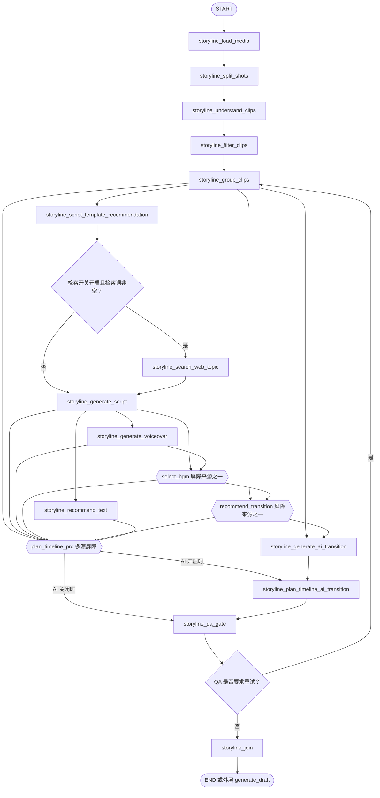
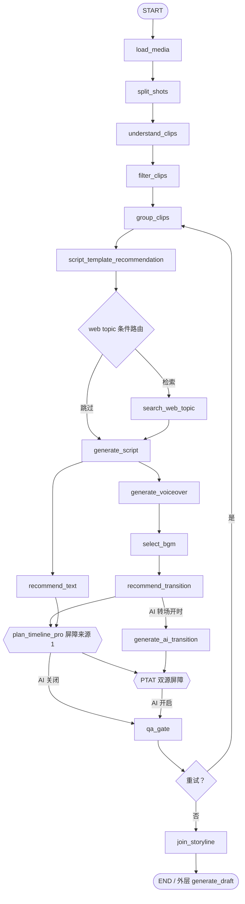

# auto-video-editor LangGraph 节点依赖与边关系审计、简化设计及分阶段执行计划

> **⚠️ 执行结果（2026-11-14，阶段 0/1/2/4/5/6 已执行、阶段 3 跳过）：** 阶段 1 的四组 fan-in 传递性约简**已执行**（用户决策推翻 2026-11-13 边审计「任务B 保留双源屏障」的结案）——§4 的四组建议与 §8.3 代码片段均已落地（`[GS,GV]→SB` 缩 `GV→SB`、`[GC,SB]→RTR` 缩 `SB→RTR`、PTP 六源缩 `[RTR,TXT]`、GAT 缩 `RTR` 单源边）；阶段 5 并行化以**改造现有 web_topic 节点为每轮必跑 + 内部软跳过**的方式实现（§9 方案的变体：不新增 prepare_web_topic 节点）。阶段 3 跳过（根因已于 2026-11-10 修复，无新失败样本）。§7.2 bridge_snapshot2 重构已执行（桥接节点删除）。SCHEMA_VERSION=8。**最终口径以《执行记录_LangGraph依赖约简_20261114.md》（同目录）为准。**

> 审计对象：[`wayyet/auto-video-editor`](https://github.com/wayyet/auto-video-editor) `main` 分支  
> 审计日期：2026-11-13  
> 重点对象：截图中的 `storyline_generate_script`，以及它所在的完整 auto Storyline 子图和外层剪映草稿工作流。  
> 审计方式：读取 `main` 分支的 `graph.py`、`state.py`、关键节点实现和 `README.md`，按「图边 → State 字段 → Artifact 文件 → 节点实际读取」交叉核验。

---

## 1. 审计结论摘要

### 1.1 总体结论

当前图的主干顺序整体合理，没有证据表明应该大规模删除业务节点。需要优先处理的是 **4 组 fan-in（多源汇合）屏障中的传递性冗余依赖**：上游 A 已经是上游 B 的前置节点，目标节点同时等待 A、B 并不会增加正确性，只会让拓扑更复杂。

建议优先完成以下调整：

| 优先级 | 当前关系 | 建议关系 | 结论 |
|---|---|---|---|
| P1 | `[generate_script, generate_voiceover] → select_bgm` | `generate_voiceover → select_bgm` | 删除文案的重复等待；保留配音等待 |
| P1 | `[group_clips, select_bgm] → recommend_transition` | `select_bgm → recommend_transition` | 删除分组节点的重复等待 |
| P1 | `[group_clips, generate_script, generate_voiceover, select_bgm, recommend_transition, recommend_text] → plan_timeline_pro` | `[recommend_transition, recommend_text] → plan_timeline_pro` | 将 6 源屏障缩为 2 源屏障 |
| P1 | `[group_clips, recommend_transition] → generate_ai_transition` | `recommend_transition → generate_ai_transition` | 删除分组节点的重复等待 |

这四项是**边关系的传递约简**，不删除节点、不改变 Artifact 契约、不改变业务计算。实施前仍应通过节点执行次数、重试轮和 feature flag 测试锁定行为。

### 1.2 截图节点的结论

`storyline_generate_script` 的两个上游标签并不代表「两个无条件并行任务都必须成功」：

- `storyline_script_template_recommendation` 是每轮必经的前置节点。它生成模板 Artifact，供文案节点注入 Prompt。
- `storyline_search_web_topic` 是条件节点。模板推荐完成后，路由函数根据检索开关及 `build_web_topic_query(state)` 的结果，决定走网页检索，或直接进入文案节点。
- 网页检索失败、无结果或没有有效检索词，不应阻断文案生成。

因此，截图中的两个 Dependencies 是两个可能的直接前驱，不是同一个 fan-in 屏障的两个强制输入。两个节点的业务职责不同，不建议删除。

### 1.3 截图中的四个下游标签

截图显示 `storyline_generate_script` 指向：

- `storyline_generate_voiceover`
- `storyline_plan_timeline_pro`
- `storyline_recommend_text`
- `storyline_select_bgm`

这些是四个不同目标，不是重复连线。但其中 `generate_script → select_bgm` 和 `generate_script → plan_timeline_pro` 是当前 fan-in 中可被下游链路传递保证的冗余等待边。完成上述简化后，文案节点的直接后继关系可更清晰地收敛为：

- `generate_voiceover`
- `recommend_text`

BGM 与时间线规划仍然会在后续执行，只是不再把文案节点单独列为直接屏障来源。

### 1.4 截图中的失败与依赖边无关

截图报错：

```text
RuntimeError: [storyline:generate_script]
narration 全空(字幕/配音源头断裂,LLM 返回无可用旁白)。
trace 已落盘: script_llm_trace.json; raw_head=''
```

`node_generate_script.py` 在真实（非 Stub）LLM 后端启用且 `required_features` 要求中文字幕或中文配音时，会检查生成结果的 `group_scripts[*].narration`。当所有旁白都为空时，先写入 `script_llm_trace.json`，再抛出异常。

这说明当前失败发生在**文案生成结果/LLM 返回内容/解析结果的有效性检查**，并不能归因于上游依赖过多。删除模板或网页检索边既不能补出旁白，也不能修复 `raw_head=''`。应先检查 `script_llm_trace.json`、`script.json`、LLM provider/model 返回值、解析器及提示词输入。

---

## 2. LangGraph 依赖判断标准

### 2.1 必须区分的三类关系

| 类型 | 含义 | 例子 | 审计问题 |
|---|---|---|---|
| 数据依赖 | 节点需要读取前序节点产生的 State 字段或 Artifact | 文案节点读取模板路径和网页检索产物 | 没有该数据是否会算错或无法执行？ |
| 调度依赖 | 图需要等某些节点完成后，才能调度当前节点 | `add_edge([A, B], C)` | 目标是否必须等待全部来源？ |
| 传递依赖 | A 已经是 B 的祖先，目标只等 B 就能保证 A 先完成 | BGM 节点等待配音节点，配音节点已等待文案节点 | 同时等待 A、B 是否只是重复约束？ |

**不得把读取字段的所有祖先都画成当前节点的直接依赖。** 直接依赖只应描述当前节点必须等待的最近必要完成条件；更上游的数据由链路自然传导。

### 2.2 `add_edge` 与 fan-in 屏障

本项目 `graph.py` 的注释已经记录并修复过多次误用：

- `add_edge("A", "C")` 是 A 完成后可触发 C；如果 C 有多个独立单源边，可能出现 C 在不同来源完成时被重复触发。
- `add_edge(["A", "B"], "C")` 是 fan-in 屏障，要求 A、B 都完成后再触发 C 一次。
- 条件执行节点不能随意加入 fan-in。若某轮条件分支没有运行，屏障可能永远等不到该来源，造成图静默终止或卡住。

因此，本次审计并不是把所有多源边改成单源边，而是检查：

1. 每个源是否是目标节点真实需要的数据或必要完成条件；
2. 源与源之间是否已经存在确定的先后依赖；
3. 被删除的来源是否可能在重试轮、条件分支或开关关闭时缺席；
4. 简化后是否仍能保证目标节点读取的数据已经就绪。

### 2.3 传递约简的安全条件

只有同时满足以下条件才建议删除一条 fan-in 来源边：

- 来源 A 必然先于保留来源 B 完成（A 是 B 的祖先）；
- B 在目标节点需要执行的每一轮都会被调度；
- B 正常返回时，不存在“跳过上游执行但又让目标被错误放行”的特殊路径；
- 目标节点需要的 A 数据在 B 完成之前已写入当前同一 workflow thread 的 State / Artifact；
- 重试回路不会只重跑目标而漏掉 B。

如果以上条件不能由代码和测试证明，则先保留边，不为减少图形连线而牺牲可靠性。

---

## 3. 当前 Storyline 子图：实际拓扑与数据流

### 3.1 当前主干（纵向）



> 说明：上图用于表达当前 `graph.py` 的业务路径。AI 转场节点是否连入图，由 `is_ai_transition_enabled()` 在建图时决定；AI 开启时 QA 的前驱切换为 PTAT，关闭时 QA 直接等待 PTP。

### 3.2 逐节点依赖审计

| 节点 | 当前直接上游 / 调度关系 | 代码实际读取的数据 | 输出 | 审计意见 |
|---|---|---|---|---|
| `storyline_load_media` | `START` | `video_input_paths` 或旧字段 `video_input_path` | `storyline_media_artifact` | 保留。素材导入是子图入口。 |
| `storyline_split_shots` | `load_media` | `storyline_media_artifact` 对应的 media manifest | `storyline_shots_artifact` | 保留。没有媒体清单不能切镜。 |
| `storyline_understand_clips` | `split_shots` | `storyline_media_artifact`、`storyline_shots_artifact` | `storyline_understanding_artifact` | 保留。其实现同时读取原媒体信息与切镜结果；前序链已保证两者就绪。 |
| `storyline_filter_clips` | `understand_clips` | `storyline_understanding_artifact`、用户筛选要求、目标时长 | `storyline_filtered_clips` | 保留。过滤输入是理解结果。 |
| `storyline_group_clips` | `filter_clips` | `storyline_filtered_clips`、语言、分组要求、目标时长 | `storyline_groups_artifact` | 保留。后续多节点均消费分组产物。 |
| `storyline_script_template_recommendation` | `group_clips` | groups、understanding.overall、用户文案要求、语言 | `storyline_script_template_artifact` | 保留。是每轮必经的真实业务节点，不是空转节点。失败输出 unavailable Artifact，软降级。 |
| `storyline_search_web_topic` | 模板节点后的条件路由；满足条件才执行 | 手动 query、understanding.overall、groups[].theme（共用 `build_web_topic_query`） | `storyline_web_topic_artifact` | 保留为可选增强节点。不可放入重试 fan-in 屏障；无检索词或失败时应软降级。 |
| `storyline_generate_script` | 模板节点后的条件直达，或 web topic 完成后进入 | groups、understanding.overall、可选 web topic Artifact、可选模板 Artifact、用户文案要求 | `storyline_script_artifact` | 保留。两个直接前驱并非无条件双源屏障；模板必经，网页检索条件执行。 |
| `storyline_generate_voiceover` | `generate_script` | `storyline_script_artifact` 中的 `group_scripts`、配音请求 | `storyline_voiceover_artifact` | 保留。确实依赖文案内容。 |
| `storyline_select_bgm` | 当前屏障 `[generate_script, generate_voiceover]` | groups、script、配音产物中的逐段 duration、BGM 请求 | `storyline_bgm_selection` | 保留节点。建议屏障只等 `generate_voiceover`；该节点已等待 script。配音时长是 2026-11-13 新增的真实数据消费，不能删掉 GV 等待。 |
| `storyline_recommend_transition` | 当前屏障 `[group_clips, select_bgm]` | groups、`storyline_bgm_selection`、转场请求 | `storyline_transition_plan` | 保留节点。建议只等 `select_bgm`；其上游已保证 groups 完成。 |
| `storyline_recommend_text` | `generate_script` | groups、script.group_scripts、文字样式请求、语言 | `storyline_text_style_plan` | 保留。其脚本输入来自 GS，groups 也在 GS 的祖先链上。 |
| `storyline_plan_timeline_pro` | 当前 6 源屏障 `[GC, GS, GV, SB, RTR, TXT]` | groups、media、script、voiceover、BGM、transition plan、text style、targets | `storyline_timeline_plan` | 保留节点。建议缩为 `[RTR, TXT]` 两源屏障；两条链覆盖全部实际输入。 |
| `storyline_generate_ai_transition` | 当前屏障 `[GC, RTR]`，且受建图开关控制 | groups、transition hints、media manifest（用于解析 clip 对应媒体）及授权/Provider 配置 | `storyline_ai_transition_artifact` | 保留为可选能力。建议只等 RTR；RTR 的上游已传递保证 GC 和媒体完成。 |
| `storyline_plan_timeline_ai_transition` | 当前屏障 `[PTP, GAT]`，且受开关控制 | 基础 `storyline_timeline_plan`、`storyline_ai_transition_artifact` | 更新后的 `storyline_timeline_plan` | 保留双源屏障。两份输入来自不同分支，不能约成单源。 |
| `storyline_qa_gate` | AI 关闭时等待 PTP；AI 开启时等待 PTAT | 最终时间线 Artifact、targets；检查时间、source range、clip speed 等 | QA 路由信号、retry count、日志 | 保留单前驱设计。PTP/PTAT 已负责等齐 QA 所需上游。 |
| `storyline_join` | QA 非 retry 出口 | `storyline_timeline_plan`，进行 CanonicalTimeline 校验并反序列化 | `storyline_plan` | 保留。外层剪映草稿 mapper 读取该字段。 |

### 3.3 `storyline_generate_script` 的两个上游为什么不是重复依赖

#### 模板推荐：真实、每轮必需的调度前置

`nodes/storyline/node_script_template_recommendation.py` 会：

1. 读取素材整体概述和分组主题；
2. 结合用户要求、语言构建模板查询；
3. 调用模板库推荐能力；
4. 写出 `script_template_plan.json`；
5. 回填 State 字段 `storyline_script_template_artifact`。

`nodes/storyline/node_generate_script.py` 随后读取该 Artifact，将模板正文作为 `script_template` 参数传给 `generate_script()`。

模板不可用、文件异常或用户显式提供 `custom_script` 时，文案节点可以不应用模板。因此，这是**需要等待其执行完成以获取可选模板结果**的前置关系，但不是强制模板内容依赖。

#### 网页检索：条件前驱，不是强制输入

当前路由函数 `_storyline_route_after_template_rec(state)` 的判断是：

- `STORYLINE_ENABLE_WEB_TOPIC` 关闭：直接去 `storyline_generate_script`；
- 开关打开但 `build_web_topic_query(state)` 为空：直接去 `storyline_generate_script`；
- 开关打开且检索词非空：先执行 `storyline_search_web_topic`，再进入 `storyline_generate_script`。

文案节点读取网页检索产物时使用软降级逻辑；网页参考被单独注入 `web_research`，不会被误并入视频概述 `overall`。因此，不应把 web topic 改成硬依赖，也不能把它加入要求每轮必达的 fan-in 屏障。

#### 两个节点是否可以合并

不建议合并。模板推荐回答“文案采用什么表达结构”，网页检索回答“当前话题有哪些外部参考”。输入、产物、失败模式和后续维护方式均不同。可以优化调度时序，但不应把两个能力揉成一个职责不清的节点。

### 3.4 截图四个后继的精确解释

| 截图后继 | 为什么需要 | 当前是否重复 |
|---|---|---|
| `generate_voiceover` | 由 `group_scripts` 合成配音 | 否，直接消费文案 |
| `recommend_text` | 基于分组与文案生成字体/文字样式方案 | 否，直接消费文案 |
| `select_bgm` | 利用文案内容、分组以及配音时长选择背景音乐 | 节点不重复，但 GS 对 SB 的直接屏障来源冗余；GV 已经等待 GS |
| `plan_timeline_pro` | 汇总素材、分组、文案、配音、BGM、转场和文字样式，规划 Canonical Timeline | 节点不重复，但 GS 对 PTP 的直接屏障来源冗余；RTR/TXT 两条保留链足以保证输入 |

所以“一个节点指向多个下游”本身是合理的 fan-out（扇出），不是重复执行。需要消除的是不同下游屏障中的**多余来源**，而不是把四个下游节点合并或删除。

---

## 4. 四组依赖边简化设计

### 4.1 `generate_script → select_bgm`：删除冗余来源

**当前：**

```python
g.add_edge(
    ["storyline_generate_script", "storyline_generate_voiceover"],
    "storyline_select_bgm",
)
```

**建议：**

```python
g.add_edge("storyline_generate_voiceover", "storyline_select_bgm")
```

**证明链：**

```text
storyline_generate_script
        ↓
storyline_generate_voiceover
        ↓
storyline_select_bgm
```

`node_generate_voiceover.py` 读取 `storyline_script_artifact` 并处理 `group_scripts`。所以只要 GV 完成，就能保证 GS 已经完成，文案 Artifact 已经写出。

**保留 GV 是必要的。** 2026-11-13 的 `node_select_bgm.py` 已加入 `_read_voiceover_total_ms(state)`，汇总 `storyline_voiceover_artifact` 中成功配音段的 duration，并传给 `select_bgm(voiceover_total_ms=...)`。配音失败时按 0 容缺省，不阻断 BGM，但必须等其执行结束后，才能确定本轮是否有可用时长。

### 4.2 `group_clips → recommend_transition`：删除冗余来源

**当前：**

```python
g.add_edge(
    ["storyline_group_clips", "storyline_select_bgm"],
    "storyline_recommend_transition",
)
```

**建议：**

```python
g.add_edge("storyline_select_bgm", "storyline_recommend_transition")
```

**证明链：**

```text
storyline_group_clips
        ↓
storyline_script_template_recommendation
        ↓
storyline_generate_script
        ↓
storyline_generate_voiceover
        ↓
storyline_select_bgm
        ↓
storyline_recommend_transition
```

`node_recommend_transition.py` 读取 groups 与 `storyline_bgm_selection`。SB 完成意味着其前驱文案/配音链已经完成；文案链又在 GC 之后。因此额外等待 GC 不会带来新的正确性保证。

### 4.3 PTP 六源屏障：缩为 RTR + TXT

**当前：**

```python
g.add_edge(
    [
        "storyline_group_clips",
        "storyline_generate_script",
        "storyline_generate_voiceover",
        "storyline_select_bgm",
        "storyline_recommend_transition",
        "storyline_recommend_text",
    ],
    "storyline_plan_timeline_pro",
)
```

**建议：**

```python
g.add_edge(
    [
        "storyline_recommend_transition",
        "storyline_recommend_text",
    ],
    "storyline_plan_timeline_pro",
)
```

**数据覆盖证明：**

| PTP 需要的数据 | 建议保留的完成来源 | 为什么能保证 |
|---|---|---|
| groups | RTR | RTR 读取 groups，且在 GC 之后执行 |
| script | RTR、TXT 任一祖先链 | 两者均由 GS 之后执行；GS 读取 groups |
| voiceover | RTR | RTR 等 SB；SB 等 GV；GV 等 GS |
| BGM selection | RTR | RTR 直接读取 BGM selection，且等待 SB |
| transition plan | RTR | RTR 自己生成并写入 State |
| text style plan | TXT | TXT 自己生成并写入 State |
| source media | RTR | GC 来自 filter/understand/split/load_media 链；媒体清单在该链上已产生 |
| targets | 入口初始 State | 不需要通过某个节点等待；创建工作流时已经注入 State |

PTP 仍保留两个屏障源：

- RTR 保证 groups、script、voiceover、BGM、transition plan 以及上游 media 链就绪；
- TXT 保证 text style plan 就绪。

**为什么不只等 RTR？** 因为 RTR 并不生成 `storyline_text_style_plan`。TXT 是一条独立的结果链，必须保留。

**为什么不把 web topic 加入屏障？** 网页检索是条件节点，关闭开关、无检索词、QA 重试等情况下可能不运行。文案节点可以在不依赖网页结果时生成文案，PTP 的数据也不是直接读取网页 Artifact。

### 4.4 AI 转场生成 GAT：只等待 RTR

**当前：**

```python
g.add_edge(
    ["storyline_group_clips", "storyline_recommend_transition"],
    "storyline_generate_ai_transition",
)
```

**建议：**

```python
g.add_edge(
    "storyline_recommend_transition",
    "storyline_generate_ai_transition",
)
```

`node_generate_ai_transition.py` 使用 groups 生成相邻分组边界配对，读取 `storyline_transition_plan` 作为提示参考；生成时还会读取 media manifest 来解析 clip 对应的素材信息。RTR 已经等待 BGM，而 BGM 的上游包含 GS/GV，模板分支的上游又包含 GC；GC 的前置链包含 load_media。故 RTR 完成可传递保证以上输入已经存在。

该结论以当前图的固定前驱链为前提。未来若 GAT 改成独立素材旁路，或允许 RTR 跳过其上游链后单独执行，必须重新评估该单源边。

### 4.5 必须保留的双源屏障

以下关系不应继续削减：

```python
g.add_edge(
    ["storyline_plan_timeline_pro", "storyline_generate_ai_transition"],
    "storyline_plan_timeline_ai_transition",
)
```

PTAT 要合并两份互相独立的产物：基础时间线和 AI 转场生成结果。PTP 完成不能保证 GAT 产物存在，GAT 完成也不能保证基础时间线存在，所以必须等两者。

`storyline_qa_gate` 当前只等待最终时间线节点（AI 关闭时 PTP，AI 开启时 PTAT）是正确做法。QA 只读取最终时间线，不应再直接等待 BGM、转场方案或文字样式；这些等待已由 PTP 的上游屏障承担。

---

## 5. 条件分支、QA 重试与循环安全性

### 5.1 Web topic 是条件节点，不可放入 fan-in

`storyline_search_web_topic` 在模板推荐之后经条件路由选择执行，不是每轮必跑。QA 重试时返回 `storyline_group_clips`，模板节点会再次执行；路由可能根据开关/输入直接绕过 web topic。

若把 web topic 放入 PTP 的必需屏障，某次重试轮没有执行 web topic，PTP 就可能永远等不到该节点，触发 LangGraph 图静默结束或阻塞风险。当前没有把它放入屏障是正确的，简化时必须继续遵守。

### 5.2 PTP / RTR / TXT / SB / GV 均处于 QA 重试链内

QA 超时重试路径是：

```text
storyline_qa_gate
    └─ retry → storyline_group_clips
                  → template recommendation
                  → [optional web topic]
                  → generate_script
                  → generate_voiceover / recommend_text
                  → select_bgm
                  → recommend_transition
                  → plan_timeline_pro
                  → QA
```

因此，当前建议保留的 `RTR` 和 `TXT` 在每轮重试都会重新经过。两者组成 PTP 的双源屏障，不会像已在早期治理中移除的 `split_shots` 那样停留在重试点上游而导致下一轮无法补齐。

### 5.3 QA 路由应继续使用独立信号字段

`qa_gate.py` 当前以 `storyline_qa_route_signal` 作为路由依据，不再依赖 `status_log[-1]`。这是合理设计：`status_log` 使用 append-unique reducer，重试标签可能被去重；若其后又写入不同标签，旧路由方式可能误判并跳过重试。

这次简化不应修改：

- `storyline_qa_route_signal` 的写入和读取方式；
- QA 重试次数上限；
- `storyline_group_clips` 作为重试回跳点；
- 节点每轮状态标签固定的约束；
- 网页检索失败缓存/复用策略。

---

## 6. 外层剪映工作流逐段依赖审计

除截图所在的 Storyline 子图外，`graph.py` 还装配了剪映草稿生成、质检、双语分支和交付 QA。以下关系按数据写入、草稿修改顺序及人工关卡检查。

| 阶段 / 节点 | 当前关系 | 依赖理由 | 审计结论 |
|---|---|---|---|
| `storyline_join → generate_draft` | Join 后条件路由；有 `storyline_plan` 才进入 | `generate_draft` 优先读取 `storyline_plan`，将 Canonical Timeline 映射为剪映草稿 | 保留。`shot_plan` 是历史/测试兼容兜底，不代表主链还需要旧人工模式 |
| `generate_draft → assembly_discover_and_probe → assembly_visual_observe → assembly_build_timeline → assembly_validate_render_qc` | `ASSEMBLY_QC_GATE_ENABLED=True` 时启用 | Assembly QC 链逐步发现媒体、观察画面、构建时间线、渲染/校验 | 保留。是开关控制的可选完整通道 |
| `assembly_validate_render_qc → assembly_repair_loop → assembly_validate_render_qc` | 条件重试回路 | QC 未达标且 retry 未超限时修复并复检 | 保留。不能删除回边 |
| `assembly_validate_render_qc → assembly_write_report → node_06_human_reorder` | 达标或达到软降级上限时写报告 | 报告完成后进入人工重排关卡 | 保留 |
| `ASSEMBLY_QC_GATE_ENABLED=False` | `generate_draft → node_06_human_reorder` | 应急关闭后跳过 QC 节点 | 保留。关闭时注册但不连边的 QC 节点是有意的 feature flag 行为，不是遗留重复边 |
| `node_06_human_reorder → node_07_speed_fit` | 串行 | 人工重排后再做速度/总时长护栏 | 保留。执行顺序有业务意义 |
| `node_07_speed_fit → bridge_snapshot2 → node_08_add_subtitles` | 条件达标后进入；超时则重试或升级终止 | 快照②是速度适配后的草稿版本；节点 8 从 snapshot2 读草稿 | 保留当前功能。`bridge_snapshot2` 可做结构性重构，详见 §7.2 |
| `node_08_add_subtitles → node_10_inject_text_fx → node_14_make_covers → node_15_localize_covers_en` | 中文线串行 | 后续节点都修改/读取草稿或封面产物，顺序不能随意并行 | 保留 |
| `node_08_add_subtitles → fork_draft_for_english_branch → node_16a_translate_and_check → node_08b_add_subtitles_en → node_10b_inject_text_fx_en` | 英文线串行 | 先基于字幕后草稿分叉，再翻译、注入英文字幕、注入英文花字 | 保留。即使无源字幕时 16a 会正常 skip，节点仍承载有源字幕时的真实翻译与布局检查能力 |
| `node_10b_inject_text_fx_en → route_after_translate` | 条件分支 | 有 `layout_issues_detected` 才进入 checkpoint③，否则直接到英文 TTS | 保留。条件节点不是重复边 |
| `node_checkpoint3_layout_review → node_17_inject_english_tts` | 需要人工校对时的继续边 | 人工修正布局后再生成英文配音 | 保留 |
| `[node_15_localize_covers_en, node_17_inject_english_tts] → node_09_inject_fx` | 双源 fan-in | 中文封面本地化和英文草稿/配音都完成后，公共尾链才开始处理两份草稿 | 保留。两条语言分支独立，不能只等其中一条 |
| `node_09_inject_fx → node_09b_inject_opening_hook → node_11_inject_sticker → node_12_human_add_bgm → node_13_adjust_volume` | 串行尾链 | 这些节点对中文主草稿和英文分支草稿进行顺序修改；关卡② 在 BGM 人工确认后再做音量处理 | 保留。若并行修改同一草稿，容易发生覆盖/写冲突 |
| `node_13_adjust_volume → join_before_delivery` | 单前驱 | 音量调整完成后才能做最终双语草稿 QA | 保留 |
| `join_before_delivery → export_final_video / delivery_qa_repair / delivery_qa_failed` | 条件路由 | QA 通过可导出；首次失败进入定向修复；复检仍失败则显式失败终止 | 保留。导出开关关闭时显式 skipped 是预期行为 |
| `delivery_qa_repair → join_before_delivery` | 复检回边 | 修复后必须重新过 QA | 保留 |

### 6.1 外层双分支汇合不是重复依赖

`node_15_localize_covers_en` 和 `node_17_inject_english_tts` 属于两个不同分支：前者在中文线生成封面并做英文封面本地化；后者在英文分支草稿中生成/写入英文配音。公共尾链节点会同时处理中文、英文两份草稿。

因此，以下屏障是正确的：

```python
g.add_edge(
    ["node_15_localize_covers_en", "node_17_inject_english_tts"],
    "node_09_inject_fx",
)
```

这不是可以用单一来源替代的传递依赖。

### 6.2 尾链不应随意合并或并行

`node_09`、`node_09b`、`node_11`、`node_12`、`node_13` 都会改动同一批草稿文件。当前串行关系避免多个节点同时读写 `draft_content.json` 导致更新覆盖。

关卡② 是有意的人机中断点，不能通过删除节点或调整成并行执行来绕过。

---

## 7. 可以删除的节点、不可删除的节点与后续候选项

### 7.1 当前不建议删除的节点

| 节点 | 不建议删除的原因 |
|---|---|
| `storyline_script_template_recommendation` | 真实读取模板目录并输出供文案使用的模板内容；不是与网页检索重复的空节点 |
| `storyline_search_web_topic` | 可选外部话题增强；当前条件路由与软降级是合理的 |
| `storyline_generate_script` | 核心文案产物生产者；下游配音、文本样式、BGM 与时间线都需要其产物 |
| `storyline_generate_voiceover` | 生成配音 Artifact；2026-11-13 起还给 BGM 选择提供真实时长信息 |
| `storyline_select_bgm` | 输出 BGM selection，供转场推荐、时间线规划和草稿映射使用 |
| `storyline_recommend_transition` / `storyline_recommend_text` | 两者分别产出 transition plan 和 text style plan，是 PTP 的两个不同输入 |
| `storyline_plan_timeline_pro` | 生成主 Canonical Timeline；是 AI 转场合并及 QA 的基础 |
| `storyline_generate_ai_transition` / `storyline_plan_timeline_ai_transition` | 可选 AIGC 生成及时间线物化链，受开关/授权保护；不能与基础时间线节点简单合并 |
| `storyline_qa_gate` / `storyline_join` | QA 检查与结果反序列化职责不同；Join 是外层 `generate_draft` 的契约入口 |
| `node_checkpoint3_layout_review`、`node_12_human_add_bgm`、`node_06_human_reorder` | 人工关卡承担真实确认/编辑行为，不能以依赖简化为理由删除 |

### 7.2 `bridge_snapshot2`：可以做重构，不建议直接删除

当前 `route_after_speed_fit(state)` 不只是路由函数：在速度达标时，它还会复制草稿目录到 `snapshots/snapshot2/`。随后 `bridge_snapshot2` 调用 `get_snapshot2_path(state)`，从磁盘重新定位快照并写入 `snapshot2_path` State，最后交给 `node_08_add_subtitles`。

当前职责链：

```text
node_07_speed_fit
   ↓
route_after_speed_fit（判断 + 写文件快照 + 返回路由名）
   ↓
bridge_snapshot2（重新定位文件 + 写 State）
   ↓
node_08_add_subtitles（消费 snapshot2_path）
```

该桥接节点不是无用节点：它弥补了条件路由函数不能直接返回 State 更新的问题。但它是可优化的控制流适配层。

**建议的后续重构：**

1. 将快照复制和 `snapshot2_path` 写入职责移到 `speed_fit` 节点（或一个显式的 `create_snapshot2` 普通节点）。
2. `route_after_speed_fit` 只读取 State / 草稿结果并返回下一节点名称，不再承担文件写入副作用。
3. `node_08_add_subtitles` 直接读取 State 中的 `snapshot2_path`。
4. 在确认没有其它调用方依赖 `bridge_snapshot2` 后，再删除 `bridge_snapshot2` 节点与 `get_snapshot2_path` helper。

**不建议把快照逻辑简单删除**，因为 node 08 需要速度适配后的草稿快照；直接删除可能导致后续字幕/配音写在错误版本的草稿上。

### 7.3 条件节点和 feature flag 节点不是孤儿节点

以下节点在某些配置下可能不执行或不连入编译图，这是设计行为：

- `storyline_search_web_topic`：按检索开关及查询内容条件执行；
- `storyline_generate_ai_transition`、`storyline_plan_timeline_ai_transition`：按建图时的 AI 转场开关连接；
- `assembly_*` 六节点：由 `ASSEMBLY_QC_GATE_ENABLED` 控制连接；关闭时主线回到旧路径。

不能只用“某次运行没有看到节点执行”判断它是冗余节点。应结合编译图 flags、路由结果和运行状态判断。

---

## 8. 推荐的简化后 Storyline 拓扑

### 8.1 简化原则

- 保留原有节点职责、Artifact 路径、State 字段及失败降级策略。
- 只删掉 fan-in 屏障中可由另一个保留来源传递保证的来源。
- 不改变条件路由、QA retry 回边和 feature flag 的读取时机。
- AI 转场仍需 PTP 与 GAT 两个输出合并。

### 8.2 推荐拓扑（纵向）



> 注：图中 `PTP` 的两个屏障来源是 `RTR` 和 `TXT`；`PTAT` 只有在 AI 转场开关开启时才接入。图中的 `PTP → QA` 是 AI 关闭路径，`PTAT → QA` 是 AI 开启路径，二者互斥，不应在同一建图配置中同时成为 QA 的正常前驱。

### 8.3 推荐的 graph.py 变更片段

```python
# select_bgm：配音节点已经等待 generate_script，删除重复的 GS 来源

g.add_edge("storyline_generate_voiceover", "storyline_select_bgm")

# recommend_transition：select_bgm 的祖先链已经包含 group_clips

g.add_edge("storyline_select_bgm", "storyline_recommend_transition")

# plan_timeline_pro：RTR 保证 groups/script/voiceover/BGM/transition/media；
# TXT 单独保证 text_style_plan

g.add_edge(
    [
        "storyline_recommend_transition",
        "storyline_recommend_text",
    ],
    "storyline_plan_timeline_pro",
)

# AI transition：RTR 的祖先链已经保证 groups 和 media 就绪
if is_ai_transition_enabled():
    g.add_edge(
        "storyline_recommend_transition",
        "storyline_generate_ai_transition",
    )
    g.add_edge(
        [
            "storyline_plan_timeline_pro",
            "storyline_generate_ai_transition",
        ],
        "storyline_plan_timeline_ai_transition",
    )
```

> 此代码是建议改造片段，不是已提交到仓库的变更。合并前必须按仓库当前 `graph.py` 的函数作用域、缩进和 feature flag 分支应用，并通过测试验证。

---

## 9. 可选的进一步优化：模板推荐与网页检索并行

当前模板推荐和网页检索是串行执行：

```text
group_clips → template_recommendation → conditional web_topic → generate_script
```

从数据角度看，网页检索构造查询只需要：

- `storyline_targets.query`；
- `storyline_understanding_artifact.overall`；
- `storyline_groups_artifact.groups[].theme`。

它并不读取模板推荐的 Artifact。因此两个能力之间没有真实的数据依赖，当前串行主要是为了让 `generate_script` 只被触发一次，并避免独立单源边导致重复执行。

如果后续要降低端到端延迟，可以考虑让两个分支并行，但**不能**简单增加 `group_clips → search_web_topic` 和 `group_clips → generate_script` 两条单源边；那会让 GS 提前执行一次，模板/网页分支完成后又可能再次触发 GS。

可选实现方案：

1. 新增一个很轻量的 `prepare_web_topic` 分支节点。无论功能关闭、查询为空还是检索开启，该节点都必须运行一次；关闭/为空时写入明确的 `skipped` 结果，不发网络请求。
2. `group_clips` 并行触发 `script_template_recommendation` 与 `prepare_web_topic`。
3. 使用列表 fan-in：`[script_template_recommendation, prepare_web_topic] → generate_script`。
4. `prepare_web_topic` 内部按 flag 决定是否实际调用搜索；失败仍写入可识别的软降级 Artifact。
5. 明确 QA 重试时两个分支每轮都能到达汇合点，不能把真正条件跳过的节点留在必需屏障中。

该优化可能减少串行等待，但会增加一个调度节点和状态契约，优先级低于四组传递性边简化。若网页检索耗时并不明显，不建议为了并行化额外增加维护成本。

---

## 10. 分阶段执行开发计划

### 阶段 0：建立当前图拓扑与执行次数基线

**目标：** 在改边之前锁定当前执行语义，避免把历史回归问题带入简化版本。

任务：

- [ ] 固定本次审计所依据的 `main` 分支代码版本，记录 Git commit SHA（在实际工作区执行 `git rev-parse HEAD` 获取）。
- [ ] 用 `build_graph(checkpointer=make_checkpointer("memory"))` 编译图，导出 `get_graph(xray=True)` 的节点、边和条件边映射。
- [ ] 分别记录 `STORYLINE_ENABLE_WEB_TOPIC` 开/关、有效/空 query 两种运行轨迹。
- [ ] 分别记录 AI 转场开/关时的编译图和执行轨迹。
- [ ] 记录 QA 正常通过、触发一次 retry、连续 retry 达上限三类轨迹。
- [ ] 为 `select_bgm`、`recommend_transition`、`plan_timeline_pro`、`generate_ai_transition` 增加每轮实际调用次数断言。

验收：

- [ ] 正常成功流程中每个应执行节点每轮只执行一次。
- [ ] 条件检索关闭/无 query 时，`search_web_topic` 不执行，文案节点仍只执行一次。
- [ ] AI 转场关闭时，GAT/PTAT 不参与本轮执行，QA 直接检查 PTP 产物。
- [ ] QA 重试时，重试回路内的节点按设计重跑，不出现 fan-in 不完整或 `next=[]` 的静默结束。

### 阶段 1：实施四组 fan-in 传递性约简

**目标：** 降低拓扑冗余，避免不必要的同步等待。

任务：

- [ ] 将 SB 屏障从 `[GS, GV]` 改为 `GV → SB`。
- [ ] 将 RTR 屏障从 `[GC, SB]` 改为 `SB → RTR`。
- [ ] 将 PTP 屏障从 `[GC, GS, GV, SB, RTR, TXT]` 改为 `[RTR, TXT]`。
- [ ] 将 GAT 屏障从 `[GC, RTR]` 改为 `RTR → GAT`。
- [ ] 保留 PTAT 的 `[PTP, GAT]` 双源屏障。
- [ ] 保留 QA 只等待最终时间线节点的单源入口。
- [ ] 更新 `graph.py` 对应注释，说明每一条保留边的数据保障链，避免未来维护者重新加回冗余来源。

验收：

- [ ] SB 开始前 `storyline_voiceover_artifact` 已写入；缺失时仍按现有容错规则处理。
- [ ] RTR 开始前 `storyline_groups_artifact` 与 `storyline_bgm_selection` 均已产生。
- [ ] PTP 开始前 groups、script、voiceover、BGM、transition plan、text style、media 均已就绪。
- [ ] GAT 开始前 groups、transition plan、media 均可读取。
- [ ] PTAT 开始前基础时间线和 AI 转场产物均完成。
- [ ] 无重复执行、无 `InvalidUpdateError`、无 `next=[]` 的非预期静默终止。

### 阶段 2：补齐节点级依赖契约测试

**目标：** 防止未来节点实现变化后，传递性约简不再成立却没有人发现。

建议新增/更新测试：

- [ ] `test_select_bgm_waits_for_voiceover_artifact.py`：验证 SB 等待 GV，且读取 voiceover duration。
- [ ] `test_recommend_transition_waits_for_bgm.py`：验证 RTR 启动前 BGM selection 已就绪。
- [ ] `test_plan_timeline_waits_for_transition_and_text.py`：验证 PTP 等待 RTR 和 TXT 两条链。
- [ ] `test_generate_ai_transition_waits_for_recommend_transition.py`：验证 GAT 所需 groups、media、transition hints 均已就绪。
- [ ] `test_storyline_barriers_do_not_include_conditional_web_topic.py`：验证 web topic 不进入必达 fan-in。
- [ ] `test_storyline_qa_retry_reaches_reduced_barriers.py`：验证简化后的屏障在 QA 每轮 retry 都可补齐。
- [ ] `test_storyline_node_execution_count.py`：黄金轨迹断言关键节点每轮运行次数。

测试应验证可观察行为与输入字段，不要只断言 `graph.py` 中字符串边列表；否则即使运行时调度错误，也可能出现“拓扑单测通过、执行重复”的假阳性。

### 阶段 3：修复截图中的文案失败（独立任务，不与边简化混做）

**目标：** 查明 `narration 全空` 的实际来源，避免用删边掩盖模型输出问题。

任务：

- [ ] 读取失败 thread 对应的 `outputs/<thread_id>/storyline/script_llm_trace.json`，核对 provider、model、请求摘要、原始返回长度、解析结果和异常信息。
- [ ] 检查 `script.json` 的 `group_scripts` 数量、`group_id` 映射和 `narration` 字段；区分“LLM 原始返回为空”和“模型返回非空但 parser 丢弃”。
- [ ] 检查 `storyline_groups_artifact` 中每组的 clips/theme，确认传给 Prompt 的分组输入非空。
- [ ] 检查 `storyline_script_template_artifact` 是否为 `status=ok`，模板正文是否过强约束或错误覆盖生成要求。
- [ ] 检查网页检索上下文是否为空、是否混入过长或无关内容；网页参考应是软增强，不应是文案事实唯一来源。
- [ ] 检查 `required_features.subtitles_zh` / `voiceover_zh` 的来源是否符合用户本次实际需求。
- [ ] 增加结构化解析日志：原始返回字符数、解析成功段数、空旁白段数、对应 group_id；避免记录敏感密钥或完整不可信外部数据。
- [ ] 为空 narration 增加小型、确定性的回归样例：Stub 场景按现有约定可降级；真实后端场景在必需旁白时必须 fail-fast 并保留 trace。

验收：

- [ ] 能明确区分 provider 空返回、模型格式不符、解析失败、group 映射失败四种原因。
- [ ] 有必需旁白时不允许空文案静默进入下游。
- [ ] 可选旁白功能关闭时，不因旁白为空误报为硬失败。

### 阶段 4：评估 `bridge_snapshot2` 结构性重构（可选）

**目标：** 让路由函数成为纯路由逻辑，减少单纯传递 State 的桥接节点。

任务：

- [ ] 明确 `snapshot2_path` 的唯一生产者，并由普通 State 节点完成写入。
- [ ] 将 `route_after_speed_fit` 内的目录复制等副作用迁移到节点逻辑，路由函数只返回目标节点名。
- [ ] 让 `node_08_add_subtitles` 直接读取 `snapshot2_path`，并保留文件不存在时回退到 `draft_path` 的现有容错。
- [ ] 确认失败/无 `draft_path`/时长未达标/重试超限路径不会读取旧任务遗留的 snapshot2 文件。
- [ ] 覆盖人工 checkpoint 恢复场景，确保 resume 后 State 中路径与 snapshot 文件一致。
- [ ] 只有上述测试全部通过后，才删除 `bridge_snapshot2` 节点和 `get_snapshot2_path` helper。

验收：

- [ ] 节点 8 读到的快照一定是当前 thread 最新一次速度适配结果。
- [ ] 重试不会将上轮旧快照误当成本轮快照。
- [ ] 所有异常路径仍然可观测，不会静默使用旧草稿。

### 阶段 5：评估模板与网页检索并行化（可选、低优先级）

**目标：** 只有在检索延迟确实影响总耗时时，才优化该串行路径。

任务：

- [ ] 先用运行事件统计 template recommendation 与 web topic 的 p50/p95 时长。
- [ ] 若有明确收益，再设计始终执行一次的 `prepare_web_topic`（未启用时返回 skipped Artifact，不产生网络请求）。
- [ ] 模板分支与 web topic 分支并行后，以双源屏障汇合到 GS。
- [ ] 测试开关关闭、query 为空、检索失败、模板失败、QA retry 等全部场景。
- [ ] 对比并行前后完整运行次数、端到端时延、外部检索调用次数与 token/费用。

验收：

- [ ] `generate_script` 每轮严格执行一次。
- [ ] web topic 失败/跳过仍可继续生成文案。
- [ ] 重试不会重复产生不必要的网络请求。
- [ ] 双源屏障不存在因可选节点缺席导致的死锁。

### 阶段 6：完整回归与上线

任务：

- [ ] 运行 `tests/unit`。
- [ ] 运行 `tests/integration/test_sequential_integration.py`。
- [ ] 在 PostgreSQL checkpointer 环境运行相关集成测试，验证 interrupt/resume。
- [ ] 对 assembly QC 开/关各运行一次。
- [ ] 对 AI 转场开/关各运行一次；付费 Provider 的审批门禁必须保持 fail-closed。
- [ ] 验证三个人工关卡①②③中断与恢复。
- [ ] 验证双语草稿生成、公共尾链和交付 QA。
- [ ] 对比改造前后的 graph JSON、执行事件流与每个节点的实际调用次数。
- [ ] 将运行轨迹、测试结果、拓扑快照和失败 trace 归档到 `docs/`，作为后续依赖调整的基线。

验收标准：

- [ ] 无节点重复执行（除明确的 QA / Assembly retry 外）。
- [ ] 无 fan-in 缺源导致的静默结束。
- [ ] 无 `InvalidUpdateError` 或 State 字段并发写冲突。
- [ ] 节点只在其输入 Artifact 可用之后运行。
- [ ] checkpoint 恢复、feature flag 和降级路径行为不变。
- [ ] 关键节点的直接依赖数量减少，但业务数据依赖没有丢失。

---

## 11. 回归命令与实施注意事项

### 11.1 仓库测试

在项目根目录、已激活项目 `.venv` 的环境中执行：

```powershell
# 单元测试
.\.venv\Scripts\python.exe -m pytest tests\unit -q

# 顺序集成测试
.\.venv\Scripts\python.exe -m pytest tests\integration\test_sequential_integration.py -v

# 全量测试（按当前环境中测试依赖和素材情况执行）
.\.venv\Scripts\python.exe -m pytest -q
```

README 当前记录过完整测试基线 `877 passed / 0 failed / 0 errors / 11 skipped`，但实际结果会受代码版本、测试素材、FFmpeg 和 Postgres 可达性影响。不要把被 skip 的 e2e 用例统计为已验证通过。

### 11.2 建图检查

建议在测试中将图结构转换为稳定的 `(source, target, edge_type)` 列表，并明确标注：

- 普通边；
- 条件边及其 route mapping；
- fan-in barrier 的完整来源集合；
- feature flag 当前值及其建图时/运行时读取时机。

监控界面也建议优化 `Dependencies` 的展示语义：不要只把所有直接入边来源显示成同样的 pill。至少区分：

- **必经前驱**；
- **条件前驱**（例如 web topic）；
- **fan-in 屏障来源**（且显示“需全部完成”）；
- **传递上游**（只用于解释，不应与直接依赖混为一谈）。

`Next Nodes` 同样建议显示边类型/汇合屏障语义。否则用户容易把“节点是某个 fan-in 的来源”误解成“它单独完成就会直接启动目标节点”。

### 11.3 实施风险

| 风险 | 影响 | 防护 |
|---|---|---|
| 将条件 web topic 加入必需屏障 | 某些轮次缺少该来源，PTP 无法触发 | 明确测试禁入条件分支屏障 |
| 错误删除 GV→SB | BGM 选曲拿不到配音总时长 | 保留 GV 等待，增加 duration 消费测试 |
| PTP 只等待 RTR | text style plan 可能未完成 | 保留 TXT 作为独立第二来源 |
| 删除 PTAT 的 GAT 或 PTP 来源 | AI 转场产物或基础时间线未完成 | 保留 PTAT 双源屏障 |
| 直接删除 bridge_snapshot2 | node 08 可能读错版本草稿 | 先迁移快照生产与 State 写入，再删除桥接节点 |
| 把条件路由函数继续用于文件写入 | 重放/恢复时副作用边界不清 | 将副作用放入普通节点，路由保持纯函数 |
| 只看 graph schema，不验证运行次数 | 仍可能出现重复触发或重复写文件 | 增加 golden trace 与调用次数断言 |

---

## 12. 源码核验索引

以下均为本次审计重点核对的 `main` 分支源码入口。实施前应重新拉取目标分支并确认文件未发生变化。

| 文件 | 核验内容 |
|---|---|
| [`graph.py`](https://github.com/wayyet/auto-video-editor/blob/main/graph.py) | 节点注册、全部 add_edge / add_conditional_edges、fan-in 屏障、feature flag、QA retry 回路、外层双语流程 |
| [`state.py`](https://github.com/wayyet/auto-video-editor/blob/main/state.py) | WorkflowState 字段、Artifact 字段、`_last_wins` 与 `status_log` reducer |
| [`nodes/storyline/node_generate_script.py`](https://github.com/wayyet/auto-video-editor/blob/main/nodes/storyline/node_generate_script.py) | 模板/web Artifact 消费、Prompt 输入、空 narration fail-fast 和 trace 落盘 |
| [`nodes/storyline/node_script_template_recommendation.py`](https://github.com/wayyet/auto-video-editor/blob/main/nodes/storyline/node_script_template_recommendation.py) | 模板推荐真实实现、输入/输出、软降级与重试缓存 |
| [`nodes/storyline/node_search_web_topic.py`](https://github.com/wayyet/auto-video-editor/blob/main/nodes/storyline/node_search_web_topic.py) | 网页检索条件输入、query hash、Artifact、cache hit 与失败降级 |
| [`nodes/storyline/_common.py`](https://github.com/wayyet/auto-video-editor/blob/main/nodes/storyline/_common.py) | `build_web_topic_query`、State/Artifact 读取 helper、视频路径解析 |
| [`nodes/storyline/node_generate_voiceover.py`](https://github.com/wayyet/auto-video-editor/blob/main/nodes/storyline/node_generate_voiceover.py) | 配音对 script Artifact 的消费关系 |
| [`nodes/storyline/node_select_bgm.py`](https://github.com/wayyet/auto-video-editor/blob/main/nodes/storyline/node_select_bgm.py) | 配音总时长读取与 BGM 选择输入 |
| [`nodes/storyline/node_recommend_transition.py`](https://github.com/wayyet/auto-video-editor/blob/main/nodes/storyline/node_recommend_transition.py) | groups 和 BGM selection 的实际读取 |
| [`nodes/storyline/node_recommend_text.py`](https://github.com/wayyet/auto-video-editor/blob/main/nodes/storyline/node_recommend_text.py) | groups 与 script 的实际读取 |
| [`nodes/storyline/node_plan_timeline_pro.py`](https://github.com/wayyet/auto-video-editor/blob/main/nodes/storyline/node_plan_timeline_pro.py) | PTP 全部输入 Artifact/State 字段 |
| [`nodes/storyline/node_generate_ai_transition.py`](https://github.com/wayyet/auto-video-editor/blob/main/nodes/storyline/node_generate_ai_transition.py) | GAT 的 groups、transition hints、media 读取及 Provider 授权门禁 |
| [`nodes/storyline/node_plan_timeline_ai_transition.py`](https://github.com/wayyet/auto-video-editor/blob/main/nodes/storyline/node_plan_timeline_ai_transition.py) | PTP 与 GAT 两份产物合并，物化 AI 转场 |
| [`nodes/storyline/qa_gate.py`](https://github.com/wayyet/auto-video-editor/blob/main/nodes/storyline/qa_gate.py) | 时间线校验、QA route signal 与 retry |
| [`nodes/storyline/join_storyline.py`](https://github.com/wayyet/auto-video-editor/blob/main/nodes/storyline/join_storyline.py) | 时间线反序列化为 `storyline_plan` |
| [`nodes/node_07_speed_fit.py`](https://github.com/wayyet/auto-video-editor/blob/main/nodes/node_07_speed_fit.py) | 速度护栏、snapshot2 生成位置、条件路由及路径 helper |
| [`nodes/node_05_generate_draft.py`](https://github.com/wayyet/auto-video-editor/blob/main/nodes/node_05_generate_draft.py) | `storyline_plan` 到剪映草稿 mapper 的入口 |
| [`nodes/node_08_add_subtitles.py`](https://github.com/wayyet/auto-video-editor/blob/main/nodes/node_08_add_subtitles.py) | snapshot2 消费、中文字幕/配音样式写入 |
| [`nodes/node_16a_translate_and_check.py`](https://github.com/wayyet/auto-video-editor/blob/main/nodes/node_16a_translate_and_check.py) | 英文字幕源、空源跳过和布局检查 |
| [`nodes/node_17_inject_english_tts.py`](https://github.com/wayyet/auto-video-editor/blob/main/nodes/node_17_inject_english_tts.py) | 英文分支配音写入 |
| [`nodes/node_join_before_delivery.py`](https://github.com/wayyet/auto-video-editor/blob/main/nodes/node_join_before_delivery.py) | 双语草稿交付 QA |
| [`README.md`](https://github.com/wayyet/auto-video-editor/blob/main/README.md) | 当前架构说明、运行/测试基线、监控拓扑和阶段治理记录 |

---

## 13. 本次审计边界与最终建议

本次结论来自对 GitHub `main` 分支源码的静态阅读及节点输入/输出交叉核验，不代表已经在该仓库工作区编译图或实际跑过全部集成测试；本次环境没有对本地 checkout 执行测试，因此不能将任何建议边变更描述为“已通过运行验证”。

**推荐实施顺序：**先做阶段 0 的基线与执行次数测试，再实施阶段 1 的四组 fan-in 约简，随后补齐阶段 2 的契约测试。截图中的空 narration 问题按阶段 3 单独排查。`bridge_snapshot2` 和模板/web 并行化属于后续可选重构，不应和 P1 边简化混在同一个改动批次。

最终目标不是把图变得尽可能少边，而是让每一条边都具有清楚、可验证的含义：**节点需要的数据由真实数据链提供，目标节点只等待最近且必要的前驱，条件分支不会破坏 fan-in，重试与恢复不会造成重复执行或静默终止。**
