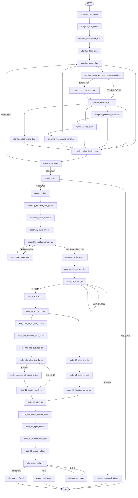

# auto-video-editor：完整 LangGraph 工作流树状布局设计与分阶段执行计划

> **改造目标**：将「完整 LangGraph 工作流（mode=auto）」节点地图从当前的横向分层布局切换为自上而下的树状布局。  
> **项目**：[`wayyet/auto-video-editor`](https://github.com/wayyet/auto-video-editor)  
> **分支**：`main`  
> **源码基准提交**：[`6679e540eb91555b2f437b8661b0c5679291f697`](https://github.com/wayyet/auto-video-editor/commit/6679e540eb91555b2f437b8661b0c5679291f697)  
> **基准时间**：2026-11-13 04:14（Asia/Singapore，按提交时间换算）  
> **截图基准**：用户提供的「完整 LangGraph 工作流(mode=auto)」页面截图  
> **文档性质**：UI 设计方案、源码改造说明、分阶段执行计划、测试与验收清单

---

## 1. 需求与结论

### 1.1 当前问题

当前「完整 LangGraph 工作流(mode=auto)」页面把节点按流程深度放入多个横向列中。节点数量增加后，工作流会逐渐向右扩展，用户需要同时横向、纵向滚动才能查看整体结构。对于存在并行分支、条件路由、汇合屏障和重试回路的主图，这种布局不容易快速看出主流程从哪里开始、在哪些位置分支、又在哪里汇合。

本次需要把主图改为树状组织方式：

- `START` 位于顶层，作为树根。
- 主流程从上向下展开。
- 并行分支在同一层级向左右分散。
- 多个分支汇合时，一个逻辑节点只展示一张卡片。
- 条件分支、回边和重试边继续保留，不能为了画成树而删除真实边。
- `END` 放在流程底部；多个终止路径汇入同一个 `END` 节点。

### 1.2 推荐方案

采用**树状主布局 + DAG 辅助连线**：

1. 使用真实图边构建一棵用于排版的「生成树」（Spanning Tree，即从原图中选出一组边，使每个可达节点只通过一个父节点进入布局层级）。
2. 生成树中的边负责确定节点的父子层级和卡片位置。
3. 原始图中没有被选为树边的边，仍然绘制为辅助连线，包括条件分支、Fan-in 多前驱汇合边、自环和重试回边。
4. 不复制节点，不删除原始边，不修改 LangGraph 的执行拓扑。

这不是把 LangGraph 改造成树，而是**仅把现有有向图（DAG/含环图）投影成便于阅读的树状布局**。

### 1.3 改造范围

| 范围 | 本次处理方式 |
|---|---|
| `完整 LangGraph 工作流(mode=auto)` 主图 | 默认改为自上而下树状布局 |
| 原横向分层布局 | 保留为可选备用布局，便于复杂边关系排查和回退 |
| `OpenStoryline 子流程` 视图 | 默认保持现有布局，不扩大本次改造范围 |
| LangGraph 节点注册与边定义 | 不修改 |
| `/api/workflow/graph` 图 Schema | 不修改接口语义 |
| SSE 实时运行状态、thread 订阅、节点状态和运行计数 | 保持原有行为 |
| PostgreSQL 检查点、事件持久化、工作流执行逻辑 | 不修改 |

**重要边界：**本次是前端展示层改造，不是工作流拓扑重构。不要通过修改 `graph.py` 的 `add_edge()` / `add_conditional_edges()` 来迎合页面布局。

---

## 2. 当前源码核对与现状分析

### 2.1 关键源码文件

以下路径已在基准提交中核对：

| 文件 | 当前职责 | 本次是否修改 |
|---|---|---|
| [`web/node_map/node_map.html`](https://github.com/wayyet/auto-video-editor/blob/main/web/node_map/node_map.html) | 节点地图页面；创建节点卡片、控制拖拽/折叠、计算布局、绘制 SVG 边、保存布局 | **主要改造文件** |
| [`web/node_map/workflow.json`](https://github.com/wayyet/auto-video-editor/blob/main/web/node_map/workflow.json) | OpenStoryline 子流程静态节点数据 | 不改 |
| [`monitoring/workflow_graph.py`](https://github.com/wayyet/auto-video-editor/blob/main/monitoring/workflow_graph.py) | 从已编译 LangGraph 图提取真实节点、普通边、条件边和展示元数据 | 原则上不改 |
| [`web/api_workflow.py`](https://github.com/wayyet/auto-video-editor/blob/main/web/api_workflow.py) | 提供只读工作流图、运行快照和 SSE 事件流接口 | 不改 |
| [`web/static/workflow_monitor.mjs`](https://github.com/wayyet/auto-video-editor/blob/main/web/static/workflow_monitor.mjs) | SSE 事件归约、运行状态、活动节点、已走边和布局缓存辅助逻辑 | 原则上不改；若统一布局缓存 key，再小幅扩展 |
| [`graph.py`](https://github.com/wayyet/auto-video-editor/blob/main/graph.py) | 定义实际 LangGraph 节点、固定边、条件边和多前驱屏障 | **不改** |
| [`web/tests/workflow_monitor.test.mjs`](https://github.com/wayyet/auto-video-editor/tree/main/web/tests) | 现有前端监控纯逻辑测试 | 作为回归测试 |
| [`tests/integration/test_workflow_graph_schema.py`](https://github.com/wayyet/auto-video-editor/blob/main/tests/integration/test_workflow_graph_schema.py) | 校验 API Schema 与编译图真实拓扑一致 | 作为拓扑回归测试 |

### 2.2 当前横向布局的具体实现

`web/node_map/node_map.html` 中已有以下布局逻辑：

- `computeDepths(nodes)`：沿节点依赖计算最长路径深度；遍历到正在访问的依赖时忽略该回边，避免 QC/QA 重试环和自环导致深度计算不收敛。
- `autoLayout(nodes)`：按深度把节点放入横向列。
- 当前横向列间距为 `420px`，同列节点纵向间距为 `170px`。
- 节点坐标按 `x = 40 + depth * 420`、`y = 40 + index * 170` 计算。
- `ensureCanvasSize()` 根据节点卡片实际位置扩大可滚动画布。
- `loadLayout()` / `saveLayout()` 使用 `localStorage` 保存节点位置和折叠状态。
- `resetLayout()` 清除当前布局缓存，再执行 `autoLayout()`。

因此，当前问题并不是缺少节点数据或缺少连线，而是**布局函数把图的深度映射成横坐标、把同层节点映射成纵向列表**。

### 2.3 主图数据不是静态 JSON

主图视图通过 `node_map.html` 的 `loadData("main")` 请求：

```text
GET /api/workflow/graph
```

页面读取接口返回的数据后，调用 `normalizeMainGraph()`（或内联兜底实现），从 `schema.edges` 推导各节点的 `dependencies` 和 `next_nodes`，再交给节点渲染层。

后端 `monitoring/workflow_graph.py` 的拓扑来源是已编译图的 `compiled_graph.builder`，覆盖：

- 普通 `add_edge()`；
- `add_edge([source_a, source_b, ...], target)` 产生的多前驱等待边；
- `add_conditional_edges()` 的条件边出口；
- `START` / `END` 归一化。

后端还为边提供 `id`、`from`、`to`、`kind`、`label` 字段。前端必须继续以 `schema.edges` 为边的事实来源，不能自己重新写一份主图节点关系。

### 2.4 一个需要同步修正的展示问题

当前 `node_map.html` 的 `buildEdges()` 在主图模式下会读取 `data.edges`，但 `addEdge()` 主要保存 `from`、`to`、SVG 元素和 `id`，没有完整保留 `kind`、`label`。

这会使前端无法充分表现后端已经提供的边语义。本次树状布局改造应同时保留：

- `kind="conditional"`：条件边；
- `label`：分支条件、Fan-in 屏障说明、修复后复检说明等；
- 原始 `id`：实时事件层用它匹配已走边和活动边。

不要只画线而丢失边的业务含义。

### 2.5 当前页面已有、必须保留的功能

根据截图和 `node_map.html` 源码，以下能力已存在，不应在本次重写中丢失：

1. 完整工作流 / OpenStoryline 子流程视图切换。
2. `Expand All`、`Collapse All` 和 `Reset Layout`。
3. 黑色 / 白色背景主题切换。
4. thread_id 输入、订阅和断开。
5. 执行中、完成、等待、重试、失败、未参与等状态图例。
6. 节点卡片拖拽；点击标题折叠或展开。
7. 鼠标悬停时突出显示节点相邻连线。
8. 当前活动节点自动跟随滚动；人工拖拽节点时暂停自动跟随。
9. SSE 实时运行状态、attempt、耗时、错误和等待人工信息。
10. 节点状态与实际运行事件保持一致，允许多个并行节点同时处于运行状态。

---

## 3. 主图拓扑特征：为什么不能直接画成普通树

当前主图是一个**带条件分支、并行分支、汇合屏障和回边的有向工作流图**，不是单链路树。若简单把所有出边都作为树的子节点，会出现同一个节点被重复创建、循环递归或图关系丢失的问题。

### 3.1 当前主图的主要业务阶段

根据基准提交 `graph.py` 中的实际接线，主图的主要结构如下：



> 注：图中展示的是便于理解的业务关系，不是页面最终坐标图。AI 转场相关节点会随 `STORYLINE_ENABLE_AI_TRANSITION` 的建图配置改变；QC 节点是否进入执行链由 `ASSEMBLY_QC_GATE_ENABLED` 控制。前端必须消费 API 当前返回的节点和边，不能依赖此 Mermaid 图硬编码实际运行拓扑。

### 3.2 树布局必须特殊处理的四种关系

| 关系 | 主图中的例子 | 树状展示规则 |
|---|---|---|
| 条件分支 | `storyline_script_template_recommendation`、`node_07_speed_fit`、`node_10b_inject_text_fx_en`、`join_before_delivery` | 子节点向下分叉；连线保留条件标签；未选择的分支不能被前端假定为已执行 |
| 并行分支 | 中文字幕链与英文链；文案、配音、文字推荐等并行工作 | 同一父节点下面横向展开多个子树；运行时允许多个节点同时执行 |
| Fan-in 汇合 | `storyline_select_bgm`、`storyline_plan_timeline_pro`、`node_09_inject_fx` | 目标节点只创建一张卡片；一个父节点作为树布局父节点，其余上游边作为汇合辅助连线 |
| 循环 / 回边 | `storyline_qa_gate → storyline_group_clips`、`assembly_validate_render_qc ↔ assembly_repair_loop`、`node_07_speed_fit` 自环、交付 QA 修复回路 | 不参与树层级递归；以回边样式绘制，避免重复节点和无限递归 |

### 3.3 为什么不能复制汇合节点

例如：

```text
node_15_localize_covers_en ─┐
                            ├── node_09_inject_fx
node_17_inject_english_tts ─┘
```

`node_09_inject_fx` 在真实 LangGraph 图中是同一个汇合节点，LangGraph 会等待两个前驱满足屏障条件后执行。若树状 UI 把它复制成两张卡片，用户会误以为后面存在两个独立的特效节点，实时状态也无法明确映射到唯一 `node_id`。

正确方式是：`node_09_inject_fx` 只显示一次；两条输入边都保留，其中一条用于树层级定位，另一条作为 Fan-in 辅助连线。节点卡片可以显示「汇合 · 2 个上游」提示，具体数量从真实入边计算，不写死。

---

## 4. 目标页面设计

### 4.1 页面结构

保留现有两条顶部工具栏，在第一条工具栏增加布局选择器：

```text
完整 LangGraph 工作流(mode=auto)              [完整 LangGraph 工作流 ▼]
                                               [布局: 树状 ▼] [Expand All] [Collapse All]
                                               [Reset Layout] [背景:黑色]

thread [thread_id] [订阅] [断开] [运行状态] [跟随]
图例：执行中 / 完成 / 等待 / 重试 / 失败 / 未参与

                         START
                           │
                    storyline_load_media
                           │
                   storyline_split_shots
                           │
                storyline_understand_clips
                           │
                 storyline_filter_clips
                           │
                  storyline_group_clips
                    /                \
       文案模板/检索分支             时间线/其他分支
                  ...                 ...
```

布局选择器建议提供：

| 选项 | 行为 |
|---|---|
| **树状布局（默认）** | 自上而下，根节点在顶层，并行子树横向展开 |
| 横向分层布局 | 保留当前 `autoLayout()` 的横向列布局，作为备用视图 |

页面进入完整主图时默认树状布局。切换到 `OpenStoryline 子流程` 视图时，仍使用它自己的既有布局行为，不强制套用主图树状算法。

### 4.2 节点卡片

继续沿用当前 `.node` 卡片、标题、摘要、状态点、状态徽标和展开详情结构，不另起一套节点组件。

树状布局的视觉要求：

- 根节点 `START` 位于顶部中间区域。
- 普通流程使用自上而下的连线，父节点底部连接子节点顶部。
- 同一父节点的多个子节点在水平方向均匀分布。
- 卡片宽度保留当前默认 `340px`，允许根据视口滚动，不将节点内容缩放到不可读。
- 折叠状态优先展示节点中文名和简短说明。
- 展开状态继续展示节点 ID、kind、group、checkpoint、运行状态、依赖和下游节点。
- `enabled=false` 或 `reachable=false` 的节点仍应显示，使用离线/未连通样式，不得静默隐藏。

### 4.3 连线样式

建议增加以下连线语义：

| 连线类别 | 建议样式 | 说明 |
|---|---|---|
| 树主边（生成树边） | 实线、常规箭头 | 决定父子层级和主布局 |
| 条件分支边 | 实线或轻量强调线；悬停显示 `label` | 展示条件路由及分支条件 |
| Fan-in 辅助边 | 虚线或浅灰曲线 | 显示多个上游汇合到同一个节点 |
| 循环 / 重试回边 | 虚线、折返路径；悬停显示标签 | 不改变节点树层级，只说明返回关系 |
| 未选中 / 未走过边 | 中性颜色 | 不提前标记为 skipped；实际状态仍以运行事件为准 |
| 已走过 / 当前活动边 | 继续使用当前绿色 / 蓝色状态效果 | 保持 `workflow_monitor.mjs` 的事件投影规则 |

边的 `kind` 和 `label` 使用后端 schema 的原值。标签默认不需要全部常驻绘制，避免拥挤；条件边标签可在悬停 tooltip 中完整展示，在重要分支旁显示短文本。

### 4.4 画布和交互

- 保留现有横向、纵向滚动能力。树状布局可能因大规模并行分支而变宽，不能假定树一定只需要纵向滚动。
- `ensureCanvasSize()` 继续根据节点实际坐标和尺寸扩展画布，但必须支持树布局重新排版后更新尺寸。
- 节点拖拽继续有效；拖拽后保存当前布局，并暂停活动节点自动跟随。
- 节点展开/折叠后重新校准 SVG 连线位置。
- 自动树状布局模式下，未手动拖拽时可在展开/折叠后重新计算纵向层高，避免卡片变高后覆盖下一层节点。
- 用户手动拖拽后，将布局标记为自定义；展开/折叠不应突然覆盖用户已调整的位置。点击 `Reset Layout` 才重新应用算法布局。
- `Expand All` / `Collapse All` 只改变卡片展开状态，不改变节点 ID、边 ID、执行状态或当前运行 thread。

---

## 5. 树状布局算法设计

### 5.1 输入与输出

**输入：**

- `data.nodes`：后端返回的真实节点列表。
- `data.edges`：后端返回的真实边列表，至少包含 `id`、`from`、`to`、`kind`、`label`。
- 节点 DOM 实际测量尺寸：`offsetWidth`、`offsetHeight`。
- 当前布局模式：`tree` 或 `dag`。

**输出：**

```js
{
  positions: {
    [nodeId]: { x, y }
  },
  treeEdgeIds: new Set(),
  secondaryEdgeIds: new Set(),
  disconnectedNodeIds: new Set(),
  depthByNode: new Map()
}
```

字段用途：

- `positions`：每个真实节点唯一的一组坐标。
- `treeEdgeIds`：被选为父子关系的边。
- `secondaryEdgeIds`：其余仍需绘制的真实边，包括汇合、条件补充边和回边。
- `disconnectedNodeIds`：从 `START` 沿真实边不可达的节点。
- `depthByNode`：节点在树状视图中的层级。

上述结构只在前端内存中使用，不回写 API，不修改后端图 Schema。

### 5.2 第一步：建立真实邻接表

1. 从 `data.nodes` 建立 `nodeId → node` 映射。
2. 从 `data.edges` 建立 `from → outgoing edges` 和 `to → incoming edges`。
3. 忽略引用了不存在节点 ID 的异常边，并记录开发期告警；正常后端 schema 不应产生此类边。
4. 保留每条边的 `id`、`kind`、`label`，禁止只保留起点和终点。
5. 邻接顺序必须稳定：优先使用 schema 节点注册顺序作为同级节点顺序依据，避免每次页面刷新树枝随机换位。

不要仅依靠节点的 `dependencies` 生成树。主图 `edges` 已经是后端根据编译图提取的真实拓扑，`dependencies` 只是归一化后的辅助字段。

### 5.3 第二步：构造生成树

建议使用**带 visited 集合的确定性深度优先遍历（DFS）**生成主树：

1. 优先从 `START` 开始遍历。
2. 每个节点第一次被发现时，记录发现它的边为 `treeEdge`，并把目标节点加入该父节点的 children。
3. 如果目标节点已经访问过，则该边不再创建第二个父子节点，改为 `secondaryEdge`。
4. 对 `START` 不可达的节点单独归入「未接入/未启用」区域，不伪造真实 LangGraph 边。
5. `END` 只创建一个节点。若存在多个真实入边，仅一条用于树层级，其余仍作为辅助汇合边；布局可将 `END` 放在所有有效终止父节点的下方居中位置。

伪代码：

```js
function buildSpanningTree(nodes, edges, rootId = "START") {
  const nodeIds = new Set(nodes.map((node) => node.id));
  const outgoing = buildStableAdjacency(nodes, edges, nodeIds);
  const visited = new Set();
  const treeEdgeIds = new Set();
  const secondaryEdgeIds = new Set();
  const children = new Map(nodes.map((node) => [node.id, []]));
  const parent = new Map();

  function visit(nodeId) {
    visited.add(nodeId);

    for (const edge of outgoing.get(nodeId) || []) {
      const targetId = edge.to;
      if (!visited.has(targetId)) {
        visited.add(targetId);
        parent.set(targetId, nodeId);
        children.get(nodeId).push(targetId);
        treeEdgeIds.add(edge.id);
        visit(targetId);
      } else {
        secondaryEdgeIds.add(edge.id);
      }
    }
  }

  if (nodeIds.has(rootId)) visit(rootId);

  // 所有未访问节点进入独立的未接入节点区域，不创建伪拓扑边。
  const disconnectedNodeIds = new Set(
    [...nodeIds].filter((id) => !visited.has(id))
  );

  return { children, parent, treeEdgeIds, secondaryEdgeIds, disconnectedNodeIds };
}
```

> 实际实现需要确保 `visit()` 不重复递归已经访问的节点；上面代码用于说明控制流程，正式函数应把「标记 visited」集中在首次发现时完成，并为深图使用显式栈或限制递归深度，避免 JS 调用栈溢出。

### 5.4 第三步：计算树的水平位置

采用适合树形结构的**子树宽度分配**方法，而不是把每一层简单排列成一条长横排。

1. 从叶子节点开始，自底向上计算每个节点的子树所需宽度。
2. 子树宽度至少为当前节点宽度。
3. 如果有多个子节点，父节点需要的子树宽度为所有子树宽度之和，再加节点间距。
4. 按子树宽度给兄弟节点分配不重叠的水平区间。
5. 父节点 X 坐标放在子节点区间的中心附近。
6. 没有子节点的叶子节点按稳定顺序占据水平槽位。

建议初始参数：

| 参数 | 初始建议值 | 说明 |
|---|---:|---|
| `NODE_GAP_X` | `48px` | 同一父节点下兄弟子树之间的水平间距 |
| `NODE_GAP_Y` | `72px` | 相邻树层之间的垂直间距 |
| `CANVAS_PADDING_X` | `48px` | 画布左右留白 |
| `CANVAS_PADDING_Y` | `40px` | 画布顶部留白 |
| 节点宽度 | 使用实际 DOM 测量值 | 默认卡片宽度目前为 `340px` |

### 5.5 第四步：计算树的垂直位置

不能继续固定使用 `rowHeight=170px`。主图节点展开后会显示运行详情、依赖关系、错误和等待信息，实际高度不同。

建议：

1. 所有节点 DOM 创建完成后，先应用折叠状态。
2. 在 `requestAnimationFrame()` 中测量每张卡片的实际宽高。
3. 按树深度统计每层最大高度 `maxHeightByDepth[d]`。
4. 计算每层 Y 坐标：

```text
Y[0] = CANVAS_PADDING_Y
Y[d] = Y[d - 1] + maxHeightByDepth[d - 1] + NODE_GAP_Y
```

5. 将同层节点顶部对齐，节点横坐标按 5.4 的子树宽度分配结果确定。
6. 应用位置后调用 `ensureCanvasSize()` 和 `updateAllEdges()`。

当用户展开/折叠节点时，如果布局还没有被人工拖拽修改，则重新测量卡片高度并重新排版；如果用户已经手动拖动节点，则不自动覆盖手动坐标。

### 5.6 第五步：绘制非树边

生成树仅用于决定坐标，**所有真实边都必须继续绘制**。

| 边类型 | 识别方式 | 处理方式 |
|---|---|---|
| 主树边 | `edge.id ∈ treeEdgeIds` | 父节点底部 → 子节点顶部，使用纵向贝塞尔或折线 |
| 非树普通边 | 真实边但不在 `treeEdgeIds` | 使用辅助路径，避免遮挡卡片 |
| 条件边 | `edge.kind === "conditional"` | 添加 `edge-conditional` class，保留 `edge.label` |
| Fan-in 辅助边 | `edge.label` 包含屏障/Fan-in 说明，或后端将来明确提供 edge role | 显示多上游汇合路径；目标节点仍只有一个 |
| 回边 / 自环 | 非树边且目标已在其上游访问路径中，或 `from === to` | 使用虚线折返路径或外围绕线路径 |

辅助连线建议使用 SVG 的侧边通道（routing lane）：为同一节点附近的多条辅助边分配不同偏移量，避免多条线完全重叠。辅助边标签默认放在悬停 tooltip 中；重要条件边可以显示短标签。

### 5.7 第六步：保持实时状态投影不变

布局计算不得改动 `workflow_monitor.mjs` 的状态归约逻辑：

- 一个 run 可以同时有多个 `running` / `retrying` 节点。
- `branch.selected` 事件用于确定运行时实际选中的条件分支。
- `node.started`、`node.succeeded`、`node.failed`、`node.waiting_input` 等事件继续按原规则更新节点。
- `run.completed` / `run.failed` 终态后，原有 `finalizeSkipped()` 逻辑继续工作。
- 已走边和活动边仍然使用后端 edge ID 匹配，布局切换不能改变 edge ID。
- 自动跟随继续使用活动节点 ID；只改变节点坐标，不改变状态归约结果。

---

## 6. 前端文件与代码改造设计

### 6.1 新增纯布局模块

建议新增：

```text
web/static/workflow_layout.mjs
```

建议导出：

```js
export function buildSpanningTree(nodes, edges, options = {}) {}
export function computeTreePositions(tree, nodeMeasurements, options = {}) {}
export function computeDagPositions(nodes, edges, options = {}) {}
export function getLayoutCacheKey({ workflowId, mode, schemaVersion, layoutMode }) {}
```

职责边界：

- 只计算布局数据，不创建 DOM、不发 HTTP 请求、不订阅 SSE。
- 不负责修改节点状态或边状态。
- 输入输出均为普通 JS 数据结构，可以直接用 Node.js 测试。
- 主图树布局和原横向布局统一由布局模块管理，页面只负责调用和渲染。

### 6.2 修改 `web/node_map/node_map.html`

主要改动点：

1. 在现有 `viewSelect` 后增加布局选择器 `layoutSelect`。
2. 主图默认采用 `tree`；用户切换后可选择 `dag` 作为原横向分层布局。
3. `OpenStoryline 子流程` 仍保持当前行为；其布局选择器可以隐藏或禁用。
4. 将现有 `autoLayout()` 明确改名为 `autoDagLayout()`，避免以后把它和树布局混淆。
5. 新增 `autoTreeLayout()` 调用纯布局模块。
6. 调整 `renderWorkflow()`：先创建节点 DOM 并应用折叠状态，再测量节点尺寸，最后计算布局和绘制边。
7. `addEdge()` / `buildEdges()` 保留后端边的 `kind`、`label` 和原始 `id`。
8. `edgePath()` 增加树状主边的纵向锚点，以及辅助边的折返/侧向路由。
9. `resetLayout()` 根据当前 `layoutMode` 选择对应算法。
10. 用户手动拖拽后设置 `positionsCustomized=true`，避免展开/折叠事件意外覆盖手动排布。
11. 主题、节点状态、hover 高亮、跟随滚动、订阅控制不应与布局算法耦合。

### 6.3 布局缓存隔离

当前主图布局 key 的基本结构为：

```text
wf_layout_{workflowId}_{mode}_v{schemaVersion}
```

新增树布局后，必须防止树坐标和旧横向坐标互相覆盖。建议：

```text
wf_layout_{workflowId}_{mode}_v{schemaVersion}_tree_v1
wf_layout_{workflowId}_{mode}_v{schemaVersion}_dag
```

其中：

- `tree_v1`：树布局算法版本；将来调整树坐标规则时可升级为 `tree_v2`，避免旧坐标污染新算法。
- `dag`：沿用旧横向布局缓存，尽量兼容用户既有拖拽位置。
- 子流程视图继续沿用旧的 `node_layout_{workflowId}` key，不与主图混用。
- 缓存 payload 应保存 `positions`、`collapsed`、`layoutMode`、`layoutAlgorithmVersion` 和 `positionsCustomized`。

**Schema 版本不需要因纯 UI 布局变更而递增。** 当前后端主图 Schema 为 `schema_version=6`；只有后端 Schema 字段或拓扑契约变化时，才按既有规则升级版本。

### 6.4 不建议引入新的布局依赖

当前节点地图是直接由 HTML / CSS / 原生 JavaScript / SVG 实现的轻量页面。首选新增纯 JS 布局模块，不急于引入 `dagre`、`elkjs` 或完整图形编辑框架。

原因：

- 本次只需要确定树层级、坐标和辅助连线路径，不需要完整画布编辑器。
- 当前拖拽、折叠、状态投影和 SVG 连线已经存在。
- 引入额外库会增加打包、版本和部署维护成本。
- 先用纯函数实现树布局，更容易以 Node.js 单元测试覆盖循环、汇合和孤立节点。

若后续真实主图复杂度显著增加，再单独评估 ELK 等自动布局引擎，不在本次范围内。

---

## 7. 分阶段执行开发任务

### 阶段 0：基线冻结与改造前验证

**目标：**确认本次只改展示层，并建立可比较的基线。

任务：

- [ ] 基于 `main` 最新提交 `6679e540eb91555b2f437b8661b0c5679291f697` 检出代码。
- [ ] 保存当前主图页面截图，记录主图默认 `mode=auto`、`schema_version=6`、`ASSEMBLY_QC_GATE_ENABLED=true`。
- [ ] 访问 `/api/workflow/graph`，记录 `nodes` 数量、`edges` 数量、节点 ID 集合和 edge ID 集合。
- [ ] 分别记录 QC 开启与关闭时的节点可达性变化。
- [ ] 记录 `STORYLINE_ENABLE_AI_TRANSITION` 开/关时 Storyline 相关节点和边的变化。
- [ ] 运行现有图 Schema、图编译、SSE 和前端监控测试，保存结果。
- [ ] 确认当前 `workflow_monitor.mjs` 的已走边/活动边投影按 edge ID 工作。

交付物：

- 当前布局截图；
- 主图 Schema 快照；
- 现有测试结果；
- 本次文件改动清单。

验收：阶段 0 不修改业务代码和图拓扑。

### 阶段 1：抽离纯布局算法

**目标：**将布局计算从页面渲染逻辑中分离，先保证算法可测试。

任务：

- [ ] 新增 `web/static/workflow_layout.mjs`。
- [ ] 实现稳定邻接表构建，输入以 `nodes`、`edges` 为准。
- [ ] 实现从 `START` 出发的生成树构建。
- [ ] 把未选入生成树的真实边归类为辅助边，不删除它们。
- [ ] 对 `START` 不可达节点生成独立布局区域。
- [ ] 实现基于节点实际尺寸的子树宽度和层级高度计算。
- [ ] 实现原横向布局的 `computeDagPositions()`，作为备用布局。
- [ ] 为 tree 和 dag 生成不同的布局缓存 key。
- [ ] 新增 `web/tests/workflow_layout.test.mjs`，不依赖浏览器 DOM。

重点单测：

- [ ] 单链路：`START → A → B → END`。
- [ ] 一对多分支：`A → B/C`。
- [ ] 多对一汇合：`B/C → D`，D 只创建一次。
- [ ] 三路并行后汇合：所有输入边保留。
- [ ] 条件边：保留 `kind`、`label` 和 edge ID。
- [ ] 自环：布局不无限递归。
- [ ] 多节点回环：回边不创建重复节点。
- [ ] 不可达节点：进入独立区域，不伪造真实边。
- [ ] 不同节点宽高：卡片坐标无重叠。
- [ ] 相同输入多次计算：位置输出稳定。

验收：布局模块可以脱离页面运行，输入同一图结构始终产生一致结果。

### 阶段 2：接入树状节点渲染与连线

**目标：**让主图第一次以树状方式显示，且所有真实边都能找到。

任务：

- [ ] 修改 `renderWorkflow()`，创建节点后测量实际尺寸，再应用树状坐标。
- [ ] 主图默认调用 `computeTreePositions()`。
- [ ] 原横向布局改为调用 `computeDagPositions()`。
- [ ] 更新 `ensureCanvasSize()`，支持布局切换和重新排版后的画布尺寸。
- [ ] 主树边改为父节点下缘到子节点上缘的纵向连接。
- [ ] 辅助边根据 `secondaryEdgeIds` 进行侧向或折返路径绘制。
- [ ] `addEdge()` 保存 `kind`、`label`、`id` 和布局角色。
- [ ] Fan-in 目标节点只保留一个 DOM 卡片，可显示上游汇合数量提示。
- [ ] 保留 `START`、`END` 的特殊位置规则。
- [ ] 保留 QC 关闭时不可达节点的显示。

验收：

- [ ] 每个后端节点 ID 在页面中恰好出现一次。
- [ ] 每条后端真实边均能在 `state.edges` 中找到并绘制。
- [ ] 树主边与辅助边视觉可区分。
- [ ] 节点卡片不重叠，展开状态下也能重新计算层高。

### 阶段 3：增加布局选择器和布局持久化

**目标：**树状布局作为默认视图，原横向布局可随时切回。

任务：

- [ ] 在页面顶部添加 `布局` 选择器。
- [ ] 完整主图默认选择 `树状布局`。
- [ ] 增加 `横向分层布局` 备用选项。
- [ ] 子流程视图继续维持原布局行为。
- [ ] 切换布局时调用对应缓存 key，不能复用另一种布局的节点坐标。
- [ ] `Reset Layout` 只重置当前布局模式。
- [ ] `Expand All` / `Collapse All` 对两种布局均有效。
- [ ] `layoutMode` 可写入 URL query（如 `layout=tree` / `layout=dag`），刷新页面时恢复当前选择。
- [ ] 验证原有 DAG 布局缓存不会被树状布局覆盖。

验收：刷新、切换视图、切换布局后，布局模式与节点位置符合用户最后选择；重置只影响当前布局。

### 阶段 4：实时运行状态和交互回归

**目标：**证明布局变化不影响现有运行监控。

任务：

- [ ] 验证 `thread_id` 订阅 / 断开不受影响。
- [ ] 验证 `node.started`、`node.succeeded`、`node.failed`、`node.waiting_input`、`node.retrying` 状态更新。
- [ ] 验证并行分支多个节点可以同时显示执行中。
- [ ] 验证条件边选中事件仍能高亮正确边。
- [ ] 验证 Fan-in 两个前驱都完成后，目标节点仍按真实事件展示状态。
- [ ] 验证 QC 修复、QA 重试和 delivery QA 修复回边可以正常显示。
- [ ] 验证当前活动节点自动跟随滚动；拖拽后自动跟随暂停。
- [ ] 验证节点悬停高亮、键盘 Enter / Space 折叠、pointer 拖拽。
- [ ] 验证黑色 / 白色主题。
- [ ] 验证浏览器断线后 EventSource 使用 `Last-Event-ID` 补发时，节点状态和边高亮不重复或错位。

验收：布局切换只改变节点位置和线条路径，不改变事件状态、运行快照、SSE 游标或执行结果。

### 阶段 5：全量回归、视觉验收和交付

**目标：**验证当前真实主图不同配置下均可稳定展示。

任务：

- [ ] 在 `ASSEMBLY_QC_GATE_ENABLED=true` 下检查完整主图。
- [ ] 在 `ASSEMBLY_QC_GATE_ENABLED=false` 下检查 QC 未启用节点区域。
- [ ] 在 AI 转场开 / 关两种建图配置下检查树布局。
- [ ] 检查 QA 重试、QC 修复、速度护栏自环、交付 QA 修复四类回边。
- [ ] 检查英文 / 中文分支并行与 `node_09_inject_fx` 汇合。
- [ ] 在 1280×720、1440×900、1920×1080 视口下进行截图比较。
- [ ] 检查全展开、全折叠和混合折叠状态。
- [ ] 检查长中文名称、长节点说明和大量辅助边标签不会破坏布局。
- [ ] 运行前端 Node.js 测试和 Python 测试。
- [ ] 更新开发记录，说明修改文件、测试命令、测试结果和已知限制。

验收：达到第 9 节全部验收标准后再合并。

---

## 8. 建议代码改动清单

| 优先级 | 文件 | 改动 | 预计风险 |
|---|---|---|---|
| P0 | `web/static/workflow_layout.mjs` | 新增纯布局算法、生成树和辅助边分类 | 中；算法需覆盖环与多父节点 |
| P0 | `web/node_map/node_map.html` | 增加树状布局渲染、布局选择器、纵向连线和辅助边 | 中；现有 DOM / SVG 交互较多 |
| P0 | `web/tests/workflow_layout.test.mjs` | 新增布局算法单测 | 低 |
| P1 | `web/static/workflow_monitor.mjs` | 仅当布局缓存 key 需要复用时扩展；事件归约逻辑不应改 | 低至中 |
| P1 | `web/tests/workflow_monitor.test.mjs` | 验证 layout key 隔离（如 helper 被修改） | 低 |
| P2 | `docs/` | 补充布局设计、截图和开发记录 | 低 |

### 8.1 明确不应修改的文件/模块

除非测试证明存在独立缺陷，本次不应修改：

- `graph.py`：不改节点注册、`add_edge()`、`add_conditional_edges()` 和 fan-in 屏障。
- `monitoring/workflow_graph.py`：不重写拓扑提取，不手工补节点或边。
- `web/api_workflow.py`：不改变 `/api/workflow/graph`、运行快照和 SSE 只读接口。
- PostgreSQL checkpoint / event store：与 UI 坐标无关。
- `workflow_monitor.mjs` 的事件归约、游标去重、重试历史与活动节点逻辑：只做必要的布局 key 扩展，不重写状态机。

---

## 9. 测试与验收标准

### 9.1 数据正确性

| 验收项 | 通过标准 |
|---|---|
| 节点完整性 | 页面节点 ID 集合与 `/api/workflow/graph` 的 `nodes[].id` 完全一致 |
| 节点唯一性 | 每个节点 ID 只渲染一张卡片 |
| 边完整性 | 页面绘制边 ID 集合与接口 `edges[].id` 一致，不因生成树而丢弃辅助边 |
| 边类型 | `normal` / `conditional` 保留；条件边 label 可查看 |
| 多前驱 | Fan-in 目标节点只有一张卡片，全部真实入边保留 |
| 循环 | 重试回边、自环不会造成无限递归或重复卡片 |
| 不可达节点 | QC 关闭时未启用节点仍可见，并明确呈现不可达/未启用状态 |
| 稳定性 | 相同 Schema 多次布局结果一致，除非用户手动拖拽 |

### 9.2 视觉正确性

- [ ] `START` 在顶层，流程总体方向为自上而下。
- [ ] 主要单链路的父子顺序符合实际图边。
- [ ] 并行节点在同一父节点下分叉，不出现明显重叠。
- [ ] 汇合节点位于分支之后，且不会被重复创建。
- [ ] `END` 位于所有结束路径之后；多个终止入边均保留。
- [ ] 循环 / 重试辅助线可识别，且不遮挡节点标题。
- [ ] 展开卡片不会覆盖下一层节点；重新排版后连线仍准确连接卡片边缘。
- [ ] 横向过宽时仍可滚动，不将卡片缩小到不可读。
- [ ] 深色和浅色主题均有足够的线条对比度。

### 9.3 交互正确性

- [ ] 切换树状 / 横向布局不会清除运行状态。
- [ ] 刷新后恢复所选布局。
- [ ] 两种布局的 localStorage 位置缓存互不污染。
- [ ] `Reset Layout` 恢复当前布局算法的默认坐标。
- [ ] `Expand All` / `Collapse All` 不破坏连线。
- [ ] 手动拖拽节点后保存位置，并暂停自动跟随。
- [ ] 活动节点滚动跟随在树状布局中仍然有效。
- [ ] 运行中页面不因布局重排重新发起工作流执行。

### 9.4 推荐测试命令

前端纯逻辑测试（新增布局模块后）：

```bash
node --test web/tests/workflow_layout.test.mjs web/tests/workflow_monitor.test.mjs
```

工作流 Schema / 编译图回归：

```bash
python -m pytest -q tests/integration/test_workflow_graph_schema.py tests/integration/test_graph_compiles.py
```

SSE / API 只读回归（按当前仓库测试文件）：

```bash
python -m pytest -q tests/unit/test_api_workflow_readonly.py tests/unit/test_api_workflow_sse_cursor.py
```

完成阶段后执行仓库完整测试：

```bash
python -m pytest -q
```

> 测试命令应在项目现有虚拟环境和依赖安装状态下执行。如果当前分支调整了测试入口或 Node.js 运行方式，应以仓库实际配置为准，不要为了本次 UI 改造新增不必要的测试框架。

---

## 10. 风险与处理策略

| 风险 | 形成原因 | 处理策略 |
|---|---|---|
| 树布局丢失边 | 生成树只选择部分边 | 节点布局与边绘制分离；所有原始边仍进入 SVG |
| 汇合节点重复 | 把每个父边都当作独立子节点 | visited + 唯一 node ID；一个节点只创建一个 DOM |
| 回边造成循环递归 | LangGraph 存在 QA/QC 重试和自环 | 只有首次发现边能加入生成树；其余边走辅助边渲染 |
| 主流程顺序看起来不合理 | 多父节点需要选择唯一视觉父节点 | 使用稳定遍历顺序；保留其他入边；通过辅助线表达真实汇合 |
| 展开节点后卡片重叠 | 节点展开后高度发生变化 | DOM 测量 + 每层最大高度 + 重新排版 |
| 树布局覆盖用户手动拖拽 | 自动重排触发时重新写入全部坐标 | 记录 `positionsCustomized`；手动调整后不自动覆盖，Reset 才恢复 |
| 两种布局缓存串扰 | 原布局 key 没有 layoutMode | tree/dag 使用独立 key 和算法版本 |
| 实时高亮错位 | 辅助边重建时改变 edge ID | 原样保留后端 `edge.id`，布局算法不得生成新的业务 edge ID |
| 不可达节点消失 | QC 关闭后部分节点没有入边 | 单独放到「未启用 / 未接入」区域，不隐藏、不补造真实边 |
| 画布过宽或过高 | 并行分支较多、节点卡片展开 | 子树宽度分配、滚动容器、真实尺寸测量；不强行缩放 |
| 前端职责混乱 | 将布局逻辑写进 SSE 状态机 | `workflow_layout.mjs` 只负责布局；`workflow_monitor.mjs` 只负责事件状态 |

---

## 11. 最终建议与实施顺序

### 11.1 推荐落地选择

采用以下默认方案：

- 完整主图默认树状布局，自上而下。
- 原横向分层布局保留为备用选项。
- Storyline 子流程暂不改动。
- 使用原生 JavaScript 实现生成树和坐标算法，不增加第三方图形依赖。
- 所有非树边继续显示，特别是条件边、Fan-in 边和重试回边。
- 后端图 Schema、LangGraph 编排、PostgreSQL 检查点和 SSE 协议保持不变。

### 11.2 执行优先级

先完成**阶段 0 + 阶段 1**，用纯函数单测证明节点唯一性、边完整性和循环安全；再进行阶段 2 的页面接入。不要先大改 HTML/CSS，再回头处理图中的多父节点与回边，否则容易出现视觉上像树、实际上丢失真实工作流关系的问题。

### 11.3 完成定义

只有同时满足以下条件，才视为本次需求完成：

1. 页面默认以树状方式展示完整 `mode=auto` 主图。
2. `START`、全部业务节点和 `END` 的层级清晰，节点卡片无重复、无明显重叠。
3. 并行、条件、汇合和回边都能在页面中辨认。
4. 页面展示的节点和边与后端当前编译图 Schema 一致。
5. thread 订阅、SSE 状态、活动边高亮、节点跟随、主题切换和拖拽交互全部保留。
6. 原横向布局仍可切换，且两种布局的缓存互相隔离。
7. Python 图拓扑测试和前端布局测试全部通过。

---

## 12. 源码依据

本方案主要依据以下基准提交源码：

1. [`web/node_map/node_map.html`](https://github.com/wayyet/auto-video-editor/blob/6679e540eb91555b2f437b8661b0c5679291f697/web/node_map/node_map.html)：现有横向 `autoLayout()`、节点渲染、SVG 连线、拖拽、折叠、缓存和主图加载。
2. [`web/static/workflow_monitor.mjs`](https://github.com/wayyet/auto-video-editor/blob/6679e540eb91555b2f437b8661b0c5679291f697/web/static/workflow_monitor.mjs)：运行事件归约、并行活动节点、分支选中、edge ID 高亮和布局缓存 key。
3. [`monitoring/workflow_graph.py`](https://github.com/wayyet/auto-video-editor/blob/6679e540eb91555b2f437b8661b0c5679291f697/monitoring/workflow_graph.py)：从编译图 builder 提取真实拓扑，输出节点/边 schema、条件边标签、reachable 和 enabled。
4. [`web/api_workflow.py`](https://github.com/wayyet/auto-video-editor/blob/6679e540eb91555b2f437b8661b0c5679291f697/web/api_workflow.py)：工作流监控只读 API 与 SSE 事件流。
5. [`graph.py`](https://github.com/wayyet/auto-video-editor/blob/6679e540eb91555b2f437b8661b0c5679291f697/graph.py)：当前 auto-only 主图真实节点、固定边、条件边、Fan-in 屏障、QA/QC 重试回路。
6. [`tests/integration/test_workflow_graph_schema.py`](https://github.com/wayyet/auto-video-editor/blob/6679e540eb91555b2f437b8661b0c5679291f697/tests/integration/test_workflow_graph_schema.py)：后端 Schema 与 LangGraph builder 拓扑一致性测试。
7. [`web/tests/workflow_monitor.test.mjs`](https://github.com/wayyet/auto-video-editor/blob/6679e540eb91555b2f437b8661b0c5679291f697/web/tests/workflow_monitor.test.mjs)：前端实时监控纯逻辑测试基线。

