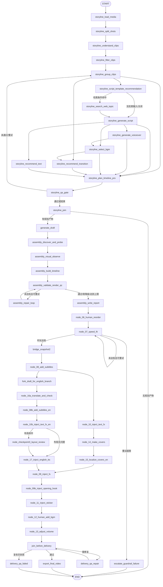

# auto-video-editor：完整 LangGraph 工作流纵向有向图布局设计与分阶段执行计划

> **改造目标**：将「完整 LangGraph 工作流（mode=auto）」节点地图从当前的横向分层布局切换为自上而下（Top-to-Bottom，TB）的有向图布局；节点和边严格保持 LangGraph 原始图语义，不把有向图树化。  
> **项目**：[`wayyet/auto-video-editor`](https://github.com/wayyet/auto-video-editor)  
> **分支**：`main`  
> **源码基准提交**：[`6679e540eb91555b2f437b8661b0c5679291f697`](https://github.com/wayyet/auto-video-editor/commit/6679e540eb91555b2f437b8661b0c5679291f697)  
> **基准时间**：2026-11-13 04:14（Asia/Singapore，按提交时间换算）  
> **截图基准**：用户提供的「完整 LangGraph 工作流(mode=auto)」页面截图  
> **文档性质**：UI 设计方案、源码改造说明、分阶段执行计划、测试与验收清单  
> **本次修订**：以纵向分层有向图替换上一版的生成树/树状投影方案；不再选择单一父节点表达多前驱节点。

---

## 1. 需求与结论

### 1.1 当前问题

当前「完整 LangGraph 工作流(mode=auto)」页面将流程深度映射到横坐标，节点从左向右排列。主图节点和边不断增加后，用户需要大量横向滚动；对于并行分支、条件路由、Fan-in 汇合和重试回路，横向布局也不利于顺着执行方向阅读。

本次目标不是把工作流改造成树，而是**保留 LangGraph 有向图（Directed Graph）的真实节点和边，只把图的整体阅读方向改为自上而下**：

- `START` 放在画布顶部，作为流程入口。
- 普通执行方向由上向下，主流程自然向页面底部延伸。
- 并行分支在同一层向左右展开；分支节点仍是独立节点。
- 多个上游汇入同一节点时，目标节点只显示一张卡片，但所有入边都必须画出。
- 条件边保留方向、条件标签和原始 edge ID；不能把互斥分支误画成已经全部执行。
- 重试边、回边和自环继续保留，通过画布侧边的回路通道表示，不参与普通流程层级计算。
- `END` 位于可达流程底部，所有真实终止路径均连接到同一个 `END`。

### 1.2 推荐方案

采用**纵向分层有向图布局（Layered Directed Graph Layout，TB）**，使用经典 Sugiyama 思路：分层、层内排序、坐标分配和边路由。它是图布局算法，不是树布局算法。

实现分为四个独立步骤：

1. **真实图建模**：以 API 返回的 `nodes` 和 `edges` 为唯一输入，建立节点索引、入边和出边邻接表；不从 UI 推断或补造业务边。
2. **环边识别与分层**：使用确定性 DFS 识别仅用于布局的反馈边（back edges），将这些边从“计算层级用的临时边集”中排除；其余边用于拓扑排序和纵向层级计算。所有反馈边仍保留在原始边集合中并最终绘制。
3. **层内排序与坐标分配**：以节点注册顺序作为稳定初始顺序，使用上下交替的 barycenter（重心排序）迭代减少交叉；根据真实 DOM 宽高计算每层高度和层内水平位置。
4. **全量有向边路由**：普通边自上向下连接；条件边显示标签；多前驱边全部汇入同一目标节点；反馈边和自环通过左右侧边通道折返。

**关键原则：布局算法可以临时忽略反馈边来计算 rank，但不得从最终渲染图或后端 Schema 中删除任何真实边。**

### 1.3 改造范围

| 范围 | 本次处理方式 |
|---|---|
| `完整 LangGraph 工作流(mode=auto)` 主图 | 默认改为纵向有向图布局（TB） |
| 原横向分层布局 | 保留为备用方向（LR），用于回退和排障 |
| `OpenStoryline 子流程` 视图 | 默认保持现有布局，不扩大本次改造范围 |
| LangGraph 节点注册与边定义 | 不修改 |
| `/api/workflow/graph` 图 Schema | 不修改接口语义，不增加伪边 |
| SSE 实时运行状态、thread 订阅、节点状态和运行计数 | 保持原有行为 |
| PostgreSQL 检查点、事件持久化、工作流执行逻辑 | 不修改 |

**重要边界：**本次是前端布局与连线渲染改造，不是工作流拓扑重构。不得为了页面从上向下展示而修改 `graph.py` 的 `add_edge()` / `add_conditional_edges()`，也不得把多父节点拆成多个 UI 节点。

## 2. 当前源码核对与现状分析

### 2.1 关键源码文件

以下路径已在基准提交中核对：

| 文件 | 当前职责 | 本次是否修改 |
|---|---|---|
| [`web/node_map/node_map.html`](https://github.com/wayyet/auto-video-editor/blob/main/web/node_map/node_map.html) | 节点地图页面；创建节点卡片、控制拖拽/折叠、计算布局、绘制 SVG 边、保存布局 | **主要改造文件** |
| [`web/node_map/workflow.json`](https://github.com/wayyet/auto-video-editor/blob/main/web/node_map/workflow.json) | OpenStoryline 子流程静态节点数据 | 不改 |
| [`monitoring/workflow_graph.py`](https://github.com/wayyet/auto-video-editor/blob/main/monitoring/workflow_graph.py) | 从已编译 LangGraph 图提取真实节点、普通边、条件边和展示元数据 | 原则上不改 |
| [`web/api_workflow.py`](https://github.com/wayyet/auto-video-editor/blob/main/web/api_workflow.py) | 提供只读工作流图、运行快照和 SSE 事件流接口 | 不改 |
| [`web/static/workflow_monitor.mjs`](https://github.com/wayyet/auto-video-editor/blob/main/web/static/workflow_monitor.mjs) | SSE 事件归约、运行状态、活动节点、已走边和布局缓存辅助逻辑 | 原则上不改；若统一布局缓存 key，再小幅扩展 |
| [`graph.py`](https://github.com/wayyet/auto-video-editor/blob/main/graph.py) | 定义实际 LangGraph 节点、固定边、条件边和多前驱屏障 | **不改** |
| [`web/tests/workflow_monitor.test.mjs`](https://github.com/wayyet/auto-video-editor/tree/main/web/tests) | 现有前端监控纯逻辑测试 | 作为回归测试 |
| [`tests/integration/test_workflow_graph_schema.py`](https://github.com/wayyet/auto-video-editor/blob/main/tests/integration/test_workflow_graph_schema.py) | 校验 API Schema 与编译图真实拓扑一致 | 作为拓扑回归测试 |

### 2.2 当前横向布局的具体实现

`web/node_map/node_map.html` 中已有以下布局逻辑：

- `computeDepths(nodes)`：沿节点依赖计算最长路径深度；遍历到正在访问的依赖时忽略该回边，避免 QC/QA 重试环和自环导致深度计算不收敛。
- `autoLayout(nodes)`：按图深度把节点放入横向列。
- 本次 TB 布局不直接复用旧 `computeDepths()` 作为完整算法；它需要从 `data.edges` 识别反馈边，再对剩余有向边执行拓扑排序。
- 当前横向列间距为 `420px`，同列节点纵向间距为 `170px`。
- 节点坐标按 `x = 40 + depth * 420`、`y = 40 + index * 170` 计算。
- `ensureCanvasSize()` 根据节点卡片实际位置扩大可滚动画布。
- `loadLayout()` / `saveLayout()` 使用 `localStorage` 保存节点位置和折叠状态。
- `resetLayout()` 清除当前布局缓存，再执行 `autoLayout()`。

因此，当前问题并不是缺少节点数据或缺少连线，而是**布局函数把图的深度映射成横坐标、把同层节点映射成纵向列表**。

### 2.3 主图数据不是静态 JSON

主图视图通过 `node_map.html` 的 `loadData("main")` 请求：

```text
GET /api/workflow/graph
```

页面读取接口返回的数据后，调用 `normalizeMainGraph()`（或内联兜底实现），从 `schema.edges` 推导各节点的 `dependencies` 和 `next_nodes`，再交给节点渲染层。

后端 `monitoring/workflow_graph.py` 的拓扑来源是已编译图的 `compiled_graph.builder`，覆盖：

- 普通 `add_edge()`；
- `add_edge([source_a, source_b, ...], target)` 产生的多前驱等待边；
- `add_conditional_edges()` 的条件边出口；
- `START` / `END` 归一化。

后端还为边提供 `id`、`from`、`to`、`kind`、`label` 字段。前端必须继续以 `schema.edges` 为边的事实来源，不能自己重新写一份主图节点关系。

### 2.4 一个需要同步修正的展示问题

当前 `node_map.html` 的 `buildEdges()` 在主图模式下会读取 `data.edges`，但 `addEdge()` 主要保存 `from`、`to`、SVG 元素和 `id`，没有完整保留 `kind`、`label`。

这会使前端无法充分表现后端已经提供的边语义。本次纵向有向图布局改造应同时保留：

- `kind="conditional"`：条件边；
- `label`：分支条件、Fan-in 屏障说明、修复后复检说明等；
- 原始 `id`：实时事件层用它匹配已走边和活动边。

不要只画线而丢失边的业务含义。

### 2.5 当前页面已有、必须保留的功能

根据截图和 `node_map.html` 源码，以下能力已存在，不应在本次重写中丢失：

1. 完整工作流 / OpenStoryline 子流程视图切换。
2. `Expand All`、`Collapse All` 和 `Reset Layout`。
3. 黑色 / 白色背景主题切换。
4. thread_id 输入、订阅和断开。
5. 执行中、完成、等待、重试、失败、未参与等状态图例。
6. 节点卡片拖拽；点击标题折叠或展开。
7. 鼠标悬停时突出显示节点相邻连线。
8. 当前活动节点自动跟随滚动；人工拖拽节点时暂停自动跟随。
9. SSE 实时运行状态、attempt、耗时、错误和等待人工信息。
10. 节点状态与实际运行事件保持一致，允许多个并行节点同时处于运行状态。

---

## 3. 主图拓扑特征：为什么必须保留 LangGraph 的有向图语义

当前主图是一个**带条件分支、并行分支、汇合屏障和回边的有向工作流图**，既不是单链路，也不是树。若把所有出边都简单当作独立子节点，会出现同一个节点被重复创建、循环递归或图关系丢失的问题。

### 3.1 当前主图的主要业务阶段

根据基准提交 `graph.py` 中的实际接线，主图的主要结构如下：



> 注：图中展示的是便于理解的业务关系，不是页面最终坐标图。AI 转场相关节点会随 `STORYLINE_ENABLE_AI_TRANSITION` 的建图配置改变；QC 节点是否进入执行链由 `ASSEMBLY_QC_GATE_ENABLED` 控制。前端必须消费 API 当前返回的节点和边，不能依赖此 Mermaid 图硬编码实际运行拓扑。

### 3.2 纵向有向图布局必须正确表达的四种关系

| 关系 | 主图中的例子 | 纵向有向图展示规则 |
|---|---|---|
| 条件分支 | `storyline_script_template_recommendation`、`node_07_speed_fit`、`node_10b_inject_text_fx_en`、`join_before_delivery` | 从同一来源节点向下分出多条有向边；目标节点位于后续层；边保留条件 `label`，实际命中分支由 `branch.selected` 事件决定 |
| 并行分支 | 中文字幕链与英文链；文案、配音、文字推荐等并行工作 | 同一层横向排列多个不同节点；每个节点可独立显示运行状态，不强制按单线程顺序展示 |
| Fan-in 汇合 | `storyline_select_bgm`、`storyline_plan_timeline_pro`、`node_09_inject_fx` | 每个真实节点只创建一张卡片；所有上游真实边分别连接该卡片，不指定唯一父节点 |
| 循环 / 回边 | `storyline_qa_gate → storyline_group_clips`、`assembly_validate_render_qc ↔ assembly_repair_loop`、`node_07_speed_fit` 自环、交付 QA 修复回路 | 不参与普通分层层级计算；仍按真实方向绘制，沿画布左右侧通道折返，不能隐藏或改写方向 |

布局计算时把普通向前边和反馈边分开，是为了避免环路破坏拓扑排序；这只是坐标计算策略，不意味着这些边在业务上属于不同的执行语义。

### 3.3 为什么不能树化或复制汇合节点

例如：

```text
node_15_localize_covers_en ─┐
                            ├──> node_09_inject_fx
node_17_inject_english_tts ─┘
```

`node_09_inject_fx` 在真实 LangGraph 图中是同一个汇合节点，LangGraph 会等待两个前驱满足屏障条件后再执行。纵向有向图必须让两条有向入边都直接指向同一张 `node_09_inject_fx` 卡片。

不得采用“生成树”或“每条入边复制一个节点”的方式决定 UI 节点关系。否则会丢失多前驱语义，实时事件也无法准确映射到唯一 `node_id`。节点卡片可以显示「多上游汇合」提示；若要显示屏障源数量，必须依据后端真实拓扑或明确的边标签计算，不写死。

## 4. 目标页面设计

### 4.1 页面结构

保留现有两条顶部工具栏，在第一条工具栏增加布局方向选择器：

```text
完整 LangGraph 工作流(mode=auto)      [完整 LangGraph 工作流 ▼] [方向: 纵向 ▼]
                                     [Expand All] [Collapse All] [Reset Layout] [背景:黑色]

thread [thread_id] [订阅] [断开] [运行状态] [跟随]
图例：执行中 / 完成 / 等待 / 重试 / 失败 / 未参与

                               START
                                 │
                         storyline_load_media
                                 │
                         storyline_split_shots
                                 │
                       storyline_understand_clips
                                 │
                        storyline_filter_clips
                                 │
                        storyline_group_clips
                          /             \
               文案 / 检索分支       时间线 / 推荐分支
                    ...                  ...
```

这里的示意图只强调阅读方向。实际布局必须根据 API 实时返回的全部节点和边计算，不能把示例流程写死在前端。

布局方向选择器建议提供：

| 选项 | 行为 |
|---|---|
| **纵向有向图（TB，默认）** | 节点按执行方向从上向下分层；并行分支横向展开；所有真实边均绘制 |
| 横向有向图（LR，备用） | 保留当前从左向右的分层布局，便于回退和复杂拓扑排障 |

主图默认 `TB`。切换到 `OpenStoryline 子流程` 视图时，保持其既有布局行为，不强制套用本次主图布局算法。

### 4.2 节点卡片

继续沿用当前 `.node` 卡片、标题、摘要、状态点、状态徽标和展开详情结构，不另起一套节点组件。

纵向布局的视觉要求：

- `START` 位于顶部，作为唯一流程入口。
- 普通流程边从上向下；父节点底部连接下游节点顶部。
- 同一层的并行节点在水平方向排列；不人为创建虚拟业务节点。
- 多个上游可以连接同一张目标卡片，目标卡片不得复制。
- 卡片宽度保留当前默认 `340px`，节点文字不通过整体缩放缩小到不可读。
- 折叠状态优先展示节点中文名和简短说明。
- 展开状态继续展示节点 ID、kind、group、checkpoint、运行状态、依赖和下游节点。
- `enabled=false` 或 `reachable=false` 的节点仍应显示，放入独立的「未启用 / 未接入」区域或按其可用真实边布局，不得静默隐藏，也不得伪造连接线。

### 4.3 有向边样式

| 连线类别 | 建议样式 | 说明 |
|---|---|---|
| 普通向前边 | 实线、向下箭头 | 按源节点到目标节点方向连接 |
| 条件边 | 实线或强调线；显示/悬停显示 `label` | 表示可能的路由目标；是否实际选择由 `branch.selected` 事件决定 |
| Fan-in 入边 | 多条独立实线汇入同一目标节点；可在标签中注明屏障 | 保留每个真实上游来源，不复制目标节点 |
| 反馈 / 重试边 | 虚线或区别于普通边的折返线，箭头指向真实目标 | 沿画布左/右侧边缘绕行，清楚表达“返回上游” |
| 自环边 | 从节点侧边绕出并回到同一节点 | 不参与层级计算，但必须可见 |
| 未走过边 | 中性颜色 | 不提前标记为 skipped；实际状态仍以运行事件为准 |
| 已走过 / 当前活动边 | 继续使用当前绿色 / 蓝色状态效果 | 保持 `workflow_monitor.mjs` 的事件投影规则 |

边的 `kind`、`label` 和 `id` 使用后端 schema 原值。标签默认不必全部常驻绘制，避免重叠；条件边与反馈边可通过 tooltip 查看完整标签，重要分支显示短标签。

### 4.4 画布和交互

- 保留横向和纵向滚动能力。纵向图主要沿 Y 轴延伸，但并行分支仍可能使画布变宽，不能只保留纵向滚动。
- `ensureCanvasSize()` 继续根据节点实际坐标和尺寸扩展画布；布局切换、折叠/展开、节点移动后都要重新计算画布边界。
- 节点拖拽继续有效；拖拽后保存当前布局，并暂停活动节点自动跟随。
- 节点展开/折叠后重新校准 SVG 连线位置，避免线条悬空或穿过节点。
- 自动布局模式下，若用户未手动移动节点，展开/折叠后按新的节点高度重新计算各层 Y 坐标。
- 用户手动拖拽后，将布局标记为自定义；展开/折叠不能突然覆盖用户已调整的位置。点击 `Reset Layout` 才重新应用自动布局。
- `Expand All` / `Collapse All` 只改变卡片展开状态，不改变节点 ID、边 ID、执行状态或当前运行 thread。

## 5. 纵向有向图布局算法设计

### 5.1 输入与输出

**输入：**

- `data.nodes`：后端返回的真实节点列表。
- `data.edges`：后端返回的真实边列表，至少包含 `id`、`from`、`to`、`kind`、`label`。
- 节点 DOM 实际测量尺寸：`offsetWidth`、`offsetHeight`。
- 布局方向：`tb`（纵向）或 `lr`（横向备用）。

**输出：**

```js
{
  positions: Map,          // nodeId -> { x, y }
  rankByNode: Map,         // nodeId -> 层级编号
  orderByRank: Map,        // rank -> 按水平位置排序的 nodeId[]
  forwardEdgeIds: Set,     // 用于分层计算的非反馈边 ID
  feedbackEdgeIds: Set,    // 仅用于布局回路绘制的边 ID
  unreachableNodeIds: Set // 从 START 不可达的节点
}
```

这些结构只在前端内存中使用，不回写 API，不修改后端图 Schema。`forwardEdgeIds` 和 `feedbackEdgeIds` 只是布局角色，不得替代后端 `edge.kind`。

### 5.2 建立真实图邻接表

1. 从 `data.nodes` 建立 `nodeId → node` 映射，并记录节点在 Schema 中的原始顺序。
2. 从 `data.edges` 建立 `from → outgoing edges` 和 `to → incoming edges`。
3. 忽略引用了不存在节点 ID 的异常边，并记录开发期告警；正常后端 schema 不应产生此类边。
4. 原样保留每条边的 `id`、`from`、`to`、`kind`、`label`。
5. 邻接顺序使用稳定规则：优先按节点注册顺序，再按 edge ID 排序，确保相同 Schema 多次布局的输出稳定。

主图必须以 `data.edges` 为拓扑事实来源。`dependencies` / `next_nodes` 是归一化辅助字段，不应成为另一套边真源。

### 5.3 识别反馈边，并构造用于排版的无环边集

LangGraph 主图存在真实环路，例如：

- `storyline_qa_gate → storyline_group_clips`：QA 不通过时回到分组节点重试。
- `assembly_repair_loop → assembly_validate_render_qc`：修复完成后返回复检节点。
- `node_07_speed_fit → node_07_speed_fit`：时长适配自环。
- `delivery_qa_repair → join_before_delivery`：交付修复后回到 QA。

这些边不能删除，也不适合直接参与普通 DAG 分层。建议使用**确定性 DFS 三色标记法**识别反馈边：

- 白色：未访问；
- 灰色：正在当前 DFS 路径中；
- 黑色：已经完成访问。

遍历某条有向边 `u → v` 时，如果 `v` 处于灰色，说明该边指向当前 DFS 路径中的祖先节点，是反馈边；`u === v` 的自环也属于反馈边。其余边保留在排版边集中。

执行顺序：

1. 从 `START` 开始遍历可达子图。
2. 再按 Schema 稳定顺序遍历仍未访问的节点，识别其他连通分量中的环。
3. 只把 DFS 反馈边 ID 放入 `feedbackEdgeIds`；其他真实边 ID 放入 `forwardEdgeIds`。
4. 用 `forwardEdgeIds` 构造临时无环图，执行拓扑排序和层级计算。
5. 最终绘制时仍使用完整 `data.edges`，包括全部反馈边。

该方式不改变边的业务方向，也不改变图执行顺序；它只让布局计算拥有一个无环的层级骨架。实现时必须固定 DFS 邻接顺序，避免相同图每次选出不同反馈边。

### 5.4 计算纵向层级（Rank）

对排版边集使用 Kahn 拓扑排序（入度为零的节点先入队）：

1. `START` 的 rank 为 `0`。
2. 对从 `START` 可达的节点，按拓扑顺序处理；目标节点 rank 取所有排版入边来源 rank 的最大值加一。没有排版入边的局部根节点 rank 为 `0`：

```text
rank(v) = max(0, max(rank(u) + 1 for each forward edge u -> v))
```

3. 因而多前驱汇合节点会位于所有上游节点之后，而不需要指定唯一父节点。
4. 条件边的所有可能目标都参与布局层级计算，但这不代表这些分支会在一次运行中全部执行。
5. `END` 根据所有真实入边自然放在终止来源之后；多个终止路径仍指向同一个 `END`。
6. 不可达节点在独立区域按各自连通分量计算局部 rank，不得把它们插入 `START → END` 的主流程层级。
7. 如果主流程或某个不可达分量在反馈边剔除后仍无法完成拓扑排序，说明反馈边识别或输入图校验存在缺陷，应在开发期报错，不允许静默地把残留节点随机摆放。

`unreachableNodeIds` 仍按后端 `reachable` 字段和从 `START` 的图遍历结果交叉校验。可达节点以 `START` 为根计算 rank；不可达节点不与主流程竞争 rank 空间，而是按其真实边关系在独立的「未启用 / 未接入」区域中单独分层。完全孤立的节点按稳定顺序排列。未启用的 assembly 节点可以没有任何真实连线，禁止为了让它们“接入主流程”而创建假边。

### 5.5 层内排序与交叉减少

仅有 rank 还不足以让分支关系清晰。建议使用轻量级 Sugiyama 层内排序：

1. 初始层内顺序按 Schema 节点注册顺序排列，保证可复现。
2. 自上而下执行 barycenter sweep：节点根据已连接上游节点的水平序号平均值重新排序。
3. 自下而上再执行一轮：根据下游节点水平序号平均值重新排序。
4. 上下交替执行 4～8 轮，只有当交叉数量减少或顺序评分改善时才接受新顺序。
5. 重心相同或无相邻层邻居时，按原始注册顺序稳定打破平局。
6. 条件分支和并行分支不做语义合并；所有节点仍各自占据独立位置。

不要求第一版实现复杂的全局最优交叉算法；重点是稳定、可读、不重叠，并且不破坏有向边关系。

### 5.6 根据实际卡片尺寸分配坐标

不能继续使用固定 `rowHeight=170px`。主图节点展开后会展示运行详情、依赖关系、错误和等待信息，卡片高度不同。

建议先应用折叠状态，再测量所有节点 DOM：

- 每层最大卡片高度：`maxHeightByRank[rank]`。
- 每层节点宽度之和与间距决定该层所需画布宽度。
- 同层节点按 5.5 的顺序从左向右排列；每层整体尽量居中。
- Y 坐标按层最大高度递增：

```text
Y[0] = CANVAS_PADDING_Y
Y[r] = Y[r - 1] + maxHeightByRank[r - 1] + NODE_GAP_Y
```

建议初始参数：

| 参数 | 初始建议值 | 说明 |
|---|---:|---|
| `NODE_GAP_X` | `48px` | 同层相邻卡片的水平间距 |
| `NODE_GAP_Y` | `64px` | 相邻 rank 层之间的垂直间距 |
| `CANVAS_PADDING_X` | `48px` | 画布左右留白 |
| `CANVAS_PADDING_Y` | `40px` | 画布顶部留白 |
| 节点宽度 | 使用实际 DOM 测量值 | 默认卡片宽度目前为 `340px` |

坐标分配必须满足：同层卡片不重叠；不同层卡片之间有足够间距；画布宽高覆盖所有节点与边路由通道。

### 5.7 绘制完整有向边

布局算法只负责位置，不负责删边。最终必须遍历 `data.edges` 绘制全部真实边：

| 边类型 | 路由规则 |
|---|---|
| 普通向前边 | 从源节点底部锚点连接目标节点顶部锚点；若跨越多个 rank，使用平滑贝塞尔或正交折线 |
| 条件边 | 仍按真实 from/to 方向向下连接；用 `edge.kind` 添加样式，用 `edge.label` 提供条件提示 |
| Fan-in 边 | 每个上游分别连到同一目标节点；目标 DOM 只有一份；为相邻入边分配不同目标锚点，减少重叠 |
| 反馈边 | 从源节点侧边引出，经画布外侧 lane 绕行，再指向真实目标节点侧边或顶部；箭头方向不能反转 |
| 自环 | 沿节点一侧绕出并回到该节点，保留 edge ID 和箭头 |

反馈边 lane 需要按边 ID 稳定分配偏移，避免多条回路叠成一条线。连线的端点必须根据节点当前 DOM 矩形计算；布局、拖拽、折叠/展开和窗口 resize 后都要重新调用 `updateAllEdges()`。

### 5.8 实时状态投影保持不变

布局计算不得改动 `workflow_monitor.mjs` 的状态归约逻辑：

- 一个 run 可以同时有多个 `running` / `retrying` 节点。
- `branch.selected` 事件用于确认实际选择的条件分支；不能仅凭图上存在条件边，就把分支标记为已经执行。
- `node.started`、`node.succeeded`、`node.failed`、`node.waiting_input` 等事件继续按原规则更新节点。
- `run.completed` / `run.failed` 终态后，原有 `finalizeSkipped()` 逻辑继续工作。
- 已走边和活动边仍使用后端 edge ID 匹配，布局方向切换不得改变 edge ID。
- 自动跟随继续使用活动节点 ID；只改变节点坐标，不改变状态归约结果。

## 6. 前端文件与代码改造设计

### 6.1 新增纯布局模块

建议新增：

```text
web/static/workflow_layout.mjs
```

建议导出：

```js
export function detectFeedbackEdges(nodes, edges, options = {}) {}
export function assignVerticalRanks(nodes, edges, feedbackEdgeIds, options = {}) {}
export function orderGraphLayers(nodes, edges, rankByNode, options = {}) {}
export function computeLayeredGraphPositions(nodes, edges, measurements, options = {}) {}
export function getLayoutCacheKey({ workflowId, mode, schemaVersion, direction }) {}
```

职责边界：

- 只计算布局数据，不创建 DOM、不发 HTTP 请求、不订阅 SSE。
- 只给边增加前端临时布局角色，不改写后端 `kind`、`label` 或 `id`。
- 不负责修改节点状态或边状态。
- 输入输出均为普通 JS 数据结构，可以直接用 Node.js 测试。
- 主图 TB 与原横向 LR 布局由布局模块统一管理，页面只负责测量、调用和渲染。

### 6.2 修改 `web/node_map/node_map.html`

主要改动点：

1. 在现有视图选择器后增加布局方向选择器 `layoutSelect`。
2. 主图默认采用 `tb`；用户可以切换 `lr` 作为备用方向。
3. `OpenStoryline 子流程` 仍保持当前行为；其布局方向选择器可以隐藏或禁用。
4. 将现有横向布局函数明确命名为 `autoHorizontalLayout()` 或 `computeHorizontalPositions()`，避免继续把方向和图类型混为一谈。
5. 新增 `autoVerticalGraphLayout()`，调用纯布局模块计算 rank、层内顺序、坐标和反馈边集合。
6. 调整 `renderWorkflow()`：先创建节点 DOM 并应用折叠状态，再测量节点尺寸，最后计算节点坐标和绘制边。
7. `addEdge()` / `buildEdges()` 必须保存后端边的 `kind`、`label`、原始 `id`，另设 `layoutRole` 表明当前边用于分层还是反馈路由。
8. `edgePath()` 支持向下连接、跨层连接、侧边反馈回路和自环。
9. `resetLayout()` 根据当前方向选择对应算法。
10. 用户手动拖拽后设置 `positionsCustomized=true`，避免展开/折叠事件意外覆盖手动坐标。
11. 主题、节点状态、hover 高亮、跟随滚动、订阅控制不应与布局算法耦合。

### 6.3 布局缓存隔离

当前主图布局 key 的基本结构为：

```text
wf_layout_{workflowId}_{mode}_v{schemaVersion}
```

新增方向后，必须防止纵向坐标和旧横向坐标互相覆盖。建议：

```text
wf_layout_{workflowId}_{mode}_v{schemaVersion}_tb_v1
wf_layout_{workflowId}_{mode}_v{schemaVersion}_lr
```

其中：

- `tb_v1`：纵向有向图布局算法版本；将来改变 rank 或层内排序规则时可升级为 `tb_v2`，避免旧坐标污染新算法。
- `lr`：原横向布局缓存；尽量兼容目前用户已经保存的横向拖拽位置，必要时从旧 key 一次性迁移。
- 子流程视图继续沿用旧的 `node_layout_{workflowId}` key，不与主图混用。
- 缓存 payload 保存 `positions`、`collapsed`、`direction`、`layoutAlgorithmVersion` 和 `positionsCustomized`。

**Schema 版本不需要因纯 UI 布局变更而递增。** 当前后端主图 Schema 为 `schema_version=6`；只有后端 Schema 字段或拓扑契约变化时，才按既有规则升级版本。

### 6.4 不建议第一阶段引入完整图形编辑框架

当前节点地图是直接由 HTML / CSS / 原生 JavaScript / SVG 实现的轻量页面。第一版首选新增纯 JS 分层布局模块，不立即引入完整图形编辑器。

原因：

- 本次只需要分层、层内排序、坐标分配和边路由，不需要改变当前页面的交互模型。
- 当前拖拽、折叠、状态投影和 SVG 连线已经存在。
- 引入额外库会增加打包、版本、离线部署和维护成本。
- 纯函数实现可以先用 Node.js 单元测试覆盖有向环、多前驱和条件边。

如果后续节点数、边数显著增长，或原生算法难以控制交叉与反馈边路由，再单独评估 `elkjs` 等 layered layout 引擎；若引入，必须固定版本、明确本地资源部署方式，并确保不改变图 Schema。

## 7. 分阶段执行开发任务

### 阶段 0：基线冻结与改造前验证

**目标：**确认本次只改展示层，并建立可比较的基线。

任务：

- [ ] 基于 `main` 最新提交 `6679e540eb91555b2f437b8661b0c5679291f697` 检出代码。
- [ ] 保存当前主图页面截图，记录主图默认 `mode=auto`、`schema_version=6`、`ASSEMBLY_QC_GATE_ENABLED=true`。
- [ ] 访问 `/api/workflow/graph`，记录 `nodes` 数量、`edges` 数量、节点 ID 集合和 edge ID 集合。
- [ ] 分别记录 QC 开启与关闭时的节点可达性变化。
- [ ] 记录 `STORYLINE_ENABLE_AI_TRANSITION` 开/关时 Storyline 相关节点和边的变化。
- [ ] 运行现有图 Schema、图编译、SSE 和前端监控测试，保存结果。
- [ ] 确认 `workflow_monitor.mjs` 的已走边/活动边投影按 edge ID 工作。

交付物：当前布局截图、主图 Schema 快照、现有测试结果、本次文件改动清单。

验收：阶段 0 不修改业务代码和图拓扑。

### 阶段 1：抽离有向图布局算法

**目标：**将布局计算从页面渲染逻辑中分离，先保证算法可测试。

任务：

- [ ] 新增 `web/static/workflow_layout.mjs`。
- [ ] 实现稳定邻接表构建，输入以 `nodes`、`edges` 为准。
- [ ] 实现确定性 DFS 反馈边识别；反馈边只从层级计算边集中排除，不从真实图中删除。
- [ ] 实现基于非反馈边的 Kahn 拓扑排序和 rank 计算。
- [ ] 实现 barycenter 上下交替层内排序，尽量减少交叉并保持稳定顺序。
- [ ] 实现基于 DOM 测量尺寸的纵向坐标计算。
- [ ] 为反馈边、自环和多条并行回路提供稳定路由 lane 分配数据。
- [ ] 将原横向布局保留为 `computeHorizontalPositions()`。
- [ ] 为 TB 和 LR 生成不同的布局缓存 key。
- [ ] 新增 `web/tests/workflow_layout.test.mjs`，不依赖浏览器 DOM。

重点单测：

- [ ] 单链路：`START → A → B → END`，rank 逐层向下增加。
- [ ] 一对多分支：`A → B/C`，B、C 同层水平展开。
- [ ] 多对一汇合：`B/C → D`，D 只创建一次且 rank 晚于 B、C。
- [ ] 三路并行后汇合：所有输入边保留，目标节点唯一。
- [ ] 条件边：保留 `kind`、`label` 和 edge ID；不把所有条件分支标记为已执行。
- [ ] 自环：不影响拓扑排序，但最终反馈边集合中保留该边。
- [ ] 多节点环：能够识别反馈边，剩余排版边无环。
- [ ] 组合回路：QA 重试、QC 修复、交付 QA 修复均不导致算法挂起。
- [ ] 不可达节点：进入独立区域，不伪造真实拓扑边。
- [ ] 不同节点宽高：卡片坐标无重叠。
- [ ] 相同输入多次计算：rank、层内顺序、反馈边分类和坐标输出稳定。

验收：布局模块可以脱离页面运行；同一图结构始终产生一致的层级和坐标结果。

### 阶段 2：接入纵向有向图渲染与连线

**目标：**让主图第一次以 TB 有向图方式显示，所有真实边均保留。

任务：

- [ ] 修改 `renderWorkflow()`，创建节点后测量实际尺寸，再应用 TB 坐标。
- [ ] 主图默认调用 `computeLayeredGraphPositions(..., { direction: "TB" })`。
- [ ] 原横向布局改为调用 `computeHorizontalPositions()`。
- [ ] 更新 `ensureCanvasSize()`，支持方向切换和重新排版后的画布尺寸。
- [ ] 普通边改为源节点底部到目标节点顶部的向下连接。
- [ ] 条件边显示真实方向和 `label`；运行时实际分支仍由事件决定。
- [ ] 多前驱边全部连接到同一目标节点，目标卡片不可复制。
- [ ] 反馈边通过画布左右侧的路由 lane 折返，箭头指向真实目标节点。
- [ ] 自环使用单独回路路径，不参与节点 rank 计算。
- [ ] `addEdge()` 保存 `kind`、`label`、原始 `id` 和布局角色。
- [ ] 保留 `START`、`END` 的真实节点及所有终止路径。
- [ ] 保留 QC 关闭时不可达节点的显示。

验收：

- [ ] 每个后端节点 ID 在页面中恰好出现一次。
- [ ] 每条后端真实边 ID 均能在 `state.edges` 中找到并绘制。
- [ ] 普通边总体向下；反馈边有明确的回流方向。
- [ ] 多前驱边全部汇入唯一目标卡片。
- [ ] 节点卡片不重叠，展开状态下也能重新计算层高。

### 阶段 3：增加方向选择器和布局持久化

**目标：**纵向有向图作为默认方向，原横向方向可随时切回。

任务：

- [ ] 在页面顶部添加 `方向` 选择器。
- [ ] 完整主图默认选择 `纵向有向图（TB）`。
- [ ] 增加 `横向有向图（LR）` 备用选项。
- [ ] 子流程视图继续维持原布局行为。
- [ ] 切换方向时使用对应缓存 key，不能复用另一方向的节点坐标。
- [ ] `Reset Layout` 只重置当前方向。
- [ ] `Expand All` / `Collapse All` 对两种方向均有效。
- [ ] `direction` 写入 URL query（如 `layout=tb` / `layout=lr`），刷新页面时恢复当前选择。
- [ ] 验证原横向布局缓存不会被纵向布局覆盖；若迁移旧 key，迁移需可回滚且不得覆盖现有 TB 缓存。

验收：刷新、切换视图、切换方向后，布局方向与节点位置符合用户最后选择；重置只影响当前方向。

### 阶段 4：实时运行状态和交互回归

**目标：**证明布局变化不影响现有运行监控。

任务：

- [ ] 验证 `thread_id` 订阅 / 断开不受影响。
- [ ] 验证 `node.started`、`node.succeeded`、`node.failed`、`node.waiting_input`、`node.retrying` 状态更新。
- [ ] 验证并行分支多个节点可以同时显示执行中。
- [ ] 验证条件边选中事件仍能高亮正确边。
- [ ] 验证 Fan-in 的所有前驱边均连接到唯一目标节点，目标节点状态仍按真实事件展示。
- [ ] 验证 QC 修复、QA 重试、速度护栏自环和 delivery QA 修复回边可以正常显示。
- [ ] 验证当前活动节点自动跟随滚动；拖拽后自动跟随暂停。
- [ ] 验证节点悬停高亮、键盘 Enter / Space 折叠、pointer 拖拽。
- [ ] 验证黑色 / 白色主题。
- [ ] 验证浏览器断线后 EventSource 使用 `Last-Event-ID` 补发时，节点状态和边高亮不重复或错位。

验收：布局切换只改变节点位置和线条路径，不改变事件状态、运行快照、SSE 游标或执行结果。

### 阶段 5：全量回归、视觉验收和交付

**目标：**验证当前真实主图不同配置下均可稳定展示。

任务：

- [ ] 在 `ASSEMBLY_QC_GATE_ENABLED=true` 下检查完整主图。
- [ ] 在 `ASSEMBLY_QC_GATE_ENABLED=false` 下检查 QC 未启用节点区域。
- [ ] 在 AI 转场开 / 关两种建图配置下检查纵向有向图。
- [ ] 检查 QA 重试、QC 修复、速度护栏自环、交付 QA 修复四类反馈边。
- [ ] 检查英文 / 中文分支并行与 `node_09_inject_fx` 汇合。
- [ ] 在 1280×720、1440×900、1920×1080 视口下进行截图比较。
- [ ] 检查全展开、全折叠和混合折叠状态。
- [ ] 检查长中文名称、长节点说明和大量边标签不会破坏布局。
- [ ] 运行前端 Node.js 测试和 Python 测试。
- [ ] 更新开发记录，说明修改文件、测试命令、测试结果和已知限制。

验收：达到第 9 节全部验收标准后再合并。

## 8. 建议代码改动清单

| 优先级 | 文件 | 改动 | 预计风险 |
|---|---|---|---|
| P0 | `web/static/workflow_layout.mjs` | 新增纵向分层布局、反馈边识别、rank 和层内排序算法 | 中；需覆盖有向环和多前驱 |
| P0 | `web/node_map/node_map.html` | 增加 TB/LR 方向切换、纵向节点布局、反馈边路由和完整边渲染 | 中；现有 DOM / SVG 交互较多 |
| P0 | `web/tests/workflow_layout.test.mjs` | 新增图布局算法单测 | 低 |
| P1 | `web/static/workflow_monitor.mjs` | 仅当布局缓存 key 需要统一管理时扩展；事件归约逻辑不应改 | 低至中 |
| P1 | `web/tests/workflow_monitor.test.mjs` | 验证布局方向 key 隔离（如 helper 被修改） | 低 |
| P2 | `docs/` | 补充纵向有向图设计、截图和开发记录 | 低 |

### 8.1 明确不应修改的文件/模块

除非测试证明存在独立缺陷，本次不应修改：

- `graph.py`：不改节点注册、`add_edge()`、`add_conditional_edges()` 和 fan-in 屏障。
- `monitoring/workflow_graph.py`：不重写拓扑提取，不手工补节点或边。
- `web/api_workflow.py`：不改变 `/api/workflow/graph`、运行快照和 SSE 只读接口。
- PostgreSQL checkpoint / event store：与 UI 坐标无关。
- `workflow_monitor.mjs` 的事件归约、游标去重、重试历史与活动节点逻辑：只做必要的布局 key 扩展，不重写状态机。

## 9. 测试与验收标准

### 9.1 数据正确性

| 验收项 | 通过标准 |
|---|---|
| 节点完整性 | 页面节点 ID 集合与 `/api/workflow/graph` 的 `nodes[].id` 完全一致 |
| 节点唯一性 | 每个节点 ID 只渲染一张卡片 |
| 边完整性 | 页面绘制边 ID 集合与接口 `edges[].id` 一致；反馈边不能因分层而丢弃 |
| 边类型 | `normal` / `conditional` 保留；条件边 label 可查看 |
| 多前驱 | Fan-in 目标节点只有一张卡片，全部真实入边保留 |
| 循环 | 重试回边、自环不会造成无限递归或重复卡片；箭头仍指向真实目标 |
| 层级 | 除反馈边外，所有排版边的目标 rank 均大于来源 rank |
| 不可达节点 | QC 关闭时未启用节点仍可见，并明确呈现不可达/未启用状态 |
| 稳定性 | 相同 Schema 多次布局结果一致，除非用户手动拖拽 |

### 9.2 视觉正确性

- [ ] `START` 在顶层，主流程总体方向自上而下。
- [ ] 普通有向边从上游节点指向下游节点，不因布局改变箭头方向。
- [ ] 并行节点在同一层横向展开，不出现明显重叠。
- [ ] 多分支汇合到同一目标节点，目标节点只显示一次。
- [ ] `END` 位于有效终止路径之后；所有真实终止入边均保留。
- [ ] 条件边可区分，标签可查看；未选择分支不被误标为已执行。
- [ ] 循环 / 重试反馈线可识别，且不遮挡节点标题。
- [ ] 展开卡片不会覆盖相邻层节点；重新布局后连线仍准确连接卡片边缘。
- [ ] 并行分支过宽时仍可横向滚动，不将卡片缩小到不可读。
- [ ] 深色和浅色主题均有足够的线条对比度。

### 9.3 交互正确性

- [ ] 切换纵向 / 横向方向不会清除运行状态。
- [ ] 刷新后恢复所选布局方向。
- [ ] 两种方向的 localStorage 位置缓存互不污染。
- [ ] `Reset Layout` 恢复当前方向算法的默认坐标。
- [ ] `Expand All` / `Collapse All` 不破坏节点位置或连线。
- [ ] 手动拖拽节点后保存位置，并暂停自动跟随。
- [ ] 活动节点滚动跟随在纵向布局中仍然有效。
- [ ] 运行中页面不因布局重排重新发起工作流执行。

### 9.4 推荐测试命令

前端纯逻辑测试（新增布局模块后）：

```bash
node --test web/tests/workflow_layout.test.mjs web/tests/workflow_monitor.test.mjs
```

工作流 Schema / 编译图回归：

```bash
python -m pytest -q tests/integration/test_workflow_graph_schema.py tests/integration/test_graph_compiles.py
```

SSE / API 只读回归（按当前仓库测试文件）：

```bash
python -m pytest -q tests/unit/test_api_workflow_readonly.py tests/unit/test_api_workflow_sse_cursor.py
```

完成阶段后执行仓库完整测试：

```bash
python -m pytest -q
```

> 测试命令应在项目现有虚拟环境和依赖安装状态下执行。如果当前分支调整了测试入口或 Node.js 运行方式，应以仓库实际配置为准，不要为了本次 UI 改造新增不必要的测试框架。

## 10. 风险与处理策略

| 风险 | 形成原因 | 处理策略 |
|---|---|---|
| 纵向布局丢失边 | 只保留用于分层的边 | 分层边与最终渲染边分离；最终按完整 `data.edges` 绘制 |
| 回边导致层级算法不收敛 | LangGraph 存在 QA/QC 重试和自环 | DFS 识别反馈边；仅从临时层级边集中排除，最终仍绘制 |
| 汇合节点重复 | 把每个入边都当成独立节点 | 用唯一 node ID 建立节点 DOM；多条边汇入同一张卡片 |
| 条件分支被误认为同时执行 | schema 包含条件边的所有可能出口 | 图上表示“可能路由”；实际执行分支由 `branch.selected` 事件高亮 |
| 主流程顺序看起来不合理 | 多前驱、长边和回边影响层级 | 使用稳定 DFS + 拓扑排序 + barycenter 层内排序；保留注册顺序作为平局依据 |
| 展开节点后卡片重叠 | 节点展开后高度发生变化 | DOM 测量 + 每层最大高度 + 重新计算坐标 |
| 多条回路重叠 | 反馈边都沿同一路径绕行 | 为反馈边按 edge ID 分配不同侧边 lane 和偏移 |
| 纵向图/方向布局覆盖用户拖拽 | 自动重排触发时重新写入全部坐标 | 记录 `positionsCustomized`；手动调整后不自动覆盖，Reset 才恢复 |
| 两种方向缓存串扰 | 布局 key 不包含方向 | TB/LR 使用独立 key 和算法版本 |
| 实时高亮错位 | 重建辅助边时改变 edge ID | 原样保留后端 `edge.id`，布局算法不得生成新的业务 edge ID |
| 不可达节点消失 | QC 关闭后部分节点没有入边 | 单独放到「未启用 / 未接入」区域，不隐藏、不补造真实边 |
| 画布过宽或过高 | 并行分支较多、节点卡片展开、反馈边绕行 | 动态尺寸测量、滚动容器和侧边路由通道；不强行缩放 |
| 前端职责混乱 | 将布局逻辑写进 SSE 状态机 | `workflow_layout.mjs` 只负责布局；`workflow_monitor.mjs` 只负责事件状态 |

## 11. 最终建议与实施顺序

### 11.1 推荐落地选择

采用以下默认方案：

- 完整主图默认采用纵向有向图布局（TB），从 `START` 顶部向下展开。
- 同层并行节点横向排列；多前驱通过多条入边汇合到唯一目标节点。
- 原横向分层布局保留为备用方向（LR）。
- Storyline 子流程暂不改动。
- 使用原生 JavaScript 实现分层、反馈边识别和层内排序，第一版不增加第三方图形依赖。
- 所有真实边都继续显示，特别是条件边、Fan-in 边、重试回边和自环。
- 后端图 Schema、LangGraph 编排、PostgreSQL 检查点和 SSE 协议保持不变。

### 11.2 执行优先级

先完成**阶段 0 + 阶段 1**，用纯函数单测证明节点唯一性、边完整性、反馈边识别和拓扑排序稳定；再进行阶段 2 的页面接入。不要先大改 HTML/CSS，再回头处理循环边、多前驱汇合与条件分支，否则容易出现“看起来是纵向流程图，但实际边关系丢失”的问题。

### 11.3 完成定义

只有同时满足以下条件，才视为本次需求完成：

1. 页面默认以纵向有向图方式展示完整 `mode=auto` 主图，而不是树状投影。
2. `START` 在顶部、`END` 在终止路径之后，所有真实节点只显示一次。
3. 普通边自上向下；并行、条件、汇合和反馈边都能按真实方向辨认。
4. 页面展示的节点和边与后端当前编译图 Schema 一致，不增删业务边。
5. thread 订阅、SSE 状态、活动边高亮、节点跟随、主题切换和拖拽交互全部保留。
6. 原横向方向仍可切换，且两种方向的缓存互相隔离。
7. Python 图拓扑测试和前端布局测试全部通过。

## 12. 源码依据

本方案主要依据以下基准提交源码：

1. [`web/node_map/node_map.html`](https://github.com/wayyet/auto-video-editor/blob/6679e540eb91555b2f437b8661b0c5679291f697/web/node_map/node_map.html)：现有横向 `autoLayout()`、节点渲染、SVG 连线、拖拽、折叠、缓存和主图加载。
2. [`web/static/workflow_monitor.mjs`](https://github.com/wayyet/auto-video-editor/blob/6679e540eb91555b2f437b8661b0c5679291f697/web/static/workflow_monitor.mjs)：运行事件归约、并行活动节点、分支选中、edge ID 高亮和布局缓存 key。
3. [`monitoring/workflow_graph.py`](https://github.com/wayyet/auto-video-editor/blob/6679e540eb91555b2f437b8661b0c5679291f697/monitoring/workflow_graph.py)：从编译图 builder 提取真实拓扑，输出节点/边 schema、条件边标签、reachable 和 enabled。
4. [`web/api_workflow.py`](https://github.com/wayyet/auto-video-editor/blob/6679e540eb91555b2f437b8661b0c5679291f697/web/api_workflow.py)：工作流监控只读 API 与 SSE 事件流。
5. [`graph.py`](https://github.com/wayyet/auto-video-editor/blob/6679e540eb91555b2f437b8661b0c5679291f697/graph.py)：当前 auto-only 主图真实节点、固定边、条件边、Fan-in 屏障、QA/QC 重试回路。
6. [`tests/integration/test_workflow_graph_schema.py`](https://github.com/wayyet/auto-video-editor/blob/6679e540eb91555b2f437b8661b0c5679291f697/tests/integration/test_workflow_graph_schema.py)：后端 Schema 与 LangGraph builder 拓扑一致性测试。
7. [`web/tests/workflow_monitor.test.mjs`](https://github.com/wayyet/auto-video-editor/blob/6679e540eb91555b2f437b8661b0c5679291f697/web/tests/workflow_monitor.test.mjs)：前端实时监控纯逻辑测试基线。

