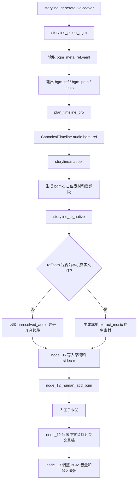
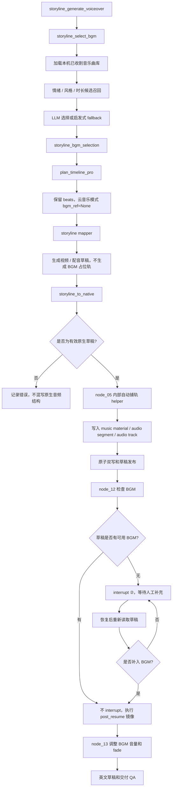

# 剪映音乐库 BGM 选曲与自动铺轨
## 源码核验报告与修订版设计执行计划

> 核验日期：2026-11-14  
> 仓库：[`wayyet/auto-video-editor`](https://github.com/wayyet/auto-video-editor)  
> 分支：`main`  
> 核验基线：`69924771d96bccc097142ebe8f7e0cab2da20605`  
> 原始设计文档：[剪映音乐库 BGM 选曲与自动铺轨——设计执行计划](https://github.com/wayyet/auto-video-editor/blob/69924771d96bccc097142ebe8f7e0cab2da20605/docs/%E7%AC%AC5%E6%9C%9F%E5%BC%80%E5%8F%91/auto-video-editor_%E5%89%AA%E6%98%A0%E9%9F%B3%E4%B9%90%E5%BA%93BGM%E9%80%89%E6%9B%B2%E4%B8%8E%E8%87%AA%E5%8A%A8%E9%93%BA%E8%BD%A8_%E8%AE%BE%E8%AE%A1%E6%89%A7%E8%A1%8C%E8%AE%A1%E5%88%92_20261114.md)
>
> **核验范围说明**：本报告基于 GitHub `main` 分支源码、目录树、已有测试代码和目标设计文档进行静态核验。未在本地克隆仓库执行 pytest，也未在剪映客户端实际打开本次自动生成的草稿。因此，文中不会把静态推断描述成运行时验证结果。

---

## 0. 执行摘要与最终结论

### 0.1 总体结论

**结论：有条件可行**

原始设计的核心方向是正确的：**选曲节点负责选择剪映已缓存的音乐素材，节点 05 负责将其写入剪映原生草稿，节点 12 负责检查 BGM 是否存在并同步到英文草稿，节点 13 负责音量和淡入淡出。** 该方案可以在不增加 LangGraph 节点、不改变边关系的前提下完成。

但原文有几处实现契约不完整，部分地方与当前源码直接冲突。应先修订，再进入开发。需要优先修正的事项如下：

| 优先级 | 问题 | 原因 | 处理要求 |
|---|---|---|---|
| P0 | 关卡②缺失 BGM 后仍依赖 `required_features.bgm` | 与“取消该开关、缺失时必须人工补充”的决策矛盾 | 去掉该条件对 BGM 校验的控制，改为无条件校验；区分读取失败与确实缺失 |
| P0 | 新音轨结构不符合仓库现有原生轨道构造口径 | 原计划只写 4 个字段；`_new_track()` 返回 7 个字段，且轨道 ID 应采用稳定 UUID | 复用或抽取原生轨道构造逻辑，不使用 `track-audio-bgm` 字面 ID |
| P0 | 音乐素材不能只靠一份简化 CSV 重建 | 剪映云音乐素材含账号、来源、缓存、请求等字段；当前只有单首歌样本 | 收割完整素材对象，保留原始字段；只替换确有必要的草稿内 ID 和路径 |
| P0 | CSV 种子行字段数量不正确 | Schema 声明 9 列，示例行实际拆成 11 列 | 使用 JSONL，或用标准 `csv` 模块并固定字段和转义规则 |
| P1 | 音乐素材伴随引用没有完整核对 | 样本 `extra_material_refs` 有 5 个 ID，但文档只解释了其中 4 个，另有 1 个未说明 | 对黄金样本做 ID 到 materials 桶的完整映射；不得猜测缺失引用 |
| P1 | 淡入淡出结构描述与现有实现不一致 | 样本使用 `fade_type`；仓库 builder 使用 `fade_in_type` / `fade_out_type` | 以真实客户端样本和剪映验收确定一种最终结构，避免重复生成冲突素材 |
| P1 | 绝对缓存路径进入公开仓库和 LLM Prompt | 会暴露本机用户名、目录结构；路径也无法跨设备复用 | 将本机路径放在 gitignored 本地索引；LLM 候选投影不得包含路径和 request_id |
| P1 | `stub` 标志会误判真实音乐 | `method == "default_match"` 不等于素材不可用 | 将“选择策略”和“素材可用性”分开表达 |
| P1 | 新音乐库的加载器返回契约不明确 | `select_bgm()` 当前消费的是包含 `library/default_match/matching` 的字典 | 新加载器必须兼容该外层结构，不能只返回列表 |
| P2 | 只有一首种子音乐 | 单候选情况下，LLM 实际没有选择空间 | 首次上线前至少收割多首真实曲目，或明确 MVP 仅支持默认曲目 |
| P2 | 节拍和情绪元数据不完整 | 全部强制 `tempo="medium"` 会损失现有节拍对齐能力 | 保存 `tempo`、`beat_period_ms`、`genre` 和规范化情绪标签 |

### 0.2 可以保留的原始决策

以下决策经过源码核对后可以保留：

1. 不新增、不删除 LangGraph 节点，不改变已有节点边关系。
2. `storyline_select_bgm` 继续负责选曲，不负责写剪映草稿。
3. 云音乐模式下，`CanonicalTimeline.audio.bgm_ref` 设为 `None`，防止 mapper 再生成一个无法解析的占位音频引用；节拍信息仍由 `storyline_bgm_selection` 提供。
4. 在节点 05 中，原生转换完成后、草稿写盘前注入真实 BGM 音轨，可以复用当前原子双写和草稿发布链路。
5. 节点 12 继续负责中文草稿音轨镜像到英文分支，节点 13 继续统一调整 BGM 音量和淡入淡出。
6. Prompt 文件可以保持不变，但传入 Prompt 的候选数据必须保持原有字段契约，并剔除本机路径等非业务字段。
7. 如果只改变节点内部实现、不改变图拓扑，`SCHEMA_VERSION` 可以保持 8；但仍要同步更新节点静态输出描述和对应测试。

### 0.3 当前代码是否已经实现

**没有实现。** 本次核验的最新提交与父提交比较，变更文件只有原始设计 Markdown，新增 238 行，没有 BGM 业务代码、测试代码或 CSV 文件变更。

因此：

- `jy_common/jianying_music_library.csv`：当前不存在。
- `jy_common/jianying_music_library.py`：当前不存在。
- `nodes/_auto_bgm.py`：当前不存在。
- `scripts/harvest_jianying_music.py`：当前不存在。
- 原有 `storyline_select_bgm` 仍然读取 `bgm_meta_ref.yaml`。
- 原生转换器仍然会丢弃无法解析成本地文件的 BGM 占位引用。
- 节点 12 仍然先执行 `interrupt()`，并按 `required_features.bgm` 决定是否在恢复后继续校验。

核验依据：[HEAD 与父提交比较](https://github.com/wayyet/auto-video-editor/compare/4716c394d1ebcc752d673ffa482aae5888aef28f...69924771d96bccc097142ebe8f7e0cab2da20605)。

---

## 1. 当前源码链路与根因核验

### 1.1 当前实际链路



### 1.2 现有选曲节点和能力层

`storyline_capabilities/bgm_selector.py` 的模块说明明确指出：

- 当前库文件 `bgm_meta_ref.yaml` 只存资源描述。
- 二进制音频文件需要用户自行准备。
- 选择逻辑是情绪标签启发式匹配，再由 LLM 从候选中选择。
- `load_bgm_library()` 当前返回 YAML 解析结果。

源码位置：

- [`bgm_selector.py`：加载函数](https://github.com/wayyet/auto-video-editor/blob/69924771d96bccc097142ebe8f7e0cab2da20605/storyline_capabilities/bgm_selector.py#L166-L175)
- [`bgm_selector.py`：候选排序](https://github.com/wayyet/auto-video-editor/blob/69924771d96bccc097142ebe8f7e0cab2da20605/storyline_capabilities/bgm_selector.py#L70-L78)
- [`select_bgm.py`：选择链路和返回字段](https://github.com/wayyet/auto-video-editor/blob/69924771d96bccc097142ebe8f7e0cab2da20605/storyline_capabilities/select_bgm.py#L79-L170)

当前 YAML 的 5 条记录均是 `path: ""` 的占位描述，`default_match` 指向 `bgm_calm_lofi`。这能支持“选择一个音乐资源 ID”，但无法让剪映加载一个真实本地音乐文件。

### 1.3 BGM 占位引用被丢弃的判断正确

当前 `storyline.mapper` 在 `plan.audio.bgm_ref` 非空时，会创建：

- `materials.audios` 中的 `bgm-1` 占位素材。
- `tracks` 中的 `segment-bgm-1` 音频段。
- `ref` 使用 BGM 资源 ID，而不是本地音频文件路径。

源码位置：

- [`mapper.py`：BGM 占位素材](https://github.com/wayyet/auto-video-editor/blob/69924771d96bccc097142ebe8f7e0cab2da20605/storyline/mapper.py#L100-L125)
- [`mapper.py`：BGM 时间线段](https://github.com/wayyet/auto-video-editor/blob/69924771d96bccc097142ebe8f7e0cab2da20605/storyline/mapper.py#L175-L205)

`storyline/native_draft.py` 会检查音频素材引用是否能解析成存在的本地文件。文件不存在时，素材不会写入原生 `materials.audios`，对应音频段也不会进入原生音轨；丢弃原因会写入 sidecar。

源码位置：

- [`native_draft.py`：音频文件检查](https://github.com/wayyet/auto-video-editor/blob/69924771d96bccc097142ebe8f7e0cab2da20605/storyline/native_draft.py#L483-L530)
- [`native_draft.py`：音频轨段转换和丢弃](https://github.com/wayyet/auto-video-editor/blob/69924771d96bccc097142ebe8f7e0cab2da20605/storyline/native_draft.py#L540-L580)

已有测试 `test_unresolved_bgm_dropped_to_sidecar` 也验证了该行为。因此，原文对“占位 ID 不是音频文件路径，原生转换器会丢弃它”的根因判断正确。

### 1.4 时间线节拍可以与真实音频落轨分离

`plan_timeline_pro` 根据 `bgm_selection` 计算节拍间隔，再交给 `timeline_planner`；它不要求 BGM 必须已经物化为剪映音轨。

`TimelineAudio.bgm_ref` 是 `Optional[str]`，且 Pydantic 配置 `extra="forbid"`。因此可以继续把选择结果留在 `storyline_bgm_selection`，同时在云音乐模式下令 `audio.bgm_ref=None`。不要为了传递 `music_id` 而向 `CanonicalTimeline.audio` 直接塞入未声明字段。

源码位置：

- [`plan_timeline_pro.py`](https://github.com/wayyet/auto-video-editor/blob/69924771d96bccc097142ebe8f7e0cab2da20605/storyline_capabilities/plan_timeline_pro.py#L145-L180)
- [`plan_timeline_pro.py`：节拍适配函数](https://github.com/wayyet/auto-video-editor/blob/69924771d96bccc097142ebe8f7e0cab2da20605/storyline_capabilities/plan_timeline_pro.py#L318-L350)
- [`contract.py`：TimelineAudio 契约](https://github.com/wayyet/auto-video-editor/blob/69924771d96bccc097142ebe8f7e0cab2da20605/storyline/contract.py#L120-L145)

### 1.5 节点 05 的插入位置正确，但必须覆盖转换失败分支

`generate_initial_jianying_draft()` 的当前顺序是：

1. 构建 mapper 草稿。
2. 调用 `storyline_to_native()`。
3. 原生转换异常时记录错误，并保留原草稿格式继续执行。
4. 调用 writer 原子写盘。
5. 写入 sidecar。
6. 发布到剪映草稿库，并回填草稿路径。

因此，自动 BGM 应放在第 2 步成功之后、第 4 步写盘之前。这样 BGM 会同时进入 staging 草稿和后续发布副本。

但原生转换失败时，当前节点并不会因为该异常自动终止，而是继续写入保留的旧格式。如果 `_auto_bgm` 不检查草稿是否为原生结构，就可能把原生 `materials.audios` 和轨道字段混入 mapper 私有结构。

实现要求：**仅在确认草稿已经是原生格式（例如具有当前原生标记 `new_version`）时注入；否则记录明确的错误状态并交由后续失败保护处理，不允许混写两种格式。**

源码位置：[`node_05_generate_draft.py`](https://github.com/wayyet/auto-video-editor/blob/69924771d96bccc097142ebe8f7e0cab2da20605/nodes/node_05_generate_draft.py#L150-L215)。

### 1.6 节点 12、13 和 QA 的现有联动基本可复用

- 节点 12 会把中文草稿的非配音音轨镜像到英文分支，并复制对应音频素材和部分伴随素材。
- 节点 13 通过轨道名称区分配音和非配音音轨，所有非配音 `audio` 轨会进入 BGM 音量处理。
- `_bgm_segment_count()` 按“非配音 audio 轨的 segment 数量”判断 BGM 是否存在。

源码位置：

- [`node_12_human_add_bgm.py`：镜像实现](https://github.com/wayyet/auto-video-editor/blob/69924771d96bccc097142ebe8f7e0cab2da20605/nodes/node_12_human_add_bgm.py#L95-L240)
- [`node_13_adjust_volume.py`：配音轨分类和 BGM 处理](https://github.com/wayyet/auto-video-editor/blob/69924771d96bccc097142ebe8f7e0cab2da20605/nodes/node_13_adjust_volume.py#L55-L115)
- [`draft_integrity.py`：BGM 计数](https://github.com/wayyet/auto-video-editor/blob/69924771d96bccc097142ebe8f7e0cab2da20605/draft_ops/draft_integrity.py#L759-L775)
- [`graph.py`：node 12 → node 13 的既有边](https://github.com/wayyet/auto-video-editor/blob/69924771d96bccc097142ebe8f7e0cab2da20605/graph.py#L650-L660)

所以不需要为了 BGM 增加新节点或改变图拓扑，但必须确保自动轨道使用正确的原生结构，并且其伴随引用能够被节点 12 镜像。

---

## 2. 原始设计文档的问题、原因与解决方案

### 2.1 P0：新音乐库加载器的返回结构必须兼容现有调用方

**原文问题**：阶段 1 描述了归一化条目字段，但没有明确 `load_bgm_library()` 的外层返回契约。

**源码事实**：`select_bgm()` 当前把 `load_bgm_library()` 的结果当作字典使用：

```python
meta = load_bgm_library() if library is None else {
    "library": library or [],
    "default_match": default_match or {},
}
lib = list(meta.get("library") or [])
dflt = dict(meta.get("default_match") or default_match or {})
```

后面还会读取 `meta.get("matching")`。

**风险**：如果新加载器只返回 `list[dict]`，`select_bgm()` 会在 `meta.get(...)` 处失败；如果返回 dict 但漏掉 `library`，则会退化成空库。

**修正方案**：新加载器必须返回兼容的外层结构：

```python
{
    "library": [
        {
            "bgm_id": "<music_id>",
            "name": "<曲名>",
            "mood": ["calm", "soft"],
            "genre": ["piano", "ambient"],
            "tempo": "slow",
            "beat_period_ms": 900,
            "duration_ms": 190767,
            "default_volume": 0.35,
            "path": "<本机解析后的缓存路径>",
            "music_id": "<music_id>",
            "category_id": "<category_id>",
            "category_name": "会员热榜",
            "request_id": "<本机素材请求标识>",
            "cache_path": "<本机解析后的缓存路径>",
            "duration_us": 190766666,
            "raw_material": {"...": "完整的剪映素材字段"}
        }
    ],
    "default_match": {"bgm_id": "<可用音乐ID>"},
    "matching": {"llm_assist": True, "max_candidates_for_llm": 10}
}
```

`raw_material` 可仅在本机音乐素材索引中保存；传入 LLM Prompt 前必须移除。选择层只消费业务字段，不应直接把原始草稿素材对象交给 LLM。

### 2.2 P0：原始 CSV 示例行实际列数不符合 Schema

原文声明 CSV 有 9 个字段：

```text
music_id,name,category_id,category_name,duration_us,request_id,cache_path,mood_tags,notes
```

但示例种子行中 `舒缓,清新,旅行` 被逗号拆为 3 列，末尾备注又多占一列，实际不是 9 列。原文虽在括号中提示“逗号需转义或改分号”，但没有把它变成明确的 Schema 约束。

**风险**：自行使用 `line.split(",")` 的加载器会错位解析；音乐路径含空格，备注和情绪标签也可能包含逗号。`jy_common/jianying_tts.py` 的两列音色表目前使用 `split(",")`，不代表它适合复杂音乐表。

**推荐方案：本地索引使用 JSONL。** 原始云音乐素材天然是嵌套 JSON，JSONL 可以保存完整原始素材字段，不需要把对象压进多个 CSV 列。

推荐单行结构：

```json
{
  "music_id": "7553871402870491155",
  "name": "旅途的风景",
  "category_id": "7405872200315882277",
  "category_name": "会员热榜",
  "duration_us": 190766666,
  "mood": ["calm", "soft", "travel"],
  "genre": ["piano", "ambient"],
  "tempo": "slow",
  "beat_period_ms": null,
  "cache_relative_path": "Cache/music/db0778c27c2b63b997cb0d494ee0b64e.mp3",
  "request_id": "<从本机剪映素材记录读取>",
  "raw_material": {"...": "从 draft_content.json 收割的原始素材对象"},
  "source_draft": "console-50cd4c6af941"
}
```

`raw_material`、`request_id` 和 `cache_relative_path` 应放在本机忽略文件中，避免将个人缓存信息发布到公开仓库。若必须采用 CSV，则必须使用标准库 `csv.DictReader/csv.DictWriter`，给 `mood_tags` 规定 `;` 分隔，并将原始素材 JSON 放在正确转义的独立字段中。

### 2.3 P0：不得把个人 Windows 绝对路径提交到公开仓库

原文种子路径包含：

```text
C:/Users/wayyet/AppData/Local/JianyingPro/User Data/Cache/music/...
```

**风险**：

1. 暴露个人 Windows 用户目录名称和本机目录结构。
2. 其他设备、其他 Windows 用户、Linux/macOS 测试环境无法复用。
3. 剪映清缓存、重装、换账号或迁移机器后，路径失效。
4. 如果该路径作为候选对象的一部分传入 `rank_candidates_with_llm()`，现有实现会把候选 JSON 序列化进 Prompt，进而把本机路径和 `request_id` 发送给配置的 LLM 服务。

**修正方案**：分离“曲目业务目录”和“本机缓存定位”。

- 可提交的曲目目录只保存 `music_id/name/category/duration/mood/genre/tempo` 等非本机信息。
- 本机缓存映射存放在 `runtime/` 下的 gitignored 文件，或 `%LOCALAPPDATA%/auto-video-editor/`。
- 用 `JY_USER_DATA_DIR` 覆盖剪映用户数据根目录；未配置时，在 Windows 上从 `LOCALAPPDATA` 推导 `JianyingPro/User Data`。
- `cache_relative_path` 相对剪映用户数据根目录解析，不将 `C:\Users\...` 硬编码进仓库。
- Prompt 只发送 `{bgm_id,name,mood,genre,tempo,duration_ms,notes}` 等业务字段；严禁发送 `path/cache_path/request_id/raw_material`。
- `.gitignore` 增加本机音乐索引文件，确保 harvest 脚本默认不会把个人缓存数据提交到 Git。

### 2.4 P1：中文情绪标签与现有启发式匹配标签不一致

**原文示例**：`mood_tags = 舒缓、清新、旅行`。

**源码事实**：`_match_mood_tags()` 产生的是 `calm/soft/happy/energetic/...` 等规范标签；`_score_library_entry()` 直接计算两个集合的交集，并不会自动把中文标签翻译成这些规范标签。

例如，当前 `calm` 关键词包括“安静、平静、轻”等，`soft` 包括“柔和、温柔”等；原文使用的“舒缓、清新、旅行”没有完整映射关系。

**风险**：新曲库即使已经收割成功，启发式排序仍然可能全部打 0 分；LLM 只能依赖曲名和自然语言上下文猜测。

**修正方案**：

1. 曲库存规范化标签 ID：`calm`、`soft`、`travel`、`cinematic` 等。
2. 收割阶段可以保存中文原始标签，但必须通过映射表转为规范标签后再交给 `rank_candidates()`。
3. 在 `_MOOD_KEYWORDS` 增加真正使用到的同义词，例如 `舒缓 -> calm/soft`、`清新 -> light/bright`、`旅行 -> travel/adventure`；对于没有现有标签的 `travel`，要新增标准标签及关键词。
4. 单测必须证明“舒缓旅行视频”会把对应曲目排到更高位置，而不是仅验证 CSV 能读出来。

### 2.5 P1：`stub` 不能继续把 `default_match` 等同于“没有真实音频”

**原文问题**：阶段 2 建议将 `stub` 改成：

```python
(not cache_path 可用) or method == "default_match"
```

**源码事实**：`method` 代表选择策略：`llm`、`heuristic` 或 `default_match`；`stub` 表示素材不可用或是占位数据。两者不是一个概念。

**风险**：当曲库里有真实缓存文件，但 LLM 不可用，程序选择了一个有效的默认曲目时，仍会错误标记 `stub=True`。`node_select_bgm` 会将其写入 `error_log`，监控显示“BGM_FALLBACK”，使成功落轨被误报为 stub。

**修正方案**：

```python
cache_valid = bool(cache_path and Path(cache_path).is_file())
stub = not cache_valid
```

选择策略另设 `method` 或 `selection_source`。`default_match` 只说明选择是通过默认策略完成，不代表音频不可用。

建议增加：

- `asset_available: bool`
- `selection_source: "llm" | "heuristic" | "default_match"`
- `asset_kind: "jianying_music" | "local_audio" | "placeholder"`

`node_select_bgm` 只有在 `asset_available=False` 时才记录素材不可用错误；默认选择本身可以记录普通 `status_log`。

### 2.6 P1：不能强制所有新曲目的 tempo 都是 medium

原文归一化条目固定输出 `tempo="medium"`，且没有明确保留 `beat_period_ms`。

**源码影响**：`select_bgm()` 会调用 `compute_beats_ms()`。没有 `beat_period_ms` 时，当前逻辑使用默认 1000ms。`plan_timeline_pro` 再把 `beats` 交给时间线规划器对齐剪辑节奏。

**风险**：不同曲目都变成 1 秒一个节拍，原本 YAML 中 `slow/fast` 和不同 `beat_period_ms` 的信息丢失；音乐实际节奏与切镜节奏可能不匹配。

**修正方案**：

- 收割并保留 `tempo`、`beat_period_ms`、可选 BPM。
- 未知 tempo 不得伪造为 `medium`；可以标记 `unknown`，并在时间线策略中明确是否关闭 BGM 节拍对齐。
- 如果只知道 `tempo`，可以将其映射到保守的节拍区间，但必须注明是估算值，不可当成真实 BPM。
- 对歌曲片段的节拍分析可以作为后续独立能力，不应在本次通过固定 1000ms 假装完成。

### 2.7 P0：云音乐素材应保留原始素材对象，不应只凭单首样本写死 37 个字段

原文使用单个 `console-50cd4c6af941` 草稿中的《旅途的风景》作为黄金样本，拟将 37 个字段逐项写死，并把 `app_id/check_flag/source_platform/copyright_limit_type` 等字段作为固定值。

**问题**：目前只能证明这一个剪映 5.9.0 样本包含这些字段，不能证明所有音乐素材、所有音乐分类、不同账号权益、不同客户端版本都使用相同的字段值和字段集合。

例如：

- `category_id/category_name` 明显随曲目所属榜单变化。
- `music_id`、`request_id` 和缓存路径属于具体素材记录。
- `local_material_id`、`resource_id`、`source_from` 等字段在其他曲目上可能不相同。
- 文档所称“37 键即完备”只对当前样本成立，不构成跨版本保证。

**修正方案**：

1. harvest 脚本保存完整 `materials.audios` 原始对象。
2. 新建素材时先 `deepcopy(raw_material)`，仅修改已经验证必须变化的字段，例如草稿内 `id` 和当前设备解析后的 `path`。
3. `music_id` 必须保留为云曲库 ID，不要用生成的新 UUID 覆盖。
4. 不要把 `app_id/check_flag/source_platform/copyright_limit_type` 等全部视为全曲库固定常量；保留从原始草稿读取的值。
5. 至少从不同曲目、不同榜单收割 3 个样本，并比较素材字段差异，再确定可选字段、默认字段和必须保留字段。
6. 对剪映版本建立兼容性记录：样本版本、字段差异、打开结果、播放结果。不要仅以 JSON 解析成功判断兼容。

原有 `build_native_audio_material()` 是给本地配音等 `extract_music` 形态使用的 17 键素材构造器，不应把它误用为云曲库 `type="music"` 的构造器。新建专用 builder 是合理的，但它应以真实收割对象为模板。

源码：[native_draft.py：音频素材构造器](https://github.com/wayyet/auto-video-editor/blob/69924771d96bccc097142ebe8f7e0cab2da20605/storyline/native_draft.py#L260-L410)。

### 2.8 P0：新音轨 ID 和字段不能使用原计划中的 4 键简化结构

原文拟生成：

```python
{
    "type": "audio",
    "id": "track-audio-bgm",
    "name": "BGM",
    "segments": [...]
}
```

**源码事实**：现有 `storyline.native_draft._new_track()` 返回的是原生 7 键轨道：

```python
{
    "attribute": 0,
    "flag": 0,
    "id": <uuid> ,
    "is_default_name": True,
    "name": "",
    "segments": [...],
    "type": "audio"
}
```

现有转换器使用确定性 UUID 作为 track/material/segment ID。手写 `track-audio-bgm` 不符合本仓库已经采用的原生 ID 生成纪律。

**修正方案**：

- 复用 `_new_track()` 或将其提取成可供节点调用的公开 helper。
- 使用 UUID5 或仓库统一 ID 生成器，根据 `job_id + music_id + role` 得到稳定轨道 ID。
- `name="BGM"` 可以保留，用于非配音轨分类与审计；其他字段按剪映原生样本构造。
- 材料 ID、segment ID、track ID 分别生成，禁止复用同一个 ID。
- 同一任务重放时 ID 稳定，先移除本工具生成的 BGM 轨，再按相同 ID 重新插入，确保幂等。
- 若草稿中已有操作员手动添加的 BGM，不应盲目再追加第二首；需要明确“自动轨已存在”和“手工音轨已存在”的优先策略。

源码：[`native_draft.py`：原生轨道构造器](https://github.com/wayyet/auto-video-editor/blob/69924771d96bccc097142ebe8f7e0cab2da20605/storyline/native_draft.py#L445-L465)。

### 2.9 P1：黄金样本的 `extra_material_refs` 有一项没有得到解释

原文的音频段 `extra_material_refs` 有 5 个 ID：

```text
96E023B8-A821-4e81-A515-3450008D20D7
 audio-fade-3C272012-B173-425f-A2A5-922260563CBF
 F7E3B403-FC64-4f30-B36B-D32E11C19601
 A626EE39-CF15-424b-8C95-395528DF54A1
 38E40AF0-FBBA-49f0-9D0E-C6E326AC0D66
```

原文随后解释了 speed、audio_fade、sound_channel_mapping、vocal_separation，并称另一个引用为 beats，但**没有说明 `F7E3...` 对应什么素材，也没有给出它所在的 materials 桶**。从原文列出的顺序看，“第 5 个引用是 beats”也无法直接对应上述清单中第五个引用，因为第五个 ID 已被解释为 `vocal_separation`。

**风险**：如果未知 ID 属于某个必须的伴随素材，而自动铺轨没有复制该素材，剪映可能忽略对应能力或产生悬空引用。节点 12 会检查/剥离无法镜像的伴随引用，因此遗漏可能在英文草稿镜像时才暴露。

**修正方案**：

在开发自动铺轨前新增一项“黄金样本结构盘点”任务：

1. 从原始 `draft_content.json` 读取这条 BGM segment 的 `extra_material_refs`。
2. 遍历 `materials` 的全部桶，建立 `id -> bucket -> material JSON` 映射。
3. 对每个 ref 输出：是否找到、所在桶、素材 `type`、原始 JSON。
4. 对无法找到的 ref 标为 `unresolved_sample_ref`，不允许猜成 beats。
5. 根据盘点结果决定自动构造时哪些伴随素材必须写入。
6. 节点 12 镜像时，必须覆盖实际引用到的桶；若有 `materials.beats` 引用，应加入 `companion_buckets` 并增加单测。

当前 `node_12_human_add_bgm.py` 的 `companion_buckets` 包含 `speeds/canvases/sound_channel_mappings/vocal_separations/audio_fades`，没有 `beats`。这不是天然错误，但代表“beats 引用确实不需要”必须由样本证据证明，不能只靠英文草稿未出现该桶就推断。

源码：[node_12：伴随素材镜像](https://github.com/wayyet/auto-video-editor/blob/69924771d96bccc097142ebe8f7e0cab2da20605/nodes/node_12_human_add_bgm.py#L180-L220)。

### 2.10 P1：淡入淡出素材结构与现有 node 13 builder 不一致

原始样本中的 fade 形态是：

```json
{
  "fade_in_duration": 2000000,
  "fade_out_duration": 3000000,
  "fade_type": 0,
  "id": "audio-fade-...",
  "type": "audio_fade"
}
```

而当前 `jy_common.native_fx.build_native_audio_fade_material()` 返回：

```python
{
    "id": material_id,
    "type": "audio_fade",
    "fade_in_duration": ...,
    "fade_out_duration": ...,
    "fade_in_type": "linear",
    "fade_out_type": "linear",
}
```

node 13 使用的是后者，并明确注释曲线字段仍待实机复核。

**原文问题**：一边要求复刻黄金样本的 `fade_type`，一边又说直接复用 node 13 的 builder，称两者是同款。这两个结构并不相同。

**修正方案**：

- 自动铺轨 helper 不必提前造 fade；先将 BGM 轨和音频素材落盘，交给既有 node 13 统一生成音量和 fade。
- 若真实剪映样本证明 node 13 当前 builder 的 fade 字段不兼容，应单独修复 `build_native_audio_fade_material()`，并同步更新 node 13 测试。
- 禁止在 node 05 生成一份 `fade_type`，再由 node 13 用相同 ID 覆盖成另一种结构而不做明确设计。
- fade 时长应按 segment 实际长度钳制；现有 node 13 已有钳制逻辑，应继续复用。

源码：[native_fx.py：fade builder](https://github.com/wayyet/auto-video-editor/blob/69924771d96bccc097142ebe8f7e0cab2da20605/jy_common/native_fx.py#L185-L210)，[node 13：fade upsert](https://github.com/wayyet/auto-video-editor/blob/69924771d96bccc097142ebe8f7e0cab2da20605/nodes/node_13_adjust_volume.py#L90-L130)。

### 2.11 P0：关卡②的“缺失 BGM 后重挂”仍然被 `required_features.bgm` 控制

这是原始方案中最需要修正的逻辑问题。

**当前源码**：

```python
bgm_required = bool(resolve_required_features(state).get("bgm"))
interrupt(_build_interrupt_payload(state))
while bgm_required:
    draft = _load_zh_draft_for_gate(state)
    if not _zh_bgm_missing(draft):
        break
    interrupt(_build_interrupt_payload(state, bgm_missing=True))
return _post_resume(state)
```

**原始计划的冲突**：

- D2 说不再依赖 `required_features.bgm` 勾选，自动铺轨无条件开启。
- 阶段 5 又说缺失时先 interrupt，恢复后仅在 `bgm_required=True` 时带告警重挂。
- 如果新任务没有设置 `required_features.bgm=True`，自动铺轨失败后用户即使没有真正添加 BGM，第一次 resume 后仍可能直接放行。

这会让“只在 BGM 缺失时挂起，人工补上后才放行”的目标失效。

**正确逻辑**：关卡②不再用 `required_features.bgm` 决定是否验证 BGM。它只依据实际草稿状态判断：

1. 先读取中文草稿。
2. 读取成功且已存在可用非配音音轨：直接调用 `_post_resume()`，不触发 `interrupt()`。
3. 读取成功但没有 BGM：触发一次 `interrupt()`。
4. 用户恢复后重新读取磁盘草稿。
5. 仍然没有 BGM：继续以 `bgm_missing=True` 挂起。
6. 检测到 BGM 后才调用 `_post_resume()`，执行 SHA 记录和英文草稿镜像。

伪代码：

```python
def human_add_bgm(state: WorkflowState) -> dict:
    read_result = _read_zh_draft_for_gate(state)

    if read_result.status == "read_error":
        raise BgmGateDraftReadError(read_result.reason)

    if not _zh_bgm_missing(read_result.draft):
        return _post_resume(state)

    while True:
        interrupt(_build_interrupt_payload(state, bgm_missing=True))

        read_result = _read_zh_draft_for_gate(state)
        if read_result.status == "read_error":
            raise BgmGateDraftReadError(read_result.reason)

        if not _zh_bgm_missing(read_result.draft):
            return _post_resume(state)
```

此处 `interrupt()` 的第一次调用应当位于确认 BGM 缺失之后，而不是所有任务无条件执行。恢复后必须重新读取磁盘上的 `draft_content.json`，不能复用旧内存对象。

### 2.12 P1：草稿读取失败不能与“没有 BGM”混成同一个状态

当前 `_load_zh_draft_for_gate()` 在路径缺失、文件不存在、JSON 错误或 I/O 异常时返回 `None`；`_zh_bgm_missing(None)` 又返回 `True`。

这造成两个问题：

1. 读取失败和真实缺少音轨被混为一谈。
2. 当 `bgm_required=True` 时，读取失败会使循环继续 interrupt；下一次恢复仍读不到，可能反复挂起。函数注释写着“校验降级放行”，但当前调用路径在 `bgm_required=True` 时实际不是放行。

**修正方案**：读取结果用三态结构：

```python
{
    "status": "ok" | "missing_file" | "invalid_json" | "io_error",
    "draft": {...} | None,
    "reason": "..."
}
```

- `status="ok"` 且无非配音音轨：判定 BGM 缺失。
- `status="ok"` 且有非配音音轨：判定 BGM 存在。
- 其他状态：判定读取失败，不得当成 BGM 缺失无限重复 interrupt，也不得静默放行。

建议读取失败直接让节点明确失败，并在 `error_log` 留下可操作信息（例如检查 `draft_path`、文件权限、JSON 是否损坏、剪映是否正在占用草稿）。若业务一定要允许人工重试，设置有限重试次数并在超过阈值后失败；不要无限重挂。

### 2.13 P1：英文草稿镜像的 beats 策略需要按真实引用决定

当前镜像代码复制 `audios`，再复制 `speeds/canvases/sound_channel_mappings/vocal_separations/audio_fades` 中被 segment 引用的条目。没有复制 `beats`。

原文选择“beats 省略”，理由是英文分支已有样本缺少 beats。但原始 BGM 段的 `extra_material_refs` 又包含一个未解释的 ID。应先完成 §2.9 的 ref 盘点，再确定是否省略 beats。

**修正方案**：

- 只复制 BGM segment 实际引用的素材，不要整桶复制所有 beats。
- 如果实际引用指向 `materials.beats`，则按 ID 将该条目镜像到英文草稿。
- 镜像完成后验证所有 `extra_material_refs` 都能在英文草稿的 materials 桶中找到。
- 增加测试：缺少一个伴随素材时，节点能明确报告，不应把缺失引用静默当成成功。

### 2.14 P1：节点 05 的自动铺轨 helper 必须具备事务式失败语义

原文建议 `apply_auto_bgm_track()` 遇到异常只返回 notes，不阻断草稿生成。这个降级策略本身合理，但接口定义不完整：签名返回 `list[str]`，文档却要求区分 `status_log` 和 `error_log`。

更重要的是：如果 helper 已经向 `draft` 写入 `materials.audios`，之后写 track 或 companion materials 时异常，原对象可能处于半修改状态；node 05 又会继续写盘。

**修正方案**：

- 采用 `deepcopy(draft)` 构造候选修改。
- 在副本中一次性生成 audio material、segment、track 和所有伴随素材。
- 做引用完整性校验、时长检查、ID 唯一性检查。
- 全部通过后再用副本替换原 draft；失败则原 draft 保持完全不变。
- 返回结构化结果，而不是混合字符串列表：

```python
{
    "applied": True,
    "music_id": "...",
    "music_name": "...",
    "track_id": "...",
    "status_notes": ["..."],
    "errors": []
}
```

节点 05 根据结果分别追加 `status_log` 和 `error_log`。失败时保留工作流继续运行的能力，但必须让 node 12 检测到 BGM 缺失并进入人工补充关卡。

### 2.15 P2：音频比时间线短时不能只用 `min()` 后直接结束

原文建议 segment 长度：

```python
min(draft.duration, music.duration_us)
```

这对于样本《旅途的风景》（音乐约 190.77 秒，时间线约 34.8 秒）是可用的，但对于短于视频时间线的音乐，BGM 会提前结束，时间线后半段没有背景音乐。

**修正方案**：

1. 明确 BGM 目标长度来自视频轨最大 `target_timerange` 终点，而不是把音乐自身时长当成草稿时长。
2. 如果音乐时长大于等于目标时长：裁剪一个 segment，source 和 target 时长一致。
3. 如果音乐时长小于目标时长：明确选择循环铺轨，或将该曲目标记为不适合当前时长并重新选曲。
4. 若采用循环，按源音乐长度重复生成多个 segment，最后一段裁剪到剩余长度；必须验证循环边界是否会有明显爆音/断点。
5. 不允许 BGM segment 把草稿总时长延长，也不允许静默留下未覆盖尾段。

当前 `compute_draft_duration_us()` 是遍历所有 track 的最大终点，因此自动 BGM 必须被严格限制在视频时间线长度内，不能反向扩大草稿时长。

源码：[jianying_registry.py：草稿时长计算](https://github.com/wayyet/auto-video-editor/blob/69924771d96bccc097142ebe8f7e0cab2da20605/draft_ops/jianying_registry.py#L100-L145)。

### 2.16 P2：一首种子曲目无法验证“智能选曲”

原计划只种子化《旅途的风景》一首曲目。此时 `rank_candidates()` 最多只有一个候选，LLM 即使执行，也没有真实选择空间。

**修正方案**：

- 首次 dogfood 前至少收割截图中的多首可用曲目，建议不少于 5 首。
- 验收至少覆盖舒缓、欢快、叙事、节奏鲜明等不同风格。
- 若暂时只有一首歌，产品能力应表述为“从本地已收录曲库选曲（当前曲库 1 首）”，不能宣称智能选曲已经得到充分验证。

### 2.17 P2：缓存文件存在不等于音频可播放

`Path(cache_path).is_file()` 只能证明路径指向一个文件，不能证明文件非空、没有被截断、格式可解码，也不能证明剪映能够正常播放和导出。

**修正方案**：

- loader 最低检查：文件存在、文件大小大于 0。
- harvest 或 preflight 阶段可用 `ffprobe` 检查容器/音频流/时长；运行时不要每次对整个库重复做昂贵探测，可按文件大小、mtime 缓存检查结果。
- 节点 05 写入前再做一次轻量 re-check，避免 loader 与生成草稿之间缓存文件被删除。
- 最终可播放性必须通过剪映客户端真机验收，ffprobe 成功不能替代剪映验证。

### 2.18 P2：本机缓存索引的懒加载需要支持刷新

原文参照 TTS 音色表采用模块级全局懒加载缓存。这个模式适合很少变化的静态表，但音乐曲库会由 harvest 脚本不断增加。

**风险**：进程启动后第一次加载曲库，之后即使 harvest 新增曲目，进程内缓存也可能一直是旧数据。

**修正方案**：

- 提供显式 `reload_music_library()`。
- 或按索引文件 `mtime_ns` 检测变更后重载。
- 单测可以注入临时路径，并显式重置缓存。
- harvest 写文件使用临时文件 + 原子替换，避免加载器读取到半写入内容。

### 2.19 P2：`state.py` 不需要为了嵌套选择结果无谓新增顶层字段

当前 `WorkflowState` 已声明：

```python
storyline_bgm_selection: Annotated[Optional[dict], _last_wins]
```

新字段 `music_id/music_name/category_id/request_id/cache_path` 可以继续放在这个字典内部，不需要新增同名顶层状态字段。

可以更新状态字段注释，说明选择结果的扩展结构；但不能为了这些嵌套属性修改 LangGraph 拓扑或增加冗余 state 字段。

源码：[state.py：storyline 状态字段](https://github.com/wayyet/auto-video-editor/blob/69924771d96bccc097142ebe8f7e0cab2da20605/state.py#L285-L315)。

---

## 3. 修订后的目标架构

### 3.1 推荐的端到端流程



### 3.2 职责边界

| 模块 | 负责内容 | 不负责内容 |
|---|---|---|
| `storyline_select_bgm` | 读取可用曲目、召回候选、选择曲目、输出 metadata | 不直接修改 `draft_content.json` |
| `jianying_music_library` | 读取本机曲库索引、解析缓存路径、校验素材可用性 | 不调用剪映 UI、不下载云音乐 |
| `harvest_jianying_music.py` | 从已保存的剪映草稿提取真实素材记录 | 不从未授权接口爬取曲库、不复制音乐二进制进 Git |
| `plan_timeline_pro` | 保留 BGM 节拍供剪辑规划；云音乐模式不产生占位引用 | 不负责生成剪映云音乐素材结构 |
| `nodes/_auto_bgm.py` | 向原生草稿注入素材、轨段、伴随素材；验证并确保幂等 | 不负责剪映账号登录或 VIP 授权 |
| `node_05_generate_draft` | 调用 helper，并在原子写盘前纳入草稿 | 不自行维护云曲库数据格式 |
| `node_12_human_add_bgm` | 已有 BGM 自动过关；缺失时人工补充；恢复后镜像到英文分支 | 不在已有 BGM 时强制打断用户 |
| `node_13_adjust_volume` | 统一控制非配音音轨音量和 fade | 不重新选曲、不下载素材 |
| `draft_integrity` / QA | 检查非配音音轨、材料引用和草稿完整性 | 不只凭一个 segment 数量证明素材可播放 |

### 3.3 数据文件建议

推荐两个层次，避免把本机缓存路径提交到公开仓库：

| 数据 | 推荐位置 | 是否提交 Git | 内容 |
|---|---|---|---|
| 曲目业务元数据 | `jy_common/jianying_music_catalog.jsonl`（可选） | 可以 | `music_id/name/category/mood/genre/tempo/duration` 等非本机属性 |
| 本机素材缓存索引 | `runtime/jianying_music_library.local.jsonl` | **不提交** | `music_id -> cache_relative_path/request_id/raw_material` |
| 剪映用户数据根目录 | 环境变量 `JY_USER_DATA_DIR` 或自动解析 | 不适用 | 当前设备剪映 `User Data` 根目录 |

如果暂时不需要跨机器共享元数据，也可以只维护一个位于 `runtime/` 的本机 JSONL 曲库。不要把用户缓存绝对路径写进 `jy_common/` 并提交到公共仓库。

---

## 4. 修订后的核心接口

### 4.1 `jianying_music_library.py`

建议接口：

```python
load_jianying_music_library(
    *,
    path: str | Path | None = None,
    refresh: bool = False,
) -> dict[str, Any]
```

返回形状必须兼容现有 `select_bgm()`：

```python
{
    "library": [...],
    "default_match": {...},
    "matching": {
        "llm_assist": True,
        "max_candidates_for_llm": 10,
    },
}
```

实现约束：

- `path` 参数优先级：显式参数 > `JY_MUSIC_LIBRARY_PATH` > 默认本机索引路径。
- 默认路径不得是某个开发者的绝对路径。
- 支持 UTF-8 / UTF-8 BOM，单条坏记录记录警告并跳过。
- `music_id` 必填且去重；同一 ID 多条记录按最后一次有效 harvest 或显式更新时间选择。
- `cache_relative_path` 从 `JY_USER_DATA_DIR` 解析；兼容 harvest 时保存的有效绝对路径，但不能默认把绝对路径当成共享配置。
- 文件不存在、无可用曲目时返回空 `library`，不抛异常；同时记录明确原因。
- 曲目缓存文件必须存在且非空；可缓存 `ffprobe` 校验结果。
- 有缓存刷新机制：文件 mtime 变化后重新加载，或由 harvest 后显式调用 reload。
- 默认曲目只能在库中存在且素材有效时生效。

### 4.2 曲目元数据归一化

每条音乐最少需要：

| 字段 | 说明 | 约束 |
|---|---|---|
| `bgm_id` | 现有算法使用的选择 ID | 建议等于 `music_id` 字符串 |
| `music_id` | 剪映云音乐 ID | 原样保存，不得用 UUID 替代 |
| `name` | 曲名 | 从草稿原始素材提取 |
| `mood` | 规范情绪标签 | 规范 ID，不能直接混用未映射中文标签 |
| `genre` | 音乐风格 | 列表，可为空 |
| `tempo` | `slow/medium/fast/unknown` | 不得无依据地全部写 medium |
| `beat_period_ms` | 节拍间隔 | 未知时为 null，不伪造真实值 |
| `duration_us` | 原始音乐时长 | 微秒，来自原生素材 |
| `duration_ms` | 选择算法使用的毫秒时长 | 由 `duration_us` 规范换算 |
| `cache_path` | 当前设备实际缓存路径 | 只存在运行时对象，不进入 LLM Prompt |
| `request_id` | 原始素材请求标识 | 从 harvest 数据保留；复用规则需真机验证 |
| `raw_material` | 原始剪映云音乐素材对象 | 本机索引保存，不传给 LLM |

### 4.3 `select_bgm.py` 输出扩展

在现有返回结构上增加：

```python
{
    "music_id": "...",
    "music_name": "...",
    "category_id": "...",
    "category_name": "...",
    "request_id": "...",
    "cache_path": "...",
    "asset_available": True,
    "asset_kind": "jianying_music",
}
```

注意：

- `bgm_ref` 可继续用于现有兼容字段，但云音乐模式下不要把它直接写进 `CanonicalTimeline.audio.bgm_ref`。
- `beats/duration_ms/tempo/default_volume/reason/method/stub/voiceover_total_ms` 维持已有字段和语义。
- `stub` 由素材是否有效决定，不由 `method` 决定。
- 传给 LLM 的候选字段必须采用白名单投影，禁止包含 `cache_path/path/request_id/raw_material`。
- 现有 Prompt 的候选字段如果是 `bgm_id/name/mood/duration_ms/tempo`，继续提供这些字段即可；无需因为素材落轨而重写 Prompt。

### 4.4 `build_native_music_library_material()`

建议接口：

```python
build_native_music_library_material(
    *,
    id_seed: str,
    raw_material: dict[str, Any],
    cache_path: str,
) -> dict[str, Any]
```

建议行为：

1. 对 `raw_material` 做深拷贝。
2. 根据 `id_seed` 生成确定性 UUID5，写入草稿内 `id`。
3. 保留 `music_id`、`request_id`、`category_id`、`duration` 等真实素材元数据。
4. 将 `path` 更新为当前设备实际缓存路径。
5. 不擅自把 `type="music"` 改为 `extract_music`。
6. 不把单一样本的固定字段扩散为全局常量。
7. 对关键字段缺失、`music_id` 不匹配、路径不存在或文件为空的对象拒绝构造。

### 4.5 音轨和 segment 构造

- segment 继续复用 `build_native_audio_segment()`，得到原生 34 键 segment 及 speed companion。
- track 复用 `_new_track()` 或提取出等价的公开 builder，确保原生 7 键结构。
- track/material/segment 使用不同的 UUID5 seed。
- `extra_material_refs` 中每一个 ID 必须在实际 materials 桶中存在。
- `volume` 可以初始设为 `NODE13_VOLUME_BGM` 的默认值，但最终仍由 node 13 统一应用。
- 自动铺轨先构造副本，通过校验后才替换原 draft。
- audio material 的 `duration` 保留完整原曲时长；segment 的 `source_timerange/target_timerange` 只表示实际截取/铺入长度。
- 目标轨道长度严格不超过视频时间线长度。

### 4.6 node 12 镜像

继续复用 `mirror_bgm_to_en_draft()`，但必须验证：

1. 新增云音乐 `materials.audios` 项能被按 `material_id` 找到并复制。
2. 所有被引用的伴随材料都同步复制。
3. `extra_material_refs` 在英文草稿中不悬空。
4. 英文 `Voiceover_*` 配音轨保持不变。
5. 多次恢复或镜像不会重复增加同一条 BGM 轨。
6. 是否复制 `beats` 由 §2.9 的黄金样本盘点决定。

---

## 5. 修订后的分阶段执行计划

> 原则：每个阶段独立提交、执行对应测试，DoD 全部满足后再进入下一阶段。开发期间不修改 Prompt，不改变 LangGraph 节点拓扑。

### 阶段 0：冻结基线与黄金样本结构盘点

**目标**：把“单首样本可打开”与“新音乐素材可批量复刻”区分清楚，避免直接照抄不完整样本。

任务：

1. 记录 `main` HEAD SHA、Python 版本、依赖版本。
2. 分别运行 `tests/unit` 和 `tests/integration`，保存测试结果。
3. 记录当前存量失败、跳过用例和失败原因；原设计文档中的 `1965/0F`、`2060/3F/6S` 只作为历史参考，不能直接视为本次运行的当前基线。
4. 对 `console-50cd4c6af941` 的原始草稿执行素材盘点：完整导出 `materials.audios` 目标素材、对应 track、segment 和全部 `extra_material_refs`。
5. 对每个引用 ID 查找所属 materials 桶，特别查清 `F7E3B403-FC64-4f30-B36B-D32E11C19601`。
6. 再收割至少 2 首不同曲目，比较 `materials.audios` 的字段差异。
7. 记录剪映客户端版本、账号权益状态和草稿打开/播放结果。

涉及文件：新增审计脚本或临时分析脚本；不修改生产代码。

DoD：

- [ ] 当前 HEAD、unit/integration 基线写入执行记录。
- [ ] 原始样本的 5 个 `extra_material_refs` 全部映射到具体 materials 桶或明确标记为未知。
- [ ] 至少 3 首曲目素材对象完成字段差异对比。
- [ ] 明确哪些字段可变、哪些字段缺失时不能生成。
- [ ] 确认 node 13 fade builder 与剪映客户端实际结构的差异。

### 阶段 1：曲库索引和 harvest 脚本

**目标**：把剪映已经写入草稿的音乐素材登记到本机曲库，不下载或复制音乐文件。

新增：

- `jy_common/jianying_music_library.py`
- `scripts/harvest_jianying_music.py`
- 本机索引文件，例如 `runtime/jianying_music_library.local.jsonl`（加入 `.gitignore`）

任务：

1. 使用 JSONL 保存曲目 metadata 和完整 `raw_material`。
2. harvest 接受一个或多个草稿目录，自动查找 `draft_content.json`。
3. 从 `materials.audios` 提取 `type == "music"` 且 `music_id` 有效的对象。
4. 校验缓存路径存在、大小大于 0；可选执行 ffprobe 验证音频流。
5. 以 `music_id` 去重；已存在时按明确规则更新 metadata，而不是无条件覆盖人工标签。
6. 保存相对缓存路径并保留原始素材对象。
7. 写入时采用临时文件 + 原子替换。
8. 为情绪、风格、tempo、节拍补充可编辑的规范化 metadata。
9. 提供 `--dry-run`，默认不复制音频二进制、不修改源草稿。
10. 对源草稿 JSON 损坏、目录错误、字段缺失、缓存丢失输出明确跳过原因。

建议命令：

```powershell
# 先预览，不写入索引
python scripts/harvest_jianying_music.py `
  --draft-dir "C:\path\to\AutoVideo_console-50cd4c6af941" `
  --dry-run

# 确认后写入本机索引
python scripts/harvest_jianying_music.py `
  --draft-dir "C:\path\to\AutoVideo_console-50cd4c6af941"
```

DoD：

- [ ] 单个草稿可提取曲目。
- [ ] 多个草稿可批量提取。
- [ ] 按 `music_id` 幂等去重。
- [ ] 保留真实原始素材对象。
- [ ] 不向 Git 索引写入个人绝对路径。
- [ ] 不复制、不上传音乐二进制。
- [ ] 同一草稿重复 harvest 零重复新增。
- [ ] 损坏草稿和缓存失效都能明确报告。

### 阶段 2：加载器和选曲能力接入

修改：

- `storyline_capabilities/bgm_selector.py`
- `storyline_capabilities/select_bgm.py`
- `nodes/storyline/node_select_bgm.py`
- 对应 unit tests

任务：

1. 将 `load_bgm_library()` 改为调用新加载器，但维持 `{"library", "default_match", "matching"}` 外层契约。
2. 保留 `rank_candidates()` 和 `rank_candidates_with_llm()` 的现有排序流程。
3. 规范化中文情绪标签，确保能与 `_MOOD_KEYWORDS` 的标签 ID 匹配。
4. 为曲目保留 `tempo/beat_period_ms/duration_ms/default_volume`。
5. LLM 输入改为白名单候选投影，不包含路径、request_id、raw material。
6. 新字段透传到 `storyline_bgm_selection`。
7. 修复 `stub` 语义：有效缓存文件即不是 stub，无论 `method` 是否为 `default_match`。
8. 节点日志包含 `music_name/music_id/selection_source`，避免只显示不可读 ID。
9. 旧 checkpoint 缺少新字段时保持兼容。

DoD：

- [ ] 新库正常加载、缺失、空库、坏记录、缓存失效测试通过。
- [ ] 加载器返回契约与现有 `select_bgm()` 一致。
- [ ] LLM fallback/default_match + 有效缓存时 `stub=False`。
- [ ] 缓存失效时 `stub=True`，并能在 node 12 进入人工补充。
- [ ] 中文情绪标签测试证明候选排序符合预期。
- [ ] Prompt 文件无差异：`git diff -- prompts/` 为空。

### 阶段 3：云音乐模式下抑制 mapper 占位音轨

修改：

- `storyline_capabilities/plan_timeline_pro.py`
- 相关 timeline 单测

任务：

1. 如果 `bgm_selection.music_id` 有效，说明这是剪映云音乐素材模式。
2. `CanonicalTimeline.audio.bgm_ref` 设为 `None`，避免 mapper 生成 `bgm-1` 占位素材和 `segment-bgm-1`。
3. `storyline_bgm_selection.beats` 继续传入节拍规划逻辑。
4. 没有 `music_id` 的旧 selection 沿用旧行为。
5. 不向 `TimelineAudio` 添加未声明字段；不修改 `extra="forbid"` 契约。

DoD：

- [ ] 云音乐模式 canonical audio 不含 BGM 占位引用。
- [ ] mapper 不生成 `bgm-1` 和 `segment-bgm-1`。
- [ ] 云音乐节拍仍能参与切镜规划。
- [ ] 旧 checkpoint / 旧 selection 行为不变。
- [ ] sidecar 不再因为该云音乐占位引用产生 `unresolved_audio_refs`。

### 阶段 4：原生音乐素材和轨道构造器

修改/新增：

- `storyline/native_draft.py`
- `jy_common/native_fx.py`（仅在 fade 真机核验要求时）
- 对应 native draft tests

新增：

- `build_native_music_library_material()`
- 稳定原生 audio track builder（优先复用 `_new_track()`）

任务：

1. 从本机索引复制原始素材对象，不能用固定 37 个值重建所有曲目。
2. 新素材 ID 使用 UUID5，`music_id` 保留原始云音乐 ID。
3. 使用真实缓存 path。
4. 复用 `build_native_audio_segment()`，保留 speed companion。
5. 按阶段 0 样本盘点结果构建 SCM、vocal separation 等必需伴随素材。
6. fade 先交给 node 13；不重复制造两份 fade 结构。
7. 使用 7 键原生轨道结构，轨道名称标记为 `BGM`。
8. 所有 materials 引用必须可解析。
9. 目标时间线长度严格不超过视频轨最大终点；短音乐按已确认循环策略处理。
10. 使用副本构造，所有校验成功后才合并回 draft。

DoD：

- [ ] 原始音乐素材字段完整保留。
- [ ] `type="music"`、`music_id`、`request_id`、`duration`、`path` 正确。
- [ ] material/segment/track ID 格式正确且无冲突。
- [ ] track 为 7 键原生轨道结构。
- [ ] `extra_material_refs` 全部有对应 materials 项。
- [ ] 重放相同 selection 不会生成重复轨道/素材。
- [ ] 构造异常时原 draft 不被部分修改。
- [ ] 剪映真机可以打开并播放最小试验草稿。

### 阶段 5：接入 node 05 草稿生成

修改：

- `nodes/node_05_generate_draft.py`
- `tests/unit/test_node_05_generate_draft.py`

任务：

1. 在 `storyline_to_native()` 成功之后调用 `apply_auto_bgm_track()`。
2. 只有确认原生草稿格式后才能注入。
3. 转换失败时不混写 mapper/native 结构；明确记录错误并按现有异常策略继续或失败。
4. 自动铺轨 helper 在 writer 之前完成。
5. 继续通过现有 writer 原子双写 `draft_content.json` 与 `draft_info.json`。
6. 发布流程沿用既有 `publish_draft()`，不额外创建一份旁路草稿。
7. helper 结果分别写入 `status_log` 和 `error_log`。
8. `JY_AUTO_BGM=0` 时跳过自动注入，保留节点 12 人工补充路径。

DoD：

- [ ] node 05 正常路径生成包含 BGM 的原生草稿。
- [ ] BGM 落在写盘前，发布副本包含该音轨。
- [ ] 转换失败分支不发生混合 schema。
- [ ] `JY_AUTO_BGM=0` 可关闭自动铺轨。
- [ ] 缓存文件在加载后被删除时，helper 安全跳过并留下错误。
- [ ] 原子双写和草稿发布原有测试不回归。

### 阶段 6：改造 node 12 关卡②及英文镜像

修改：

- `nodes/node_12_human_add_bgm.py`
- `tests/unit/test_node_12_human_add_bgm.py`

任务：

1. 节点启动先加载中文主草稿。
2. 如果草稿读取成功且 BGM 已存在，直接 `_post_resume()`，不调用 `interrupt()`。
3. 如果草稿读取成功但 BGM 不存在，才触发 `interrupt()`。
4. 恢复后重新读取文件；如果仍无 BGM，重新挂起。
5. 不再使用 `required_features.bgm` 决定是否执行 BGM 存在性校验。
6. 读取失败单独处理，不能作为 `None -> missing` 无限重挂，也不能静默通过。
7. 通过后依旧调用 `_post_resume()`，保证 SHA 记录和 `mirror_bgm_to_en_draft()` 不被绕过。
8. 镜像实际引用到的所有伴随桶，并对英文草稿做引用完整性校验。
9. 保留英文 `Voiceover_*` 轨道，不覆盖 node 17 已写入的英文配音。

DoD：

- [ ] 有 BGM：零次 interrupt，直接 post-resume。
- [ ] 无 BGM：第一次挂起。
- [ ] 恢复后仍无 BGM：再次挂起，不受 `required_features.bgm` 影响。
- [ ] 恢复后检测到 BGM：放行并镜像英文草稿。
- [ ] 读取失败：明确失败原因，不误报为“无 BGM”。
- [ ] 镜像重放幂等。
- [ ] 英文配音轨保留。
- [ ] 英文草稿无悬空材料引用。

### 阶段 7：harvest 扩充、节点图描述和状态文档

修改：

- `web/node_map/workflow.json`
- `state.py`（仅更新既有字段注释）
- `.gitignore`

任务：

1. harvest 脚本支持多个草稿目录。
2. 默认索引文件位于 gitignored 本地 runtime 目录。
3. `workflow.json` 更新 `storyline_select_bgm` 的描述和输出字段。
4. 节点状态描述区分“选曲完成”“素材可用”“自动铺轨成功”“关卡②跳过”。
5. `state.py` 只更新 `storyline_bgm_selection` 注释，不新增冗余顶层 state 字段。
6. 对状态日志输出曲名和素材可用状态，不输出缓存文件绝对路径。

DoD：

- [ ] node-map 页面加载正常。
- [ ] 节点描述与真实输出一致。
- [ ] 不新增节点、不改变边、不改变 `NEIGHBORS/GOLDEN_STEPS`。
- [ ] 本机曲库索引被 `.gitignore` 保护。

### 阶段 8：全量测试和回归

任务：

1. 执行 `tests/unit` 全量。
2. 执行 `tests/integration` 全量。
3. 执行相关 prompt golden、workflow wiring、node map 测试。
4. 用阶段 0 的基线比较新增失败，不将历史失败归咎于本次代码。
5. 对新旧 checkpoint 兼容性做回归。
6. 确认 `JY_AUTO_BGM=0` 和默认开启两种路径都覆盖。

DoD：

- [ ] 新增测试全部通过。
- [ ] 对照基线无新增失败。
- [ ] 无意外修改 Prompt。
- [ ] LangGraph 拓扑测试通过。
- [ ] 原子草稿写盘、发布和恢复测试通过。

### 阶段 9：剪映真机验收

由真实剪映客户端验证，自动化单测不能代替。

1. 在剪映「音频 → 音乐素材」中选取至少 5 首风格不同的曲目。
2. 分别保存到一个或多个草稿，运行 harvest。
3. 确认曲库可读取、可选曲、不会将本机绝对路径交给 LLM。
4. 创建一条新任务，确认选择结果中的曲名和 `music_id` 正确。
5. 确认中文草稿自动出现对应音乐素材和 audio 轨道。
6. 确认剪映打开草稿不报错，播放声音正常，波形存在。
7. 确认 BGM 从 0 秒开始，覆盖预期视频时间线，不把草稿时长拉长。
8. 确认节点 12 在 BGM 存在时不挂起。
9. 临时制造自动铺轨失败（例如关闭自动铺轨或使用失效缓存），确认节点 12 挂起；手动添加 BGM 后恢复可通过。
10. 确认 node 13 音量配置和淡入淡出可听见且长度正确。
11. 确认英文分支草稿含同一首 BGM，英文配音轨仍然存在。
12. 确认英文草稿所有 `extra_material_refs` 均可在 materials 中解析。
13. 确认 `autovideo_storyline_source.json` 不再记录云音乐占位引用的 `unresolved_audio_refs`。
14. 在 VIP 权益有效和失效/未登录场景分别验证预览、打开和导出行为；不能把“草稿能打开”当成“导出版权验证通过”。

DoD：上述清单全部有截图、草稿 JSON 或运行日志证据。

---

## 6. 测试矩阵

| 层级 | 测试对象 | 必测场景 | 通过标准 |
|---|---|---|---|
| Unit | 音乐库 loader | 正常/缺文件/空库/坏行/重复 ID/缓存失效/路径注入/缓存刷新 | 不崩溃，输出契约稳定 |
| Unit | harvest | 单草稿/多草稿/坏 JSON/重复素材/缺缓存/dry-run | 幂等，只登记素材不复制二进制 |
| Unit | BGM selector | LLM/heuristic/default_match/空库/无效缓存 | `stub` 与素材可用性一致 |
| Unit | mood ranking | 中文“舒缓、清新、旅行”等输入 | 对应规范化标签能命中候选 |
| Unit | prompt projection | 候选包含路径和原始素材对象 | 最终 Prompt 不含本机路径/request_id/raw_material |
| Unit | timeline | 云音乐 `bgm_ref=None`、beats 保留、旧 selection 兼容 | 不产生占位 BGM，节拍不丢 |
| Unit | native music material | 原始字段保留、ID 唯一、path 更新、type=music | 素材 schema 与样本核验一致 |
| Unit | native track | 7 键结构、UUID、segment timerange | 原生结构合法，ID 不冲突 |
| Unit | companion refs | speed/fade/SCM/vocal/beats（以样本实际为准） | 所有引用都能找到材料 |
| Unit | auto BGM helper | 正常/无选择/缓存缺失/重放/部分异常 | 幂等，失败不污染原 draft |
| Unit | node 05 | native 成功、native 失败、JY_AUTO_BGM=0 | 仅原生草稿注入，写盘仍原子 |
| Unit | node 12 | 已存在/缺失/恢复补入/持续缺失/读失败 | 直接放行和人工补轨行为正确 |
| Unit | mirror | BGM materials/companion/英文配音/重放 | 不重复、不悬空、不覆盖 VO |
| Unit | node 13 | 自动 BGM 音量、fade 时长、重复执行 | 配置生效且幂等 |
| Integration | 全链 | 新任务自动选曲→生成草稿→节点 12→节点 13→英文草稿 | 中文/英文草稿结构和引用完整 |
| Manual | 剪映客户端 | 打开/播放/波形/淡入淡出/导出 | 客户端实际可用，不仅 JSON 可解析 |

### 6.1 建议新增/更新测试文件

新增：

- `tests/unit/test_jianying_music_library.py`
- `tests/unit/test_harvest_jianying_music.py`
- `tests/unit/nodes/test_auto_bgm.py`

更新：

- `tests/unit/nodes/test_node_select_bgm.py`
- `tests/unit/test_storyline_contract_alignment.py`
- `tests/unit/test_native_draft_converter.py`
- `tests/unit/test_node_05_generate_draft.py`
- `tests/unit/test_node_12_human_add_bgm.py`
- `tests/unit/test_node_13_adjust_volume.py`
- `tests/unit/test_storyline_capabilities_c_classes.py`

其中 node 12 测试必须直接覆盖 `human_add_bgm()` 的 interrupt 控制路径；只测试 `_zh_bgm_missing()` 和 `mirror_bgm_to_en_draft()` 两个 helper，不足以证明“已有 BGM 不 interrupt”。

---

## 7. 失败处理与回滚设计

| 失败场景 | 识别方式 | 正确处理 | 是否允许继续 |
|---|---|---|---|
| 曲库文件不存在 | loader 找不到索引文件 | 空库 + 明确 status_log；节点 12 等待人工补轨 | 可以进入人工关卡 |
| 曲库记录损坏 | JSONL 单行解析错误 | 跳过该条并记录行号 | 可以，其他曲目继续 |
| 曲目缓存文件不存在 | `Path.is_file()` 为 false | 该曲目不可选；重新 harvest | 可以，选择其他曲目 |
| 音频文件为空/损坏 | size/ffprobe 失败 | 曲目标记不可用 | 可以，选择其他曲目 |
| 选曲节点异常 | select_bgm 异常 | 记录 error_log，不生成假有效 ID | 可以进入人工关卡 |
| native 转换失败 | 没有原生标记或异常 | 不注入 native audio；明确失败 | 依据当前 node 05 既有失败策略，但不能混合 schema |
| 自动铺轨异常 | helper 返回 applied=false | 原 draft 不变；记录错误 | 可以进入 node 12 人工补轨 |
| node 12 草稿读取失败 | 文件不存在/JSON 损坏/I/O 异常 | 明确节点失败，提示修复路径；有限重试可选 | 不得静默放行 |
| node 12 仍无 BGM | 非配音 audio segment 数为 0 | 再次 interrupt | 不可放行 |
| 英文镜像缺伴随素材 | refs 检查失败 | 报告具体 ID 和 bucket | 可以按既有降级策略继续，但交付 QA 必须拦截 |
| VIP/授权失效 | 剪映客户端提示受限 | 交由账号权限/授权处理 | 草稿生成与导出验收分开判定 |

回滚原则：

- `JY_AUTO_BGM=0` 作为紧急开关，关闭 node 05 自动注入。
- 曲库索引与代码分离，回滚代码不删除本机已收割曲库。
- 旧 YAML 可在过渡期保留，用于兼容旧 checkpoint 或没有云音乐素材的环境，但不要把空路径占位条目标记为可播放素材。
- 若新音乐素材结构导致剪映无法打开草稿，优先关闭自动注入并恢复人工关卡路径，不要在未确认前批量覆盖已有剪映草稿。
- 不删除、不清理剪映 `User Data/Cache/music`，harvest 只读。

---

## 8. 关键文件清单

### 8.1 新增文件

| 文件 | 职责 |
|---|---|
| `jy_common/jianying_music_library.py` | 读取本机曲库，规范化 metadata，解析缓存路径，缓存刷新 |
| `scripts/harvest_jianying_music.py` | 从剪映草稿收割 `materials.audios[type=music]` |
| `nodes/_auto_bgm.py` | 对原生草稿注入音乐素材和音轨，事务式校验、幂等 |
| `runtime/jianying_music_library.local.jsonl` | 本机音乐索引，不提交 Git |
| `tests/unit/test_jianying_music_library.py` | loader 单测 |
| `tests/unit/test_harvest_jianying_music.py` | harvest 单测 |
| `tests/unit/nodes/test_auto_bgm.py` | 自动铺轨 helper 单测 |

### 8.2 修改文件

| 文件 | 修改内容 |
|---|---|
| `storyline_capabilities/bgm_selector.py` | loader 改为新库，保留旧调用契约和排序接口 |
| `storyline_capabilities/select_bgm.py` | 输出 music metadata，修正 stub 语义，Prompt 候选白名单 |
| `nodes/storyline/node_select_bgm.py` | 曲名、素材可用性状态日志 |
| `storyline_capabilities/plan_timeline_pro.py` | 云音乐模式 `bgm_ref=None`，保留 beats |
| `storyline/native_draft.py` | 新增原生云音乐素材构造器，复用原生 ID 和 track builder |
| `nodes/node_05_generate_draft.py` | native 转换成功后、原子写盘前注入 BGM |
| `nodes/node_12_human_add_bgm.py` | BGM 存在直接放行；缺失后严格复查；镜像伴随引用核验 |
| `nodes/node_13_adjust_volume.py` / `jy_common/native_fx.py` | 只有真机证明 fade builder 不兼容时才调整 |
| `web/node_map/workflow.json` | 更新节点描述和输出字段静态快照 |
| `state.py` | 更新既有 `storyline_bgm_selection` 注释，不新增冗余字段 |
| `.gitignore` | 忽略本机曲库索引及本机缓存映射 |

### 8.3 明确不做

- 不接入未经验证的剪映私有云曲库 API。
- 不通过程序登录剪映账号，不绕过 VIP/版权限制。
- 不下载、破解或复制受版权限制的音乐文件到 Git。
- 不将剪映缓存二进制上传到仓库或第三方服务。
- 不修改 TTS 双后端。
- 不新增 LangGraph 节点，不修改已有边。
- 不改动 `prompts/tasks/select_bgm/{zh,en}` 的 Prompt 文本，除非新数据契约证明无法兼容；优先修复候选投影。
- 不为了音乐素材增加新的顶层 WorkflowState 字段。

---

## 9. 拓扑、版本和兼容性结论

### 9.1 LangGraph 拓扑

本次只在节点内部增加数据处理：

- `storyline_select_bgm` 内部改曲库来源和选择元数据。
- `node_05_generate_draft` 内部增加原生草稿注入。
- `node_12_human_add_bgm` 内部增加已有 BGM 检测和条件 interrupt。

节点仍保持既有顺序：

```text
node_11_inject_sticker
    ↓
node_12_human_add_bgm
    ↓
node_13_adjust_volume
    ↓
join_before_delivery
```

因此，不需要增删边，不需要改变 `NEIGHBORS/GOLDEN_STEPS`。如果 `SCHEMA_VERSION` 仅用于描述节点图拓扑，可保持 8；但 `web/node_map/workflow.json` 的节点 `description/output_schema` 仍必须同步。

### 9.2 旧 checkpoint 兼容

- 旧 `storyline_bgm_selection` 没有 `music_id`：保持旧分支行为，不强行视为云音乐。
- 新 selection 有 `music_id`：使用云音乐 native builder。
- 旧 checkpoint 恢复时，如果缺少曲库路径、素材对象或新 metadata，不应凭空补造 `music_id`。
- `_auto_bgm` 必须能识别没有新字段的旧状态，并安全跳过。
- `node_12` 应以磁盘草稿真实轨道为准，不依赖 checkpoint 中保存的旧 BGM 状态。

---

## 10. 实施验收标准（最终 DoD）

**功能验收目标**

只有以下条件全部满足，才可将本功能标记为完成：

- [ ] 曲库数据由真实剪映草稿收割，不使用虚构 `music_id`、请求 ID 或缓存路径。
- [ ] 多首曲目可进入候选池，标签匹配和 fallback 行为正确。
- [ ] LLM Prompt 不含本机路径、请求 ID 和原始素材对象。
- [ ] `storyline_bgm_selection` 输出完整且兼容旧状态。
- [ ] 云音乐模式不再生成 `bgm-1` 之类的无效占位素材。
- [ ] node 05 注入的 `materials.audios` 保留真实 `type="music"` 和 `music_id`。
- [ ] 原生轨道、segment、ID、materials companion refs 通过结构校验。
- [ ] BGM 从视频时间线起点开始，长度正确，不延长草稿时长。
- [ ] 剪映 5.9 客户端能够打开草稿、播放 BGM、显示正确素材名称和波形。
- [ ] BGM 已存在时 node 12 不执行 interrupt。
- [ ] BGM 缺失时 node 12 挂起；人工补入后才放行。
- [ ] BGM 缺失的复查不依赖 `required_features.bgm`。
- [ ] node 12 将 BGM 和全部必要 companion materials 镜像到英文草稿。
- [ ] node 13 对 BGM 音量和淡入淡出实际生效。
- [ ] 英文配音轨不被覆盖，两个草稿的引用完整性检查通过。
- [ ] unit/integration 对照基线无新增失败。
- [ ] `JY_AUTO_BGM=0` 可以安全回退到人工添加 BGM 流程。

---

## 11. 执行记录模板

| 阶段 | 状态 | HEAD / Commit | 测试结果 | 备注 |
|---|---|---|---|---|
| 0. 基线与黄金样本盘点 | [ ] 未开始 |  |  |  |
| 1. 曲库索引与 harvest | [ ] 未开始 |  |  |  |
| 2. loader 和选曲接入 | [ ] 未开始 |  |  |  |
| 3. timeline 占位抑制 | [ ] 未开始 |  |  |  |
| 4. native 音乐素材与轨道 builder | [ ] 未开始 |  |  |  |
| 5. node 05 自动铺轨 | [ ] 未开始 |  |  |  |
| 6. node 12 条件放行与镜像 | [ ] 未开始 |  |  |  |
| 7. harvest / node-map / 文档 | [ ] 未开始 |  |  |  |
| 8. 全量回归 | [ ] 未开始 |  |  |  |
| 9. 剪映真机验收 | [ ] 未开始 |  |  |  |

### 11.1 本次源码核验记录

- [x] 读取仓库 `main` 分支。
- [x] 读取原始 BGM 设计文档。
- [x] 核验 `bgm_selector.py`、`select_bgm.py`。
- [x] 核验 `plan_timeline_pro.py`、`storyline/contract.py`、`storyline/mapper.py`。
- [x] 核验 `storyline/native_draft.py` 原生音频、轨道构造逻辑。
- [x] 核验 `node_05_generate_draft.py` 写盘和发布顺序。
- [x] 核验 `node_12_human_add_bgm.py` gate 和英文镜像逻辑。
- [x] 核验 `node_13_adjust_volume.py`、`jy_common/native_fx.py`。
- [x] 核验 `draft_integrity.py` BGM 判定和相关测试文件。
- [x] 比较最新提交与父提交，确认当前 HEAD 只新增了原始设计文档。
- [ ] 本地运行 pytest（本次未执行）。
- [ ] 剪映客户端真机验证（本次未执行）。

---

## 12. 源码依据索引

以下链接固定到本次核验的 HEAD，避免后续 `main` 分支变化导致行号与内容漂移：

1. [BGM 候选库加载与排序：`storyline_capabilities/bgm_selector.py`](https://github.com/wayyet/auto-video-editor/blob/69924771d96bccc097142ebe8f7e0cab2da20605/storyline_capabilities/bgm_selector.py)
2. [BGM 选择输出：`storyline_capabilities/select_bgm.py`](https://github.com/wayyet/auto-video-editor/blob/69924771d96bccc097142ebe8f7e0cab2da20605/storyline_capabilities/select_bgm.py)
3. [选曲节点：`nodes/storyline/node_select_bgm.py`](https://github.com/wayyet/auto-video-editor/blob/69924771d96bccc097142ebe8f7e0cab2da20605/nodes/storyline/node_select_bgm.py)
4. [时间线能力：`storyline_capabilities/plan_timeline_pro.py`](https://github.com/wayyet/auto-video-editor/blob/69924771d96bccc097142ebe8f7e0cab2da20605/storyline_capabilities/plan_timeline_pro.py)
5. [Canonical Timeline 契约：`storyline/contract.py`](https://github.com/wayyet/auto-video-editor/blob/69924771d96bccc097142ebe8f7e0cab2da20605/storyline/contract.py)
6. [mapper：`storyline/mapper.py`](https://github.com/wayyet/auto-video-editor/blob/69924771d96bccc097142ebe8f7e0cab2da20605/storyline/mapper.py)
7. [剪映原生草稿转换器：`storyline/native_draft.py`](https://github.com/wayyet/auto-video-editor/blob/69924771d96bccc097142ebe8f7e0cab2da20605/storyline/native_draft.py)
8. [节点 05：`nodes/node_05_generate_draft.py`](https://github.com/wayyet/auto-video-editor/blob/69924771d96bccc097142ebe8f7e0cab2da20605/nodes/node_05_generate_draft.py)
9. [节点 12：`nodes/node_12_human_add_bgm.py`](https://github.com/wayyet/auto-video-editor/blob/69924771d96bccc097142ebe8f7e0cab2da20605/nodes/node_12_human_add_bgm.py)
10. [节点 13：`nodes/node_13_adjust_volume.py`](https://github.com/wayyet/auto-video-editor/blob/69924771d96bccc097142ebe8f7e0cab2da20605/nodes/node_13_adjust_volume.py)
11. [音频 fade builder：`jy_common/native_fx.py`](https://github.com/wayyet/auto-video-editor/blob/69924771d96bccc097142ebe8f7e0cab2da20605/jy_common/native_fx.py)
12. [草稿读写工具：`nodes/_draft_io.py`](https://github.com/wayyet/auto-video-editor/blob/69924771d96bccc097142ebe8f7e0cab2da20605/nodes/_draft_io.py)
13. [草稿完整性：`draft_ops/draft_integrity.py`](https://github.com/wayyet/auto-video-editor/blob/69924771d96bccc097142ebe8f7e0cab2da20605/draft_ops/draft_integrity.py)
14. [BGM 资源描述：`storyline_capabilities/resource/bgm_meta_ref.yaml`](https://github.com/wayyet/auto-video-editor/blob/69924771d96bccc097142ebe8f7e0cab2da20605/storyline_capabilities/resource/bgm_meta_ref.yaml)
15. [LangGraph 接线：`graph.py`](https://github.com/wayyet/auto-video-editor/blob/69924771d96bccc097142ebe8f7e0cab2da20605/graph.py)
16. [WorkflowState：`state.py`](https://github.com/wayyet/auto-video-editor/blob/69924771d96bccc097142ebe8f7e0cab2da20605/state.py)
17. [节点 12 测试：`tests/unit/test_node_12_human_add_bgm.py`](https://github.com/wayyet/auto-video-editor/blob/69924771d96bccc097142ebe8f7e0cab2da20605/tests/unit/test_node_12_human_add_bgm.py)
18. [节点 05 测试：`tests/unit/test_node_05_generate_draft.py`](https://github.com/wayyet/auto-video-editor/blob/69924771d96bccc097142ebe8f7e0cab2da20605/tests/unit/test_node_05_generate_draft.py)
19. [原生转换器测试：`tests/unit/test_native_draft_converter.py`](https://github.com/wayyet/auto-video-editor/blob/69924771d96bccc097142ebe8f7e0cab2da20605/tests/unit/test_native_draft_converter.py)
20. [当前核验基线 Commit](https://github.com/wayyet/auto-video-editor/commit/69924771d96bccc097142ebe8f7e0cab2da20605)

---

## 13. 最终建议

本功能建议按“曲库收割 → 选曲元数据 → 原生素材注入 → node 12 条件校验 → node 13 音量处理”的顺序实施，不要先改 node 12 再补曲库和素材构造器。

**进入开发前必须先完成阶段 0 的黄金样本盘点，并优先修正三个 P0 问题：**

1. node 12 不再依赖 `required_features.bgm` 才执行缺失复查。
2. 原生轨道 ID、7 键轨道对象、云音乐素材原始字段和 companion refs 必须有完整样本依据。
3. 曲库索引不得将个人绝对缓存路径提交到公开仓库，也不得把路径和 `request_id` 发送给 LLM。

完成这三项后，整体方案不需要改变 LangGraph 拓扑，可以沿用现有 node 05 原子写盘、node 12 双草稿镜像、node 13 音量和 fade 机制推进。
