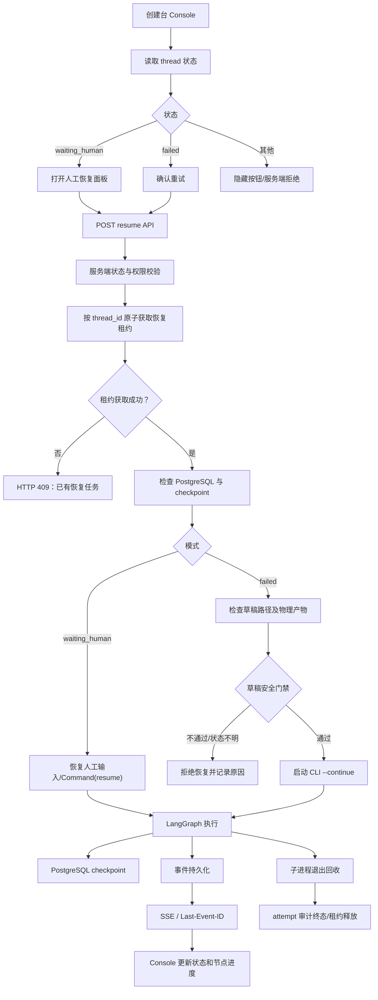

# 创建台「继续运行」与失败节点重试
## 设计审查、风险修订及分阶段执行计划

> 文档版本：1.0  
> 编制日期：2026-11-18  
> 目标仓库：[`wayyet/auto-video-editor`](https://github.com/wayyet/auto-video-editor)  
> 目标分支：`main`  
> 审查基线：2026-11-18 可读取的远端源码及用户提供的《创建台「继续运行」按钮与失败节点重试 — 交付说明(2026-11-18)》  
> 文档性质：设计审查与后续执行计划；**不是代码已修复或测试已重新执行的证明**。

---

## 0. 执行摘要

### 0.1 总体结论

本次功能的总体方向正确：在创建台为 `waiting_human` 和 `failed` 提供不同的继续执行入口，复用既有 LangGraph checkpoint、PostgreSQL checkpointer 和 SSE 事件通道，而不是重新创建工作流或从头执行。

远端 `main` 分支已经包含附件描述的主要实现，包括：

- CLI `scripts/resume_workflow.py` 的 `--continue` 分支；
- 服务层 `web/console_service.py` 对 `failed` 状态的放行；
- `web/gate_state.py` 的 `allow_missing_draft` 参数；
- 创建台 `web/console.html` 的继续/重试按钮；
- `web/static/workflow_console.mjs` 的 `canResumeOrRetry(state)`；
- 对应的单元测试及前端测试。

但“主要代码已存在”不等于“生产级失败恢复已充分验证”。仍需优先处理或明确验证以下风险：

1. **重试并发互斥**：服务端活跃进程检查与子进程启动之间需要原子化保护，避免同一 `thread_id` 被并发启动多个恢复进程。
2. **无 `draft_path` 的草稿安全边界**：checkpoint 中没有 `draft_path` 不足以证明磁盘上没有已生成或部分生成的草稿。
3. **真实失败节点恢复测试**：需要验证成功节点不重复执行、失败节点重新执行成功，而不只是验证 `None` 输入或参数解析。
4. **子进程提前退出后的任务状态**：需要保证 CLI 在产生恢复事件前退出时，服务端审计状态不会永久停留在 `starting`。
5. **PostgreSQL 异常覆盖范围**：需要检查状态读取、checkpointer 初始化、迁移和 checkpoint 查询等完整初始化链路的异常分类。

### 0.2 当前状态矩阵

| 能力 | 当前判断 | 说明 |
|---|---|---|
| `waiting_human` 人工关卡恢复 | 已实现 | 复用原恢复面板及 `Command(resume=...)` |
| `failed` 状态 API 放行 | 已实现 | `resume_run` 放行 `waiting_human`、`failed` |
| CLI `--continue` | 已实现 | 无挂起关卡时从已有 checkpoint 继续 |
| 创建台按钮显隐 | 已实现 | 创建台使用 `canResumeOrRetry` |
| 监控页恢复门禁 | 按设计保持原样 | `canResume` 仍只认 `waiting_human` |
| SSE 事件续接 | 已实现设计 | 复用既有事件流和 `Last-Event-ID` 机制 |
| 重试互斥的跨请求/跨进程原子保证 | 待核验/待补强 | 不能仅依赖前端禁用或进程内字典 |
| 无 `draft_path` 时物理草稿保护 | 存在风险 | 需要核验 staging/正式草稿目录及文件状态 |
| 失败节点恢复的端到端语义 | 测试证据不足 | 需要真实集成测试 |
| 子进程提前退出的最终状态回收 | 待核验/待补强 | 防止 `starting` 悬挂 |
| 浏览器真实失败重试 | 待操作员验收 | 附件只记录了按钮及取消确认的冒烟结果 |

### 0.3 本次工作边界

本计划只针对创建台继续运行与失败节点重试，不调整工作流业务节点顺序，不改变剪映草稿生成策略，不迁移数据库，不重构监控页，也不改变事件表 schema。

本次交付目标是形成可执行的修复与验收基线。除非后续明确批准，不在本计划中直接执行生产任务、启动/停止服务、修改剪映草稿或推送 Git。

---

## 1. 需求与交互语义

### 1.1 需求背景

创建台 `console.html` 的「创建并运行工作流」按钮附近增加一个继续运行入口，覆盖两种不同场景：

- 工作流停在人工关卡，状态为 `waiting_human`：操作员确认人工处理结果后继续。
- 工作流某个节点执行失败，状态为 `failed`：从 LangGraph 已保存的 checkpoint 继续，重新执行失败 superstep 中尚未成功提交的工作。

### 1.2 两种恢复模式必须分开

| 维度 | 人工关卡恢复 | 失败节点重试 |
|---|---|---|
| 状态 | `waiting_human` | `failed` |
| 用户动作 | 打开已有恢复面板，检查关卡信息后确认 | 先弹出二次确认框，再提交重试 |
| CLI 行为 | 注入 `Command(resume=...)` | `run_with_events(g, None, config)` |
| 目标 | 提交人工输入，解除 interrupt | 从最后 checkpoint 继续未完成工作 |
| 是否从头运行 | 否 | 否 |
| 主要风险 | 人工输入与关卡 ID 不匹配 | checkpoint、草稿及并发安全 |
| 监控页 | 原有恢复行为不变 | 不增加失败重试入口 |

**禁止将两种模式合并为一个无差别的“重新运行”操作。** 前端可以复用按钮/API，但后端必须根据任务状态决定执行模式。

### 1.3 按钮状态表

| 任务状态 | 创建台按钮 | 点击行为 |
|---|---|---|
| `waiting_human` | 显示「继续运行」 | 打开现有恢复面板，操作员确认后恢复 |
| `failed` | 显示「重试失败节点」 | `window.confirm` 二次确认后提交重试 |
| `running` | 隐藏 | 不允许重复启动 |
| `completed` | 隐藏 | 只能新建任务 |
| `cancelled` | 隐藏 | 只能新建任务 |
| `prepared` / `unknown` | 隐藏 | 服务端拒绝 |
| 无有效 `thread_id` | 隐藏 | 不发起请求 |

查看模式（例如 `?thread_id=`）是否允许显示按钮，应继续遵循现有交付说明中的行为，并由服务端状态门禁兜底。

---

## 2. 当前实现核对

### 2.1 已存在的主要代码

| 层次 | 文件 | 当前实现/职责 |
|---|---|---|
| CLI | `scripts/resume_workflow.py` | 解析 `--continue`，检查 checkpoint，执行失败后续跑 |
| 服务层 | `web/console_service.py` | 状态门禁、构造 CLI 参数、启动子进程、记录 `resumes[]` |
| API | `web/api_console.py` | `POST /api/console/runs/{tid}/resume` |
| 草稿门禁 | `web/gate_state.py` | `resume_guard`，控制缺少 `draft_path` 时的检查策略 |
| 草稿锁 | `draft_ops/draft_lock.py` | 检查剪映进程和草稿可恢复条件 |
| 前端状态工具 | `web/static/workflow_console.mjs` | `canResumeOrRetry(state)` |
| 创建台 | `web/console.html` | 按钮显隐、确认框、恢复面板和 SSE 续接 |
| Agent Gate 参考实现 | `agent_gate/runner.py` | `continue_after_crash` / checkpoint 检查参考 |

### 2.2 CLI 当前语义

附件记录的实现行为如下：

- `--continue` 使用 `dest="continue_run"`，避免 Python 关键字冲突。
- `--continue` 与 `--checkpoint` 同时传入时，参数非法，退出码为 2。
- 新增 `EXIT_NO_CHECKPOINT = 7`。
- `_continue_after_failure()` 先检查 `saver.aget_tuple(config)`。
- checkpoint 不存在或 checkpoint 查询异常时 fail-closed，返回退出码 7。
- 有 `draft_path` 时执行草稿恢复安全检查；门禁失败返回退出码 6。
- 通过检查后调用 `run_with_events(g, None, config)`。
- 有挂起人工关卡时，原有 `Command(resume=...)` 语义保持优先，不因 `--continue` 改变。
- 未提供 `--continue` 且没有挂起关卡时，保留原退出码 4 行为。

### 2.3 服务层与 API 当前语义

附件记录的实现行为如下：

- `resume_run` 状态门禁从只允许 `waiting_human` 扩展为允许 `waiting_human` 和 `failed`。
- `failed` 时设置 `retry_mode=True`，CLI 参数带 `--continue`，不带 `--value` 和 `--checkpoint`。
- `--llm-backend` 仍使用任务记录中固化的后端值。
- `resumes[]` 审计新增 `mode` 字段，取值为 `resume` 或 `retry`。
- retry 模式下，默认草稿门禁可透传 `allow_missing_draft=True`；显式注入的测试门禁保持原有 `(thread_id)` 调用签名。
- API 继续复用现有 ResumeBody，不要求 schema 变更。

### 2.4 前端当前语义

- `canResumeOrRetry(state)` 允许 `waiting_human` 和 `failed`。
- 原 `canResume(state)` 不应扩展为允许 `failed`，以保持监控页恢复按钮行为不变。
- `waiting_human` 点击按钮打开现有恢复面板。
- `failed` 点击按钮先确认，确认后提交 resume API。
- 若 EventSource 已关闭，成功提交后重新订阅；若仍处于可重连状态，依赖 `Last-Event-ID` 续接，避免重置右侧事件历史。

### 2.5 已记录的测试与冒烟结果（来自附件，不代表本次重新执行）

附件记录：

- 相关后端单测通过：`test_resume_workflow_script`、`test_console_resume`、`test_console_resume_guard`、`test_console_gates_api`、`test_resume_workflow_llm_backend`。
- 前端 `node --test web/tests/*.test.mjs`：76 pass / 0 fail。
- 全量 unit：2159 通过 / 1 失败 / 0 错误；唯一失败为 `test_node_09_inject_fx.py::test_inject_fx_deterministic_across_pythonhashseed`。附件将其归因于测试时剪映客户端正在运行，草稿写入互斥拒绝子进程写入。
- 浏览器冒烟 6 项通过：failed/waiting_human 按钮显隐、completed/cancelled/running 隐藏、取消确认不提交请求。
- 真实失败节点重试仍列为待操作员验收。

**本次审查没有重新运行 pytest、Node 测试或真实剪映工作流。** 上述数字只能作为附件所记录的历史测试结果引用。

---

## 3. 关键技术语义：LangGraph checkpoint

### 3.1 修正文档中的 checkpoint 定义

附件将 checkpoint 简化为“每跑完一个节点就把状态存进 PostgreSQL”。这不够准确，正式文档应使用 LangGraph 的 superstep（超级步）和 pending writes（待提交写入）概念解释恢复行为。

- **Checkpoint**：图执行在某个保存边界上的状态快照，包含恢复所需的状态和调度信息。
- **Superstep**：LangGraph 的一轮节点调度执行；并行节点可能处于同一个 superstep。
- **Pending writes**：同一 superstep 内已经成功完成的节点写入记录，可在恢复时用于避免重复执行已经成功的节点。
- **Interrupt**：工作流主动暂停并等待外部输入的控制点。
- **Retry/resume**：从已有 checkpoint 继续，而不是重新创建 thread 或从初始输入开始。

因此，“失败节点重试”的准确表达应为：

> 使用同一个 `thread_id` 和同一个 checkpointer，从 PostgreSQL 中的最新有效 checkpoint 继续执行。失败 superstep 中尚未成功提交的节点工作会重新执行；已成功完成且已记录 pending writes 的节点是否重跑，应由对应图执行语义和测试确认，不能仅凭“回到最后一个成功节点”作绝对保证。

### 3.2 必须验证的恢复场景

**串行场景：**

```text
第一次运行：
节点 A 成功
  ↓
节点 B 抛异常
  ↓
工作流 failed，checkpoint 保留

第二次运行：
读取同一 thread_id 的 checkpoint
  ↓
None 输入续跑
  ↓
节点 B 再次执行
  ↓
节点 B 成功
  ↓
后续节点继续执行
```

**并行 superstep 场景：**

```text
                 ┌─ 节点 B 成功 ─ pending write 已记录 ─┐
节点 A ─ 并行调度 ┤                                      ├─ 节点 D
                 └─ 节点 C 失败 ────────────────────────┘
                              ↓
                         工作流失败
                              ↓
                      从 checkpoint 恢复
                              ↓
               验证 B 不重复执行，C 重新执行
```

第二个场景必须由集成测试证明，不能只用串行图的测试结果代替。

---

## 4. 风险审查与修订要求

### 4.1 P0：重试并发竞态

**问题**

如果服务端流程是“检查活跃进程 → 释放锁 → 其他检查 → 启动子进程 → 注册活跃进程”，则两个并发请求可能在注册之前同时通过检查。

仅靠以下措施不能构成完整互斥：

- 前端按钮禁用；
- `window.confirm`；
- 进程内 `_ACTIVE_PROCS` 字典；
- 单次请求的状态检查。

**修订设计**

1. 对每个 `thread_id` 建立独占的 retry lease（运行租约）或等价的原子占用机制。
2. 在启动子进程之前完成占用；占用失败返回 HTTP 409。
3. 租约至少包含 `thread_id`、owner/run id、创建时间、过期时间和状态。
4. 子进程成功启动后将租约绑定到进程标识；退出回收时释放。
5. 服务进程异常退出时，租约应有过期回收和恢复策略。
6. 如果服务部署为多 worker/多实例，不能使用仅存在于单进程内存的锁作为唯一保障。
7. 同一 `thread_id` 的人工恢复与失败重试也必须互斥。

**验收标准**

- 两个并发请求同时提交同一 `thread_id`，只能有一个得到成功受理。
- 另一个请求收到明确 409，不启动第二个 CLI 进程。
- 不同 `thread_id` 可以并行恢复。
- 进程正常退出、异常退出和服务重启后，锁/租约均可正确释放或过期回收。
- 事件表、审计记录和实际子进程数量一致。

### 4.2 P0：`draft_path` 缺失时的草稿安全盲区

**问题**

`draft_path` 是工作流 state/checkpoint 中的字段，不是磁盘文件存在性的权威证明。节点可能先写入草稿文件，再因后续步骤异常而未能把 `draft_path` 提交进 checkpoint。

因此：

```text
checkpoint.draft_path 不存在
```

不能推出：

```text
磁盘上不存在草稿或部分草稿
```

另外，如果 `allow_missing_draft=True` 使 `resume_guard` 在没有 `draft_path` 时完全跳过 `assert_resume_ready()`，就可能同时跳过剪映进程检查，而不只是跳过文件哈希检查。

**修订设计**

1. 明确草稿的权威定位规则：按 `thread_id/job_id` 找到 staging 输出目录和正式发布目录。
2. 在 retry 模式下，即使 checkpoint 没有 `draft_path`，也先检查上述目录是否存在本任务产生的草稿或部分产物。
3. 如果发现草稿文件，必须恢复完整门禁：剪映进程检查、文件锁检查、必要的完整性/哈希校验。
4. 只有在能够确认不存在本任务草稿产物时，才允许按“产草稿前失败”策略跳过草稿文件门禁。
5. 无法确定草稿归属或目录状态时采用 fail-closed：拒绝自动重试并提示人工检查。
6. 不得删除、覆盖或自动修复未知归属的草稿文件。

**验收标准**

| 场景 | 预期 |
|---|---|
| checkpoint 有 `draft_path`，剪映正在运行 | 拒绝恢复 |
| checkpoint 有 `draft_path`，剪映已关闭且草稿校验通过 | 允许继续 |
| checkpoint 无 `draft_path`，本任务 staging 目录存在草稿 | 必须执行草稿/剪映门禁 |
| checkpoint 无 `draft_path`，本任务目录确认无草稿 | 可按无草稿策略继续 |
| 目录不可访问或归属不明确 | fail-closed，拒绝自动恢复 |

### 4.3 P0：PostgreSQL 异常处理覆盖完整初始化链路

**问题**

附件记录 `saver.aget_tuple(config)` 异常会返回退出码 7。但在到达该函数之前，可能已经执行图状态读取、checkpointer 初始化、数据库迁移或其他数据库访问。

这些前置操作如果抛出连接异常，可能绕过统一退出码处理。

**修订设计**

将恢复初始化流程分层，并对每个数据库操作设置明确异常边界：

```text
解析参数
  ↓
建立数据库/checkpointer
  ↓
读取 graph state
  ↓
读取 checkpoint tuple
  ↓
执行恢复前门禁
  ↓
run_with_events(None)
  ↓
检查最终状态
```

建议退出码语义：

| 退出码 | 含义 | 是否启动图执行 |
|---|---|---|
| 0 | dry-run 检查通过或执行成功 | dry-run 不启动；正常模式已完成 |
| 1 | 工作流执行失败或最终状态失败 | 是 |
| 2 | 参数非法 | 否 |
| 4 | 没有挂起人工关卡，且未指定 `--continue` | 否 |
| 6 | 草稿/剪映恢复门禁失败 | 否 |
| 7 | checkpoint 不存在或数据库不可用 | 否 |

如需新增退出码，应同步 CLI 文档、服务端日志解析和测试，不得静默复用已有含义。

**验收标准**

- 数据库连接失败、状态读取失败、checkpoint 查询失败均能输出可诊断错误。
- 任何初始化失败都不得误调用 `run_with_events`。
- `console_run.log` 记录具体阶段及退出码。
- 服务端最终状态不得因异常遗漏而停留在 `starting`。

### 4.4 P0：子进程提前退出后的状态回收

**问题**

服务端可能先记录 `starting`，而 CLI 在发送 `run.resumed` 事件之前因 checkpoint 缺失、数据库不可用、草稿门禁失败或参数错误退出。此时事件库没有新运行事件，不能仅依赖 SSE 推断最终状态。

**修订设计**

1. 子进程启动后保存 PID、启动时间、retry attempt id 和 thread id。
2. 进程收割器必须读取退出码和最后日志。
3. 如果没有收到正常终态事件，但进程已经退出，应将本次 retry attempt 标记为启动失败/恢复前检查失败等明确状态。
4. 不得覆盖原始 `failed` 事实；应把“工作流状态”和“本次恢复尝试状态”分开记录。
5. `resumes[]` 记录至少包含 `mode`、attempt id、开始时间、结束时间、退出码和结果。
6. 对服务重启后遗留的 `starting` 记录提供 reconciliation（状态对账）机制。

**验收标准**

CLI 在任何前置阶段退出后，审计记录都能在限定时间内从 `starting` 转为明确终态；日志、退出码和审计结果可相互对应。

### 4.5 P1：事件流与 SSE 续接

**修订要求**

- 保留现有事件 schema，不因本功能无必要地 bump `SCHEMA_VERSION`。
- 重试成功受理后，不能无条件清空右侧历史事件。
- EventSource 未关闭时依赖浏览器自动重连及 `Last-Event-ID`；已关闭时才重新订阅。
- 对新 retry attempt 增加可关联标识，避免把上一轮 `run.failed` 与本轮 `run.resumed` 混淆。
- 事件历史应保留 attempt 边界；必要时 UI 显示“第 N 次恢复尝试”。

**验收标准**

- 重试后事件 ID 单调递增。
- 页面刷新或 EventSource 重连后不丢失已持久化事件。
- 上一轮失败事件仍可查看，本轮事件可明确区分。
- 若 CLI 在发出 `run.resumed` 前退出，UI 仍能从 attempt 状态看到失败原因。

---

## 5. 修订后的端到端架构



---

## 6. P0/P1/P2 分阶段执行计划

### 6.1 P0：正确性与安全性修复

| 编号 | 任务 | 主要文件/模块 | 实施要点 | 验收标准 |
|---|---|---|---|---|
| P0-01 | 重试原子互斥 | `web/console_service.py` 及任务锁模块 | 对 `thread_id` 原子占用；跨 worker 时使用共享存储/数据库锁或租约 | 并发请求最多启动一个恢复进程 |
| P0-02 | 人工恢复与失败重试统一互斥 | 同上 | 两种恢复入口争用同一 thread 级锁 | 两种模式不能同时运行 |
| P0-03 | 无 `draft_path` 物理草稿检测 | `web/gate_state.py`、`draft_ops/draft_lock.py`、输出路径解析模块 | 同时检查 staging 和正式目录 | 有草稿就不能跳过剪映/文件门禁 |
| P0-04 | PostgreSQL 初始化异常归一化 | `scripts/resume_workflow.py` | 覆盖连接、初始化、状态读取、checkpoint 查询 | 初始化异常不进入图执行，退出码明确 |
| P0-05 | 子进程退出状态回收 | `web/console_service.py`、进程管理模块 | 收割退出码、结束 attempt、释放租约 | 不遗留永久 `starting` |
| P0-06 | 日志和审计关联 | `web/console_service.py`、事件模块 | attempt id 贯穿 API、CLI、事件、日志 | 可按 thread/attempt 追踪一次重试 |

**P0 完成门槛：** P0-01 至 P0-05 的自动化测试通过；任何安全状态不明都拒绝自动恢复；不得出现同一 thread 多进程恢复。

### 6.2 P1：集成测试与回归

| 编号 | 任务 | 测试文件 | 测试内容 | 验收标准 |
|---|---|---|---|---|
| P1-01 | 串行失败恢复 | `tests/integration/test_workflow_stream_events.py` 或专用恢复测试 | A 成功、B 失败、续跑后 B 成功 | A 不重复，B 重试成功 |
| P1-02 | 并行 superstep 恢复 | 同上 | B 成功、C 失败，恢复后检查 pending writes | B 不重复，C 重试 |
| P1-03 | 无 checkpoint | `tests/unit/test_resume_workflow_script.py` | checkpoint 返回 None | EXIT 7，不运行图 |
| P1-04 | 数据库初始化异常 | 同上 | connect/state/checkpoint 各阶段异常 | 错误分类一致，不运行图 |
| P1-05 | 草稿路径缺失但文件存在 | `tests/unit/test_console_resume_guard.py` | staging/正式目录存在草稿 | 不绕过门禁 |
| P1-06 | 草稿路径缺失且无文件 | 同上 | 目录确认无本任务草稿 | 允许按无草稿策略继续 |
| P1-07 | 并发重复提交 | `tests/unit/test_console_resume.py` | 两个请求同时重试同一 thread | 一个受理、一个 409 |
| P1-08 | 不同 thread 并发 | 同上 | 两个 thread 同时恢复 | 两个均可受理 |
| P1-09 | 子进程提前退出 | 同上 | CLI 在 run.resumed 前退出 | attempt 终态正确、租约释放 |
| P1-10 | 前端门禁回归 | `web/tests/workflow_console.test.mjs` | failed/等待人工/终态 | 创建台门禁正确，监控页 `canResume` 不变 |
| P1-11 | SSE 重连与历史保留 | 前端测试及 API 集成测试 | 自动重连、Last-Event-ID、已关闭后重订阅 | 无重复清空、无事件遗漏 |

### 6.3 P2：浏览器、剪映与生产验收

| 编号 | 场景 | 操作 | 预期结果 |
|---|---|---|---|
| P2-01 | 人工关卡① | 新任务运行至分镜顺序关卡，点击「继续运行」 | 恢复面板正确显示，人工确认后继续 |
| P2-02 | 人工关卡② | 运行至 BGM 确认关卡 | 恢复面板及人工输入正确，工作流继续 |
| P2-03 | 失败节点重试 | 准备可控失败节点，点击「重试失败节点」并确认 | API 受理，失败节点重新执行，最终到达终态 |
| P2-04 | 取消重试确认 | failed 状态点击按钮后取消 confirm | 不提交 API，不创建 attempt |
| P2-05 | 剪映打开且存在草稿 | 保持剪映客户端运行并重试 | 服务端拒绝，不写入/覆盖草稿 |
| P2-06 | 剪映关闭且草稿有效 | 关闭剪映后重试 | 门禁通过，工作流续跑 |
| P2-07 | 无 `draft_path` 但存在草稿文件 | 模拟节点写入后异常 | 仍触发物理草稿安全门禁 |
| P2-08 | 确认无草稿 | 在产草稿前制造失败 | 仅在确认无本任务草稿后允许续跑 |
| P2-09 | 服务重启恢复 | 重启服务后检查遗留 attempt | 对账后状态明确，不重复启动 |
| P2-10 | 监控页回归 | 打开 `monitor.html` 检查 failed 任务 | 监控页原恢复门禁保持不变 |

真实重试会消耗 LLM 调用、计算资源和执行时间。必须使用明确指定的测试任务，并在执行前确认输入素材、模型后端、费用/调用风险和剪映状态。

---

## 7. 测试设计细节

### 7.1 串行失败恢复测试伪代码

以下是测试意图示例，不是可直接复制运行的完整测试代码：

```python
calls = {"node_a": 0, "node_b": 0}

async def node_a(state):
    calls["node_a"] += 1
    return {"a_done": True}

async def node_b(state):
    calls["node_b"] += 1
    if calls["node_b"] == 1:
        raise RuntimeError("controlled failure")
    return {"b_done": True}

# 第一次：A 成功，B 失败
with pytest.raises(RuntimeError):
    await graph.ainvoke(initial_state, config)

assert calls["node_a"] == 1
assert calls["node_b"] == 1

# 第二次：同一个 config/thread_id，None 输入续跑
result = await graph.ainvoke(None, config)

assert calls["node_a"] == 1
assert calls["node_b"] == 2
assert result["b_done"] is True
```

注意：实际测试应使用与生产一致的 checkpointer 类型或可靠的 PostgreSQL 测试实例；若使用内存 saver，只能证明图语义，不能证明 PostgreSQL 集成。

### 7.2 并行恢复测试

测试图至少包含两个并行节点，其中一个成功、另一个首次失败。恢复后检查：

- 成功节点调用次数仍为 1；
- 失败节点调用次数为 2；
- 汇聚节点只在两个上游结果都可用时继续；
- checkpoint 和 pending writes 与预期一致。

### 7.3 并发互斥测试

使用 barrier/latch 让两个请求尽可能同时进入恢复服务：

- 两个请求使用同一 `thread_id`；
- mock 子进程启动器并统计调用次数；
- 断言启动器只被调用一次；
- 断言一个请求成功受理，另一个返回 409；
- 再测试不同 `thread_id` 不互相阻塞。

### 7.4 草稿门禁测试矩阵

至少覆盖以下组合：

| checkpoint `draft_path` | staging 草稿 | 正式草稿 | 剪映运行 | 预期 |
|---|---:|---:|---:|---|
| 有 | 任意 | 有 | 是 | 拒绝 |
| 有 | 任意 | 有 | 否 | 继续做文件校验 |
| 无 | 有 | 无 | 是 | 拒绝 |
| 无 | 无 | 有 | 是 | 拒绝 |
| 无 | 无 | 无 | 是 | 只有在确认无需保护草稿时按策略决定；不能因 `draft_path` 缺失自动放行 |
| 无 | 无 | 无 | 否 | 可进入 checkpoint 续跑检查 |

---

## 8. 运行状态、审计与事件约束

### 8.1 状态职责分离

建议明确区分三类状态：

1. **工作流状态**：`prepared`、`running`、`waiting_human`、`failed`、`completed`、`cancelled`。
2. **恢复尝试状态**：`starting`、`accepted`、`running`、`succeeded`、`failed_preflight`、`failed_execution`、`cancelled`。
3. **节点状态/事件**：`node.started`、`node.resumed`、`node.completed`、`node.failed` 等现有事件。

不能因为某次恢复请求已返回 HTTP 202，就把工作流直接标记为执行成功。202 只表示请求已受理。

### 8.2 审计字段建议

不要求一次性改变数据库 schema；可先评估现有 `resumes[]` 是否足够。至少应能关联：

- `thread_id`
- `attempt_id`
- `mode`：`resume` / `retry`
- `requested_at`
- `started_at`
- `finished_at`
- `pid`（若适用）
- `exit_code`
- `result`
- `error_code`
- `error_message`

若现有结构不能安全承载，先提出兼容迁移方案，再修改 schema。

### 8.3 SSE 事件约束

- 保持事件持久化先于推送。
- `Last-Event-ID` 继续作为断线续接游标。
- 不因重试而清空旧事件。
- 用 attempt id 或等价元数据区分不同恢复尝试。
- 对“没有产生 `run.resumed` 就提前退出”的场景，以服务端 attempt 状态和退出码补充，而不是伪造工作流事件。

---

## 9. 文件级执行清单

| 文件/目录 | 本计划动作 | 注意事项 |
|---|---|---|
| `scripts/resume_workflow.py` | 检查并完善初始化异常处理、退出码和恢复日志 | 保持 Windows SelectorEventLoop 现有兼容逻辑 |
| `web/console_service.py` | 原子互斥、进程回收、attempt 审计 | 不破坏 `waiting_human` 原路径 |
| `web/gate_state.py` | 修订无 `draft_path` 的门禁语义 | 不能将缺字段等同于无文件 |
| `draft_ops/draft_lock.py` | 复用/扩展剪映进程与草稿文件安全检查 | 不自动删除或覆盖草稿 |
| `web/api_console.py` | 明确 409/202 错误语义和 API 文档 | 不无必要改变请求 schema |
| `web/console.html` | 展示 attempt 状态、错误及重试反馈 | 不改变既有恢复面板流程 |
| `web/static/workflow_console.mjs` | 保持创建台和监控页门禁分离 | `canResume` 不应放行 failed |
| `tests/unit/test_console_resume.py` | 并发、回收、审计测试 | 使用可控进程启动器 |
| `tests/unit/test_console_resume_guard.py` | 草稿物理存在性与门禁测试 | 覆盖 staging/正式目录 |
| `tests/unit/test_resume_workflow_script.py` | 数据库初始化异常测试 | 断言异常时不执行 graph |
| `tests/integration/test_workflow_stream_events.py` | 串行及并行失败恢复测试 | 使用持久化 checkpointer 验证 |
| `web/tests/workflow_console.test.mjs` | 状态显隐、确认、SSE 重连回归 | 监控页行为保持不变 |

实际开发前必须再次读取目标分支当前文件，不得直接依据本表假定行号或函数签名未变化。

---

## 10. 回归与发布策略

### 10.1 开发顺序

1. 先实现并发互斥和 attempt 生命周期。
2. 再修复草稿安全门禁。
3. 再统一 PostgreSQL 初始化异常及退出码。
4. 再补齐失败恢复集成测试。
5. 最后补前端 attempt 状态和浏览器验收。

不建议先改 UI 再补后端互斥，因为 UI 无法提供服务端并发安全保证。

### 10.2 回归范围

每次修改后至少执行：

```powershell
pytest tests/unit/test_resume_workflow_script.py tests/unit/test_console_resume.py tests/unit/test_console_resume_guard.py tests/unit/test_console_gates_api.py tests/unit/test_resume_workflow_llm_backend.py
```

前端测试：

```powershell
node --test web/tests/*.test.mjs
```

新增集成测试应使用项目当前规定的 PostgreSQL 测试环境和启动方式。不得为了让测试通过而静默跳过 checkpoint、草稿门禁或并发锁。

全量测试应单独记录：

- 命令；
- 开始/结束时间；
- 通过/失败/错误数量；
- 失败用例完整名称；
- 是否依赖剪映客户端、FFmpeg、PostgreSQL 或外部模型；
- 环境性失败与代码回归的区分依据。

### 10.3 发布前检查

- [ ] 所有 P0 项通过。
- [ ] 串行失败恢复集成测试通过。
- [ ] 并行 pending writes 恢复测试通过。
- [ ] 并发重复请求测试通过。
- [ ] 无 `draft_path` 但物理草稿存在的安全测试通过。
- [ ] PostgreSQL 不可用时 fail-closed。
- [ ] 子进程提前退出后 attempt 状态能够收敛。
- [ ] 前端和监控页回归通过。
- [ ] 浏览器真实场景通过。
- [ ] 剪映打开/关闭两种状态的真实草稿门禁通过。
- [ ] 服务重启后无遗留 `starting` 和重复进程。
- [ ] 变更已审查并按仓库约定提交、推送。

---

## 11. 回滚方案

### 11.1 回滚原则

- 不删除 PostgreSQL checkpoint。
- 不删除工作流输出目录或剪映草稿。
- 不通过清空事件表修复 SSE 问题。
- 不在有活跃恢复进程时直接覆盖/回滚服务代码。
- 不将 `failed` 强制改成 `prepared` 或 `running` 来绕过门禁。

### 11.2 回滚步骤

1. 停止接受新的恢复请求。
2. 确认现有恢复子进程已结束，或按项目既有安全流程停止。
3. 保存 `console_run.log`、attempt 审计和事件记录。
4. 回滚本次代码变更。
5. 按生产启动流程重启服务。
6. 检查任务状态、checkpoint、草稿文件和 SSE 订阅。
7. 对失败任务保持 `failed`，待原因查明后再决定是否重试。

---

## 12. 最终验收标准

本功能只有同时满足以下条件，才可判定为生产验收完成：

### 功能正确性

- `waiting_human` 能继续原工作流并正确提交人工输入。
- `failed` 能从同一 thread 的 checkpoint 恢复。
- 失败节点能重新执行成功。
- 已成功节点不发生不必要的重复执行，尤其是并行 superstep 场景。

### 安全性

- 同一 thread 同时最多只有一个恢复执行者。
- 草稿存在时必须执行剪映及文件安全门禁。
- 缺少 `draft_path` 不会绕过物理草稿检查。
- PostgreSQL/checkpoint 状态不确定时拒绝执行。
- 不覆盖、不删除未知或正在被剪映使用的草稿。

### 可观测性

- 每次恢复尝试有唯一关联标识。
- CLI 退出码、服务端审计和事件状态一致。
- SSE 断线后可以按游标续接。
- 子进程提前退出不会留下永久 `starting`。

### 回归性

- 创建台按钮状态正确。
- 监控页 `canResume` 语义不变。
- 人工关卡原有恢复面板不回归。
- 现有工作流、草稿生成和事件持久化测试通过。

---

## 13. 当前结论与待办

### 已有实现（按远端源码审查）

- [x] CLI 增加 `--continue` 续跑入口。
- [x] 服务层允许 `failed` 状态进入重试路径。
- [x] 创建台增加继续/重试按钮。
- [x] 人工恢复与失败重试采用不同交互。
- [x] 创建台与监控页使用不同状态门禁。
- [x] 复用既有事件流和 checkpoint 机制。
- [x] 已有相应单元测试和前端测试。

### 待修复/补强

- [ ] 同一 thread 的原子恢复互斥。
- [ ] 无 `draft_path` 时检查实际草稿目录。
- [ ] 覆盖整个 PostgreSQL 初始化链路的异常处理。
- [ ] 子进程提前退出后的 attempt 状态回收。
- [ ] attempt id 与事件/日志/审计关联。
- [ ] 串行失败恢复端到端集成测试。
- [ ] 并行 superstep/pending writes 恢复测试。
- [ ] 并发请求和草稿物理存在性测试。

### 待真实环境验收

- [ ] 人工关卡①真实恢复。
- [ ] 人工关卡②真实恢复。
- [ ] 失败节点真实重试成功。
- [ ] 剪映运行时拒绝恢复。
- [ ] 剪映关闭且草稿安全时允许恢复。
- [ ] 产草稿前失败且确认无草稿时允许恢复。
- [ ] 服务重启后任务与 attempt 状态正确。

**最终判定：当前实现可作为功能基线继续迭代，但在 P0 风险修复和真实失败节点恢复验收完成之前，不应将“失败节点重试”标记为生产级完全验收。**

---

## 14. 参考资料

### 仓库源码

- [auto-video-editor — main](https://github.com/wayyet/auto-video-editor/tree/main)
- [scripts/resume_workflow.py](https://github.com/wayyet/auto-video-editor/blob/main/scripts/resume_workflow.py)
- [web/console_service.py](https://github.com/wayyet/auto-video-editor/blob/main/web/console_service.py)
- [web/gate_state.py](https://github.com/wayyet/auto-video-editor/blob/main/web/gate_state.py)
- [web/api_console.py](https://github.com/wayyet/auto-video-editor/blob/main/web/api_console.py)
- [web/console.html](https://github.com/wayyet/auto-video-editor/blob/main/web/console.html)
- [web/static/workflow_console.mjs](https://github.com/wayyet/auto-video-editor/blob/main/web/static/workflow_console.mjs)
- [agent_gate/runner.py](https://github.com/wayyet/auto-video-editor/blob/main/agent_gate/runner.py)
- [tests/integration/test_workflow_stream_events.py](https://github.com/wayyet/auto-video-editor/blob/main/tests/integration/test_workflow_stream_events.py)
- [tests/unit/test_resume_workflow_script.py](https://github.com/wayyet/auto-video-editor/blob/main/tests/unit/test_resume_workflow_script.py)
- [tests/unit/test_console_resume.py](https://github.com/wayyet/auto-video-editor/blob/main/tests/unit/test_console_resume.py)
- [tests/unit/test_console_resume_guard.py](https://github.com/wayyet/auto-video-editor/blob/main/tests/unit/test_console_resume_guard.py)
- [web/tests/workflow_console.test.mjs](https://github.com/wayyet/auto-video-editor/blob/main/web/tests/workflow_console.test.mjs)

### LangGraph 官方资料

- [LangGraph Persistence / Checkpoints](https://docs.langchain.com/oss/python/langgraph/persistence)
- [LangGraph Fault-tolerance](https://docs.langchain.com/oss/python/langgraph/fault-tolerance)
- [LangGraph Interrupts](https://docs.langchain.com/oss/python/langgraph/interrupts)

---

## 附录 A：与原交付说明的差异

| 原交付说明 | 本修订文档处理 |
|---|---|
| checkpoint 简化为每个节点结束即保存 | 修正为 checkpoint、superstep、pending writes 语义 |
| `draft_path` 缺失即可跳过草稿门禁 | 增加 staging/正式目录物理产物检查 |
| `aget_tuple` 异常返回 7 | 扩展审查到数据库初始化和状态读取完整链路 |
| 已有服务层活跃进程检查 | 增加原子占用和跨 worker 互斥要求 |
| 主要依赖 SSE 事件观察重试 | 增加 attempt 生命周期及子进程退出回收 |
| 已有测试锁定失败恢复语义 | 明确现有测试证据不足，增加串行和并行集成测试 |
| 浏览器冒烟完成 | 保留为附件记录的历史结果，不等同真实失败重试验收 |
| 四个提交待推送 | 该状态属于附件记录的历史状态；本次不据此判断当前 Git 工作区或远端同步状态 |

## 附录 B：实施约束

1. 开始代码修改前，重新读取 `main` 分支最新文件和提交记录。
2. 每个 P0 任务先补测试，再修改实现。
3. 不改变 `waiting_human` 既有恢复语义。
4. 不扩展监控页 `canResume` 的允许状态。
5. 不无必要改变数据库 schema 或 `SCHEMA_VERSION`。
6. 不把 HTTP 202 当作工作流执行成功。
7. 不以 `draft_path` 缺失作为唯一的无草稿证明。
8. 不以进程内锁作为多 worker/多实例部署的唯一并发保证。
9. 所有生产实跑、服务启停、草稿写入和 Git 推送均须单独确认。
