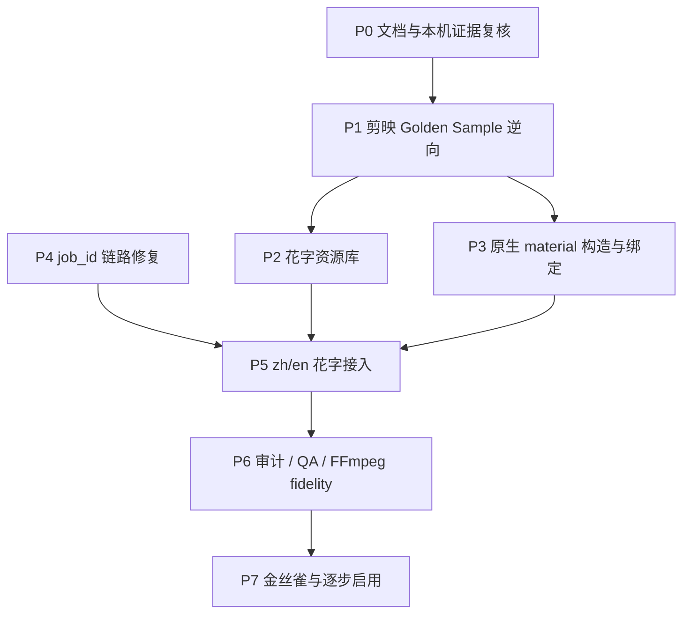

# 剪映 VIP 花字审计文档正确性审查与分阶段执行计划

> **审查日期：** 2026-11-18  
> **审查对象：** `wayyet/auto-video-editor` 仓库 `main` 分支  
> **审查基线：** `ea40d941b1824bf22b15b750f031841dad7ce485`（当前读取到的 `main` 提交）  
> **被审查文档：** `docs/第七期开发/auto-video-editor_剪映VIP花字草稿审计与流水线花字缺失根因分析_20261118.md`

---

## 0. 审查结论

### 0.1 总体判断

原文档的**核心方向基本正确**：当前 `main` 分支具备普通字幕、字幕样式和字幕入场动画的写入能力，但没有看到独立的剪映原生 VIP 花字（`panel-text-flower` / `text_effect`）资源池和专用写入器。因此，当前流水线不能据此认定已经具备自动注入剪映原生 VIP 花字的能力。

但原文档存在明显的证据强度问题、因果关系错误和实施方案缺项。特别是：

1. **草稿级结论无法仅凭仓库代码复核。** “中文草稿存在 1 个 VIP 花字”“由 UI 手动添加”“英文草稿为零花字”“VIP 账号可正常导出”等结论依赖本机 `draft_content.json`、截图、`rp.db`、缓存目录和审计日志；这些原始文件没有随本次请求提供，本次无法独立验证。
2. **审计日志不能证明 `materials.effects` 未变化。** `nodes/_draft_io.py` 的 `_AUDIT_BUCKETS` 没有 `effects`，日志的 `changed_counts` 不会记录该桶的数量变化或内容变化。SHA-256 只能说明整份草稿是否变化，不能说明具体变化发生在哪个桶。
3. **“FFmpeg 不渲染花字”不等于“剪映草稿不写入花字”。** 前者是 MP4 导出器的渲染能力边界，后者是剪映草稿构造和素材绑定能力，两条链路必须分开讨论。
4. **原文把“vendor 没有花字元数据模块”当成写入阻塞原因，不成立。** 项目已有 `jy_common/native_fx.py` 直接构造原生素材字典；缺少 vendor 元数据适配模块不代表无法通过自定义构造器写入。
5. **原文建议沿用 `sha256(job_id)`，但现有 job_id 传递链本身有未修复缺陷。** `WorkflowState` 没有声明 `thread_id`，`node_10` 与 `node_10b` 的路径兜底值不同。新花字池不能直接复用当前实现，否则可能出现中英文选择不一致和英文任务之间 seed 碰撞。
6. **FFmpeg fidelity 报告目前没有花字明细。** `draft_exporter.py` 的实际代码只统计转场、视频特效和贴纸，没有统计 `materials.effects`；原文声称导出报告会明确记录花字未渲染，与现有实现不完全一致。

### 0.2 结论分级

| 原文结论 | 审查结果 | 说明 |
|---|---|---|
| 当前工作流有普通字幕写入 | **代码已证实** | `nodes/_subtitle_texts.py` 写 `materials.texts`，并建立 text 轨道段 |
| node_10 / node_10b 写的是字幕入场动画，不是 VIP 花字 | **代码已证实** | 写入 `materials.material_animations`，素材类型为 `sticker_animation` |
| 当前资源库没有独立的原生花字池 | **代码已证实** | `fx_template.json`、`fx_resource_library.json`、`text_resource_library.json` 均未定义独立 flower 资源段 |
| 当前流水线没有专用 VIP 花字写入逻辑 | **高度支持，仍需全库复核** | 已检查核心文本写入、FX 构造器和节点；原文的全库 grep 结果未提供原始输出 |
| 中文草稿存在 `互动立体` VIP 花字 | **未独立验证** | 缺少本机草稿 JSON、截图和 `rp.db` 对应记录 |
| 花字由剪映 UI 手动添加 | **未独立验证** | 时间线与审计日志原始文件未提供，且审计桶不覆盖 `effects` |
| 英文草稿完全没有花字 | **未独立验证** | 缺少英文分支草稿 JSON |
| 当前账号有 Pro，应用和导出不受阻 | **证据不足** | `is_vip=true` / `paid_type=subscribe` 只表示资源的授权类型，不代表当前账号订阅状态 |
| vendor 缺模块导致写入器无法表达花字 | **因果错误** | 项目可用自定义原生字典构造器，不依赖 vendor 必须提供该模块 |
| 导出报告已经记录花字不渲染 | **与当前代码不符** | 当前 `draft_exporter.py` 未统计 `materials.effects` |
| 用当前 `job_id` 机制可保证 zh/en 花字一致 | **当前实现存在已知缺陷** | `thread_id` 未进入 `WorkflowState`，英文兜底 seed 与中文不同 |

### 0.3 本次审查的边界

本次通过 GitHub 读取了 `main` 分支的代码和目标 Markdown 文档，完成静态代码核验；**没有读取用户电脑上的真实剪映草稿、`rp.db`、缓存目录、截图或 `.autovideo_draft_mutations.jsonl` 原始内容，也没有在本机运行项目测试或启动剪映做 GUI 实测**。因此，本文件会明确区分仓库代码事实和依赖本机文件的观察结论，不把未见到的本机证据表述为已验证事实。

---

## 1. 当前 main 分支核验结果

### 1.1 字幕写入层：普通文本与原生花字是不同对象

文件：[`nodes/_subtitle_texts.py`](https://github.com/wayyet/auto-video-editor/blob/main/nodes/_subtitle_texts.py)

`make_text_material()` 负责构造 `materials.texts` 条目，内容包括剪映原生 `content` JSON、排版和样式字段，以及供工作流使用的私有字段。`make_text_segment()` 构造 text 轨道段，其 `extra_material_refs` 初始为空列表。

因此，普通字幕样式（字体、字号、颜色、描边、位置等）不能等同于剪映「文本 → 花字」面板中的原生花字素材。仅修改 `materials.texts[].content` 或 `style`，不能证明已经挂载 `panel-text-flower` 资源。

### 1.2 node_10 / node_10b：当前实现的是字幕入场动画

文件：[`nodes/node_10_inject_text_fx.py`](https://github.com/wayyet/auto-video-editor/blob/main/nodes/node_10_inject_text_fx.py)、[`jy_common/native_fx.py`](https://github.com/wayyet/auto-video-editor/blob/main/jy_common/native_fx.py)

核验结果：

- `node_10` 面向中文草稿，`node_10b` 面向英文分支草稿，共用 `apply_text_fx()`。
- `_apply_text_animations()` 只处理 ID 前缀为 `text-zh-` / `text-en-` 的我方字幕。
- 节点调用 `build_native_text_animation_material()`，写入 `materials.material_animations`。
- 动画素材类型是 `sticker_animation`，其 `animations[]` 记录动画名称、类型、时长、`resource_id`、`effect_id`、`md5` 等。
- 动画 material ID 使用 `text-anim-` 前缀，随后把该 ID 追加到对应 text 轨道段的 `extra_material_refs`。

所以，当前节点名称中的 `text_fx` 不能解读成“已经支持原生 VIP 花字”。现有代码实际实现的是**字幕入场动画**。

**额外问题：** `monitoring/workflow_graph.py` 对外显示名为“注入中文花字 / 注入英文花字”，但描述内容明确写的是“字幕入场动画”。这会让创建台或工作流图把动画与花字混为一谈。建议保留内部 node ID，修改 UI 展示名与说明，避免破坏现有拓扑和历史记录。

建议显示名：

- `node_10_inject_text_fx`：注入中文字幕入场动画
- `node_10b_inject_text_fx_en`：注入英文字幕入场动画

### 1.3 资源库：有 VIP 字幕动画数据，没有独立花字资源池

核验了三个资源文件：

| 文件 | 当前结构 | 对花字的含义 |
|---|---|---|
| [`templates/fx_template.json`](https://github.com/wayyet/auto-video-editor/blob/main/templates/fx_template.json) | 转场语义映射、转场池、视频特效候选 | 没有独立花字池 |
| [`templates/fx_resource_library.json`](https://github.com/wayyet/auto-video-editor/blob/main/templates/fx_resource_library.json) | `transitions` 433 条、`video_effects` 462 条 | 不包含独立的文字花字资源段 |
| [`templates/text_resource_library.json`](https://github.com/wayyet/auto-video-editor/blob/main/templates/text_resource_library.json) | `intro` / `loop` / `outro`，分别保存 VIP 字幕动画资源 | 这是字幕动画库，不是原生花字库 |

当前 `text_resource_library.json` 记录的是 `intro`、`loop`、`outro` 动画资源；文件中的 `intro_vip`、`loop_vip`、`outro_vip` 计数分别是 78、52、46。该数据可以支持字幕动画池，但不能据此认为它具备 `panel-text-flower` 花字数据。

**术语必须统一：**

| 术语 | 本项目中应表达的对象 |
|---|---|
| 字幕样式 | `materials.texts` 的字体、字号、颜色、描边、排版等属性 |
| 字幕入场/循环/出场动画 | `materials.material_animations` 中的动画素材与轨段引用 |
| 剪映原生花字 | 待由真实剪映 GUI 样本确认的花字素材结构；原文声称分类为 `panel-text-flower`、素材类型为 `text_effect` |

### 1.4 vendor 元数据模块缺失：现象正确，因果解释错误

目录：[`vendor/pyJianYingDraft/metadata/`](https://github.com/wayyet/auto-video-editor/tree/main/vendor/pyJianYingDraft/metadata)

当前目录中可以看到视频特效、文字动画、转场、视频场景特效等元数据模块，没有独立的 `text_style` / `text_flower` 模块。这说明 vendor 没有提供现成的花字元数据适配，但**不意味着写入器在技术上无法写入花字**。

原因是项目已经有 `jy_common/native_fx.py` 这样的自定义构造器，直接创建原生 material 字典，再由节点放入 `draft_content.json`。如果通过剪映 GUI 实测得到花字的完整结构，就可以新增自定义构造器；vendor 模块是否补齐是实现组织方式的选择，不是前置硬阻塞。

### 1.5 FFmpeg 导出器：没有渲染花字，但当前 fidelity 明细也没有完整记录花字

文件：[`draft_ops/draft_exporter.py`](https://github.com/wayyet/auto-video-editor/blob/main/draft_ops/draft_exporter.py)

`build_render_plan()` 当前会读取 `materials.texts`，将文本转换为 FFmpeg `drawtext` 计划。fidelity 明细实际统计：

- `materials.transitions`：按硬切近似渲染；
- `materials.video_effects`：不渲染进 MP4；
- `materials.stickers`：不渲染进 MP4。

但当前代码没有读取或统计 `materials.effects`，也没有统计 `materials.material_animations`。因此：

1. 原生 VIP 花字不会因为当前 `draft_exporter` 自动进入 MP4；
2. 当前 fidelity 明细也没有可靠地把原生花字数量和未渲染状态报告出来；
3. 原文“差异作为 fidelity 明细写进导出报告”的描述，对花字而言尚未被当前代码实现。

**必须分开：** 剪映草稿写入链决定剪映时间轴能否识别和渲染花字；FFmpeg 导出链决定最终 MP4 是否能复现该效果。FFmpeg 不支持某种效果，不构成禁止向剪映草稿写入该效果的理由。

### 1.6 草稿变更审计：当前无法按 effects 桶审计

文件：[`nodes/_draft_io.py`](https://github.com/wayyet/auto-video-editor/blob/main/nodes/_draft_io.py)

当前 `_AUDIT_BUCKETS` 包含：

`videos`、`audios`、`texts`、`transitions`、`video_effects`、`stickers`、`material_animations`、`audio_fades`、`speeds`。

其中**没有 `effects`**。

`build_draft_mutation_record()` 的行为是：

- 对 `_AUDIT_BUCKETS` 中的桶生成前后数量差异 `changed_counts`；
- 通过整份 `draft_content.json` 的 SHA-256 前后值计算 `changed`；
- 不生成完整 JSON diff，也不记录未列入 `_AUDIT_BUCKETS` 的桶详情。

因此，审计日志即使出现 `changed=true`，也不能定位到 `materials.effects`；即使 `changed_counts` 为空，也不能推出 `materials.effects` 未变化。原文第 1.4 节不能把该日志作为“没有任何花字写入”的直接证明。

另外，审计记录是观测通道，写入失败会降级，不会阻断主流程。若要把日志用作排除证据，还需要确认目标流水线所有写入都经过审计包装器，并核实日志文件完整性。

### 1.7 交付 QA：有 text_animation，不等于有 text_effect

文件：[`draft_ops/draft_integrity.py`](https://github.com/wayyet/auto-video-editor/blob/main/draft_ops/draft_integrity.py)

当前 `REQUIRED_FEATURE_KEYS` 中包含 `text_animation`，但没有 `text_effect` / `text_flower`。也就是说，交付 QA 可以把字幕动画作为必需功能检查，但尚无原生花字功能类别。

另一方面，`_material_ids()` 会遍历 `materials` 下所有 list 桶，并把 material ID 汇总；`check_track_references()` 对轨道段的 `material_id` 和 `extra_material_refs` 做通用悬空引用检查。若未来花字确实写入 `materials.effects`，当前通用检查可能识别其引用是否存在，但它**不验证花字字段结构、重复 ID、重复引用、VIP 元数据、缓存可用性或具体的花字类别**。

---

## 2. 原文档必须修订的问题

### 2.1 本机草稿结论应标记为“待原始文件复核”

以下内容不属于仓库静态代码能够证明的事实：

- 中文草稿 `AutoVideo_console-52373c6f9e11` 有且只有一个 `互动立体` 花字；
- 花字条目在 `materials.effects` 中重复两次，ID 完全相同；
- 同一文本轨段的 `extra_material_refs` 也重复两次；
- 该效果对应第 4 条字幕，时间范围为 18.133333 秒至约 23.866666 秒；
- 英文分支草稿完全没有花字；
- `rp.db` 记录 `is_vip=true`、`paid_type=subscribe`，且缓存目录 MD5 与资源一致；
- 花字缓存创建、`.bak` 产生、草稿最后保存时间分别为 07:07、07:12、07:13。

这些观察可能是真实的，但本次没有原始文件，不能独立背书。修订版应把它们放在“本机实测观察（由操作者提供，待复核）”一节，并附上脱敏 JSON 片段、文件哈希、查询输出和时间戳依据。

### 2.2 `is_vip=true` 不等于当前账号具备 Pro 订阅

`is_vip=true` 通常表示该资源的授权策略为订阅类资源；`paid_type=subscribe` / `subscribe_package=Pro` 说明资源需要相应订阅授权。

它们**不能单独证明**：

- 当前剪映账号当前仍有有效 Pro 订阅；
- 当前设备已完成账号登录；
- 当前资源在当前版本、地区和账号下可正常应用；
- 当前草稿在重新打开后仍能正常加载；
- 导出时不会出现付费校验或资源缺失提示。

因此，原文“当前账号有 VIP，应用/导出不受阻”应删除，除非另有当前账号会员状态或真实导出成功的证据。

### 2.3 重复 material ID / 重复 refs 不能直接判定“无害”

原文将同一个花字 material ID 重复写入两次、轨段重复引用两次解释为“剪映 UI 保存痕迹，无害”。目前缺少以下验证：

- 剪映实际解析时是否按 ID 去重；
- 重复 material 是否会覆盖、重复加载或出现不确定选择；
- 重复 ref 是否导致双重应用、资源重复请求或保存时被规范化；
- 草稿重新打开、重新保存后，重复条目是否仍存在。

**修订原则：** 在复制出来的测试草稿中验证重复行为。流水线自己的写入必须按 ID upsert，引用必须去重；不得把 UI 产生的重复结构直接当作推荐写入格式。

### 2.4 通过 `grep` 直接解析 `rp.db` 的配方不可靠

`rp.db` 是 SQLite 数据库。对数据库文件做 `grep -a -b`，再以 `tail -c` / `head -c` 截取字节，不能保证取得完整、结构正确的 SQLite 记录。SQLite 页面布局、记录边界、文本编码或 BLOB 内容都可能使这种做法误读。

建议：

1. 先只读检查数据库 schema（表名、字段名、字段类型）；
2. 使用 SQLite 查询读取目标接口缓存记录；
3. 对 `json_str` 等字段再做 JSON 解析；
4. 导出最小化、脱敏的 JSON 记录作为证据；
5. 将 `rp.db` 解析器作为**离线资源导入工具**，不要让流水线每次运行都依赖剪映私有缓存数据库的内部结构。

### 2.5 “分层设计使然”应改为“当前未实现，流水线无此能力”

目前可以确认“代码中尚无专用实现”，但仅凭没有资源池、没有写入器、FFmpeg 不渲染，不能证明这是经过明确评审的产品设计决定。

建议把原文结论改成：

> 当前 `main` 分支未实现剪映原生 VIP 花字的资源收集、素材构造、片段绑定和 QA 校验。因此，流水线默认不会自动向中英文草稿写入原生 VIP 花字。这是当前实现范围缺失，不应表述成已经验证过的主动禁用策略。

### 2.6 `job_id` 确定性机制存在现成缺陷，不能照搬

当前代码：

- `node_10` 先读取 `state.get("thread_id")`，为空时用中文草稿目录名；
- `node_10b` 先读取 `state.get("thread_id")`，为空时用 `Path(draft_dir_en_branch).parent.name`；
- `state.py` 的 `WorkflowState` 未声明 `thread_id` 或 `job_id` 字段。

对于原文给出的英文分支路径：

`...\Projects\com.lveditor.draft\en_branch_console-...`

`Path(draft_dir_en_branch).parent.name` 会落到上一级目录名 `com.lveditor.draft`，而不是英文分支任务名。不同英文任务可能得到相同的 fallback seed；中文路径兜底值又是中文草稿目录名，无法保证 zh/en 选出同一个资源。

当前 `main` 提交说明也明确记录了字幕 VIP 动画池的 `thread_id` 链路缺陷，并标注修复计划尚未实施。故原文第 3.5 节不得直接声称“传同一 job_id 即可保证 zh/en 一致”。

**要求：** 花字池实施前，先修复统一的任务 ID 解析和传递机制。不能把 LangGraph `configurable.thread_id` 当成自动存在于 `WorkflowState` 的普通字段。

---

## 3. 修订后的目标与范围

### 3.1 目标定义

本项目所说的“接入剪映 VIP 花字”，必须同时满足以下四项，缺一不可：

1. **资源识别：** 能从受控资源目录中确定花字资源身份、分类、授权类型和版本信息；
2. **草稿构造：** 能按照真实剪映 GUI 样本所证明的 JSON schema，构造花字 material；
3. **片段绑定：** 能把 material 绑定到正确的字幕片段，且剪映重新打开草稿后仍识别并显示；
4. **交付可观测：** QA 和导出报告能分别说明“剪映草稿内已挂载”与“FFmpeg MP4 是否渲染”。

仅在资源库中增加一条花字名称，或只在 `materials.texts[].style` 中加字段，都不算完成。

### 3.2 明确不纳入本次改造的内容

- 不改写现有字幕正文、时间轴切分、字幕翻译和 TTS 逻辑；
- 不把字幕入场动画 `material_animations` 改名为花字素材或混入花字资源池；
- 不改变 FFmpeg 的渲染引擎；
- 不删除或覆盖用户在剪映 UI 中手工添加的文本、花字、动画或其他素材；
- 不在未经 GUI 样本验证前猜测 `materials.effects` 的必填字段和绑定位置；
- 不默认给所有字幕套用 VIP 花字。

### 3.3 推荐默认策略

- 新功能开关默认关闭：`TEXT_FLOWER_ENABLED=False`；
- 花字资源必须来自经过样本验证的资源库；
- 资源字段、授权和缓存状态不确定时，fail-closed（安全降级：不写入、不伪装成功）；
- 中文和英文资源选择使用同一个稳定 `job_id`，但目标字幕映射必须基于明确的字幕对应关系，不能简单假设中英文第 N 条字幕必然语义一致；
- 用户手工添加的花字不参与流水线清理；
- FFmpeg 不支持的花字必须在导出 fidelity 报告中显式列出。

---

## 4. 分阶段设计与执行计划

## P0：修订审计文档与建立可复核证据（先做）

**目标：** 先把事实和推断分开，不在证据缺失时开始写入器开发。

| 任务 | 执行内容 | 验收标准 |
|---|---|---|
| P0-1 | 将本机草稿结论标注为“操作者本机实测，待原始文件复核” | 文档不再把未提供的本机数据写成已由仓库代码证实 |
| P0-2 | 修正审计日志能力描述 | 明确 `_AUDIT_BUCKETS` 当前不含 `effects`，不能单凭 `changed_counts` 排除花字变化 |
| P0-3 | 修正 VIP 订阅结论 | `is_vip` / `paid_type` 与当前账号订阅状态分开描述 |
| P0-4 | 修正“分层设计使然”措辞 | 结论统一为“当前未实现/当前流水线不生成”，除非找到明确决策记录 |
| P0-5 | 修正 FFmpeg fidelity 描述 | 指出当前代码未统计 `materials.effects` / `material_animations` |
| P0-6 | 修正 `job_id` 说明 | 加入现有 zh/en seed 缺陷，要求先修复统一 ID 传递 |

**本阶段应附的原始证据：**

- 中文草稿 `draft_content.json` 的脱敏副本；
- 英文分支草稿 `draft_content.json` 的脱敏副本；
- `.autovideo_draft_mutations.jsonl` 原始记录；
- 目标花字在 `rp.db` 中对应的最小化 JSON 记录，而不是整个数据库；
- 目标缓存目录的目录清单、文件大小和内容 MD5 校验结果；
- 剪映版本号、草稿保存时间、采集时间及本地时区；
- 对应截图（至少包含选中具体字幕片段后的时间轴和右侧花字面板，而不只是素材库浏览页）。

**验收：** 第 1 节的“中文 1 个 / 英文 0 个 / UI 手动添加 / VIP 可用”四类结论，都能从可复核原始证据重新得到；不能得到的必须保留为未验证项。

## P1：制作原生 VIP 花字 Golden Sample（核心前置）

**目标：** 以剪映本身生成的真实草稿 JSON 为准，确认花字结构，不凭动画或视频特效结构猜字段。

执行步骤：

1. 复制一份测试草稿，保留基线 `draft_content.json`；不要在生产草稿上做 schema 试验。
2. 在剪映 UI 中只对一个测试字幕片段应用一个已确认可用的 VIP 花字。
3. 保存草稿，关闭剪映，再重新打开该测试草稿，确认花字仍然存在并正常显示。
4. 对比应用前后的完整 JSON，定位新增/修改的 material 桶、轨段引用、资源路径、分类 ID、版本字段和时间范围。
5. 再次保存并重新打开，确认剪映是否会规范化或删除重复 material / refs。
6. 对照缓存目录中的资源文件验证 MD5，而不是只比较目录名中的 MD5 字符串。
7. 测试资源缓存缺失、用户未登录、账号无订阅或网络不可用时，分别记录剪映实际行为。

需要明确的 schema 问题：

- 花字 material 是否确实位于 `materials.effects`；
- `type` 是否为 `text_effect`；
- 花字 material 的 `effect_id`、`resource_id`、`md5`、`path`、`source_platform` 等字段真实含义；
- 花字是否直接挂在 text segment 的 `extra_material_refs`，还是使用其他字段或轨道结构；
- ref 的类型、顺序和重复约束；
- 一个字幕能否同时挂载多个花字；
- 花字应用范围是否由 text segment、独立 effect segment 或时间范围决定。

**验收标准：**

- 有一份可复现、脱敏的“未应用 / 已应用” JSON diff；
- 有剪映重新打开、重新保存后仍生效的实机结果；
- 能给出最小可用 material 与 binding schema；
- 资源缺失和授权失败的行为已记录；
- 在 P1 通过前，不得开始 P3 的正式写入实现。

## P2：建立独立的花字资源库

**目标：** 花字资源和字幕动画资源明确分离，避免把 `text_resource_library.json` 中的 intro/loop/outro 动画误用作花字。

建议新增：

`templates/text_flower_resource_library.json`

资源库字段以 P1 Golden Sample 为准。建议保留以下元数据（不代表每个字段都已经由剪映 schema 证实）：

| 字段 | 用途 |
|---|---|
| `name` | 花字显示名称 |
| `category_id` / `category_name` | 剪映资源分类 |
| `effect_id` | 花字资源标识，具体含义以样本确认 |
| `resource_id` | 如样本存在，记录资源 ID，不要与 `effect_id` 混用 |
| `md5` | 资源包校验值 |
| `is_vip` / `paid_type` | 资源授权类型，不代表当前账号订阅状态 |
| `source_platform` / `platform` | 剪映平台和版本兼容信息 |
| `cache_relpath` | 相对缓存路径或缓存定位信息，不写死用户绝对路径 |
| `source_snapshot` | 原始接口/GUI 样本来源与采集时间 |
| `enabled` | 操作员审核后是否允许流水线选择 |

资源导入方式：

- **优先：** GUI 样本 harvest（采集剪映实际生成的资源信息），并由人工审核资源条目；
- **辅助：** 对 `rp.db` 做离线只读解析，导出资源元数据快照；
- 不建议：运行时直接依赖 `rp.db` 的内部表结构；它属于剪映本机缓存实现，可能随版本改变。

**验收标准：**

- 花字资源库只含真实 `text_effect` 花字，不混入字幕动画、视频特效或“烟花字”等同名异类资源；
- 每条资源都有稳定身份、来源和校验字段；
- 资源库加载失败、字段缺失、ID 冲突时明确报 degraded，不产生占位素材；
- 资源库有 fixture 和单元测试，真实 `rp.db` 不进入仓库。

## P3：实现原生花字素材构造器和安全绑定器

**目标：** 通过 P1 确认的 schema 写入剪映原生花字，不影响普通字幕、入场动画和用户手工内容。

建议实现位置：

- 新增 `jy_common/native_text_effect.py`，或在 `jy_common/native_fx.py` 中新增独立 builder；
- 新增 `nodes/_text_flower.py`，集中实现花字选择、素材 upsert、引用绑定、清理和摘要；
- 不把花字逻辑塞进 `make_text_material()`，避免普通字幕构造器承担 FX 资源职责。

建议核心接口（仅是设计草案，签名需按 P1 结果定稿）：

```python
build_native_text_effect_material(
    *,
    material_id: str,
    flower_meta: dict[str, Any],
) -> dict[str, Any]

apply_text_flower_effects(
    draft: dict[str, Any],
    flower_library: TextFlowerLibrary,
    *,
    job_id: str,
    language: str,
) -> tuple[list[str], dict[str, Any]]
```

关键实现约束：

1. **不得预设绑定位置。** 只有 P1 证明 `extra_material_refs` 是正确通道后，才按该通道写入。
2. material ID 使用我方专属前缀，例如 `text-flower-`；若 P1 发现剪映要求特定 ID 形式，则以真实样本为准。
3. 对我方 material 使用 `upsert_by_id` 语义，重复执行不产生重复条目。
4. 写入 refs 前先去重；重放结果必须字节级稳定。
5. 清理时只删除我方前缀资源和我方 refs，保留剪映 UI 手动创建的 UUID 素材。
6. 无 text segment、时间范围无效或资源缺失时，明确计数并降级，不允许写入悬空引用。
7. 默认只对明确策略选中的字幕应用花字，不对所有字幕无差别套用。

**验收标准：**

- builder 输出结构与 Golden Sample 的字段结构一致；
- 同一草稿重放两次，JSON 字节级结果稳定；
- 重放不产生重复 material ID 或重复 refs；
- 人工文本、人工花字和其他轨道内容不被删除或改写；
- 任意绑定都能通过 `check_track_references()`，且剪映 GUI 可重新打开显示。

## P4：修复 job_id 链路并接入中英文分支

**目标：** 同一个工作流任务的中英文草稿使用同一任务身份，花字池轮换具有跨进程可重放性。

### P4-1 先修 job_id 传递

- 在工作流初始化阶段生成/接收稳定的任务 ID；
- 明确从 LangGraph config 的 `configurable.thread_id` 读取，再显式放入 `WorkflowState`，或将统一 `job_id` 作为节点参数传递；
- 确保 checkpoint resume 后 ID 不变化；
- `node_09`、`node_10`、`node_10b` 和未来花字逻辑统一使用同一个解析函数，例如 `_resolve_job_id(state)`；
- 删除英文分支通过 `Path(draft_dir_en_branch).parent.name` 推导 job ID 的逻辑。

### P4-2 接入双语花字

建议保持当前 LangGraph 分支结构不变：

- 中文分支由 node_10 的调用路径处理中文草稿；
- 英文分支由 node_10b 的调用路径处理英文草稿；
- 两者调用独立的 `apply_text_flower_effects()` 公共实现；
- 现有字幕入场动画功能和花字功能分别产生摘要，不互相覆盖状态。

这样可以避免为了增加花字而大幅调整工作流拓扑。若后续要求单独展示花字执行节点，再考虑拆分独立节点，不作为本次首选方案。

### P4-3 中英字幕对应策略

不能只按字幕序号选同一效果。中英文字幕可能存在切分数量、时间范围或翻译顺序差异。优先使用已有稳定字幕映射信息；若没有可靠映射，必须明确采用“每个语言独立按规则应用”还是“只对一组指定的对应字幕应用”，不能宣称序号相同即语义相同。

**验收标准：**

- 同一任务中 zh/en 的资源选择符合已定义的一致性策略；
- 两个不同 job_id 的英文任务不会因为目录上级名相同而得到同一 seed；
- 同一任务恢复执行后，选择结果不变化；
- node_10 与 node_10b 不会因 LangGraph 并行写入冲突而覆盖彼此状态；
- feature flag 关闭时，现有动画行为完全不变。

## P5：补齐审计、QA 和 FFmpeg fidelity 报告

**目标：** 花字写入情况可以被自动检查；剪映草稿能力与 MP4 能力分别报告。

| 模块 | 改造要求 | 验收标准 |
|---|---|---|
| `nodes/_draft_io.py` | `_AUDIT_BUCKETS` 增加经 P1 确认的花字桶；同时记录前后数量与整体 SHA | 增加/删除花字条目时，审计记录能显示对应桶变化 |
| `draft_ops/draft_integrity.py` | 检查花字 material 结构、重复 ID、悬空 refs、重复 refs、资源字段和目标 text segment | 构造错误 fixture 时能准确报错；正常样本通过 |
| `REQUIRED_FEATURE_KEYS` | 按产品要求决定是否新增 `text_effects` / `text_flower`，默认不强制 | 未要求花字的任务不因缺花字失败；显式要求时缺失会被 gate 捕获 |
| `draft_ops/draft_exporter.py` | 对 `materials.effects` 计数；如 FFmpeg 不支持，新增花字未渲染 fidelity 明细 | 有花字草稿导出时，报告明确指出剪映客户端可见而 FFmpeg MP4 未渲染 |
| 创建台 / workflow event | 展示 enabled、选中资源、写入数量、降级原因、未渲染提示 | UI 状态与草稿实际结构一致，不以节点执行成功冒充效果成功 |

建议区分以下状态：

- `written`：material 已创建且已绑定；
- `degraded_no_resource`：资源未找到或未通过校验；
- `degraded_cache_missing`：本机缓存缺失；
- `degraded_auth_unknown`：授权状态无法确认；
- `no_text_segment`：字幕没有可绑定的 text segment；
- `disabled`：功能开关关闭；
- `not_applicable`：本任务没有符合策略的字幕目标。

**重要：** “VIP 资源元数据存在”“资源缓存存在”“账号拥有订阅”“剪映成功加载”是四个不同状态，不得压缩成一个 `vip=true`。

## P6：金丝雀验证与逐步启用

**目标：** 先在复制草稿上验证，再开放给真实任务。

1. 选择一个短视频测试任务，只对一个指定字幕应用一个已验证的花字。
2. 分别检查中文与英文分支，验证资源选择、绑定和重新打开后的显示效果。
3. 检查人工创建的文本/花字不被覆盖，检查重放和 resume 不重复注入。
4. 在 FFmpeg 导出打开的情况下验证报告会提示花字未渲染；不要把 FFmpeg 成片作为剪映效果通过的唯一依据。
5. 连续运行多个不同 job_id，验证轮换多样性和中英一致性规则。
6. 关闭功能开关，确认旧工作流回归无差异。
7. 先小范围启用，再决定是否把花字列入创建台可选项或 required-feature gate。

**最终验收：** 剪映草稿内的 VIP 花字能稳定显示、可重新打开、可重复运行、可保护人工内容；QA 和 FFmpeg 报告不隐瞒降级或渲染差异；旧的字幕与入场动画链路不回归。

---

## 5. 测试矩阵

| 测试编号 | 场景 | 预期结果 |
|---|---|---|
| TF-01 | 花字资源库加载合法 Golden Sample | 资源元数据解析完整，分类正确 |
| TF-02 | 花字资源缺少必要字段 | fail-closed，不写入 material |
| TF-03 | 缓存目录不存在或 MD5 不匹配 | 不写入或按明确策略降级，并记录原因 |
| TF-04 | 用户账号授权状态未知 | 不宣称 VIP 可用；按配置降级 |
| TF-05 | 一个中文 text segment 应用一个花字 | 剪映重新打开后仍显示 |
| TF-06 | 一个英文 text segment 应用一个花字 | 剪映重新打开后仍显示 |
| TF-07 | zh/en 使用同一 job_id | 满足已定义的跨语言选择策略 |
| TF-08 | 两个不同 job_id 的英文任务 | 不使用相同目录上级名导致 seed 碰撞 |
| TF-09 | 同一任务 checkpoint resume | 花字选择结果保持不变 |
| TF-10 | 同一节点连续运行两次 | material 和 refs 不重复，JSON 稳定 |
| TF-11 | 草稿存在手工花字 UUID | 流水线不删除、不覆盖人工素材 |
| TF-12 | text segment 缺失 | 不写悬空 material/ref，摘要记录 `no_text_segment` |
| TF-13 | 花字 bucket 中出现重复 material ID | QA 明确报告，不判为无害 |
| TF-14 | segment 中出现重复 refs | QA 报告或写入前自动去重 |
| TF-15 | 审计前后新增 `materials.effects` | `changed_counts` 能准确体现桶变化 |
| TF-16 | 草稿有花字但运行 FFmpeg 导出 | fidelity 报告明确指出花字未渲染 |
| TF-17 | `TEXT_FLOWER_ENABLED=False` | 旧字幕动画链路行为不变 |
| TF-18 | 资源池为空 | 节点降级但不伪装成功，不影响其他节点 |

建议测试文件（按仓库现有组织方式新增或扩展）：

- `tests/unit/test_native_text_effect.py`
- `tests/unit/test_node_text_flower.py`
- `tests/unit/test_text_flower_resource_library.py`
- `tests/unit/test_draft_integrity.py`
- `tests/unit/test_draft_exporter.py`
- `tests/integration/test_text_flower_dual_draft.py`

---

## 6. 建议执行顺序与依赖关系



| 阶段 | 优先级 | 是否可并行 | 进入下一阶段的条件 |
|---|---|---|---|
| P0 文档与证据复核 | P0 | 可与 job_id 代码审查并行 | 本机观察结论有原始证据或明确标为未验证 |
| P1 Golden Sample | P0 | 不可跳过 | 剪映实际 schema 和 binding 已确认 |
| P2 资源库 | P1 | 与 P3 设计可并行，编码依赖 P1 | 资源身份、字段来源和缓存校验规则确定 |
| P3 构造器/绑定器 | P1 | 依赖 P1 | Golden Sample 结构可由代码稳定复现 |
| P4 job_id 修复 | P1 | 可与 P2/P3 并行 | zh/en 同一 run 使用同一个稳定 job_id |
| P5 双语接入 | P1 | 依赖 P2/P3/P4 | 两分支分别写入且一致性策略通过测试 |
| P6 审计/QA/导出报告 | P1 | 可在 P5 开发期间并行设计 | effects 审计、引用 QA、fidelity 报告通过测试 |
| P7 金丝雀启用 | P1 | 不可提前 | 所有单测、集成测试和 GUI 验收通过 |

**建议的实施门槛：** P1 Golden Sample 没有通过之前，不接受“按 `materials.effects + extra_material_refs` 直接实现”的代码任务；因为这两个结构目前只有原文观察结论，尚未由本次读取到的仓库代码或可复核样本证实。

---

## 7. 对原文的建议替换结论

建议将原文“结论摘要”替换为以下表述：

> 当前 `main` 分支已经支持普通字幕样式和剪映原生字幕入场动画，但这两者不等于剪映「文本 → 花字」面板中的原生 VIP 花字。当前资源库没有独立的花字资源池，`node_10` / `node_10b` 只写入 `materials.material_animations`，未实现经 Golden Sample 验证的原生花字 material 构造和绑定。因此，当前流水线不会主动生成原生 VIP 花字。
>
> 原文记录的中文草稿 `互动立体` 花字、英文草稿零花字、VIP 属性、缓存下载时间和 UI 手动操作时间线，属于本机草稿与缓存审计结果；在提供对应草稿 JSON、审计日志、资源缓存校验结果和截图前，应标记为“本机观察，尚待独立复核”。
>
> FFmpeg 不支持原生花字渲染与剪映草稿是否可以挂载花字是两个独立问题。当前 FFmpeg 导出器尚未把 `materials.effects` 纳入 fidelity 明细，后续接入花字时必须同时补齐审计、QA 与导出差异报告。
>
> 花字池若采用 `sha256(job_id)` 做确定性选择，必须先修复 `thread_id` / `job_id` 在 LangGraph config、`WorkflowState`、中文节点和英文节点之间的传递缺陷，不能直接复制当前 `node_10` / `node_10b` 的 fallback 实现。

---

## 8. 关键代码与文档索引

以下链接对应本次读取的 `main` 分支文件；正式审查记录应保留基线 commit SHA，避免后续分支更新造成证据漂移。

| 文件 | 核验用途 |
|---|---|
| [`nodes/_subtitle_texts.py`](https://github.com/wayyet/auto-video-editor/blob/main/nodes/_subtitle_texts.py) | 普通字幕 material 与 text track 构造 |
| [`nodes/node_10_inject_text_fx.py`](https://github.com/wayyet/auto-video-editor/blob/main/nodes/node_10_inject_text_fx.py) | node_10 / node_10b 实际写入内容、job_id 兜底 |
| [`jy_common/native_fx.py`](https://github.com/wayyet/auto-video-editor/blob/main/jy_common/native_fx.py) | 当前原生特效/动画/贴纸构造器 |
| [`templates/fx_template.json`](https://github.com/wayyet/auto-video-editor/blob/main/templates/fx_template.json) | 转场池与视频特效白名单 |
| [`templates/fx_resource_library.json`](https://github.com/wayyet/auto-video-editor/blob/main/templates/fx_resource_library.json) | 转场和视频特效资源源数据 |
| [`templates/text_resource_library.json`](https://github.com/wayyet/auto-video-editor/blob/main/templates/text_resource_library.json) | 字幕 intro/loop/outro 动画资源 |
| [`vendor/pyJianYingDraft/metadata/`](https://github.com/wayyet/auto-video-editor/tree/main/vendor/pyJianYingDraft/metadata) | vendor 元数据模块目录 |
| [`nodes/_draft_io.py`](https://github.com/wayyet/auto-video-editor/blob/main/nodes/_draft_io.py) | 草稿写入包装器和变更审计桶 |
| [`draft_ops/draft_exporter.py`](https://github.com/wayyet/auto-video-editor/blob/main/draft_ops/draft_exporter.py) | FFmpeg 渲染计划与 fidelity 明细 |
| [`draft_ops/draft_integrity.py`](https://github.com/wayyet/auto-video-editor/blob/main/draft_ops/draft_integrity.py) | 引用 QA 与 required-feature gate |
| [`state.py`](https://github.com/wayyet/auto-video-editor/blob/main/state.py) | WorkflowState 字段定义 |
| [`monitoring/workflow_graph.py`](https://github.com/wayyet/auto-video-editor/blob/main/monitoring/workflow_graph.py) | 工作流 UI 节点显示名与说明 |
| [审查基线提交](https://github.com/wayyet/auto-video-editor/commit/ea40d941b1824bf22b15a750f031841dad7ce485) | 本次读取到的 `main` 提交 |

---

## 9. 最终判定

**原文档不建议原样作为代码实施依据。** 可以保留“当前流水线没有原生 VIP 花字注入能力”这一核心结论，但必须修订本机审计证据、日志证明力、VIP 授权判断、FFmpeg fidelity 描述、vendor 因果解释和 job_id 方案。

推荐执行顺序是：**先完成 P0 文档证据修订，再以剪映 GUI 生成的 Golden Sample 完成 P1 schema 逆向；之后才进入资源池、写入器、中英文接入和 QA/导出报告改造。** 在 P1 通过前，不应直接按原文中的字段清单向正式草稿写入 `materials.effects`。
