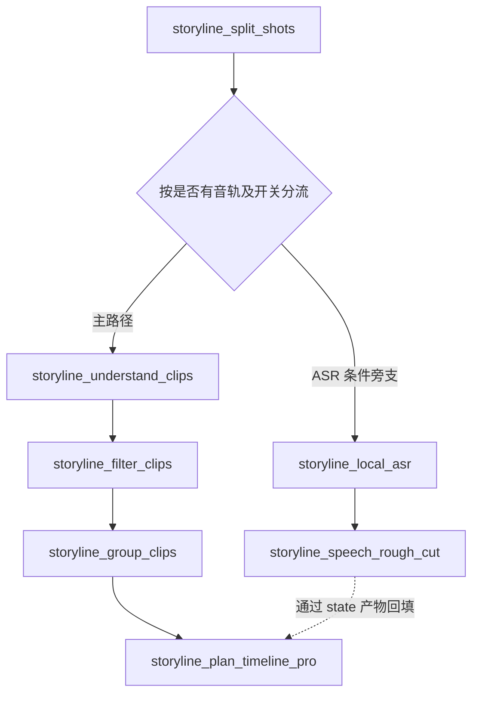
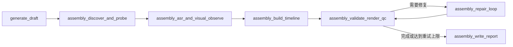
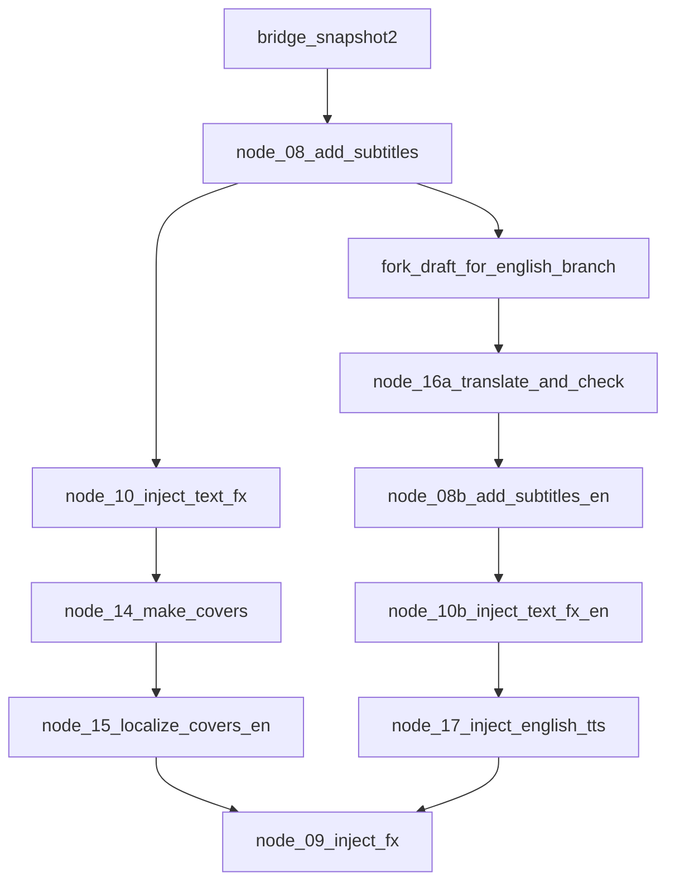
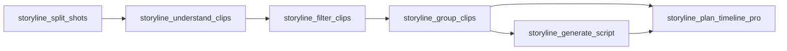
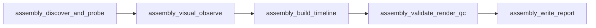
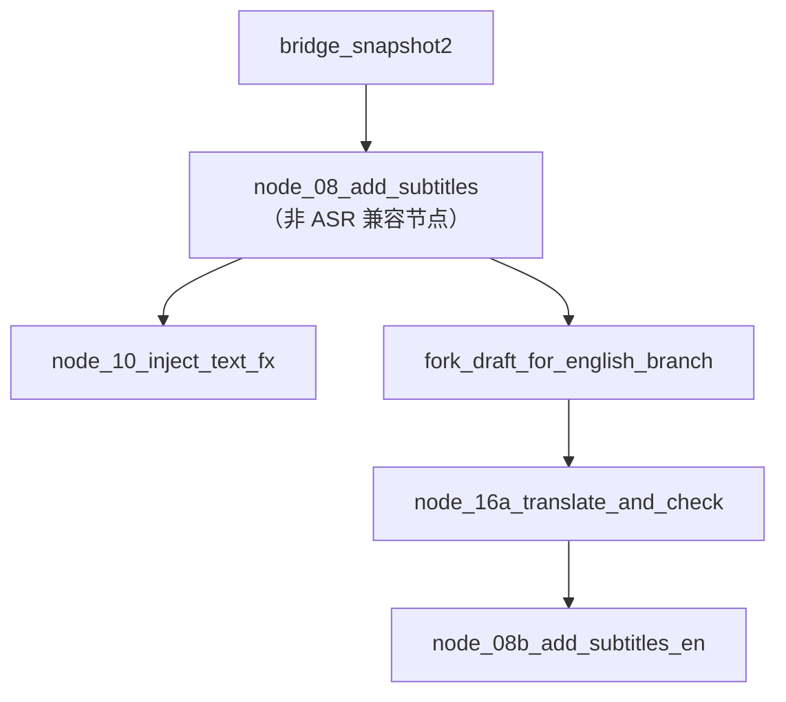

# B1 语音识别（ASR）移除设计与分阶段执行计划

| 项目 | 内容 |
|---|---|
| 项目 | `wayyet/auto-video-editor` |
| 分支 | `main` |
| 源码基线 | `175afec0f7dbca9478c34e0aab7e5591cb19043b` |
| 基线提交时间 | 2026-11-07 15:20:46 UTC（新加坡时间 2026-11-07 23:20:46） |
| 参考材料 | `相似功能节点分析与设计执行计划.md` |
| 文档日期 | 2026-11-08 |
| 分析方式 | 只读源码与工作流拓扑静态分析 |
| 验证状态 | 未修改仓库代码；未运行 pytest、LangGraph 工作流或剪映客户端 |

> **本计划的目标**：彻底移除 B1 组中的 ASR 识别实现及其专属旁支，同时保留字幕主干、素材视觉观察、时间线构建、上下游分支和人工关卡等非 ASR 能力。本文是设计与执行计划，不代表代码已经修改或测试已经通过。

---

## 0. 结论

### 0.1 执行结论

B1 组在参考文档中列出四个节点：

1. `node_08_add_subtitles`：字幕节点内部调用 ASR。
2. `storyline_local_asr`：storyline 本地 ASR 节点。
3. `storyline_speech_rough_cut`：ASR 下游的口播粗剪节点，本身不是 ASR 识别器。
4. `assembly_asr_and_visual_observe`：外部转写透传与视频抽帧观察复合节点。

这四个节点不能简单地全部从图中删除：第 1 个节点还处于字幕主干上，其上下游分别连接中文字幕处理和英文分支；第 4 个节点还承担视频抽帧、contact sheet 生成等视觉观察职责。直接删除整个复合节点会连带移除非 ASR 功能。

因此本计划采用**删除 ASR 职责、保留非 ASR 职责**的方式：

| 当前节点 | 处理方式 | 修改后职责 / 拓扑 |
|---|---|---|
| `node_08_add_subtitles` | 保留图节点接口；删除 ASR 调用、ASR 时间映射和 ASR 字幕写入 | 作为无 ASR 的字幕主干兼容节点，保留原节点位置和后续两条分支；已有脚本字幕不得被空列表覆盖 |
| `storyline_local_asr` | 从图中删除，删除节点实现及专属能力层 | 不再从 `storyline_split_shots` 发起 ASR 并行旁支 |
| `storyline_speech_rough_cut` | 从图中删除，删除节点实现及专属能力层 | ASR 口播粗剪链整体移除，不再向 `Clip.transcript` 回填语音文本 |
| `assembly_asr_and_visual_observe` | 拆分并改名为 `assembly_visual_observe` | 只保留视频抽帧和 contact sheet 生成；从 ASR 复合节点变为视觉观察节点 |

**最终效果**：B1 ASR 不再存在可执行的识别器、转写旁支、外部转写透传入口或 ASR 驱动的口播粗剪；工作流的非 ASR 主链继续运行。

### 0.2 必须接受的功能变化

移除 ASR 后，以下行为会停止，这是预期的产品行为变化，不应通过伪造空转写结果掩盖：

- 不再对源视频自动识别语音并生成逐句中文字幕。
- 不再生成 `storyline_asr_artifact`、`storyline_rough_cut_artifact` 或 `assembly_transcript_artifact`。
- 不再执行基于 ASR 的 `Clip.transcript` 回填。
- 不再把外部 transcript 文件或 inline text 传入 assembly 视觉观察作为语音文本上下文。
- `node_16a_translate_and_check` 没有中文字幕 ASR 段时，应按“无翻译源字幕”的预期情况跳过；`node_08b_add_subtitles_en` 也应安全跳过空英文字幕，不得阻塞后续节点。

storyline 时间线中由脚本/旁白生成的字幕内容与本次 ASR 识别是两条不同的数据来源。本次不删除 `storyline` 脚本生成能力，也不删除 mapper 对脚本字幕的处理。应确保移除 ASR 后，不会用空的 `materials.texts` 或空 text track 覆盖已有脚本字幕。

### 0.3 本次不处理

- 不移除 TTS：`node_17_inject_english_tts`、`storyline_generate_voiceover` 保留。
- 不移除字幕翻译、字幕样式、字幕特效、封面、转场、贴纸、BGM、音量调整等非 ASR 能力。
- 不改变 storyline 素材加载、切镜、视觉理解、选段、脚本、时间线规划、QA 和渲染主链。
- 不改变 assembly 的媒体探测、视觉抽帧、时间线构建、渲染 QC、修复循环和报告。
- 不改变 `ASSEMBLY_QC_GATE_ENABLED` 的默认值及关闭时的直连行为。
- 不改变 LangGraph checkpointer、PostgreSQL、持久化模型或数据库结构。

---

## 1. 术语与设计约束

| 术语 | 含义 |
|---|---|
| ASR | Automatic Speech Recognition，自动语音识别，即把音视频中的语音转成文字和时间戳 |
| node | LangGraph 工作流图中的执行节点，通过 `add_node` 注册 |
| edge | 节点间的有向连接，决定执行顺序 |
| fan-out | 一个节点完成后并行触发多个下游节点 |
| fan-in | 多个上游节点都完成后才触发一个下游节点 |
| artifact | 节点生成并供其他节点读取的文件产物，通常通过 state 中的路径字段传递 |
| 兼容字段 | 为读取旧 checkpoint 或旧输入暂时保留，但新流程不再生成或消费的字段 |

执行必须遵循以下约束：

1. **先盘点引用，再删除文件**：任何能力模块、prompt、state 字段或工具文件，只有在全仓库确认无其他调用者后才允许删除。
2. **节点职责拆分，不连带删功能**：复合节点只剥离 ASR 相关逻辑，保留视觉观察、脚本字幕等独立能力。
3. **上下游契约明确**：所有被移除的 state 输出都要同步清理消费者；不能留下 import error、缺失字段异常或永远等待的 fan-in 屏障。
4. **不制造伪造数据**：不得生成 `Mock 字幕 N`、stub 空 ASR 文件或“成功”的假 transcript 来假装 ASR 仍在工作。
5. **旧 checkpoint 有明确策略**：删除/重命名节点会影响正在运行或暂停中的旧图任务，发布时应先处理存量任务，不能承诺旧图 checkpoint 自动兼容。
6. **静态分析不等于运行验证**：本文的拓扑结论来自源码静态检查，必须按第 8 节完成测试后才可验收。

---

## 2. 当前源码与工作流分析

### 2.1 当前主图关键拓扑

当前 `main` 分支的整体工作流包含 storyline 自动剪辑段、草稿生成、assembly QC、原流水线字幕与中英分支、尾链处理以及交付 QA。与本任务直接相关的拓扑如下。

**当前 storyline 段：**



源码依据：`graph.py` 中 `_asr_branch_enabled`、`_storyline_route_after_split_shots`、`storyline_split_shots` 的条件边，以及 `storyline_local_asr -> storyline_speech_rough_cut` 的连接。

**当前 assembly QC 段：**



**当前字幕主干：**



`node_08_add_subtitles` 是中英分支的共同前置节点。其职责目前混合了 ASR、中文字幕写入、字幕样式建议和草稿写回。不能仅因它被列入 B1 就直接删除整个节点，否则必须额外迁移节点职责并改动两条下游分支。

### 2.2 四个 B1 节点的真实职责

#### A. `node_08_add_subtitles`

- 文件：`nodes/node_08_add_subtitles.py`
- 函数：`add_subtitles`
- ASR 依赖：`jy_common.asr_client.call_asr2s`
- ASR 专属逻辑：
  - 单视频调用 `call_asr2s`。
  - 多视频通过 `_collect_source_spans`、`_map_asr_to_target`、`_multi_video_asr_segments` 把源视频识别时间映射到成片时间线。
  - 将识别结果写入 `materials.texts` 与 `state.asr_segments_zh`。
- 非 ASR 职责：
  - 读取草稿并执行节点级写回。
  - 调用 `subtitle_scout`，计算字幕样式建议。
  - 保持中文字幕主干节点位置，为中文线和英文线提供共同的执行入口。

**设计处理**：删除 ASR 调用、时间映射及 ASR 文本注入；保留节点 ID、图边与非 ASR 样式辅助能力。新逻辑必须避免 `sync_text_track(draft, [])` 这种空列表整轨替换，不能清空 storyline mapper 已经写入的脚本字幕。节点对 `asr_segments_zh` 的新输出应明确为空，或由 `node_16a` 按缺省空列表处理；建议暂时保留字段声明以兼容旧 state，但新流程不再产生识别段。

#### B. `storyline_local_asr`

- 文件：`nodes/storyline/node_local_asr.py`
- 函数：`storyline_local_asr_node`
- 能力层：`storyline_capabilities/asr_runner.py::transcribe_media`
- 当前默认模式：`STORYLINE_ASR_MODE=stub`，默认写出空 segments；当前源码不再提供可用的 vendored ASR 后端。
- 输出：`storyline_asr_artifact`。
- 入口：`storyline_split_shots` 的条件旁支，受 `STORYLINE_ENABLE_ASR_BRANCH` 和素材音轨判断控制。

**设计处理**：该节点没有独立于 ASR 的业务职责，整体从主图删除，包括注册、导入、条件路由、相关配置开关和专属能力层。

#### C. `storyline_speech_rough_cut`

- 文件：`nodes/storyline/node_speech_rough_cut.py`
- 函数：`storyline_speech_rough_cut_node`
- 能力层：`storyline_capabilities/speech_rough_cut.py::speech_rough_cut`
- 说明：它不是 ASR 识别器，而是依赖 ASR 句子的语音粗剪节点。
- 输入：`storyline_asr_artifact`。
- 输出：`storyline_rough_cut_artifact`。
- 下游消费：`storyline_plan_timeline_pro` 通过 `fill_clip_transcripts` 把粗剪或 ASR 文本回填到 `Clip.transcript`。

**设计处理**：该节点没有独立输入来源，移除 ASR 后已无法履行职责，因此随 ASR 旁支整体删除；同时清理 `storyline_plan_timeline_pro` 中读取 ASR/rough-cut 产物并回填 transcript 的代码。

#### D. `assembly_asr_and_visual_observe`

- 文件：`nodes/assembly/node_asr_and_visual_observe.py`
- 函数：`assembly_asr_and_visual_observe_node`
- ASR 能力：`assembly_capabilities/speech_asr.py::speech_transcribe`
- 非 ASR 能力：`assembly_capabilities.visual_observe.video_ingest`
- 当前 ASR 行为：只接受外部 `transcript_path` 或 `inline_text` 透传；本仓库没有在此节点中配置云端 ASR。未传外部 transcript 时会记录 ASR 未配置错误，但视觉抽帧仍可以继续。
- 输出：`assembly_transcript_artifact`（ASR 产物）和 `assembly_ingest_artifact`（视觉抽帧产物）。
- 下游：`assembly_build_timeline`。

**设计处理**：删除 transcript 输入、转写、转写合并及 `assembly_transcript_artifact` 输出；保留视频抽帧、contact sheet、`assembly_ingest_artifact`。节点文件/注册名改为 `nodes/assembly/node_visual_observe.py` / `assembly_visual_observe`，避免代码名称继续暗示 ASR。

### 2.3 下游依赖与安全退化

| 下游节点/能力 | 当前依赖 | 移除后的处理 |
|---|---|---|
| `node_10_inject_text_fx` | `node_08_add_subtitles` 完成后执行 | 保留原边；继续处理已有草稿内容 |
| `fork_draft_for_english_branch` | `node_08_add_subtitles` 完成后执行 | 保留原边；英文分支仍可建立 |
| `node_16a_translate_and_check` | 读取 `state.asr_segments_zh` | 无源字幕时作为预期跳过，不写错误日志、不阻断后续路由 |
| `node_08b_add_subtitles_en` | 读取 `subtitle_segments_en` | 空列表时保留安全跳过；状态标记明确表示无翻译字幕输入 |
| `storyline_plan_timeline_pro` | 读取 `storyline_asr_artifact`、`storyline_rough_cut_artifact` | 移除 transcript 回填步骤；时间线规划本身照常执行 |
| `assembly_build_timeline` | 可选读取 `assembly_transcript_artifact` | 继续使用媒体探测和视觉抽帧信息；无 transcript 时构建纯视觉/媒体信息时间线 |
| `assembly_validate_render_qc` 及后续节点 | 依赖 `assembly_build_timeline` 产物 | 保持输入输出契约，不应感知 ASR 节点删除 |

注意：`node_16a_translate_and_check` 当前已通过 `state.get("asr_segments_zh") or []` 读取输入，并在空列表时提前返回；但当前提前返回仍把缺失源字幕记入 `error_log`。本次需把它改成正常的 `skipped_no_source_subtitles` 状态，而不是错误。

### 2.4 当前分支版本注意事项

参考文件的仓库基线是 `ca37c18`，文档头部仍以 `LangGraph + SqliteSaver` 描述项目。当前 `main` 的源码基线已经更新到 `175afec0f7dbca9478c34e0aab7e5591cb19043b`；`graph.py` 与 `config.py` 的现行实现说明运行时 checkpointer 已统一为 PostgreSQL，SQLite checkpoint 分支已删除。因此本次 ASR 清理不得按参考文档的旧数据库描述操作，也不应触碰当前 PostgreSQL checkpointer。

---

## 3. 目标设计

### 3.1 目标拓扑

**storyline：移除 ASR 并行旁支**



实际图中的其他文案、配音、BGM、转场、AI 转场与 QA fan-in 连接全部保持现状。本图只展示本次改动所在的主路径。

**assembly：保留视觉观察并去除 ASR**



修复循环 `assembly_validate_render_qc -> assembly_repair_loop -> assembly_validate_render_qc` 及原条件路由不变。

**原字幕主干：保留节点位置和两条下游边**



`node_08_add_subtitles` 不再进行语音转写，也不再生成 ASR 字幕。它只负责保持旧图的节点边界/状态约定，并保留经确认仍被其他节点使用的非 ASR 字幕样式辅助逻辑。已有脚本字幕必须原样保留。

### 3.2 边重接的明确规则

#### storyline 主图

删除以下内容：

- `g.add_node("storyline_local_asr", storyline_local_asr_node)`
- `g.add_node("storyline_speech_rough_cut", storyline_speech_rough_cut_node)`
- `_asr_branch_enabled` 函数及其配置依赖。
- `_storyline_route_after_split_shots` 中返回 `storyline_local_asr` 的分支。
- `storyline_split_shots -> storyline_local_asr` 条件边映射。
- `storyline_local_asr -> storyline_speech_rough_cut` 边。

改为一条确定性主边：

```python
g.add_edge("storyline_split_shots", "storyline_understand_clips")
```

这样无论素材是否带音轨，切镜完成后都进入 `storyline_understand_clips`。不会因为删除条件分支而遗漏主路径，也不会建立多余的 fan-in 屏障。

#### assembly QC 图

将原复合节点替换为纯视觉节点，并让上下游继续相连：

```python
g.add_edge("assembly_discover_and_probe", "assembly_visual_observe")
g.add_edge("assembly_visual_observe", "assembly_build_timeline")
```

不得遗留 `assembly_discover_and_probe -> assembly_asr_and_visual_observe` 或 `assembly_asr_and_visual_observe -> assembly_build_timeline` 的旧边。

#### node 08 字幕主干

保留以下原连接，不需要重新绕过主干节点：

```python
g.add_edge("bridge_snapshot2", "node_08_add_subtitles")
g.add_edge("node_08_add_subtitles", "node_10_inject_text_fx")
g.add_edge("node_08_add_subtitles", "fork_draft_for_english_branch")
```

其要点是：删除节点内部的 ASR 职责，而不是删除字幕主干节点及其中文、英文两条后继边。

### 3.3 state 字段设计

| 字段 | 处理建议 | 原因 |
|---|---|---|
| `asr_segments_zh` | 暂时保留为兼容字段；新流程置空或缺省 | `node_16a_translate_and_check` 目前读取该键；避免 TypedDict/state 交接出现不兼容 |
| `asr_segments_zh_written` | 暂时保留为兼容字段；新流程不再标记为已写入 | 旧 checkpoint 可能含此字段，但新流程不再产出 ASR |
| `storyline_asr_artifact` | 删除新流程读写；可短期保留为 deprecated/NotRequired | 旧 checkpoint 兼容；新图不再产生此产物 |
| `storyline_rough_cut_artifact` | 删除新流程读写；可短期保留为 deprecated/NotRequired | 随粗剪旁支一起移除 |
| `assembly_transcript_artifact` | 删除新流程读写；可短期保留为 deprecated/NotRequired | assembly 不再生成 transcript |
| `assembly_ingest_artifact` | 保留 | 视觉观察节点仍然生成，`assembly_build_timeline` 仍需要 |

清理 state 时先全仓检索读写点。若旧 checkpoint 兼容要求尚未确认，不要直接从 `WorkflowState` 移除字段；优先停止新写入、移除新消费者，并注明 deprecated。完成存量任务迁移/过期后，再单独提交字段删除。

### 3.4 节点 08 的无 ASR 行为

`node_08_add_subtitles` 必须满足：

1. 不导入、不调用 `jy_common.asr_client`。
2. 删除 `_collect_source_spans`、`_map_asr_to_target`、`_multi_video_asr_segments` 等 ASR 时间映射函数。
3. 不调用 ASR，不写出 `Mock 字幕 N`，不生成空 `asr.json`。
4. 不把空 `materials.texts` 传入 `sync_text_track` 做整轨替换。
5. 不删除/覆盖 mapper 之前写入的脚本字幕轨道或其他已有文本素材。
6. 保留图节点执行结果及 status 标记；保留仍被英文字幕节点复用的样式辅助函数，若将样式逻辑拆出文件，应同步修改其 import。
7. `asr_segments_zh` 对新任务必须为空/缺省，`node_16a_translate_and_check` 应按无源字幕的正常场景跳过。

### 3.5 assembly 视觉观察节点行为

新节点 `assembly_visual_observe_node`：

- 输入继续使用 `video_input_path` / `video_input_paths` 和 `assembly_media_artifact`。
- 仅调用 `video_ingest`，不再创建 `RunContext` 后调用 `speech_transcribe`。
- 单视频仍产出 `assembly/video_ingest.json`；多视频仍逐个执行并合并 `sheet_paths`、`frame_paths`、`per_source`。
- 继续返回 `assembly_ingest_artifact` 与正常 status tag。
- 不再返回 `assembly_transcript_artifact`，不创建 `transcript.json` / `transcript_<i>.json`。
- 视频不存在、media artifact 缺失、抽帧失败时，继续沿用原有错误码和 fail-fast/软降级策略，不允许 ASR 移除改变视觉观察失败语义。

`assembly_build_timeline` 继续以 `assembly_media_artifact` 和 `assembly_ingest_artifact` 构建时间线。移除其对 `assembly_transcript_artifact` 的读取，并同步调整 `build_timeline_from_paths` 的 transcript 入参/提示词逻辑；如果静态搜索发现该能力函数仍被其他非 B1 业务使用，则保留其通用可选接口，但主图不得再传入 ASR 产物。

---

## 4. 文件级修改清单

> 下表是根据当前 `main` 静态分析形成的预期修改清单。阶段 0 的全仓引用扫描可能发现额外调用点；删除前必须验证引用关系，不以文件名作为唯一依据。

### 4.1 图与节点代码

| 文件 | 操作 | 关键内容 |
|---|---|---|
| `graph.py` | 修改 | 删除 ASR 导入、条件路由函数、节点注册与边；storyline 切镜后直接进入理解节点；assembly 链改接 `assembly_visual_observe`；更新文件顶部拓扑注释 |
| `nodes/node_08_add_subtitles.py` | 修改 | 去掉 ASR client import、ASR 相关时间映射 helper 和 ASR 调用；禁止空文本整轨替换；保留安全的节点状态和非 ASR 字幕样式代码 |
| `nodes/storyline/node_local_asr.py` | 删除 | 移除 `storyline_local_asr_node` |
| `nodes/storyline/node_speech_rough_cut.py` | 删除 | 移除 ASR 粗剪节点 |
| `nodes/assembly/node_asr_and_visual_observe.py` | 删除/迁移 | 将可保留的视觉逻辑迁移到新文件；不保留 ASR 逻辑 |
| `nodes/assembly/node_visual_observe.py` | 新增 | 只保留视频抽帧和 contact sheet 逻辑，输出 `assembly_ingest_artifact` |
| `nodes/assembly/__init__.py` | 修改 | 删除旧节点 export，新增 `assembly_visual_observe_node` export |
| `nodes/storyline/node_plan_timeline_pro.py` | 修改 | 移除 `fill_clip_transcripts` import、ASR/rough-cut artifact 读取和 `Clip.transcript` 回填异常处理；保留正常时间线规划 |
| `nodes/node_16a_translate_and_check.py` | 修改 | 将空 `asr_segments_zh` 从 error 改为预期 skip；确保返回值不会触发布局人工关卡或中断图执行 |
| `nodes/node_08b_add_subtitles_en.py` | 检查/小改 | 空 `subtitle_segments_en` 时作为预期 skip，不能抛异常；确保样式 helper 不再依赖被删除的 ASR 模块 |

### 4.2 ASR 能力层、工具和 Prompt

| 文件/目录 | 操作 | 备注 |
|---|---|---|
| `jy_common/asr_client.py` | 删除 | `MockASRClient`、`FireRedASR2SClient`、ASR backend 解析及 `call_asr2s` 入口；删除前确认全仓无其他调用方 |
| `storyline_capabilities/asr_runner.py` | 删除 | `ASRClient`、`StubASRClient`、`transcribe_media` 及 `STORYLINE_ASR_MODE` |
| `storyline_capabilities/speech_rough_cut.py` | 删除 | 只服务被删除的语音粗剪节点 |
| `assembly_capabilities/speech_asr.py` | 删除 | 外部 transcript 透传的 ASR 工具封装 |
| `storyline_capabilities/timeline_transcript.py` | 条件删除 | 先确认 `fill_clip_transcripts` 全仓没有其他消费者，再删除 |
| `assembly_capabilities/transcript.py` | 条件删除或拆分 | 先检查 `visual_observe.py`、`build_timeline.py` 和其他调用者；只删除 ASR 专用解析链，不删除仍被复用的通用文本处理函数 |
| `storyline_capabilities/prompts/speech_rough_cut/` | 删除 | 如果仅由 `speech_rough_cut.py` 使用，删除对应 prompt 目录 |
| `prompts/tasks/speech_rough_cut/` | 条件删除 | 确认旧目录不再被脚本或测试引用后清理 |

**依赖管理注意**：不要因为删除 `jy_common/asr_client.py` 就直接从依赖文件移除 `httpx`。`httpx` 可能还被其他 API、模型客户端或服务调用使用；只有在全仓引用确认无其他消费者时才可清理依赖。

### 4.3 配置、环境变量和 state

| 文件 | 操作 | 关键内容 |
|---|---|---|
| `config.py` | 修改 | 删除 `STORYLINE_ENABLE_ASR_BRANCH` 配置及对应注释；保留其他 storyline 开关 |
| `.env.example` | 修改 | 删除 `STORYLINE_ENABLE_ASR_BRANCH` 及已无效的 ASR 说明；检查是否还有 `ASR_BACKEND`、`STORYLINE_ASR_MODE`、`FIRERED_ASR_ENDPOINT` 等过期变量 |
| `state.py` | 修改 | 清理已无新读写者的 ASR state 字段；需要兼容旧 checkpoint 时先保留为 deprecated/NotRequired，不立即破坏性删除 |
| `nodes/storyline/_common.py` | 修改 | 若 `media_has_audio` 只被 ASR 条件路由使用，删除函数及 `__all__` 导出；先全仓检查其他调用者 |
| `assembly_capabilities/visual_observe.py` | 修改 | 移除 ASR transcript 输入链，或在确认仍有非 ASR 调用者时保留通用可选文本接口；纯视觉观察功能必须保持 |
| `assembly_capabilities/build_timeline.py` | 修改 | 主图不再读取 transcript；清理无其他使用者的 transcript 参数、提示词字段和 metadata 统计 |

### 4.4 测试与文档

| 文件 | 操作 | 关键内容 |
|---|---|---|
| `tests/unit/test_node_08_add_subtitles.py` | 重写相关测试 | 去除 ASR mock 依赖；增加无 ASR、不覆盖脚本字幕、节点正常返回等测试；保留仍有效的样式测试 |
| `tests/unit/test_asr_client_firered.py` | 删除 | 对应 ASR client 已移除 |
| `tests/unit/assembly_capabilities/test_speech_asr.py` | 删除 | 对应 speech_asr 已移除 |
| `tests/unit/assembly_capabilities/test_visual_observe.py` | 修改 | 移除 transcript/ASR 入参相关断言；保留抽帧、contact sheet、缓存和错误路径测试 |
| `tests/unit/nodes/test_assembly_nodes.py` | 修改 | 将 `assembly_asr_and_visual_observe_node` 测试改为 `assembly_visual_observe_node`；只断言视觉产物 |
| `tests/integration/test_workflow_graph_schema.py` | 修改 | assembly 节点集合改名；断言旧 ASR 节点不在图中、两条新边存在、主路径无断边 |
| storyline 相关图测试 | 修改 | 断言切镜后直连 `storyline_understand_clips`，图中不存在两个 ASR 旁支节点 |
| 相关项目设计文档 / README / env 文档 | 修改 | 清除已删除节点、开关、ASR backend 的现行使用说明；历史记录可保留但必须标注已废弃 |

---

## 5. 兼容性与风险控制

### 5.1 上下游不受影响的保证范围

| 验证对象 | 必须保持的行为 |
|---|---|
| `storyline_split_shots` | 切镜完成后无条件进入 `storyline_understand_clips` |
| `storyline_understand_clips` | 输入仍来自切镜产物，处理逻辑和输出字段不变 |
| `storyline_filter_clips`、`storyline_group_clips` | 顺序和输入契约不变 |
| storyline 文案、配音、BGM、转场、QA | 原 fan-out/fan-in 和路由不变；不加入 ASR 节点作为屏障依赖 |
| `node_08_add_subtitles` | 仍从 `bridge_snapshot2` 进入；执行后仍触发中文线和英文分支 |
| `node_10_inject_text_fx` | 仍从原字幕主干节点后执行 |
| `fork_draft_for_english_branch` | 仍能建立英文分支草稿，不依赖 ASR artifact |
| `node_16a_translate_and_check` | 无 ASR 段时正常 skip，不抛错、不阻断 `node_17` |
| assembly `assembly_discover_and_probe` | 输出仍供视觉观察节点读取 |
| assembly `assembly_visual_observe` | 保持单视频/多视频抽帧产物路径和 JSON 契约 |
| `assembly_build_timeline` | 允许没有 transcript，仅用媒体探测与视觉抽帧输入正常构建时间线 |
| assembly QC / repair / report | 输入输出字段、重试次数、条件边不变 |
| `ASSEMBLY_QC_GATE_ENABLED=false` | 仍为 `generate_draft -> node_06_human_reorder`，不受节点改名影响 |

### 5.2 主要风险与处理办法

| 风险 | 影响 | 处理办法 |
|---|---|---|
| 删除 `node_08_add_subtitles` 整个节点 | 中英分支的共同前置边断开，草稿文本处理可能变化 | 保留节点 ID 和位置，只删除 ASR 相关代码；不擅自绕过节点 |
| 空 `materials.texts` 覆盖 mapper 脚本字幕 | 中文字幕可能意外消失 | 无 ASR 段时不调用空列表整轨同步；增加“保留原字幕轨”回归测试 |
| `node_16a` 把空源字幕当错误 | error_log 出现误报，排障噪声 | 改为明确的正常跳过状态；确保条件路由默认进入 `node_17` |
| assembly 重命名后旧 import 未更新 | 图初始化时 `ImportError` 或节点注册失败 | 同步修改 `nodes/assembly/__init__.py`、`graph.py`、测试和 docs；全仓搜索旧节点名 |
| 删除 `transcript.py` 等共享工具过早 | 其他视觉/文本工具可能导入失败 | 先全仓查引用；只删已证实没有其他消费者的模块或函数 |
| 旧 checkpoint 仍停在待删除节点 | 旧任务可能不能从新图恢复 | 发布前完成/终止相关旧任务；变更后暂停任务按迁移策略处理，不承诺跨拓扑恢复 |
| 删除 ASR 环境变量但部署仍配置旧值 | 配置变成无效项，造成运维误解 | 同步清理 `.env` 模板、部署文档和启动脚本；旧环境变量应被忽略而非导致程序导入失败 |
| assembly 时间线失去 transcript 上下文 | LLM 选段缺少语音内容依据 | 明确接受本次功能边界；保留视觉抽帧与媒体探测输入，并对无 transcript 路径做回归测试 |

### 5.3 旧 checkpoint 处理

本次涉及 storyline 节点删除、assembly 节点改名。LangGraph checkpoint 会保存节点执行进度；图拓扑改变后，旧 checkpoint 可能仍指向旧节点任务。上线建议：

1. 发布前列出运行中、等待人工关卡、失败待恢复的 thread。
2. 尽可能让旧版本任务完成；对无法完成的任务，按现有业务策略明确终止或新建 thread。
3. 不要在新代码中保留空壳 `storyline_local_asr` 或 `storyline_speech_rough_cut` 仅为了“让旧任务看起来能恢复”；这会造成已删除功能仍可被调度的假象。
4. `state.py` 中 ASR 字段可作为短期兼容字段保留，但不得再有新节点写入 ASR 产物。
5. 如果必须恢复旧任务，应在独立迁移方案中定义 checkpoint 节点映射与 state 清理规则，不在本次 ASR 清理中隐式处理。

---

## 6. 分阶段执行开发任务

以下任务按依赖顺序执行。每个阶段必须通过本阶段验收，才能进入下一阶段。

### 阶段 0：基线冻结与全仓依赖盘点

**目标**：确认当前 `main` 实际调用关系，避免漏删或误删。

- [ ] 固定基线提交：`175afec0f7dbca9478c34e0aab7e5591cb19043b`。
- [ ] 本地拉取该提交并记录 `git status`，确保工作区没有未提交改动。
- [ ] 用 `rg` 搜索四个节点 ID、函数名、ASR API、state 字段、环境变量和 transcript 产物。
- [ ] 确认 `jy_common.asr_client`、`asr_runner`、`speech_rough_cut`、`speech_asr`、`timeline_transcript`、`assembly_capabilities.transcript` 的全部 import/call sites。
- [ ] 确认 `media_has_audio` 是否仅服务 ASR 条件路由。
- [ ] 确认 `visual_observe.py` 的 transcript 支持是否还有非 B1 调用者。
- [ ] 确认 node 08 样式辅助函数的消费者，特别是 `node_08b_add_subtitles_en`。
- [ ] 记录当前工作流编译图中的节点和边，作为修改前后 diff 基线。

**阶段验收**：得到完整文件/符号引用清单；没有任何删除项尚未确认调用者；形成修改前 graph topology 快照。

### 阶段 1：先补回归测试与状态契约

**目标**：先锁定“删除 ASR 后仍保持主链可执行”的验收行为。

- [ ] 更新 `tests/unit/test_node_08_add_subtitles.py`：移除测试对 `set_default_client`、FireRed、Mock ASR 的依赖。
- [ ] 增加 node 08 无 ASR 场景测试：节点可返回；不得产生 ASR 文件；不得写入伪字幕。
- [ ] 增加字幕保留测试：当输入草稿已有 mapper 脚本字幕或 text track 时，空 ASR 状态不能清空、覆盖或替换原字幕。
- [ ] 增加英文翻译无源字幕测试：`node_16a_translate_and_check` 正常 skip，无 `error_log` 误报，并允许图继续进入 `node_17`。
- [ ] 增加 `node_08b_add_subtitles_en` 空列表测试：只记录 skip 状态，不抛异常。
- [ ] 为新的 `assembly_visual_observe_node` 编写单视频、多视频、缺失视频、缺失 media artifact、抽帧工具失败测试。
- [ ] 更新图 schema 测试：明确断言被删除的 ASR 节点不再注册。

**阶段验收**：测试明确表达新的业务语义；在实现尚未完成时，相关新测试可以按预期失败，但测试本身必须可运行、可复现。

### 阶段 2：移除 storyline ASR 与口播粗剪旁支

**目标**：先移除不承担主线职责的独立 ASR 支路。

- [ ] 从 `graph.py` 删除 `storyline_local_asr_node` 和 `storyline_speech_rough_cut_node` imports。
- [ ] 删除 `_asr_branch_enabled`。
- [ ] 将 `_storyline_route_after_split_shots` 改为只返回 `storyline_understand_clips`，或直接用静态 `add_edge` 替代条件路由。
- [ ] 删除 `storyline_local_asr`、`storyline_speech_rough_cut` 两个 `add_node` 注册。
- [ ] 删除旧边：`storyline_split_shots -> storyline_local_asr` 条件分支、`storyline_local_asr -> storyline_speech_rough_cut`。
- [ ] 添加确定性边：`storyline_split_shots -> storyline_understand_clips`。
- [ ] 从 `config.py` 删除 `STORYLINE_ENABLE_ASR_BRANCH`；从 `.env.example` 删除同名变量及说明。
- [ ] 删除 `nodes/storyline/node_local_asr.py`、`nodes/storyline/node_speech_rough_cut.py`。
- [ ] 删除 `storyline_capabilities/asr_runner.py`、`storyline_capabilities/speech_rough_cut.py`，前提是阶段 0 已确认无其他调用者。
- [ ] 删除 `storyline_capabilities/timeline_transcript.py` 或仅移除其 ASR 回填函数，取决于阶段 0 的引用检查结果。
- [ ] 从 `node_plan_timeline_pro.py` 删除 `fill_clip_transcripts` import、ASR/rough-cut artifact 读取与 transcript 回填 try/except。
- [ ] 如 `media_has_audio` 无其他消费者，则从 `_common.py` 和 `__all__` 删除。
- [ ] 删除只供粗剪使用的 prompt 目录和对应测试。

**阶段验收**：图中切镜后只进入 `storyline_understand_clips`；storyline 主流程可完成 filter/group/script/timeline/QA；图中无 ASR 旁支节点、无粗剪节点、无 ASR 条件开关。

### 阶段 3：清理 node 08 的 ASR 实现，保护字幕主干

**目标**：删除 node 08 内部的 ASR 实现，但不改变中英分支入口。

- [ ] 从 `nodes/node_08_add_subtitles.py` 删除 `call_asr2s` import。
- [ ] 删除 `_collect_source_spans`、`_map_asr_to_target`、`_multi_video_asr_segments`。
- [ ] 删除单视频/多视频 ASR 调用逻辑及 ASR 段到 `materials.texts` 的循环注入。
- [ ] 删除 ASR 专属输出写入；新任务的 `asr_segments_zh` 应为空/缺省，不能继续返回上次任务残留的旧数据。
- [ ] 对空输入不调用 `sync_text_track(draft, [])`；不使用空 `materials.texts` 覆盖原有脚本字幕轨道。
- [ ] 保留并测试 `subtitle_scout`、`_style_from_scout` 等仍被 node 08b 使用的非 ASR 样式逻辑；如需迁移到独立 helper，保证 import 路径同步更新。
- [ ] 保留 `node_08_add_subtitles` 的图节点注册名和原上下游边，减少图拓扑改动。
- [ ] 将 `node_16a_translate_and_check` 对空 `asr_segments_zh` 的处理改成正常跳过状态。
- [ ] 检查 `node_08b_add_subtitles_en` 在没有 `subtitle_segments_en` 时仍可向后续节点正常放行。
- [ ] 删除 `jy_common/asr_client.py` 和 `tests/unit/test_asr_client_firered.py`，前提是全仓无其他客户端调用者。

**阶段验收**：运行 node 08 时没有任何 ASR 调用或伪字幕；原脚本字幕不被清空；node 08 之后中文线与英文线都能触发；英文翻译空输入时不阻塞。

### 阶段 4：assembly 节点拆分为纯视觉观察

**目标**：移除 assembly 转写透传，同时保留媒体观察和时间线构建。

- [ ] 新建 `nodes/assembly/node_visual_observe.py`，迁移并精简原节点中的视频路径解析、`video_ingest` 调用、多视频合并、错误处理和 state 输出。
- [ ] 新节点只输出 `assembly_ingest_artifact` 与 status/error 字段；不再返回 `assembly_transcript_artifact`。
- [ ] 删除 `speech_transcribe`、`ToolResult` 中仅供 ASR 的引用、transcript 文件生成与 `_merge_transcripts`。
- [ ] 在 `nodes/assembly/__init__.py` 导出 `assembly_visual_observe_node`，移除旧 export。
- [ ] 在 `graph.py` 中将节点注册名改为 `assembly_visual_observe`。
- [ ] 将上下游两条边重接为 `assembly_discover_and_probe -> assembly_visual_observe -> assembly_build_timeline`。
- [ ] 从 `assembly_build_timeline_node` 移除 `assembly_transcript_artifact` 读取和传参。
- [ ] 检查 `assembly_capabilities/build_timeline.py`，移除无其他使用者的 transcript 入参、文本上下文拼接和 `transcript_chars` 专属 metadata；保留纯媒体/视觉构建路径。
- [ ] 清除 `assembly_capabilities/speech_asr.py` 和其专属测试。
- [ ] 按引用扫描结果清理 `assembly_capabilities/transcript.py` 及 `visual_observe.py` 中的 transcript 解析支持；保留抽帧、contact sheet、缓存、视频元数据和 ffmpeg 逻辑。
- [ ] 更新 `tests/unit/nodes/test_assembly_nodes.py`、`tests/unit/assembly_capabilities/test_visual_observe.py` 和 graph schema tests。

**阶段验收**：`assembly_visual_observe` 在不提供 transcript 的情况下，单视频和多视频均生成视觉产物；`assembly_build_timeline` 能在 `transcript_artifact=None` 时正常运行；QC、repair、report 后继链路不变。

### 阶段 5：全仓清理、状态兼容与文档更新

**目标**：清除孤立代码、旧配置和过期文档，确保仓库没有遗留的可执行 ASR 入口。

- [ ] 全仓搜索 ASR 节点 ID、函数名、能力层模块名、`call_asr2s`、`speech_transcribe`、`STORYLINE_ENABLE_ASR_BRANCH` 等关键字。
- [ ] 清除 `state.py` 中不再被任何新代码使用的字段；需要兼容旧 checkpoint 的字段标记 deprecated/NotRequired。
- [ ] 检查 `.env.example`、实际部署 env 模板、PowerShell 启动脚本、Docker/Compose、CI 工作流是否仍设置已移除 ASR 变量。
- [ ] 检查 README、节点图、工作流 JSON、设计文档和开发说明中是否还描述 ASR 分支或节点。
- [ ] 更新 `web/node_map/workflow.json`（若它是当前节点图的实际 UI 数据源）和对应节点图展示；确认不会继续展示已删除节点。
- [ ] 检查是否有测试或工具脚本依赖 ASR 模块；删除过期测试，补充新的负向断言。
- [ ] 确认 `httpx` 等通用依赖仍被谁使用，不要误删其他服务的共享依赖。

**阶段验收**：生产代码中不再有 ASR 模块调用入口、ASR 节点注册或 ASR 条件开关；文档和图示与现行拓扑一致；无悬空 import。

### 阶段 6：回归测试、运行验证与发布

**目标**：证明上下游连续、核心功能未回归，并按旧 checkpoint 策略发布。

- [ ] 运行受影响单元测试。
- [ ] 运行工作流 graph schema / compile 测试。
- [ ] 运行完整测试套件。
- [ ] 使用 `ASSEMBLY_QC_GATE_ENABLED=true` 编译图，检查 assembly 新链路。
- [ ] 使用 `ASSEMBLY_QC_GATE_ENABLED=false` 编译图，确认原应急关闭路径不变。
- [ ] 使用带音轨和无音轨素材各执行一次 storyline 流程，确认两者都从 `storyline_split_shots` 进入 `storyline_understand_clips`。
- [ ] 使用单视频和多视频执行 assembly，确认抽帧、contact sheet、`assembly_ingest_artifact` 与 timeline 产物有效。
- [ ] 检查无 ASR 结果时，`node_16a`、`node_08b` 只跳过字幕翻译/写入，不影响 TTS、尾链和交付 QA。
- [ ] 检查 storyline mapper 生成的脚本字幕在 node 08 后仍存在，未被空列表清空。
- [ ] 处理旧 checkpoint：完成旧版本任务或显式终止；确认新任务不再访问旧 ASR 节点。
- [ ] 记录测试命令、通过/失败数量、失败原因、执行环境和最终 commit SHA。

**阶段验收**：完整测试通过；两条主链边连续；中英分支、视觉抽帧、时间线、QC 和交付链路无回归；不再出现 ASR 网络调用或假转写产物。

---

## 7. 测试设计与验收标准

### 7.1 静态检查

在仓库根目录执行：

```bash
rg -n "storyline_local_asr|storyline_speech_rough_cut|assembly_asr_and_visual_observe|call_asr2s|speech_transcribe|STORYLINE_ENABLE_ASR_BRANCH|STORYLINE_ASR_MODE|ASR_BACKEND|FIRERED_ASR_ENDPOINT" \
  --glob "*.py" --glob "*.toml" --glob "*.yaml" --glob "*.yml" --glob "*.env*" .
```

预期：生产代码和当前配置中不存在可执行 ASR import、节点注册和 ASR 开关。测试中的负向断言、历史文档中的迁移记录可以保留，但必须可识别为历史/测试内容。

再执行：

```bash
rg -n "storyline_asr_artifact|storyline_rough_cut_artifact|assembly_transcript_artifact|asr_segments_zh|transcript_artifact" \
  --glob "*.py" --glob "!tests/**" .
```

预期：只剩下明确的旧 state 兼容字段或仍有正当用途的通用 transcript API；每一处保留都必须有注释和消费者说明。

### 7.2 受影响测试

下面命令以当前路径为基础。删除 ASR 测试文件后，不应再把已删除文件名放进 pytest 命令：

```bash
python -m pytest -q \
  tests/unit/test_node_08_add_subtitles.py \
  tests/unit/assembly_capabilities/test_visual_observe.py \
  tests/unit/nodes/test_assembly_nodes.py \
  tests/integration/test_workflow_graph_schema.py
```

若 storyline 图测试位于其他路径，应将阶段 0 找出的实际测试路径追加到命令，不得假定不存在的测试文件。

完整回归：

```bash
python -m pytest -q
```

### 7.3 LangGraph 图结构验收

必须断言：

- 图中存在 `storyline_split_shots`、`storyline_understand_clips`。
- `storyline_split_shots -> storyline_understand_clips` 存在。
- 图中不存在 `storyline_local_asr`、`storyline_speech_rough_cut`。
- 图中存在 `assembly_discover_and_probe`、`assembly_visual_observe`、`assembly_build_timeline`。
- `assembly_discover_and_probe -> assembly_visual_observe` 存在。
- `assembly_visual_observe -> assembly_build_timeline` 存在。
- 图中不存在 `assembly_asr_and_visual_observe`。
- `node_08_add_subtitles` 仍存在，并且其后继仍包含 `node_10_inject_text_fx` 和 `fork_draft_for_english_branch`。
- `node_08_add_subtitles` 后的英文分支仍可到达 `node_16a_translate_and_check`、`node_08b_add_subtitles_en` 和 `node_17_inject_english_tts`。
- assembly QC 条件路由、repair 回路、`ASSEMBLY_QC_GATE_ENABLED=false` 的应急边均保持。

### 7.4 行为验收

| 场景 | 预期结果 |
|---|---|
| 视频有音轨 | 不触发 ASR；storyline 进入视觉理解主链 |
| 视频无音轨 | 同样进入视觉理解主链，不再因音轨条件改变图拓扑 |
| node 08 收到空 ASR 输入 | 不调用 ASR，不生成假字幕，不清空原脚本字幕 |
| node 16a 没有中文字幕源段 | 正常 skip，不写 error，不阻断英文分支后续 |
| node 08b 没有英文翻译段 | 正常 skip，不写空字幕轨，不阻断 TTS 和尾链 |
| assembly 无外部 transcript | 视觉抽帧照常完成，不产生 ASR 未配置错误 |
| assembly 多视频输入 | 每个源视频均生成视觉产物，合并结构与下游输入约定保持 |
| assembly 无 transcript 构建时间线 | 仅依赖媒体与视觉产物，timeline/QC 后续正常 |
| assembly QC 开关关闭 | 不进入 assembly 链，原有直连路径不变 |

---

## 8. 回滚方案

若阶段 6 出现图编译失败、分支断开、字幕丢失或 assembly 时间线构建失败：

1. 回滚本次 ASR 清理提交，不在生产环境临时补空壳节点或伪造转写产物。
2. 若已发布后运行过新图，标记新旧 checkpoint 所属版本；不要交叉使用不兼容的图拓扑恢复旧任务。
3. 优先恢复到本次基线 `175afec0f7dbca9478c34e0aab7e5591cb19043b`，再根据失败测试定位原因。
4. 若只出现 assembly transcript 缺失导致的时间线质量下降，但视觉 QC 与主链均可工作，应按产品决策确认是否接受“纯视觉 assembly”；不能未经确认重新引入 ASR。

---

## 9. 源码依据与参考材料

以下链接固定到本计划分析的 `main` 基线提交，避免后续 `main` 更新造成行号或内容漂移。

| 内容 | 源码 |
|---|---|
| 工作流节点注册、ASR 路由、storyline 边、assembly 边 | [graph.py](https://github.com/wayyet/auto-video-editor/blob/175afec0f7dbca9478c34e0aab7e5591cb19043b/graph.py) |
| node 08 ASR、字幕样式和草稿写入 | [nodes/node_08_add_subtitles.py](https://github.com/wayyet/auto-video-editor/blob/175afec0f7dbca9478c34e0aab7e5591cb19043b/nodes/node_08_add_subtitles.py) |
| storyline local ASR 节点 | [nodes/storyline/node_local_asr.py](https://github.com/wayyet/auto-video-editor/blob/175afec0f7dbca9478c34e0aab7e5591cb19043b/nodes/storyline/node_local_asr.py) |
| storyline speech rough cut 节点 | [nodes/storyline/node_speech_rough_cut.py](https://github.com/wayyet/auto-video-editor/blob/175afec0f7dbca9478c34e0aab7e5591cb19043b/nodes/storyline/node_speech_rough_cut.py) |
| storyline ASR capability | [storyline_capabilities/asr_runner.py](https://github.com/wayyet/auto-video-editor/blob/175afec0f7dbca9478c34e0aab7e5591cb19043b/storyline_capabilities/asr_runner.py) |
| storyline speech rough cut capability | [storyline_capabilities/speech_rough_cut.py](https://github.com/wayyet/auto-video-editor/blob/175afec0f7dbca9478c34e0aab7e5591cb19043b/storyline_capabilities/speech_rough_cut.py) |
| assembly ASR + visual observe 节点 | [nodes/assembly/node_asr_and_visual_observe.py](https://github.com/wayyet/auto-video-editor/blob/175afec0f7dbca9478c34e0aab7e5591cb19043b/nodes/assembly/node_asr_and_visual_observe.py) |
| assembly speech ASR capability | [assembly_capabilities/speech_asr.py](https://github.com/wayyet/auto-video-editor/blob/175afec0f7dbca9478c34e0aab7e5591cb19043b/assembly_capabilities/speech_asr.py) |
| assembly visual observe capability | [assembly_capabilities/visual_observe.py](https://github.com/wayyet/auto-video-editor/blob/175afec0f7dbca9478c34e0aab7e5591cb19043b/assembly_capabilities/visual_observe.py) |
| assembly timeline 构建 | [assembly_capabilities/build_timeline.py](https://github.com/wayyet/auto-video-editor/blob/175afec0f7dbca9478c34e0aab7e5591cb19043b/assembly_capabilities/build_timeline.py) |
| 英文翻译的空源字幕处理 | [nodes/node_16a_translate_and_check.py](https://github.com/wayyet/auto-video-editor/blob/175afec0f7dbca9478c34e0aab7e5591cb19043b/nodes/node_16a_translate_and_check.py) |
| 英文字幕写入 | [nodes/node_08b_add_subtitles_en.py](https://github.com/wayyet/auto-video-editor/blob/175afec0f7dbca9478c34e0aab7e5591cb19043b/nodes/node_08b_add_subtitles_en.py) |
| ASR backend 与 FireRed client | [jy_common/asr_client.py](https://github.com/wayyet/auto-video-editor/blob/175afec0f7dbca9478c34e0aab7e5591cb19043b/jy_common/asr_client.py) |
| ASR 分支配置 | [config.py](https://github.com/wayyet/auto-video-editor/blob/175afec0f7dbca9478c34e0aab7e5591cb19043b/config.py) / [.env.example](https://github.com/wayyet/auto-video-editor/blob/175afec0f7dbca9478c34e0aab7e5591cb19043b/.env.example) |
| Workflow state | [state.py](https://github.com/wayyet/auto-video-editor/blob/175afec0f7dbca9478c34e0aab7e5591cb19043b/state.py) |

**参考材料**：用户提供的 `相似功能节点分析与设计执行计划.md`，尤其是“B1 语音识别（ASR）”章节、四个节点职责对照表、ASR 三套实现比较和附录 A 节点文件映射。

---

## 10. 最终完成定义（Definition of Done）

只有同时满足以下条件，才能把本次工作标记为完成：

- [ ] 四个 B1 节点中的 ASR 相关职责与实现均已移除。
- [ ] storyline ASR 与 speech rough-cut 两个旁支不再注册、不再连边、不再产生 artifact。
- [ ] node 08 不再识别语音或注入 ASR 字幕，但仍保持原主干位置；已有脚本字幕不被覆盖。
- [ ] assembly 复合节点已替换为纯视觉观察节点，抽帧、contact sheet 和下游 timeline 继续工作。
- [ ] storyline 切镜主路径、字幕中英分支、assembly QC/repair/report 链均无断边。
- [ ] state、config、`.env.example`、测试、节点图和文档中不存在未处理的 ASR 残留引用。
- [ ] 受影响单测、图结构测试和完整 pytest 套件通过。
- [ ] 至少完成一次 storyline 带音轨素材、一次 storyline 无音轨素材、一次 assembly 单视频和一次 assembly 多视频运行验证。
- [ ] 旧 checkpoint 处理策略已经执行或书面确认。
- [ ] 最终提交说明记录实际删除/迁移文件、测试结果和提交 SHA。

