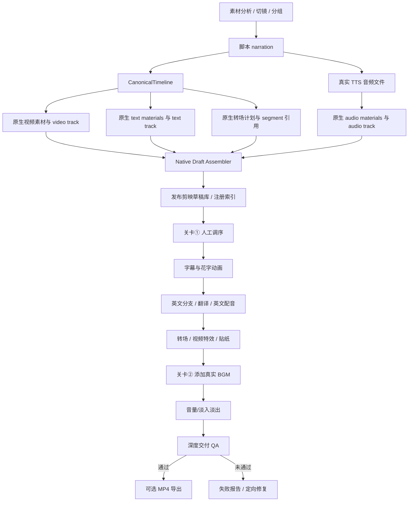
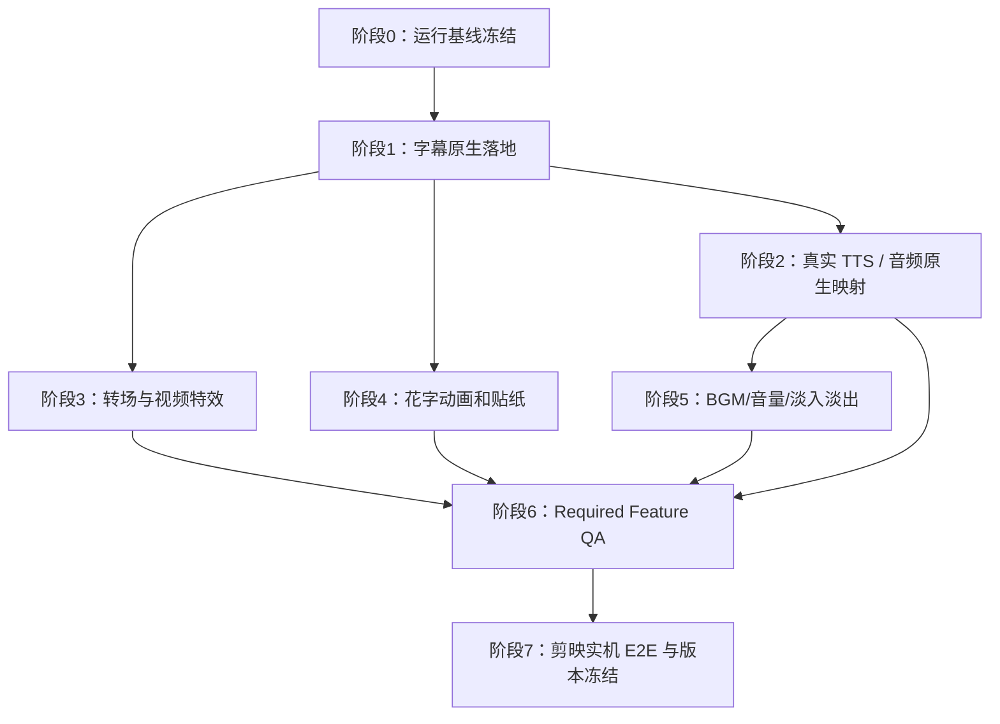

# auto-video-editor 剪映草稿效果缺失：根因分析、设计方案与分阶段执行计划

> 项目：[`wayyet/auto-video-editor`](https://github.com/wayyet/auto-video-editor)  
> 分支：`main`  
> 分析基线：`ca885e4f216116b4ea38672c8bd7b800764f90f5`（2026-11-08）  
> 截图 Thread：`console-d103e894da2b`  
> 截图状态：已完成 23、执行中 0、等待 1、失败 0；当前等待人工关卡①  
> 文档日期：2026-11-08  
> 文档性质：源码分析 + 运行状态证据判断 + 修复设计 + 分阶段开发计划

---

## 1. 执行摘要

### 1.1 核心结论

当前生成的剪映草稿并非完全没有经过自动化处理，而是**当前自动化链路主要能稳定形成视频片段时间轴，但文案、字幕、动画、转场、贴纸和配音等能力没有形成从“上游分析结果”到“剪映原生草稿对象”再到“可见播放效果”的完整闭环**。

问题不是简单地“节点没跑”，而是多个节点之间存在数据契约断裂：上游生成了计划或 artifact，下游节点没有把这些数据转换成剪映真正可识别、可渲染的原生素材和轨道；部分节点只写入了元数据或占位对象；部分节点在没有输入时静默跳过；最后的 QA 又没有把这些缺失作为阻断条件。

主要发现如下：

1. **截图对应的这次运行并没有跑完整条流程。** 当前图停在 `node_06_human_reorder`（人工调整镜头顺序①），后面的 `node_07`、字幕、双语分支、转场、贴纸、BGM、音量和交付 QA 尚未执行。
2. **Assembly QC 不是剪映特效合成节点。** `assembly_build_timeline` 生成的是独立的组装质检时间线，`assembly_write_report` 生成 Markdown 质检报告；这些产物不会自动合并进剪映草稿。
3. **中文字幕链路有明确断点。** `storyline/mapper.py` 会构造私有形状的 text track，但 `storyline/native_draft.py` 转原生格式时把 `type="text"` 轨道丢入 sidecar；与此同时，当前 `node_08_add_subtitles.py` 已按 B1 ASR 移除设计停止转写和注入字幕，中文草稿没有恢复字幕轨道。
4. **花字/动画依赖字幕素材。** `node_10_inject_text_fx` 只遍历 `materials.texts`，不负责创建字幕。如果 `materials.texts` 为空，节点即使执行并写出 `node_10_inject_text_fx_done`，也不会产生任何字幕动画。
5. **贴纸依赖字幕文本和有效资源 ID。** `node_11_inject_sticker` 根据 `materials.texts` 的内容匹配贴纸；当前 `templates/sticker_template.json` 仍标记 `_reverse_engineering_pending: true`，其中资源 ID 是 `PLACEHOLDER_*`，不能视为已验证的剪映资源。
6. **转场推荐与转场落地不是同一回事。** 上游 `storyline_recommend_transition` 生成的是推荐计划；`storyline_plan_timeline_pro` 把计划写入 CanonicalTimeline，但 `storyline/mapper.py` 未将 `transition_in/out` 转成剪映原生转场引用。`node_09_inject_fx` 另行按视频边界插入转场素材对象，且其数量依赖实际分镜边界、模板库和资源库；“推荐节点完成”不代表转场已在剪映时间轴上生效。
7. **配音默认可能是静音占位。** `TTS_BACKEND` 未设置为 `firered` 时，`install_tts_client_from_env()` 会回落 `StubTTSClient`；该实现生成的是按文字长度估算时长的静音 WAV。并且中文配音路径在 mapper 中传递的是 voiceover ID 映射 JSON，而不是可解析的 WAV 文件路径，不能据此证明配音已进入中文草稿。
8. **英文配音依赖英文字幕内容。** `node_17_inject_english_tts` 在 `subtitle_segments_en` 为空时直接返回 `empty_text`，不合成配音；当前 B1 ASR 移除后，`node_08` 不再产生新的中文 ASR 字幕，`node_16a` 对无源字幕正常 skip，英文线容易没有配音输入。
9. **BGM 选择结果不等于真实音频已写入草稿。** BGM 选择节点可能只得到 `bgm_ref` / `bgm_path` 元数据或 fallback；`native_draft.py` 只将可解析且本地存在的音频文件转换为原生音频素材。人工关卡②仍是实际添加 BGM 的主路径。
10. **音量淡入淡出字段尚未通过剪映实机逆向确认。** `node_13_adjust_volume.py` 将 `volume`、`fade_in_duration_us`、`fade_out_duration_us`、`track_id` 明确标为 placeholder/FIXME，写入 JSON 不代表剪映一定识别。
11. **交付 QA 会报告问题，但不会阻止工作流结束。** `join_before_delivery` 会将缺失转场、视频特效、贴纸等写入 `join_qa_issues` 和 `join_qa_report`，但图仍会继续到导出节点/END。导出默认关闭，草稿完成不能等同于 MP4 成片已生成。

### 1.2 对“节点结果是否保存到剪映草稿”的直接回答

需要区分三种保存位置：

- **工作流 artifact**：保存在 `outputs/<thread_id>/storyline/`、`outputs/<thread_id>/assembly/` 等任务产物目录，供后续节点或报告读取。
- **剪映草稿文件**：通过 `generate_draft` 写入 staging 草稿，再在 `JY_DRAFT_PUBLISH_ENABLED=true` 时发布到剪映草稿库；后续草稿节点通过 `draft_path` / `_draft_dir_override` 修改这份权威草稿。
- **剪映可见效果**：要求数据不仅写入 JSON，还必须具有剪映原生 schema、正确 material/track/segment 引用、有效资源 ID，并能在剪映客户端打开和播放。

**对截图中的 Thread `console-d103e894da2b`：** 可以判断上游 storyline 链、`generate_draft` 及 Assembly QC 已经走过，当前停在关卡①；后续字幕、转场、贴纸、BGM、音量、英文 TTS 节点还没有运行。因此，当前剪映草稿最多应被视为“初始视频时间轴草稿”，不能期待已经包含这些后续节点的效果。

**关于这次 Thread 的实际磁盘内容：** 本次分析读取了 GitHub `main` 源码和用户截图，但没有直接读取用户机器上的 `outputs/console-d103e894da2b`、PostgreSQL checkpoint 或剪映草稿目录。因此无法替代实机检查，逐项证明这一个 Thread 的 `draft_content.json` 当前具体有多少 texts/transitions/audios/stickers。本文会给出精确检查路径与命令；这部分属于必须在用户运行环境核验的证据。

### 1.3 开发优先级

| 优先级 | 工作项 | 原因 |
|---|---|---|
| P0 | 修复字幕从 CanonicalTimeline 到原生剪映 text material/track 的数据链 | 是文案、字幕动画、贴纸、英文翻译和配音的上游基础 |
| P0 | 建立真实 TTS 音频文件到原生音频轨的映射 | 解决静音 stub 和配音只停留在 artifact 的问题 |
| P0 | 让交付 QA 对用户要求的效果执行 fail-closed | 防止“流程成功”掩盖“效果缺失” |
| P1 | 修复转场计划到剪映原生转场对象/片段引用的映射 | 让推荐结果真正出现在时间轴上 |
| P1 | 贴纸资源 ID 实机逆向、替换占位资源 | 避免无效资源 ID |
| P1 | 逐项确认花字动画与剪映 schema 的对应关系 | 确认 JSON 已写入等于客户端可见 |
| P1 | 逆向并修正音量、淡入淡出字段 | 当前明确存在占位字段 |
| P2 | 将节点产物、草稿 SHA 和修改摘要纳入任务审计 | 可准确回答每个节点是否改动草稿 |
| P2 | 完成多素材、双语、人工关卡的剪映实机 E2E 验收 | 防止仅单元测试通过而 GUI 结果不正确 |

---

## 2. 分析范围、版本和证据边界

### 2.1 源码基线

本次分析以 `main` 分支 HEAD `ca885e4f216116b4ea38672c8bd7b800764f90f5` 为准。主要检查文件：

| 模块 | 文件 | 分析目的 |
|---|---|---|
| 图拓扑 | [`graph.py`](https://github.com/wayyet/auto-video-editor/blob/main/graph.py) | 节点注册、边、并行汇合、人工中断、结束条件 |
| 状态 | [`state.py`](https://github.com/wayyet/auto-video-editor/blob/main/state.py) | WorkflowState 字段和 reducer |
| 草稿生成 | [`nodes/node_05_generate_draft.py`](https://github.com/wayyet/auto-video-editor/blob/main/nodes/node_05_generate_draft.py) | 初始草稿生成、原生转换、发布、路径回填 |
| Canonical mapper | [`storyline/mapper.py`](https://github.com/wayyet/auto-video-editor/blob/main/storyline/mapper.py) | CanonicalTimeline 到内部草稿结构的映射 |
| 原生转换 | [`storyline/native_draft.py`](https://github.com/wayyet/auto-video-editor/blob/main/storyline/native_draft.py) | 内部草稿结构到剪映原生 schema 的转换 |
| 字幕 | [`nodes/node_08_add_subtitles.py`](https://github.com/wayyet/auto-video-editor/blob/main/nodes/node_08_add_subtitles.py) | 当前中文字幕行为及 B1 ASR 移除后的影响 |
| 转场/特效 | [`nodes/node_09_inject_fx.py`](https://github.com/wayyet/auto-video-editor/blob/main/nodes/node_09_inject_fx.py) | 转场和视频特效对象注入 |
| 花字/动画 | [`nodes/node_10_inject_text_fx.py`](https://github.com/wayyet/auto-video-editor/blob/main/nodes/node_10_inject_text_fx.py) | 字幕对象的描边、投影和入场动画 |
| 贴纸 | [`nodes/node_11_inject_sticker.py`](https://github.com/wayyet/auto-video-editor/blob/main/nodes/node_11_inject_sticker.py) | 贴纸素材和片段引用 |
| BGM | [`nodes/node_12_human_add_bgm.py`](https://github.com/wayyet/auto-video-editor/blob/main/nodes/node_12_human_add_bgm.py) | 人工添加 BGM 后镜像到英文草稿 |
| 音量 | [`nodes/node_13_adjust_volume.py`](https://github.com/wayyet/auto-video-editor/blob/main/nodes/node_13_adjust_volume.py) | 音量和淡入淡出字段 |
| 英文 TTS | [`nodes/node_17_inject_english_tts.py`](https://github.com/wayyet/auto-video-editor/blob/main/nodes/node_17_inject_english_tts.py) | 英文语音合成及写入英文草稿 |
| TTS 适配 | [`nodes/storyline/_tts_adapter.py`](https://github.com/wayyet/auto-video-editor/blob/main/nodes/storyline/_tts_adapter.py)、[`storyline_capabilities/tts_runner.py`](https://github.com/wayyet/auto-video-editor/blob/main/storyline_capabilities/tts_runner.py) | 真实 FireRed / 静音 Stub 的选择 |
| 交付 QA | [`nodes/node_join_before_delivery.py`](https://github.com/wayyet/auto-video-editor/blob/main/nodes/node_join_before_delivery.py) | 缺失效果检测与是否阻断 |
| 草稿发布 | [`draft_ops/draft_publisher.py`](https://github.com/wayyet/auto-video-editor/blob/main/draft_ops/draft_publisher.py)、[`draft_ops/jianying_registry.py`](https://github.com/wayyet/auto-video-editor/blob/main/draft_ops/jianying_registry.py) | 发布到剪映草稿库、注册索引、回读校验 |
| 配置 | [`config.py`](https://github.com/wayyet/auto-video-editor/blob/main/config.py) | 发布、TTS、导出及运行开关 |
| 历史实机记录 | [`阶段5端到端验收记录`](https://github.com/wayyet/auto-video-editor/blob/main/docs/第二期开发/auto-video-editor_人工关卡与剪映草稿导入_阶段5_端到端验收记录_20261107.md) | 以往剪映导入、空时间轴、切镜与实机验收情况 |

### 2.2 证据分类

- **源码已确认**：可以从当前 `main` 的节点代码、图边和配置直接得出。
- **仓库历史记录**：来自历史诊断或实机记录，只能说明对应历史 Thread/日期，不能自动套用到当前 Thread。
- **当前运行待实机确认**：需要读取这次运行目录、PostgreSQL checkpoint 或实际剪映草稿 JSON。
- **剪映客户端可见性**：只有真实剪映版本打开、保存、重开和播放验证才算完成，单元测试不能替代。

特别说明：2026-11-06 阶段0诊断中“没有发布到剪映草稿库”的结论是旧实现状态；当前 `main` 已增加 `draft_publisher`，且 `JY_DRAFT_PUBLISH_ENABLED` 默认 `true`。不能继续把历史阶段0结论当成当前代码现状。

---

## 3. 截图状态分析：当前并未跑完整条流程

### 3.1 截图可直接确认的状态

| 截图元素 | 可确认结论 |
|---|---|
| Thread `console-d103e894da2b` | 本次运行 ID |
| `等待人工操作 · #2089` | LangGraph 正在等待人工恢复，不是正常运行态 |
| `完成 23` | 监控计数显示已完成 23 个节点/步骤事件；不能据此理解为整个业务交付完成 |
| `执行中 0` | 当前没有正在运行的节点 |
| `等待 1` | 至少有一个人工等待项 |
| `写 QC 报告` 绿色 | Assembly QC 报告节点已完成 |
| `人工调整镜头顺序①` 橙色 | 当前停在关卡①，对应 `node_06_human_reorder` |
| `时长适配(35s)` 灰色 | `node_07_speed_fit` 尚未执行 |

### 3.2 本次运行当前所处阶段


### 3.3 对当前草稿的合理预期

关卡①位于初始草稿生成和 QC 报告完成之后，后续 `node_07` 到 `node_18` 尚未执行。因此此时：

- 应能看到初始视频片段时间轴（前提是本次 `generate_draft` 生成及发布成功）。
- 不应期待节点09创建的转场和视频特效已经出现。
- 不应期待节点11贴纸已经出现。
- 不应期待关卡②人工添加的 BGM 已写入。
- 不应期待 node13 音量调整已经发生。
- 字幕是例外：当前初始 mapper/native 转换存在字幕丢失问题，即使上游 script 产物存在，也不能据此认为剪映草稿含有字幕。

关卡①正确操作方式：在剪映打开对应草稿，调整视频片段顺序，保存并关闭剪映，再回到创建台确认恢复。`config.py` 当前默认 `JY_RESUME_REQUIRE_CLOSED=true`，恢复前应确保剪映已关闭，避免人工编辑与后续工作流写入发生竞争。

---

## 4. 当前完整工作流与草稿数据路径

### 4.1 LangGraph 主流程

当前 `graph.py` 已经是 `auto-only` 单流水线，旧 OpenStoryline Web/chat runtime 已在 2026-11-04 架构收敛中移除。与本问题相关的核心路径如下：

1. `storyline_load_media` 读取素材并建立媒体 artifact。
2. `storyline_split_shots` 切分镜头；后续理解、过滤、分组。
3. `storyline_generate_script` 生成分组文案。
4. 文案后并行执行脚本模板推荐、配音生成、BGM 选择、字幕样式推荐；另有转场推荐。
5. `storyline_plan_timeline_pro` 将镜头、时长、音频引用、字幕文本、转场计划及样式计划合成为 CanonicalTimeline。
6. `storyline_qa_gate` 校验和必要时重试；`storyline_join` 将产物整理进 WorkflowState。
7. `generate_draft` 将 CanonicalTimeline 映射成草稿结构，转换成剪映原生格式并写文件。
8. 默认开启 Assembly QC（`ASSEMBLY_QC_GATE_ENABLED=true`），生成 QC 时间线、预览、质量报告和 Markdown 报告。
9. `node_06_human_reorder` 进入人工关卡①。
10. 恢复后才执行时长适配、字幕/中英文支路、转场、贴纸、人工 BGM、音量和交付 QA。
11. `node_18_export_video` 由 `AUTO_VIDEO_EDITOR_FINAL_EXPORT_ENABLED` 控制，默认关闭。

### 4.2 三种产物并非同一个东西

| 类型 | 常见位置/状态字段 | 主要用途 | 是否自动等于剪映时间轴效果 |
|---|---|---|---|
| Storyline artifact | `outputs/<thread_id>/storyline/`；如媒体、分镜、脚本、配音、时间线 JSON | 保存上游分析和规划结果，供后续节点读取 | 否 |
| Assembly QC artifact | `outputs/<thread_id>/assembly/`；`timeline.json`、校验报告、预览、`report.md` | 质量检查、画面分析和人工复核 | 否 |
| Jianying draft | staging 的 `draft_content.json` / `draft_info.json`，或正式草稿库 `AutoVideo_<thread_id>` | 剪映客户端实际打开和编辑的数据 | 只有原生 schema、素材和轨道引用有效时才是 |

`assembly_build_timeline` 与 `storyline_plan_timeline_pro` 是两条职责不同的时间线链路。Assembly QC 的 `timeline.json` 不会因为生成成功就覆盖或更新 `draft_content.json`。`assembly_write_report` 只生成报告，不是合成、转场或动画节点。

### 4.3 草稿生成与发布的当前实现

当前 `node_05_generate_draft.py` 做以下动作：

1. 优先读取 `state.storyline_plan`，调用 `_build_from_canonical()` / `canonical_to_draft()`；兼容旧 `shot_plan` 路径。
2. 对 `storyline_plan.clips` 为空执行 fail-closed，拒绝发布空时间轴。
3. 调 `storyline_to_native()` 做剪映原生格式转换。
4. 使用 `safe_write_draft` 向 staging 目录双写 `draft_content.json` 和 `draft_info.json`。
5. 默认开启发布时调用 `publish_draft()`，发布到 `JIANYING_DRAFT_ROOT/AutoVideo_<thread_id>`，维护 `draft_meta_info.json` 和根目录 `root_meta_info.json`，发布后回读验证。
6. 发布成功后把 `state.draft_path` 指向正式草稿，并设置 `_draft_dir_override`；后续节点应继续修改同一权威草稿。

默认配置：

```text
JY_DRAFT_PUBLISH_ENABLED=true
JY_PUBLISH_FAIL_ON_JIANYING_RUNNING=true
JY_WRITE_FAIL_ON_JIANYING_RUNNING=true
JY_RESUME_REQUIRE_CLOSED=true
```

如果剪映进程正在运行，默认发布和工作流写入门禁可能拒绝写入。`node_05` 会把发布失败记录到 `draft_publish_error` / `error_log`，并降级继续使用 staging 草稿。因此排查当前 Thread 时必须检查 `draft.published` 或 `draft.publish_failed` 事件，不能只看 `generate_draft` 的 done 状态。

---

## 5. 为什么最后只有基础剪映草稿：按功能拆解根因

### 5.1 文案和字幕：当前最关键的上游断点（P0）

#### 当前代码链

- `storyline_generate_script` 生成 `group_scripts`，文案保存在 storyline artifact。
- `storyline_plan_timeline_pro` 将分组 narration 合并为 `CanonicalTimeline.subtitles.zh` 字符串。
- `storyline/mapper.py::canonical_to_draft()` 会创建一个 `type="text"` 的内部文本轨道；但其 segments 使用 `text`、`target_start_us`、`target_end_us` 等 mapper 私有字段，且 `materials.texts` 明确为空数组。
- `storyline/native_draft.py::storyline_to_native()` 发现 `type="text"` 后，将该轨写入 `dropped["dropped_text_track"]`，随后 `continue`，不创建原生 text track。
- sidecar `autovideo_storyline_source.json` 用于保存转换前数据和丢弃信息，但剪映客户端不会把 sidecar 当作时间轴字幕。
- 当前 `node_08_add_subtitles.py` 已随 2026-11-08 B1 ASR 移除：不再识别语音，不再生成 ASR 文本，不调用 `sync_text_track()`；源码注释明确说明中文样式计算“草稿仍不修改”，字幕素材真实落草稿通道待后续阶段。

#### 根因

**上游有文案，不代表剪映草稿有字幕。** mapper 生成的内部文本轨被 native converter 丢弃，而当前 `node_08` 又没有负责从 script narration 重建剪映原生字幕的逻辑。

因此可能同时存在以下状态：

- `storyline_script_artifact` 有文案；
- `storyline_timeline_plan` 有 `subtitles.zh`；
- `autovideo_storyline_source.json` sidecar 甚至保留了原始 text track；
- 但是正式 `draft_content.json` 的 `materials.texts` 为空，或没有正确原生 text track；
- 剪映打开后看不到字幕。

这也是花字动画、贴纸、英文翻译和英文配音无法继续的上游原因。

### 5.2 花字、描边、投影和入场动画（P0/P1）

`node_10_inject_text_fx` 的实现是“修改已有文本”，不是“创建文本”：

- 只遍历 `draft["materials"]["texts"]`。
- 给每个 text 对象更新 `style`，包含 `outline`、`shadow` 和 `entrance_animation`。
- 入场动画优先查找 `templates/text_resource_library.json` 中的“居中打字机”“渐次出现”“渐显”“打字机 II”，找不到时会退化成 `entrance_animation=None`。
- `materials.texts` 为空时，不会创建任何文字素材，但仍可能追加 `node_10_inject_text_fx_done`。

所以“node10 done”只能表示函数完成了读写流程，不代表动画已写入某个文本对象，更不代表剪映已播放动画。

### 5.3 转场与视频特效（P1）

当前转场链路由两部分组成：

1. `storyline_recommend_transition` 对每个 group 生成 `transition_in/out` 推荐结果；`storyline_plan_timeline_pro` 将它们附加到 CanonicalTimeline clip 的扩展字段。
2. `node_09_inject_fx` 运行时读取剪映模板/资源库，按视频轨片段数和 `shot_plan` 计算边界数，再往 `materials.transitions` 和 `materials.video_effects` upsert 资源对象。

已知问题：

- `canonical_to_draft()` 虽接收 CanonicalTimeline，但没有把每个 clip 的 `transition_in/out` 映射为剪映原生转场素材与片段关系。
- 当前 `node_09` 自己另行根据分镜边界注入，未直接消费 `state.storyline_transition_plan` 中的逐 group 语义；在当前 canonical 路径中 `shot_plan` 可能不存在，style_tag 会回落为 `default`。
- 没有边界时转场数自然为 0。例如只有 1 个 video segment 时，`_boundary_count()` 返回 0。
- 模板/资源库缺失或名称未命中会降级；resource_id 不符合 19 位数字时只写 warning/error log，节点仍可返回 done。
- 将 transition 对象写入 `materials.transitions`，还需要确认剪映原生格式中“相邻片段如何引用该 transition”的数据关系；单测检查数组数量并不能证明客户端时间轴显示了真实转场。

历史记录中的 `test_tail_chain_applies_to_both_drafts` 失败曾被定位为测试夹具只有一个 shot，因此没有边界；这只能解释该测试转场数为 0，不能证明真实多镜头项目的转场已经在剪映实机生效。

视频特效也依赖真实资源库和剪映 schema；`node_09` 的 done 不能直接作为可见特效验收。

### 5.4 贴纸（P1）

`node_11_inject_sticker`：

- 遍历 `materials.texts`；
- 读取字幕内容；
- 用 `jy_common/sticker_resolver.py` 对照 `templates/sticker_template.json` 的关键词；
- 找到资源 ID 后创建 sticker material，并根据字幕时间范围挂到时间重叠的视频 segment 的 `extra_material_refs`。

当前模板明确标记 `_reverse_engineering_pending: true`，资源值是 `PLACEHOLDER_STICKER_THUMBS_UP` 等占位字符串。由此可见：

- 没有 `materials.texts` 时，节点无文字内容可匹配，贴纸数为 0；
- 即使匹配到关键词，占位 resource_id 也不代表剪映认识该资源；
- 单测验证了有 sticker 对象和时间引用，不等于剪映端可加载该 VIP 贴纸。

### 5.5 配音（P0）

#### 中文 storyline TTS

`storyline_capabilities/tts_runner.py` 中的默认 `StubTTSClient` 会写入静音 WAV，时长按字符数估算；它不是语音合成模型。`nodes/storyline/_tts_adapter.py` 只有在 `TTS_BACKEND=firered` 时才安装真实 FireRed TTS adapter，其他值（含未配置）会重置为 Stub。

因此需要检查当前 worker 子进程实际继承到的 `TTS_BACKEND`，以及 `voiceover.json` 里的 `provider`、`stub_count`、`errors` 和每条音频 `path`。

#### 中文音频未可靠映射到草稿

`plan_timeline_pro()` 给 `CanonicalTimeline.audio.voiceover` 写的是 group_id → voiceover_id 的 JSON 映射字符串，而不是 WAV 的本地文件路径。`mapper.py` 将其作为音频 `ref`；`native_draft.py` 只把本地存在的音频路径转成剪映原生 audio material，不能解析的音频引用会被记录为 unresolved 并从正式音轨转换结果中丢弃到 sidecar。

这意味着：有 `voiceover.json` 或 WAV 文件，不等于中文剪映草稿有可播放 audio track。

#### 英文 TTS

`node_17_inject_english_tts` 会把成功合成的音频写入英文草稿 `materials.audios` 和 `en_voiceover` 音轨。但其输入是 `subtitle_segments_en`；为空时直接返回 `tts_issue=empty_text`，不会合成。

当前 B1 移除了 ASR 文本来源，`node_08` 不生成 `asr_segments_zh`，`node_16a_translate_and_check` 对无源字幕会正常 skip。因此若没有其他明确的字幕文本输入，英文 TTS 很可能没有输入文本。

### 5.6 BGM（P0/P1）

`storyline_select_bgm` 的结果包含 `bgm_ref`、`bgm_path`、`method` 和 `stub`。如果没有真实本地路径，或者使用 default/fallback 选择，会标记为 stub。

`plan_timeline_pro` 主要把 `bgm_ref` 写进 CanonicalTimeline，而不是把 `bgm_path` 明确作为真实素材文件引用。`native_draft.py` 只有能解析成本地文件、且文件存在时才转换为原生音频素材；不可解析的 ID/ref 会进入 sidecar。

因此自动选择了 BGM 名称或 ID，不等于剪映里已经有 BGM 音频。当前图保留关卡②让操作员在剪映 VIP 音乐库手动添加 BGM；恢复后 `node_12_human_add_bgm` 会把中文草稿音轨和引用的音频素材镜像到英文草稿。

### 5.7 音量、淡入和淡出（P1）

`nodes/node_13_adjust_volume.py` 顶部源码明确写明以下字段尚待剪映客户端逆向确认：

- `audio_fades[].fade_in_duration_us`
- `audio_fades[].fade_out_duration_us`
- `audio_fades[].track_id`
- `audio_material.volume`

这些目前是设计占位字段。写入 JSON 后，剪映可能忽略这些字段。应使用真实剪映 5.9.0.11632 草稿做“修改前/修改后 diff”，找出实际键名、单位和关系，再实现字段转换。

### 5.8 最终 MP4 导出（P2）

`AUTO_VIDEO_EDITOR_FINAL_EXPORT_ENABLED` 默认 `false`。关闭时 `export_final_video` 显式 skipped。

即使开启，当前 FFmpeg 导出能力定义为基础保真：主要覆盖片段裁切/拼接/变速/画布、音频混音和字幕 drawtext；转场按硬切近似，贴纸、VIP 视频特效、花字动画不保证被渲染。因此必须区分：

- 剪映项目草稿是否包含原生效果；
- FFmpeg 输出 MP4 是否渲染了这些效果。

两者不是同一套验证标准。

### 5.9 工作流为何仍可能“成功结束”

`join_before_delivery` 会检查中文/英文草稿中的 `transitions`、`video_effects`、`stickers`，以及音频引用和 volume 字段；会把缺失项标为 error，记录到 `join_qa_issues` 和 `join_qa_report.passed=false`。

但 `graph.py` 没有根据 `join_qa_report.passed` 进行条件分流终止，后续仍继续到可选导出和 END。故“所有节点都完成 / Worker completed”仅表示图执行结束，不代表 QA 通过，也不代表用户要求的效果齐全。

---

## 6. 之前运行的节点结果：哪些写进剪映草稿，哪些没有

### 6.1 按节点分类

| 节点/阶段 | 主要产物 | 是否直接写剪映草稿 | 当前代码事实与判断 |
|---|---|---:|---|
| `storyline_load_media` | 媒体清单、媒体 metadata | 否 | 保存 storyline artifact，供后续节点读取 |
| `storyline_split_shots` | 分镜/切镜 JSON、抽帧结果 | 否 | 产物描述素材区间，不直接修改 Jianying draft |
| `storyline_understand_clips` | 画面理解/镜头描述 | 否 | 供 filter/group/script 使用 |
| `storyline_filter_clips` / `storyline_group_clips` | 选段、分组 | 否 | 输出规划数据，不直接写草稿 |
| `storyline_generate_script` | `group_scripts`、narration | 否 | 文案先保存在 artifact/state；当前没有可靠落到中文原生字幕轨的闭环 |
| `storyline_generate_voiceover` | `voiceover.json`、WAV 文件 | 否（当前中文映射不完整） | 有音频文件不代表写进 Jianying；默认 TTS 还可能是静音 Stub |
| `storyline_select_bgm` | BGM 选择结果 | 否（自动结果不保证） | `bgm_ref` / `bgm_path` 主要是计划信息；真实文件需被 native converter 解析，或在关卡②人工添加 |
| `storyline_recommend_transition` | 转场推荐 JSON/State | 否 | 计划数据；不等于 native transition 已绑定到时间轴 |
| `storyline_recommend_text` | 字体/字号/颜色/位置建议 | 否 | 样式计划；没有字幕对象就没有可应用的文字素材 |
| `storyline_plan_timeline_pro` | CanonicalTimeline | 否 | 最终时间线计划；需要 mapper/native converter 完整转换后才进入草稿 |
| `storyline_qa_gate` / `storyline_join` | 质量检查结果/合并后的 State | 否 | 决策与数据整理，不是草稿写入节点 |
| `generate_draft` | `draft_content.json`、`draft_info.json`、sidecar | **是** | 创建初始视频草稿；发布成功时写入剪映用户草稿库并注册索引 |
| `assembly_discover_and_probe` | QC media/ingest artifacts | 否 | 独立 QC 分析 |
| `assembly_visual_observe` | 视觉观察结果 | 否 | QC 证据，不会自动成为剪映字幕/特效 |
| `assembly_build_timeline` | `assembly/timeline.json` | 否 | 独立 QC 时间线，未合并到草稿 |
| `assembly_validate_render_qc` / `assembly_repair_loop` | validation、preview、qc report | 否 | 用于发现问题和修复 QC 时间线，不等于剪映项目节点 |
| `assembly_write_report` | `assembly/report.md` | 否 | 只写 Markdown 报告 |
| `node_06_human_reorder` | interrupt payload / 人工恢复记录 | **不主动写效果** | 等待用户在剪映修改时间轴；人工保存的内容会留在当前草稿文件中 |
| `node_07_speed_fit` | `snapshot2` / 变速后的草稿 | **是** | 恢复关卡①后才会运行；会修改当前草稿的片段时长/速度 |
| `node_08_add_subtitles` | scout 报告、样式计算、状态记录 | 当前基本否 | 当前版本不再做 ASR，不注入中文字幕；保存调用不等于内容发生变化 |
| `fork_draft_for_english_branch` | 英文分支草稿副本 | **是（复制）** | 创建英文草稿副本；后续英文字幕/配音应作用于该分支 |
| `node_16a_translate_and_check` | 英文字幕翻译和布局检查结果 | 视输入而定 | 没有源字幕时正常 skip；翻译 artifact 不自动证明已经在中文草稿显示 |
| `node_08b_add_subtitles_en` | 英文 text materials/track | **是（满足输入时）** | 将英文字幕写进英文草稿；无有效英文段则跳过 |
| `node_10_inject_text_fx` / `node_10b_inject_text_fx_en` | text style/animation 字段 | **是（只修改已有文本对象）** | 无 text materials 时没有可修改对象；资源库未命中时动画降级为 None |
| `node_14_make_covers` / `node_15_localize_covers_en` | 封面图片及路径 | 否（草稿外交付文件） | 生成封面文件，不等于放进视频时间轴 |
| `node_17_inject_english_tts` | 英文音频文件、英文 audio material/track | **是（成功且有英文文本时）** | 空 `subtitle_segments_en` 时 `empty_text`，不会写音轨 |
| `node_09_inject_fx` | transition/video_effect materials | **是（会写当前草稿 JSON）** | 注入两份草稿；但边界、资源 ID、原生引用关系必须另行验证可见效果 |
| `node_11_inject_sticker` | sticker materials、segment refs | **是（有字幕且资源 ID 有效时）** | 当前模板有占位资源；空字幕时没有贴纸输入 |
| `node_12_human_add_bgm` | 人工音频轨镜像结果 | **是（人工加好并恢复后）** | 将中文音频轨及引用素材镜像到英文草稿；不是自动给草稿添加一首可播放 BGM |
| `node_13_adjust_volume` | volume/fade 字段 | **是（JSON 写入）** | 字段仍有未逆向占位风险，需实机确认剪映是否识别 |
| `join_before_delivery` | `join_qa_report`、`join_qa_issues` | 否 | 检查草稿完整性，不负责修复缺失效果 |
| `export_final_video` | `final.mp4`（开关开启时） | 否 | 输出成片文件，不反向修改剪映草稿；默认跳过 |

### 6.2 对当前截图 Thread 的节点执行情况

根据截图的拓扑状态：

- 已经完成：上游 Storyline 链、`generate_draft`、Assembly QC 及 `assembly_write_report`（截图中 `写 QC 报告` 为绿色）。
- 正在等待：`node_06_human_reorder`，关卡①。
- 尚未执行：`node_07_speed_fit` 及其之后的字幕、中英分支、转场、贴纸、BGM、音量、交付 QA、导出节点。

所以当前草稿内**不可能已经包含尚未执行的 node09/node11/node12/node13 的本次运行结果**。若剪映里已有人工或旧任务留下的类似效果，不能把它算作本次工作流的节点产物。

### 6.3 如何核查这次任务真实写入了什么

先确认任务目录。默认创建台任务目录是项目 `outputs/<thread_id>`，但可被 `CONSOLE_OUTPUTS_ROOT` 覆盖；Storyline artifacts 根目录也可能由 `AUTO_VIDEO_EDITOR_OUTPUTS_ROOT` 覆盖。

PowerShell（在仓库根目录执行）：

```powershell
$threadId = "console-d103e894da2b"

# 创建台任务目录：默认是 .\outputs\<thread_id>
if ($env:CONSOLE_OUTPUTS_ROOT) {
    $consoleTaskDir = Join-Path $env:CONSOLE_OUTPUTS_ROOT $threadId
} else {
    $consoleTaskDir = Join-Path (Get-Location) ("outputs\" + $threadId)
}

Write-Host "Console task directory: $consoleTaskDir"
if (Test-Path $consoleTaskDir) {
    Get-ChildItem $consoleTaskDir -Recurse -File |
        Select-Object FullName, Length, LastWriteTime
} else {
    Write-Warning "任务目录不存在；请检查 CONSOLE_OUTPUTS_ROOT 配置。"
}
```

检查 Storyline 输出根目录（如果未设置 `AUTO_VIDEO_EDITOR_OUTPUTS_ROOT`，通常与项目默认 `outputs` 路径一致）：

```powershell
if ($env:AUTO_VIDEO_EDITOR_OUTPUTS_ROOT) {
    $storylineTaskDir = Join-Path $env:AUTO_VIDEO_EDITOR_OUTPUTS_ROOT $threadId
} else {
    $storylineTaskDir = Join-Path (Get-Location) ("outputs\" + $threadId)
}

Get-ChildItem $storylineTaskDir -Recurse -File -ErrorAction SilentlyContinue |
    Where-Object { $_.FullName -match '\\storyline\\|\\assembly\\|manifest|console_run' } |
    Select-Object FullName, Length, LastWriteTime
```

检查剪映官方草稿目录（默认配置；如果设置了 `JIANYING_DRAFT_ROOT`，以环境变量为准）：

```powershell
if ($env:JIANYING_DRAFT_ROOT) {
    $jianyingDraftRoot = $env:JIANYING_DRAFT_ROOT
} else {
    $jianyingDraftRoot = Join-Path $env:LOCALAPPDATA 'JianyingPro\User Data\Projects\com.lveditor.draft'
}

$officialDraftDir = Join-Path $jianyingDraftRoot ("AutoVideo_" + $threadId)
Write-Host "Official Jianying draft: $officialDraftDir"

Get-ChildItem $officialDraftDir -Force -ErrorAction SilentlyContinue |
    Select-Object Name, Length, LastWriteTime
```

检查 `draft_content.json` 内的实际轨道和素材数量：

```powershell
$draftFile = Join-Path $officialDraftDir 'draft_content.json'
if (-not (Test-Path $draftFile)) {
    throw "正式剪映草稿不存在：$draftFile；请检查 draft.publish_failed、draft_path 和 staging 草稿目录。"
}

$draft = Get-Content $draftFile -Raw -Encoding UTF8 | ConvertFrom-Json
$videoTracks = @($draft.tracks | Where-Object { $_.type -eq 'video' })
$textTracks  = @($draft.tracks | Where-Object { $_.type -eq 'text' })
$audioTracks = @($draft.tracks | Where-Object { $_.type -eq 'audio' })
$videoSegments = @($videoTracks | ForEach-Object { $_.segments })
$textMaterials = @($draft.materials.texts)
$transitions = @($draft.materials.transitions)
$videoEffects = @($draft.materials.video_effects)
$stickers = @($draft.materials.stickers)
$audioMaterials = @($draft.materials.audios)

[pscustomobject]@{
    DraftDir         = $officialDraftDir
    VideoTracks      = $videoTracks.Count
    VideoSegments    = $videoSegments.Count
    TextTracks       = $textTracks.Count
    TextMaterials    = $textMaterials.Count
    AudioTracks      = $audioTracks.Count
    AudioMaterials   = $audioMaterials.Count
    Transitions      = $transitions.Count
    VideoEffects     = $videoEffects.Count
    Stickers         = $stickers.Count
} | Format-List
```

检查挂起关卡（只读 dry-run，不恢复工作流）：

```powershell
.\.venv\Scripts\python.exe scripts\resume_workflow.py `
  --thread-id console-d103e894da2b `
  --dry-run
```

说明：正式草稿目录不存在不必然代表草稿没生成；还要检查 staging 的 `draft_content.json`、`draft_info.json`、`console_run.log`、`manifest.json` 及状态中的 `draft_publish_error`。同理，artifact 存在也不等于已经进入剪映草稿。

---

## 7. 目标设计：建立“分析结果 → 原生素材 → 时间轴引用 → 可见效果”的闭环

### 7.1 核心设计原则

1. **唯一事实来源（Single Source of Truth）**：CanonicalTimeline 负责定义镜头、字幕、音频、转场与样式；所有剪映素材和轨道均从它或显式人工输入生成。
2. **原生结构优先**：任何写入剪映的 text/audio/transition/sticker 对象都必须符合当前剪映版本的真实 schema，不能把内部字段或 sidecar 当作剪映素材。
3. **ID 引用完整**：每个 track segment 引用的 `material_id` 必须存在；需要挂到视频片段的效果必须验证 `extra_material_refs` 或剪映实际采用的关系字段。
4. **实际落盘可审计**：每个写草稿节点记录目标 draft path、写入前后 SHA-256、修改对象数量、失败原因和版本号。
5. **stub 不冒充成功**：静音 TTS、占位 resource ID、空字幕、空转场等必须显示为 `degraded` 或 `failed`，不能只返回 done。
6. **按用户配置区分必需能力**：用户未要求配音时，不能把“无配音”视为失败；用户要求配音、字幕或转场时，缺失必须成为 QA error。
7. **工作流状态和剪映效果分开验收**：节点完成、JSON 写入成功、剪映首页可见、剪映时间轴可编辑、实际播放有效，是五个不同的验收层次。
8. **人工编辑必须保留**：关卡①②③后的人工改动，应通过 checkpoint、快照和 draft revision 继续沿用，后续自动节点只能修改各自负责的字段，不能整体覆盖用户编辑。

### 7.2 建议目标数据链



### 7.3 关键模块改造要求

#### A. 原生字幕生成与转换

建议将字幕生成的输入从“依赖 ASR 输出”调整为有明确来源优先级：

1. 用户明确输入的字幕文本；
2. `group_scripts[*].narration` / CanonicalTimeline `subtitles.zh`；
3. 可选 ASR 识别结果（仅当启用 ASR 功能时）。

为每条字幕生成稳定 `text_id`、文本内容、样式、时间范围，构造真实剪映 text material，并建立原生 `type="text"` track；每个 track segment 必须引用相应 text material ID。

建议在 `storyline/native_draft.py` 增加 `convert_text_materials()` / `convert_text_track()`，或在 `node_08_add_subtitles.py` 中实现明确的原生字幕构建器。二者只能有一个权威写入口，避免重复添加。禁止把有效字幕轨静默丢弃进 sidecar；sidecar 只允许做调试快照。

验收：打开剪映草稿，时间轴可见字幕轨；字幕内容、时间范围、换行、样式与 CanonicalTimeline 一致；保存关闭后重新打开，字幕仍存在。

#### B. 配音与音频素材映射

调整 `CanonicalTimeline.audio.voiceover` 契约：不要用 JSON 字符串保存 group_id → voiceover_id 作为文件引用。建议增加结构化字段，例如：

```json
{
  "voiceovers": [
    {
      "voiceover_id": "voiceover_0001",
      "group_id": "group_0001",
      "path": "outputs/<thread_id>/storyline/voiceover_0001.wav",
      "duration_ms": 4200,
      "provider": "firered",
      "stub": false
    }
  ]
}
```

然后按 group 的 timeline range 把音频文件转换成原生 `materials.audios` 和 audio track segments。音频素材路径、音频时长、采样率、segment 的 material_id 必须互相一致。

`TTS_BACKEND` 在生产运行配置中应显式要求 `firered`（或后续正式 provider）；若回退到 Stub，应在状态卡和 QA 报告标为 `stub_silence`。用户明确要求真实配音时，`stub_silence` 必须阻断交付 QA。

#### C. 转场推荐与原生转场落地

把 `storyline_transition_plan.items` 显式映射成每个剪辑边界的原生转场实例：

- 从 CanonicalTimeline 的相邻 clip 计算边界；
- 使用 `transition_out` / `transition_in` 统一决定边界效果，避免一个边界被两端重复创建；
- 由资源解析层查找真实 19 位 resource ID；
- 创建 native transition material，并按剪映 schema 挂接到实际相邻 segment / track；
- 缺少资源或 ID 无效时，记录 `transition_status=degraded`，不允许伪装成成功。

`node_09_inject_fx` 应消费 CanonicalTimeline/transition_plan，而不再仅依赖可能为空的旧 `shot_plan`。转场数量应与有效边界数对齐：`max(video_segments - 1, 0)`。只有一个片段时应清楚报告 `not_applicable`，不能将 0 个转场误判成执行成功。

#### D. 花字动画与贴纸资源

- `node_10` 必须作用于真实原生 text material；按资源库版本记录动画 ID 和适用版本。
- 贴纸模板中所有 `PLACEHOLDER_*` 必须替换为经剪映 5.9.0.11632 实机样本确认的真实资源 ID。
- 资源缺失时输出 `sticker_status=degraded`；如果用户配置要求贴纸，则 QA 阻断。
- 对贴纸既检查 material，也检查其在对应视频 segment 的引用；不能只统计 `materials.stickers` 数量。

#### E. BGM 与人工关卡②

保留“操作员在剪映中选择 VIP BGM”的业务流程，但补充严谨的读回：

1. 关卡②恢复前记录人工修改后的草稿 SHA-256。
2. `node_12` 读回中文草稿，验证 audio track、每个 segment 的 material_id 和 materials.audios 文件路径/资源引用。
3. 镜像到英文草稿后，再读回验证同一组轨道与素材完整存在。
4. BGM 路径不存在、资源 ID 无效或镜像失败时，写 error 并交付 QA 阻断（若配置要求 BGM）。

#### F. 音量与淡入淡出

从剪映客户端创建一个测试草稿，分别人工设置：主音量、BGM 音量、淡入 2 秒、淡出 3 秒，保存后对比 JSON。以真实差异确认字段、单位、挂接位置及曲线类型，再实现节点13。禁止继续将 FIXME placeholder 字段视为已生效。

#### G. 交付 QA 必须具备阻断能力

`join_before_delivery` 增加基于 `storyline_targets` / 用户选项的 Required Features 配置：

- `require_subtitles_zh`
- `require_subtitles_en`
- `require_voiceover_zh`
- `require_voiceover_en`
- `require_bgm`
- `require_transitions`
- `require_text_animation`
- `require_stickers`
- `require_volume_fades`

对每项输出 `passed / failed / not_applicable / degraded`。如果 required feature 是 failed/degraded，则根据策略返回阻断路由，不进入正常 END；进入修复节点或终止并提供报告。

QA 不能只数 `materials` 数量，还必须验证：

- material schema 与关键字段；
- track/segment 的 material_id 引用完整；
- transition/sticker 的真实资源 ID 和 segment 绑定；
- 音频路径文件存在且非空；
- 字幕 material 与 text track 一一对应；
- 草稿双文件一致、根索引已注册、素材路径可访问；
- `draft_content.json` 写入后的回读结果与预期一致。

#### H. 节点级草稿修改审计

每个改写草稿的节点使用统一包装器：

```text
read current draft
  -> calculate sha256_before
  -> apply one logical mutation
  -> atomic write draft_content + draft_info
  -> read back and validate
  -> calculate sha256_after
  -> append draft_mutation record
```

建议在 state 或任务 manifest 中新增 `draft_mutations[]`：

```json
{
  "node_id": "node_10_inject_text_fx",
  "draft_role": "zh",
  "draft_path": ".../draft_content.json",
  "sha256_before": "...",
  "sha256_after": "...",
  "changed": true,
  "changed_counts": {"texts": 8, "animations": 8},
  "status": "succeeded",
  "reason": null
}
```

这样可以准确回答“节点是否运行”“节点是否修改了草稿”“改了多少条”“修改后的文件在哪里”。

---

## 8. 分阶段执行开发任务（新增章节）

### 阶段 0：当前运行基线与证据冻结

**目标：** 在改代码之前拿到当前 Thread 的真实文件、节点状态和草稿结构，避免凭节点名推断运行结果。

**任务：**

1. 保存 `console-d103e894da2b` 的 `console_run.json`、`console_run.log`、`manifest.json`、初始 state 和 PostgreSQL checkpoint 摘要。
2. 用 `resume_workflow.py --dry-run` 确认当前挂起项为关卡①，记录 interrupt payload 和当前 `draft_path`。
3. 同时检查 staging 和官方剪映目录，确定 `draft.published` 是否成功，以及发布目录是否为 `AutoVideo_console-d103e894da2b`。
4. 对 `draft_content.json` / `draft_info.json` 计算 SHA-256，导出 tracks/materials 计数和所有素材引用完整性报告。
5. 将 `storyline/`、`assembly/`、草稿目录作为只读基线备份；后续测试使用新 Thread，不覆盖这次人工工作。

**主要文件：** `outputs/<thread_id>/`、`draft_ops/draft_integrity.py`、`scripts/resume_workflow.py`、`console_run.*`。

**验收标准：**

- 能按节点给出本次运行“已执行/未执行”的事实列表；
- 能定位 staging 草稿和官方草稿的实际路径；
- 能导出草稿中 video/text/audio/transition/effect/sticker 的计数和 ID 引用校验；
- 基线文件只读，没有因诊断而触发恢复或覆盖。

### 阶段 1：字幕原生落地（P0，后续视觉能力的前置）

**目标：** 确保脚本 narration 真正成为剪映可见、可编辑的字幕对象。

**任务：**

1. 明确字幕数据契约：从 `group_scripts` / CanonicalTimeline `subtitles.zh` 生成逐句字幕段，并映射到 clip 的时间范围。
2. 在 `storyline/native_draft.py` 增加原生 text material/track 转换，或者由 `node_08_add_subtitles` 唯一负责生成原生文本对象；二者不允许重复写入。
3. 修复当前 converter 丢弃 `type="text"` track 的行为；只允许丢弃无法转换的未知字段，并记录明确错误。
4. 为 text material 生成稳定 ID，text track segment 通过 `material_id` 引用文本素材。
5. 支持字幕样式计划（字号、颜色、位置、字体）到剪映实际字段的映射；字体文件不存在必须告警并回退。
6. 增加双文件回读校验、字幕素材与轨道一致性校验。

**主要文件：** `storyline/mapper.py`、`storyline/native_draft.py`、`nodes/node_08_add_subtitles.py`、`nodes/node_08b_add_subtitles_en.py`、`jy_common/native_text.py`、`draft_ops/draft_integrity.py`。

**测试：**

- 单元测试：多句字幕、无字幕、空 narration、标点、长句、换行、多个 group、稳定 ID、原生 schema。
- 集成测试：生成草稿后 `materials.texts > 0`、text track 存在、每段 material_id 都存在。
- 实机测试：剪映打开草稿，字幕轨可见、文本可编辑、保存关闭后再次打开内容仍在。

**验收标准：** 用户输入文案后，默认中文草稿必须能看到真实字幕；节点 `done` 与字幕数量不一致时直接失败。

### 阶段 2：中文 TTS 和英文 TTS 落入草稿（P0）

**目标：** 从 TTS artifact 生成真实可播放音轨，消除静音 Stub 冒充真实配音的问题。

**任务：**

1. 对 `TTS_BACKEND` 增加生产环境校验；用户要求配音时不允许默认使用 Stub。
2. 将 TTS 产物结构化回填 `voiceover_id/group_id/path/duration_ms/provider/stub`，不再将 ID JSON 字符串用作 audio file ref。
3. 将中文每段 WAV 转换成原生 audio material，并根据对应 group 时间区间生成 audio track segment。
4. 校验 WAV 文件存在、大小大于 WAV header、时长大于 0、音轨 material 引用完整。
5. 修复英文 TTS 输入来源：英文字幕段应来自已确认的中文脚本/字幕翻译，而非依赖已移除的 ASR state 字段。
6. 英文 TTS 成功时写入英文 draft 的 `materials.audios` 和原生 audio track；失败时保留详细 `tts_issue` 并进入 QA。
7. 状态卡展示真实 provider、stub 数量、生成语音段数和失败段数。

**主要文件：** `storyline_capabilities/tts_runner.py`、`nodes/storyline/_tts_adapter.py`、`nodes/storyline/node_generate_voiceover.py`、`storyline_capabilities/plan_timeline_pro.py`、`storyline/mapper.py`、`storyline/native_draft.py`、`nodes/node_17_inject_english_tts.py`。

**验收标准：** 中文和英文草稿分别有正确 audio track；实际播放有声音，不是静音占位；工作流状态能区分 real provider 与 stub provider。

### 阶段 3：转场计划和视频特效原生映射（P1）

**目标：** 将推荐的转场和视频特效实际绑定到剪映相邻片段，而不是只增加材料数组记录。

**任务：**

1. 统一 `storyline_transition_plan` 与 CanonicalTimeline clip transition 字段的数据契约。
2. 以实际 video track segments 计算剪辑边界，并将 group/clip 的 transition 语义映射到边界。
3. 明确剪映原生 transition material 的必填字段及 segment 引用位置；用剪映 GUI 手工创建样本做差异逆向。
4. `node_09_inject_fx` 直接消费 CanonicalTimeline/transition_plan，删除对旧 `shot_plan` 可能缺失的隐式依赖。
5. 资源解析失败、placeholder ID、无有效边界分别输出不同状态：`failed`、`degraded`、`not_applicable`。
6. 视频特效采用相同的“真实资源 ID + 原生引用 + 实机可见”验收链。

**主要文件：** `storyline_capabilities/recommend_transition.py`、`storyline_capabilities/plan_timeline_pro.py`、`storyline/mapper.py`、`nodes/node_09_inject_fx.py`、`jy_common/template_library.py`、`templates/fx_template.json`、`templates/fx_resource_library.json`。

**验收标准：** 2 个及以上镜头时，剪映时间轴可见真实转场；逐边界数量与预期一致；视频特效可在剪映预览中看到；素材 ID 与轨道引用完整。

### 阶段 4：花字动画和贴纸资源实机校准（P1）

**目标：** 让文字动画和贴纸实际出现在剪映时间轴，并验证 VIP 资源可加载。

**任务：**

1. 以阶段1产出的原生 text materials 为唯一输入，修复 `node_10` 对原生 text material 的字段映射。
2. 使用剪映手工创建文字动画前后样本，逆向 `entrance_animation` 的字段、resource_id、时长和 track/segment 引用关系。
3. 清理 `text_resource_library.json` 的缺失/错误资源项；无有效资源时明确降级，不能返回虚假的成功状态。
4. 操作员在剪映 5.9.0.11632 手动创建多种贴纸，保存并 diff，回填真实贴纸 resource_id，替换 `templates/sticker_template.json` 中全部 `PLACEHOLDER_*`。
5. `node_11` 验证字幕时间范围和 video segment 的引用；贴纸对象没有挂到片段时应 QA 失败。
6. 对中英文草稿分别做文字动画和贴纸验收。

**主要文件：** `nodes/node_10_inject_text_fx.py`、`nodes/node_11_inject_sticker.py`、`jy_common/sticker_resolver.py`、`templates/text_resource_library.json`、`templates/sticker_template.json`。

**验收标准：** 剪映打开后可以看到文字动画和贴纸；贴纸资源 ID 全部有效；人工保存关闭后再次打开仍然存在。

### 阶段 5：BGM、音量、淡入淡出闭环（P1）

**目标：** 保证 BGM 能真实播放，并让音量/淡入淡出字段被剪映识别。

**任务：**

1. 保留关卡②人工选 BGM；恢复时记录人工修改后的 draft revision 与 SHA-256。
2. 改造 `mirror_bgm_to_en_draft()`，在镜像后验证 track、segments、materials.audios 和 material_id 引用完整。
3. 手工创建音量/淡入淡出标定草稿，逆向当前 node13 的 placeholder 字段。
4. 将真实剪映字段写入节点配置；对主音轨、BGM、英文配音分别按 role 设置音量。
5. 验证 node13 重放幂等，不重复创建音量/淡入淡出对象，也不覆盖人工 BGM。
6. 如果 BGM 是 required feature，缺失或镜像失败必须阻断 QA。

**主要文件：** `nodes/node_12_human_add_bgm.py`、`nodes/node_13_adjust_volume.py`、`nodes/_dual_draft.py`、`draft_ops/atomic_writer.py`、`draft_ops/draft_integrity.py`。

**验收标准：** 中英草稿均存在预期 BGM；播放有声；主音轨与 BGM 音量符合配置；淡入淡出真实有效；恢复和重复执行不丢失人工修改。

### 阶段 6：交付 QA 升级为 required-feature gate（P0/P2）

**目标：** 防止效果缺失时仍被显示为“完整成功”。

**任务：**

1. 从用户 prompt/创建台设置解析必需功能，回填 WorkflowState `required_features`。
2. 为字幕、配音、BGM、转场、动画、贴纸、音量淡入淡出分别生成独立 QA 结果。
3. 检查 schema、引用、文件路径、资源 ID、轨道关系、发布注册和回读 SHA。
4. 将 QA 的 `passed=false` 接入 LangGraph 条件边；按错误类型进入定向修复，无法修复则终止为 failed，不允许静默 END。
5. 创建台分开展示：artifact 生成、草稿生成、草稿发布、节点效果落盘、交付 QA、MP4 导出。
6. 对每个节点输出 `draft_mutations` 修改审计记录。

**主要文件：** `nodes/node_join_before_delivery.py`、`draft_ops/draft_integrity.py`、`graph.py`、`state.py`、`web/console.html`、`web/console_service.py`、`web/console_state.py`。

**验收标准：** 必需效果缺失时 `delivery.qa_passed` 不会出现；创建台可指出缺失在哪个节点、哪份草稿、哪个 material/track、对应原因和 SHA。

### 阶段 7：端到端实机回归与版本冻结

**目标：** 用真实素材在剪映中验证整条链路，不以单元测试代替成品验收。

**任务：**

1. 建立测试素材集：单镜头、多镜头、多素材、横竖屏、4K HEVC、无音轨/有音轨、中文/英文 narration。
2. 每个任务都新建 Thread，不复用旧 checkpoint；覆盖关卡①、条件关卡③、关卡②及 resume。
3. 按节点保存草稿前后快照，检查每个节点的实际修改对象和 SHA。
4. 在剪映 5.9.0.11632 中验证：首页可列、草稿可打开、轨道可见、效果可编辑、保存关闭后重开仍存在、播放结果正确。
5. 对比中英两份草稿的字幕、配音、BGM、转场、动画和贴纸；检查镜像一致性。
6. 验证 `AUTO_VIDEO_EDITOR_FINAL_EXPORT_ENABLED=0` 时显式 skipped；开启时导出 MP4 并记录其与剪映效果的保真差异。
7. 汇总测试报告、遗留问题和版本冻结条件。

**主要文件：** `tests/unit/`、`tests/integration/`、`scripts/make_e2e_test_assets.py`、`docs/第二期开发/`、实际剪映草稿目录。

**验收标准：** 新 Thread 从创建到交付 QA 全程可复现；所有 required feature 均通过；剪映 GUI 二次打开无损坏；QA、节点日志、草稿结构和最终播放结果一致。

---

## 9. 建议开发顺序与依赖关系



推荐先完成阶段0与阶段1。字幕原生落地是文字动画、贴纸、英文翻译和英文配音的共同前置；在字幕对象不存在时，先优化后续节点只会继续产生空跑或无意义的 done 状态。

---

## 10. 风险、回滚与执行纪律

| 风险 | 影响 | 控制措施 |
|---|---|---|
| 原生草稿 schema 不符合当前剪映版本 | 首页能看到草稿但双击导入失败 | 使用 5.9.0.11632 实机样本逐字段校验；发布前回读；保留 staging |
| 自动节点覆盖人工编辑 | 关卡①/②/③成果丢失 | draft revision + SHA；按对象增量修改；写入前快照；剪映运行门禁 |
| TTS fallback 被当作成功 | 草稿有音轨但实际静音 | provider/stub 明示；required voiceover 开启时 Stub fail-closed |
| 资源库 ID 失效 | 转场/动画/贴纸无法加载 | 真实资源 ID 白名单；版本标识；剪映实机播放验收 |
| 节点 done 不代表效果完成 | 创建台误报成功 | 节点状态拆成 executed / draft_changed / native_valid / gui_verified |
| QA 仅记录不阻断 | 效果缺失的任务仍走 END | required feature 条件路由；错误时失败或回到修复节点 |
| MP4 导出能力与剪映效果不一致 | 用户误以为导出包含 VIP 效果 | 导出报告保真度字段；明确区分 Jianying draft 与 FFmpeg MP4 |

回滚原则：每个阶段独立提交；草稿 schema 改造必须使用新测试 Thread；生产草稿库不做批量覆盖；任何 destructive 操作（删除旧草稿、覆盖正式草稿、清理输出目录）都必须先备份并经操作员确认。

---

## 11. 当前已知完成项与未完成项

| 项目 | 当前判断 | 依据 |
|---|---|---|
| auto-only LangGraph 主图 | 已完成 | `graph.py` 当前拓扑 |
| Postgres checkpoint | 已纳入生产路径 | `graph.get_checkpointer()` 与 `config.py` |
| 初始视频草稿生成 | 已实现 | `node_05` + mapper/native converter |
| 草稿发布到剪映用户目录 | 当前代码已实现，默认开 | `draft_publisher.py`、`jianying_registry.py`、`JY_DRAFT_PUBLISH_ENABLED=true` |
| 剪映原生格式转换 | 已实现基础转换，但文本/音频存在数据缺口 | `storyline/native_draft.py` |
| Assembly QC | 已实现独立 QC 流程 | `nodes/assembly/*`、截图 QC 报告节点完成 |
| 中文字幕原生生成 | 当前链路未闭环 | B1 ASR 移除；mapper text track 被 native converter 丢弃；node08 不注入 |
| 文字花字动画 | 节点存在，但依赖 `materials.texts` 和有效动画资源 | `node_10_inject_text_fx.py` |
| 转场与视频特效 | 有注入逻辑，但推荐计划映射和原生引用/GUI 验证待补 | `node_09_inject_fx.py`、mapper、模板库 |
| 贴纸 | 节点存在，但当前模板仍为 placeholder | `sticker_template.json` |
| 中文真实配音 | TTS artifact 能产出；真实 provider/草稿音轨映射未形成完整闭环 | `tts_runner.py`、`_tts_adapter.py`、mapper/native converter |
| 英文真实配音 | 已有英文草稿写入逻辑，但受字幕源依赖 | `node_17_inject_english_tts.py` |
| BGM | 人工添加 + 镜像逻辑已存在；自动选择结果不保证真实音频落盘 | `node_12_human_add_bgm.py`、`select_bgm.py` |
| 音量/淡入淡出 | JSON 写入实现存在，字段仍标注待逆向 | `node_13_adjust_volume.py` |
| required feature QA 阻断 | 尚未形成 | `node_join_before_delivery.py` 记录 issue 后仍继续执行 |
| MP4 导出 | 可选实现，默认关闭；高级特效不保证保真 | `config.py`、`nodes/node_18_export_video.py` |
| 剪映全流程 GUI 验收 | 尚不能由仓库单测代替；阶段5历史清单仍要求操作员完成实机步骤 | `阶段5端到端验收记录_20261107.md` |

---

## 12. 最终结论

这次看到“只有剪映草稿，没有动画、转场、文案、配音”的现象，至少包含两个层次：

1. **当前截图的直接原因：** 任务还停在人工关卡①，后面的转场、贴纸、人工 BGM、音量和交付节点根本还没有执行。
2. **即使恢复并跑到最后仍可能缺效果的结构性原因：** 文案/字幕在 mapper 到原生草稿转换时被丢弃，当前中文 `node_08` 不再生成字幕；`node_10` 和 `node_11` 依赖 text materials；真实 TTS 有 Stub 静音回退且中文音频引用未正确映射；转场推荐计划没有完整映射到原生边界关系；贴纸资源仍为占位；音量字段待逆向；交付 QA 只记录问题而不阻断。

因此，不建议通过单纯“重新跑一遍整个工作流”来解决。应先冻结当前任务的草稿和 checkpoint，再按本文件阶段0→阶段1→阶段2/3/4/5→阶段6→阶段7的顺序修复。优先打通字幕的原生写入与真实音频映射，再处理特效资源和 QA 阻断，最后通过剪映实机端到端验收确认效果。

**判定标准必须从“节点执行完成”升级为“节点确实修改了草稿 + 草稿原生结构有效 + 剪映客户端能打开并看到/播放效果 + 交付 QA 通过”。**


---

## 13. 执行记录(2026-11-09)

### 13.1 阶段 0:运行基线与证据冻结 —— ✅ 已交付(f5dd584)

- 新增只读取证脚本 `scripts/freeze_run_baseline.py`(任务目录盘点 + staging/官方双草稿 SHA-256/轨道素材计数/`draft_integrity.check_draft_dir` 引用完整性 + `aget_state` 挂起导出,SelectorEventLoop 同 resume_workflow 口径);对 `console-d103e894da2b` 实跑通过。
- 冻结记录见《auto-video-editor_剪映草稿效果缺失_阶段0_基线冻结记录_20261109.md》。关键事实修正:该 run 已于 2026-11-08 22:50 前后恢复并跑完全程(`interrupts: []`、`final_export_status=skipped`),交付 QA `passed=false` —— "跑完仍缺效果"被本 run 自证。
- 测试基线:unit 1488 例 0 失败;integration 128 例 **8 存量失败**(注:剪映客户端在跑会被 `JY_WRITE_FAIL_ON_JIANYING_RUNNING` fail-closed 拒写,需带 `=0` 或关剪映,首次 32 失败即此因)。基线产物在 `outputs/baseline-console-d103e894da2b/`(gitignore,本地留存)。
- 阶段 0 对后续的输入:官方草稿已含人工 VIP 音乐(Island Sway 3)→ node_08 配音轨重写必须带删除守卫;`check_dual_files` 对剪映人工保存的双文件不一致报 error(记录待放宽口径);EN 音频镜像悬空 companion 引用 ×4(阶段 5 输入)。

### 13.2 阶段 1:字幕原生落地 —— ✅ 已交付

**设计决策(计划任务 2 的二选一):由 `node_08` 唯一负责中文原生字幕写入**,理由:
1. `timeline_planner.distribute` 在 TTS 驱动下明确不裁剪到目标时长(`timeline_planner.py:111-116`)+ 关卡①人工调序 → node_05 时点写入的时间必然错位;node_08 读 snapshot2(node_07 之后),时机正确;
2. 计划 §7.2 目标数据链亦把字幕放在关卡①之后;
3. 复用 node_08b 英文侧已验证的原生构造器(`nodes/_subtitle_texts.py`),P4 的样式叠加代码自此真正落草稿。

**改动清单:**
- `nodes/node_08_add_subtitles.py`(主):`_split_sentences`(标点切句)/`_proportional_ranges`(字符比例分摊,末句吃余量)/`_narration_by_group`(script.json 旁白)/`_voiceover_to_group`(plan.audio.voiceover JSON 串解析,回落 voiceover.json)/`_group_spans_from_draft`(**源范围匹配**抗关卡①调序:素材路径归一化+source 起点/跨度 µs;miss 段顺序配对兜底;再失败跳过)/`_build_zh_subtitles`/`_sync_zh_text_materials`+`_sync_zh_text_track`(**定向替换**:只清理 `text-zh-` 前缀与 `track-text-1` 轨,人工文本素材/轨道保留);产出 `subtitle_segments_zh`(复用 SubtitleSegment 形状,供阶段 2 的 16a 消费)。
- `storyline/mapper.py`:删除内部 text 轨构造(私有形状曾被原生转换整轨丢弃,从不曾是剪映字幕);`storyline_meta.subtitles` 留档不变。
- `storyline/native_draft.py`:dropped_text_track 分支降级为防御性(旧 checkpoint 残留),注释明确。
- `nodes/node_05_generate_draft.py`:sidecar dropped 非空时向 status_log 告警(丢弃必须有痕)。
- `state.py`:声明 `subtitle_segments_zh`、`subtitle_scout_report`(后者此前被 graph 运行时静默丢弃)。
- `draft_ops/draft_integrity.py`:新增 `check_texts_track_alignment`(text 轨段 material_id 可解析+显示文本非空;反向孤儿素材 warning),接入 `check_draft_dir`。
- `monitoring/workflow_graph.py`:node_08 注册表文案同步。

**测试与验收:**
- 新增 10 例:node_08 ×6(写入/幂等重放/空旁白跳过/无 plan 跳过/**人工调序后跟随新位置**/人工文本保留+旧产物定向替换)+ integrity ×4(空态合法/悬空引用 error/孤儿素材 warning/原生形态+check_draft_dir 接线);集成新增 1 例 `test_zh_draft_gets_native_subtitles`(整图驱动 05→07→08:materials.texts>0、text 轨存在、material_id 全解析、state 段落产出;storyline 桩链用 join/_read_timeline_dict + graph 符号补丁隔离)。
- 验收:unit **1498 例 0 失败**(基线 1488+10);integration **129 例,新增失败 0/消失 0**(`compare_junit` 对照阶段 0 基线,8 存量不变);`check_imports` 0 未解析。
- 实机验收(待用户,须新 thread):剪映打开草稿应见字幕轨,保存关闭重开仍在;本 thread(narration 空)仅验证空输入跳过路径。

### 13.3 阶段 2:中文 TTS 和英文 TTS 落入草稿 —— ✅ 已交付

**设计决策(双落点)**:mapper/原生转换把真实 WAV 写进初始草稿(关卡①调序时可听,音画当时对齐),node_08 在 node_07 适配后按当前草稿组区间**权威重写**配音轨(自愈错位)。任务逐项:
1. **生产门禁**:`node_generate_voiceover` 新增 `_production_tts_backend_violation` —— `APP_ENV=production` 且 `TTS_BACKEND≠firered` 时 fail-closed 拒绝合成(不产假音频,经 run.failed 透出);`start_production.ps1` 缺省注入 `TTS_BACKEND=firered`(仿 CONSOLE_LLM_BACKEND 模式,含传播列表与注入日志行;pwsh 解析校验通过);`.env.example` 登记门禁说明。
2. **结构化回填**:契约 `TimelineAudio` 新增 `voiceovers: Optional[list[VoiceoverEntry]]`(voiceover_id/group_id/path/duration_ms/provider/stub/error),`storyline/schemas/canonical_timeline.schema.json` 同步(外科手术式 +18 行);`plan_timeline_pro` 用已有 tts_res 填充(失败/空旁白段原样保留供审计);旧 `voiceover` JSON 字符串保留作联调快照。
3. **mapper 原生映射**:逐段有效 WAV 一条 material(`ref`=本机路径)+ 按 `clip.voiceover_id` 聚组的音频轨段(组首 clip 起 → 组末 clip 止);不再把 ID JSON 字符串当文件 ref。
4. **WAV 校验**:`_wav_usable`(存在+>44B 头)+ duration>0 + 引用完整性;`draft_integrity.check_material_paths` 扩展 audio 时长≤0 warning。
5. **英文 TTS 输入源**:`node_16a` 改读 `subtitle_segments_zh`(node_08 阶段 1 产出)优先、`asr_segments_zh` 兜底(旧 checkpoint 兼容)—— 英文链 16a→08b→17 复活。
6. **node_17 计时口径**:时长以 WAV 头为准(`read_wav_duration_ms`,与 P3 中文适配器同款),服务端返回值仅兜底;`state.py` 补声明 `tts_run_id`/`tts_issue`(此前被 graph 运行时静默丢弃)。
7. **node_08 权威配音轨重写**:`_write_zh_voiceover_track` —— 有效段按当前草稿组区间重铺(时间自愈),钳制到草稿总时长(node_17 同款);native extract_music 素材 + 34 键段复用 `native_draft` 新公共助手 `build_native_audio_material`/`build_native_audio_segment`(speed 伴随按 id upsert,重放不翻倍);**删除守卫**:只移除轨名 `Voiceover_zh` 或全部素材路径位于本次运行 storyline 输出目录内的音频轨(阶段 0 基线实证:人工 VIP 音乐轨必须保留),废弃我方素材同步清理;产出 `voiceover_summary`(provider/stub 数/写入数/失败数)。

**测试与验收:**
- 新增 19 例:node_08 配音轨 ×6(组区间落轨/幂等重放/钳制/坏 WAV 计 failed/**人工音乐轨保留+我方旧轨替换**/无产物跳过)+ 16a 源切换 ×1 + plan_timeline_pro→mapper→native 全链 ×1(结构化 voiceovers 物化、旧 JSON ref 不再产生 dropped、speed 伴随无悬空)+ 生产门禁 ×1(production+mock 拒绝/production+firered 放行/dev 不 gate/节点 RuntimeError)+ 契约 schema 对齐修复(既有金样测试回归)。
- 验收:unit **1507 例 0 失败**(基线 1488+19);integration **129 例,新增失败 0/消失 0**(8 存量不变);`check_imports` 0 未解析;`start_production.ps1` Parser.ParseFile 语法通过。
- 实机验收(待用户,须新 thread):TTS_BACKEND=firered 且 FireRed :8010 在跑 → 关卡①草稿应可听到旁白;恢复跑完 node_08 后配音与画面对齐;英文分支播放有真人声。

**范围与遗留**:配音轨时间以"组起点+自然时长"铺放,组间溢出按顺序自然延续(不截断语义);`delivery QA` 对 stub 配音的阻断属阶段 6(required-feature gate)不在本次范围;EN 音频镜像悬空 companion 引用(阶段 0 实证)归阶段 5。
