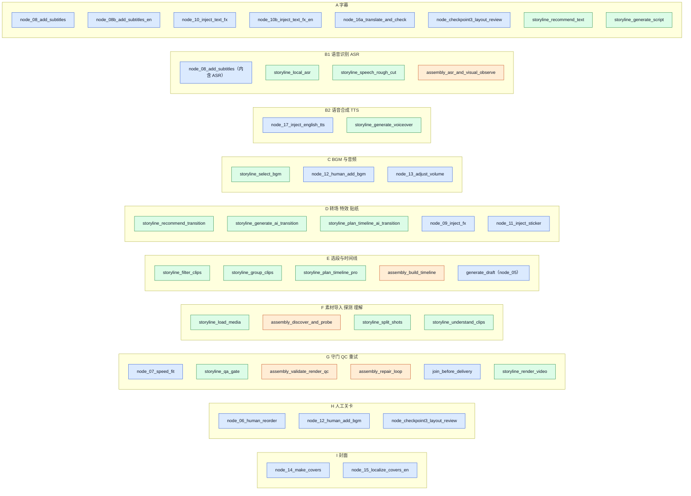
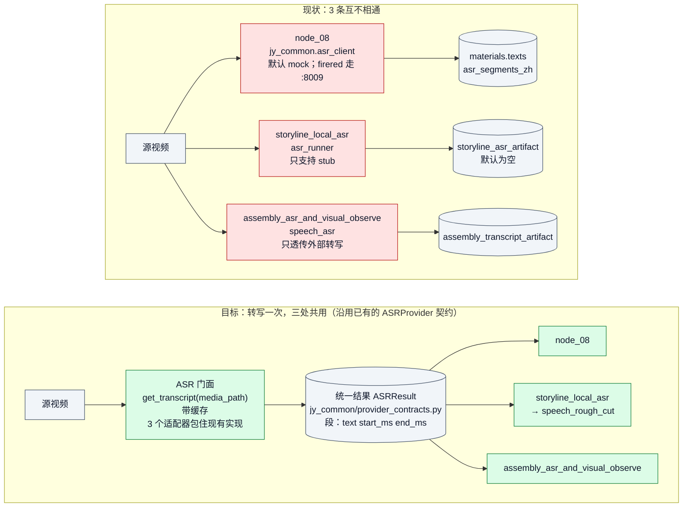
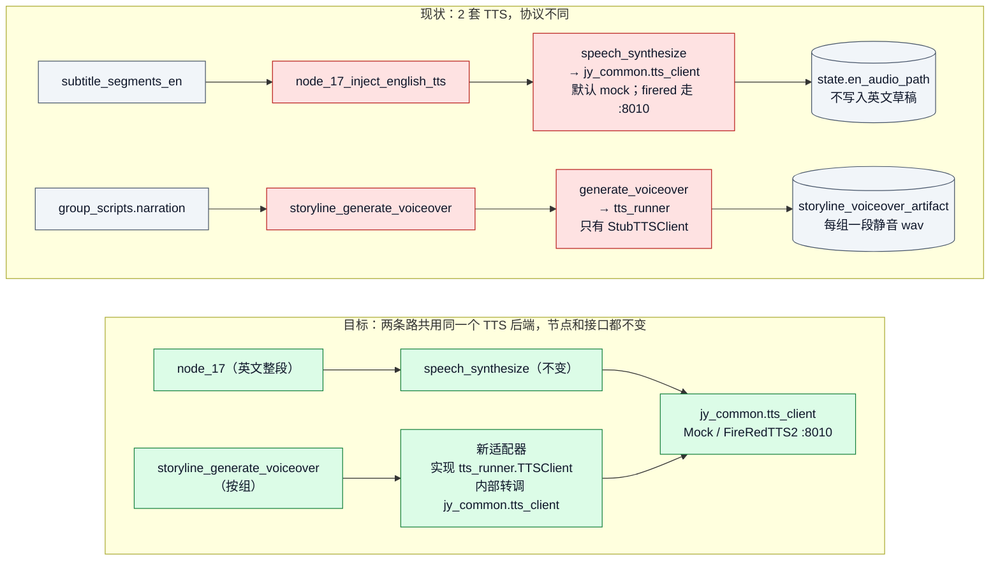
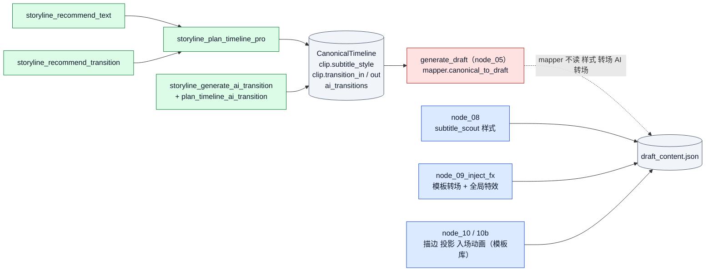

# 相似功能节点分析与设计执行计划

| 项 | 内容 |
|---|---|
| 项目 | `wayyet/auto-video-editor`（LangGraph + SqliteSaver） |
| 分支 / 提交 | `main` / `ca37c18`（2026-11-06） |
| 分析日期 | 2026-11-07 |
| 方法 | 只读源码，静态分析。**没有运行工作流，没有跑测试，没有在剪映里打开草稿。** |
| 读者 | 中级工程师 |

**名词（先看一遍）**

- **节点（node）**：LangGraph 图里的一个步骤，在 `graph.py` 用 `add_node` 注册。
- **门面（facade）**：一个统一入口函数，内部再去调不同的实现。
- **Protocol**：Python 的"接口约定"。只规定方法签名，不规定怎么实现。
- **fan-in**：多个上游节点都完成后，才触发一个下游节点。
- **CanonicalTimeline**：storyline 族产出的统一时间线数据（定义在 `storyline/contract.py`）。
- **mapper**：把 CanonicalTimeline 转成剪映草稿 JSON 的函数（`storyline/mapper.py`）。
- **interrupt**：LangGraph 的人工暂停点。等人处理完，流程再继续。
- **静态结论**：只读代码得出的判断，没有运行验证。文中都会标出来。

---

## 0. 结论（先看这里）

**一句话**：47 个节点里，"代码完全相同"的只有 1 对。更多的是"同一件事写了几份，互不相通"。最该处理的是 4 件事：ASR（语音转文字）、TTS（文字转语音）、转场/字幕样式、目标时长。

### 0.1 你点名的 3 个节点

| 节点 | 所属组 | 和谁相似 | 判定 |
|---|---|---|---|
| `storyline_local_asr` | B1 ASR | `node_08_add_subtitles`（内含 ASR）、`assembly_asr_and_visual_observe` | 功能相似。三套独立 ASR，不共用 |
| `assembly_asr_and_visual_observe` | B1 ASR | 同上。它的"抽帧理解"部分还和 F 组的 `storyline_understand_clips` 相似 | 功能相似 |
| `node_17_inject_english_tts` | B2 TTS | `storyline_generate_voiceover` | 功能相似。两套 TTS，接口约定（Protocol）不同 |

### 0.2 四个关键问题

1. **三套 ASR、两套 TTS，互不共用，默认都不产真实结果。**
   - ASR 默认值：`node_08` 用 `mock`（假字幕）；`storyline_local_asr` 只支持 `stub`（空结果）；`assembly_asr_and_visual_observe` 只透传外部转写，没有就报 `[ERROR]`（不阻塞）。
   - TTS 默认值：`node_17` 用 `mock`（静音 wav）；`storyline_generate_voiceover` 只有 `StubTTSClient`（静音 wav）。
2. **转场和字幕样式的"推荐"进不了草稿。** storyline 的推荐写进了 CanonicalTimeline，但 mapper 不读转场、样式、AI 转场。草稿里的样式和转场，由 `node_08` / `node_09` / `node_10` 各自另起炉灶。
3. **目标时长 35 秒在 7 处各写一份，`node_07` 不看用户设置。** 控制台允许最大 600000 ms（10 分钟），`node_07` 却固定压到 35 秒。
4. **同一件事被决定两次。**
   - 中文字幕有两个来源：脚本整段（`subtitle-zh-1`）和 ASR 逐句（`materials.texts`），没有去重。
   - BGM 先由 `storyline_select_bgm` 选一次，关卡② `node_12_human_add_bgm` 再让人加一次。

### 0.3 建议

- **先做**（低风险，默认行为不变）：P0 基线 → P1 目标时长单一来源 → P2 ASR 门面 → P3 TTS 适配器。
- **先拍板**：第 7 节的 2 个决定。
- **不要做**：改节点名、改边、把关卡③并进公共模板、合并 `ffproc.py` / `fonts.py`。原因见 5.1 和附录 B。

---

## 1. 范围与方法

- **对象**：`graph.py` 里 `add_node` 注册的 47 个节点。
- **方法**：
  1. 用 Python `ast` 解析 `graph.py`，列出节点和边。不 import、不执行仓库代码。
  2. 读节点和能力层源码。
  3. 用 grep 查"谁读、谁写某个 state 键"。每条证据都写成 `文件:行号`。
- **"相似"分三档**：

| 档 | 含义 |
|---|---|
| 完全相同 | 同一份代码，只是作用对象不同 |
| 功能相似 | 做同一类事，各写了一份；数据或默认值不同 |
| 仅同阶段 | 在流水线同一位置，但做互补的事，不是重复 |

- **没做的事**：没运行工作流；没跑测试；没有在剪映里打开草稿；没有调用任何外部服务（ASR、TTS、LLM 都没调）。
- **不动的东西**：节点名和边。原因见 5.1。

---

## 2. 47 个节点总览

| 族 | 个数 | 作用 |
|---|---|---|
| 原流水线 | 20 | 剪映草稿的主链：生成草稿 → 人工关卡 → 速度适配 → 字幕/特效 → 英文分支 → 交付 |
| assembly | 6 | 草稿生成后的 QC 通道：探测 → ASR+抽帧 → 时间线 → 渲染 QC → 修复 → 报告。默认开启（`ASSEMBLY_QC_GATE_ENABLED` 默认 `true`，`config.py:237-241`） |
| storyline | 21 | 自动前段：素材 → 理解 → 选段 → 文案/配音/BGM → 时间线 → QA → 渲染，最后 `storyline_join` 接到 `generate_draft` |

**主链顺序**（依据 `graph.py:577-663`）：

1. 入口：`START → storyline_load_media`（`graph.py:577`）。
2. storyline 族走完，`storyline_join` 接 `generate_draft`。
3. `generate_draft →` assembly 6 个节点 `→ node_06_human_reorder → node_07_speed_fit`（`graph.py:591-612`）。
4. 中文线：`node_08 → node_10 → node_14 → node_15`。
5. 英文线：`node_08 → fork_draft_for_english_branch → node_16a → node_08b → node_10b →（node_checkpoint3）→ node_17`（`graph.py:627-648`）。
6. 两线汇合：`[node_15, node_17] → node_09 → node_11 → node_12 → node_13 → join_before_delivery → END`（`graph.py:651-663`）。

**按功能分成 9 组**（A–I；B 拆成 B1、B2）。颜色表示所属族：蓝 = 原流水线，绿 = storyline，橙 = assembly。



每个节点对应的文件和函数，见附录 A。

---

## 3. 分组分析

读法：每组先列成员，再给判定，再给证据。证据都是 `文件:行号`，行号对应提交 `ca37c18`。

> **和仓库里已有文档的关系**
>
> - `docs/第二期开发/自动剪辑工作流重复冗余模块分析与合并设计执行计划.md`（2026-11-04）按"函数、常量、文件"找重复。本文按"节点功能"分组，是补充，不重复它的结论。
> - 沿用它的既有决定：关卡节点不合并；`ffproc.py`、`fonts.py` 保留两份；ASR/TTS 只定契约，暂不合并运行时。
> - `docs/修改文档/剧情线自动模式节点并入人工模式主图设计与执行计划.md` §2.1 已把 storyline 节点和 human 节点配过对。本文的分组与它一致。差别在两处：A 组（样式字段该落在哪）、D 组（转场名对不上）。
> - `docs/修改文档/auto-video-editor_ASR_TTS_ProviderContract草案与字段映射_20261103.md` 是本文 P2、P3 的依据。

### A 字幕

| 节点 | 做什么 | 文件 |
|---|---|---|
| `node_08_add_subtitles` | 中文 ASR → 逐句写进草稿 `materials.texts`；样式取 subtitle_scout 的建议 | `nodes/node_08_add_subtitles.py` |
| `node_08b_add_subtitles_en` | 英文翻译 → 逐句写进英文分支草稿 `materials.texts`（整表替换，可重放） | `nodes/node_08b_add_subtitles_en.py` |
| `node_10_inject_text_fx` | 给中文草稿每条字幕加描边、投影、入场动画 | `nodes/node_10_inject_text_fx.py` |
| `node_10b_inject_text_fx_en` | 给英文分支草稿做同样的事 | 同上，函数 `inject_text_fx_en` |
| `node_16a_translate_and_check` | 翻译 + 版面检查 | `nodes/node_16a_translate_and_check.py` |
| `node_checkpoint3_layout_review` | 关卡③：版面有问题时人工复核（见 H 组） | `nodes/node_checkpoint3_layout_review.py` |
| `storyline_generate_script` | 生成每组旁白文案；拼起来就是 `subtitles.zh` | `nodes/storyline/node_generate_script.py` |
| `storyline_recommend_text` | 推荐字幕样式（字体、字号、颜色、位置） | `nodes/storyline/node_recommend_text.py` |

**判定**

| 对比 | 判定 | 依据 |
|---|---|---|
| `node_10` ↔ `node_10b` | **完全相同** | 都调同一个 `apply_text_fx`（`nodes/node_10_inject_text_fx.py:39`，调用处 `:107`、`:129`）。10b 就在同一个文件里（`inject_text_fx_en`，`:116`），只是处理的草稿目录不同 |
| `node_08` ↔ `node_08b` | **功能相似（高）** | 已共用 `make_text_material`（`nodes/_subtitle_texts.py`）和 `_style_from_scout`（`nodes/node_08b_add_subtitles_en.py:24-25`）。差别只有数据源（ASR 对翻译）和样式（见下） |
| `node_08` / `node_08b` ↔ `storyline_recommend_text` | **功能相似** | 都在决定字幕"基础样式"：字体、字号、颜色、位置 |
| `node_08` / `node_08b` ↔ `node_10` / `node_10b` | 仅同阶段 | 08 写文字和基础样式；10 只追加描边、投影、入场动画（`nodes/node_10_inject_text_fx.py:3`）。互补，不重复 |
| `node_16a` 的两条版面检查 | 有意降级，保留 | 先走 qc 链 `_check_layout_via_subtitle_qc`（`nodes/node_16a_translate_and_check.py:75`）；失败回落 `validate_layout`（`:258`）。`layout_issues_source` 记录走了哪条（`:264`、`:267`） |

**证据**

- **字幕基础样式有三个决策者，互不相通。**
  - `storyline_recommend_text` 推荐 `font_zh`、`font_en`、`size`、`color`、`position`（`storyline_capabilities/recommend_text.py:49-50`、`:61-65`）。结果写进 `clip.subtitle_style`（`storyline_capabilities/plan_timeline_pro.py:130-134`），之后没有节点读它。
  - `node_08` 用 subtitle_scout 的建议，经 `_style_from_scout` 生成样式（`nodes/node_08_add_subtitles.py:375`）。
  - `node_08b` 用默认样式 `_style_from_scout(None)`（`nodes/node_08b_add_subtitles_en.py:47`）。源码注释说了原因：scout 报告键 `subtitle_scout_report` 没在 `state.py` 声明，图运行时被丢弃（`nodes/node_08b_add_subtitles_en.py:44-46`）。
- **`recommend_text` 的字段该落在 08/08b，不在 10。** `node_10` 只写 `outline`、`shadow`、`entrance_animation`，不碰字体、字号、颜色、位置（`apply_text_fx`，`nodes/node_10_inject_text_fx.py:39` 起）。这和既有文档 §9.2 写的"`storyline_text_style_plan` → `node_10`"不一致。
- **中文字幕有两个来源，没有去重。**
  - 来源①，脚本整段：`storyline_capabilities/plan_timeline_pro.py:167-170` 把各组旁白按顺序拼成 `subtitles.zh`；mapper 把它写成文本轨上的一整条 `subtitle-zh-1`，从 0 秒盖到最后一个片段结束（`storyline/mapper.py:195-206`）。
  - 来源②，ASR 逐句：`node_08` 把每句追加进 `materials.texts`（`nodes/node_08_add_subtitles.py:384`）。
  - mapper 自己把 `materials.texts` 写成空列表（`storyline/mapper.py:213`）。`subtitle-zh-1` 只在 `storyline/mapper.py` 里出现（全仓 `.py`，不含 tests、docs）。两处互不知道对方。
  - 剪映里是否同时显示：**没验证**。见 P4 第一步。

**建议**：`node_10` / `10b` 不动（已共用函数）；`node_08` / `08b` 不合并（数据源不同）；样式决策者收敛，见 P4；中文字幕双来源先验证，再决定。

---

### B1 语音识别（ASR）

| 节点 | 做什么 | 文件 |
|---|---|---|
| `node_08_add_subtitles` | 内含 ASR：对源视频转写，再写字幕 | `nodes/node_08_add_subtitles.py` |
| `storyline_local_asr` | 本地 ASR，结果交给粗剪 | `nodes/storyline/node_local_asr.py` |
| `storyline_speech_rough_cut` | **不是 ASR**，是 `local_asr` 的下游：按语音切段粗剪（`nodes/storyline/node_speech_rough_cut.py:3`） | `nodes/storyline/node_speech_rough_cut.py` |
| `assembly_asr_and_visual_observe` | 透传外部转写 + 抽帧（"看画面"） | `nodes/assembly/node_asr_and_visual_observe.py` |

**三套 ASR 对比**

| 项 | `node_08_add_subtitles` | `storyline_local_asr` | `assembly_asr_and_visual_observe` |
|---|---|---|---|
| 调用的实现 | `jy_common/asr_client.py` 的 `call_asr2s`（`:179`） | `storyline_capabilities/asr_runner.py` 的 `transcribe_media` | `assembly_capabilities/speech_asr.py` 的 `speech_transcribe` |
| 默认后端 | `ASR_BACKEND=mock`（`jy_common/asr_client.py:156`）：假字幕 "Mock 字幕 N" | `STORYLINE_ASR_MODE=stub`（`storyline_capabilities/asr_runner.py:27`）：空结果 | 没有后端。只透传外部转写；没有就报 `[ERROR] cloud ASR is not configured…`（`assembly_capabilities/speech_asr.py:59`），不阻塞 |
| 真实后端 | `firered`：`http://127.0.0.1:8009/transcribe`（`jy_common/asr_client.py:74`） | 没有。设成别的值，导入时抛 `ValueError`（`storyline_capabilities/asr_runner.py:28-32`） | 靠外部喂入 state 键 `storyline_transcript_external_path`（`nodes/assembly/node_asr_and_visual_observe.py:140`） |
| 时间单位 | 秒：`start_s` / `end_s` | 整数 `start` / `end`（`storyline_capabilities/speech_rough_cut.py:112-113`），单位实现前要再确认 | 秒：`start` / `end`（`nodes/node_16a_translate_and_check.py:52-56` 的说明） |
| 产物去哪 | 逐句进草稿 `materials.texts`，另写 `asr_segments_zh`（`nodes/node_08_add_subtitles.py:421`） | `storyline_asr_artifact` → `storyline_speech_rough_cut` | `assembly_transcript_artifact` → `assembly_build_timeline` |
| 多视频 | 逐个视频各跑一次（`nodes/node_08_add_subtitles.py:306-315`） | 逐个视频各跑一次（`nodes/storyline/node_local_asr.py:103-111`） | 逐个视频各跑一次（`nodes/assembly/node_asr_and_visual_observe.py:146`） |



**判定**：三套 ASR **功能相似，互不共用**。三条路都启用时，同一个视频会被转写 3 次，结果互相看不见。

**证据**

- **两个同名 Protocol。** `jy_common/asr_client.py:24` 和 `storyline_capabilities/asr_runner.py:39` 都叫 `ASRClient`，方法签名不同：前者 `transcribe(video_path)`，后者 `transcribe(*, media_path, output_dir)`。
- **统一契约已经有了，但没人用。** `jy_common/provider_contracts.py` 定义了 `ASRProvider` / `ASRResult`：段用毫秒 `{text, start_ms, end_ms}`，失败写 `error` 字段而不是抛异常。全仓只有 `tests/unit/test_provider_contracts.py` 引用它。字段映射表在 `docs/修改文档/auto-video-editor_ASR_TTS_ProviderContract草案与字段映射_20261103.md`。
- **assembly 的外部转写钩子，多视频不能用。** 它对每个视频传同一个路径（`nodes/assembly/node_asr_and_visual_observe.py:158-159`）。`state.py` 没有声明这个键（grep 无命中）；只有 e2e 脚本传入（`scripts/assembly/phase5_e2e.py:90`）。
- **ASR 旁支默认开着，但默认出空结果。** `.env.example:21` 是 `STORYLINE_ENABLE_ASR_BRANCH=1`；`stub` 返回空 segments（`storyline_capabilities/asr_runner.py:3-5`）。
- **注释过期。** `nodes/storyline/node_local_asr.py:7` 还写着 `STORYLINE_ASR_MODE=vendored` 可用；vendored 模式已经删了（`storyline_capabilities/asr_runner.py:7-9`）。

**建议**：P2（门面 + 缓存，沿用已有契约，默认行为不变）。

---

### B2 语音合成（TTS）

| 项 | `node_17_inject_english_tts` | `storyline_generate_voiceover` |
|---|---|---|
| 输入 | `subtitle_segments_en` 的 `text_en`，拼成一整段（`nodes/node_17_inject_english_tts.py:38-49`、`:70-71`） | 每组旁白 `narration`，按组各合成一段 |
| 调用链 | `speech_synthesize`（`nodes/node_17_inject_english_tts.py:84`）→ `jy_common.tts_client.call_firered_tts`（`video_edit_capabilities/speech_synthesize.py:129`） | `generate_voiceover`（`storyline_capabilities/generate_voiceover.py:151`）→ `tts_runner.TTSClient` |
| 默认实现 | `TTS_BACKEND=mock`（`jy_common/tts_client.py:204`）：静音 wav，至少 8 KB（`:57`） | `StubTTSClient`（`storyline_capabilities/tts_runner.py:104`）：静音 wav；缺省客户端见 `:142-146` |
| 真实后端 | `firered`：`http://127.0.0.1:8010/synthesize`（`jy_common/tts_client.py:110`） | 没有。模块里只有 `StubTTSClient`；`load_tts_providers`（`storyline_capabilities/tts_runner.py:191`）只读 yaml 配置 |
| 结果去哪 | `state.en_audio_path` 和 `en_dub_audio_path`，同值双写（`nodes/node_17_inject_english_tts.py:109-111`）。**不写进英文草稿**（`nodes/node_12_human_add_bgm.py:66-68`） | `storyline_voiceover_artifact`；配音 ID 进 `audio.voiceover` |
| 接口约定 | `jy_common/tts_client.py:31`：`synthesize(text, *, voice, speed)`，返回 dict | `storyline_capabilities/tts_runner.py:37`：`synthesize(*, text, wav_path, params)`，返回 `TTSResult` |



**判定**：两套 TTS **功能相似，接口约定不同**。一个合成英文整段，一个按组合成中文旁白。

**证据**

- **三个 TTS 类型并存**：`jy_common/tts_client.py:31` 的 `TTSClient`、`storyline_capabilities/tts_runner.py:37` 的 `TTSClient`、`jy_common/provider_contracts.py:84` 的 `TTSProvider`（契约草案，无运行时使用）。
- **`node_17` 的产物不进草稿。** 它只写 state。`node_12` 排在 `node_17` 之后（`graph.py:648-658`），镜像时整体替换英文草稿的音轨（`nodes/node_12_human_add_bgm.py:108-112`）。所以将来要把英文配音写进英文草稿，必须同时改 `node_12`（见 P3b）。
- **storyline 配音进草稿的路径有疑点（静态判断，未运行）。**
  - 契约说 `audio.voiceover` 是配音 ID（`storyline/contract.py:111`）。
  - `storyline_capabilities/plan_timeline_pro.py:163-165` 存的却是 `group_id → voiceover_id` 的 JSON 字符串。
  - mapper 把它当文件引用写进 `materials.audios`（`storyline/mapper.py:113-121`）和音轨（`:175-188`）。
  - `storyline_capabilities/plan_timeline_pro.py:161-162` 的注释写"mapper 不读"，与 mapper 代码不符。
  - 全仓 `.py`（不含 tests、docs）没有找到把配音 ID 换成 wav 路径的代码。

**建议**：P3（适配器，默认不变）；P3b（英文配音入草稿）可选，要先确认产品是否需要。

---

### C BGM 与音频

| 节点 | 做什么 | 文件 |
|---|---|---|
| `storyline_select_bgm` | 自动选 BGM → `bgm_ref` | `nodes/storyline/node_select_bgm.py` |
| `node_12_human_add_bgm` | 关卡②：人工加 BGM，再把音轨镜像到英文草稿 | `nodes/node_12_human_add_bgm.py` |
| `node_13_adjust_volume` | 调音量、淡入淡出 | `nodes/node_13_adjust_volume.py` |

**判定**：`storyline_select_bgm` ↔ `node_12`：**功能相似**（都在"选 BGM"，一个自动、一个人工），结果不互通。`node_13` 仅同阶段。

**证据**

- `bgm_ref` 经 mapper 写成 `materials.audios` 的 `bgm-1`（`storyline/mapper.py:104-112`）和音轨 `track-audio-1` 上的一段（`:155-174`）。
- `node_12` 再让人加一次。它的镜像 `mirror_bgm_to_en_draft`（`nodes/node_12_human_add_bgm.py:56`）复制中文草稿全部音轨（`:95-97`），并**整体替换**英文草稿的音轨（`:108-112`）。没有检查已有 BGM（静态读取）。
- 既有文档 §9.2 已建议"`storyline_bgm_selection` → `node_12`（给人工选曲当建议）"，未实现。

**建议**：不合并。要给英文草稿加配音时，先改 `node_12` 的镜像（P3b）。

---

### D 转场、特效、贴纸

| 节点 | 做什么 | 文件 |
|---|---|---|
| `storyline_recommend_transition` | 推荐转场，写 `storyline_transition_plan` | `nodes/storyline/node_recommend_transition.py` |
| `storyline_generate_ai_transition` | 生成 AI 转场（默认 noop，`STORYLINE_ENABLE_AI_TRANSITION` 才开） | `nodes/storyline/node_generate_ai_transition.py` |
| `storyline_plan_timeline_ai_transition` | 带 AI 转场的时间线（默认 noop） | `nodes/storyline/node_plan_timeline_ai_transition.py` |
| `node_09_inject_fx` | 注入转场 + 单个全局特效 `vfx-default`，中英文两份草稿都处理（`graph.py:655`） | `nodes/node_09_inject_fx.py` |
| `node_11_inject_sticker` | 按字幕关键词匹配贴纸（`templates/sticker_template.json`） | `nodes/node_11_inject_sticker.py` |



**判定**：storyline 的三个转场节点 ↔ `node_09`：**功能相似，产物不互通**。`node_11` 仅同阶段（贴纸）。

**证据**

- **mapper 不读转场、样式、特效。** `storyline/mapper.py` 里没有 transition / style / effect 相关字样（grep 为空）。`storyline/contract.py:183-186` 的注释也写着 `ai_transitions` "mapper 暂不消费"。
- **推荐结果只流到时间线，之后断了。** `storyline_transition_plan` 只被两处读：`nodes/storyline/node_plan_timeline_pro.py:56`（写进 `clip.transition_in/out`，`storyline_capabilities/plan_timeline_pro.py:130-134`）和 `nodes/storyline/node_generate_ai_transition.py:118`（只当提示）。`storyline_text_style_plan` 只被 `nodes/storyline/node_plan_timeline_pro.py:57` 读。
- **`node_09` 的样式几乎恒为 `default`。** `style_tag` 取 `shot_plan.shots[i].style_tag`，没有就用 `"default"`（`nodes/node_09_inject_fx.py:112-116`）。`graph.py:196-199` 把 `shot_plan` 描述成旧 checkpoint 和测试的回退输入，所以正常运行里大概率没有它（静态推断）。
- **转场名对不上。** `recommend_transition` 输出通用名 `fade`、`cut`，缺省 `fade_in`（`storyline_capabilities/recommend_transition.py:29-33`）；`node_09` 要的是剪映资源库里的名字，经 `_resolve_vip_transition` 解析（`nodes/node_09_inject_fx.py:42`）。直接接会匹配不上，要先做映射表。
- **第三套转场字段。** assembly 自己的 `timeline.json` 也有 `transition_in/out`（`assembly_capabilities/timeline_ops.py:231`、`:582`，`assembly_capabilities/render_preview.py:586`），不进草稿。

**建议**：P4。先接字幕样式，转场等映射表做好再接。

---

### E 选段与时间线

| 节点 | 做什么 | 文件 |
|---|---|---|
| `storyline_filter_clips` | 过滤片段 | `nodes/storyline/node_filter_clips.py` |
| `storyline_group_clips` | 片段分组（段落） | `nodes/storyline/node_group_clips.py` |
| `storyline_plan_timeline_pro` | 产出 CanonicalTimeline | `nodes/storyline/node_plan_timeline_pro.py` |
| `assembly_build_timeline` | 用 LLM 产出 assembly 自己的 `timeline.json`（6 个 assembly 节点里唯一调 LLM 的） | `nodes/assembly/node_build_timeline.py` |
| `generate_draft` | 把 CanonicalTimeline 经 mapper 变成剪映草稿 | `nodes/node_05_generate_draft.py` |

**判定**：`storyline_plan_timeline_pro` ↔ `assembly_build_timeline`：**功能相似，数据格式不同，互不读取**。`generate_draft` 是下游，只吃 CanonicalTimeline。

**证据**

- `assembly_timeline_path` 在非测试代码里只被 assembly 节点和 e2e 脚本引用（`nodes/assembly/node_build_timeline.py`、`nodes/assembly/node_validate_render_qc.py`、`nodes/assembly/node_repair_loop.py`、`nodes/assembly/node_write_report.py`、`scripts/video_edit_phase56_e2e.py`，另有 `state.py` 声明）。
- assembly 的产出只汇成 `report.md`，路径 `assembly_report_path` 被 `node_06_human_reorder` 读（`nodes/node_06_human_reorder.py:36`、`:42`），给关卡①的人看。

**建议**：不动。两条线目的不同：storyline 生成草稿，assembly 事后做 QC。

---

### F 素材导入、探测、理解

| 节点 | 做什么 | 文件 |
|---|---|---|
| `storyline_load_media` | 读视频元数据，登记素材清单 | `nodes/storyline/node_load_media.py` |
| `assembly_discover_and_probe` | 发现素材，探测元数据，并扫场景、黑帧、静音 | `nodes/assembly/node_discover_and_probe.py` |
| `storyline_split_shots` | 帧差法切镜头 | `nodes/storyline/node_split_shots.py` |
| `storyline_understand_clips` | 用 VLM 理解片段内容 | `nodes/storyline/node_understand_clips.py` |

**判定**（都是**功能相似**）

- `storyline_load_media` ↔ `assembly_discover_and_probe`：都在读视频元数据（时长、分辨率、是否有音频）。
- `storyline_split_shots` ↔ `assembly_discover_and_probe` 里的 `analyze_media` 场景扫描：都在找镜头切点。
- `storyline_understand_clips` ↔ `assembly_asr_and_visual_observe` 的抽帧和 contact sheet：都在"看画面"。

**证据（能力层里的同名函数，彼此有差异）**

- `probe_video_size` 有 3 份，两两不同：`video_edit_capabilities/render.py:92`、`video_edit_capabilities/subtitle_build.py:1509`、`assembly_capabilities/render_preview.py:829`。
- `media_duration_seconds` 有 2 份，内容不同：`video_edit_capabilities/timeline.py:44`、`assembly_capabilities/media_probe.py:367`。

**建议**：登记，不合并（P5）。这是既有决定"B1 两个能力包保留两份"的范围。

---

### G 守门、QC、重试

| 节点 | 守什么 | 超限后 | 重试上限 |
|---|---|---|---|
| `node_07_speed_fit` | 总时长压到 35 秒 | 自己重试；连续 3 次不行 → `escalate_guardrail_failure`（写 `error_log` 后终止，`graph.py:278-284`） | `NODE_07_MAX_RETRY` = 3（`config.py:176`） |
| `storyline_qa_gate` | 实际时长不超过目标的 1.05 倍 | 回到 `storyline_group_clips` 重选（`nodes/storyline/qa_gate.py:100`） | 3（`nodes/storyline/qa_gate.py:100`） |
| `assembly_validate_render_qc` + `assembly_repair_loop` | 预览渲染 QC | 修复循环 | `ASSEMBLY_QC_MAX_RETRY`，默认 2（`config.py:247`） |
| `join_before_delivery` | 交付前轻量检查 | 只记录问题，不阻塞 | — |
| `storyline_render_video` | 冒烟渲染 | 默认关闭，`STORYLINE_ENABLE_RENDER_SMOKE_TEST=1` 才跑（`nodes/storyline/node_render_video.py:3`） | — |

**判定**：`node_07`、`storyline_qa_gate`、assembly QC 是三个"闸门 + 重试"：**功能相似，目标不同，重试去向不同**。`join_before_delivery` 只记录，`storyline_render_video` 是旁支冒烟。

**关键问题：目标时长在 7 处各写一份，值都是 35 秒。**

| # | 位置 | 值 |
|---|---|---|
| 1 | `config.py:175` `TARGET_DURATION_US` | 35_000_000 微秒 |
| 2 | `config.py:390` 控制台默认值 | 35000 毫秒 |
| 3 | `nodes/storyline/_common.py:184` `DEFAULT_TARGET_DURATION_MS`（解析函数 `target_duration_ms` 在 `:219`） | 35000 |
| 4 | `nodes/storyline/qa_gate.py:60`、`:64` `_target_ms` | 35000 |
| 5 | `nodes/storyline/node_plan_timeline_pro.py:88` | 35000 |
| 6 | `storyline_capabilities/plan_timeline_pro.py:176-177` | 35_000 |
| 7 | `nodes/storyline/join_storyline.py:97` | 35000 |

另有 `graph.py:279-281` 的报错文案写死了"35s"，不算定义，但改常量时要一起改。

**冲突证据**

- `node_07` 固定用 `TARGET_DURATION_US`（`nodes/node_07_speed_fit.py:100`、`:107`）。全文没有 `storyline_targets`、`target_duration_ms`（grep 为空）。
- 控制台允许目标时长在 1 到 600000 毫秒之间（`web/api_console.py:189-194`；上限 `config.py:391` `CONSOLE_TARGET_DURATION_MS_MAX`）。
- `storyline_qa_gate` 读 `storyline_targets.target_duration_ms`（`nodes/storyline/qa_gate.py:55-64`）。
- 所以：用户设 60 秒 → storyline 前段按 60 秒判；到 `node_07` 又被压回 35 秒。这是静态结论，没有运行验证。
- 35 秒的来历：代码注释称"剪映总时长上限"（`nodes/storyline/qa_gate.py:56`）；仓库文档称"35 秒硬业务护栏"（`docs/video-agent-kit_vs_auto-video-editor_功能差异对比.md:424`，`README.md:712` 验收项"总时长 ≤ 35s"）；`README.md:341` 又写"设置目标时长（默认 35 秒）"。这几处说法互相矛盾，所以要你拍板（第 7 节决定 1）。
- 另有 `storyline_capabilities/duration_budget.py:19` 的 `coerce_target_duration_ms`：缺省返回 0（表示"无预算"），语义不同，**不并入**。

**建议**：P1。

---

### H 人工关卡

| 节点 | 关卡 | 文件 |
|---|---|---|
| `node_06_human_reorder` | ① 调片段顺序 | `nodes/node_06_human_reorder.py` |
| `node_12_human_add_bgm` | ② 加 BGM | `nodes/node_12_human_add_bgm.py` |
| `node_checkpoint3_layout_review` | ③ 版面复核 | `nodes/node_checkpoint3_layout_review.py` |

**判定**：三个都是 `interrupt()` 暂停点。**仅同阶段**：同一个机制，处理不同内容。

**证据**

- ① 和 ② 已共用 `nodes/_checkpoint.py` 的 `build_interrupt_payload` 和 `post_resume`。
- ③ **有意不纳入**：resume 后多一步 SRT 重写，返回值是增量字典，结构已偏离样板（`nodes/_checkpoint.py:24-26`）。
- payload 的 `checkpoint`、`legacy_id`、`step` 三个键不能改：`resume_all_pending` 按 `checkpoint` 自动匹配，改了会静默失配（`nodes/_checkpoint.py:12-16`）。

**建议**：不动。既有决定"关卡节点不合并"。

---

### I 封面

| 节点 | 做什么 | 文件 |
|---|---|---|
| `node_14_make_covers` | 并发生成三种比例的中文封面 | `nodes/node_14_make_covers.py` |
| `node_15_localize_covers_en` | 把中文封面本地化成英文（`nodes/node_15_localize_covers_en.py:3`） | `nodes/node_15_localize_covers_en.py` |

**判定**：**不是重复，是中 → 英接力**。

**建议**：不动。

---

### 未归组的 8 个节点

没有相似节点，不需要处理：

| 节点 | 作用 |
|---|---|
| `escalate_guardrail_failure` | `node_07` 重试耗尽的兜底出口（`graph.py:278-284`） |
| `bridge_snapshot2` | 把快照②路径写进 state，再交给 `node_08`（`graph.py:290-293`） |
| `fork_draft_for_english_branch` | 复制草稿，开英文分支（`nodes/node_fork_english_branch.py`） |
| `assembly_write_report` | 汇总 assembly 前 5 步，写 Markdown 报告 |
| `storyline_join` | 把时间线转成 plan 字典，交给 `generate_draft` |
| `storyline_search_media` | 用 Pexels 搜外部素材 |
| `storyline_search_web_topic` | 联网搜选题 |
| `storyline_script_template_recommendation` | 空操作，只记日志 |

---

## 4. 汇总判定表

| 组 | 对象 | 判定 | 要不要动 |
|---|---|---|---|
| A 字幕 | `node_10` ↔ `node_10b` | 完全相同 | 不动，已共用 `apply_text_fx` |
| A 字幕 | `node_08` ↔ `node_08b` | 功能相似（高） | 不合并 |
| A 字幕 | 样式三个决策者 | 功能相似，不互通 | P4 |
| A 字幕 | 中文字幕双来源 | 重复来源 | 先验证（P4 第一步） |
| B1 ASR | 三套 ASR | 功能相似，不共用 | P2 |
| B2 TTS | 两套 TTS | 功能相似，接口不同 | P3 |
| C BGM | `storyline_select_bgm` ↔ `node_12` | 功能相似，不互通 | 不合并；P3b 前先改 `node_12` 镜像 |
| D 转场 | storyline 三个 ↔ `node_09` | 功能相似，产物断在 mapper | P4 |
| E 时间线 | `plan_timeline_pro` ↔ `build_timeline` | 功能相似，格式不同 | 不动 |
| F 素材 | storyline ↔ assembly 的探测、理解 | 功能相似 | 登记（P5），不动 |
| G 守门 | `node_07` / `qa_gate` / assembly QC | 功能相似 | P1（目标时长） |
| H 关卡 | 三个关卡 | 仅同阶段 | 不动 |
| I 封面 | `node_14` → `node_15` | 接力，不重复 | 不动 |
| 未归组 | 8 个节点 | 无相似节点 | 不动 |

---

## 5. 设计

### 5.1 原则

1. **不改节点名，不改边。** 节点名硬编码在 `graph.py`、`monitoring/workflow_graph.py`、`web/node_map`、`agent_gate/README.md`、测试、README、e2e 脚本里。多路汇合还用了列表写法 `add_edge([a, b], 目标)`（`graph.py:651`）。改名或改边会静默失配，而且难查。
2. **先收敛能力层和共用 helper，节点保持薄。** 沿用已经做过的做法：`nodes/_draft_io.py`、`nodes/_checkpoint.py`、`nodes/_subtitle_texts.py`。
3. **一个阶段一个 PR，能单独回滚。** 新行为一律放在环境变量开关后面，默认关，默认行为不变。
4. **沿用既有决定**：关卡节点不合并；`ffproc.py` / `fonts.py` 保留两份；ASR/TTS 按已有契约迁移，先有契约测试，再动实现（映射文档 §6）。

### 5.2 目标时长（P1）

**现状**：7 处各写一份（见 G 组）。

**设计**

- 在 `config.py` 新增唯一定义 `DEFAULT_TARGET_DURATION_MS = 35_000`。`TARGET_DURATION_US` 和控制台默认值都由它得出。
- storyline 节点层统一从 `nodes/storyline/_common.py` 取。`_common.py` 改成引用 `config.DEFAULT_TARGET_DURATION_MS`。`config.py` 不 import 节点层（它只 import 了 `db.postgres_config`，`config.py:156`），所以不会循环导入。
- `qa_gate._target_ms` 改为复用 `_common.target_duration_ms`。两者只有一处行为差异：值为非正数时，`_common` 回落默认值，`qa_gate` 原样返回。要用测试锁住新行为。
- 能力层 `storyline_capabilities/plan_timeline_pro.py` **保留自己的 35_000 兜底**。能力层从不 import 根目录 `config`（grep 无命中），硬接会引入新的层间依赖。改用测试锁住"与 `config` 一致"，这与既有的"刻意复制 + 防漂移测试"做法一致。
- 决定 1 选 A（守 35 秒）：把控制台上限也降到 35000。选 B（可调）：`node_07` 和它的路由 `route_after_speed_fit` 改读 `storyline_targets.target_duration_ms`，缺省仍是 35 秒。

### 5.3 ASR（P2）

**设计**

- **沿用已有契约。** `jy_common/provider_contracts.py` 的 `ASRResult` 做统一结果：毫秒 `{text, start_ms, end_ms}`，失败写 `error` 字段。
- **新增门面** `get_transcript(media_path, out_dir) -> ASRResult`。建议放 `nodes/_transcript.py`，和 `nodes/_draft_io.py`、`nodes/_checkpoint.py` 同一套路（节点层共用 helper）。它做三件事：
  1. 按 `ASR_BACKEND` 选后端。沿用 `jy_common/asr_client.py:156` 的开关，默认 `mock`。
  2. 缓存：同一个视频只转写一次。缓存键 = 路径 + 文件大小 + 修改时间。
  3. 输出契约 `ASRResult`，并提供 3 个转换函数：转成 `node_08` 要的秒格式、storyline 要的段格式、assembly 要的 `transcript.json`。
- **开关**：新增环境变量 `TRANSCRIPT_SHARED`，默认 `0`。为 `0` 时三个节点与现在完全一致；为 `1` 时三个节点都走门面。
- **mock 不外溢**：`provider=mock` 的结果，storyline 和 assembly 一律视为"没有转写"。避免把假字幕喂给 `storyline_speech_rough_cut` 和 `assembly_build_timeline`。
- **顺手修多视频问题**：门面给每个视频各写一份转写 JSON，再逐个传给 `speech_transcribe(transcript_path=…)`。不再对所有视频传同一个路径。`storyline_transcript_external_path` 键保留，保持兼容。
- **要同步改**：`tests/unit/test_provider_contracts.py` 和映射文档（映射文档 §6 第 1 条："不允许静默换签名"）。
- **不引入 torch**（ADR-001，映射文档 §6 第 3 条）。
- **要确认**：storyline 段的时间单位。`storyline_capabilities/speech_rough_cut.py:112-113` 只看得出是整数 `start` / `end`。

### 5.4 TTS（P3、P3b）

**P3 设计**

- 新增一个适配器类，实现 `tts_runner.TTSClient`（`synthesize(*, text, wav_path, params) -> TTSResult`）。内部转调 `jy_common.tts_client.call_firered_tts`，把音频放到 `wav_path`，再按 WAV 头算 `duration_ms`。失败写 `error`，不抛异常。
- 建议放 `nodes/storyline/_tts_adapter.py`（节点层）。它同时 import `jy_common` 和 `storyline_capabilities`，不引入新的层间依赖。
- 装配方式：用已有的 `set_default_tts_client`（`storyline_capabilities/tts_runner.py:149`）。在节点壳 `nodes/storyline/node_generate_voiceover.py` 里，只有 `TTS_BACKEND=firered` 时才安装；否则保持 `StubTTSClient`，默认不变。
- `node_17` 和 `speech_synthesize` 不动。
- 这一步只统一后端。"storyline 配音怎么进草稿"的疑点（B2 组）不在这一步处理。

**P3b 设计（可选，要产品先确认）**

- `node_17` 把英文配音作为一条音轨写进英文分支草稿。
- `node_12` 的镜像（`nodes/node_12_human_add_bgm.py:108-112`）从"整体替换音轨"改成"按角色合并"：只替换从中文草稿镜像来的轨，保留英文配音轨。
- 同步改 `nodes/node_12_human_add_bgm.py:66-68` 的说明，以及 `tests/unit/test_node_12_human_add_bgm.py`、`tests/unit/test_node_17_inject_english_tts.py`。

### 5.5 样式与转场（P4）

**设计**

- **第一步，先验证再改**：中文字幕双来源在剪映里是否重复显示（人工，15 分钟）。
- **字幕基础样式，只留一个决策点。** 优先级：用户明确要求 > storyline 推荐（`storyline_text_style_plan`）> subtitle_scout 建议 > 模板默认。落点是 `node_08` / `node_08b` 的 `_style_from_scout`，它已有覆盖机制（见 `nodes/node_08_add_subtitles.py:89` 的注释）。推荐的字体名在本机查不到时，回落到现在的默认。
- **字幕装饰** 不动：`node_10` / `10b` 继续只做描边、投影、入场动画。
- **转场放第二步。** 先做一张映射表：storyline 的通用名（`fade`、`cut`）→ 剪映资源库里的名字（`node_09` 的 `template_lib` 用的那套）。表做好，`node_09` 才能读 `storyline_transition_plan`。
- **双来源去重（视验证结果）**：只在 `node_08` 成功写入逐句字幕时，才移除 `subtitle-zh-1`；ASR 为空时保留它，当兜底。

### 5.6 登记项（P5）

`ffproc.py`、`fonts.py`、探测函数这类能力层同名不同实现，只登记，不合并（附录 B）。

---

## 6. 执行计划

**阶段总览**（工时是粗估）

| 阶段 | 内容 | 改源码 | 默认行为 | 粗估 |
|---|---|---|---|---|
| P0 | 存基线测试结果 | 否 | — | 0.5 天 |
| P1 | 目标时长单一来源 | 是 | 不变 | 0.5–1 天 |
| P2 | ASR 门面 | 是 | 不变（开关默认关） | 2–3 天 |
| P3 | TTS 适配器 | 是 | 不变 | 1 天 |
| P3b | 英文配音写进英文草稿（可选） | 是 | 要产品确认 | 1–2 天 |
| P4 | 字幕样式单一决策 | 是 | 取决于决定 2 | 1–2 天 |
| P5 | 登记能力层同名不同实现 | 否（只写文档） | — | 0.5 天 |

**顺序**：P0 → P1 → P2 → P3 → P4 → P5。P3b 在 P3 之后，等产品确认。每个阶段一个 PR。

### 6.0 标准验收（P1–P4 每个阶段结束都做）

仓库里本来就有失败的测试（既有文档 §5.0 记录，2026-11-04），所以不能只看总数。做法：P0 存基线，之后每个阶段对照，只看"新增失败"。以下命令在仓库根目录、PowerShell 里运行。

```powershell
.\.venv\Scripts\python.exe -I scripts\check_imports.py .
.\.venv\Scripts\python.exe -m pytest tests/unit -q --junitxml "$env:TEMP\similar-baseline\now-unit.xml"
.\.venv\Scripts\python.exe -I scripts\compare_junit.py "$env:TEMP\similar-baseline\p0-unit.xml" "$env:TEMP\similar-baseline\now-unit.xml"
.\.venv\Scripts\python.exe -m pytest tests/integration -q --junitxml "$env:TEMP\similar-baseline\now-integration.xml"
.\.venv\Scripts\python.exe -I scripts\compare_junit.py "$env:TEMP\similar-baseline\p0-integration.xml" "$env:TEMP\similar-baseline\now-integration.xml"
```

`pytest` 有失败时退出码是 1，这是正常的。通过条件：

1. `check_imports.py` 末行输出 `未解析的导入: 0 处`。
2. 两次 `compare_junit.py` 的输出里，"新增失败或错误"和"消失的用例"都是 0 个（此时退出码为 0）。

### P0　存基线（不改源码）

**做什么**

```powershell
New-Item -ItemType Directory -Force "$env:TEMP\similar-baseline" | Out-Null
.\.venv\Scripts\python.exe -m pytest tests/unit -q --junitxml "$env:TEMP\similar-baseline\p0-unit.xml"
.\.venv\Scripts\python.exe -m pytest tests/integration -q --junitxml "$env:TEMP\similar-baseline\p0-integration.xml"
```

**验收**：两个 XML 文件都生成。**回滚**：无（没有改源码）。

### P1　目标时长单一来源

**改哪里**

| 文件 | 改动 |
|---|---|
| `config.py` | 新增 `DEFAULT_TARGET_DURATION_MS`；`:175` 的 `TARGET_DURATION_US` 和 `:390` 的控制台默认值都引用它 |
| `nodes/storyline/_common.py` | `:184` 改成引用 `config.DEFAULT_TARGET_DURATION_MS` |
| `nodes/storyline/qa_gate.py` | `_target_ms`（`:55-64`）改为调 `_common.target_duration_ms` |
| `nodes/storyline/node_plan_timeline_pro.py` | `:88` 引用常量 |
| `nodes/storyline/join_storyline.py` | `:97` 引用常量 |
| `graph.py` | `:279-281` 的文案用常量拼（可选） |
| `storyline_capabilities/plan_timeline_pro.py` | **不改**，保留 35_000 兜底，由新测试锁住 |
| 新增 `tests/unit/test_target_duration_single_source.py` | 锁住：`_common` 默认值、`qa_gate` 默认值、`plan_timeline_pro` 空 `targets` 时的 `max_duration_ms` 都等于 `config.DEFAULT_TARGET_DURATION_MS`；`qa_gate` 对非正数的新行为 |
| 决定 1 的落地 | 选 A：`config.py:391` 的默认值改 35000。选 B：见 5.2 |

**验收**：标准验收，再加：

```powershell
.\.venv\Scripts\python.exe -m pytest tests/unit/test_node_07_speed_fit.py tests/unit/test_wiring_routers.py tests/unit/test_api_console_runs.py tests/unit/test_storyline_contract_alignment.py -q
```

**回滚**：还原这个 PR。选 A 时，也可以只回退 `config.py:391` 的默认值。

### P2　ASR 门面

**改哪里**

| 文件 | 改动 |
|---|---|
| 新增 `nodes/_transcript.py` | `get_transcript` + 缓存 + 3 个转换函数 |
| `nodes/node_08_add_subtitles.py` | `:315`、`:368` 两处 `call_asr2s` 前加开关判断 |
| `nodes/storyline/node_local_asr.py` | `:108` 的 `transcribe_media` 调用前加开关判断 |
| `nodes/assembly/node_asr_and_visual_observe.py` | `:154-160`：开关为 1 时，逐视频用门面的转写传给 `speech_transcribe` |
| `config.py`、`.env.example` | 登记 `TRANSCRIPT_SHARED`，默认 `0` |
| `tests/unit/test_provider_contracts.py` + 映射文档 | 同步更新 |
| `tests/unit/test_shared_node_helpers_single_source.py` | 把 `nodes/_transcript.py` 的公共函数登记进去 |
| 新增 `tests/unit/test_transcript_shared.py` | 见下 |

**验收**

- 标准验收。
- 新测试要覆盖三件事：开关为 `0` 时，三个节点的输出与改前一致；开关为 `1` 且 `ASR_BACKEND=mock` 时，storyline 和 assembly 视为"无转写"；同一视频只转写一次（缓存命中）。
- 手工（需要本机有 FireRed ASR 服务 `http://127.0.0.1:8009`）：

```powershell
$env:ASR_BACKEND = "firered"
$env:TRANSCRIPT_SHARED = "1"
```

  然后用你平时的方式跑一次（控制台 `http://127.0.0.1:7860/console`，或 `scripts\run_workflow.py`），看三个节点的产物里是不是同一份转写。

**回滚**：把 `TRANSCRIPT_SHARED` 设回 `0`；或还原这个 PR。

### P3　TTS 适配器

**改哪里**

| 文件 | 改动 |
|---|---|
| 新增 `nodes/storyline/_tts_adapter.py` | 实现 `tts_runner.TTSClient`，内部转调 `jy_common.tts_client.call_firered_tts` |
| `nodes/storyline/node_generate_voiceover.py` | 仅 `TTS_BACKEND=firered` 时调 `set_default_tts_client` 安装适配器 |
| 新增 `tests/unit/test_storyline_tts_adapter.py` | 见下 |

**验收**

- 标准验收。
- 新测试要覆盖：`TTS_BACKEND` 未设时仍是 `StubTTSClient`；设为 `firered` 时用适配器；适配器把 `jy_common` 返回的 dict 转成 `TTSResult`；失败写 `error`，不抛异常。
- 手工（需要本机有 FireRed TTS 服务 `http://127.0.0.1:8010`）：

```powershell
$env:TTS_BACKEND = "firered"
```

  然后跑一次，看 `storyline_voiceover_artifact` 里的 wav 不再是静音。

**回滚**：去掉环境变量 `TTS_BACKEND`；或还原这个 PR。

### P3b　英文配音写进英文草稿（可选）

**前提**：产品确认"英文版要带配音"。

**改哪里**：`nodes/node_17_inject_english_tts.py`（写音轨）、`nodes/node_12_human_add_bgm.py`（镜像改合并，并更新 `:66-68` 的说明）、`tests/unit/test_node_12_human_add_bgm.py`、`tests/unit/test_node_17_inject_english_tts.py`。

**验收**：标准验收；新增用例：英文草稿里有配音轨，经过 `node_12` 后仍在。

**回滚**：还原这个 PR。**先写测试，再改代码。**

### P4　字幕样式单一决策

**第一步（人工，先做）：验证中文字幕双来源**

1. 跑一次带文案的完整流程，生成草稿。
2. 在剪映里打开草稿，看字幕轨：是否既有一条覆盖整段的长字幕（`subtitle-zh-1`），又有逐句字幕。
3. 把结果记进 PR。若重复显示，按 5.5 去重。

**改哪里（决定 2 选 A）**

| 文件 | 改动 |
|---|---|
| `nodes/node_08_add_subtitles.py` | `_style_from_scout` 的结果上叠加 `storyline_text_style_plan`；优先级见 5.5 |
| `nodes/node_08b_add_subtitles_en.py` | 英文字幕用推荐的 `font_en`；没有就保持默认 |
| `storyline/mapper.py`（视验证结果） | 去重规则，见 5.5 |
| `tests/unit/test_node_08_add_subtitles.py` | 新增 3 个用例：无推荐时行为不变；有推荐时覆盖字号和位置；字体不可用时回落 |

**验收**：标准验收。

**转场**：不在这一步。等映射表做好后另开 PR。

**回滚**：还原这个 PR。

### P5　登记能力层同名不同实现

只写文档：把附录 B 的条目补进 `docs/第二期开发/自动剪辑工作流重复冗余模块分析与合并设计执行计划.md` §2.2（B 类，刻意复制）。不改代码。

---

## 7. 需要你决定的 2 件事

### 决定 1：目标时长（影响 P1）

| 选项 | 做法 | 代价 |
|---|---|---|
| **A（推荐）守住 35 秒** | 控制台上限也改成 35000：改 `config.py:391` 的默认值；或只在环境里设 `CONSOLE_TARGET_DURATION_MS_MAX=35000`，不改代码 | 1 行改动，流水线行为不变，界面不再承诺做不到的事 |
| B 目标时长可调 | `node_07` 和 `route_after_speed_fit` 改读 `storyline_targets.target_duration_ms`，缺省仍是 35 秒 | 要改 `node_07`、路由、测试；等于放开 35 秒这条业务规则 |

**推荐 A 的理由**：仓库文档把 35 秒写成"硬业务护栏"（`docs/video-agent-kit_vs_auto-video-editor_功能差异对比.md:424`，`README.md:712`）。选 A 与文档一致。只有业务确实要出超过 35 秒的片，才选 B。

### 决定 2：storyline 的样式推荐（影响 P4）

| 选项 | 做法 | 代价 |
|---|---|---|
| **A（推荐）让字幕样式生效** | `node_08` / `node_08b` 读 `storyline_text_style_plan`，没有就回落到现在的做法。转场暂不接 | 改 2 个节点和测试，不动图 |
| B 关掉推荐 | 把 `storyline_recommend_text`、`storyline_recommend_transition` 改成空操作（像 `storyline_script_template_recommendation` 那样），不改图 | 省掉白算的步骤；放弃 storyline 的样式推荐能力 |

**推荐 A 的理由**：现在这两个节点的结果断在 mapper，白算了。A 有回落，风险小；B 等于放弃这条能力。

---

## 8. 风险与未验证项

### 8.1 风险

| # | 风险 | 对策 |
|---|---|---|
| 1 | 节点名、边硬编码在多处，改了会静默失配 | 本计划不改节点名和边 |
| 2 | P2 门面的缓存键（路径 + 大小 + 修改时间）在极端情况下会误命中 | 缓存只放在单次运行的输出目录，不跨运行 |
| 3 | P2 把 `mock` 的假字幕喂给下游 | 门面按 `provider` 判断，`mock` 一律当"无转写" |
| 4 | P3b 改 `node_12` 镜像会影响关卡② 的行为 | 单独一个 PR，先写测试 |
| 5 | P4 转场映射错，剪映里转场缺失 | 先接字幕样式，转场另开 PR |
| 6 | 仓库里本来就有失败的测试 | 只比"新增失败"（6.0） |

### 8.2 未验证项（都是静态结论，没有运行）

1. 中文字幕两个来源，在剪映里是否会同时显示。（P4 第一步验证）
2. 目标时长设成超过 35 秒，是否真的会被 `node_07` 压回 35 秒。
3. storyline 配音 ID（JSON 字符串）被 mapper 当文件引用写进草稿，剪映里会是什么表现。
4. `node_09` 的样式是否恒为 `default`（取决于 `shot_plan` 在正常运行里是否真的缺失）。
5. storyline 段的时间单位（`storyline_asr_artifact`）。
6. 测试没有运行。`tests/unit` 里已有的失败，以既有文档 §1.4（2026-11-04）为准，本文没有重新统计。
7. **附带发现（不是相似节点问题，本计划不处理，只登记）**：`storyline_select_bgm` 有两条独立入边（`graph.py:717`、`:721`），`storyline_recommend_transition` 也有两条（`graph.py:708`、`:724`）。`graph.py:727-730` 的注释说，独立 `add_edge` 是"任一 source 完成就触发"。按这个语义，这两个节点可能各被触发两次。没有运行验证。

---

## 9. 验证记录

| 项 | 做法 | 结果 |
|---|---|---|
| 节点总数 | 用 `ast` 解析 `graph.py` 的 `add_node`，不执行仓库代码 | 47 个，与附录 A 一致 |
| 分族个数 | 按注册名分族 | 原流水线 20、assembly 6、storyline 21 |
| 边和执行顺序 | `ast` 解析 `add_edge` / `add_conditional_edges` | 主链顺序见第 2 节 |
| 同名函数是否相同 | `ast` 逐函数比较（忽略 docstring） | 见附录 B |
| 谁读、谁写某个 state 键 | `grep`（排除 tests、docs） | 结论都已标出处 |
| 引用的行号 | 逐条打印原文核对 | 对 169 处「文件:行号」引用逐条打印原文核对，0 处错误 |
| 图 | 用 `mmdc` 渲染 4 张图并目视检查 | 通过 |
| 没做的 | 运行工作流、跑测试、在剪映里打开草稿、调用外部服务 | — |

---

## 附录 A　47 个注册节点：文件与函数

| # | 族 | 注册名 | 文件 | 函数 |
|---|---|---|---|---|
| 1 | 原流水线 | `generate_draft` | `nodes/node_05_generate_draft.py` | `generate_initial_jianying_draft(经 generate_draft_wrapped)` |
| 2 | 原流水线 | `node_06_human_reorder` | `nodes/node_06_human_reorder.py` | `human_reorder` |
| 3 | 原流水线 | `node_07_speed_fit` | `nodes/node_07_speed_fit.py` | `speed_fit` |
| 4 | 原流水线 | `escalate_guardrail_failure` | `graph.py` | `escalate_guardrail_failure` |
| 5 | 原流水线 | `bridge_snapshot2` | `graph.py` | `bridge_snapshot2` |
| 6 | 原流水线 | `node_08_add_subtitles` | `nodes/node_08_add_subtitles.py` | `add_subtitles` |
| 7 | 原流水线 | `node_09_inject_fx` | `nodes/node_09_inject_fx.py` | `inject_fx` |
| 8 | 原流水线 | `node_10_inject_text_fx` | `nodes/node_10_inject_text_fx.py` | `inject_text_fx` |
| 9 | 原流水线 | `node_10b_inject_text_fx_en` | `nodes/node_10_inject_text_fx.py` | `inject_text_fx_en` |
| 10 | 原流水线 | `node_11_inject_sticker` | `nodes/node_11_inject_sticker.py` | `inject_sticker` |
| 11 | 原流水线 | `node_12_human_add_bgm` | `nodes/node_12_human_add_bgm.py` | `human_add_bgm` |
| 12 | 原流水线 | `node_13_adjust_volume` | `nodes/node_13_adjust_volume.py` | `adjust_volume` |
| 13 | assembly | `assembly_discover_and_probe` | `nodes/assembly/node_discover_and_probe.py` | `assembly_discover_and_probe_node` |
| 14 | assembly | `assembly_asr_and_visual_observe` | `nodes/assembly/node_asr_and_visual_observe.py` | `assembly_asr_and_visual_observe_node` |
| 15 | assembly | `assembly_build_timeline` | `nodes/assembly/node_build_timeline.py` | `assembly_build_timeline_node` |
| 16 | assembly | `assembly_validate_render_qc` | `nodes/assembly/node_validate_render_qc.py` | `assembly_validate_render_qc_node` |
| 17 | assembly | `assembly_repair_loop` | `nodes/assembly/node_repair_loop.py` | `assembly_repair_loop_node` |
| 18 | assembly | `assembly_write_report` | `nodes/assembly/node_write_report.py` | `assembly_write_report_node` |
| 19 | 原流水线 | `fork_draft_for_english_branch` | `nodes/node_fork_english_branch.py` | `fork_draft_for_english_branch` |
| 20 | 原流水线 | `node_14_make_covers` | `nodes/node_14_make_covers.py` | `node_14_make_covers` |
| 21 | 原流水线 | `node_15_localize_covers_en` | `nodes/node_15_localize_covers_en.py` | `node_15_localize_covers_en` |
| 22 | 原流水线 | `node_16a_translate_and_check` | `nodes/node_16a_translate_and_check.py` | `node_16a_translate_and_check` |
| 23 | 原流水线 | `node_08b_add_subtitles_en` | `nodes/node_08b_add_subtitles_en.py` | `add_subtitles_en` |
| 24 | 原流水线 | `node_checkpoint3_layout_review` | `nodes/node_checkpoint3_layout_review.py` | `node_checkpoint3_layout_review` |
| 25 | 原流水线 | `node_17_inject_english_tts` | `nodes/node_17_inject_english_tts.py` | `node_17_inject_english_tts` |
| 26 | 原流水线 | `join_before_delivery` | `nodes/node_join_before_delivery.py` | `join_before_delivery` |
| 27 | storyline | `storyline_load_media` | `nodes/storyline/node_load_media.py` | `storyline_load_media_node` |
| 28 | storyline | `storyline_search_media` | `nodes/storyline/node_search_media.py` | `storyline_search_media_node` |
| 29 | storyline | `storyline_search_web_topic` | `nodes/storyline/node_search_web_topic.py` | `storyline_search_web_topic_node` |
| 30 | storyline | `storyline_split_shots` | `nodes/storyline/node_split_shots.py` | `storyline_split_shots_node` |
| 31 | storyline | `storyline_local_asr` | `nodes/storyline/node_local_asr.py` | `storyline_local_asr_node` |
| 32 | storyline | `storyline_speech_rough_cut` | `nodes/storyline/node_speech_rough_cut.py` | `storyline_speech_rough_cut_node` |
| 33 | storyline | `storyline_generate_ai_transition` | `nodes/storyline/node_generate_ai_transition.py` | `storyline_generate_ai_transition_node` |
| 34 | storyline | `storyline_understand_clips` | `nodes/storyline/node_understand_clips.py` | `storyline_understand_clips_node` |
| 35 | storyline | `storyline_filter_clips` | `nodes/storyline/node_filter_clips.py` | `storyline_filter_clips_node` |
| 36 | storyline | `storyline_group_clips` | `nodes/storyline/node_group_clips.py` | `storyline_group_clips_node` |
| 37 | storyline | `storyline_generate_script` | `nodes/storyline/node_generate_script.py` | `storyline_generate_script_node` |
| 38 | storyline | `storyline_script_template_recommendation` | `nodes/storyline/node_script_template_recommendation.py` | `storyline_script_template_recommendation_node` |
| 39 | storyline | `storyline_generate_voiceover` | `nodes/storyline/node_generate_voiceover.py` | `storyline_generate_voiceover_node` |
| 40 | storyline | `storyline_select_bgm` | `nodes/storyline/node_select_bgm.py` | `storyline_select_bgm_node` |
| 41 | storyline | `storyline_recommend_transition` | `nodes/storyline/node_recommend_transition.py` | `storyline_recommend_transition_node` |
| 42 | storyline | `storyline_recommend_text` | `nodes/storyline/node_recommend_text.py` | `storyline_recommend_text_node` |
| 43 | storyline | `storyline_plan_timeline_pro` | `nodes/storyline/node_plan_timeline_pro.py` | `storyline_plan_timeline_pro_node` |
| 44 | storyline | `storyline_plan_timeline_ai_transition` | `nodes/storyline/node_plan_timeline_ai_transition.py` | `storyline_plan_timeline_ai_transition_node` |
| 45 | storyline | `storyline_render_video` | `nodes/storyline/node_render_video.py` | `storyline_render_video_node` |
| 46 | storyline | `storyline_qa_gate` | `nodes/storyline/qa_gate.py` | `storyline_qa_gate_node` |
| 47 | storyline | `storyline_join` | `nodes/storyline/join_storyline.py` | `storyline_join_node` |

---

## 附录 B　有意保留的重复（只登记，不合并）

以下是函数级 `ast` 比较的结果（提交 `ca37c18`）。既有文档（基线 `9ab3df5`）统计的是"定义"（含常量），本文只比"同名函数"，所以数字不同；结论一致：`ffproc.py` 只有 `require_ffmpeg` 不同，`fonts.py` 的差异在 `_find_cjk_font`。

| 对象 | 两份在哪 | 现状 | 处理 |
|---|---|---|---|
| `ffproc.py` | `video_edit_capabilities/` ↔ `assembly_capabilities/` | 同名函数 6 个，5 个相同（`_ffmpeg_feature_text`、`escape_option`、`escape_text`、`run_proc`、`safe_expr`），`require_ffmpeg` 不同 | 保留两份（既有决定 B1） |
| `fonts.py` | 同上 | 同名函数 10 个，9 个相同，`_find_cjk_font` 不同；`covers_cjk`、`diagnose` 只在 `video_edit_capabilities/` 有 | 保留两份 |
| `render.py` ↔ `render_preview.py` | `video_edit_capabilities/render.py` ↔ `assembly_capabilities/render_preview.py` | 同名函数 6 个，**全部有差异**：`_has_stream`、`cut_clip`、`ffconcat_escape`、`probe_video_size`、`source_has_audio`、`source_has_video` | 登记 |
| `probe_video_size` | `video_edit_capabilities/render.py:92`、`video_edit_capabilities/subtitle_build.py:1509`、`assembly_capabilities/render_preview.py:829` | 3 份两两不同 | 登记 |
| `media_duration_seconds` | `video_edit_capabilities/timeline.py:44`、`assembly_capabilities/media_probe.py:367` | 2 份内容不同 | 登记 |
| `ASRClient`（同名 Protocol） | `jy_common/asr_client.py:24`、`storyline_capabilities/asr_runner.py:39` | 签名不同 | P2 处理 |
| `TTSClient`（同名 Protocol） | `jy_common/tts_client.py:31`、`storyline_capabilities/tts_runner.py:37` | 签名不同 | P3 处理 |

---

## 10. P1 执行记录（2026-11-08）

**执行范围**：只执行 P1（用户指定）；**决定 1 由用户拍板选 B（目标时长可调）**，且明确目标时长以创建台「目标时长(秒)」输入框为准。基线为 P0（2026-11-08，HEAD `5a2f5c2`）。

### 10.1 与本文档的偏差（执行时按当前代码 `5a2f5c2` 核实）

| 文档说法 | 实际情况 | 落地方式 |
|---|---|---|
| §6-P1 表：`TARGET_DURATION_US` 两处使用（`:100`、`:107`） | **三处**：还有 `route_after_speed_fit` 内 `:178`（路由定义在 `nodes/node_07_speed_fit.py:167-192`，不在 graph.py） | 三处一起换成 `target_us = target_duration_ms(state) * 1000` |
| §5.2：`node_07` 和"它的路由 `route_after_speed_fit`"改读 targets | 路由函数物理位置在 node_07 文件内 | 同上，无额外文件 |
| §6-P1 表：`graph.py:279-281` 文案用常量拼（可选） | 位置实际在 `graph.py:254-260`；选 B 后改为随 `state` 目标**动态**（`{target_s:g}s`），并顺手把"连续 3 次"改为读 `NODE_07_MAX_RETRY` | 已做 |
| 能力层兜底 `int(x or 0) or 35_000` | 只兜**假值**（缺省/0），负数 truthy 会透传 | 测试只锁"空 targets == config"（§5.2 要求范围），负数归一由 `_common`/`qa_gate` 负责 |

### 10.2 变更清单

- `config.py`：新增 `DEFAULT_TARGET_DURATION_MS = 35_000`（唯一权威定义）；`TARGET_DURATION_US` 改为派生（`* 1000`）；`CONSOLE_TARGET_DURATION_MS_DEFAULT` 缺省参数改引用它。`CONSOLE_TARGET_DURATION_MS_MAX`（600000）**不动**（选 B 保留可调上限）。
- `nodes/storyline/_common.py`：删本地 `DEFAULT_TARGET_DURATION_MS = 35000`，改 `from config import` re-export（`__all__` 不变）。
- `nodes/storyline/qa_gate.py`：`_target_ms` 改为委托 `_common.target_duration_ms`（行为统一：缺省/非正数/非法值回落 35000；旧实现对非正数原样返回，由测试锁定新行为）。
- `nodes/storyline/node_plan_timeline_pro.py:87`、`nodes/storyline/join_storyline.py:97`：兜底 `35000` 改引用常量（各自的占位 `duration_ms`/`source_out_ms`/`timeline_out_ms` 35000 是占位内容时长，不动）。
- `nodes/node_07_speed_fit.py`（决定 1 选 B 核心）：删 `TARGET_DURATION_US` import；`speed_fit` 与 `route_after_speed_fit` 各自 `target_us = target_duration_ms(state) * 1000`，三处比较/计算全部改用 `target_us`。缺省（无 `storyline_targets`，如 `scripts/run_workflow.py`、agent_gate、旧 checkpoint resume）仍 35s，行为不变。
- `graph.py`：`escalate_guardrail_failure` 文案动态化（目标秒数 + `NODE_07_MAX_RETRY` 插值）。
- `storyline_capabilities/plan_timeline_pro.py`：**不改**（`or 35_000` 兜底保留，测试锁一致）。
- 新增 `tests/unit/test_target_duration_single_source.py`（9 例）：config 权威/派生、`_common` re-export 同一对象、`_common` 解析规则、`qa_gate` 统一（含非正数新行为）、能力层兜底一致（空 targets）、能力层透传、升级文案动态（"65s"/"35s"）。
- `tests/unit/test_node_07_speed_fit.py` 新增 3 例（决定 1 选 B 行为）：60s 目标下 60s 草稿不动；90s 压到 ≤60s 且 >35s；40s 草稿在 60s 目标下放行（旧逻辑自循环）。
- 创建台前端/API/`console_state.py`：**零改动**——「目标时长(秒)」→ 毫秒 → `storyline_targets.target_duration_ms` 的链路此前已通，本次只是让 node_07 消费它。

### 10.3 验证结果（标准验收 §6.0 + P1 专项）

| 项 | 结果 |
|---|---|
| `check_imports.py` | `未解析的导入: 0 处` |
| unit 对照 P0 基线 | 1447 → 1459（新增 12 例 = 新文件 9 + node_07 3，全过）；新增失败 0、消失用例 0（compare 退出码 0） |
| integration 对照 P0 基线 | 128 例逐字一致（通过 117 / 失败 8 存量 / 跳过 3）；新增失败 0、消失用例 0（compare 退出码 0） |
| P1 专项 + 相邻文件 | `test_node_07_speed_fit` / `test_wiring_routers` / `test_api_console_runs` / `test_storyline_contract_alignment` / `test_target_duration_single_source` / `test_console_state` / `test_draft_path_degradation` / `test_timeline_planner_beats_cap` 全绿 |

环境说明：PG 容器 `edb-postgres16` 全程 healthy；8 例 integration 存量失败与 P0 基线（§9/B1 阶段 6 记录）逐字一致，非本次引入。

### 10.4 行为变化摘要（对使用者）

- 创建台「目标时长(秒)」填 N（1 ≤ N ≤ 600）后，node_07 护栏、storyline qa_gate、plan_timeline 的 max_duration 全部以 N 秒为准（此前 node_07 恒压 35s）。
- 不填/脚本直跑/旧 checkpoint 恢复：仍是 35s，与改前完全一致。
- 升级文案示例：目标 65s 时为 `…仍未将总时长压到 65s 以内…`（此前恒为 35s）。

---

## 11. P3 + P3b 执行记录（2026-11-08）

**执行范围**：P3（TTS 适配器）+ P3b（英文配音写进英文分支草稿，用户在执行前追加）。P3、P3b 各一个提交；基线对照用 **p1 基线**（1459 例，P1 交付后的最新基线，文档 §6.0 写的 p0 已被 P1 推进）。

### 11.1 与本文档的偏差

| 文档说法 | 实际情况 / 落地 |
|---|---|
| §5.4 P3：适配器"把音频放到 wav_path，再按 WAV 头算 duration_ms" | `call_firered_tts` **不写调用方的 wav_path**——FireRed 客户端把服务端写好的 `audio_path` 原样带回且失败抛 `TTSUnavailable`；复制到 wav_path、WAV 头算时长（复用 `tts_runner.read_wav_duration_ms`，头解析失败回落服务返回值）、失败写 `TTSResult.error` 三件事全部由适配器补齐 |
| §6-P3b 文件清单（node_17 / node_12 / 两个测试文件） | 实际还有两处必修：① `node_13_adjust_volume._find_audio_segments` 原来只取**第一条** audio 轨——按角色合并后配音轨排在镜像轨前面会让 BGM 音量/淡入淡出被静默跳过，改为聚合全部 audio 轨；② `draft_ops/draft_integrity.check_audio_mirror` 要求英文侧段集合==中文侧——英文多出配音段会报 SEV_ERROR（join QA passed=False），且 zh 无轨+en 仅配音轨会误报 WARNING，改为英文侧用排除配音轨后的镜像轨口径 |
| P3b 标记方案 | 文档未定义"角色"如何识别。落地：`nodes/_dual_draft.py` 新增 `EN_VOICEOVER_TRACK_NAME = "en_voiceover"`（track 与 segment 同名标记）；draft_ops 侧在函数内延迟 import（nodes 反向 import draft_ops 已存在，避免包级初始化顺序问题） |
| §6-P3b node_17 写草稿细节 | 文档未定义；落地：material `en-dub-1`（含 path/duration_ms）经 `upsert_by_id` 幂等写入；音轨 `track-audio-en-dub`；segment 用原生 `target_timerange`，时长取 `speech_synthesize` 的 `duration_ms` 并 clamp 到草稿总时长，`duration_ms<=0` 不写轨；fork 早退静默跳过、草稿缺失/不可读降级记 error_log，全部不阻塞主链 |

执行过程：P3b 严格"先写测试"——10 例新用例先红（其中 2 例语义锁定用例直接绿），实现后全绿；期间 node_12 过滤条件曾写反（保留条件误写成排除），被先红后绿流程当场抓住修正。

### 11.2 变更清单

**P3（提交 1）**：新增 `nodes/storyline/_tts_adapter.py`（`StorylineFireRedTTSClient` + `install_tts_client_from_env`，`TTS_BACKEND=firered` 才安装，缺省回落 lazy Stub）；`nodes/storyline/node_generate_voiceover.py` 主路径装配一次；`.env.example` 登记 `TTS_BACKEND` 注释（import 期读取，改后需重启进程）；新增 `tests/unit/test_storyline_tts_adapter.py` 9 例（含 monkeypatch `call_firered_tts` 的 dict→TTSResult 转换、WAV 头权威、三类失败不抛）。

**P3b（提交 2）**：`nodes/_dual_draft.py` 新增标记常量；`nodes/node_17_inject_english_tts.py` 成功路径写配音轨（`_write_en_voiceover_track`，delta-only 契约不变）；`nodes/node_12_human_add_bgm.py` 镜像改按角色合并（materials 侧既有按 id 保留逻辑零改动）；`nodes/node_13_adjust_volume.py` 聚合全部音轨；`draft_ops/draft_integrity.py` 镜像校验放行配音轨（summary 增 `en_voiceover_tracks`）；`monitoring/workflow_graph.py` node_12/node_17 描述文案同步。测试：node_17 +6、node_12 +3、node_13 +1、draft_integrity +2。

### 11.3 验证结果

| 项 | 结果 |
|---|---|
| `check_imports.py` | `未解析的导入: 0 处` |
| P3 专项（5 文件） | 全绿（提交 1 前） |
| P3b 测试先行 | 10 例先红（2 例语义锁定直绿）→ 实现后全绿 |
| unit 对照 p1 基线 | 1459 → 1480（新增 21 例全过）；新增失败 0、消失用例 0（compare 退出码 0） |
| integration 对照 p1 基线 | 128 例逐字一致（通过 117 / 失败 8 存量 / 跳过 3）；新增失败 0 |
| P3+P3b 专项（9 文件） | 全绿 |

### 11.4 遗留与行为变化

- **遗留**：FireRed TTS 服务（`http://127.0.0.1:8010`）本机未运行，适配器直连冒烟未做；接口形状已被单测覆盖（monkeypatch `call_firered_tts`）。真机验证须服务可用后新建任务，或按 §6-P3 手工步骤设 `TTS_BACKEND=firered` 跑一次看 `storyline_voiceover_artifact` 与英文草稿配音轨。
- **行为变化（默认关闭）**：设 `TTS_BACKEND=firered` 后，storyline 配音走 FireRed 真实后端（缺省仍 Stub）；node_17 在英文分支草稿写入配音轨（任何配置下都写，音频本身仍是 mock 时为静音占位 wav）；node_12 保留该配音轨；join QA 不再对配音轨误报。
- 下游提示：`plan_timeline_pro` 读 `audio.voiceover` 的疑点（§3-B2）仍不在本次范围（P3 明确只统一后端）。

---

## 12. P4 执行记录（2026-11-08，决定 2 选 A）

**执行范围**：只执行 P4；决定 2 由用户拍板选 **A（让字幕样式生效）**，转场不接（文档明确另开 PR）。基线对照用 **p3 基线**（unit 1480 / integration 128）。

### 12.1 与本文档的偏差（B1 ASR 移除 + 实测发现）

| 文档说法 | 实际情况 / 落地 |
|---|---|
| §5.5 第一步"人工验证中文字幕双来源"+ 视验证结果的 mapper 去重 | **整体免除**：B1 ASR 移除（2026-11-08）已删掉 node_08 的逐句 ASR 字幕写入，双来源的来源②不存在了；中文侧只剩 mapper 的 `subtitle-zh-1` 长字幕，`materials.texts` 恒空。node_08 现有回归锁"草稿不被修改"（`test_add_subtitles_preserves_existing_script_subtitles`） |
| §5.5 优先级"用户明确要求 > storyline 推荐 > scout > 默认" | 「用户明确要求」层**无数据源**：`style_request` 是死键（无写者、`node_recommend_text` 读的是 `text_request/font_request/user_request`、console 无样式输入）→ 不实现，链落地为「推荐(default) > scout 换算结果 > 默认」，记偏差 |
| §6-P4 表"`_style_from_scout` 的结果上叠加"隐含同单位直读 | 推荐 (px 基准 24 / `#RRGGBB` / `"bottom"` 枚举) 与剪映样式 (5.0 / `[1,1,1]` / `transform_y=-0.8`) 是**两套单位**，需换算层：size 用比值锚定（建议值/24 → 复用 `_scaled` 夹取 0.6~2.0）、color hex→0-1 浮点、position 枚举→transform_y 映射（bottom=-0.8/center·middle=0.0/top=0.8，未知保留原值） |
| "推荐的字体名在本机查不到时回落" | 字体**无渲染路径**：原生 content JSON（`jy_common/native_text.build_text_content_json`）不含 font 字段，剪映样式无 font 键 → 字体只做 `config.ASSETS_FONTS_DIR` 存在性检查并记 status_log（本机 assets/fonts 只有 README，"查不到"是常态），**不落草稿、不发明剪映字段** |
| node_08 的叠加结果有落点 | B1 后 zh 侧 scout/叠加结果**均无草稿落点**（原状保持），叠加说明按契约落 status_log；zh 侧真实落草稿的通道（`subtitle-zh-1` 无样式键）待后续阶段。**唯一真实落草稿的通道是 node_08b**（英文逐句字幕） |
| per-group 推荐 items | node_08/08b 无 group 上下文 → 只消费 plan 的 `default`；per-group 映射待后续 |

**恒等设计**：推荐 stub/fallback 默认（24 / bottom / #FFFFFF）与剪映默认逐项等值 → 缺省路径恒等变换，「无推荐时行为不变」由构造成立，无需开关；只有 LLM 真推荐出不同值时样式才变。

### 12.2 变更清单

- `nodes/node_08_add_subtitles.py`：新增 `_STORYLINE_SIZE_BASELINE_PX=24`、`_STORYLINE_POSITION_TO_Y` 映射、`_hex_to_rgb_floats`、`_font_file_available`、**`_overlay_storyline_style(style, plan, *, lang)`**（永不抛异常、非法输入原样返回、逐项只有实际变化才记 note）；`add_subtitles` 在 `_style_from_scout` 后叠加（zh），日志分流：scout notes 保持 `[node_08] scout 样式已生效:` 前缀（:210 断言锁定）、storyline notes 用 `[node_08] storyline 推荐样式:`，"scout 未提出建议"判定改用 scout_notes。
- `nodes/node_08b_add_subtitles_en.py`：`_style_from_scout(None)` 基础上叠加（en，读 state 键）——**推荐样式唯一真实落草稿的通道**；`[node_08b] 字幕样式:` 前缀记说明；原"scout 报告未声明"注释保留为已知限制。
- 测试 +8：test_node_08_add_subtitles.py +5（文档 3 例：无推荐 noop / 有推荐覆盖字号位置颜色 / 字体不可用回落 + stub 恒等 + 节点级日志接线）；test_node_08b_add_subtitles_en.py +3（该文件首个成功路径覆盖：推荐落草稿逐字段断言含原生 content JSON、无 plan 默认不变、字体 note only）。
- `monitoring/workflow_graph.py`：`storyline_recommend_text` 描述 →「推荐字幕样式(P4 起经 node_08/08b 落到草稿)」。

### 12.3 验证结果

| 项 | 结果 |
|---|---|
| `check_imports.py` | `未解析的导入: 0 处` |
| unit 对照 p3 基线 | 1480 → 1488（新增 8 例全过）；新增失败 0、消失用例 0（compare 退出码 0） |
| integration 对照 p3 基线 | 128 例逐字一致（通过 117 / 失败 8 存量 / 跳过 3）；新增失败 0 |
| P4 专项（4 文件） | `test_node_08_add_subtitles` / `test_node_08b_add_subtitles_en` / `test_storyline_contract_alignment` / `test_storyline_capabilities_b_classes` 全绿 |

**遗留**：真机验证（剪映内目视英文草稿样式随 LLM 真推荐变化）未做，不在验收内；字体渲染路径（原生 content JSON 加 font 字段）与 zh 侧落草稿通道、per-group 样式映射、style_request 数据源均待后续阶段。
