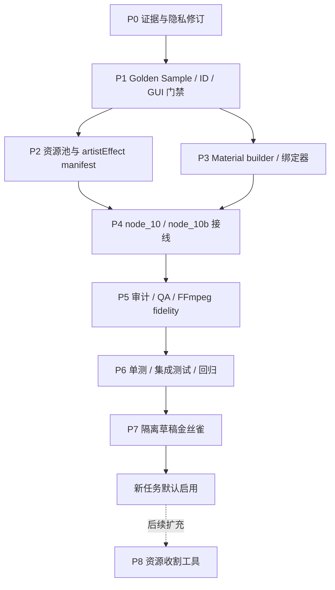

# auto-video-editor 原生花字方案正确性审查与修订执行计划

> **审查日期：** 2026-11-21  
> **仓库：** `<user>/auto-video-editor`  
> **目标分支：** `main`  
> **当前 HEAD：** `f885e938f2841f6bd5967b4ffed61f905ce38a54`  
> **当前 HEAD 的父提交 / 代码基线：** `edec4b09048698978bcac1d3f5619e7aa42f66aa`  
> **被审查文档：** `docs/第九期开发/字幕无原生花字根因分析与花字通道实施计划_console-011419d9ceec_20261121.md`  
> **被审查文档 Blob SHA：** `ccd27724553b72df26d2e6a9812140e361c29797`  
> **审查方式：** GitHub 仓库静态代码核验 + 仓库内证据文件解析；未在用户本机运行测试、启动剪映或复现 GUI 操作。

---

## 0. 审查结论

### 0.1 总体判定

**参考文档的核心技术结论基本正确，但当前版本不宜直接作为代码实施指令。**

核心结论成立：当前 `main` 分支已具备普通字幕、字幕样式和字幕入场动画能力，但尚未实现独立的剪映原生花字资源池、`text_effect` 构造器和写入绑定逻辑。`node_10` / `node_10b` 当前写入的是 `materials.material_animations`，不是原生花字 `materials.effects`。

不过，参考文档有若干事实和设计问题必须先修订，主要包括：

1. **仓库隐私风险：** GitHub 仓库元数据当前显示 `visibility=public`，但已提交的采集说明仍以“私有仓库”为前提；证据文件包含本机绝对路径，资源记录中还存在未脱敏的 `business_info.sign` 字段。
2. **资源数量不准确：** `rpdb_flower_record.json` 的 `authoritative_own_item_records` 只有 2 条记录，且两条记录是同一资源，不是“约 8 条”独立花字资源。当前可确认的唯一资源是“互动立体”。
3. **Golden Sample 只部分满足 P1：** 样本证明了 `materials.effects` / `type=text_effect` / `category_id=panel-text-flower` / `extra_material_refs` 的结构，但实际 material ID 是 UUID，不能据此证明 `text-flower-*` 前缀 ID 可被剪映接受。
4. **缓存目录判断不完整：** 当前配置 `JIANYING_CACHE_ROOT` 指向 `Cache/effect`，而花字样本位于 `Cache/artistEffect`。新方案必须使用独立的花字缓存根目录，并利用已有缓存 manifest 检测缓存包是否发生变化，不能只判断目录是否存在。
5. **导出计数存在重复统计风险：** Golden Sample 中同一个花字 material ID 在 `materials.effects` 出现两次，text 轨段 refs 也重复两次；当前导出器按数组条目数计数，可能把一个花字报告为两个。
6. **审计能力被高估：** `_AUDIT_BUCKETS` 已包含 `effects`，但 `changed_counts` 只比较桶条目数量；同样数量的 effect 内容变化、refs 变化不会在 `changed_counts` 中显示。
7. **降级与清理语义不够明确：** 缺少 text segment 时不能先写 effect 再留下孤儿素材；开关关闭、资源不可用、缓存失效时是否保留上一轮我方花字，需要明确区分。
8. **VIP 账号授权状态未验证：** 唯一已确认的资源标记为 VIP/订阅资源，但证据没有证明当前剪映账号拥有 Pro 订阅。默认开启会自动把 VIP 花字写入所有正文字幕，需明确接受相应的授权和导出风险。

### 0.2 结论分级

| 项目 | 判定 | 说明 |
|---|---|---|
| 当前没有自动注入原生花字的代码通道 | **正确** | 核心节点和构造器未实现 `text_effect` 写入 |
| `node_10` 当前处理的是字幕入场动画 | **正确** | 写入 `materials.material_animations`，并绑定到 `extra_material_refs` |
| 原生花字样本落在 `materials.effects` | **已由仓库证据支持** | Golden Sample 中 `type=text_effect`、`category_id=panel-text-flower` |
| 原生花字通过 text 轨段 `extra_material_refs` 绑定 | **已由仓库证据支持** | 提取样本中可见花字 material ID 与 refs |
| “约 8 条”自有花字资源 | **不正确** | 证据 JSON 只有 2 条记录，且为同一资源的重复记录 |
| Golden Sample 已完全满足 P1 | **部分正确** | 样本结构已存在，但尚未验证自定义 ID 格式、跨环境路径和缓存失效规则 |
| vendor 缺少花字元数据模块是实现阻塞 | **不成立** | 项目可直接通过 `jy_common/native_fx.py` 自定义构造器写入字典 |
| FFmpeg 不渲染花字 | **正确** | 这是 MP4 导出能力边界，不影响剪映草稿写入 |
| 当前导出花字计数已足够准确 | **不正确** | 目前按 `effects` 数组原始条目计数，无法消除重复 ID |
| `effects` 审计已完整 | **不正确** | 只有数量变化，不包含桶内容指纹及 refs 变化 |

**推荐处理：保留核心架构方向，按本文件第 5 节修订实施顺序和技术约束后再进入代码开发。**

---

## 1. 审查范围与代码基线

### 1.1 Git 基线校准

本次读取到的 `main` 分支 HEAD 为：

```text
f885e938f2841f6bd5967b4ffed61f905ce38a54
```

该提交的父提交为：

```text
edec4b09048698978bcac1d3f5619e7aa42f66aa
```

HEAD 提交只新增了本次被审查的 Markdown 文档；花字相关代码基线仍是父提交 `edec4b0`。因此，参考文档将 `edec4b0` 称为**代码基线**是合理的，但称其为“当前 main 最新 HEAD”不准确。建议统一写成：

> 审查分支：`main`；文档提交：`f885e938`；代码基线：`edec4b0`（`f885e938` 的父提交，当前提交未改变业务代码）。

### 1.2 已核验的主要文件

| 文件 | 本次核验内容 |
|---|---|
| `nodes/_subtitle_texts.py` | 普通字幕 material 的构造方式和 ID 前缀 |
| `nodes/node_10_inject_text_fx.py` | node_10 / node_10b 的现有写入流程、我方字幕筛选、降级和清理语义 |
| `jy_common/native_fx.py` | 已有转场、视频特效、文字动画和贴纸构造器；未见原生花字构造器 |
| `jy_common/template_library.py` | 现有资源库加载 API 及其兼容性 |
| `templates/fx_template.json` | 转场和视频特效模板 |
| `templates/fx_resource_library.json` | 转场和视频特效资源库 |
| `templates/text_resource_library.json` | intro / loop / outro 字幕动画资源库 |
| `nodes/_draft_io.py` | `effects` 审计桶和 `changed_counts` 的实际计算方式 |
| `draft_ops/draft_integrity.py` | 通用素材 ID 收集、轨段引用检查、required-feature gate |
| `draft_ops/draft_exporter.py` | 花字 fidelity 统计逻辑 |
| `storyline/native_draft.py` | 原生草稿素材桶列表，包含 `effects` 和独立的 `flowers` 桶 |
| `config.py` | 现有字幕动画配置和缓存根目录 |
| `jy_common/cache_manifest.py` | 缓存文件 SHA-256 manifest 的实现 |
| `jy_common/job_identity.py` | job_id 解析优先级 |
| `monitoring/workflow_graph.py` | node_10 / node_10b 的 UI 显示名称 |

### 1.3 核验边界

本次只读取 GitHub 中的代码和已提交证据，没有访问用户本机正在使用的剪映进程、当前任务目录、当前 `rp.db`、本机缓存或未提交截图。因此：

- `console-011419d9ceec` 的最新草稿状态、最新 9 条 mutations 日志和对应截图，属于参考文档记录的本机观察；当前仓库证据包没有包含这组同任务原始文件，无法从仓库独立复核。
- 仓库已有的 Golden Sample 和缓存证据来自 `console-52373c6f9e11`，采集日期为 2026-11-18；可以作为花字结构参考，但不能冒充 `console-011419d9ceec` 当前任务的原始证据。
- 本报告不声称已运行 `pytest`，也不声称已通过剪映 GUI 真机验证。

---

## 2. 代码核验结果

### 2.1 普通字幕和入场动画链路

`nodes/_subtitle_texts.py` 的 `make_text_material()` 构造 `materials.texts` 条目。当前字幕 ID 前缀由调用方传入，node_10 只筛选我方字幕 ID（`text-zh-` / `text-en-`）。

`nodes/node_10_inject_text_fx.py` 的 `_apply_text_animations()`：

1. 从 `materials.texts` 中筛选我方字幕；
2. 调用 `build_native_text_animation_material()`；
3. 把素材写入 `materials.material_animations`；
4. 把动画 material ID 追加到对应 text segment 的 `extra_material_refs`；
5. 对我方旧 `text-anim-*` 素材执行 upsert 和受控清理。

现有 `apply_text_fx()` 只加载 `fx_template`、`fx_resource`、`text_resource` 三类库，并调用字幕动画逻辑。`jy_common/template_library.py` 当前也只有 fx 资源库和 text 动画资源库，没有 flower 资源库 API。

因此，参考文档对“没有独立花字通道”的核心判断成立。

### 2.2 花字 Golden Sample

仓库证据：

`docs/第七期开发/花字审计证据_20261118/zh_draft_flower_extract.json`

提取结果如下：

| 检测项 | 证据结果 |
|---|---|
| `materials_effects_total` | 2 |
| `type` | `text_effect` |
| `category_id` | `panel-text-flower` |
| `category_name` | `花字` |
| 花字名称 | `互动立体` |
| `effect_id` | `7407340226189757733` |
| `resource_id` | `7407340226189757733` |
| `md5` | `c093f229a5b9529beab4d27c00bc0c4f` |
| material ID | UUID：`1D5E66AA-119A-416a-A828-3157E60EDDD3` |
| 绑定位置 | text track segment 的 `extra_material_refs` |

该证据确认了 `materials.effects` 中的花字 material 形状，也确认了轨段引用方式。它足以支持“按该结构继续做隔离草稿实验”，但不足以证明下面这些实现假设：

- 剪映一定接受 `text-flower-text-zh-1` 这种非 UUID ID；
- 剪映保存后一定保留自定义前缀 ID；
- 将同一花字 material 绑定到多个正文字幕段的表现与单段样本一致；
- 不同用户目录、便携版安装目录和不同 Windows 用户下的缓存绝对路径都能正确解析。

**修订要求：** P1 不能只写“Golden Sample 已有”，而要写成“material schema 与 refs 通道已确认；ID 格式和部署路径仍需通过隔离草稿验证”。

### 2.3 Golden Sample 中的重复条目

该样本包含：

- `materials.effects` 中相同 material ID 的两条重复记录；
- 一个 text segment 的 `extra_material_refs` 中，相同花字 ID 出现两次。

这与参考文档记录的“剪映 UI 保存后重复序列化”现象一致。但是，**“观察到重复”不等于“已经证明重复不会影响渲染或剪映后续编辑”**。建议把“属 GUI 行为无害”改为“样本观察到重复；流水线自身必须去重；GUI 生成的重复需要保留证据并列为非阻断告警，是否无害仍以 GUI 对照实验确认”。

### 2.4 花字资源池数量

仓库文件：

`docs/第七期开发/花字审计证据_20261118/rpdb_flower_record.json`

其 `authoritative_own_item_records` 当前只有 **2 条记录**。两条记录的 `effect_id`、`resource_id`、`md5` 和名称完全相同，都是“互动立体”。因此：

- 数据库记录数：2；
- 按 `(effect_id, resource_id, md5)` 去重后的资源数：1；
- 当前证据能确认的唯一资源：互动立体；
- 不能据此描述为“约 8 条独立自有花字资源”。

`matched` 中的多个分类请求命中，不应直接计为不同的花字资源。导入池时必须按资源身份去重，避免同一资源被重复轮换。

### 2.5 花字缓存目录

证据文件：

`docs/第七期开发/花字审计证据_20261118/flower_cache_inventory.json`

显示“互动立体”缓存位于 `Cache/artistEffect/<effect_id>/<md5>`，该目录下有 5 个文件的大小和 MD5 记录。

但 `config.py` 现有 `JIANYING_CACHE_ROOT` 默认指向 `Cache/effect`，这是字幕动画缓存根目录，不是花字缓存根目录。不得把该配置直接传给花字缓存检查函数，否则会在错误目录下查找资源。

仓库已有 `jy_common/cache_manifest.py`：它能够遍历资源目录、计算文件大小和 SHA-256，并生成 `manifest_sha256`。当前 helper 的目录拼接逻辑是通用的 `cache_root / effect_id / md5`，可以复用于 `artistEffect`，但其文档注释和验证记录仍偏向普通 `effect` 缓存，且目前没有看到运行时根据已保存 manifest 判定缓存过期的完整接线。

**修订要求：** 新增独立的 `JIANYING_ARTIST_EFFECT_CACHE_ROOT`，默认指向 `Cache/artistEffect`；缓存可用性不能只检查 `.is_dir()`，还应比较 GUI 验证时保存的 `verification.cache_manifest_sha256` 与当前 manifest。

### 2.6 审计桶：已包含 effects，但不是完整内容审计

`nodes/_draft_io.py` 当前 `_AUDIT_BUCKETS` 已包含 `effects`。这意味着新增或删除 `materials.effects` 条目、导致桶长度变化时，`changed_counts` 可以记录变化。

但 `_bucket_counts()` 只记录桶长度；`build_draft_mutation_record()` 只把前后数量不同的桶写进 `changed_counts`。如果 effect 条目内容被修改但数量不变，或只改变 text segment 的 `extra_material_refs`，`changed_counts` 不一定出现 `materials.effects` 变化。整份草稿 SHA-256 只能说明文件发生变化，不能指出变化来自哪个桶。

**修订要求：** 保留现有轻量计数，同时增加 `materials.effects` 内容指纹和 text segment 花字 refs 指纹；日志中记录指纹是否变化，不必写入完整私有资源路径。

### 2.7 FFmpeg fidelity：当前计数会重复计算

`draft_ops/draft_exporter.py` 当前 `n_flower` 的计算方式是遍历 `materials.effects`，对每个 `type=text_effect` 条目累加 1。它没有：

- 按 material ID 去重；
- 检查 material ID 是否实际被 text track segment 引用；
- 区分“素材条目数”和“实际绑定到字幕段的花字资源数”。

Golden Sample 的 `materials.effects` 有两条相同 ID 的记录，因此当前算法会报告 2 个花字，而样本实际只包含 1 个唯一花字 ID。这个数字可能高估。

**修订要求：** 导出报告至少按“唯一且实际绑定的花字 material ID”计数；可选同时报告绑定字幕段数。孤立 material 不应计为已应用花字。

### 2.8 通用引用检查和专属 QA

`draft_ops/draft_integrity.py` 的 `_material_ids()` 会遍历 `materials` 下所有 list bucket；`check_track_references()` 会检查 `material_id` 和 `extra_material_refs` 是否能解析到已存在 material。

所以，花字写入 `materials.effects` 后，基本的悬空引用检查已有基础，不必再实现一套重复的通用解析器。但当前检查不验证：

- `type=text_effect`、`category_id=panel-text-flower` 是否正确；
- 同一个我方 material ID 是否出现冲突内容；
- text segment 是否重复引用同一个花字 ID；
- 花字 material 是否孤立、是否绑定到我方正文字幕；
- 缓存 manifest 是否与 GUI 验证证据一致。

建议只补充花字专属结构和一致性检查，不要重复实现通用 refs 检查。

### 2.9 job_id 与中英文节点

`jy_common/job_identity.py` 已有公共 `resolve_job_id()`，优先读取 LangGraph `config.configurable.thread_id`，再回退到 `state.thread_id`、`state.session_id` 和中文草稿目录名。node_10 / node_10b 使用相同公共解析入口。

因此，参考文档提出复用 job_id 做中英文一致选择是合理的，不需要再次重做 job_id 修复，也不需要因为新增花字直接改变 LangGraph 图拓扑或 `WorkflowState` schema。

### 2.10 vendor 元数据模块

当前 `vendor/pyJianYingDraft/metadata/` 只有 effect、text_intro、text_loop、text_outro、transition 和 video_scene_effect 等模块，没有独立的 text_flower 模块。

这是“vendor 没有现成适配”的事实，但不是技术阻塞。项目已有自定义原生素材构造器，可直接按已验证的 JSON schema 构造字典。建议把该项从“实现四层缺失之一”改为“vendor 没有复用现成类；本期采用项目自有 builder，不改 vendor”。

---

## 3. 参考文档需要修订的问题清单

| 编号 | 优先级 | 问题 | 影响 | 必须修订的内容 |
|---|---|---|---|---|
| R-01 | **P0** | 仓库当前为公开可见，但证据文档称仓库为私有 | 本机账户目录、开发路径、缓存路径和签名字段可能被公开暴露 | 先清理绝对路径与 `business_info.sign`；检查所有已提交证据；如需从 Git 历史彻底移除，另行评估历史重写影响 |
| R-02 | P1 | `authoritative_own_item_records` 只有 2 条重复记录 | 资源池规模被高估，轮换多样性预期错误 | 改为“2 条记录、1 个唯一资源”；池导入按资源身份去重 |
| R-03 | P1 | `text-flower-*` ID 格式没有 GUI 证据 | 剪映可能不接受或保存时重写自定义 ID | 增加隔离草稿 ID 兼容实验；通过前不写正式任务草稿 |
| R-04 | P1 | 花字缓存根目录与动画缓存根目录不同 | 查错目录导致全量误判缓存缺失 | 新增 `JIANYING_ARTIST_EFFECT_CACHE_ROOT` |
| R-05 | P1 | 只检查缓存目录存在，不检查缓存内容变化 | 不完整或被替换的资源包可能被误判可用 | 使用 `cache_manifest.py`，记录并比对 `manifest_sha256` |
| R-06 | P1 | UI 重复条目被直接定性为“无害” | 未经对照实测就把潜在数据异常当作正常 | 改为观察事实 + 非阻断告警；验证重复后是否影响渲染和保存 |
| R-07 | P1 | FFmpeg 花字计数按原始 effects 条目数统计 | GUI 重复条目造成数量高估；孤立素材也可能被统计 | 只统计唯一且绑定到 text track 的花字 ID |
| R-08 | P1 | `changed_counts` 仅比较数组长度 | 同数量内容修改、refs 修改无法在桶级被定位 | 增加 effects 内容摘要和花字 refs 摘要 |
| R-09 | P1 | `no_text_segment` 场景写入顺序不明确 | 可能生成未绑定的孤儿 effect material | 先定位 text segment，再写 effect 和 ref；找不到时不写 material |
| R-10 | P1 | `TEXT_FLOWER_ENABLED=0` 与非破坏性降级的语义冲突未定义 | 关闭功能后可能仍保留上一轮花字，或误删已有花字 | 明确 disabled / degraded / cleanup 三种行为，清理必须是显式操作 |
| R-11 | P1 | VIP 资源和账号订阅状态未建立验收门槛 | 默认给所有正文字幕加 VIP 资源，可能引发订阅提示或导出限制 | 加入账号授权风险提示和真机导出验收；不得把 `is_vip=true` 表示成账号已授权 |
| R-12 | P1 | `TemplateLibrary` 新增参数的兼容性没有写清 | 若把第四个参数设为必填，其他调用方会被破坏 | `text_flower_resource` 必须为可选参数，保持既有三参数调用不变 |
| R-13 | P2 | vendor 缺失模块被列为四层功能缺失之一 | 把非阻塞组织方式误作技术前置条件 | 标注为“无现成 vendor 适配；本期用自定义 builder” |
| R-14 | P2 | 当前任务 `console-011419d9ceec` 的证据没有纳入仓库证据包 | 外部审查者无法复核当前任务的草稿 JSON、9 条日志和截图 | 补充经过脱敏的当前任务摘要、草稿结构提取和审计日志摘要 |
| R-15 | P2 | 测试清单缺少缓存 manifest、ID 格式、禁用后重跑和导出去重测试 | 单测可能通过，但真机加载/报告仍有问题 | 按第 6 节补充测试矩阵 |

### 3.1 关于“全部正文字幕”和默认开启

参考文档把应用范围定义为全部 `text-zh-*` / `text-en-*` 正文字幕，不覆盖 node_09b 开场标题。这是产品策略，不是仓库代码能自行证明的事实。当前实现通过我方字幕 ID 前缀区分正文字幕与手工标题，方案可以沿用该边界，但必须有测试证明开场标题和人工 UUID 文本不会被误处理。

默认开启也是产品决策。由于当前唯一确认资源是 VIP 订阅资源，默认开启之前要确认接受以下行为：新任务自动把 VIP 花字写入剪映草稿；账号订阅状态与资源本身的 `is_vip` / `paid_type` 分开处理；剪映能否预览、保存和导出必须在目标账号上实测。不能仅凭资源缓存存在就声称当前账号拥有授权。

---

## 4. 修订后的设计约束

### 4.1 资源池数据模型

建议新建：`templates/text_flower_resource_library.json`

最小字段建议：

| 字段 | 用途 |
|---|---|
| `name` | 花字名称，例如“互动立体” |
| `effect_id` | 剪映资源 effect ID |
| `resource_id` | 剪映资源 ID；与 `effect_id` 相同也要分别保存 |
| `md5` | 资源目录身份字段 |
| `category_id` | 固定为 `panel-text-flower` |
| `is_vip` / `paid_type` | 资源授权属性，不表示当前账号订阅状态 |
| `enabled` | 是否允许进入候选池 |
| `verified` | 是否通过 GUI 预览、保存、重开验证 |
| `verification.jianying_version` | GUI 验证所用剪映版本 |
| `verification.verified_at` | 验证时间 |
| `verification.evidence_path` | 脱敏证据文件相对路径 |
| `verification.cache_manifest_sha256` | 验证时的缓存 manifest 摘要 |
| `source_snapshot` | 脱敏后的原始资源元数据摘要 |

池加载时按 `(effect_id, resource_id, md5)` 去重。当前证据只能生成 1 个唯一条目；未实测的资源不能标成 `verified=true`。

### 4.2 独立花字缓存配置

新增配置：

```python
JIANYING_ARTIST_EFFECT_CACHE_ROOT
```

默认目录应指向当前用户的：

```text
%LOCALAPPDATA%\JianyingPro\User Data\Cache\artistEffect
```

并允许通过环境变量覆盖，以适配便携版或非默认安装目录。

缓存目录拼接规则：

```text
<JIANYING_ARTIST_EFFECT_CACHE_ROOT>/<effect_id>/<md5>
```

不可复用当前 `JIANYING_CACHE_ROOT`，因为当前配置指向 `Cache/effect`。

缓存守卫应至少满足：

1. 资源记录 `enabled=true`；
2. 资源记录 `verified=true`；
3. `effect_id`、`resource_id`、`md5` 完整；
4. `Cache/artistEffect/<effect_id>/<md5>` 目录存在；
5. 当前 `build_cache_manifest()` 结果与验证记录中的 `cache_manifest_sha256` 一致。

如果旧资源没有 manifest，状态应为 `cache_unverified` / `verification_stale`，不能静默当作完整可用。manifest 保存时不要把本机绝对 `cache_root` 路径写入资源库或 UI 日志，只保存文件清单摘要和必要的非路径信息。

### 4.3 Material ID 策略

Golden Sample 使用 UUID。参考文档提出 `text-flower-{text_material_id}`，但尚无剪映兼容证据。

实施前必须在隔离测试草稿里比较：

- 自定义前缀 ID 是否能被剪映打开、预览、保存、关闭和重开；
- 保存后 ID 是否被保留或重写；
- 对应 refs 是否仍然有效。

只有测试通过才能采用前缀 ID。若剪映要求 UUID，使用固定命名空间的 UUIDv5（基于任务无关的稳定文本 material ID 生成），保证重放稳定，并通过可重算的 ID 规则识别我方素材。不能在没有验证前把 UUID 样本推断成“任意字符串 ID 都可用”。

### 4.4 花字 material 构造

在 `jy_common/native_fx.py` 新增独立 builder，例如：

```python
build_native_text_effect_material(
    *,
    material_id: str,
    flower_meta: dict[str, Any],
    artist_effect_cache_root: str | Path,
) -> dict[str, Any]
```

builder 的字段值以 Golden Sample 为准，不应从普通字幕动画结构推断。`path` 应由当前运行环境的缓存根目录动态构造为绝对路径，不得硬编码采集机器的 `C:/Users/...` 路径。

写入字段必须至少校验：

- `type == "text_effect"`；
- `category_id == "panel-text-flower"`；
- `effect_id`、`resource_id`、`name`、`path` 非空；
- `path` 与 `effect_id` / `md5` 对应的缓存目录完全一致。

### 4.5 写入与引用绑定

建议新建：`nodes/_text_flower.py`

核心函数：

```python
apply_text_flower_effects(
    draft: dict,
    flower_lib: TemplateLibrary,
    *,
    job_id: str,
    enabled: bool,
    tag: str,
) -> tuple[list[str], dict[str, Any]]
```

写入规则：

1. 只处理 `text-zh-*` / `text-en-*` 我方正文字幕；不得处理 node_09b 开场标题、人工 UUID 文本或其他语言外的素材。
2. 先按 text material ID 找到实际 text track segment；找不到时记录 `no_text_segment`，不创建孤儿 `materials.effects` 条目。
3. 按稳定 material ID 对 `materials.effects` 执行 upsert，不覆盖人工 UUID 花字。
4. 把花字 ID 加入目标 text segment 的 `extra_material_refs`，写入前去重。
5. 同一逻辑任务的中英文分支复用 `resolve_job_id()`，用同一 seed 选到同一资源；同一资源应用到全部正文字幕。
6. 缓存或池不可用时 fail-closed，不创建新花字，也不删除上一轮我方素材。
7. 成功生成新结果后，才允许按我方 ID 规则清理不再使用的旧花字；人工素材不得被清理。

**必须定义 `enabled=false` 的行为：** 推荐默认只停止本轮新写入，并保留草稿中已有的花字；需要移除我方花字时提供独立、显式的清理动作。这样可以避免把“关闭功能”与“删除草稿内容”混成一个操作。若产品要求关闭时自动移除，则必须作为单独产品决策，并补充非破坏性测试。

### 4.6 TemplateLibrary API 兼容

当前 `TemplateLibrary.from_json_files()` 与 `load_resource_libraries()` 使用三个资源参数。新增 `text_flower_resource` 时必须是可选参数，例如默认 `None`：

- 旧有三参数调用继续有效；
- 没有花字库文件时按空花字库处理；
- 只有调用方明确启用花字逻辑时才查询花字库；
- 不因资源库文件暂时缺失而影响现有转场、视频特效和字幕动画逻辑。

### 4.7 节点接线

保留 node_10 / node_10b 现有拓扑：

- `apply_text_fx()` 先执行字幕动画逻辑，再执行花字逻辑；
- 同一份草稿只进行一次原子写回；
- 中文和英文节点调用相同公共函数；
- 不新增 `WorkflowState` 字段，不 bump schema，除非后续确实需要让 UI 读取结构化花字结果；
- `status_log` 记录资源名、effect ID、池大小、可用数、选取位置、写入数和降级原因；不得把本机缓存绝对路径写入 UI 日志。

workflow graph 显示名可调整为“注入中文字幕入场动画与原生花字”和“注入英文字幕入场动画与原生花字”，保留内部 node ID 不变。

### 4.8 审计、QA 与导出

**审计：** 保留 `_AUDIT_BUCKETS` 的 `effects` 条目数量变化；增加花字 material 内容摘要和 text track 花字 refs 摘要。只记录 SHA/数量，不写入资源包完整路径。

**QA：** 在现有通用 `check_track_references()` 之外补充花字专属检查：

- 我方 `text-flower` material 的 `type` / `category_id` / 必要字段；
- 重复 ID：同 ID 且内容完全一致时告警或规范化；同 ID 内容冲突时 error；
- 重复 refs：我方 refs 写入前去重；剪映 UI 保存后观察到的重复不应未经验证就作为致命错误；
- 孤立花字 material、非正文字幕绑定、悬空 refs；
- 缓存验证状态和 manifest 是否过期。

**required-feature gate：** 本期默认不把花字加入 `REQUIRED_FEATURE_KEYS`。没有花字资源的任务可以降级完成；只有产品明确要求“花字必须生成”时，才增加显式 required-feature 配置。

**FFmpeg fidelity：** 仅统计实际绑定到 text track 的唯一 `text_effect` material ID。建议分别输出：

- 唯一已绑定花字素材数；
- 绑定花字的正文字幕段数；
- 明确提示这些花字只在剪映客户端草稿内可见，不会被当前 FFmpeg 导出器渲染。

---

## 5. 修订后的分阶段执行计划

### 阶段 0：证据与隐私修订（P0，先做）

**目标：** 确保后续实现依据真实、可审计且不泄露本机信息。

任务：

- [ ] 修正 Git 基线描述：HEAD `f885e938`，代码基线 `edec4b0`。
- [ ] 将“约 8 条资源”修正为“2 条原始记录、1 个唯一资源”。
- [ ] 将当前任务 `console-011419d9ceec` 的草稿摘要、审计日志摘要和截图证据与旧样本 `console-52373c6f9e11` 分开管理。
- [ ] 对公开仓库中已提交的证据做脱敏检查：绝对用户目录、OneDrive 开发路径、缓存绝对路径、`business_info.sign` 等字段。
- [ ] 评估 Git 历史中是否仍保留敏感字段；如需彻底移除历史记录，单独制定历史重写和协作者同步方案，不直接强制改写主分支。
- [ ] 为当前任务补充可复核的结构化证据：`effects` 条目摘要、text refs 摘要、审计记录摘要、剪映版本和采集时间。

**交付物：** 修订后的证据包、脱敏说明、固定 commit SHA。

**进入下一阶段条件：** 资源数量、代码基线、当前任务证据与隐私风险均已澄清。

### 阶段 1：Golden Sample 与 ID 格式门禁（P0）

**目标：** 不直接把未验证的 ID 和缓存假设写入正式草稿。

任务：

- [ ] 以已提交 Golden Sample 为结构依据，核验完整 material 字段和 text segment refs。
- [ ] 复制一份隔离草稿，分别测试 UUID 和 `text-flower-*` ID。
- [ ] 对测试草稿执行打开、预览、保存、关闭、重开；核验 material ID 和 refs 是否保留。
- [ ] 在一条字幕上验证效果，再验证同一花字绑定多条正文字幕的行为。
- [ ] 记录重复 material / refs 的 UI 保存行为，确认是否影响画面、编辑和重开。

**交付物：** Golden Sample schema 说明、ID 兼容结论、GUI 前后对照证据。

**进入下一阶段条件：** 花字 material 结构、ID 方案、引用方式和 UI 保存行为均有明确结论。

### 阶段 2：资源池和缓存 manifest（P1）

**目标：** 建立去重、可追溯、不会把坏缓存误判为可用的资源池。

任务：

- [ ] 新建 `templates/text_flower_resource_library.json`。
- [ ] 新建 `scripts/import_text_flower_pool.py`，从已脱敏证据 JSON 导入，不在运行时读取 `rp.db`。
- [ ] 按 `(effect_id, resource_id, md5)` 去重；当前只导入 1 个唯一资源。
- [ ] 新增 `JIANYING_ARTIST_EFFECT_CACHE_ROOT`，不复用 `JIANYING_CACHE_ROOT`。
- [ ] 复用/扩展 `jy_common/cache_manifest.py`，为花字目录生成文件清单和 manifest SHA-256。
- [ ] 将 `cache_manifest_sha256`、剪映版本、验证时间和证据相对路径写入 `verification`。
- [ ] 在资源池加载时区分 `verified`、`cache_missing`、`cache_unverified`、`verification_stale`。

**交付物：** 花字资源库、导入脚本、缓存验证记录。

**进入下一阶段条件：** 唯一资源可准确加载；缓存缺失、内容变化和验证过期都能被识别。

### 阶段 3：原生 material builder 与绑定器（P1）

**目标：** 在不污染人工内容的前提下，产生幂等的花字素材和引用。

任务：

- [ ] 在 `jy_common/native_fx.py` 增加 `OUR_TEXT_FLOWER_PREFIX`（仅当 ID 格式门禁允许）和 `build_native_text_effect_material()`。
- [ ] 增加 `flower_effect_cache_available()`，检查 `artistEffect` 独立根目录和 manifest。
- [ ] 新建 `nodes/_text_flower.py`。
- [ ] 先解析 text segment，再构造和写入 effect；缺少 segment 不创建孤儿素材。
- [ ] 只处理我方 `text-zh-*` / `text-en-*` 正文字幕。
- [ ] 对 `materials.effects` 执行确定性 upsert；text segment refs 写入前去重。
- [ ] 保留人工 UUID 素材；缓存不可用时不清理旧数据。
- [ ] 明确 disabled / degraded / cleanup 三种状态和结果摘要。

**交付物：** builder、绑定器、资源可用性守卫、结构化摘要。

**进入下一阶段条件：** 单元测试证明重复执行不增加重复素材或 refs；人工素材不受影响；所有 refs 都可解析。

### 阶段 4：接入 node_10 / node_10b（P1）

**目标：** 保持现有工作流拓扑和字幕动画行为不变。

任务：

- [ ] 在 `apply_text_fx()` 的字幕动画之后调用花字公共函数。
- [ ] 扩展资源库加载接口，但 `text_flower_resource` 必须可选，兼容既有三参数调用。
- [ ] node_10 / node_10b 使用 `resolve_job_id()` 的同一 job_id seed。
- [ ] 同一任务选中同一花字资源并应用于全部正文字幕；开场标题不处理。
- [ ] 同一草稿由 `apply_and_write()` 统一原子写回，不额外增加一次草稿写入。
- [ ] `status_log` 输出选中资源、写入数量和降级状态，不输出绝对缓存路径。
- [ ] 保留 `WorkflowState` / LangGraph schema，不做无必要的拓扑变更。

**交付物：** 中英文双分支接线、日志标签和节点显示文案。

**进入下一阶段条件：** 中英文草稿均写入正确；同一 job_id 选择一致；原有字幕动画结果无回归。

### 阶段 5：审计、QA 和 FFmpeg fidelity（P1）

**目标：** 让“花字写入成功”与“MP4 导出可见”成为两个独立、可验证的状态。

任务：

- [ ] 扩展 `nodes/_draft_io.py`：对 `effects` 条目增加内容指纹，对 text refs 增加摘要指纹。
- [ ] 扩展 `draft_ops/draft_integrity.py`：增加花字字段结构、重复 ID 冲突、孤立 material、重复 refs 和目标字幕检查。
- [ ] 不把 `text_flower` 默认加入 `REQUIRED_FEATURE_KEYS`。
- [ ] 修改 `draft_ops/draft_exporter.py`：只统计唯一且绑定的花字 ID，避免 GUI 重复序列化导致高估。
- [ ] 导出 fidelity 信息中明确说明花字不进入当前 FFmpeg MP4。
- [ ] 增加对应审计、QA、导出单测。

**交付物：** 花字 QA 检查、可解释的 mutations 日志、准确 fidelity 报告。

**进入下一阶段条件：** 重复和孤立数据能够被区分；导出数量与实际绑定素材一致。

### 阶段 6：单元测试、集成测试与回归（P1）

**目标：** 覆盖正常、降级、重复执行、双语和旧功能回归。

任务：

- [ ] 新增 `tests/unit/test_native_text_effect.py`。
- [ ] 新增 `tests/unit/test_node_text_flower.py`。
- [ ] 新增 `tests/unit/test_text_flower_resource_library.py`。
- [ ] 扩展 `tests/unit/test_draft_integrity.py`。
- [ ] 扩展 `tests/unit/test_draft_exporter.py`。
- [ ] 新增 `tests/integration/test_text_flower_dual_draft.py`。
- [ ] 执行 `python -m pytest tests/unit -q`。
- [ ] 在 PostgreSQL 测试依赖准备完成后运行集成测试；数据库容器名和启动命令以当前环境实际配置为准，不把固定容器名写成所有机器通用前提。
- [ ] 按项目现有测试约定，在运行涉及剪映文件访问的回归前关闭剪映，避免客户端同时改写草稿造成非确定性。

**交付物：** 自动化测试结果、回归差异报告。

**进入下一阶段条件：** 单测、集成测试通过；字幕、动画、转场、视频特效、导出链路没有回归。

### 阶段 7：隔离草稿金丝雀与逐步启用（P1）

**目标：** 先在测试副本验证剪映真实行为，再应用到新任务。

验收步骤：

1. 复制一个短视频任务为隔离草稿，不修改用户当前正式草稿。
2. 新建任务运行流水线，检查中英文 `materials.effects` 是否包含正确花字，text refs 是否绑定到正文字幕。
3. 检查 mutations 记录的 effects 内容指纹和 refs 指纹。
4. 用剪映打开隔离草稿，确认花字显示；保存、关闭、重开，再次检查。
5. 比较 GUI 保存前后 material / refs 的重复行为，并确认没有画面异常。
6. 在目标账号上确认 VIP 预览、保存和导出行为；不以缓存存在替代授权验收。
7. 使用 `TEXT_FLOWER_ENABLED=0` 执行对照任务，确认不会新增花字且既有字幕动画行为保持不变。
8. 最后才在新任务中默认启用；不自动回写或批量修改历史草稿。

**最终验收：** 剪映草稿可打开、可见、可保存、可重开；中英文应用范围正确；人工素材不受影响；降级可解释；FFmpeg 报告不虚报花字已渲染。

### 阶段 8：更多资源收割（可选，独立排期）

目前证据只确认 1 个唯一资源。若后续确实需要增加轮换多样性，再开发 `scripts/harvest_text_flower.py`，提供 `list`、`gen`、`manifest`、`apply-verification` 等子命令。

收割工具不得自行把资源标记为 `verified`。每条资源仍需 GUI 预览、保存、关闭、重开和证据留档后才能回填验证状态。该工具不是首个可用花字通道的阻塞前置，可在主链路稳定后再做。

---

## 6. 补充测试矩阵

| 编号 | 场景 | 预期结果 |
|---|---|---|
| TF-01 | 资源库读取当前 `rpdb_flower_record.json` | 2 条重复记录归一为 1 个唯一资源 |
| TF-02 | 缺少 `effect_id` / `resource_id` / `md5` | 资源不进入可用候选池 |
| TF-03 | `artistEffect` 缓存根目录正确 | 查找 `Cache/artistEffect`，不误用 `Cache/effect` |
| TF-04 | 缓存目录不存在 | `cache_missing`，不写入新花字 |
| TF-05 | 缓存目录存在但 manifest 不一致 | `verification_stale`，不写入新花字 |
| TF-06 | 已验证缓存 manifest 一致 | 资源进入可用候选池 |
| TF-07 | UUID 与 `text-flower-*` ID 隔离草稿对照 | 只有剪映打开、保存、重开验证通过的 ID 方案可启用 |
| TF-08 | 中文正文字幕应用花字 | 只绑定 `text-zh-*`，不处理开场标题 |
| TF-09 | 英文正文字幕应用花字 | 只绑定 `text-en-*` |
| TF-10 | 同一个 job_id 的 zh/en 分支 | 选择同一资源 |
| TF-11 | 不同 job_id | 选择 seed 可复现，不依赖草稿库根目录名 |
| TF-12 | 同一节点重复执行 | material ID 与 refs 不重复，结果稳定 |
| TF-13 | checkpoint resume 后再次执行 | 不新增重复 effect，不改变选择结果 |
| TF-14 | text material 找不到 text segment | 记录 `no_text_segment`，不产生孤儿 effect |
| TF-15 | 人工 UUID 花字和人工文本存在 | 不覆盖、不删除、不改写人工素材 |
| TF-16 | 资源池为空或全部不可用 | 降级，不写新素材，不误删已有花字 |
| TF-17 | `TEXT_FLOWER_ENABLED=0` | 不写新花字；清理行为按明确策略执行 |
| TF-18 | `materials.effects` 有相同 ID、相同内容的重复条目 | 不把它们计为多个唯一花字；记录非阻断告警或规范化结果 |
| TF-19 | `materials.effects` 有相同 ID、不同内容 | QA error，阻止交付或进入人工处理 |
| TF-20 | text segment 有重复花字 refs | 我方写入前去重；GUI 保存后的重复按已验证策略处理 |
| TF-21 | effect material 存在但没有 text refs | QA 报告孤立素材，不计入已应用花字数 |
| TF-22 | 增加或修改 effects 内容但数量不变 | mutations 内容指纹能识别变化 |
| TF-23 | 只修改花字 refs、轨道段数不变 | mutations refs 指纹能识别变化 |
| TF-24 | Golden Sample 一条资源重复两次 | FFmpeg fidelity 只统计 1 个唯一且已绑定的 material ID |
| TF-25 | 花字绑定 5 条正文字幕 | 报告唯一素材数与绑定字幕段数，两个数字口径清晰 |
| TF-26 | 当前账号无 VIP 订阅或状态未知 | 不伪报授权；按产品确定的风险策略执行并提示 |
| TF-27 | `REQUIRED_FEATURE_KEYS` 未显式要求花字 | 花字不可用不会阻断普通视频交付 |
| TF-28 | 花字功能关闭时执行字幕动画 | 原有字幕动画结果不回归 |

---

## 7. 关键文件变更清单

### 修改

- `config.py`
- `jy_common/native_fx.py`
- `jy_common/template_library.py`
- `jy_common/cache_manifest.py`
- `nodes/node_10_inject_text_fx.py`
- `nodes/_draft_io.py`
- `draft_ops/draft_integrity.py`
- `draft_ops/draft_exporter.py`
- `monitoring/workflow_graph.py`

### 新建

- `templates/text_flower_resource_library.json`
- `nodes/_text_flower.py`
- `scripts/import_text_flower_pool.py`
- `tests/unit/test_native_text_effect.py`
- `tests/unit/test_node_text_flower.py`
- `tests/unit/test_text_flower_resource_library.py`
- `tests/integration/test_text_flower_dual_draft.py`

### 可选后续

- `scripts/harvest_text_flower.py`

---

## 8. 执行依赖关系



| 阶段 | 依赖 | 能否并行 | 出口门槛 |
|---|---|---|---|
| P0 证据与隐私修订 | 无 | 可与代码静态设计并行 | 证据可信、数量口径正确、敏感信息已处理 |
| P1 Golden Sample / ID | P0 | 不可跳过 | GUI 确认 schema、ID、refs 和保存行为 |
| P2 资源池 / 缓存 | P1 | 可与 P3 并行 | 资源去重，缓存 manifest 稳定 |
| P3 builder / binder | P1 | 可与 P2 并行 | 幂等、不写孤儿、不破坏人工素材 |
| P4 双语接线 | P2 + P3 | 否 | zh/en 同 job_id，同一选取结果 |
| P5 QA / audit / export | P4 接口确认后 | 部分可并行 | 内容指纹、refs QA 和 fidelity 口径准确 |
| P6 自动化测试 | P2-P5 | 可分模块并行 | 单测、集成、回归全部通过 |
| P7 金丝雀 | P6 | 不可提前 | 剪映打开、预览、保存、重开和授权验收通过 |
| P8 收割工具 | P7 后 | 可选 | 主链路稳定且确有扩充资源需求 |

---

## 9. 对原参考文档的建议替换结论

建议把原文“P1 门槛已满足”和“约 8 条花字记录”等表述修订为：

> 当前 `main` 分支已支持普通字幕样式和原生字幕入场动画，但没有独立的剪映原生花字自动注入通道。`node_10` / `node_10b` 当前只写入 `materials.material_animations`；普通字幕写入 `materials.texts`。仓库 Golden Sample 证明原生花字使用 `materials.effects` 中 `type=text_effect`、`category_id=panel-text-flower` 的素材，并由 text track segment 的 `extra_material_refs` 引用。
>
> 当前 Golden Sample 已确认花字 material 的字段结构和绑定通道，但样本 material ID 是 UUID；自定义 `text-flower-*` ID 是否能被剪映接受、保存和重开，仍需隔离草稿验证。样本还记录了 GUI 保存后同 ID 条目和 refs 重复的现象；该现象需要验证其视觉和编辑影响，不应直接断言完全无害。
>
> 当前仓库内 `rpdb_flower_record.json` 只有 2 条权威记录，且对应同一个“互动立体”资源，去重后只有 1 个唯一资源。当前缓存证据显示该资源有 5 个缓存文件，但运行时必须使用独立的 `Cache/artistEffect` 根目录，并通过缓存 manifest 检查资源完整性及验证状态是否过期。
>
> `effects` 桶已经纳入草稿审计，但现有 `changed_counts` 只比较桶长度；FFmpeg exporter 当前按 effects 原始条目计数，Golden Sample 的重复条目会导致高估。两处都需要补充基于唯一 material ID 和 text refs 的准确统计。
>
> 花字 VIP 属性不代表当前账号已拥有 Pro 订阅。`TEXT_FLOWER_ENABLED` 默认开启属于产品策略，应在目标账号上完成 VIP 预览、保存和导出验收后再对新任务默认启用。花字不应默认成为 required-feature gate，以免资源不可用时阻断普通视频交付。

---

## 10. 参考与证据索引

以下链接使用本次读取到的仓库版本；审查时应优先引用固定 commit，而不是随时间变化的 `main`。

### Git 基线

- [main HEAD：f885e938](https://github.com/<user>/auto-video-editor/commit/f885e938f2841f6bd5967b4ffed61f905ce38a54)
- [代码基线父提交：edec4b0](https://github.com/<user>/auto-video-editor/commit/edec4b09048698978bcac1d3f5619e7aa42f66aa)

### 被审查文档

- [字幕无原生花字根因分析与花字通道实施计划](https://github.com/<user>/auto-video-editor/blob/main/docs/%E7%AC%AC%E4%B9%9D%E6%9C%9F%E5%BC%80%E5%8F%91/%E5%AD%97%E5%B9%95%E6%97%A0%E5%8E%9F%E7%94%9F%E8%8A%B1%E5%AD%97%E6%A0%B9%E5%9B%A0%E5%88%86%E6%9E%90%E4%B8%8E%E8%8A%B1%E5%AD%97%E9%80%9A%E9%81%93%E5%AE%9E%E6%96%BD%E8%AE%A1%E5%88%92_console-011419d9ceec_20261121.md)
- [前序花字正确性审查与分阶段执行计划](https://github.com/<user>/auto-video-editor/blob/main/docs/%E7%AC%AC%E4%B8%83%E6%9C%9F%E5%BC%80%E5%8F%91/auto-video-editor_%E5%89%AA%E6%98%A0VIP%E8%8A%B1%E5%AD%97%E6%96%87%E6%A1%A3%E6%AD%A3%E7%A1%AE%E6%80%A7%E5%AE%A1%E6%9F%A5%E4%B8%8E%E5%88%86%E9%98%B6%E6%AE%B5%E6%89%A7%E8%A1%8C%E8%AE%A1%E5%88%92_20261118.md)

### 证据文件

- [`zh_draft_flower_extract.json`](https://github.com/<user>/auto-video-editor/blob/main/docs/%E7%AC%AC%E4%B8%83%E6%9C%9F%E5%BC%80%E5%8F%91/%E8%8A%B1%E5%AD%97%E5%AE%A1%E8%AE%A1%E8%AF%81%E6%8D%AE_20261118/zh_draft_flower_extract.json)
- [`rpdb_flower_record.json`](https://github.com/<user>/auto-video-editor/blob/main/docs/%E7%AC%AC%E4%B8%83%E6%9C%9F%E5%BC%80%E5%8F%91/%E8%8A%B1%E5%AD%97%E5%AE%A1%E8%AE%A1%E8%AF%81%E6%8D%AE_20261118/rpdb_flower_record.json)
- [`flower_cache_inventory.json`](https://github.com/<user>/auto-video-editor/blob/main/docs/%E7%AC%AC%E4%B8%83%E6%9C%9F%E5%BC%80%E5%8F%91/%E8%8A%B1%E5%AD%97%E5%AE%A1%E8%AE%A1%E8%AF%81%E6%8D%AE_20261118/flower_cache_inventory.json)
- [`采集说明.md`](https://github.com/<user>/auto-video-editor/blob/main/docs/%E7%AC%AC%E4%B8%83%E6%9C%9F%E5%BC%80%E5%8F%91/%E8%8A%B1%E5%AD%97%E5%AE%A1%E8%AE%A1%E8%AF%81%E6%8D%AE_20261118/%E9%87%87%E9%9B%86%E8%AF%B4%E6%98%8E.md)

### 关键代码

- [`nodes/_subtitle_texts.py`](https://github.com/<user>/auto-video-editor/blob/main/nodes/_subtitle_texts.py)
- [`nodes/node_10_inject_text_fx.py`](https://github.com/<user>/auto-video-editor/blob/main/nodes/node_10_inject_text_fx.py)
- [`jy_common/native_fx.py`](https://github.com/<user>/auto-video-editor/blob/main/jy_common/native_fx.py)
- [`jy_common/template_library.py`](https://github.com/<user>/auto-video-editor/blob/main/jy_common/template_library.py)
- [`jy_common/cache_manifest.py`](https://github.com/<user>/auto-video-editor/blob/main/jy_common/cache_manifest.py)
- [`jy_common/job_identity.py`](https://github.com/<user>/auto-video-editor/blob/main/jy_common/job_identity.py)
- [`nodes/_draft_io.py`](https://github.com/<user>/auto-video-editor/blob/main/nodes/_draft_io.py)
- [`draft_ops/draft_integrity.py`](https://github.com/<user>/auto-video-editor/blob/main/draft_ops/draft_integrity.py)
- [`draft_ops/draft_exporter.py`](https://github.com/<user>/auto-video-editor/blob/main/draft_ops/draft_exporter.py)
- [`storyline/native_draft.py`](https://github.com/<user>/auto-video-editor/blob/main/storyline/native_draft.py)
- [`config.py`](https://github.com/<user>/auto-video-editor/blob/main/config.py)
- [`monitoring/workflow_graph.py`](https://github.com/<user>/auto-video-editor/blob/main/monitoring/workflow_graph.py)

---

## 11. 最终建议

**结论保留，实施计划修订后再开工。**

优先顺序不是立即增加 `nodes/_text_flower.py`，而是：

1. 先处理公开仓库证据脱敏与当前任务证据归档；
2. 再完成花字 ID 格式、`artistEffect` 缓存 manifest 和 GUI 保存行为门禁；
3. 然后实现资源池、builder、绑定器和 node_10 / node_10b 接线；
4. 最后补齐审计、QA、导出计数、自动化测试和隔离草稿金丝雀。

在 P1 GUI 门禁通过前，不应把 `text-flower-*` ID 和“缓存目录存在即可用”的假设写入正式流水线。当前唯一可确认的资源为一个 VIP 花字“互动立体”；这足以做首个端到端验证，但不足以宣称已经具备多资源轮换能力。
