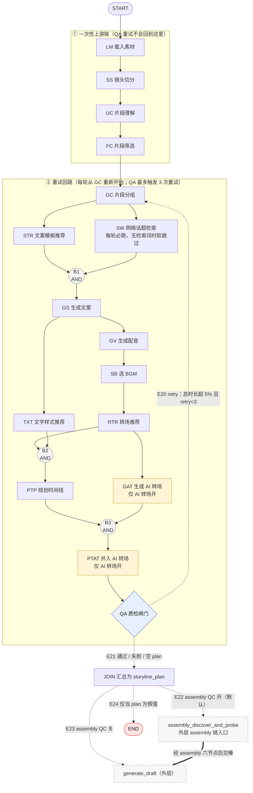

# Storyline（故事线）子图边核验：保留 / 删除 / 改造 设计与执行计划

| 项 | 内容 |
|---|---|
| 项目 / 分支 | `auto-video-editor`（github.com/wayyet/auto-video-editor）`main` |
| **核验基线** | **`e29dd26`**（2026-11-17 03:16 +0800，`docs(第六期): 转场/特效资源库核验报告入库 + 七阶段执行记录`）。本文所有行号、结论都以它为准 |
| 编写日期 | 2026-11-20（基线固定在 `e29dd26`，不再换分支重做。交付前我看过 `origin/main`：到 `11b5ec2`（比基线多 54 个提交）为止，没有改动 Storyline 的边和条件路由；我最后一次看到的 `main` 是 `f63c3cf`（多 64 个提交），它的 `graph.py` 改了拓扑，**我没有在它上面复核**，见 §7.2 的 P0） |
| 性质 | 对 `main` 实际源码的独立核验：重新读源码 → 真实编译 LangGraph 图 → 在沙箱里实际运行 → 给出可落地的改造与测试方案。**不照搬团队已有文档的结论** |
| 环境 | Linux 沙箱；Python 3.13.18；langgraph 1.2.9；langgraph-checkpoint 4.1.1。真实仓库克隆全程只读，补丁只打在副本上 |
| 基线变动记录 | 核验期间 `main` 前进过 5 次（`4716c39` → `4f48bd3` → `3a2672b` → `bbf7306` → `e29dd26`），每次都重跑了边清单与测试。最近一次一口气前进了 35 个提交（`bbf7306..e29dd26`：第六期 assembly 重构、英文分支、转场推荐等），其中**只有 `3992552`（P1-1「assembly 六节点拓扑前移」）改变了 Storyline 子图的边**：`storyline_join` 的出口由 {generate_draft, END} 变成 {assembly_discover_and_probe, generate_draft, END}。所以 Storyline 边数由 23/20 变为 **24/21**，新增的只有 `storyline_join → assembly_discover_and_probe` 这 1 条，其余 23 条与上一基线逐条一致。这 35 个提交里，Storyline 节点代码只动了 3 个文件（`nodes/storyline/_common.py`、`nodes/storyline/node_recommend_transition.py`、`storyline_capabilities/recommend_transition.py`）。本文的行号、补丁、测试、实验已全部在新基线上重做。此后 `main` 又前进过多次；**基线仍固定在 `e29dd26`**。我在 `7c0bbc7`、`bbf4e5b`、`09c297d`、`b14ce85`、`11b5ec2` 这 5 个提交上各复核过一次：Storyline 的边、条件路由和本文用到的 8 份证据输出都与基线逐字一致，补丁都能干净应用（`7c0bbc7` 当时只有 4 个补丁）。最后一次看到的 `f63c3cf` 改了 `graph.py` 的拓扑（新增 `storyline_search_web_topic_en` 节点等），**没有复核**，也没有再换到新分支重做，详见 §7.2 的 P0 |

**全文结构**：§0 结论先行 · §1 名词表 · §2 范围与方法 · §3 子图全景 · §4 逐边核验 · §5 问题与改造方案 · §6 测试方案 · §7 分阶段执行计划 · §8 风险与未验证项 · 附录 A 补丁 / B 测试全文 / C 脚本 / D 证据索引。

---

## 0. 结论先行

**一句话**：Storyline 子图 24 条箭头（AI 转场开、assembly QC 开；AI 转场关闭时 21 条；assembly QC 关闭时各少 1 条，即 23 / 20）里，**23 条保留，1 条需要改造（`storyline_join → END`），没有必须立刻删除的边**。子图结构本身是健康的：17 个节点默认全部可达、没有重复触发、QA 重试必然终止，整张图的 5 个条件路由在配置一致时全部完备。真正需要动手的是边以外的 4 类问题：join 的判空口径、配音节点失败时不刷新产物、说明/监控元数据与代码不符、守卫测试空转。

### 0.1 目标子图（你没有点名，我这样选的）

你说的是“包含多条边的目标子图”，没有指名。我在真实编译出的图里按区域数了箭头（AI 转场开、assembly QC 开）：

| 区域 | 节点数 | 箭头数 | 汇合屏障 | 条件出口 | 回环 |
|---|---|---|---|---|---|
| **Storyline（本文对象）** | 17 | **24**（占全图约 41%） | **3 个**（全图共 4 个） | 5 条 | QA→GC 重试回边 |
| 外层主干 | 22 | 27 | 1 个（`[node_15, node_17]→node_09`） | 6 条 | speed-fit 自环；`delivery_qa_repair→join_before_delivery` 回边 |
| assembly QC | 6 | 8 | 0 | 3 条 | `assembly_repair_loop→assembly_validate_render_qc` 回边 |

Storyline 是箭头最多的区域，也是历史缺陷（D10：静默 END、重复触发）的发源地。如果你指的是别的区域，告诉我，方法可以原样复用。

> 全图合计 45 个节点、59 条箭头（`scripts/whole_graph_counts.py` 统计，附录 C.2）。【实测】区域归属规则：箭头的**起点**以 `storyline_` / `assembly_` 开头就计到对应区域；起点是外层节点或 `START` 时，按**终点**所在区域计（所以 `START→LM` 和 `storyline_join` 的三条出口都算在 Storyline 里，`assembly_write_report→generate_draft` 算在 assembly 里）。整图 4 条回边：Storyline 1 条、外层 2 条、assembly 1 条。

### 0.2 逐边判定总表（编号 E01–E24 沿用到全文；AI 转场开、assembly QC 开）

| 类别 | 边 | 数量 | 判定 | 关键依据（详见 §4） |
|---|---|---|---|---|
| 一次性上游链 | E01 START→LM、E02 LM→SS、E03 SS→UC、E04 UC→FC、E05 FC→GC | 5 | **保留** | 线性依赖，不在重试回路内，只跑一次 |
| 并行扇出 | E06 GC→STR、E07 GC→SW、E10 GS→GV、E11 GS→TXT | 4 | **保留** | 兄弟节点之间无数据依赖，同一超步并行跑，每轮各 1 次 |
| 串行单源边 | E12 GV→SB、E13 SB→RTR、E16 RTR→GAT | 3 | **保留** | 团队约简后的最小依赖；每个目标只剩 1 条入边 → 每轮恰好触发 1 次 |
| 末端单源边 | E19 PTAT→QA（AI 关时为 PTP→QA） | 1 | **保留** | QA 只读最终时间线 |
| 汇合屏障（AND） | E08+E09 `[STR,SW]→GS`；E14+E15 `[RTR,TXT]→PTP`；E17+E18 `[PTP,GAT]→PTAT` | 3 个屏障 / 6 条箭头 | **保留，且不能拆成独立边** | 实测：拆开后目标节点双触发，并读到缺失/陈旧产物（§4.2） |
| 条件路由 | E20 QA→GC（重试回边）、E21 QA→JOIN | 2 | **保留** | 路由器完备；重试上限 3 次，必然终止（§4.3） |
| 条件路由 | **E22 JOIN→assembly_discover_and_probe** | 1 | **保留** | 第六期 P1-1 新增；assembly QC 开（默认）时 Storyline 的正常出口。本轮核验的 Storyline 区域里唯一新增的边（§4.5） |
| 条件路由 | **E23 JOIN→generate_draft** | 1 | **保留（有前提）** | assembly QC 关时的正常出口；QC 开时只有“建图后又把开关改成关”才会走到（R8）。上游集成测试明确断言它存在（`tests/integration/test_unreachable_nodes_wiring.py:330-358`）（§4.5） |
| 条件路由 | **E24 JOIN→END** | 1 | **改造**（先让它不可达；是否物理删除见 Q1） | 仅当时间线 JSON 内容为 `{}` `[]` `0` `false` `""` 时触发；一旦触发，图静默“完成”且没有草稿（§5 R2） |
| **合计** | | **24**（AI 关 21） | 保留 23 / 改造 1 / 删除 0 | |

AI 转场关闭时没有 E16–E18，E19 变为 `PTP→QA`，其余不变（21 条）。assembly QC 关闭时建图不接 E22，其余不变（23 条；AI 转场也关则 20 条）。

### 0.3 需要修改的问题与优先级

优先级含义：**P0** 建议本轮合入；**P1** 同批清理；**P2** 可选；**P3** 只记录、不在本轮改。

| 编号 | 问题（一句话） | 级别 | 建议动作 | 改动量 |
|---|---|---|---|---|
| R2 | join 把内容为假值的时间线 JSON 当“没有 plan”，导致 E24 可达 → 静默完成、无草稿 | **P0** | `join_norm`：`_read_timeline_dict` 末尾改 `return data or None` | 1 文件 ≈6 行 |
| R3 | 配音节点（GV）失败时不清空 `storyline_voiceover_artifact`：QA 重试轮里 TTS 失败 → 上一轮旧配音（对应旧文案）流进 SB / PTP / 成片 | **P0** | `gv_clear`：失败分支返回里加 `"storyline_voiceover_artifact": ""` | 1 文件 +4 行 |
| R6 | D10 结构守卫空转（`CONDITIONAL_NODES = set()`，遍历空集合永不失败） | **P0**（只加测试） | 新增 T1 数据流/屏障守卫 | 0 行生产代码 |
| R1 | 注释、监控元数据、边标签与代码不符（13 处，见 §5.4） | P1 | 纯文本清理，不改行为 | 4 文件 |
| R5 | PTP 把 warnings 逐条写 `status_log`，覆盖了 done / method 标签 | P2 | `ptp_tags` | 1 文件 ≈8 行 |
| R3b | RTR / TXT 失败分支同样不清空产物（影响限于转场/文字样式，不会错配音频） | P2 | 可选，见 Q2 | 2 文件 |
| R2b | 物理删除 E24（删掉 JOIN 条件路由的 END 出口） | P2 | 可选，见 Q1-B（`join_noend`；必须在 `join_norm` 之后做） | 6 文件 + 监控版本 10→11 |
| R4 | QA 判“失败 / 空 plan”后仍进入 JOIN；时间线文件缺失或损坏时 JOIN 用占位时间线继续出片（状态里看不出异常） | P3 | 属策略决策，只记录 | — |
| R7 | SW 软跳过不清旧检索文档：第 1 轮有检索、第 2 轮检索词为空时，GS 读到第 1 轮的旧文档 | P3 | 只记录（团队测试把“跳过不写产物”当契约） | — |
| R8 | `ASSEMBLY_QC_GATE_ENABLED` 在两个时间点被读（建图时定映射表，运行时由路由函数再读一次）；两次不一致时，建图 QC 关→运行时开会 `KeyError`，建图 QC 开→运行时关会静默跳过 assembly 链 | P3 | 只记录（正常运行只在进程启动时读一次环境变量，两次必然一致；只有测试或运行中改配置才会触发） | — |

### 0.4 需要你拍板的两件事（≤4 个选项，推荐项在前）

**Q1 — `join → END`（E24）怎么处理？**

| 选项 | 做法 | 代价 / 风险 |
|---|---|---|
| **A（推荐）** | 只做 `join_norm`：让出口在实际运行中不可达；拓扑与监控版本号都不动 | 改 1 个文件约 6 行；T2 测试守住“永不静默 END”；与上游设计文档“`storyline_join` 的 END 路由语义必须保留”一致 |
| B | A + 物理删除 E24：删掉 JOIN 条件路由的 END 出口，路由函数只在“QC 开 / QC 关”两个去向里选（补丁 `join_noend`） | 改 6 个文件（`graph.py`、`monitoring/workflow_graph.py`、`state.py` 的一处注释，加 3 个测试文件）；监控 `SCHEMA_VERSION` 10→11（前端布局缓存失效）；上游 3 个测试文件要跟着改（2 个文件里共 3 处断言 / 期望值，1 个文件只改 docstring）；Storyline 箭头数 24→23（AI 关 21→20）；**与上游设计文档“END 路由语义必须保留”冲突，要你们先确认** |
| C | 不处理 | 保留极低概率的静默 END |

**Q2 — 节点失败不刷新旧产物，改哪几个？**

| 选项 | 做法 | 代价 / 风险 |
|---|---|---|
| **A（推荐）** | 只改 GV（已证实会让旧配音进成片） | 1 个文件 +4 行 |
| B | GV + RTR + TXT（失败时都清空各自产物） | 3 个文件；RTR/TXT 的影响只是转场/文字样式用旧值，收益小 |
| C | 都不改 | 接受 TTS 失败时旧配音进成片的风险 |

> 推荐选 **Q1-A + Q2-A**，再加上 R1 清理和 T1/T2/T3 三份新测试。这一组改动的代码部分全部落在 `nodes/storyline/` 与 `tests/unit/` 内；R1 另外只改 `graph.py` 与 `monitoring/workflow_graph.py` 里的注释和展示文案。不改拓扑，回归面最小。

### 0.5 与团队已有结论的关系

- **第 5 期「LangGraph 依赖约简」（`docs/第5期开发/执行记录_LangGraph依赖约简_20261114.md`）**：阶段 1 对四组 fan-in 屏障做传递性约简（SB、RTR、GAT 三处缩成单源边，PTP 由六源缩成 `[RTR, TXT]` 两源），阶段 5 把 web_topic 改成每轮必跑并与模板推荐并行。我独立复核后**确认正确**——约简前后逐超步轨迹等价，并行化有检索产物时每轮节省 1 个超步（§4.7）。这两项改动留下了 R1 里的 7 处过期说明 / 元数据（阶段 1 约简 4 处、阶段 5 并行化 3 处，§5.4）。
- **2026-11-14 用户决策推翻 2026-11-13 边审计「任务B 保留 `[GS,GV]→SB`」**（记录在 `tests/unit/test_storyline_topology_baseline.py` 文件头）：我同意。保留 GV 源、删 GS 源方向正确——T1 的负对照“SB 改成 GS→SB（丢掉 GV）”会立刻变红，说明 GV 才是必须等的那个。
- **第六期 P1-1「assembly 六节点拓扑前移」（提交 `3992552`；设计文档 `docs/第六期开发/auto-video-editor_assembly草稿影响重构设计与分阶段执行计划_20261115.md`，执行记录 `docs/第六期开发/auto-video-editor_P1-0至P1-6分阶段执行记录_20261115.md`）**：把 assembly 六节点从 `generate_draft` 之后挪到 `storyline_join` 与 `generate_draft` 之间，assembly QC 开时成功流量先走 assembly 链。我独立复核后**确认这次改动正确，并且对 Storyline 的影响很小**：Storyline 内部 17 个节点之间的边一条没变，只是 `storyline_join` 的条件出口多了 `assembly_discover_and_probe`（E22）。设计文档第 163 行明确要求“`storyline_join` 的 END 路由语义必须保留”，所以本文对 E24（`join → END`）的推荐是 Q1-A（让它在实际运行中不可达，但不删这个出口）；物理删除（Q1-B）与这条设计约束冲突，需要你们先确认。
- **第六期「storyline 配音与 BGM 节点后移至 node17 之后」（`docs/第六期开发/storyline_配音与BGM节点后移至node17之后_架构分析与执行计划.md`）**：该文档结论是不要原样后移 GV/SB，且尚未实施。本文基于**当前未后移**的拓扑；将来若实施“规划/执行拆分”，要重新跑 §6 的测试矩阵。

### 0.6 验证结果一览

| 项目 | 结果 | 证据级别 |
|---|---|---|
| 真实编译 4 种开关组合，边集与 AST 静态解析交叉一致 | 一致；Storyline AI 开 24 条 / 关 21 条（assembly QC 关：23 / 20） | 【实测】 |
| 整图 5 个条件路由的完备性（每个返回值在映射内、每个映射出口可达） | assembly QC 开的建图：全部完备，无死分支。QC 关的建图：JOIN 的映射里没有 `assembly_discover_and_probe`，只有“建图后又把开关改成开”时路由函数才会返回它（R8，实验 H） | 【实测】 |
| 12 场景矩阵（web 开/关 × AI 开/关 × 重试 0/1/3 次）：节点触发次数与产物新鲜度；外加 assembly QC 关的 4 组子矩阵（实验 I） | 全部通过（AI 开：14/23/41 个超步；AI 关：13/21/37）；QC 关子矩阵与 QC 开逐超步一致，说明 Storyline 本体与 QC 开关无关 | 【实测】 |
| 三个屏障的必要性（负控实验 C1–C4b） | 全部必要（PTP 屏障今天就必须；GS、PTAT 屏障今天恰好等价于独立边，但那是“同一超步”的巧合，不是保证） | 【实测】 |
| D10 复现 | 复现成功：条件节点进屏障 → 第 2 轮静默 END；且发现仓库里现有 D10 守卫是空转的 | 【实测】 |
| 新增测试 T1/T2/T3/T5（29 个用例） | 基线上红 9 个（T2×5、T3×2、T5×2），补丁后全绿；T1 的 10 个负对照变异体全部被抓住 | 【实测】 |
| 全量单元测试 | 基线 2260 通过；打全部补丁并加 4 份新测试后 2289 通过（多出的 29 个就是新增用例）；另有 6 个沙箱环境下**本来就失败**的用例（5 个 `test_console_cache_clear`、1 个 `test_subtitle`，与本次无关），前后一致 | 【实测】 |
| 全量集成测试 | 见 §6.6（基线与打补丁后失败集合逐条一致：均为 17 失败 / 131 通过 / 14 跳过；失败原因是沙箱没有 Postgres、没有真实视频，与本次无关） | 【实测】 |
| 真实 LLM / TTS / FFmpeg / 剪映 / Windows 端到端 | **没有做** | 【未验证】 |

---

## 1. 名词表（第一次出现时都会再解释一次）

| 名词 | 含义 |
|---|---|
| LangGraph | 把“节点（一个 Python 函数）”和“边（谁完成后触发谁）”连成有向图来编排流程的框架。本项目用 `StateGraph` + SqliteSaver 做持久化 |
| state | 全图共享的字典（`state.py` 的 `WorkflowState`）。节点读它、返回“要更新的字段”，由每个字段的 **reducer（合并规则）** 决定怎么合并 |
| 超步（superstep） | LangGraph 的执行节拍：同一拍里所有“被触发”的节点并行跑，**全部跑完**才进入下一拍 |
| 普通边 `add_edge(a, t)` | a 完成 → 触发 t。同一个 t 有多条独立入边时是 **OR**：任何一个来源完成都会触发 t（t 会被触发多次） |
| 汇合屏障（fan-in barrier）`add_edge([a, b], t)` | **AND**：a 和 b 都完成后才触发 t，只触发一次 |
| 条件边 `add_conditional_edges` | 由路由函数按 state 决定走哪个出口；路由到 END 即“什么都不再触发，图结束” |
| 回边 / 重试回路 | QA 判超时 → 回到 GC 重新跑一轮（最多 3 次重试）。每一轮都从 GC 重新开始，**GC 上游的节点不会重跑** |
| D10 | 项目内部缺陷编号：条件触发的节点被放进汇合屏障，重试轮里它不跑 → 屏障永远凑不齐 → 图在没有报错的情况下提前结束（“静默 END”） |
| 静默 END | 图提前结束，但 runner 把它当“正常完成”上报（`agent_gate/runner.py:621-629`：`snap.next` 为空 ⇒ STATE_COMPLETED），既没有草稿也没有报错。项目原则：**不允许静默 END** |
| 必经集合 must(n) | 去掉 QA→GC 回边后，节点 n 启动前“本轮必然已完成”的节点集合。用来证明“n 读取的上游产物一定已经写好” |
| 每轮必跑节点 | 从 GC 出发，只沿普通边与“来源全部必到”的屏障能走到的节点。条件出口上的节点不算（它们“有时跑有时不跑”） |
| 陈旧读取（stale read） | 节点读到的是**上一轮（重试前）留下的旧产物**，而不是本轮刚写的 |
| `_last_wins` | `state.py:82-90` 的 reducer：新值为 `None` 时**保留旧值**，否则取新值。所以要“清空”一个字段必须写 `""`，写 `None` 无效 |
| fail-closed | 出错时选择拒绝/报错，而不是放行 |

---

## 2. 范围、方法与证据

### 2.1 范围

- **对象**：Storyline 子图，即 `graph.py` 里 `storyline_*` 17 个节点之间的全部边，加上 `START→LM` 入边（`graph.py:585`）和 JOIN 的三条条件出口（E22–E24，`graph.py:842-857`）。
- **不在范围**：外层主干（node_01…node_18、关卡①②）、assembly QC 六节点；它们只作为边界出现。
- **三个开关改变拓扑/行为**（`config.py:52-54`、`:61-63`、`:324-327`，默认都为开）：
  - `STORYLINE_ENABLE_AI_TRANSITION`：**建图时**读取（`graph.py:811` 调 `is_ai_transition_enabled()`），决定是否接 GAT、PTAT 两个节点（24 条 vs 21 条）。改了要重启进程。
  - `STORYLINE_ENABLE_WEB_TOPIC`：**运行时**读取，不改拓扑；SW 每轮都跑，开关关闭或没有检索词时在节点内部“软跳过”（`nodes/storyline/node_search_web_topic.py:83-91`：只落 skipped 标签，不发网络请求、不写产物）。
  - `ASSEMBLY_QC_GATE_ENABLED`：**建图时 + 运行时**各读一次。建图时（`graph.py:842`）决定 JOIN 条件边的映射表里有没有 `assembly_discover_and_probe` 这个出口、assembly 六节点是否接线（关闭时 E22 不存在：24 → 23 条、21 → 20 条）；运行时 `_route_after_storyline_join`（`graph.py:229`）再读一次，决定返回哪个出口。两次读到的值不一致会出问题（R8，见 §4.5 的实验 H 与 §5.6）。

### 2.2 方法（六步）

1. **静态解析**：用 AST 读取 `graph.py` 里全部 `add_edge` / `add_conditional_edges` 调用，得到边定义清单。
2. **真实编译**：调用 `graph._build_state_graph()`，读 builder 的 `edges`（普通边）/ `waiting_edges`（屏障）/ `branches`（条件边）三件套——这也是项目监控模块自己的取边口径（`monitoring/workflow_graph.py:5-14`）。两条路径得到的边集交叉比对一致。
3. **逐节点读写扫描**：AST 扫描每个节点读/写哪些 state 键、各返回路径（成功 / 失败 / 跳过）写了什么。
4. **路由器完备性**：整图 5 个条件路由（assembly QC、speed-fit、交付前 QA、Storyline 的 QA 与 JOIN），逐个检查“路由函数的每个返回值都在映射里、映射里的每个出口都有路径能返回”。
5. **沙箱动态实测**：把 17 个节点换成“记录器桩”（只记录每个超步触发了谁、读到哪一轮写的产物），在**真实编译的图**上跑 12 个场景，再用负控实验（故意改坏图，看是否复现缺陷）验证每条结论。
6. **补丁与测试**：在仓库**副本**上打补丁，新增 4 份测试，跑全量单元/集成测试，对比基线。

### 2.3 证据分级

| 标签 | 含义 |
|---|---|
| 【代码】 | 直接读源码得出，附 `文件:行号`（行号以 `e29dd26` 为准） |
| 【实测】 | 在沙箱里实际运行得出（桩节点 + 真实编译的图） |
| 【推断】 | 由代码和 LangGraph 语义推理得出，未单独实测 |
| 【未验证】 | 没有验证，原因写在旁边（汇总见 §8.2） |

### 2.4 信任边界

沙箱是 Linux，LLM / TTS / FFmpeg / 剪映全部被桩替换，所以：**拓扑、触发次数、数据新鲜度**的结论是【实测】的；**各节点的业务结果**（文案好不好、配音像不像）没有验证。团队在 Windows 上的基线（单元 1924/0F、集成 142/3F，见 `docs/第5期开发/执行记录_LangGraph依赖约简_20261114.md`）与沙箱不可直接比较，本文只比较**同一环境下补丁前后**。

---

## 3. 子图全景

### 3.1 17 个节点：职责、读写、失败行为

“回路”列：**一次性** = 在 GC 上游，QA 重试时不会重跑；**每轮** = 在重试回路内，每一轮都会执行。“读取”只列来自上游节点的产物（状态键均定义在 `state.py:297-327`，全部用 `_last_wins`）。

| 缩写 | 节点（文件:函数行） | 职责 | 读取的上游产物 | 写出 | 失败 / 跳过时 | 回路 |
|---|---|---|---|---|---|---|
| LM | `storyline_load_media`<br>`nodes/storyline/node_load_media.py:37` | 载入并登记素材 | —（入口） | `storyline_media_artifact` | 只写 error_log + 失败标签（`:43-49`） | 一次性 |
| SS | `storyline_split_shots`<br>`node_split_shots.py:17` | 镜头切分 | media | `storyline_shots_artifact` | 同上 | 一次性 |
| UC | `storyline_understand_clips`<br>`node_understand_clips.py:12` | 片段理解 | media、shots | `storyline_understanding_artifact` | 同上 | 一次性 |
| FC | `storyline_filter_clips`<br>`node_filter_clips.py:18` | 片段筛选 | understanding | `storyline_filtered_clips` | 同上 | 一次性 |
| GC | `storyline_group_clips`<br>`node_group_clips.py:18` | 片段分组（**重试回路起点**） | filtered_clips | `storyline_groups_artifact` | 只写 error_log + 失败标签，不写产物（`:25` `:36` `:54`） | 每轮 |
| STR | `storyline_script_template_recommendation`<br>`node_script_template_recommendation.py:60` | 文案模板推荐 | understanding、groups | `storyline_script_template_artifact` | **降级不抛**：照样写出 `status: "unavailable"` 的新产物（`:108-126`），不会留旧值 | 每轮 |
| SW | `storyline_search_web_topic`<br>`node_search_web_topic.py:75` | 联网检索话题参考 | understanding、groups（拼检索词） | `storyline_web_topic_artifact` | 开关关 / 无检索词 → 软跳过，只落 skipped 标签、**不写产物**（`:83-91`）；联网异常见 `:115` | 每轮 |
| GS | `storyline_generate_script`<br>`node_generate_script.py:36` | LLM 生成文案 | groups、understanding、template、web_topic（软读取） | `storyline_script_artifact` | **fail-closed**：异常留痕后 re-raise（`:114-123`），旁白全空也 raise（`:150`），节点标红，不会假成功 | 每轮 |
| GV | `storyline_generate_voiceover`<br>`node_generate_voiceover.py:67` | TTS 配音 | script | `storyline_voiceover_artifact` | 失败只写 error_log + failed 标签、**不清旧产物**（`:112-121`）；生产配置错误直接 raise（`:73`） | 每轮 |
| TXT | `storyline_recommend_text`<br>`node_recommend_text.py:17` | 文字样式推荐 | groups、script | `storyline_text_style_plan` | 失败只写 error_log + failed 标签，不清旧值（`:53-54`） | 每轮 |
| SB | `storyline_select_bgm`<br>`node_select_bgm.py:83` | 选 BGM（读配音总时长做时长偏好，缺失按 0 容缺省） | groups、script、voiceover | `storyline_bgm_selection` | 异常 → 写 `bgm_fallback` 兜底结果（`:100-111`），总会写出新值 | 每轮 |
| RTR | `storyline_recommend_transition`<br>`node_recommend_transition.py:17` | 转场推荐 | groups、bgm_selection | `storyline_transition_plan` | 失败只写 error_log + failed 标签，不清旧值（`:48-57`）；成功时多记一条 `storyline_recommend_transition_method_<method>` 状态标签，并把推荐警告并入 error_log（`:59-75`，2026-11-17 起） | 每轮 |
| GAT | `storyline_generate_ai_transition`<br>`node_generate_ai_transition.py:182` | AI 转场生成（默认只写估算，0 次 Provider 外呼；需 Provider 配置 + 显式批准才真实生成，`config.py` 双门禁） | groups、media、transition_plan（仅作提示） | `storyline_ai_transition_artifact` | 内部 try/except，只写 error_log（`:400`），照常返回 | 每轮（仅 AI 开） |
| PTP | `storyline_plan_timeline_pro`<br>`node_plan_timeline_pro.py:45` | 规划 Canonical Timeline（正式时间线） | groups、media、voiceover、script、bgm、transition、text_style、targets | `storyline_timeline_plan`（`timeline_plan.json` 路径） | 无 groups → 写 `clips=[]` 的空时间线（`:62-103`）；异常 → error_log + failed 标签，不动旧路径（`:117-126`） | 每轮 |
| PTAT | `storyline_plan_timeline_ai_transition`<br>`node_plan_timeline_ai_transition.py:263` | 把 AI 转场清单并入时间线 | timeline_plan、ai_transition_artifact | `storyline_timeline_plan`（改指 `timeline_plan_ai.json`） | 跳过 / 失败都保留 PTP 刚写的时间线（`:265-293`、`:335-343`） | 每轮（仅 AI 开） |
| QA | `storyline_qa_gate`<br>`nodes/storyline/qa_gate.py:134` | 质检闸门：逐片段一致性 + 总时长 ≤ 目标 ×1.05 | timeline、targets、retry_count | `storyline_qa_route_signal`（**每次必写**）、`storyline_qa_retry_count` | 合约违例 → `storyline_qa_failed`；空 plan → `storyline_qa_done_empty`（`:145-166`） | 每轮 |
| JOIN | `storyline_join`<br>`nodes/storyline/join_storyline.py:51` | 把时间线 JSON 反序列化写入 `storyline_plan`，交给外层：assembly QC 开 → `assembly_discover_and_probe`，QC 关 → `generate_draft` | timeline | `storyline_plan` | 文件缺失 / 损坏 → 占位时间线（每个源视频 1 个 clip，0–35000 ms，`:57-103`）；合约非法 → 仍写出原值（`:109-120`） | QA 放行后一次 |

> 三个“读+写同一键”的关系需要特别注意：`storyline_timeline_plan` 先由 PTP 写、AI 开时再由 PTAT **改指**另一个文件；QA 与 JOIN 读的是“最终时间线”，AI 开时是 PTAT 的输出，AI 关时是 PTP 的输出。【代码】`graph.py:810-826`。

### 3.2 流程图

下面是 mermaid 源码（大多数 Markdown 预览器可直接渲染；已用 `mmdc` 实际渲染校验过语法）：



图例：虚线 = 条件边（E20–E24 都是条件边）；`B1/B2/B3` = 汇合屏障（AND）；黄色 = 仅 AI 转场开启时存在的节点；灰色虚框 = Storyline 以外的外层节点；粗箭头 = 省略了外层 assembly 链内部的 6 个节点；E 编号见 §0.2 / §4。AI 关闭时 GAT、PTAT 不接线，PTP 直接连 QA；assembly QC 关闭时没有 E22 和那条粗箭头。

### 3.3 一轮执行轨迹（实测，AI 转场开、有检索产物）

每一行是一个超步；同一行的节点是并行执行的。【实测】桩节点 + 真实编译的图，`stream_mode="debug"` 记录。

| 超步 | 触发的节点 | 说明 |
|---|---|---|
| 1 | LM | |
| 2 | SS | |
| 3 | UC | |
| 4 | FC | |
| 5 | GC | **重试轮从这一步重新开始** |
| 6 | STR ∥ SW | 并行；两者都完成才触发 GS（B1 屏障） |
| 7 | GS | |
| 8 | GV ∥ TXT | 并行；TXT 先结束，但 PTP 要等 B2（RTR + TXT） |
| 9 | SB | 等 GV（GV→SB 单源边） |
| 10 | RTR | 等 SB |
| 11 | PTP ∥ GAT | B2 触发 PTP；RTR→GAT 触发 GAT |
| 12 | PTAT | B3（PTP + GAT）触发 |
| 13 | QA | |
| 14 | JOIN | 之后进入外层：assembly QC 开 → `assembly_discover_and_probe`，QC 关 → `generate_draft`（本实测在这里中断，不执行外层节点） |

- AI 关：第 11 步只有 PTP，之后 QA（12）、JOIN（13），共 13 步。
- 每多一轮重试，增加一遍 GC→…→QA：AI 开 +9 步，AI 关 +8 步。实测总超步数（重试 0 / 1 / 3 次）：AI 开 **14 / 23 / 41**，AI 关 **13 / 21 / 37**，与“基础步数 + 每轮步数 × 重试次数”完全吻合。
- 并行化（团队阶段 5）使 STR 与 SW 同在第 6 步；并行化之前检索是挂在 STR 出口的条件路由（STR→SW→GS），SW 要排在 STR 之后，**每轮多 1 步**。有检索产物时节省 1 步/轮（重试 3 次节省 4 步），无检索产物时节省 0 步。【实测】对照实验 B2。

### 3.4 配置开关与图形态

| 开关 | 读取时机 | 默认 | 对子图的影响 |
|---|---|---|---|
| `STORYLINE_ENABLE_AI_TRANSITION`（`config.py:61-63`；`graph.py` 实际读 `storyline_capabilities/ai_transition_client.py:24` 的 `is_ai_transition_enabled()`） | **建图时** | 开 | 开：接 GAT、PTAT（24 条）；关：不接线（21 条）。改后必须重启进程。两处同名读取的默认值必须一致，仓库里有对齐断言 |
| `STORYLINE_ENABLE_WEB_TOPIC`（`config.py:52-54`） | 运行时 | 开 | **不改拓扑**。SW 每轮都跑；开关关或检索词为空时节点内软跳过 |
| `STORYLINE_AI_TRANSITION_PROVIDER` / `STORYLINE_AI_TRANSITION_APPROVED`（`config.py` AI 转场双门禁） | 运行时 | 空 / false | 不改拓扑。未满足时 GAT 只写估算，0 次付费外呼（fail-closed） |
| `ASSEMBLY_QC_GATE_ENABLED` | **建图时 + 运行时**（建图时决定 assembly 六节点是否接线、JOIN 条件路由的映射表有哪些出口；运行时 `_route_after_storyline_join` 再读一次决定走哪个出口） | 开 | **只影响 `storyline_join` 的出口，不影响 Storyline 内部 17 个节点之间的边**：开 → 多一条 E22 `JOIN→assembly_discover_and_probe`（24 / 21 条）；关 → 不接 E22（23 / 20 条）。两次读取不一致的后果见 §5 R8 |

### 3.5 状态字段与合并规则（后面的“陈旧读取”分析依赖这一节）

- **所有 Storyline 产物键**（路径或 dict）都用 `_last_wins`（`state.py:297-316`、`:324`）：写入 `None` 等于“不更新”（保留旧值），所以**节点失败不返回该键 = 旧值留在 state 里**；要清空必须写 `""`（空字符串）。
- `status_log` / `error_log` 用 `_append_unique`（追加并去重，并行安全）。这意味着**固定标签每轮重复会被去重**，不能拿它判断“本轮发生了什么”——QA 的路由因此改读独立字段 `storyline_qa_route_signal`（`qa_gate.py:226-253`）。
- `storyline_plan`（`state.py:276`）声明为 `Optional[dict]`、**没有 reducer**，由 JOIN 单点写入；TypedDict 不做运行时类型校验，所以 JOIN 在合约非法时写进去的可能不是 dict（见 R2）。它的下游读取者：JOIN 的条件路由、`assembly_discover_and_probe`（assembly QC 开时的第一个节点，`nodes/assembly/node_discover_and_probe.py:69`、`:390`）、`node_05_generate_draft`（`:99`）。
- `storyline_qa_retry_count`（`state.py:328`）与 `storyline_qa_route_signal`（`state.py:334`）只有 QA 一个写入者，无需 reducer。

---

## 4. 逐边核验

### 4.0 核验口径

每条边都按下面 5 项检查，再给判定：

| # | 检查项 | 看什么 | 怎么验证 |
|---|---|---|---|
| ① | 定义 | 在 `graph.py` 哪一行、什么写法（单源边 / 列表屏障 / 条件边） | 【代码】AST 静态解析；与真实编译出的 builder 边集交叉比对（4 种开关组合全部一致） |
| ② | 触发语义与条件路由 | 目标节点是 OR 触发还是 AND 触发；条件边的路由函数每个返回值是否都在映射里 | 【代码】+【实测】12 场景矩阵里每个节点每轮的触发次数 |
| ③ | 节点职责与数据依赖 | 目标节点读哪些上游产物；这些产物的生产者是否在目标的“必经集合”里 | 【代码】逐节点读写扫描（固化为 T1 的 `UPSTREAM_READS` 表）；【实测】陈旧 / 缺失读取计数 |
| ④ | 可达性 | AI 开关 × assembly QC 开关共 4 种组合下，两端节点从 START 是否可达、是否都能走到 END | 【实测】图遍历 |
| ⑤ | 判定 | 保留 / 删除 / 改造 | 判据见下 |

**判据**（先定规则再判，避免凭感觉）：

- **删除**：目标读取的全部上游产物，都已被它**其它入边**保证“先完成”（传递性约简——第 5 期阶段 1 做的就是这件事）；或这条边永远不会被选中（死边）。
- **保留**：删掉或改写它，会让目标节点**重复触发**、读到**缺失 / 陈旧**产物，或它是唯一的入口 / 出口——必须有负对照实验或结构证明。
- **改造**：边本身有存在价值，但它的触发条件或落点会造成**静默 END**、重复触发或错误放行，需要改它的条件或相邻节点。

> **必经集合 must(n)**：去掉 QA→GC 回边后，节点 n 启动前“本轮必然已完成”的节点集合。若 n 读取的每个产物，其生产者都在 must(n) 里，就**结构上**保证了 n 读到的一定是本轮新产物（§1）。

### 4.1 24 条边总览（AI 转场开、assembly QC 开）

“每轮触发”指目标节点在一次“GC→…→QA”循环里被触发的次数，来自 12 场景矩阵（重试 0 / 1 / 3 次均相同）。

| 编号 | 边 | 定义（`graph.py`） | 写法与触发语义 | 每轮触发【实测】 | 判定 |
|---|---|---|---|---|---|
| E01 | START → LM | `:585` | 普通边；START 只有这一条出边 | 整次运行 1 次 | 保留 |
| E02 | LM → SS | `:696` | 单源边（SS 唯一入边） | 整次运行 1 次 | 保留 |
| E03 | SS → UC | `:700` | 单源边 | 整次运行 1 次 | 保留 |
| E04 | UC → FC | `:703` | 单源边 | 整次运行 1 次 | 保留 |
| E05 | FC → GC | `:704` | 单源边（GC 首轮入口；重试轮由 E20 触发 GC） | 首轮 1 次 | 保留 |
| E06 | GC → STR | `:724` | 单源边，与 E07 并行 | 每轮 1 次 | 保留 |
| E07 | GC → SW | `:725` | 单源边，与 E06 并行 | 每轮 1 次 | 保留 |
| E08 | STR → GS | `:728-734` | **屏障 B1**（与 E09 合为 AND） | GS 每轮 1 次 | 保留 |
| E09 | SW → GS | `:728-734` | 屏障 B1 | 同上 | 保留 |
| E10 | GS → GV | `:743` | 单源边，与 E11 并行 | 每轮 1 次 | 保留 |
| E11 | GS → TXT | `:744` | 单源边，与 E10 并行 | 每轮 1 次 | 保留 |
| E12 | GV → SB | `:755` | 单源边（SB 唯一入边） | 每轮 1 次 | 保留 |
| E13 | SB → RTR | `:763` | 单源边（RTR 唯一入边） | 每轮 1 次 | 保留 |
| E14 | RTR → PTP | `:783-789` | **屏障 B2**（与 E15 合为 AND） | PTP 每轮 1 次 | 保留 |
| E15 | TXT → PTP | `:783-789` | 屏障 B2 | 同上 | 保留 |
| E16 | RTR → GAT | `:812-815` | 单源边（GAT 唯一入边；仅 AI 开） | 每轮 1 次 | 保留 |
| E17 | PTP → PTAT | `:816-819` | **屏障 B3**（与 E18 合为 AND；仅 AI 开） | PTAT 每轮 1 次 | 保留 |
| E18 | GAT → PTAT | `:816-819` | 屏障 B3 | 同上 | 保留 |
| E19 | PTAT → QA（AI 关：PTP → QA） | `:826` | 单源边（QA 唯一入边） | 每轮 1 次 | 保留 |
| E20 | QA → GC | `:831-838` | 条件出口（**重试回边**） | 仅 QA 判重试时触发 GC | 保留 |
| E21 | QA → JOIN | `:831-838` | 条件出口 | 整次运行 1 次 | 保留 |
| E22 | JOIN → assembly_discover_and_probe | `:843-851`（仅 QC 开） | 条件出口（QC 开时是 `assembly_discover_and_probe` 的**唯一**入边） | 整次运行 1 次（QC 开） | 保留 |
| E23 | JOIN → generate_draft | `:843-851`（QC 开）<br>`:853-857`（QC 关） | 条件出口（QC 关时是 `generate_draft` 的唯一入边；QC 开时它另有外层入边 `assembly_write_report → generate_draft`） | QC 关：整次运行 1 次；QC 开：正常 0 次 | 保留（有前提） |
| E24 | JOIN → END | 同 E23 | 条件出口 | **正常运行 0 次**；时间线 JSON 内容为“假值”时触发 | **改造** |

两点补充：

- **GC 有两条入边（E05 和 E20），但不会同时触发**：E05 只在首轮触发，E20 要等 QA 跑完才可能触发，两者在时间上互斥。
- 编译图的“多触发节点”分析（有 ≥2 条独立入边、按 OR 语义触发的节点）只有两个：`__end__`（5 个互不相干的分支出口：`storyline_join`、`export_final_video`、`delivery_qa_failed`、`escalate_guardrail_failure`、`assembly_validate_render_qc`，END 被多条边指向是正常的），以及 `generate_draft`（`assembly_write_report` 和 `storyline_join` 两个来源）。后者是第六期 P1-1 引入的：同一次运行里只会走其中一条——配置一致时 QC 开走 `assembly_write_report`、QC 关走 `storyline_join`——所以不会重复触发；两个开关时间点不一致时的例外见下文 R8。【实测】
- AI 转场关闭时没有 E16–E18，E19 变为 `PTP → QA`（同一行 `graph.py:826`，源节点由 `_plan_for_qa` 决定），其余边不变，共 21 条。assembly QC 关闭时建图不接 E22，再各少 1 条（23 / 20）。

### 4.2 数据依赖：每个节点读什么、生产者是否“必经”

下表的“读取”来自逐节点源码扫描（`state.get(...)`、`_read_json_artifact(state, ...)`、`_read_groups`、`_read_media`），已固化为 T1 测试的 `UPSTREAM_READS` 表；“必经集合大小”不含 `__start__`，由 AST 分析与 T1 的 `must_sets()` 两套独立实现算出，结果一致。【代码】【实测】

| 目标 | 读取的上游产物 ← 生产者 | 必经集合大小（AI 开 / 关） | 读取满足？ |
|---|---|---|---|
| SS | media ← LM | 1 / 1 | ✓ |
| UC | media ← LM；shots ← SS | 2 / 2 | ✓ |
| FC | understanding ← UC | 3 / 3 | ✓ |
| GC | filtered_clips ← FC | 4 / 4 | ✓ |
| STR | understanding ← UC；groups ← GC | 5 / 5 | ✓ |
| SW | understanding ← UC；groups ← GC（拼检索词） | 5 / 5 | ✓ |
| GS | groups ← GC；understanding ← UC；template ← STR；web_topic ← SW（软读取，但必须先于 GS 完成） | 7 / 7 | ✓ |
| GV | script ← GS | 8 / 8 | ✓ |
| TXT | groups ← GC；script ← GS | 8 / 8 | ✓ |
| SB | groups ← GC；script ← GS；voiceover ← GV | 9 / 9 | ✓ |
| RTR | groups ← GC；bgm_selection ← SB | 10 / 10 | ✓ |
| GAT | groups ← GC；media ← LM；transition_plan ← RTR | 11 / —（AI 关无此节点） | ✓ |
| PTP | groups ← GC；media ← LM；voiceover ← GV；script ← GS；bgm ← SB；transition ← RTR；text_style ← TXT | 12 / 12 | ✓ |
| PTAT | timeline_plan ← PTP；ai_transition ← GAT | 14 / — | ✓ |
| QA | 最终时间线 ← PTAT（AI 关：PTP） | 15 / 13 | ✓ |
| JOIN | 最终时间线 ← PTAT（AI 关：PTP） | 16 / 14 | ✓ |

结论：16 个节点的全部上游读取，生产者都在各自的必经集合里。T1 测试把这个结论固化成守卫（`test_every_upstream_read_has_its_producer_in_must_set`，AI 开 / 关各跑一遍）。

> **一个容易忽略的前提：边不感知节点“成功还是失败”**。LangGraph 的边只表达“谁完成后触发谁”；多数 Storyline 节点失败时是**软失败**——只写 `error_log` 和一个失败标签、照常返回（§3.1“失败 / 跳过时”一列）——所以后继节点照样被触发。结构保证只能说明“生产者已经跑过了”，**不能**说明“它这一轮写出了新产物”。这正是 §5 R3（配音节点失败时旧产物残留）的来源。

### 4.3 单源边（E01–E07、E10–E13、E16、E19）

**一次性上游链 E01–E05**

- ② 每个目标只有 1 条入边，且都在 GC 上游、不在重试回路里：实测在重试 0 / 1 / 3 次的所有场景里 LM、SS、UC、FC 都只执行 1 次（重试从 GC 重新开始，不会回头）。
- ③ 依赖是线性的：SS 读 LM、UC 读 LM 和 SS、FC 读 UC、GC 读 FC，生产者全在祖先链上。
- ④ 4 种开关组合下全部可达。
- ⑤ **保留**。这是整条流水线的主干，没有任何一条是传递性冗余（每个节点的输入就是前一个节点的输出）。

**并行扇出 E06 ∥ E07（GC → STR、SW）与 E10 ∥ E11（GS → GV、TXT）**

- ② 兄弟节点各自只有 1 条入边，同一超步一起触发：实测 STR ∥ SW 同在第 6 超步，GV ∥ TXT 同在第 8 超步（§3.3）。
- ③ 兄弟之间**没有数据依赖**：STR 和 SW 都只读 UC、GC 的产物，STR 不读检索文档、SW 不读模板（`graph.py:708-711` 注释，T1 表同口径）；GV 读 script，TXT 读 groups 和 script，互不读对方产物。
- ④ 可达。
- ⑤ **保留**。并行化的收益见 §4.6（阶段 5 并行化每轮省 1 个超步）。

**串行单源边 E12（GV → SB）、E13（SB → RTR）、E16（RTR → GAT）**

- ② 每个目标都**只剩 1 条入边** → 每轮恰好触发 1 次。历史上它们曾是“多条独立单源边”，每轮触发 2–3 次、互相覆盖产物（`graph.py:740-742`、`:761-762` 注释）；团队阶段 1 约简后病根消除，实测每轮各 1 次。
- ③ 为什么不能再往上游挂：
  - SB 读 voiceover（`_read_voiceover_total_ms` 用配音总时长做 BGM 时长偏好，`node_select_bgm.py:52-80`），所以必须等 GV。T1 变异体“SB 改成 GS → SB（丢掉 GV）”变红。
  - RTR 读 SB 写的 `storyline_bgm_selection`，所以必须等 SB。变异体“RTR 改成 GC → RTR”变红。
  - GAT 读 RTR 写的 `storyline_transition_plan`（作提示），所以必须等 RTR。变异体“GAT 改成 GC → GAT”变红。
- ④ E16 仅 AI 开时存在；AI 关时 GAT 注册但不接线。
- ⑤ **保留**。

**末端单源边 E19（PTAT → QA；AI 关为 PTP → QA）**

- ② QA 只有这 1 条入边，每轮 1 次。
- ③ QA 只读最终时间线（`qa_gate.py:38-56` `_load_timeline_from_state`），最终时间线由 AI 开关决定生产者，所以边的源节点随开关切换（`graph.py:810-826`）。QA 不再直接等 RTR / TXT（它们已被 PTP 屏障保证）。
- ⑤ **保留**。

### 4.4 汇合屏障 B1 / B2 / B3

三个屏障的共同检查结果（AI 开，【实测】）：

- **冗余检查**：每个屏障的每个来源，都不在同一屏障其它来源的必经集合里（`redundant = {}`）→ 来源已是最小集，不能再约简。
- **D10 检查**（屏障来源必须“每轮必跑”）：3 个屏障的 6 个来源全部在重试回路体内、且只经普通边 / 屏障触发，**违规 0 条**。
- **D10 复现**（证明这条规则有牙齿）：把 SW 改回条件触发、却仍放在 `[STR, SW] → GS` 里 → 第 2 轮只有 GC、STR 执行，SW 没跑、屏障凑不齐、GS 再也不触发，图在 `next = []` 处结束（QA 只执行了 1 次），**没有任何报错**。对照：真实图里 SW 每轮都跑（第 2 轮开关关闭 / 无检索词时只是节点内软跳过），GS 两轮都执行。

下面三个屏障分别回答：“拆成独立边会怎样？”“去掉某个来源会怎样？”。实验方法：在真实编译的图上改边，桩节点记录每个超步触发了谁、读到哪一轮写的产物。“慢一个超步”指在该来源的路径上插一个空转的直通节点（`gat_delay_probe` / `sw_delay_probe`），模拟“这条分支将来变长”。

| 屏障 | 来源 | 实验（改动 → 结果） | 结论 |
|---|---|---|---|
| **B1** `[STR, SW] → GS`（E08 + E09） | STR（模板）、SW（检索） | **C3** 拆成两条独立边 → 与现状逐超步一致（STR、SW 同在第 6 超步完成，巧合）<br>**C3c** SW 慢一个超步 + 独立边 → GS、GV、TXT、SB、RTR **每轮各触发 2 次**，读取缺失 / 陈旧共 4 次，轮次重叠<br>**C3b** SW 慢一个超步 + 屏障 → GS 每轮 1 次，0 次坏读<br>**C4** 屏障丢掉 SW → 与现状一致（同样是巧合）<br>**C4b** SW 慢一个超步 + 丢掉 SW → GS 第 1 轮读到**缺失**、第 2 轮读到**陈旧**的检索文档 | 今天等价于独立边，但那是“两者同一超步完成”的巧合，不是保证。**保留，不拆、不丢来源** |
| **B2** `[RTR, TXT] → PTP`（E14 + E15） | RTR（代表 GC→…→RTR 整条链）、TXT | **C1** 拆成两条独立边 → PTP **每轮触发 2 次**（实测在第 9、11 超步）：TXT 一结束就触发第一次，此时 BGM 与转场产物还没写；重试 0 次时第 1 轮 2 次缺失读（`storyline_bgm_selection`、`storyline_transition_plan`），重试 1 次时共 4 次（后面轮次变成陈旧读）<br>T1 变异体“PTP 只等 RTR（丢掉 TXT）”：今天时序上碰巧不出事（TXT 第 8 超步已完成，RTR 到第 10 超步才启动），但结构上无保证 | **今天就必须是屏障**；TXT 来源是结构保险（RTR 的祖先链不含 TXT）。**保留** |
| **B3** `[PTP, GAT] → PTAT`（E17 + E18；仅 AI 开） | PTP、GAT | **C2** 拆成两条独立边 → 与现状一致（PTP、GAT 同在第 11 超步完成，巧合）<br>**C2b** GAT 慢一个超步 + 屏障 → PTAT 每轮 1 次，0 次坏读<br>**C2b** GAT 慢一个超步 + 独立边 → PTAT 第 1 轮**触发 2 次**，读到缺失的 AI 转场产物，QA 还读到上一轮的时间线，结束时 `next` 里残留 `storyline_generate_script`（轮次重叠） | 同 B1：今天等价于独立边，但靠巧合。**保留** |

> 重叠轮次引起的**后续**症状每次运行略有出入，但核心证据——“目标被触发 2 次”和“读到缺失 / 陈旧产物”——在多次运行里稳定复现。

屏障的 AND 语义由 LangGraph 保证（两个来源都完成才触发一次）。**不能因为“目前碰巧同一超步”就把屏障拆成独立边**：团队第六期若把 GV / SB 后移，节点之间的相对步数会变，巧合立刻失效。这也是 T1 用“结构守卫”而不是“数触发次数”的原因。

### 4.5 条件路由：QA 与 JOIN

整图 5 个条件路由（assembly QC、speed-fit、交付前 QA、Storyline 的 QA 与 JOIN）逐个检查：路由函数的每个返回值都在映射里，映射里的每个出口都有路径能被返回。assembly QC 开（默认）的建图下，**全部完备、无死分支**；QC 关的建图里 JOIN 的映射表没有 `assembly_discover_and_probe`，而路由函数读到开关为开时会返回它——只有“建图后又改开关”才会发生（见下文 R8）。【实测】（`router_check`，结果见附录 D）

#### QA 路由（E20 / E21）

- ① 定义：`graph.py:831-838`，映射 `{"storyline_group_clips": GC, "storyline_join": JOIN}`；路由函数 `qa_gate.py:226-253`。
- ② 路由依据：读 `storyline_qa_route_signal`，值为 `storyline_qa_retry` → GC，其它任何值 → JOIN（`qa_gate.py:243-249`）。这个字段**每个返回分支都会写**：合约违例（`:156`）、空 plan（`:166`）、逐段违例（`:185`）、重试（`:206`）、通过（`:219`）共 5 处返回，4 种信号值。旧 checkpoint 没有该字段时才回退到 `status_log[-1]`（`:250-252`）。为什么不能读 `status_log`：它走 `_append_unique`，固定标签每轮重复会被去重，PTP 又会往后追加逐轮不同的 warning，路由会读到别的标签、**静默跳过重试**（`qa_gate.py:229-233` 注释，团队已修复）。
- ② **重试必然终止**：只有 `actual_ms > target_ms × 1.05 且 retry < 3` 才判重试（`:193`），每次重试 `retry + 1`（`:205`）；`retry` 到 3 后条件为假，走“通过 / 耗尽”→ JOIN（`:209-220`）。所以重试最多 3 次，总共最多 4 轮。实测：重试 0 / 1 / 3 次对应 1 / 2 / 4 轮，总超步数 AI 开 **14 / 23 / 41**（= 14 + 9 × 重试次数）、AI 关 **13 / 21 / 37**（= 13 + 8 × 重试次数）。41 步远低于 LangGraph 默认的 `recursion_limit`（项目测试注释里写的是 10007，`tests/integration/test_assembly_qc_graph.py:543`）；生产代码里没有单独设置它。
- ③ 回路体：AI 开 12 个节点（GC … QA）、AI 关 10 个。回边的源 QA 在回路体末端，目标 GC 在起点，回路体内部没有其它环——去掉 E20 后整个子图是有向无环图（T1 的 `must_sets()` 里有环检测断言，新增环会直接报错）。
- ④ 可达：E20、E21 都可达。
- ⑤ **E20、E21 保留**。

#### JOIN 路由（E22 / E23 / E24）

- ① 定义：`graph.py:843-857`。`ASSEMBLY_QC_GATE_ENABLED` 在**建图时**决定映射表：
  - 开（默认，`:843-851`）：`{"assembly_discover_and_probe": AD, "generate_draft": GD, END: END}`，三条出口 E22 / E23 / E24；
  - 关（`:853-857`）：`{"generate_draft": GD, END: END}`，只有 E23 / E24，assembly 六节点不接线。

  路由函数 `_route_after_storyline_join`（`graph.py:211-232`）在**运行时**再读一次同一个开关：

  ```python
  if state.get("storyline_plan") or state.get("shot_plan"):
      import config as _config

      if _config.ASSEMBLY_QC_GATE_ENABLED:
          return "assembly_discover_and_probe"
      return "generate_draft"
  return "__end__"
  ```
- ② 触发语义：`assembly_discover_and_probe`（下称 AD）的唯一入边是 E22（QC 开）；`generate_draft`（下称 GD）在 QC 开时有两条独立入边——外层的 `assembly_write_report → generate_draft`（普通边）和 E23（条件边），QC 关时只剩 E23。配置一致时每次运行只会走其中一条，不会重复触发。【实测】（编译图的入边统计；4 种开关组合）
- ③ 节点职责：JOIN 总会往 `storyline_plan` 写一个值——占位时间线、校验通过的时间线，或“合约非法但原样写出”的原值（`join_storyline.py:57-103`、`:109-120`、`:123-126`）。所以路由正常情况下恒为真。`shot_plan` 是旧 checkpoint 的兼容输入，正常运行不再产生。
- **漏洞在于“假值”**（路由把假值当成“没有 plan”）：`_read_timeline_dict` 返回 `json.loads(...)` 的原值（`join_storyline.py:46`），而占位分支只判断 `is None`（`:57`）。于是文件内容为 `{}`、`[]`、`0`、`false`、`""` 这类合法但为假的 JSON 时，**绕过占位分支** → 校验失败 → 把这个假值写进 `storyline_plan`（`:119`）→ 路由选 END。
- 实测（直接调用真实的 `storyline_join_node` + `_route_after_storyline_join`，QC 开 / 关各算一次）：

  | 时间线文件的状态 | `storyline_plan` 是否为真 | 路由（QC 开，默认） | 路由（QC 关） |
  |---|---|---|---|
  | state 里没有 `storyline_timeline_plan` 键 | 是（占位时间线） | assembly_discover_and_probe | generate_draft |
  | 路径指向不存在的文件 | 是（占位） | assembly_discover_and_probe | generate_draft |
  | 内容不是合法 JSON | 是（占位） | assembly_discover_and_probe | generate_draft |
  | 内容为 `null` | 是（占位） | assembly_discover_and_probe | generate_draft |
  | 内容为 **`{}`** | **否** | **END** | **END** |
  | 内容为 **`[]`** | **否** | **END** | **END** |
  | 合法 JSON 但违反合约（`source_out` 越界） | 是（原值） | assembly_discover_and_probe | generate_draft |
  | 完全合法的时间线 | 是 | assembly_discover_and_probe | generate_draft |

- 后果：走 E24 既不进 assembly 链、也没有草稿。QC 关时 `generate_draft` 的唯一入边是 E23；QC 开时它的另一条入边来自 `assembly_write_report`，而 assembly 链根本没被启动，所以同样到不了。此时 `snap.next` 为空，runner 把它上报为“完成”（`agent_gate/runner.py:621-629`）；`error_log` 里虽有 `CONTRACT_INVALID` 记录，但运行状态是成功。这违反项目“不允许静默 END”的原则。
- 现实概率：【推断】极低——PTP 总是写出 dict，要触发需要文件被外部改成合法但为假的 JSON；但没有任何测试或代码守卫它。
- ④ 可达：QC 开时 E22、E23、E24 三条出口都可达（E23 需要运行时开关与建图不一致，E24 需要假值）；QC 关时 E23、E24 可达（§4.6）。
- ⑤ **E22 保留**：它是 QC 开（默认）时 AD 的唯一入边，删掉就等于整条 assembly 链不可达；路由实测返回它（上表）。**E23 保留（有前提）**：QC 关时它是 GD 的唯一入边；QC 开时它是路由函数 docstring 所说的“应急直连”（`graph.py:217`），上游集成测试 `test_assembly_chain_moved_before_generate_draft` 断言 JOIN 的出口 QC 开时恰为 {AD, GD}、QC 关时恰为 {GD}（`tests/integration/test_unreachable_nodes_wiring.py:330-358`）。**E24 改造**：先让它在实际运行里不可达（`join_norm`，§5 R2）；是否物理删除这条边见 Q1。上游设计文档要求保留 END 路由语义（`docs/第六期开发/auto-video-editor_assembly草稿影响重构设计与分阶段执行计划_20261115.md:163`），所以我的推荐是 Q1-A。

**两个时间点读同一个开关（R8）**：建图时（`graph.py:842`）决定映射表，运行时（`graph.py:229`）路由函数再读一次。两次值不同时（只有测试里 monkeypatch、或运行中改配置才会发生；正常运行只在进程启动时读一次环境变量，两次必然一致），实测结果：

| 场景（实验 H） | 路由返回 | 实测结果 |
|---|---|---|
| 建图 QC 开 / 运行时 QC 开（一致，默认） | assembly_discover_and_probe | 下一步 `assembly_discover_and_probe`，正常 |
| 建图 QC 关 / 运行时 QC 关（一致） | generate_draft | 下一步 `generate_draft`，正常 |
| 建图 QC 关 → 运行时改成开 | assembly_discover_and_probe | 映射表里没有这个键 → **`KeyError('assembly_discover_and_probe')`**，图在 JOIN 处中止（响亮失败，不是静默） |
| 建图 QC 开 → 运行时改成关 | generate_draft | 下一步 `generate_draft`，**assembly 链被跳过**（等同“QC 关闭姿态”，docstring 称“应急直连”） |

这一条只记录、不改（§5 R8）。另外 QC 关闭时，Storyline 本体不受影响：4 组子矩阵（AI 开 / 关 × 重试 0 / 3 次，实验 I）的逐超步轨迹与 QC 开完全一致（超步数 14 / 41、13 / 37），差别只在 JOIN 之后的下一步是 `assembly_discover_and_probe` 还是 `generate_draft`。【实测】

### 4.6 可达性

| 开关组合 | Storyline 节点从 START 不可达 | 无法到达 END | 说明 |
|---|---|---|---|
| AI 开 / QC 开（**默认**） | 无 | 无 | 全图 45 个节点（不含 START / END）全部可达、都能到 END |
| AI 开 / QC 关 | 无 | 无 | 不可达的只有 6 个 assembly 节点（QC 关时不接线，设计如此） |
| AI 关 / QC 开 | GAT、PTAT | 无 | “注册但不接线”，设计如此：AI 关时这两个节点没有任何入边 |
| AI 关 / QC 关 | GAT、PTAT（另有 6 个 assembly 节点） | 无 | 同上 |

- 上表由 `reach_check.py` 算出（4 种开关组合各建一次图，把普通边、屏障的每个来源、条件出口的每个目标都当作可走的箭头；附录 D 的 D-4）。【实测】
- 团队的守卫测试只在默认档（AI 开）检查可达性和零出边（`tests/integration/test_unreachable_nodes_wiring.py:229`、`:268`），AI 关档由 `test_ai_flag_off_graph_has_no_ai_nodes_wired_and_barriers_as_before`（`:361`）单独守护：GAT / PTAT 不接线，且全图屏障集合恰为 3 个。
- 唯一的回边是 QA → GC（全图共 4 条回边，其余 3 条属外层 / assembly：`node_07_speed_fit` 自环、`delivery_qa_repair → join_before_delivery`、`assembly_repair_loop → assembly_validate_render_qc`）。

### 4.7 与团队第 5 期改动的关系（独立复核）

我没有直接采信团队的执行记录，而是把已删除的边**还原回约简前的形态**，和现状逐超步比较：

| 复核对象 | 做法 | 结果 |
|---|---|---|
| 阶段 1 的 4 处依赖约简（SB、RTR、PTP、GAT 四个目标） | 把这 4 处还原成约简前的多源屏障 / 独立边形态，在 8 个场景（web 开 / 关 × AI 开 / 关 × 重试 0 / 3）上与现状比较 | **逐超步轨迹完全一致**，陈旧读 0 → 约简是等价的，被删来源确实都在保留来源的祖先链上 |
| 阶段 5 的 SW 并行化 | 还原成“STR 之后条件路由到 SW”的旧形态 | 有检索产物时现状**每轮少 1 个超步**（重试 3 次共少 4 步），无检索产物时少 0 步；两种形态陈旧读都是 0 → 并行化正确且有收益 |
| 还原方法自检 | 阶段 1 + 阶段 5 全部还原后，与旧基线 `6679e54` 的 Storyline 边集比较 | 普通边 / 屏障 / 条件边三类全部相等（AI 开 / 关各一次）→ 我的“还原”忠实于历史拓扑 |

所以我对 §4.1 里 E06–E19 的判定是：**它们正是约简后的最小形态，没有可以继续删的边**；真正需要动手的不在“边的数量”，而在 E24 以及 §5 的节点 / 元数据问题。

---

## 5. 发现的问题与改造方案

编号、级别与 §0.3 一致（P0 建议本轮合入 / P1 同批清理 / P2 可选 / P3 只记录）。每项给出：现象 → 证据 → 根因 → 方案 → 验证 → 回滚。完整补丁见附录 A，测试全文见附录 B。

### 5.1 R2（P0）`join` 把“假值”时间线当成“没有 plan”，E24 因此可达

**现象**：`timeline_plan.json` 的内容是 `{}`、`[]`、`0`、`false`、`""` 之一时，JOIN 之后图走 E24（`storyline_join → END`）结束——既没进 assembly 链，也没有草稿，runner 却上报“完成”。

**证据**：§4.5 的 8 行实测表（QC 开 / 关各算一次，空值内容在两种姿态下都走 END）；T2 在基线 `e29dd26` 上 5 个用例变红（正是这 5 个假值）。【实测】

**根因（三处代码合在一起）**：

1. `_read_timeline_dict` 返回 `json.loads(...)` 的原值（`nodes/storyline/join_storyline.py:46`）。
2. 占位分支只判 `is None`（`join_storyline.py:57`），假值绕过它，走到合约校验并失败，随后把这个假值写进 `storyline_plan`（`:119`）。
3. 路由函数用真假值判断 `state.get("storyline_plan") or state.get("shot_plan")`（`graph.py:226`），假值 → `"__end__"`（`:232`）。

> E24 的设计本意是“JOIN 没产出 plan 就结束，不进入 assembly”（路由函数的 docstring，`graph.py:218-219`）。但 JOIN 现在无论如何都会写出 plan（占位 / 原值 / 校验过的值），这个出口在设计上已经是死分支，只剩“假值 JSON”这一个意外入口。
>
> 另外，第六期 P1-1 的设计文档写明“`storyline_join` 的 END 路由语义必须保留；没有可生成的有效计划时不能误入 assembly”（`docs/第六期开发/auto-video-editor_assembly草稿影响重构设计与分阶段执行计划_20261115.md:163`）。所以推荐方案 A 不动这条边，只让它不再被假值误触发；物理删除它是可选方案 B，要先和团队确认设计取舍。

**方案 A：`join_norm`（推荐，对应 Q1-A）**——让“空值内容”与“文件缺失 / 损坏”同口径，走现成的占位时间线（下面是代码部分的节选；完整补丁含 docstring，见附录 A.1）：

```diff
-        return json.loads(p.read_text(encoding="utf-8"))
+        data = json.loads(p.read_text(encoding="utf-8"))
     except (json.JSONDecodeError, OSError):
         return None
+    return data or None
```

- 只改 `nodes/storyline/join_storyline.py` 1 个文件（净增 6 行，含 docstring）；拓扑、监控元数据、其它测试都不动。
- 现成的“不可解读内容 → 占位时间线”逻辑原本就是 JOIN 对损坏 JSON 的处理（`join_storyline.py:45-48`、`:57-103`），所以这是**最小且口径一致**的修法。
- 留痕不丢：同样的坏内容在 QA 阶段已被记为 `storyline_qa_failed` + `error_log`（`qa_gate.py:145-157`）。【实测】

**未选方案**：让 JOIN 对假值直接 `raise`（fail-closed）。它更符合“不允许静默 END”的字面要求，但 JOIN 的既有纪律是“不抛异常（避免 graph 终止不优雅）”（`join_storyline.py:16-17`），并且“校验失败后是否阻断出片”是 R4 的策略问题，不应在这个小修里顺带改变。

**方案 B：`join_noend`（可选，对应 Q1-B）**——在 A 的基础上物理删除 E24：JOIN 条件边的映射表去掉 `END` 一项，路由函数不再有“无 plan → `__end__`”的分支。**路由函数本身要保留**：第六期 P1-1 之后它还负责按 QC 开关在 `assembly_discover_and_probe` 与 `generate_draft` 之间选路（`graph.py:229-231`），所以不能像第六期之前那样把它整个换成普通边。补丁 B 涉及 6 个文件：

| 文件 | 改动 |
|---|---|
| `graph.py` | 路由函数 `_route_after_storyline_join`（`:211-232`）去掉“有 `storyline_plan` / `shot_plan` 才继续、否则 `__end__`”的判断，只保留“QC 开 → `assembly_discover_and_probe`，QC 关 → `generate_draft`”，docstring 同步改写；建图处两份映射表（QC 开 `:846-850`，QC 关 `:856`）各去掉 `END: END` |
| `monitoring/workflow_graph.py` | `SCHEMA_VERSION` 10 → 11（`:84`，在 `:79-83` 的版本说明后追加一条注释）；JOIN 节点描述（`:345`）去掉“无 plan 则 END”；删除边标签 `("storyline_join", "END")`（`:396`） |
| `state.py` | `shot_plan` 的注释（`:127-128`）去掉“`_route_after_storyline_join` 判断仍依赖” |
| `tests/integration/test_unreachable_nodes_wiring.py` | `test_assembly_chain_moved_before_generate_draft` 的 docstring（`:336-337`）：JOIN 不再有 END 出边 |
| `tests/integration/test_workflow_graph_schema.py` | `assert ("storyline_join", "END") in pairs_on`（`:332`）改为 `not in`；`assert SCHEMA_VERSION == 10`（`:356`）放宽为 `>= 10` |
| `tests/unit/test_storyline_topology_baseline.py` | `_JOIN_CONDITIONAL_EXITS`（`:92`）去掉 `"__end__"` |

- **必须先做 A，再做 B**：删掉 END 出口后，一个假值 `storyline_plan` 会直接流进下一站（QC 开 → `assembly_discover_and_probe`，QC 关 → `generate_draft`），等于把“静默 END”换成了“静默空草稿”：`node_05_generate_draft` 对“`storyline_plan` 与 `shot_plan` 都为假”的处理是**写空草稿**（`node_05_generate_draft.py:173-179`），不是 fail-closed；只有 `clips=0` 的真值时间线才会被它拦截（`:196-200`）。QC 开时假值还会先经过 assembly 链，该链对假值 plan 的整体表现我没有实测【未验证】——已知的只是入口节点遇到缺失 / 假值 plan 会回落到 `video_input_paths`（`nodes/assembly/node_discover_and_probe.py:66-74`）。
- **补丁应用顺序**：B 必须排在 R1 补丁（`d4_r1_text`，§5.4）之后——两者都改 `monitoring/workflow_graph.py` 里 JOIN 描述的同一行。`d5_join_noend` 单独应用到没打 `d4_r1_text` 的树上，`git apply --check` 会报错【实测】。
- 代价：监控 `SCHEMA_VERSION` 参与前端布局缓存 key（`monitoring/workflow_graph.py:62`），升版会让用户浏览器里的旧布局缓存失效一次；并且这条边是团队设计文档明文要求保留的（见上面的引用）。
- 收益：拓扑里不再有一条“设计上永不该走”的出口，T2 + 结构基线测试双重守住。
- 我的建议仍是**只做 A**：风险最小，T2 已经把“永不静默 END”固化为测试；B 可以等下次本来就要 bump `SCHEMA_VERSION` 的拓扑变更时顺带做，并且先改团队设计文档里“END 路由语义必须保留”那一条。

**验证**：T2（10 个用例：9 种文件内容 + 1 个“缺失 / 损坏仍走占位”）。基线（未打补丁的 `e29dd26`）上 5 个变红；补丁 A 后 10 个全绿；A + B 后同样 10 个全绿。T2 对 JOIN 之后的去向接受 `assembly_discover_and_probe` 与 `generate_draft` 两个成功出口（只要不是 END 就算过），并用 `getattr(..., None)` 取路由函数——即使将来路由函数被删除，测试也不会报错。【实测】补丁 B 同步改了 3 个上游测试文件（见上表：2 个改断言、1 个只改 docstring），改后全量单元 / 集成测试的结果见 §6.6。

**未覆盖**：非空但不是时间线的内容（`"abc"`、`123`、`[1]`）维持现状——JOIN 会把它们原样写进 `storyline_plan`，图照常走 JOIN 之后的成功出口（QC 开 → assembly 前置链，QC 关 → `generate_draft`）；进入之后的行为我没有实测【未验证】。它们属于“文件被外部写坏”的更远情形，不在本次范围。

**回滚**：还原 `nodes/storyline/join_storyline.py` 一个文件（A）；B 另需还原上表的 6 个文件。

### 5.2 R3（P0）配音节点失败时不刷新产物，QA 重试轮里旧配音流进成片

**现象**：QA 判“总时长超标”→ 回到 GC 重跑一轮；重试轮里 GC 重新分组、GS 重写文案；若这一轮 TTS 失败，`storyline_voiceover_artifact` 仍指向上一轮的配音，**对应的是旧文案**。

**影响链**（均为 `state.get("storyline_voiceover_artifact")` 的读取点）：

- SB：用配音总时长做 BGM 时长偏好（`node_select_bgm.py:63`）。
- PTP：把配音文档写进时间线（`node_plan_timeline_pro.py:53`、`:108`）。
- 外层 `node_08_add_subtitles.py:475`：把它重铺成最终草稿的“权威配音轨”——**旧配音会进成片**。
- 另有两处只取它的**所在目录**，作为“清理链产配音素材”的路径边界，不读配音内容：`node_fork_english_branch.py:98`（`_storyline_root_of`）和 `node_12_human_add_bgm.py:226`。它们不会把旧配音带进成片，但要求对空路径也能工作（见下方）。

**证据**：

| 实验 | 结果 |
|---|---|
| F（真实 GV 节点，两轮，第 2 轮 TTS 抛异常） | 第 2 轮后产物路径不变，文件内容仍带第 1 轮标记 `ROUND1`；返回里只有 `error_log` 与 `_failed` 标签 |
| F2（真实图 + 记录器桩，现状） | 第 2 轮 SB、PTP 各读到上一轮（stamp=1）的配音，共 2 次陈旧读 |
| F2（清空后） | 0 次陈旧读；SB 读到“无配音”，时长按 0 容缺省 |

**根因**：失败分支只返回 `error_log` 与失败标签（`node_generate_voiceover.py:112-121`）；`storyline_voiceover_artifact` 是 `_last_wins` 字段，**不返回这个键 = 保留旧值**（`state.py:82-90`、`:307`）。SB 的 docstring 假设“TTS 整体失败时不写 artifact”（`node_select_bgm.py:52-61`），第 1 轮成立，重试轮不成立。

**方案：`gv_clear`**——失败分支返回里加一行：

```diff
     except Exception as e:  # noqa: BLE001
         return {
+            # 失败也要刷新产物键:不写就保留上一轮的旧配音(QA 重试轮里 select_bgm /
+            # plan_timeline_pro / node_08 会读到它)。用 "" 而不是 None ——
+            # state.py 的 _last_wins 对 None 是"保持原值"(state.py:82-90)。
+            "storyline_voiceover_artifact": "",
             "error_log": [
```

- **必须写 `""`，不能写 `None`**：`_last_wins` 对 `None` 的语义是“保持原值”，写 None 等于没清。
- 六个读取点都容空路径：SB 的 `_read_voiceover_total_ms` 在路径为空时返回 0（`node_select_bgm.py:63-64`）；PTP 的 `_read_json_artifact` 对空路径返回 `None`（`_common.py:173-175`）；`node_08` 的两处对空路径直接跳过（`node_08_add_subtitles.py:210-211` 返回 `{}`；`:476-477` 返回 `None` 并记一条“中文配音跳过”说明）；只取目录的两处对空路径取空串、跳过素材清理、只按轨名精确清理（`node_fork_english_branch.py:99-100`、`node_12_human_add_bgm.py:227`）。
- 效果：失败轮的成片**没有配音**，而不是带着错配的旧配音——符合 fail-closed 的取向，且错误已在 `error_log` 里。
- 只清 `state` 里的引用，磁盘上的旧 `voiceover.json` 还在，但没有代码按固定路径去读它。全仓文本搜索（`git grep`，排除 `docs/`）的结果：`voiceover.json` 在 `e29dd26` 上共 16 行，没有一行是“按固定路径读取”——写入点（`nodes/storyline/node_generate_voiceover.py:88`、`:123`）、`nodes/node_08_add_subtitles.py`、`nodes/node_fork_english_branch.py` 与 `jy_common/jianying_tts.py:44` 里的注释 / 提示文案、以及 4 处测试代码（`tests/unit/test_node_08_add_subtitles.py:840`、`:982`，`tests/unit/test_en_branch_voiceover_isolation.py:218`，`tests/unit/test_node_12_human_add_bgm.py:372`，都是测试自己构造的文件 / 路径）；前端 `web/` 没有引用。所有读取都经过 state 键 `storyline_voiceover_artifact`，读取点共 6 处（`node_08_add_subtitles.py:209`、`:475`，`node_12_human_add_bgm.py:226`，`node_fork_english_branch.py:98`，`node_select_bgm.py:63`，`node_plan_timeline_pro.py:53`）；`scripts/freeze_run_baseline.py:247` 只是把该键的值抄进报告摘要，值为 `""` 不受影响。【实测】命令见附录 D 的 D-15。

**验证**：T3（2 个用例）：节点级断言失败分支带 `""`（不是缺键、不是 None）；图级用真实 reducer 跑两轮，断言第 2 轮后 SB 读到 0 ms、PTP 读到 `None`。基线上 2 个变红，补丁后全绿。【实测】

**回滚**：还原 `node_generate_voiceover.py` 一个文件。

**同类问题盘点（为什么只改 GV）**——“失败不返回产物键 = 留旧值”在多个节点里都存在，逐个判断：

| 节点 | 失败时 | 旧值的后果 | 处理 |
|---|---|---|---|
| **GV** | 只写 error_log + failed 标签 | **旧配音进成片**（见上） | **改（P0）** |
| RTR | 同上（`node_recommend_transition.py:48-57`） | 转场方案沿用上一轮旧值 | 可选（R3b） |
| TXT | 同上（`node_recommend_text.py:53-54`） | 文字样式沿用旧值 | 可选（R3b） |
| GC | 只写 error_log + 失败标签（`node_group_clips.py:25`、`:36`、`:54`） | 重试轮复用上一轮的分组，旧分组自洽 | 不改 |
| PTP | 失败不动旧路径（`node_plan_timeline_pro.py:117-126`） | 旧时间线自洽，QA 会照常校验 | 不改 |
| GAT | 内部 try/except（`node_generate_ai_transition.py:400`） | PTAT 按 `clip_ids` 过滤，旧条目对不上会被丢弃 | 不改 |
| SW | 软跳过不写产物（`node_search_web_topic.py:83-91`） | 见 R7 | 只记录 |
| STR | 降级时也写出 `status: "unavailable"` 的**新**产物（`node_script_template_recommendation.py:108-126`） | 无旧值残留 | 不需要 |
| GS | 异常 re-raise，旁白全空也 raise（`node_generate_script.py:114-123`、`:150`） | 节点标红，不会假成功 | 不需要 |
| SB | 异常时写 `bgm_fallback` 兜底产物（`node_select_bgm.py:100-111`） | 总会写新值 | 不需要 |

**R3b（P2，对应 Q2-B）**：RTR / TXT 的失败分支也加清空（RTR 的失败分支在 `node_recommend_transition.py:48-57`；它的成功分支 `:59-75` 是 2026-11-17 新增的推荐诊断——多记一条方法标签、把警告并入 `error_log`——与清空无关）。注意这两个键是 **dict 类型**（`state.py:311-312`），清空值是 `{}` 而不是 `""`；下游也都容缺省（PTP 用 `state.get(...) or {}`，`node_plan_timeline_pro.py:56-57`；GAT 的 `_transition_hints` 对非 dict 一律当“没有提示”，`node_generate_ai_transition.py:116-130`）。影响范围仅限转场 / 文字样式；旧值与新分组的 `group_id` 对不上时 PTP 怎么取舍，我没有实验【未验证】。收益小，所以只作为可选项。

### 5.3 R6（P0，只加测试）D10 守卫空转，T1 补上

**现象**：团队现有的 D10 结构守卫 `test_conditional_nodes_are_never_in_a_fan_in_barrier`（`tests/integration/test_unreachable_nodes_wiring.py:377-389`）检查“屏障来源与 `CONDITIONAL_NODES` 的交集为空”，而 `CONDITIONAL_NODES` 现在是空集合（`:63`）。**任何内容放进屏障它都不会失败**。

**证据（同一张被改坏的图，两个守卫对比，【实测】）**：

| 改坏方式 | 团队 D10 守卫 | T1 屏障守卫 |
|---|---|---|
| 原图（对照） | 0 条违规 | 0 条违规 |
| SW 改回条件触发，却仍在 `[STR, SW]→GS` 屏障里（D10 复现） | **0 条（没抓到）** | 5 条违规 |
| 重试点上游节点 SS 进 PTP 屏障（2026-10-20 历史事故） | **0 条（没抓到）** | 2 条违规 |

**方案**：新增 T1 `tests/unit/test_storyline_data_flow_must_set.py`（附录 B.1），不改生产代码、不删团队旧守卫。它做两件事：

1. **数据流守卫**：每个节点读取的上游产物（`UPSTREAM_READS` 表），其生产者必须在该节点的必经集合里。
2. **D10 守卫**：从 GC 出发只沿普通边和“来源全部必到”的屏障前进，得到“每轮必跑集合”；屏障的每个来源都必须在这个集合里——**不靠手写名单，直接由图算出**。

**守卫自检**：T1 自带 10 个“故意改坏图”的变异体（8 个读取 / 屏障变异体 + 2 个 D10 变异体），每个都必须让守卫变红；基线上 14 个用例全绿，变异体全部被抓住。【实测】

**维护点**：`UPSTREAM_READS` 是手工维护的表。节点新增读取某个上游产物时必须同步更新，否则守卫会漏判（见 §8 风险）。

### 5.4 R1（P1）说明、监控元数据与边标签和代码不符（13 处，纯文本）

只改注释 / 文案 / 展示元数据，**不改任何行为**。我用 `grep` 在 `e29dd26` 的 `.py` / `.ts` / `.tsx` / `.js` / `.vue` / `.json` / `.html` 文件里查过（不含 `docs/`）：除 `monitoring/workflow_graph.py` 自己外，没有测试或前端代码断言这些文案（唯一相关的是 `tests/integration/test_unreachable_nodes_wiring.py:300` 的一段测试 docstring，见表后）。

这 13 处已经做成一个现成的补丁 `d4_r1_text`（附录 A.4，涉及 4 个文件，应用方法见 §7）；下表是逐处说明，“改成”一列是补丁里新文字的意思（补丁里的标点是源码里的半角写法）。

“成因”列：**阶段 1** = 第 5 期依赖约简阶段 1；**阶段 5** = 检索并行化；**QA 信号** = QA 路由改读 `storyline_qa_route_signal`；**P1-1** = 第六期 assembly 前移（本次基线新增的一项，#13）。

| # | 位置 | 现状（过期的原文） | 与代码不符之处 | 改成 | 成因 |
|---|---|---|---|---|---|
| 1 | `graph.py:82-83` | “⚠️ qa 重试路由靠 `status_log[-1] == "storyline_qa_retry"` 判断：重试回路内的节点**不得产生每轮都不同的状态标签**” | 路由读 `storyline_qa_route_signal`，只有旧 checkpoint 缺该字段才回退读 `status_log` 末条（`qa_gate.py:243-253`） | “qa 重试路由以 `storyline_qa_route_signal`（qa_gate 每次必写）为准；仅旧 checkpoint 缺该字段时才回退读 `status_log` 末条（qa_gate.py）” | QA 信号 |
| 2 | `graph.py:553` | “与 plan_timeline_pro 并排（同一道 4 源屏障；建图时按开关接边）” | PTP 屏障现为 `[RTR, TXT]` 两源；GAT 是 `RTR→GAT` 单源边，再与 PTP 汇入 `[PTP, GAT]→PTAT` | “与 plan_timeline_pro 并排（RTR→GAT 单源边，二者汇入 `[PTP, GAT]→PTAT` 屏障；建图时按开关接边）” | 阶段 1 |
| 3 | `graph.py:772-773` | “不把 web topic 加进屏障：检索是条件节点，某些轮次不跑（D10 —— 屏障永远凑不齐 → 图静默 END）；PTP 也不直接读取检索产物” | SW 已是每轮必跑，并且已在 `[STR, SW]→GS` 屏障里；它经 GS→…→RTR 链传递保证先于 PTP | “不把 web topic 加进这个屏障：它已在 `[STR, WT]→GS` 屏障里，经 GS→…→RTR 链保证先于 PTP；PTP 也不直接读取检索产物。（历史：WT 曾是条件节点，放进屏障会触发 D10 静默 END；现已每轮必跑。）”（原 2 行变 3 行） | 阶段 5 |
| 4 | `monitoring/workflow_graph.py:13` | docstring 以 `storyline_join→END` 作为“`get_graph()` 漏掉普通边直连 END”的例子 | 这条边早已不是普通边（现在是条件边） | 在例子后注明“2026-11-01 当时的例子；该边后来改成了条件边” | 其它 |
| 5 | `monitoring/workflow_graph.py:270` | SW 描述：“group_clips 后条件前置节点：WEB_TOPIC 开启且能构造出检索词时先检索再文案…” | SW 每轮必跑、与 STR 并行；开关关或无检索词只是节点内软跳过 | “与模板推荐并行（group_clips 之后每轮必跑）：WEB_TOPIC 关闭或构造不出检索词时节点内软跳过；产物经 web_research 独立上下文进入 generate_script” | 阶段 5 |
| 6 | `monitoring/workflow_graph.py:295` | GS 描述：“…并行 fan-out 出模板/配音/BGM/文本四路” | 模板（STR）在 GS 之前，BGM 在 GV 之后；GS 只 fan-out 出配音、文本两路 | “按分组、模板与话题生成长文案；之后并行 fan-out 出配音/文本两路” | 其它 |
| 7 | `monitoring/workflow_graph.py:325` | PTP 描述：“6 源屏障（分组/文案/配音/BGM/普通转场/文字样式）后规划时间线” | 现为 `[RTR, TXT]` 两源屏障，其余由 RTR 祖先链保证 | “[转场推荐, 文本推荐] 双源屏障后规划时间线（分组/文案/配音/BGM 由转场推荐的祖先链保证）” | 阶段 1 |
| 8 | `monitoring/workflow_graph.py:330` | GAT 描述：“屏障 `[group_clips, recommend_transition]`（其全部真实输入）…” | 现为 `RTR→GAT` 单源边 | “recommend_transition 之后的单源边（其全部真实输入经祖先链保证）；按 STORYLINE_ENABLE_AI_TRANSITION 接边” | 阶段 1 |
| 9 | `monitoring/workflow_graph.py:379` | 边标签 GC→SW：“WEB_TOPIC 开且有可检索输入” | E07 已是每轮必走的普通边 | “每轮（与模板推荐并行）” | 阶段 5 |
| 10 | `monitoring/workflow_graph.py:382-389` | 8 条标签“列表 fan-in（4 源屏障）”：GC / GS / GV / SB 各 →PTP、→GAT | 这 8 对 (源, 目标) 在任何开关组合下都**不再存在** | 删除这 8 行（死键） | 阶段 1 |
| 11 | `nodes/storyline/join_storyline.py:16-17` | “若 Pydantic 校验失败 → 写 error_log，返回 state 由图走向 END；不抛异常” | 校验失败时仍把原值写进 `storyline_plan` 交 node_05 处理（`:109-120`）；只有原值为假才走 END（R2） | “若 Pydantic 校验失败 → 写 error_log，仍把原值写入 `storyline_plan` 交 node_05 的合约校验处理；不抛异常” | 其它 |
| 12 | `nodes/storyline/node_plan_timeline_pro.py:130-131` | “⚠️ 历史约束仍然有效：qa 重试路由靠 status_log 的最后一条判断，本节点不得产生每轮都不同的状态标签” | 同第 1 项 | “（qa 重试路由已改读 `storyline_qa_route_signal`，不再依赖 `status_log` 末条；仅旧 checkpoint 缺该字段时才回退）” | QA 信号 |
| 13 | `monitoring/workflow_graph.py:345` | JOIN 描述：“反序列化规划产物；有 storyline_plan 进 generate_draft，无则 END” | 第六期 P1-1 之后，QC 开（默认）时成功流量先进 assembly 前置链，不再是“有 plan 进 generate_draft” | “反序列化规划产物并写入 storyline_plan；assembly QC 开进 assembly 前置链，QC 关直连 generate_draft；无 plan 则 END”（若再应用可选补丁 B，这一行会被改第二次：去掉“无 plan 则 END”） | P1-1 |

成因合计：阶段 1 四处（#2 #7 #8 #10）+ 阶段 5 三处（#3 #5 #9）= **第 5 期改动留下的 7 处**；QA 信号 2 处（#1 #12）；第六期 P1-1 1 处（#13）；其它 3 处（#4 #6 #11）。

**顺带发现（不计入 13 处）**：

- `monitoring/workflow_graph.py:370` 有一个非 Storyline 的死键 `("node_07_speed_fit", "bridge_snapshot2")`（该目标节点已不存在）。
- `tests/integration/test_unreachable_nodes_wiring.py:300` 的测试 docstring 仍称 SW 为“条件前置节点”。
- 区域内 12 条真实边没有边标签（其中 3 条是屏障箭头：B1 的 `STR→GS`，B2 的 `TXT→PTP` 与 `RTR→PTP`）。标签只是展示信息，**可选**补充。

**验证**：补丁应用后，在 PowerShell 里先确认过期文案已清除（应**没有任何输出**），再确认新增的说明确实在位（应**恰好 1 行**，在 `monitoring\workflow_graph.py` 第 13 行）。两条命令都带了 `-Encoding utf8`：不带的话，Windows PowerShell 5.1 可能按系统默认编码读文件，中文匹配不上，第一条会“没有输出”得很假；第二条是正向对照，它有输出才说明读取方式没问题。

```powershell
Select-String -Encoding utf8 -Path .\graph.py,.\monitoring\workflow_graph.py,.\nodes\storyline\join_storyline.py,.\nodes\storyline\node_plan_timeline_pro.py -Pattern "6 源屏障","4 源屏障","条件前置节点","四路","检索是条件节点","status_log\[-1\] ==","屏障 \[group_clips, recommend_transition\]","WEB_TOPIC 开且有可检索输入","由图走向 END","历史约束仍然有效","有 storyline_plan 进 generate_draft,无则 END"
Select-String -Encoding utf8 -Path .\monitoring\workflow_graph.py -Pattern "后来改成了条件边"
```

这 11 个模式在补丁前合计命中 19 行，补丁后为 0 行【实测，在沙箱的 `e29dd26` 克隆上；沙箱用 `grep`，PowerShell 的 `Select-String` 我没有跑过【未验证】】。再跑下面这条确认两个相关测试文件通过：

```powershell
.\.venv\Scripts\python.exe -m pytest tests\integration\test_workflow_graph_schema.py tests\unit\test_storyline_topology_baseline.py
```

**无需升 `SCHEMA_VERSION`**：只改了描述文案和死键，不改字段结构与拓扑。

### 5.5 R5（P2）PTP 把 warnings 逐条写 `status_log`，覆盖了 done / method 标签

**现象**：`node_plan_timeline_pro.py:147-151` 在循环里反复 `delta["status_log"] = append_status_tag(state, 单条 warning)`。`append_status_tag` 每次都从 `state` 重新起算（`_common.py:68-70`），所以每次赋值都会**覆盖**前一次：增量里的 `storyline_plan_timeline_pro_done`、`storyline_timeline_method=…` 和更早的 warning 全部丢失，只剩最后一条 warning。

**证据**：当 `warnings=["w1"]` 时返回的 `status_log` 里没有 `storyline_plan_timeline_pro_done`。T5 在基线上 2 个用例变红（`["w1"]`、`["w1","w2"]`），`[]` 作为对照在基线上就是绿的。【实测】

**影响面**：只影响联调 / 监控用的状态标签，**不影响路由与产物**（QA 路由已改读信号字段）。`timeline_planner` 会在“素材不足 / 快进速度达不到而按原速保留”等情形产生 warning（`storyline_capabilities/timeline_planner.py:300`、`:309`、`:472`、`:499`），所以这个分支不是死代码。

**方案：`ptp_tags`**：

```diff
-    # warnings 写 status_log 便于联调识别;不阻断
-    for w in timeline.get("warnings") or []:
-        delta["status_log"] = append_status_tag(
-            state, f"storyline_timeline_warning: {w}"
-        )
+    # warnings 写 status_log 便于联调识别;不阻断。
+    # 一次性并入 done / method 标签之后:append_status_tag 每次都从 state 起算,
+    # 在循环里反复赋值会覆盖前面的标签,只剩最后一条 warning。
+    warning_tags = [
+        f"storyline_timeline_warning: {w}" for w in timeline.get("warnings") or []
+    ]
+    if warning_tags:
+        delta["status_log"] = append_status_tag(state, *delta_log, *warning_tags)
```

**回滚**：还原 `node_plan_timeline_pro.py` 一个文件。

### 5.6 只记录、不在本轮修改（P3）

**R4：QA 判“失败 / 空 plan”后仍进入 JOIN，可能产出“看起来成功”的占位草稿。**这是**设计选择**：QA 的 docstring 明确写“失败也继续，不阻塞 node_05”（`qa_gate.py:20-22`）。按时间线文件的状态分四种后果（均为 `e29dd26` 上 QA 与 JOIN 的实测输出）：

| 情形 | QA | JOIN | 后果 |
|---|---|---|---|
| 文件缺失 / JSON 损坏 | `storyline_qa_done_empty`（`:159-167`，不写 `error_log`） | 占位时间线（每个源视频 1 个 clip，0–35000 ms） | node_05 用占位生成草稿：整段素材截 35 秒，没有文案 / 配音 / 转场；状态里看不出异常 |
| 内容为 `null`（打了补丁 A 之后，`{}` / `[]` / `0` / `false` / `""` 也是这一行） | `storyline_qa_failed` + `error_log`（过不了 Pydantic 校验，`:145-157`） | 占位时间线（`null` 解出 `None`，走占位分支） | 同上，只是 `error_log` 里多一条 `CONTRACT_INVALID` 记录；运行状态仍是成功 |
| 合法 JSON 但违反合约 | `storyline_qa_failed` + `error_log` | 原值写入 `storyline_plan` | node_05 的 `_build_from_canonical` 抛 `ContractInvalid`，被 node_05 内部捕获 → `draft_path=None`（`node_05_generate_draft.py:180-189`）；之后下游 node_08–13 在 `draft_path=None` 时的行为我没有验证【未验证】 |
| 合法但 `clips=0` | `storyline_qa_done_empty` | 原值写入 | node_05 `raise ContractInvalid`（`:196-200`），节点标红，fail-closed ✓ |

是否要让“QA 失败 / 时间线缺失”直接阻断出片，属于产品语义，需要你和团队拍板，所以只记录。若将来要做，应当给 E21 增加一个**显式失败**出口（节点 `raise`，让 runner 上报失败），而不是 END。

**R7：SW 软跳过不清旧检索文档。**第 1 轮有检索产物、第 2 轮因检索词为空而软跳过时，SW 不写产物，GS 第 2 轮仍读到第 1 轮的旧检索文档（G2 实测：现状 GS 读到 stamp=1，清空后读到 None）。不改的理由：团队测试把“跳过不写产物”当契约断言（`tests/unit/test_wiring_routers.py:40`、`:54`），改它要连契约一起改；且触发需要“第 1 轮有检索词、第 2 轮没有”，旧文档又只是 GS 的“话题参考”（软读取）。

> R3 与 R7 的共同点：**节点“跳过 / 失败”时不刷新产物键，会让下一轮读到旧值**。本轮只修了后果最重的 GV；如果将来要系统性治理，可以考虑在 QA 重试回边（E20）上统一清空“每轮产物键”，但这会改动多个节点的契约，应单独立项。

**R8：`ASSEMBLY_QC_GATE_ENABLED` 在两个时间点被读取。**建图时（`graph.py:842`）用它决定 JOIN 条件边的映射表和 assembly 六节点是否接线；运行时路由函数（`:229`）再读一次，决定返回哪个出口。正常运行只在进程启动时读一次环境变量，两次必然一致；不一致只会出现在测试里 monkeypatch、或运行中改配置的情形（实验 H，§4.5）：

| 建图时 → 运行时 | 结果 |
|---|---|
| QC 关 → 开 | 路由返回 `assembly_discover_and_probe`，映射表里没有这个键 → 抛 `KeyError`，图在 JOIN 处中止（响亮失败，不是静默） |
| QC 开 → 关 | 路由返回 `generate_draft`，assembly 链被跳过（等同“QC 关闭姿态”，也就是路由函数 docstring 说的“应急直连”） |

不改的理由：配置在进程启动时固定，不一致不会在正常运行中出现；上游设计文档也写明“修改开关后需要重新构建图”（`docs/第六期开发/auto-video-editor_assembly草稿影响重构设计与分阶段执行计划_20261115.md:164`）。如果将来要治理，可以在建图时把开关值绑进路由函数、运行时不再读配置；这会改路由函数的签名，应单独立项。

---

## 6. 测试方案

### 6.1 分层：每一层证明什么

| 层 | 证明什么 | 用什么 | 是否入库 |
|---|---|---|---|
| L0 边清单 | 图里到底有哪些边、各多少条 | `scripts/audit_storyline_edges.py`（附录 C.1，只建图不执行）+ 既有 `tests/unit/test_storyline_topology_baseline.py`（冻结全部 Storyline 边） | 脚本新增；基线测试既有 |
| L1 结构守卫 | 每个节点读到的上游产物一定是本轮新产物；屏障来源一定每轮必跑（防 D10） | **T1**（新增） | 入库 |
| L2 节点行为 | JOIN 永不静默 END；GV 失败刷新产物；PTP 不丢标签 | **T2 / T3 / T5**（新增） | 入库 |
| L3 运行时触发次数与新鲜度 | 每个节点每轮恰好触发 1 次；重试轮不读陈旧产物 | 触发次数：团队既有集成测试；新鲜度：T1 的结构证明 + 我的沙箱 12 场景实验 | 沙箱实验**不入库** |
| L4 全量回归 | 改动没有带来新失败 | 全量单元 + 全量集成，**前后对比失败集合** | 既有 |
| L5 真实环境冒烟 | 真实 LLM / TTS / FFmpeg / 剪映下的端到端 | 手工，见 §6.8 | **没有做** |

> T 编号与 R 编号对应：T2 ↔ R2，T3 ↔ R3，T5 ↔ R5；T1 是 R6 的守卫。R4 / R7 只记录、不改，所以没有 T4 / T7。

### 6.2 既有测试：复用与必须随改动更新的

| 测试（`tests/…`） | 守护什么 | 与本方案的关系 |
|---|---|---|
| `unit/test_storyline_topology_baseline.py`：`test_storyline_node_inventory_frozen`（`:181`）、`test_ai_on_topology_baseline_frozen`（`:191`）、`test_ai_off_topology_baseline_frozen`（`:196`） | 冻结 17 个节点与全部 Storyline 边、屏障、条件出口 | 只做 `join_norm` / `gv_clear` / `ptp_tags` / R1 时**不用改**；做 `join_noend`（Q1-B）时**必须改**（`_JOIN_CONDITIONAL_EXITS`（`:92`）去掉 `"__end__"`，附录 A.5 已含这处改动） |
| `integration/test_unreachable_nodes_wiring.py`：可达性 `:229`、零出边 `:268`、AI 关屏障 `:361`、D10 守卫 `:377`（空转，见 R6）、AI 节点只在设计位置进屏障 `:392` | 可达性、屏障形态 | 不用改 |
| 同文件的运行时用例：QA 重试回路 `:871`、通过时 AI 对只跑一次 `:913`、`select_bgm` 消费配音 `:927`、状态标签固定 `:1279` | 触发次数、重试轮行为（桩节点 + 真实图） | 不用改；这是 L3“触发次数”的既有覆盖 |
| `integration/test_unreachable_nodes_wiring.py::test_assembly_chain_moved_before_generate_draft`（`:330-358`）、`integration/test_workflow_graph_schema.py` 的同名用例（`:312-339`）、`integration/test_assembly_qc_graph.py:367-375` | 第六期 P1-1：QC 开时 JOIN 的出口是 `assembly_discover_and_probe` + `generate_draft`（监控 schema 里还有 JOIN→END 这条边），QC 关时只剩 `generate_draft`、assembly 零边；旧边 `generate_draft→assembly_*`、`write_report→node_06` 不存在 | 补丁 A.1–A.4 不用改；`join_noend` 要改其中 2 处：测试 docstring（`test_unreachable_nodes_wiring.py:336-337`）、END 断言（`test_workflow_graph_schema.py:332` 改为 `not in`） |
| `unit/test_wiring_routers.py`：`:40`、`:54` | SW 软跳过**不写产物**的契约 | 不用改（R7 不改的原因） |
| `integration/test_workflow_graph_schema.py`：`:356` `assert SCHEMA_VERSION == 10` | 监控 schema 版本 | 只有 `join_noend` 需要改成 `>= 10` |

### 6.3 新增测试（T1 / T2 / T3 / T5）

四份测试放在 `tests/unit/`，全文见附录 B。**“基线”指 `e29dd26` 未打任何补丁，“补丁后”指打完推荐补丁集（附录 A.1–A.4）；再叠加可选的 A.5，结果相同。**【实测】

| 编号 | 文件 | 守护的问题 | 用例数 | 基线 | 补丁后 |
|---|---|---|---|---|---|
| T1 | `test_storyline_data_flow_must_set.py` | R6：数据流 + D10 屏障守卫 | 14 | 14 绿（守卫自身成立） | 14 绿 |
| T2 | `test_storyline_join_never_ends.py` | R2：JOIN 永不静默 END | 10 | **5 红** + 5 绿 | 10 绿 |
| T3 | `test_storyline_voiceover_failure_freshness.py` | R3：GV 失败刷新产物 | 2 | **2 红** | 2 绿 |
| T5 | `test_storyline_plan_timeline_pro_status_tags.py` | R5：PTP 不丢标签 | 3 | **2 红** + 1 绿（空 warnings 对照） | 3 绿 |
| 合计 | | | **29** | 9 红 | 全绿 |

基线上红的 9 个用例：T2 的内容为 `{}`、`[]`、`0`、`false`、`""` 五个；T3 的两个；T5 的 `["w1"]`、`["w1","w2"]` 两个。它们**应该**红——红说明测试确实抓得到问题。

T2 对 JOIN 之后的去向接受 `assembly_discover_and_probe`（QC 开）与 `generate_draft`（QC 关）两个成功出口，只要不是 END 就算过，所以补丁 A.5 把 END 出口物理删除之后它仍是 10 个全绿。

**T1 的用例构成（14 个）**：

- 2 个“读取守卫”：`test_every_upstream_read_has_its_producer_in_must_set`（AI 开 / 关各一次）。
- 2 个“屏障守卫”：`test_barrier_sources_run_every_round`（AI 开 / 关各一次）。
- 10 个“守卫自检”：故意把图改坏，守卫**必须**变红，防止守卫自己悄悄失效。

| # | 变异体（故意改坏的方式） | 对应的真实风险 | 守卫结果 |
|---|---|---|---|
| 1 | PTP 只等 RTR（丢掉 TXT） | B2 的 TXT 来源是结构保险 | 红 ✓ |
| 2 | SB 改成 GS→SB（丢掉 GV） | 2026-11-13 文档“任务 A”方向 | 红 ✓ |
| 3 | RTR 改成 GC→RTR（丢掉 SB） | 读不到 BGM 选择 | 红 ✓ |
| 4 | GAT 改成 GC→GAT（丢掉 RTR） | 读不到转场方案 | 红 ✓ |
| 5 | PTAT 只等 PTP（丢掉 GAT） | 读不到 AI 转场产物 | 红 ✓ |
| 6 | GS 屏障丢掉 SW | 读不到检索文档 | 红 ✓ |
| 7 | GS 屏障拆成两条独立边 | OR 语义，不再等齐 | 红 ✓ |
| 8 | PTP 屏障拆成两条独立边 | 每轮触发 2 次（C1 实测） | 红 ✓ |
| 9 | SW 改回条件触发却仍在屏障里 | D10 复现 | 红 ✓ |
| 10 | SS（重试点上游）进 PTP 屏障 | 2026-10-20 历史事故 | 红 ✓ |

> T1 判断的是**图的结构**（必经集合与每轮必跑集合），不数触发次数、也不依赖“碰巧同一超步完成”的时序——正因为 §4.4 证明了 B1 / B3 今天等价于独立边只是时序巧合，守卫不能建立在时序上。

### 6.4 沙箱动态验证（12 场景矩阵）与负对照

**怎么测**：把 17 个 Storyline 节点换成“记录器桩”（只记录每个超步触发了谁、读到了哪一轮写的产物），其余完全是**真实编译的图和真实的 reducer**。桩节点把“当前轮次编号”作为戳记写进自己的产物键；任何节点读到的上游产物戳记 ≠ 当前轮次，就计一次“陈旧读”；读到空值计一次“缺失读”。QA 桩按设定的次数返回重试。图用 `interrupt_before` 在 JOIN 之后的下一站之前截停（QC 开是 `assembly_discover_and_probe`，QC 关是 `generate_draft`），以此证明 JOIN 之后确实走向它。

**12 场景矩阵**（检索开关 × AI 转场开关 × QA 重试次数）：12 个全部通过——每个节点每轮恰好触发 1 次、没有额外触发、陈旧 / 缺失读 0 次、最终停在 `assembly_discover_and_probe` 之前。

| 检索开关 | AI 转场 | 重试 0 次 | 重试 1 次 | 重试 3 次 | 每轮触发 | 陈旧 / 缺失读 |
|---|---|---|---|---|---|---|
| 关 / 开 | 开 | 14 步 | 23 步 | 41 步 | 每节点 1 次 | 0 |
| 关 / 开 | 关 | 13 步 | 21 步 | 37 步 | 每节点 1 次 | 0 |

（“步”= 超步总数；公式见 §4.5。检索开关开 / 关的结果完全相同，所以合并成一行。）

**QC 开关的两个补充实验**（`e29dd26` 的 JOIN 路由多了一个开关）：实验 H 把“建图时”与“运行时”的 `ASSEMBLY_QC_GATE_ENABLED` 取 4 种组合（一致 2 种、不一致 2 种），结果见 §4.5 与 §5.6 的 R8；实验 I 在 QC 关的图上重跑“AI 开 / 关 × 重试 0 / 3 次”4 组子矩阵，逐超步轨迹与 QC 开完全一致，总超步数 14 / 41（AI 开）、13 / 37（AI 关）。

负对照（故意改坏图，看缺陷是否复现）的结果已经在 §4.4（C1–C4b）、§4.5（D10、JOIN 路由）、§5.2（F / F2）、§5.6（G2）里随各结论给出，对照表见附录 D。

**这部分实验不入库**：一次性验证用的脚本体量大（最大的一个约 800 行），没有放进补丁；随文压缩包的 `evidence_sandbox\` 里附了原样脚本，供审阅（附录 D）。入库的是它们的“结构化替身”——T1（结构）+ 团队既有的运行时触发次数用例（§6.2）。若想把“重试轮陈旧读取检测”也做成长期运行的集成测试，见 §7 的可选项 P4-d。

### 6.5 执行命令（在仓库根目录的 PowerShell 里）

先确认基线提交（我的所有行号都以 `e29dd26` 为准；`main` 前进之后怎么判断“还能不能直接用”，见 §0 的基线说明和 §7 的核对命令）：

```powershell
git rev-parse --short HEAD
```

**步骤 1：打补丁之前，先记录基线结果**（后面要对比）：

```powershell
.\.venv\Scripts\python.exe -m pytest tests\unit -q | Tee-Object -FilePath .\unit_before.txt
.\.venv\Scripts\python.exe -m pytest tests\integration -q | Tee-Object -FilePath .\integ_before.txt
```

**步骤 2：加入 4 份新测试（附录 B），在未打补丁的代码上运行，确认红 / 绿与 §6.3 一致**：

```powershell
.\.venv\Scripts\python.exe -m pytest tests\unit\test_storyline_data_flow_must_set.py tests\unit\test_storyline_join_never_ends.py tests\unit\test_storyline_voiceover_failure_freshness.py tests\unit\test_storyline_plan_timeline_pro_status_tags.py -v
```

期望：`9 failed, 20 passed`（T2×5、T3×2、T5×2 红；T1 全绿）。

**步骤 3：打补丁（附录 A），再跑同一条命令**，期望 `29 passed`。

**步骤 4：跑与改动相关的既有测试**：

```powershell
.\.venv\Scripts\python.exe -m pytest tests\unit\test_storyline_topology_baseline.py tests\unit\test_wiring_routers.py tests\integration\test_unreachable_nodes_wiring.py tests\integration\test_workflow_graph_schema.py tests\integration\test_assembly_qc_graph.py -v
```

期望全部通过（这 5 个文件在 `e29dd26` 上，打补丁前后都是全绿）。

**步骤 5：全量回归并对比失败集合**：

```powershell
.\.venv\Scripts\python.exe -m pytest tests\unit -q | Tee-Object -FilePath .\unit_after.txt
.\.venv\Scripts\python.exe -m pytest tests\integration -q | Tee-Object -FilePath .\integ_after.txt
Compare-Object (Get-Content .\unit_before.txt | Where-Object { $_ -like 'FAILED*' }) (Get-Content .\unit_after.txt | Where-Object { $_ -like 'FAILED*' })
Compare-Object (Get-Content .\integ_before.txt | Where-Object { $_ -like 'FAILED*' }) (Get-Content .\integ_after.txt | Where-Object { $_ -like 'FAILED*' })
```

两条 `Compare-Object` **都没有任何输出** = 打补丁前后的失败集合完全一致。（步骤 1 的“之前”若在加入新测试**之前**跑，单元测试的“之后”会多出新增的通过用例，但不会多出 `FAILED` 行。）

**步骤 6：边清单脚本**（附录 C.1；期望输出末尾两行是 `汇总:AI 开 = 24,AI 关 = 21` 与 `(对照)assembly QC 关:AI 开 = 23,AI 关 = 20`）：

```powershell
.\.venv\Scripts\python.exe scripts\audit_storyline_edges.py
```

### 6.6 本次沙箱回归结果

| 套件 | 基线（`e29dd26` + 4 份新测试） | 推荐补丁集（A.1–A.4） | 再叠加可选 A.5 | 结论 |
|---|---|---|---|---|
| 关键子集（9 个文件，106 个用例；含 T1 / T2 / T3 / T5、拓扑基线、路由契约、可达性 / 屏障 / 重试集成测试、监控 schema、assembly QC 图；就是 §6.5 步骤 2 与步骤 4 两条命令里的 9 个文件） | 9 红 / 97 绿 | **106 绿** | **106 绿** | 9 个红正是新测试预期的红 |
| 全量单元（`tests\unit`） | 15 失败 / 2280 通过 / 24 跳过 | **6 失败 / 2289 通过 / 24 跳过** | 6 失败 / 2289 通过 / 24 跳过 | 15 − 9（新测试的预期红）= 6，补丁后新增 +9 通过 |
| 全量单元（基线、不含新测试，对照） | 6 失败 / 2260 通过 / 24 跳过 | — | — | 与上面的 6 个失败是同一批 |
| 全量集成（`tests\integration`） | 17 失败 / 131 通过 / 14 跳过 | 17 失败 / 131 通过 / 14 跳过 | 17 失败 / 131 通过 / 14 跳过 | **失败集合逐条一致** |
| 4 个上游拓扑测试文件（`test_unreachable_nodes_wiring.py`、`test_workflow_graph_schema.py`、`test_assembly_qc_graph.py`、`test_storyline_topology_baseline.py`） | 70 通过 | 70 通过 | 70 通过 | A.5 改了其中 3 个文件的断言 / docstring，改后仍全绿 |

- 单元里**本来就失败**的 6 个：5 个 `tests/unit/test_console_cache_clear.py`、1 个 `tests/unit/video_edit_capabilities/test_subtitle.py::test_build_jieba_does_not_split_inside_word`。补丁前后一致，与本次改动无关；根因没有深究（疑似 Linux 路径约定或分词库版本差异）【未验证】。
- 集成里 17 个失败补丁前后一致：8 个报错是“Postgres 不可达”（`test_console_e2e` 1 个 + `test_workflow_stream_events` 7 个，沙箱没有 Postgres）；其余 9 个断言涉及真实切镜 / 英文 TTS 音频 / 字幕注入 / 草稿转场，疑似沙箱缺少 FFmpeg 与真实素材【未验证】。
- 团队在 Windows 上的记录是单元 1924 通过 / 0 失败、集成 142 通过 / 3 失败（`docs/第5期开发/执行记录_LangGraph依赖约简_20261114.md`）。**沙箱与它不可直接比较**，所以我只比较“同一环境、补丁前后”。你在自己机器上按 §6.5 的步骤 1 先记基线，再对比即可。

### 6.7 验收标准

- [ ] 4 份新测试：未打补丁时 `9 failed, 20 passed`；打补丁后 `29 passed`。
- [ ] 全量单元：`Compare-Object` 对比无输出（没有新增失败）。
- [ ] 全量集成：`Compare-Object` 对比无输出（没有新增失败）。
- [ ] `scripts\audit_storyline_edges.py` 输出末两行 `汇总:AI 开 = 24,AI 关 = 21` 与 `(对照)assembly QC 关:AI 开 = 23,AI 关 = 20`（只做不改拓扑的补丁时必须不变）。
- [ ] R1 的过期文案已清除（§5.4 的第一条 `Select-String` 命令无输出，第二条正向对照命令恰好 1 行输出）。
- [ ] 若做了 `join_noend`（A.5）：`SCHEMA_VERSION` 为 11；3 个上游测试已同步并通过；脚本输出变为——条件出口 4 条（JOIN 的 `assembly_discover_and_probe` 与 `generate_draft` 两条，加 QA 的 2 条），不再有 `join -?-> __end__`，末两行 `汇总:AI 开 = 23,AI 关 = 20` 与 `(对照)assembly QC 关:AI 开 = 22,AI 关 = 19`（E24 删除，各少 1 条箭头；E22、E23 仍是条件边）。我在沙箱里对打完补丁的目录实测过这组数字。
- [ ] 回滚演练：把补丁文件还原后，§6.5 的基线结果能复现。

### 6.8 手工冒烟（建议在合入前做，本次**没有做**）

沙箱里没有真实 LLM / TTS / FFmpeg / 剪映，所以下面这一条只能由你在 Windows 上做：

1. 用一段较长的素材 + 较短的目标时长，让 QA 判一次“总时长超标”并重试一次；
2. 在创建台事件详情里确认 `qa_route` 事件（`qa_gate.py:13-15` 会上报）先出现 `storyline_qa_retry`、随后出现 `storyline_qa_done`，且第二轮每个 Storyline 节点各执行 1 次；
3. 若想验证 R3：临时让 TTS 在第二轮失败，确认最终草稿里**没有**上一轮的旧配音（而不是带着旧配音）。

---

## 7. 分阶段执行计划

### 7.1 总览

原则：**一个补丁一个提交、每步都有验收、每步都能单独回滚**。P0–P3 是推荐的最小合入集合（对应 Q1-A + Q2-A + R1 + T1/T2/T3）；P4 是可选项，按 §0.4 你的决定取舍。耗时是我的估算【估算】。

补丁共 5 个，应用顺序固定为 **A.1 → A.2 → A.3 → A.4 → A.5**（文件名前缀 `d1`…`d5`，全文见附录 A）。我在基线上把这 5 个补丁的全部 31 种非空组合，按这个相对顺序都试了一遍：A.1–A.4 的任意子集都能干净应用；A.5 只有在 A.4 已应用时才能应用——单独、或只配 A.1–A.3，`git apply --check` 都会失败（8 种组合）【实测】。

| 阶段 | 内容 | 对应项 | 依赖 | 改动文件 | 验收 | 回滚 | 耗时 |
|---|---|---|---|---|---|---|---|
| **P0** | 确认基线与上游是否前进、确认当前分支、记录改动前的测试结果 | — | — | 无 | 得到 `unit_before.txt`、`integ_before.txt` | 无需（只读） | 约 15 分钟 + 集成测试约 5 分钟 |
| **P1** | 只加测试 T1 | R6 | P0 | 新增 `tests/unit/test_storyline_data_flow_must_set.py` | `14 passed`（基线代码上全绿） | `git revert` | 约 15 分钟 |
| **P2a** | 加 T2，确认变红；打 `join_norm`（A.1），确认变绿 | R2 | P1 | 新增 T2；改 `nodes/storyline/join_storyline.py` | T2：补丁前 `5 failed, 5 passed`，补丁后 `10 passed` | `git revert` | 约 20 分钟 |
| **P2b** | 加 T3，确认变红；打 `gv_clear`（A.2），确认变绿 | R3 | P1 | 新增 T3；改 `nodes/storyline/node_generate_voiceover.py` | T3：补丁前 `2 failed`，补丁后 `2 passed` | `git revert` | 约 20 分钟 |
| **P3** | 清理 13 处过期说明（`d4_r1_text`，A.4，纯文本） | R1 | P2 之后（我只验证过 A.1→A.4 的顺序） | `graph.py`、`monitoring/workflow_graph.py`、`nodes/storyline/join_storyline.py`、`nodes/storyline/node_plan_timeline_pro.py` | §5.4 的两条 `Select-String`（无输出 / 恰好 1 行）；监控 schema 与拓扑基线测试通过 | `git revert` | 约 30 分钟 |
| **P4-a**（可选，Q1-B） | 物理删除 E24（`join_noend`，A.5） | R2b | **P2a、P3 必须已完成**；并先和团队确认 | `graph.py`、`monitoring/workflow_graph.py`、`state.py`、3 个测试文件（共 6 个） | 脚本输出 `AI 开 = 23，AI 关 = 20`；`SCHEMA_VERSION == 11`；相关测试全绿 | `git revert`（6 个文件一起回） | 约 1 小时 |
| **P4-b**（可选） | PTP 标签不被覆盖（`ptp_tags`，A.3） | R5 | P1 | 新增 T5；改 `nodes/storyline/node_plan_timeline_pro.py` | T5：补丁前 `2 failed, 1 passed`，补丁后 `3 passed` | `git revert` | 约 20 分钟 |
| **P4-c**（可选，Q2-B） | RTR / TXT 失败时清空产物（清空值是 `{}`） | R3b | P2b | `node_recommend_transition.py`（失败分支 `:48-57`）、`node_recommend_text.py`；**测试要另写**（照 T3 的写法补 2 个用例，本文没有提供） | 新用例红→绿 | `git revert` | 约 1 小时 |
| **P4-d**（可选） | 把“重试轮陈旧读取检测”做成长期运行的集成测试 | L3 | P1 | 新增集成测试（本文没有提供代码） | 12 场景矩阵入库并通过 | 删除新增测试 | 约半天 |
| **P5** | 全量回归、对比失败集合、提 PR | — | 前面全部 | 无 | §6.7 验收清单全部勾选 | 不合入 | 约 30 分钟 + 评审 |

### 7.2 每阶段怎么做

#### P0 基线与分支

本文固定在基线提交 `e29dd26`（2026-11-17 03:16 +0800）上：所有行号、补丁、测试、实验都以它为准。按你的要求，我没有再换到更新的分支重做。核验期间 `origin/main` 一直在前进。下表是我复核过的最后一个提交，以及我最后一次看到的 `main`（更早的 `7c0bbc7`、`bbf4e5b`、`09c297d`、`b14ce85` 我也各复核过一次，结果相同）：

| 提交 | 提交时间 | 比基线多 | 我做了什么 | 结论 |
|---|---|---|---|---|
| `11b5ec2` | 2026-11-20 02:29 +0800 | 54 个提交 | 完整复核：8 份证据输出、5 个补丁、新增 4 份测试、4 个上游拓扑测试文件 | 没有改 Storyline 的边，本文结论照样成立【实测】 |
| `f63c3cf`（我最后一次看到的 `main`） | 2026-11-20 08:43 +0800 | 64 个提交 | 只读了提交列表和 `graph.py` 的 diff，**没有运行任何复核** | `graph.py` 改了拓扑，本文的边清单在它上面**不再完整**【代码】 |

`f63c3cf` 相对基线新增的拓扑（来自 `git diff e29dd26 f63c3cf -- graph.py`，只读、未运行）：

- 新增 Storyline 节点 `storyline_search_web_topic_en`（英文线检索）和一条入边 `storyline_group_clips → storyline_search_web_topic_en`；
- 两条普通边被改成“两源屏障”（屏障 = 列表形式的 `add_edge([a, b], t)`，`a`、`b` 都跑完 `t` 才跑一次）：`node_14_make_covers → node_15_localize_covers_en` 变成 `[node_14_make_covers, storyline_search_web_topic_en] → node_15_localize_covers_en`；`fork_draft_for_english_branch → node_16a_translate_and_check` 变成 `[fork_draft_for_english_branch, storyline_search_web_topic_en] → node_16a_translate_and_check`；
- 关卡①（`node_06_human_reorder`）改成只在 QC 降级时挂起，图上的边不变。

所以本文的 24 / 21 条边、17 个节点、E01–E24 编号和各项结论，**只对 `e29dd26` 以及我复核过的 5 个提交（`7c0bbc7`、`bbf4e5b`、`09c297d`、`b14ce85`、`11b5ec2`）成立**；要在 `f63c3cf` 或更新的 `main` 上落地，需要先重新审计边（我没有做）。

你自己确认“新提交有没有动我审计的文件”，用这三条命令（PowerShell）：

```powershell
git fetch origin main
git rev-parse --short origin/main
git diff --stat e29dd26 origin/main -- graph.py state.py config.py monitoring/workflow_graph.py nodes/storyline storyline_capabilities nodes/node_05_generate_draft.py nodes/assembly agent_gate/runner.py
```

第三条**没有输出 = 没有变化**，本文行号仍然有效。输出里出现 `graph.py`，说明边可能变了，要先重新审计（`f63c3cf` 就是这样）；只出现 `nodes/storyline/…`、`storyline_capabilities/…`、`config.py` 这类节点内部文件或配置文件，通常只是行号后移。

我在 `11b5ec2` 上实测，这条命令列出 10 个文件有改动，**都不是边**：

- `monitoring/workflow_graph.py`：两个节点的显示名（`:180`、`:185`），不在 Storyline 区域，行数不变；
- `config.py`：新增检索引擎（含 MediaCrawler）/ SOCKS5 代理 / 诊断开关 / 英文检索线等配置项（在基线的 `:55` 之后插入 177 行），以及花字相关配置（在基线的 `:159` 之后插入 17 行）；本文引用的 `STORYLINE_ENABLE_AI_TRANSITION`（`:61-63`）与 `ASSEMBLY_QC_GATE_ENABLED`（`:324-327`）因此后移（新位置见下面的对照表），开关本身没变；
- `nodes/storyline/node_search_web_topic.py`、`storyline_capabilities/search_web_topic.py`、`nodes/storyline/_common.py`、`storyline_capabilities/mediacrawler_client.py`、`storyline_capabilities/xpoz_client.py`：检索节点新增引擎白名单（默认引擎已切到 MediaCrawler，失败回退 Bing）、SOCKS5 代理、按 `request_hash` 复用缓存，以及 Xpoz 英文检索线；检索词构造多读了用户输入里的【检索】【主题】标记；
- `state.py`：新增 1 个 state 键 `storyline_web_topic_en_artifact`（英文线产物；检索节点在跳过时显式写 `None`，读取方是子图外的 `node_15_localize_covers_en` 与 `node_16a_translate_and_check`）；
- `nodes/storyline/node_generate_script.py`、`storyline_capabilities/generate_script.py`：文案节点多读【标题】标记，多写一个 state 键 `hook_title`。

这些改动是节点内部逻辑、配置项和一个新的 state 键，**没有改任何一条边**：8 份证据输出（边清单、真实编译图、条件路由、监控标签、可达性等）与基线逐字一致，5 个补丁仍能 `git apply --check` 通过，T1 / T2 / T3 / T5 在无补丁时 9 红 20 绿、打补丁后 29 全绿，4 个上游拓扑测试文件（70 个用例）在无补丁 / 只打 A.1–A.4 / 再加 A.5 三种状态下都全绿【实测】。检索节点的“软跳过”分支（开关关闭或没有检索词）我读了 `11b5ec2` 的代码：中文线仍然只落状态标签、不写产物，英文线产物键被显式写成 `None`【代码】。有两点我**没有**评估【未验证】：新增的引擎 / 代理 / 缓存 / 双线检索逻辑本身，以及 `hook_title` 在 QA 重试轮里会不会残留旧值（它由子图外的 `node_09b` 读取，不属于本文审计的边与产物键，见 §8.2 第 14 条）。另外，这个提交在导入时就会 `import xpoz`，我在沙箱里先装了 `xpoz==0.10.1` 和 `langchain-xpoz==0.3.0`（`requirements.txt` 已登记）才跑通；后来的提交又移除了 Xpoz。

**本文各处行号在 `11b5ec2` 上的对应位置**：我把正文里每一条 `文件:行号` 引用，按 `git diff -U0 e29dd26 11b5ec2` 给出的改动区间逐条换算了一遍【实测】。结果分几类：① 下表这 6 个文件里的引用只是整体后移，行内容没变；② 下面这些引用对应的代码被改写过，不能只靠换算行号：`nodes/storyline/node_search_web_topic.py` 的 `:75`、`:83-91`（中文线逻辑被搬进了 `_run_zh_line`，节点函数 `storyline_search_web_topic_node` 现在在 `:419`，软跳过分支在 `:428-442`，新版还会顺带把英文线产物键清成 `None`）；③ 其余文件里的引用，在两个版本上的行号完全相同。

| 文件 | 正文引用的行号（基线 `e29dd26`） | 在 `11b5ec2` 上 |
|---|---|---|
| `config.py` | `:61-63`、`:324-327` | `:238-240`、`:518-521` |
| `nodes/node_08_add_subtitles.py` | `:195`、`:209`、`:210-211`、`:435`、`:463`、`:475`、`:476-477`、`:477`、`:481`、`:484`、`:908`、`:910` | `:199`、`:213`、`:214-215`、`:442`、`:470`、`:482`、`:483-484`、`:484`、`:488`、`:491`、`:915`、`:917` |
| `nodes/storyline/node_generate_script.py` | `:36`、`:114-123`、`:150` | `:37`、`:115-124`、`:170` |
| `nodes/storyline/node_search_web_topic.py` | `:115` | `:374` |
| `state.py` | `:297-327`、`:328`、`:334` | `:297-331`、`:332`、`:338` |
| `tests/unit/test_node_08_add_subtitles.py` | `:840`、`:982` | `:872`、`:1014` |

如果第三条命令有输出：对照 §0 的基线说明，先重跑一遍 T1 和边清单脚本（附录 C.1）；补丁先用 `git apply --check` 试一下，不能干净应用就手工照附录改。想逐行对照本文的行号时，可以（可选）另开一个基线工作区——它不会动你当前所在的分支，也不会新建分支：

```powershell
git worktree add ..\auto-video-editor-e29dd26 e29dd26
```

用完后用 `git worktree remove ..\auto-video-editor-e29dd26` 删除它。

然后**在你当前所在的分支上直接做，不新建分支**。先确认分支名和工作区状态（`git status --short` 没有输出 = 工作区干净），再记录改动前的测试结果（§6.5 步骤 1）：

```powershell
git branch --show-current
git status --short
.\.venv\Scripts\python.exe -m pytest tests\unit -q | Tee-Object -FilePath .\unit_before.txt
.\.venv\Scripts\python.exe -m pytest tests\integration -q | Tee-Object -FilePath .\integ_before.txt
```

> 两个 `*_before.txt` 只是临时对比文件，不要提交（可放在仓库外，或确认它们没被 `git add`）。

#### P1 T1

把附录 B.1 的代码保存为 `tests\unit\test_storyline_data_flow_must_set.py`（用 VS Code 这类默认 UTF-8 的编辑器粘贴保存，文件里有中文）。随文的压缩包里已有现成文件，直接复制到同名目录即可（见附录开头）。

```powershell
.\.venv\Scripts\python.exe -m pytest tests\unit\test_storyline_data_flow_must_set.py -v
```

期望 `14 passed`。建议提交说明：`test(storyline): 新增数据流 must-set 与屏障 D10 守卫`。

#### P2a join_norm（R2）与 P2b gv_clear（R3）

两个补丁的做法相同，以 R2 为例。**先加测试、确认它变红**，这样才能证明测试抓得到问题：

```powershell
# 保存附录 B.2 为 tests\unit\test_storyline_join_never_ends.py 之后：
.\.venv\Scripts\python.exe -m pytest tests\unit\test_storyline_join_never_ends.py -v
```

期望 `5 failed, 5 passed`。然后应用补丁（附录 A.1）。补丁很小，**直接照着附录 A.1 手工改最稳**；也可以用 git 应用补丁文件 `d1_join_norm.diff`（压缩包里有现成文件；自己从附录复制保存的话：UTF-8、LF 换行，并且**最后一行后面要有一个换行**，少了会报 `corrupt patch at line N`【实测】）：

```powershell
git apply --check .\d1_join_norm.diff
git apply .\d1_join_norm.diff
```

`--check` 没有输出才说明能干净应用。如果报 `patch does not apply`，多半是换行符问题：补丁文件被编辑器存成了 CRLF，或工作区文件是 CRLF。处理办法：先把补丁文件改存成 LF（VS Code 右下角点 `CRLF` 选 `LF`）；仍失败就加 `--ignore-whitespace`（`git apply --ignore-whitespace .\d1_join_norm.diff`），或者直接手工改。沙箱里（Linux 版 git）我实测了四种组合——LF 补丁 + LF 文件：直接通过；CRLF 补丁 + LF 文件：要加 `--ignore-whitespace`；LF 补丁 + CRLF 文件：要加 `--ignore-whitespace`；LF 补丁 + CRLF 文件且 `core.autocrlf=true`（Git for Windows 的默认值）：直接通过。【实测】Windows 版 git 我没有跑过【未验证】。注意：用 `--ignore-whitespace` 打到 CRLF 文件上时，新增行会按补丁里的 LF 写入，文件里会出现混合换行，这种情况建议手工改。

打完后再跑一遍同一条 pytest 命令，期望 `10 passed`。

R3 同理：T3 是附录 B.3，补丁是附录 A.2（`d2_gv_clear.diff`），期望补丁前 `2 failed`、补丁后 `2 passed`。

建议提交说明：

- `fix(storyline): join 把假值时间线当缺失，永不静默 END`
- `fix(storyline): 配音失败时清空 voiceover 产物，避免 QA 重试轮旧配音进成片`

#### P3 R1 文案清理（补丁 A.4）

13 处纯文本改动已经做成一个补丁（附录 A.4，`d4_r1_text.diff`，4 个文件），逐处说明见 §5.4 的表格，**不需要再手工逐行替换**。应用（`--check` 没有输出才说明能干净应用）：

```powershell
git apply --check .\d4_r1_text.diff
git apply .\d4_r1_text.diff
```

然后做 §5.4 末尾的验证：两条 `Select-String`（第一条应**没有输出**，第二条应**恰好 1 行**），再跑：

```powershell
.\.venv\Scripts\python.exe -m pytest tests\integration\test_workflow_graph_schema.py tests\unit\test_storyline_topology_baseline.py -q
```

期望 pytest 通过。**不要**升 `SCHEMA_VERSION`（只改了文案和死键）。建议提交说明：`docs(storyline): 清理 13 处与代码不符的说明 / 监控元数据 / 死边标签`。

#### P4-a join_noend（可选，仅当 Q1 选 B）

**前提：P2a 与 P3 都已合入**（A.5 必须排在 A.4 之后；必须先有 A.1 的假值归一，原因见 §5.1）。**并且先和团队确认**：第六期 P1-1 的设计文档（`docs/第六期开发/auto-video-editor_assembly草稿影响重构设计与分阶段执行计划_20261115.md:163`）写明 `storyline_join` 的 END 路由语义必须保留，A.5 恰好改掉它。

```powershell
git apply --check .\d5_join_noend.diff
git apply .\d5_join_noend.diff
.\.venv\Scripts\python.exe scripts\audit_storyline_edges.py
.\.venv\Scripts\python.exe -m pytest tests\unit\test_storyline_topology_baseline.py tests\integration\test_workflow_graph_schema.py tests\integration\test_unreachable_nodes_wiring.py tests\integration\test_assembly_qc_graph.py tests\unit\test_storyline_join_never_ends.py -q
```

期望脚本末两行 `汇总:AI 开 = 23,AI 关 = 20` 与 `(对照)assembly QC 关:AI 开 = 22,AI 关 = 19`，且 5 个测试文件全部通过。

#### P4-b ptp_tags（可选）

T5 是附录 B.4，补丁是附录 A.3（`d3_ptp_tags.diff`）。步骤同 P2：补丁前 `2 failed, 1 passed`，补丁后 `3 passed`。

#### P5 全量回归

执行 §6.5 的步骤 5，再对照 §6.7 验收清单。PR 描述建议包含：基线提交 `e29dd26` 与你合入时的 `origin/main` 提交、本次包含哪些 R 编号、§6.6 风格的“补丁前后失败集合一致”结论、未做的 §6.8 手工冒烟。

### 7.3 PR 切分建议

- **PR-1（推荐）**：P1 + P2a + P2b + P3。行为改动只落在 `nodes/storyline/` 两个文件（`join_storyline.py`、`node_generate_voiceover.py`），另有 4 个文件的注释 / 监控说明清理（纯文本），不改拓扑，回归面最小。
- **PR-2（可选）**：P4-a（要 bump `SCHEMA_VERSION`，并且与团队设计文档的明文要求相抵触，建议单独评审）。
- **PR-3（可选）**：P4-b、P4-c、P4-d。

> 第六期到第九期都在快速推进：`e29dd26`（2026-11-17 03:16 +0800）之后，我最后一次看到的 `main`（`f63c3cf`）已经多了 64 个提交，其中 `graph.py` 改了拓扑，我没有在它上面重做核验（详见 §7.2 P0）。合入前请先按 P0 的三条命令确认你的目标提交；PR 越小越容易避免合并冲突。P2 与 P3 都会碰 `join_storyline.py` / `node_plan_timeline_pro.py`，但改的是不同位置，冲突风险低。

### 7.4 回滚

| 场景 | 做法 |
|---|---|
| 某个补丁合入后发现问题 | `git revert <那个提交>`；每个补丁独立，互不牵连。例外：A.5 依赖 A.4，如果两者都已合入，要回退 A.4，必须先回退 A.5 |
| P4-a 想回退 | 必须一次回退全部 6 个文件（同一个提交里），否则 `SCHEMA_VERSION` 断言与拓扑基线会互相打架 |
| 想回到最初状态 | 回到基线提交 `e29dd26`（或你开始改之前的提交）即可；本方案**没有**数据迁移、没有状态结构变化，旧 checkpoint 不受影响 |

关于旧 checkpoint：所有补丁都没有新增、删除或改名任何 state 字段；`gv_clear` 只是往已有字段写 `""`，`join_noend` 删除的只是图的一条边。恢复旧 checkpoint 时，LangGraph 按当前图继续，所以不需要迁移【推断】。

---

## 8. 风险与未验证项

### 8.1 风险

| # | 风险 | 触发条件 | 影响 | 缓解 |
|---|---|---|---|---|
| 1 | **基线漂移** | `main` 在你合入前又有新提交 | 本文行号失效；T1 的读取表可能过期 | 合入前执行 P0 的 `git diff --stat` 命令；有变化就重跑 T1 与边清单脚本 |
| 2 | **T1 的读取表是手工维护的** | 将来有节点新增读取某个上游产物，却没更新 `UPSTREAM_READS` | 守卫漏判，给出虚假的“绿” | 评审清单加一条：“节点读取了新的上游产物键 → 同步更新 T1 的表”；长期可考虑改成 AST 自动扫描（仓库里已有同类做法：`tests/unit/test_artifact_producer_consumer_manifest.py` 用 AST 校验生产者 / 消费者清单） |
| 3 | **LangGraph 内部属性改名** | 升级 langgraph 后 `waiting_edges` / `branches` 变了 | T1 直接 `AttributeError`（大声失败，不会假绿）；团队现有守卫也依赖这些属性 | 升级 langgraph 时先跑全部拓扑相关测试 |
| 4 | **`join_norm` 改变了假值时间线的结果** | 时间线文件内容是 `{}` 等假值 | 由“静默 END”变成“占位草稿”（QA 阶段仍留有 `error_log`） | 这与现有“文件缺失 / 损坏 → 占位”同口径；若更希望直接失败，请在 R4 的策略讨论里一并决定，不要只改 JOIN |
| 5 | **`gv_clear` 改变了失败轮的成片** | QA 重试轮里 TTS 失败 | 成片没有配音（原先是错配的旧配音） | 预期行为，错误已在 `error_log`；见 §6.8 第 3 条手工验证 |
| 6 | **`join_noend` 升 `SCHEMA_VERSION`（10 → 11）并改掉团队明文要求保留的出口** | 选了 Q1-B | 用户浏览器里的旧布局缓存失效一次；与第六期设计文档“END 路由语义必须保留”相抵触 | 单独 PR，先和团队确认；发布说明里提一句 |
| 7 | **与第六期 / 第七期并行改动冲突** | 他们同时在改 `graph.py` 等 | 合并冲突 | PR 切小；若后续实施“配音 / BGM 后移”或改动 JOIN 之后的链路，必须重跑 §6.4 的矩阵与 T1（节点相对步数会变，“巧合等价”会失效） |
| 8 | **补丁在 Windows 工作区的应用** | 补丁文件或工作区文件是 CRLF | `git apply` 报 `patch does not apply` | 补丁文件存成 LF；或加 `--ignore-whitespace`；补丁都很小，也可手工改（§7.2 P2） |
| 9 | **QC 开关被读两次（R8）** | 运行中改了 `ASSEMBLY_QC_GATE_ENABLED`，或测试里 monkeypatch 与建图时不一致 | 建图 QC 关 → 运行时开：JOIN 处抛 `KeyError`（响亮）；建图 QC 开 → 运行时关：静默跳过 assembly 链 | 本次只记录（§5.6 R8）；改配置后必须重启进程（上游设计文档同样要求） |
| 10 | **R1 的验证命令依赖文件编码** | Windows PowerShell 5.1 按系统默认编码读 UTF-8 文件 | 中文模式匹配不上，“无输出”变成假通过 | §5.4 的命令已加 `-Encoding utf8`，并附一条必须有 1 行输出的正向对照命令 |

### 8.2 没有验证的事（汇总）

| # | 没验证的事 | 为什么没验证 | 怎么补上 |
|---|---|---|---|
| 1 | 真实 LLM / TTS / FFmpeg / 剪映 / Windows 端到端 | 沙箱里没有这些，全部用桩替换 | §6.8 手工冒烟 |
| 2 | `node_05_generate_draft` 收到“非空但不是 dict”的 `storyline_plan`（`"abc"`、`123`、`[1]`）时的行为；以及假值 `storyline_plan`（没打 A.1 就打了 A.5 的情形）流进 assembly 链后的整体表现 | 属于“文件被写坏”或“补丁顺序做反”的更远情形，不在本次范围 | 给 `node_05` 的单测喂这三个值；A.5 一定在 A.1 之后 |
| 3 | `draft_path=None` 时外层 node_08–13 的行为（R4 的第二种情形） | 需要真实或完整桩的外层链路 | 在外层集成测试里构造 `draft_path=None` |
| 4 | 沙箱里 6 个单元失败、9 个非 Postgres 集成失败的根因 | 与本次改动无关（补丁前后一致），没有深究 | 在 Windows 上按 §6.5 先记基线 |
| 5 | 团队 Windows 基线（单元 1924/0F、集成 142/3F）与沙箱结果的差异 | 环境不同，不可直接比较 | 同上 |
| 6 | 重叠轮次产生的**后续**症状 | 每次运行略有出入 | 核心证据（目标被触发 2 次、读到缺失 / 陈旧产物）多次稳定复现，不影响结论 |
| 7 | 真实运行中 `timeline_plan.json` 内容为假值的概率 | 无法在沙箱里评估 | 推断极低（PTP 总写出 dict） |
| 8 | RTR / TXT 的旧值与新分组 `group_id` 对不上时，PTP 如何取舍（R3b） | 没有做实验 | 若选 Q2-B，先补实验再改 |
| 9 | AI 转场真实生成路径（Provider 已配置并批准） | 默认双门禁 fail-closed，沙箱里 GAT 用桩 | 配置 Provider 后在测试环境验证 |
| 10 | Windows 版 git 上 `git apply` 的表现 | 沙箱用 Linux 版 git 实测过四种换行组合（见 §7.2 P2），没有 Windows 环境 | 失败就手工应用 |
| 11 | §5.4 的两条 `Select-String` 命令在 PowerShell 里的实际输出 | 沙箱里没有 PowerShell，我用 `grep` 做了等价验证（补丁前 11 个模式合计命中 19 行，补丁后 0 行） | 你在 Windows 上跑 §5.4 的两条命令，对照“无输出 / 恰好 1 行” |
| 12 | 我核对之后 `main` 上的新提交 | 时间上无法核对 | 按 P0 的 `git diff --stat` 自检 |
| 13 | `ASSEMBLY_QC_GATE_ENABLED` 开启时，假值 plan 在 assembly 六节点链里的整体表现 | 链路依赖真实素材 / 渲染 | 见 §5.1 方案 B 的“必须先做 A” |
| 14 | 上游新提交（第八期标题来源链的 `hook_title`、检索节点的新引擎与中英双线）新增的 state 键和节点内部逻辑：QA 重试轮里旧值会不会残留（例如第 1 轮有标题、第 2 轮没有） | 这些不属于本文审计的边与产物键，我只在 `11b5ec2` 上核对了边、补丁和测试，没有跑节点语义 | 评审这些新提交时，按 §5.2 的口径（失败 / 空结果要不要清键）看一眼 |

---

## 附录

| 附录 | 内容 |
|---|---|
| A | 5 个候选补丁（全文）：推荐 A.1–A.4，A.5 可选 |
| B | 4 份新增测试（全文） |
| C | 2 个只读脚本（全文）与期望输出 |
| D | 证据索引：正文里每条【实测】证据怎么得到、结果是什么、你能不能自己复现 |

**随文压缩包** `故事线子图边核验_附带文件.zip`：里面是附录 A–C 的现成文件，内容与下面的全文逐字一致（由同一份源文件生成），不用从文档里复制粘贴；另有 `evidence_sandbox\` 文件夹，放着沙箱验证用的原样脚本，仅供审阅（附录 D）。

| 压缩包内的路径 | 放到仓库的哪里 |
|---|---|
| `patches\` 下 5 个 `.diff` | 仓库根目录（只是临时文件，**不要** `git add`，用完可删） |
| `tests\unit\` 下 4 个 `test_storyline_*.py` | `tests\unit\`（T5 只在做 P4-b 时才复制） |
| `scripts\audit_storyline_edges.py`、`scripts\whole_graph_counts.py` | `scripts\` |
| `evidence_sandbox\` | 不用放进仓库 |

复制命令（在仓库根目录的 PowerShell 里；先把 `$zip` 改成你解压出来的文件夹路径）：

```powershell
$zip = "C:\temp\storyline_audit"
Copy-Item "$zip\tests\unit\test_storyline_data_flow_must_set.py" .\tests\unit\
Copy-Item "$zip\tests\unit\test_storyline_join_never_ends.py" .\tests\unit\
Copy-Item "$zip\tests\unit\test_storyline_voiceover_failure_freshness.py" .\tests\unit\
Copy-Item "$zip\scripts\audit_storyline_edges.py" .\scripts\
Copy-Item "$zip\scripts\whole_graph_counts.py" .\scripts\
Copy-Item "$zip\patches\*.diff" .\
# 只在做 P4-b（补丁 A.3）时才需要 T5：
Copy-Item "$zip\tests\unit\test_storyline_plan_timeline_pro_status_tags.py" .\tests\unit\
```

---

## 附录 A　补丁（5 个，候选，未应用到 `main`）

5 个补丁都针对基线 `e29dd26`。我没有改动 `main`，也没有提交任何东西。**推荐的补丁集是 A.1–A.4**；A.5 是可选的，要先和团队确认（§5.1 方案 B）。

验证方式（都在沙箱里干净的 `e29dd26` 克隆上做的）：

- 不加任何参数的 `git apply --check` 加 `git apply`，按编号 A.1 → A.5 依次应用，5 个补丁都通过；打完得到的文件，与我跑测试用的“补丁后”目录逐字相同。
- 把 5 个补丁的全部 31 种非空子集（按编号的相对顺序）各应用一遍：23 种能干净应用；失败的 8 种都是“含 A.5 却没有 A.4”。A.1–A.4 里任取几个都互不冲突。
- 测试结果见 §6.6。【实测】

用法（在仓库根目录的 PowerShell 里，以 A.1 为例）：

```powershell
git apply --check .\d1_join_norm.diff
git apply .\d1_join_norm.diff
```

`--check` 没有输出 = 能干净应用。补丁文件要求：UTF-8、LF 换行、**最后一行后面要有一个换行**（少了会报 `corrupt patch at line N`）。其它换行符报错的处理见 §7.2 P2。


### A.1　`join_norm`

| 项 | 内容 |
|---|---|
| 对应 | R2（P0）；决策 Q1-A（推荐） |
| 改动文件 | `nodes/storyline/join_storyline.py`（+8 −2） |
| 依赖 | 无 |
| 验证 | T2：补丁前 `5 failed, 5 passed` → 补丁后 `10 passed` |
| 作用 | `_read_timeline_dict` 读到内容为假值（`{}`、`[]`、`0`、`false`、`""`）的 JSON 时返回 `None`，走现成的占位时间线，使 `storyline_plan` 恒为真值，JOIN 之后的 E24（→ END）不再被误触发 |

补丁文件 `d1_join_norm.diff`：

```diff
--- a/nodes/storyline/join_storyline.py
+++ b/nodes/storyline/join_storyline.py
@@ -35,7 +35,12 @@
 
 
 def _read_timeline_dict(state: WorkflowState) -> dict | None:
-    """从 ``storyline_timeline_plan`` 读 JSON;失败时返回 None(不抛)。"""
+    """从 ``storyline_timeline_plan`` 读 JSON;失败或内容为空值时返回 None(不抛)。
+
+    内容为空值(``{}`` / ``[]`` / ``0`` / ``false`` / ``""``)与"文件缺失"同口径 →
+    调用方走占位时间线。否则这些空值会原样写进 ``storyline_plan`` 并被下游判为
+    "无 plan"(修复前 ``_route_after_storyline_join`` 因此把图送到 END,静默"完成")。
+    """
     path = state.get("storyline_timeline_plan")
     if not path:
         return None
@@ -43,9 +48,10 @@
     if not p.exists():
         return None
     try:
-        return json.loads(p.read_text(encoding="utf-8"))
+        data = json.loads(p.read_text(encoding="utf-8"))
     except (json.JSONDecodeError, OSError):
         return None
+    return data or None
 
 
 def storyline_join_node(state: WorkflowState) -> dict:
```

应用：

```powershell
git apply --check .\d1_join_norm.diff
git apply .\d1_join_norm.diff
```


### A.2　`gv_clear`

| 项 | 内容 |
|---|---|
| 对应 | R3（P0）；决策 Q2-A（推荐） |
| 改动文件 | `nodes/storyline/node_generate_voiceover.py`（+4 −0） |
| 依赖 | 无 |
| 验证 | T3：补丁前 `2 failed` → 补丁后 `2 passed` |
| 作用 | TTS 失败分支多返回 `"storyline_voiceover_artifact": ""`，清掉上一轮遗留的配音路径（必须是 `""`，不能是 `None`，原因见 §5.2） |

补丁文件 `d2_gv_clear.diff`：

```diff
--- a/nodes/storyline/node_generate_voiceover.py
+++ b/nodes/storyline/node_generate_voiceover.py
@@ -111,6 +111,10 @@
         )
     except Exception as e:  # noqa: BLE001
         return {
+            # 失败也要刷新产物键:不写就保留上一轮的旧配音(QA 重试轮里 select_bgm /
+            # plan_timeline_pro / node_08 会读到它)。用 "" 而不是 None ——
+            # state.py 的 _last_wins 对 None 是"保持原值"(state.py:82-90)。
+            "storyline_voiceover_artifact": "",
             "error_log": [
                 *list(state.get("error_log", []) or []),
                 f"[storyline:generate_voiceover] {StorylineErrorCode.TOOL_EXECUTION_FAILED}: {e!r}",
```

应用：

```powershell
git apply --check .\d2_gv_clear.diff
git apply .\d2_gv_clear.diff
```


### A.3　`ptp_tags`

| 项 | 内容 |
|---|---|
| 对应 | R5（P2，可选） |
| 改动文件 | `nodes/storyline/node_plan_timeline_pro.py`（+8 −5） |
| 依赖 | 无 |
| 验证 | T5：补丁前 `2 failed, 1 passed` → 补丁后 `3 passed` |
| 作用 | warnings 一次性追加，不再在循环里反复覆盖 `status_log`（保住 done / method 标签） |

补丁文件 `d3_ptp_tags.diff`：

```diff
--- a/nodes/storyline/node_plan_timeline_pro.py
+++ b/nodes/storyline/node_plan_timeline_pro.py
@@ -144,9 +144,12 @@
         "status_log": append_status_tag(state, *delta_log),
     }
 
-    # warnings 写 status_log 便于联调识别;不阻断
-    for w in timeline.get("warnings") or []:
-        delta["status_log"] = append_status_tag(
-            state, f"storyline_timeline_warning: {w}"
-        )
+    # warnings 写 status_log 便于联调识别;不阻断。
+    # 一次性并入 done / method 标签之后:append_status_tag 每次都从 state 起算,
+    # 在循环里反复赋值会覆盖前面的标签,只剩最后一条 warning。
+    warning_tags = [
+        f"storyline_timeline_warning: {w}" for w in timeline.get("warnings") or []
+    ]
+    if warning_tags:
+        delta["status_log"] = append_status_tag(state, *delta_log, *warning_tags)
     return delta
\ No newline at end of file
```

应用：

```powershell
git apply --check .\d3_ptp_tags.diff
git apply .\d3_ptp_tags.diff
```


### A.4　`r1_text`

| 项 | 内容 |
|---|---|
| 对应 | R1（P1，纯文本，13 处） |
| 改动文件 | 4 个：`graph.py`、`monitoring/workflow_graph.py`、`nodes/storyline/join_storyline.py`、`nodes/storyline/node_plan_timeline_pro.py`（共 +17 −24） |
| 依赖 | 无（我验证过 A.1–A.4 的任意子集、按编号顺序都能干净应用） |
| 验证 | §5.4 的两条 `Select-String` 命令：第一条无输出、第二条恰好 1 行；监控 schema、拓扑基线测试仍全绿 |
| 作用 | 把 13 处过期的注释 / 监控描述 / 边标签改成与代码一致；不改行为、不改拓扑、不升 `SCHEMA_VERSION` |

补丁文件 `d4_r1_text.diff`：

```diff
diff --git a/graph.py b/graph.py
index f75dbe3..f7f7a50 100644
--- a/graph.py
+++ b/graph.py
@@ -79,8 +79,8 @@
   AI 转场两节点每轮必跑(建图时按开关决定接不接),可以进屏障。
   (``storyline_local_asr`` / ``storyline_speech_rough_cut`` 曾是条件旁支,
   2026-11-08 B1 ASR 移除已整体删除,``split_shots`` 改为静态直连 ``understand_clips``。)
-- ⚠️ qa 重试路由靠 ``status_log[-1] == "storyline_qa_retry"`` 判断:重试回路内的
-  节点**不得产生每轮都不同的状态标签**。
+- qa 重试路由以 ``storyline_qa_route_signal``(qa_gate 每次必写)为准;仅旧 checkpoint
+  缺该字段时才回退读 ``status_log`` 末条(qa_gate.py)。
 
 Week 5 关键改动(历史记录):
 - ``node_16_translate_subtitles`` 曾拆为 ``node_16a_translate_and_check`` +
@@ -550,7 +550,7 @@ def _build_state_graph():
     # 2026-11-12 noop 治理阶段1 条件路由挂模板推荐出口 —— 均已随并行化删除
     g.add_node("storyline_search_web_topic", storyline_search_web_topic_node)
     g.add_node("storyline_split_shots", storyline_split_shots_node)
-    # 2026-10 已接入:与 plan_timeline_pro 并排(同一道 4 源屏障;建图时按开关接边)
+    # 2026-10 已接入:与 plan_timeline_pro 并排(RTR→GAT 单源边,二者汇入 [PTP, GAT]→PTAT 屏障;建图时按开关接边)
     g.add_node(
         "storyline_generate_ai_transition",
         storyline_generate_ai_transition_node,
@@ -769,8 +769,9 @@ def _build_state_graph():
     #     RTR 自己还读取 BGM selection 与 transition plan);
     #   - TXT 单独保证 text_style_plan 就绪(TXT 是 GS 之后的独立 fan-out
     #     分支,RTR 链不含它 —— 这是不能只等 RTR 的唯一理由);
-    #   - 不把 web topic 加进屏障:检索是条件节点,某些轮次不跑(D10 ——
-    #     屏障永远凑不齐 → 图静默 END);PTP 也不直接读取检索产物。
+    #   - 不把 web topic 加进这个屏障:它已在 [STR, WT]→GS 屏障里,经 GS→…→RTR
+    #     链保证先于 PTP;PTP 也不直接读取检索产物。(历史:WT 曾是条件节点,放进
+    #     屏障会触发 D10 静默 END;现已每轮必跑。)
     # 2026-10-20 修 D10:**SS(split_shots)被移出这个 barrier**(历史教训,
     #   保留作防回归记录):qa_gate 超时重试会回到 storyline_group_clips 重跑,
     #   SS 在重试点**上游**、不会重跑。barrier 渠道在首次触发后被清空,第二轮
diff --git a/monitoring/workflow_graph.py b/monitoring/workflow_graph.py
index 0c0aad6..b9dd03b 100644
--- a/monitoring/workflow_graph.py
+++ b/monitoring/workflow_graph.py
@@ -10,7 +10,7 @@
   ``langgraph/pregel/_draw.py``):``get_graph()`` 是**静态模拟 + 画图启发式**,
   会 (a) 给所有"只入不出"的 termini 节点**合成** ``→__end__`` 边(storyline
   死胡同/侧支节点各多一条),并 (b) **漏掉**"有出边的节点的普通边直连 END"
-  (``storyline_join→END``)。真实边数与画图边数因此不一致,偏差规则已在
+  (``storyline_join→END``,2026-11-01 当时的例子;该边后来改成了条件边)。真实边数与画图边数因此不一致,偏差规则已在
   ``tests/integration/test_workflow_graph_schema.py`` 固化为 langgraph 行为护栏。
 - 本模块是**纯函数层**:输入编译图 + config 模块,输出 §4.3 的图 JSON dict。
   不接 API、不碰前端、不触发任何图执行(阶段 4 再由 FastAPI router 消费)。
@@ -267,7 +267,7 @@ _NODE_META: dict[str, dict[str, Any]] = {
     "storyline_search_web_topic": {
         "name": "网页话题检索",
         "group": "storyline_media",
-        "description": "group_clips 后条件前置节点:WEB_TOPIC 开启且能构造出检索词时先检索再文案;产物经 web_research 独立上下文进入 generate_script",
+        "description": "与模板推荐并行(group_clips 之后每轮必跑):WEB_TOPIC 关闭或构造不出检索词时节点内软跳过;产物经 web_research 独立上下文进入 generate_script",
     },
     "storyline_split_shots": {
         "name": "分镜切分",
@@ -292,7 +292,7 @@ _NODE_META: dict[str, dict[str, Any]] = {
     "storyline_generate_script": {
         "name": "生成文案",
         "group": "storyline_script",
-        "description": "按分组与话题生成长文案;并行 fan-out 出模板/配音/BGM/文本四路",
+        "description": "按分组、模板与话题生成长文案;之后并行 fan-out 出配音/文本两路",
     },
     "storyline_script_template_recommendation": {
         "name": "文案模板推荐",
@@ -322,12 +322,12 @@ _NODE_META: dict[str, dict[str, Any]] = {
     "storyline_plan_timeline_pro": {
         "name": "时间线规划",
         "group": "storyline_timeline",
-        "description": "6 源屏障(分组/文案/配音/BGM/普通转场/文字样式)后规划时间线",
+        "description": "[转场推荐, 文本推荐] 双源屏障后规划时间线(分组/文案/配音/BGM 由转场推荐的祖先链保证)",
     },
     "storyline_generate_ai_transition": {
         "name": "生成 AI 转场",
         "group": "storyline_timeline",
-        "description": "屏障 [group_clips, recommend_transition](其全部真实输入);按 STORYLINE_ENABLE_AI_TRANSITION 接边",
+        "description": "recommend_transition 之后的单源边(其全部真实输入经祖先链保证);按 STORYLINE_ENABLE_AI_TRANSITION 接边",
     },
     "storyline_plan_timeline_ai_transition": {
         "name": "AI 转场时间线规划",
@@ -342,7 +342,7 @@ _NODE_META: dict[str, dict[str, Any]] = {
     "storyline_join": {
         "name": "剧情结果汇合",
         "group": "storyline_render",
-        "description": "反序列化规划产物;有 storyline_plan 进 generate_draft,无则 END",
+        "description": "反序列化规划产物并写入 storyline_plan;assembly QC 开进 assembly 前置链,QC 关直连 generate_draft;无 plan 则 END",
     },
 }
 
@@ -376,17 +376,9 @@ _EDGE_LABELS: dict[tuple[str, str], str] = {
     # (2026-11-10:load_media → search_media「已配检索源」旁路已随检索素材节点移除删除;
     #  load_media → search_web_topic 并行旁支已随前置化阶段3 拆除,条件路由移到 group_clips 之后)
     ("storyline_load_media", "storyline_split_shots"): "主干",
-    ("storyline_group_clips", "storyline_search_web_topic"): "WEB_TOPIC 开且有可检索输入",
+    ("storyline_group_clips", "storyline_search_web_topic"): "每轮(与模板推荐并行)",
     ("storyline_search_web_topic", "storyline_generate_script"): "检索→文案",
     ("storyline_split_shots", "storyline_understand_clips"): "主干",
-    ("storyline_group_clips", "storyline_plan_timeline_pro"): "列表 fan-in(4 源屏障)",
-    ("storyline_generate_script", "storyline_plan_timeline_pro"): "列表 fan-in(4 源屏障)",
-    ("storyline_generate_voiceover", "storyline_plan_timeline_pro"): "列表 fan-in(4 源屏障)",
-    ("storyline_select_bgm", "storyline_plan_timeline_pro"): "列表 fan-in(4 源屏障)",
-    ("storyline_group_clips", "storyline_generate_ai_transition"): "列表 fan-in(4 源屏障)",
-    ("storyline_generate_script", "storyline_generate_ai_transition"): "列表 fan-in(4 源屏障)",
-    ("storyline_generate_voiceover", "storyline_generate_ai_transition"): "列表 fan-in(4 源屏障)",
-    ("storyline_select_bgm", "storyline_generate_ai_transition"): "列表 fan-in(4 源屏障)",
     ("storyline_plan_timeline_pro", "storyline_plan_timeline_ai_transition"): "AI 转场屏障",
     ("storyline_generate_ai_transition", "storyline_plan_timeline_ai_transition"): "AI 转场屏障",
     ("storyline_plan_timeline_pro", "storyline_qa_gate"): "最终时间线单源(AI 关)",
diff --git a/nodes/storyline/join_storyline.py b/nodes/storyline/join_storyline.py
index 6e0ab94..fcd7428 100644
--- a/nodes/storyline/join_storyline.py
+++ b/nodes/storyline/join_storyline.py
@@ -13,8 +13,8 @@
 设计纪律(plan §3.3):
 - 不引入新的 ``storyline_status_log`` / ``storyline_error_log``,统一用既有
   ``status_log`` / ``error_log``(Week 4 reducer 已支持 fan-in 去重)。
-- 不重排 clips,不引入浮点;若 Pydantic 校验失败 → 写 error_log,返回 state
-  由图走向 END;不抛异常(避免 graph 终止不优雅)。
+- 不重排 clips,不引入浮点;若 Pydantic 校验失败 → 写 error_log,仍把原值写入
+  ``storyline_plan`` 交 node_05 的合约校验处理;不抛异常(避免 graph 终止不优雅)。
 """
 from __future__ import annotations
 
diff --git a/nodes/storyline/node_plan_timeline_pro.py b/nodes/storyline/node_plan_timeline_pro.py
index cdda801..babd64f 100644
--- a/nodes/storyline/node_plan_timeline_pro.py
+++ b/nodes/storyline/node_plan_timeline_pro.py
@@ -127,8 +127,8 @@ def storyline_plan_timeline_pro_node(state: WorkflowState) -> dict:
 
     # 2026-11-08 B1 ASR 移除:原"ASR / 口播粗剪产物回填 Clip.transcript"步骤
     # 随旁支一起删除(timeline_transcript.fill_clip_transcripts 已删)。
-    # ⚠️ 历史约束仍然有效:qa 重试路由(qa_gate.route_after_storyline_qa)靠
-    #    status_log 的**最后一条**判断,本节点不得产生每轮都不同的状态标签。
+    # (qa 重试路由 qa_gate.route_after_storyline_qa 已改读 storyline_qa_route_signal,
+    #  不再依赖 status_log 末条;仅旧 checkpoint 缺该字段时才回退。)
 
     out_path = out_dir / "timeline_plan.json"
     out_path.write_text(
```

应用：

```powershell
git apply --check .\d4_r1_text.diff
git apply .\d4_r1_text.diff
```


### A.5　`join_noend`

| 项 | 内容 |
|---|---|
| 对应 | R2b（P2，可选）；决策 Q1-B |
| 改动文件 | 6 个：`graph.py`、`monitoring/workflow_graph.py`、`state.py`、`tests/integration/test_unreachable_nodes_wiring.py`、`tests/integration/test_workflow_graph_schema.py`、`tests/unit/test_storyline_topology_baseline.py`（共 +27 −28） |
| 依赖 | **必须先应用 A.4**（两个补丁都改了监控里 JOIN 的描述行 `monitoring/workflow_graph.py:345`，单独应用会失败）；语义上还要**先应用 A.1**（否则假值 plan 会流进 assembly 链 / `generate_draft`；git 不会替你检查这个先后） |
| 验证 | `scripts\audit_storyline_edges.py` 末两行变为 `汇总:AI 开 = 23,AI 关 = 20` 与 `(对照)assembly QC 关:AI 开 = 22,AI 关 = 19`；`SCHEMA_VERSION` 为 11；拓扑基线、监控 schema、可达性、assembly QC 图、T2 全绿 |
| 作用 | `storyline_join` 的条件边映射表去掉 END 一项，路由函数不再有“无 plan → `__end__`”的分支（路由函数本身保留，仍负责按 QC 开关在 `assembly_discover_and_probe` 与 `generate_draft` 之间选路）；E24 物理删除；监控 `SCHEMA_VERSION` 10 → 11；同步 3 个上游测试里与 END 有关的断言 / docstring |

补丁文件 `d5_join_noend.diff`：

```diff
diff --git a/graph.py b/graph.py
index f7f7a50..01a5afa 100644
--- a/graph.py
+++ b/graph.py
@@ -209,27 +209,24 @@ from storyline_capabilities.ai_transition_client import is_ai_transition_enabled
 # assembly_write_report 交棒 generate_draft)
 # ---------------------------------------------------------------------------
 def _route_after_storyline_join(state: WorkflowState) -> str:
-    """storyline_join 之后的条件路由。
+    """storyline_join 之后的条件路由(只在 QC 两种姿态之间选路,没有 END 出口)。
 
-    - 有 ``storyline_plan``(join_storyline 已反序列化到 state):
-      - ``ASSEMBLY_QC_GATE_ENABLED=True`` → ``assembly_discover_and_probe``
-        (assembly 六节点先完成候选编辑计划的 QC/修复,再交棒 generate_draft)
-      - ``False`` → ``generate_draft``(应急直连,QC 关闭姿态)
-    - 否则 → ``END``(空 plan 与 qa_gate 失败强制 continue 的语义一致;
-      没有可生成的有效计划时不进入 assembly)
-    - ``shot_plan`` 是 node_05 generate_draft 的旧 checkpoint / 测试兜底输入,
-      保留读取兼容(human 路径删除后正常运行不再产生该键)。
+    - ``ASSEMBLY_QC_GATE_ENABLED=True`` → ``assembly_discover_and_probe``
+      (assembly 六节点先完成候选编辑计划的 QC/修复,再交棒 generate_draft)
+    - ``False`` → ``generate_draft``(应急直连,QC 关闭姿态)
+
+    join 恒写出真值 ``storyline_plan``(时间线文件缺失 / 空值 / 损坏 → 占位时间线;
+    合约非法 → 仍写出原值,交 node_05 校验),所以不存在"无 plan 走 END"的分支;
+    clips=0 的空时间线由 node_05 的空 storyline fail-closed 拦截。
 
     运行时读 ``config.ASSEMBLY_QC_GATE_ENABLED``(属性访问,单测
     monkeypatch 生效;与 _build_state_graph 内接线块的读法一致)。
     """
-    if state.get("storyline_plan") or state.get("shot_plan"):
-        import config as _config
+    import config as _config
 
-        if _config.ASSEMBLY_QC_GATE_ENABLED:
-            return "assembly_discover_and_probe"
-        return "generate_draft"
-    return "__end__"
+    if _config.ASSEMBLY_QC_GATE_ENABLED:
+        return "assembly_discover_and_probe"
+    return "generate_draft"
 
 
 # ---------------------------------------------------------------------------
@@ -839,7 +836,8 @@ def _build_state_graph():
     )
 
     # join → assembly 前置通道(QC 开)/ generate_draft(QC 关)条件边
-    # (2026-11-15 第六期 P1-1:QC 开时成功流量先进 assembly 链;END 语义保留)
+    # (2026-11-15 第六期 P1-1:QC 开时成功流量先进 assembly 链;
+    # 边核验 R2 第二步:删除 END 出口 —— join 恒写出真值 plan,该出口在设计上是死分支)
     if _config.ASSEMBLY_QC_GATE_ENABLED:
         g.add_conditional_edges(
             "storyline_join",
@@ -847,14 +845,13 @@ def _build_state_graph():
             {
                 "assembly_discover_and_probe": "assembly_discover_and_probe",
                 "generate_draft": "generate_draft",
-                END: END,
             },
         )
     else:
         g.add_conditional_edges(
             "storyline_join",
             _route_after_storyline_join,
-            {"generate_draft": "generate_draft", END: END},
+            {"generate_draft": "generate_draft"},
         )
 
     # 兼容默认 graph 入边(notebook / 旧脚本可能直接 invoke 但不在测试范围)
diff --git a/monitoring/workflow_graph.py b/monitoring/workflow_graph.py
index b9dd03b..dd9c5e5 100644
--- a/monitoring/workflow_graph.py
+++ b/monitoring/workflow_graph.py
@@ -81,7 +81,9 @@ WORKFLOW_ID = "auto_video_editor_main"
 #: 2026-11-15 第六期 P1-1(assembly 前移,设计文档 §2.1):六节点入口从
 #: generate_draft 之后改挂 storyline_join 成功条件路由、出口
 #: assembly_write_report 改接 generate_draft(拓扑变更)→ bump 10。
-SCHEMA_VERSION = 10
+#: 2026-11-18 边核验 R2 第二步:storyline_join 条件路由删除 END 出口(join 恒写出
+#: 真值 storyline_plan,该出口在设计上是死分支;拓扑变更)→ bump 11。
+SCHEMA_VERSION = 11
 
 #: 关卡编号全集(阶段3 删除关卡⓪后剩 ①②③;2026-11-15 关卡③删除 → ①②)
 CHECKPOINT_MARKS = ("①", "②")
@@ -342,7 +344,7 @@ _NODE_META: dict[str, dict[str, Any]] = {
     "storyline_join": {
         "name": "剧情结果汇合",
         "group": "storyline_render",
-        "description": "反序列化规划产物并写入 storyline_plan;assembly QC 开进 assembly 前置链,QC 关直连 generate_draft;无 plan 则 END",
+        "description": "反序列化规划产物并写入 storyline_plan(时间线缺失/空值时用占位时间线);QC 开进 assembly 前置链,QC 关直连 generate_draft",
     },
 }
 
@@ -385,7 +387,6 @@ _EDGE_LABELS: dict[tuple[str, str], str] = {
     ("storyline_plan_timeline_ai_transition", "storyline_qa_gate"): "最终时间线单源(AI 开)",
     ("storyline_qa_gate", "storyline_group_clips"): "QA 未过,重试",
     ("storyline_qa_gate", "storyline_join"): "QA 通过/失败/空 plan(边治理阶段5 直连)",
-    ("storyline_join", "END"): "无规划产物",
     ("join_before_delivery", "export_final_video"): "QA gate 通过",
     ("join_before_delivery", "delivery_qa_repair"): "required 缺失,定向修复",
     ("join_before_delivery", "delivery_qa_failed"): "复检仍失败,终止",
diff --git a/state.py b/state.py
index 5dcd950..2a3716d 100644
--- a/state.py
+++ b/state.py
@@ -125,7 +125,7 @@ class WorkflowState(TypedDict, total=False):
     video_input_paths: NotRequired[list[str]]
 
     # 步骤 4(阶段3 auto-only 收敛后唯一保留的旧人工步骤字段:
-    # node_05_generate_draft 兜底读取 + _route_after_storyline_join 判断仍依赖)
+    # node_05_generate_draft 兜底读取仍依赖)
     shot_plan: Optional[dict]
 
     # 步骤 5(依赖阶段 B 的加密/版本状态)
diff --git a/tests/integration/test_unreachable_nodes_wiring.py b/tests/integration/test_unreachable_nodes_wiring.py
index 379942e..4a7cfd3 100644
--- a/tests/integration/test_unreachable_nodes_wiring.py
+++ b/tests/integration/test_unreachable_nodes_wiring.py
@@ -333,8 +333,8 @@ def test_assembly_chain_moved_before_generate_draft(monkeypatch: pytest.MonkeyPa
     QC 开(= _compiled 默认):storyline_join 条件路由多一个
     assembly_discover_and_probe 目标;assembly_write_report → generate_draft;
     旧边 generate_draft→assembly_* / write_report→node_06 不存在;
-    storyline_join 的 END 出边保留(无 plan 不进 assembly)。
-    QC 关:storyline_join 只剩 generate_draft/END 两个条件目标,assembly 零边。
+    storyline_join 没有 END 出边(边核验 R2 第二步:join 恒写出真值 plan)。
+    QC 关:storyline_join 只剩 generate_draft 一个条件目标,assembly 零边。
     """
     _, compiled_on = _compiled(monkeypatch)
     edges_on = _edge_set(compiled_on)
diff --git a/tests/integration/test_workflow_graph_schema.py b/tests/integration/test_workflow_graph_schema.py
index 8d38e26..01dcc79 100644
--- a/tests/integration/test_workflow_graph_schema.py
+++ b/tests/integration/test_workflow_graph_schema.py
@@ -328,8 +328,8 @@ def test_assembly_chain_moved_before_generate_draft(monkeypatch):
     # 旧边残留检查(P1-1 验收项)
     assert ("generate_draft", "assembly_discover_and_probe") not in pairs_on
     assert ("assembly_write_report", "node_06_human_reorder") not in pairs_on
-    # storyline_join 的 END 路由语义保留
-    assert ("storyline_join", "END") in pairs_on
+    # storyline_join 的 END 出口已删除(边核验 R2 第二步:join 恒写出真值 plan)
+    assert ("storyline_join", "END") not in pairs_on
 
     off = _make_schema(monkeypatch, qc=False)
     pairs_off = _edge_pairs(off)
@@ -353,7 +353,7 @@ def test_checkpoint3_node_removed_and_10b_17_direct(monkeypatch):
     assert ("node_15_localize_covers_en", "node_09_inject_fx") in pairs
     assert ("node_17_inject_english_tts", "node_09_inject_fx") in pairs
 
-    assert SCHEMA_VERSION == 10
+    assert SCHEMA_VERSION >= 10  # 10 起 assembly 前移;之后的拓扑变更只会继续 bump
     assert CHECKPOINT_MARKS == ("①", "②")
 
 
diff --git a/tests/unit/test_storyline_topology_baseline.py b/tests/unit/test_storyline_topology_baseline.py
index 417b1f6..47fd4e7 100644
--- a/tests/unit/test_storyline_topology_baseline.py
+++ b/tests/unit/test_storyline_topology_baseline.py
@@ -89,7 +89,8 @@ _STORYLINE_BARRIERS_BASE: set[tuple[frozenset[str], str]] = {
 #: 2026-11-15 第六期 P1-1:assembly 前移后 JOIN 成功路由多一个 assembly 目标
 #: —— QC 开启时的默认档,_deterministic_flags fixture 固定 QC=True)
 _QA_CONDITIONAL_EXITS = {_GC, _JOIN}
-_JOIN_CONDITIONAL_EXITS = {"generate_draft", "__end__", "assembly_discover_and_probe"}
+#: 边核验 R2 第二步:END 出口已删除(join 恒写出真值 plan)
+_JOIN_CONDITIONAL_EXITS = {"generate_draft", "assembly_discover_and_probe"}
 
 
 def _build():
```

应用：

```powershell
git apply --check .\d5_join_noend.diff
git apply .\d5_join_noend.diff
```

---

## 附录 B　新增测试（全文）

四份测试都放在 `tests\unit\`，UTF-8 保存（文件里有中文）。“基线”指未打补丁的 `e29dd26`。T1 单独合入就是全绿；T2、T3 要和补丁 A.1、A.2 同一批合入，否则会红；T5 只在做 A.3 时加。运行命令与期望结果见 §6.5。


### B.1　T1　`tests\unit\test_storyline_data_flow_must_set.py`

| 项 | 内容 |
|---|---|
| 守护 | R6：数据流（每个节点读到的上游产物，生产者必须在它的必经集合里）+ D10 屏障守卫（屏障来源必须每轮必跑）；自带 10 个“故意改坏图”的自检用例 |
| 用例数 | 14 |
| 基线 → 补丁后 | 14 绿 → 14 绿（守卫自身成立，不依赖任何补丁） |

单独运行：

```powershell
.\.venv\Scripts\python.exe -m pytest tests\unit\test_storyline_data_flow_must_set.py -v
```

```python
"""Storyline 数据流守卫:每个节点读取的上游产物,其生产者必须在该节点的「必经集合」里;
屏障的每个来源必须「每轮必跑」。

背景:第5期依赖约简(a9c0288 / 156daad)把 fan-in 屏障约简成更少的来源、并把检索节点并行化。
约简成立的前提是"被删来源必在保留来源的祖先链上"。本测试把这个前提固化成可执行的结构守卫:
以后任何人再改 add_edge / 屏障,只要某节点读取的上游产物不再被"必经保证",或屏障里混进了
"有时跑有时不跑"的节点,本测试立刻变红 —— 不依赖节点跑出来的次数,也不依赖"碰巧先完成"的超步时序。

名词:
- 必经集合 must(n):去掉 QA→GC 回边后,节点 n 启动前"本轮必然已完成"的节点集合。
  普通边 / 条件出口 = 一个独立触发(OR),来源任一完成即触发;
  列表屏障 = 一个汇合触发(AND),所有来源完成才触发。
  must(n) = 各触发集合的交集;汇合触发的集合 = 各来源的 must ∪ {来源} 的并集。
- 每轮必跑集合:从重试回路起点 GC 出发,只沿「普通边」与「来源全部必到的屏障」能走到的节点。
  条件出口不算 —— 路由可能选别的出口,那条路径上的节点"有时跑有时不跑"(D10)。
- 读取表(UPSTREAM_READS):节点代码里读取的上游产物(键 → 生产者)。其中 storyline_web_topic_artifact
  是软读取(缺失按"无检索参考"降级),但仍要求"先于 GS 完成",否则会读到上一轮的旧文档。
"""
from __future__ import annotations

import pytest
from langgraph.graph import END

import config
import graph as graph_module

START = "__start__"
_LM = "storyline_load_media"
_SS = "storyline_split_shots"
_UC = "storyline_understand_clips"
_FC = "storyline_filter_clips"
_GC = "storyline_group_clips"
_STR = "storyline_script_template_recommendation"
_SW = "storyline_search_web_topic"
_GS = "storyline_generate_script"
_GV = "storyline_generate_voiceover"
_TXT = "storyline_recommend_text"
_SB = "storyline_select_bgm"
_RTR = "storyline_recommend_transition"
_GAT = "storyline_generate_ai_transition"
_PTP = "storyline_plan_timeline_pro"
_PTAT = "storyline_plan_timeline_ai_transition"
_QA = "storyline_qa_gate"
_JOIN = "storyline_join"

#: 消费者 → {它读取的 state 键: [生产该键的节点]}。来源:各节点源码对 state.get(...) /
#: _read_json_artifact(state, ...) / _read_groups / _read_media 的读取(2026-11-18,基线 e29dd26 逐节点核对)。
#: "最终时间线"的生产者随 AI 开关切换,用占位 "FINAL_TIMELINE" 表示。
UPSTREAM_READS: dict[str, dict[str, list[str]]] = {
    _SS: {"storyline_media_artifact": [_LM]},
    _UC: {"storyline_media_artifact": [_LM], "storyline_shots_artifact": [_SS]},
    _FC: {"storyline_understanding_artifact": [_UC]},
    _GC: {"storyline_filtered_clips": [_FC]},
    _STR: {"storyline_understanding_artifact": [_UC], "storyline_groups_artifact": [_GC]},
    # build_web_topic_query 读 overall(UC)与 groups[].theme(GC)
    _SW: {"storyline_understanding_artifact": [_UC], "storyline_groups_artifact": [_GC]},
    _GS: {
        "storyline_groups_artifact": [_GC],
        "storyline_understanding_artifact": [_UC],
        "storyline_script_template_artifact": [_STR],
        "storyline_web_topic_artifact": [_SW],  # 软读取,但必须先于 GS 完成
    },
    _GV: {"storyline_script_artifact": [_GS]},
    _TXT: {"storyline_groups_artifact": [_GC], "storyline_script_artifact": [_GS]},
    _SB: {
        "storyline_groups_artifact": [_GC],
        "storyline_script_artifact": [_GS],
        "storyline_voiceover_artifact": [_GV],
    },
    _RTR: {"storyline_groups_artifact": [_GC], "storyline_bgm_selection": [_SB]},
    _GAT: {
        "storyline_groups_artifact": [_GC],
        "storyline_media_artifact": [_LM],
        "storyline_transition_plan": [_RTR],
    },
    _PTP: {
        "storyline_groups_artifact": [_GC],
        "storyline_media_artifact": [_LM],
        "storyline_voiceover_artifact": [_GV],
        "storyline_script_artifact": [_GS],
        "storyline_bgm_selection": [_SB],
        "storyline_transition_plan": [_RTR],
        "storyline_text_style_plan": [_TXT],
    },
    _PTAT: {"storyline_timeline_plan": [_PTP], "storyline_ai_transition_artifact": [_GAT]},
    _QA: {"storyline_timeline_plan": ["FINAL_TIMELINE"]},
    _JOIN: {"storyline_timeline_plan": ["FINAL_TIMELINE"]},
}


@pytest.fixture(autouse=True)
def _deterministic_flags(monkeypatch: pytest.MonkeyPatch) -> None:
    """与 test_storyline_topology_baseline.py 同口径:建图开关取确定值。"""
    monkeypatch.setattr(config, "ASSEMBLY_QC_GATE_ENABLED", True)


def _build(monkeypatch: pytest.MonkeyPatch, ai_on: bool):
    monkeypatch.setattr(config, "STORYLINE_ENABLE_AI_TRANSITION", ai_on)
    monkeypatch.setattr(
        "storyline_capabilities.ai_transition_client.ENABLE_AI_TRANSITION", ai_on
    )
    return graph_module._build_state_graph()


def must_sets(g) -> dict[str, set[str]]:
    """每个 storyline 节点的必经集合(只沿入边向上游回溯,所以只会遍历 storyline 链)。"""
    triggers: dict[str, list[tuple[str, ...]]] = {}
    for s, t in g.edges:  # 普通边:任一来源完成即触发(OR)
        triggers.setdefault(t, []).append((s,))
    for srcs, t in g.waiting_edges:  # 列表屏障:全部来源完成才触发(AND)
        triggers.setdefault(t, []).append(tuple(srcs))
    for src, named in g.branches.items():  # 条件出口:每个出口算一条独立触发
        for spec in named.values():
            for dst in (getattr(spec, "ends", None) or {}).values():
                triggers.setdefault(dst, []).append((src,))
    # 去掉唯一的回边 QA→GC(重试 = 新的一轮,不算本轮前置)
    triggers[_GC] = [tr for tr in triggers.get(_GC, []) if tr != (_QA,)]

    memo: dict[str, set[str]] = {START: set()}

    def solve(n: str, stack: tuple[str, ...] = ()) -> set[str]:
        if n in memo:
            return memo[n]
        assert n not in stack, f"去掉 QA→GC 回边后仍有环:{' → '.join(stack + (n,))}"
        per_trigger: list[set[str]] = []
        for srcs in triggers.get(n, []):
            u: set[str] = set()
            for s in srcs:
                u |= solve(s, stack + (n,)) | {s}
            per_trigger.append(u)
        memo[n] = set.intersection(*per_trigger) if per_trigger else set()
        return memo[n]

    return {n: solve(n) for n in list(g.nodes) if n.startswith("storyline_")}


def check_upstream_reads(g, *, ai_on: bool) -> list[str]:
    """返回违规描述列表(空 = 全部满足)。供本文件断言,也供"过度约简"负对照复用。"""
    must = must_sets(g)
    final_timeline = _PTAT if ai_on else _PTP
    problems: list[str] = []
    for consumer, reads in UPSTREAM_READS.items():
        if not ai_on and consumer in (_GAT, _PTAT):
            continue  # AI 关:两节点注册但不接线(见 topology baseline 的 ai_off 用例)
        for key, producers in reads.items():
            for p in producers:
                p = final_timeline if p == "FINAL_TIMELINE" else p
                if p not in must[consumer]:
                    problems.append(
                        f"{consumer} 读取 {key},但生产者 {p} 不在它的必经集合内 —— "
                        "该产物可能尚未写出或停留在上一轮"
                    )
    return problems


def unconditional_loop_nodes(g) -> set[str]:
    """每轮必跑集合:从 GC 出发,只沿普通边与"来源全部必到"的屏障前进;条件出口不算。"""
    reached = {_GC}
    grew = True
    while grew:
        grew = False
        for s, t in g.edges:
            if s in reached and t not in reached:
                reached.add(t)
                grew = True
        for srcs, t in g.waiting_edges:
            if t not in reached and all(x in reached for x in srcs):
                reached.add(t)
                grew = True
    return reached


def check_barrier_sources(g) -> list[str]:
    """D10 守卫:Storyline 屏障的每个来源都必须每轮必跑(在重试回路体内,且不经条件出口)。

    条件触发的节点(路由可能不放行)、重试点上游的节点(SS 等,重试轮不会重跑)进屏障,
    重试轮屏障凑不齐 → 图静默 END(runner 按 next==() 判"完成",没有草稿也没有失败)。
    """
    every_round = unconditional_loop_nodes(g)
    problems: list[str] = []
    for srcs, target in g.waiting_edges:
        if not target.startswith("storyline_"):
            continue
        for s in srcs:
            if s not in every_round:
                problems.append(
                    f"屏障 {sorted(srcs)}→{target} 的来源 {s} 不是每轮必跑"
                    "(重试点上游节点,或只经条件出口触发)"
                )
    return problems


@pytest.mark.parametrize("ai_on", [True, False])
def test_every_upstream_read_has_its_producer_in_must_set(
    monkeypatch: pytest.MonkeyPatch, ai_on: bool
) -> None:
    """第5期依赖约简的安全前提:被约简的边不能让任何节点读到"没保证先完成"的产物。"""
    g = _build(monkeypatch, ai_on)
    problems = check_upstream_reads(g, ai_on=ai_on)
    assert not problems, "\n".join(problems)


@pytest.mark.parametrize("ai_on", [True, False])
def test_barrier_sources_run_every_round(
    monkeypatch: pytest.MonkeyPatch, ai_on: bool
) -> None:
    """条件触发的节点、重试点上游的节点进屏障 → 重试轮屏障凑不齐 → 图静默 END。"""
    problems = check_barrier_sources(_build(monkeypatch, ai_on))
    assert not problems, "\n".join(problems)


# ---------------------------------------------------------------------------
# 守卫自检(负对照):故意把图改坏,守卫必须变红 —— 防止守卫自己悄悄失效
# ---------------------------------------------------------------------------
def _find_wait(g, srcs, dst):
    for s, t in list(g.waiting_edges):
        if t == dst and set(s) == set(srcs):
            return (s, t)
    raise AssertionError(f"未找到屏障 {srcs}->{dst}")


def _m_ptp_drop_txt(g):
    g.waiting_edges.discard(_find_wait(g, [_RTR, _TXT], _PTP))
    g.add_edge(_RTR, _PTP)


def _m_sb_from_gs(g):  # 20261113 文档的"任务A":精简为 GS→SB(丢掉 GV)
    g.edges.discard((_GV, _SB))
    g.add_edge(_GS, _SB)


def _m_rtr_from_gc(g):
    g.edges.discard((_SB, _RTR))
    g.add_edge(_GC, _RTR)


def _m_gat_from_gc(g):
    g.edges.discard((_RTR, _GAT))
    g.add_edge(_GC, _GAT)


def _m_ptat_only_ptp(g):
    g.waiting_edges.discard(_find_wait(g, [_PTP, _GAT], _PTAT))
    g.add_edge(_PTP, _PTAT)


def _m_gs_drop_sw(g):  # 阶段5 屏障丢掉检索来源:GS 读检索产物不再有结构保证
    g.waiting_edges.discard(_find_wait(g, [_STR, _SW], _GS))
    g.add_edge(_STR, _GS)


def _m_gs_independent(g):  # 阶段5 屏障拆成两条独立边(OR 语义,不再"等齐")
    g.waiting_edges.discard(_find_wait(g, [_STR, _SW], _GS))
    g.add_edge(_STR, _GS)
    g.add_edge(_SW, _GS)


def _m_ptp_independent(g):
    g.waiting_edges.discard(_find_wait(g, [_RTR, _TXT], _PTP))
    g.add_edge(_RTR, _PTP)
    g.add_edge(_TXT, _PTP)


def _m_sw_conditional_in_barrier(g):  # D10:检索节点改回条件触发,却仍留在 [STR,SW]→GS
    g.edges.discard((_GC, _SW))
    g.add_conditional_edges(_GC, lambda state: _SW, {_SW: _SW, END: END})


def _m_ss_in_barrier(g):  # 历史 D10 事故:重试点上游节点(SS)进屏障
    g.waiting_edges.discard(_find_wait(g, [_RTR, _TXT], _PTP))
    g.add_edge([_RTR, _TXT, _SS], _PTP)


_READ_MUTANTS = [
    ("PTP 只等 RTR(丢掉 TXT)", _m_ptp_drop_txt),
    ("SB 改成 GS→SB(丢掉 GV)", _m_sb_from_gs),
    ("RTR 改成 GC→RTR(丢掉 SB)", _m_rtr_from_gc),
    ("GAT 改成 GC→GAT(丢掉 RTR)", _m_gat_from_gc),
    ("PTAT 只等 PTP(丢掉 GAT)", _m_ptat_only_ptp),
    ("GS 屏障丢掉 SW", _m_gs_drop_sw),
    ("GS 屏障拆成两条独立边", _m_gs_independent),
    ("PTP 屏障拆成两条独立边", _m_ptp_independent),
]
_BARRIER_MUTANTS = [
    ("SW 改回条件触发但仍在屏障(D10)", _m_sw_conditional_in_barrier),
    ("SS(重试点上游)进 PTP 屏障", _m_ss_in_barrier),
]


@pytest.mark.parametrize("name,mutate", _READ_MUTANTS, ids=[m[0] for m in _READ_MUTANTS])
def test_guard_catches_over_reduction(monkeypatch: pytest.MonkeyPatch, name, mutate) -> None:
    g = _build(monkeypatch, True)
    mutate(g)
    assert check_upstream_reads(g, ai_on=True), f"守卫没有抓到:{name}"


@pytest.mark.parametrize(
    "name,mutate", _BARRIER_MUTANTS, ids=[m[0] for m in _BARRIER_MUTANTS]
)
def test_guard_catches_non_every_round_barrier_source(
    monkeypatch: pytest.MonkeyPatch, name, mutate
) -> None:
    g = _build(monkeypatch, True)
    mutate(g)
    assert check_barrier_sources(g), f"守卫没有抓到:{name}"
```


### B.2　T2　`tests\unit\test_storyline_join_never_ends.py`

| 项 | 内容 |
|---|---|
| 守护 | R2：`storyline_join` 之后永不静默 END（9 种时间线文件内容：`{}`、`[]`、`0`、`false`、`""`、`null`、`"abc"`、`123`、`[1]`；另有 1 个用例守护“缺失 / 损坏仍走占位”）。JOIN 之后的成功出口接受 `assembly_discover_and_probe`（QC 开）与 `generate_draft`（QC 关） |
| 用例数 | 10 |
| 基线 → 补丁后 | `5 failed, 5 passed` → `10 passed`（红的 5 个是 `{}`、`[]`、`0`、`false`、`""`）；再叠加 A.5 仍是 `10 passed` |

单独运行：

```powershell
.\.venv\Scripts\python.exe -m pytest tests\unit\test_storyline_join_never_ends.py -v
```

```python
"""storyline_join 之后图永不静默 END(R2)。

背景:``_read_timeline_dict`` 读到内容为空值的 JSON(``{}`` / ``[]`` / ``0`` / ``false`` /
``""``)时原样返回,``storyline_join_node`` 校验失败后把这个空值写进 ``storyline_plan``;
``_route_after_storyline_join`` 把空值判为"无 plan"→ END。runner 看到 ``next == ()`` 就报
"completed" —— 没有草稿,也没有失败(项目原则"不允许静默 END")。

修复口径:内容为空值与"文件缺失"同口径 → 走占位时间线,``storyline_plan`` 恒为真值。
非空但不是时间线的内容(``"abc"`` / ``123`` / ``[1]``)维持现状(交给 node_05 的合约
校验处理),不在本测试的行为变更范围内。

第六期 P1-1(assembly 前移)之后,JOIN 的"成功出口"随 ``ASSEMBLY_QC_GATE_ENABLED`` 而定:
QC 开 → ``assembly_discover_and_probe``;QC 关 → ``generate_draft``。本测试只关心
"不是 END",所以两个成功出口都接受。
"""
from __future__ import annotations

import pytest

import graph as graph_module
from nodes.storyline.join_storyline import storyline_join_node

_EMPTY_VALUES = ["{}", "[]", "0", "false", '""']  # 修复前:storyline_plan 为假值 → END
_OTHER_CONTENT = ["null", '"abc"', "123", "[1]"]  # 修复前就不走 END(回归保护)
_SUCCESS_EXITS = ("assembly_discover_and_probe", "generate_draft")


@pytest.mark.parametrize("content", _EMPTY_VALUES + _OTHER_CONTENT)
def test_join_always_yields_a_truthy_plan_and_never_routes_to_end(tmp_path, content):
    timeline = tmp_path / "timeline_plan.json"
    timeline.write_text(content, encoding="utf-8")
    state = {
        "session_id": "s1",
        "video_input_path": "/tmp/x.mp4",
        "storyline_outputs_root": str(tmp_path),
        "storyline_session_id": "s1",
        "storyline_timeline_plan": str(timeline),
    }

    delta = storyline_join_node(state)

    assert delta["storyline_plan"], f"内容 {content!r}:storyline_plan 为假值,下游会被判成'无 plan'"
    router = getattr(graph_module, "_route_after_storyline_join", None)
    if router is not None:  # 路由函数若在将来改版中被删除(条件边换成普通边),只保留上面的真值断言
        merged = {**state, **{k: v for k, v in delta.items() if k != "status_log"}}
        assert router(merged) in _SUCCESS_EXITS, f"内容 {content!r}:join 之后被路由到 END"


def test_missing_or_corrupt_file_still_uses_placeholder_timeline(tmp_path):
    """既有行为不变:文件缺失 / JSON 损坏 → 占位时间线(每个源视频一个 clip)。"""
    corrupt = tmp_path / "timeline_plan.json"
    corrupt.write_text("{not json", encoding="utf-8")
    for path in (str(tmp_path / "missing.json"), str(corrupt)):
        state = {
            "session_id": "s1",
            "video_input_path": "/tmp/x.mp4",
            "storyline_outputs_root": str(tmp_path),
            "storyline_session_id": "s1",
            "storyline_timeline_plan": path,
        }
        plan = storyline_join_node(state)["storyline_plan"]
        assert len(plan["clips"]) == 1 and plan["clips"][0]["timeline_out_ms"] == 35000
```


### B.3　T3　`tests\unit\test_storyline_voiceover_failure_freshness.py`

| 项 | 内容 |
|---|---|
| 守护 | R3：配音节点失败必须刷新产物键（节点级 + 真实 reducer 的图级两轮用例） |
| 用例数 | 2 |
| 基线 → 补丁后 | `2 failed` → `2 passed` |

单独运行：

```powershell
.\.venv\Scripts\python.exe -m pytest tests\unit\test_storyline_voiceover_failure_freshness.py -v
```

```python
"""generate_voiceover 失败必须刷新产物键(R3):QA 重试轮里 TTS 失败时,下游不得读到上一轮的旧配音。

背景:失败分支只写 ``error_log`` 与 ``_failed`` 标签、不写 ``storyline_voiceover_artifact``。
state 里该键是 ``_last_wins`` 字段(state.py:288),不写就保留上一轮的值 ——
``select_bgm`` / ``plan_timeline_pro`` 读到旧配音,外层 ``node_08`` 还会把它写进最终草稿。

清空必须用 ``""`` 而不是 ``None``:``_last_wins`` 对 ``new is None`` 的语义是"保持原值"
(state.py:82-90),写 None 等于没清。
"""
from __future__ import annotations

import json

import pytest
from langgraph.checkpoint.memory import InMemorySaver
from langgraph.graph import END, START, StateGraph

import nodes.storyline.node_generate_voiceover as gvn
import nodes.storyline.node_select_bgm as nsb
from nodes.storyline._common import _read_json_artifact
from state import WorkflowState


def _write_script(root):
    script = root / "storyline" / "script.json"
    script.parent.mkdir(parents=True, exist_ok=True)
    script.write_text(
        json.dumps({"group_scripts": [{"group_id": "g1", "narration": "你好"}]}),
        encoding="utf-8",
    )
    return script


def _tts_fails_on_second_call(monkeypatch):
    calls = {"n": 0}

    def fake_generate_voiceover(*, group_scripts, output_dir, user_request):
        calls["n"] += 1
        if calls["n"] >= 2:
            raise RuntimeError("TTS 服务不可用(模拟 QA 重试轮失败)")
        return {"voiceover": [{"duration": 3000, "marker": "ROUND1"}], "stub_count": 0, "errors": []}

    monkeypatch.setattr(gvn, "install_tts_client_from_env", lambda: None)
    monkeypatch.setattr(gvn, "generate_voiceover", fake_generate_voiceover)


def test_failure_branch_clears_the_artifact_key(tmp_path, monkeypatch):
    """节点级:失败分支必须带上 storyline_voiceover_artifact == ""(不是缺键,也不是 None)。"""
    _tts_fails_on_second_call(monkeypatch)
    script = _write_script(tmp_path)
    state = {
        "session_id": "s",
        "storyline_outputs_root": str(tmp_path),
        "storyline_script_artifact": str(script),
        "error_log": [],
        "status_log": [],
    }
    first = gvn.storyline_generate_voiceover_node(state)  # 第 1 轮成功
    assert first["storyline_voiceover_artifact"].endswith("voiceover.json")

    state["storyline_voiceover_artifact"] = first["storyline_voiceover_artifact"]
    second = gvn.storyline_generate_voiceover_node(state)  # 第 2 轮失败
    assert "storyline_generate_voiceover_failed" in second["status_log"]
    assert second.get("storyline_voiceover_artifact") == ""


def test_two_rounds_through_langgraph_downstream_reads_no_stale_voiceover(tmp_path, monkeypatch):
    """图级(真实 reducer):第 2 轮失败后,select_bgm / plan_timeline_pro 读到的都是'没有配音'。"""
    _tts_fails_on_second_call(monkeypatch)
    script = _write_script(tmp_path)

    g = StateGraph(WorkflowState)
    g.add_node("gv", gvn.storyline_generate_voiceover_node)
    g.add_edge(START, "gv")
    g.add_edge("gv", END)
    graph = g.compile(checkpointer=InMemorySaver())
    cfg = {"configurable": {"thread_id": "gv-freshness"}}

    graph.invoke(
        {
            "session_id": "s",
            "storyline_outputs_root": str(tmp_path),
            "storyline_script_artifact": str(script),
        },
        cfg,
    )
    round1 = dict(graph.get_state(cfg).values)
    assert nsb._read_voiceover_total_ms(round1) == 3000  # 第 1 轮:下游读到真配音

    graph.invoke({"session_id": "s"}, cfg)  # 第 2 轮:TTS 失败
    round2 = dict(graph.get_state(cfg).values)
    assert nsb._read_voiceover_total_ms(round2) == 0, "SB 读到了上一轮遗留的配音时长"
    assert _read_json_artifact(round2, "storyline_voiceover_artifact") is None, (
        "PTP 读到了上一轮遗留的配音文档"
    )
```


### B.4　T5　`tests\unit\test_storyline_plan_timeline_pro_status_tags.py`

| 项 | 内容 |
|---|---|
| 守护 | R5：PTP 在 warnings 非空时不丢 done / method 标签 |
| 用例数 | 3（空 warnings 作对照） |
| 基线 → 补丁后 | `2 failed, 1 passed` → `3 passed` |

单独运行：

```powershell
.\.venv\Scripts\python.exe -m pytest tests\unit\test_storyline_plan_timeline_pro_status_tags.py -v
```

```python
"""plan_timeline_pro 在 warnings 非空时不得丢掉 done / method 标签(R5)。

背景:节点原来在 for 循环里反复 ``delta["status_log"] = append_status_tag(state, 单条 warning)``,
每次都从 ``state`` 重新起算 —— 前一轮循环写好的 ``storyline_plan_timeline_pro_done`` /
``storyline_timeline_method=...`` 与更早的 warning 全被覆盖,增量里只剩最后一条 warning。
(timeline_planner 在"素材不足 / 快进速度达不到而按原速保留"时会产生 warning,见 storyline_capabilities/timeline_planner.py:300 / :309 / :472 / :499。)
"""
from __future__ import annotations

import pytest

import nodes.storyline.node_plan_timeline_pro as ptp


@pytest.mark.parametrize("warnings", [[], ["w1"], ["w1", "w2"]])
def test_status_log_keeps_done_method_and_every_warning(tmp_path, monkeypatch, warnings):
    monkeypatch.setattr(ptp, "_read_groups", lambda state: [{"group_id": "g1"}])
    monkeypatch.setattr(ptp, "_read_media", lambda state: [])
    monkeypatch.setattr(
        ptp,
        "plan_timeline_pro",
        lambda **kw: {"method": "stub", "warnings": list(warnings), "clips": []},
    )

    delta = ptp.storyline_plan_timeline_pro_node(
        {"session_id": "s", "storyline_outputs_root": str(tmp_path), "status_log": ["earlier_tag"]}
    )

    tags = delta["status_log"]
    assert "storyline_plan_timeline_pro_done" in tags
    assert "storyline_timeline_method=stub" in tags
    for w in warnings:
        assert f"storyline_timeline_warning: {w}" in tags
```

---

## 附录 C　只读脚本（全文）

两个脚本都**只建图、不编译、不执行、不写文件**，放进 `scripts\` 后在仓库根目录的 PowerShell 里运行。输出里有中文；要重定向到文件时，先执行 `$env:PYTHONIOENCODING = "utf-8"`。


### C.1　`scripts\audit_storyline_edges.py`（Storyline 边清单）

用途：导出 AI 转场开 / 关两种配置下的普通边、汇合屏障、条件出口并统计箭头数。运行：

```powershell
.\.venv\Scripts\python.exe scripts\audit_storyline_edges.py
```

期望输出（基线 `e29dd26`，【实测】）。节点名在输出里省略了 `storyline_` 前缀；最后两行：第一行是默认配置（assembly QC 开）下 AI 开 / 关的箭头数，第二行是 assembly QC 关时的对照数。补丁 A.1–A.4 不改拓扑，输出与下面逐字相同；若已应用补丁 A.5，条件出口里不再有 `join -?-> __end__`（每种配置各少 1 条），末两行变为 `汇总:AI 开 = 23,AI 关 = 20` 与 `(对照)assembly QC 关:AI 开 = 22,AI 关 = 19`（我在应用了 A.1–A.5 的沙箱目录上实测过）：

```text

===== AI 转场 开(assembly QC 开)=====
普通边 13 条:
  __start__ -> load_media
  filter_clips -> group_clips
  generate_script -> generate_voiceover
  generate_script -> recommend_text
  generate_voiceover -> select_bgm
  group_clips -> script_template_recommendation
  group_clips -> search_web_topic
  load_media -> split_shots
  plan_timeline_ai_transition -> qa_gate
  recommend_transition -> generate_ai_transition
  select_bgm -> recommend_transition
  split_shots -> understand_clips
  understand_clips -> filter_clips
汇合屏障 3 个(共 6 条箭头):
  [generate_ai_transition, plan_timeline_pro] -> plan_timeline_ai_transition
  [recommend_text, recommend_transition] -> plan_timeline_pro
  [script_template_recommendation, search_web_topic] -> generate_script
条件出口 5 条:
  join -?-> __end__
  join -?-> assembly_discover_and_probe
  join -?-> generate_draft
  qa_gate -?-> group_clips
  qa_gate -?-> join
合计箭头 24 条

===== AI 转场 关(assembly QC 开)=====
普通边 12 条:
  __start__ -> load_media
  filter_clips -> group_clips
  generate_script -> generate_voiceover
  generate_script -> recommend_text
  generate_voiceover -> select_bgm
  group_clips -> script_template_recommendation
  group_clips -> search_web_topic
  load_media -> split_shots
  plan_timeline_pro -> qa_gate
  select_bgm -> recommend_transition
  split_shots -> understand_clips
  understand_clips -> filter_clips
汇合屏障 2 个(共 4 条箭头):
  [recommend_text, recommend_transition] -> plan_timeline_pro
  [script_template_recommendation, search_web_topic] -> generate_script
条件出口 5 条:
  join -?-> __end__
  join -?-> assembly_discover_and_probe
  join -?-> generate_draft
  qa_gate -?-> group_clips
  qa_gate -?-> join
合计箭头 21 条

汇总:AI 开 = 24,AI 关 = 21
(对照)assembly QC 关:AI 开 = 23,AI 关 = 20
```

脚本全文：

```python
r"""导出 Storyline 子图的边清单(只读:只建图,不编译、不执行、不写文件)。

用法(在仓库根目录的 PowerShell 里执行):
    .\.venv\Scripts\python.exe scripts\audit_storyline_edges.py

输出 AI 转场开 / 关两种配置下的:普通边、汇合屏障、条件出口,并统计箭头总数。
按 assembly QC 开(默认姿态)逐条列出;末尾两行分别是默认姿态的合计和 assembly QC 关时的合计(作对照)。
期望(基线 e29dd26):
    汇总:AI 开 = 24,AI 关 = 21
    (对照)assembly QC 关:AI 开 = 23,AI 关 = 20
若已应用文档附录 A.5 的补丁(join 条件路由删除 END 出口),应为 23 / 20 与 22 / 19。
"""
from __future__ import annotations

import sys
from pathlib import Path

# 本脚本放在 <仓库根>/scripts/ 下;脚本目录会进 sys.path,但仓库根不会,所以手动加
sys.path.insert(0, str(Path(__file__).resolve().parents[1]))

import config as C  # noqa: E402
import graph as G  # noqa: E402

START, END = "__start__", "__end__"


def _short(name: str) -> str:
    return name.removeprefix("storyline_")


def _is_storyline_edge(src: str, dst: str) -> bool:
    return src.startswith("storyline_") or dst.startswith("storyline_")


def dump(ai_on: bool, qc_on: bool, verbose: bool = True) -> int:
    # 两个开关都在【建图时】读取:临时改掉,建完立刻还原
    original_ai, original_qc = G.is_ai_transition_enabled, C.ASSEMBLY_QC_GATE_ENABLED
    G.is_ai_transition_enabled = lambda: ai_on
    C.ASSEMBLY_QC_GATE_ENABLED = qc_on  # JOIN 的出口随它变(开:多一条 -> assembly)
    try:
        g = G._build_state_graph()  # 只拿 builder,不 compile
    finally:
        G.is_ai_transition_enabled, C.ASSEMBLY_QC_GATE_ENABLED = original_ai, original_qc

    # 1) 普通边:builder.edges = {(源, 目标)}
    plain = sorted((s, t) for s, t in g.edges if _is_storyline_edge(s, t))
    # 2) 汇合屏障:builder.waiting_edges = {((源1, 源2, ...), 目标)}
    barriers = sorted(
        (tuple(sorted(srcs)), dst)
        for srcs, dst in getattr(g, "waiting_edges", set())
        if dst.startswith("storyline_")
    )
    # 3) 条件出口:builder.branches = {源: {名字: BranchSpec(.ends = {标签: 目的地})}}
    conditional: list[tuple[str, str]] = []
    for src, specs in getattr(g, "branches", {}).items():
        if not src.startswith("storyline_"):
            continue
        for spec in specs.values():
            ends = getattr(spec, "ends", None) or {}
            conditional.extend((src, dst) for dst in ends.values())
    conditional.sort()

    total = len(plain) + sum(len(srcs) for srcs, _ in barriers) + len(conditional)
    if verbose:
        print(f"\n===== AI 转场 {'开' if ai_on else '关'}(assembly QC {'开' if qc_on else '关'})=====")
        print(f"普通边 {len(plain)} 条:")
        for s, t in plain:
            print(f"  {_short(s)} -> {_short(t)}")
        n_arrows = sum(len(srcs) for srcs, _ in barriers)
        print(f"汇合屏障 {len(barriers)} 个(共 {n_arrows} 条箭头):")
        for srcs, dst in barriers:
            print(f"  [{', '.join(_short(x) for x in srcs)}] -> {_short(dst)}")
        print(f"条件出口 {len(conditional)} 条:")
        for s, t in conditional:
            print(f"  {_short(s)} -?-> {_short(t)}")
        print(f"合计箭头 {total} 条")
    return total


if __name__ == "__main__":
    totals = {on: dump(on, True) for on in (True, False)}
    print(f"\n汇总:AI 开 = {totals[True]},AI 关 = {totals[False]}")
    qc_off = {on: dump(on, False, verbose=False) for on in (True, False)}
    print(f"(对照)assembly QC 关:AI 开 = {qc_off[True]},AI 关 = {qc_off[False]}")
```


### C.2　`scripts\whole_graph_counts.py`（整图箭头统计）

用途：按区域统计整图的箭头数，并给出 AI 开关、assembly QC 开关各种组合下的总数。运行：

```powershell
.\.venv\Scripts\python.exe scripts\whole_graph_counts.py
```

期望输出（基线 `e29dd26`，【实测】；补丁 A.1–A.4 不改拓扑，输出逐字相同）。若已应用补丁 A.5，三行的箭头总数依次变为 58 / 55 / 49，Storyline 区域各少 1 条：

```text
AI=True QC=True: 节点 45 个, 箭头 59 条, 按区域 {'storyline': 24, 'outer': 27, 'assembly': 8}
    {'assembly/cond': 3, 'assembly/plain': 5, 'outer/barrier': 2, 'outer/cond': 6, 'outer/plain': 19, 'storyline/barrier': 6, 'storyline/cond': 5, 'storyline/plain': 13}
AI=False QC=True: 节点 45 个, 箭头 56 条, 按区域 {'storyline': 21, 'outer': 27, 'assembly': 8}
    {'assembly/cond': 3, 'assembly/plain': 5, 'outer/barrier': 2, 'outer/cond': 6, 'outer/plain': 19, 'storyline/barrier': 4, 'storyline/cond': 5, 'storyline/plain': 12}
AI=True QC=False: 节点 45 个, 箭头 50 条, 按区域 {'storyline': 23, 'outer': 27}
    {'outer/barrier': 2, 'outer/cond': 6, 'outer/plain': 19, 'storyline/barrier': 6, 'storyline/cond': 4, 'storyline/plain': 13}
```

脚本全文：

```python
r"""整图箭头统计(只读:只建图,不编译、不执行、不写文件)。

用法(在仓库根目录的 PowerShell 里执行):
    .\.venv\Scripts\python.exe scripts\whole_graph_counts.py

按区域统计三种箭头:普通边 / 汇合屏障的每个来源 / 条件出口。
区域归属规则:箭头起点以 storyline_ 或 assembly_ 开头 → 计到该区域;
否则(外层节点或 __start__)按终点所在区域计。
期望(基线 e29dd26,AI 转场开 + assembly QC 开):节点 45 个,箭头 59 条
(storyline 24 / outer 27 / assembly 8)。
"""
from __future__ import annotations

import sys
from collections import Counter
from pathlib import Path

sys.dont_write_bytecode = True
# 本脚本放在 <仓库根>/scripts/ 下;仓库根不在 sys.path 里,所以手动加(也可用第 1 个参数指定仓库根)
repo = Path(sys.argv[1]).resolve() if len(sys.argv) > 1 else Path(__file__).resolve().parents[1]
sys.path.insert(0, str(repo))

import config as C  # noqa: E402
import graph as G  # noqa: E402


def region(name: str) -> str:
    if name.startswith("storyline_"):
        return "storyline"
    if name.startswith("assembly_"):
        return "assembly"
    return "outer"


def count(ai_on: bool, qc_on: bool):
    # 两个开关都在【建图时】读取:临时改掉,建完立刻还原
    old_ai, old_qc = G.is_ai_transition_enabled, C.ASSEMBLY_QC_GATE_ENABLED
    G.is_ai_transition_enabled = lambda: ai_on
    C.ASSEMBLY_QC_GATE_ENABLED = qc_on
    try:
        g = G._build_state_graph()  # 只拿 builder,不 compile
    finally:
        G.is_ai_transition_enabled, C.ASSEMBLY_QC_GATE_ENABLED = old_ai, old_qc

    arrows = []  # (起点, 终点, 种类)
    for s, t in g.edges:
        arrows.append((s, t, "plain"))
    for srcs, t in g.waiting_edges:
        for s in srcs:
            arrows.append((s, t, "barrier"))
    for s, specs in g.branches.items():
        for spec in specs.values():
            for t in (getattr(spec, "ends", None) or {}).values():
                arrows.append((s, t, "cond"))

    by_region: Counter = Counter()
    by_kind: Counter = Counter()
    for s, t, kind in arrows:
        r = region(s) if s.startswith(("storyline_", "assembly_")) else region(t)
        by_region[r] += 1
        by_kind[(r, kind)] += 1
    ordered = {k: by_region[k] for k in ("storyline", "outer", "assembly") if k in by_region}  # 固定顺序,输出可复现
    return len(arrows), ordered, {f"{r}/{k}": v for (r, k), v in sorted(by_kind.items())}, len(g.nodes)


for ai, qc in ((True, True), (False, True), (True, False)):
    total, by_region, kinds, n_nodes = count(ai, qc)
    print(f"AI={ai} QC={qc}: 节点 {n_nodes} 个, 箭头 {total} 条, 按区域 {by_region}")
    print("   ", kinds)
```

---

## 附录 D　证据索引

每一行是正文里的一条【实测】证据：怎么得到的、结果是什么、你能不能自己复现。“沙箱脚本”指随文压缩包 `evidence_sandbox\` 里的原样脚本（只读，不改仓库）。**所有数字都是在基线 `e29dd26` 上得到的**；`main` 在核验期间不断前进，上游的变化另见 D-18 与 D-22。

| 编号 | 证据 | 方法 | 结果 | 正文 | 你能复现吗 |
|---|---|---|---|---|---|
| D-1 | Storyline 边清单 | `scripts\audit_storyline_edges.py`（附录 C.1） | AI 开 24 条 = 普通边 13 + 屏障 3 个（共 6 条箭头）+ 条件出口 5（JOIN 3 条、QA 2 条）；AI 关 21 条 = 普通边 12 + 屏障 2 个（共 4 条箭头）+ 条件出口 5。assembly QC 关时少 E22：23 / 20 | §0.2、§4.1 | 能（附录 C.1） |
| D-2 | 整图规模 | `scripts\whole_graph_counts.py`（附录 C.2） | AI 开 / QC 开：45 个节点、59 条箭头（Storyline 24、外层 27、assembly 8）；AI 关 / QC 开：56 条；AI 开 / QC 关：50 条 | §0.1 | 能（附录 C.2） |
| D-3 | 真实编译图与源码 AST 交叉比对 | 沙箱脚本 `ast_edges.py` + `compile_graph.py` | 建图函数 `_build_state_graph`（`graph.py:477-860`）里共 45 次 `add_node`、41 次 `add_edge`、6 次 `add_conditional_edges`；4 种开关组合下节点都是 45 个；箭头数 59 / 50 / 56 / 47（AI 开 QC 开 / AI 开 QC 关 / AI 关 QC 开 / AI 关 QC 关）；普通边、屏障、条件边三类全部与源码解析一致 | §4.0 | 沙箱脚本 |
| D-4 | 可达性、回边、多触发、屏障冗余、D10 检查 | 沙箱脚本 `compile_graph.py`（默认组合）+ `reach_check.py`（4 种组合） | 默认组合：不可达 0、到不了 END 0；回边 4 条；多触发节点是 `__end__`（5 个出口）和 `generate_draft`（来自 `assembly_write_report` 与 `storyline_join` 两条互斥的路径）；4 个屏障的冗余分析都是空；D10 违规 0。其它组合的不可达节点见 §4.6 表（AI 关：GAT、PTAT；QC 关：6 个 assembly 节点；两个都关：8 个；任何组合都没有到不了 END 的节点） | §4.1、§4.4、§4.6 | 沙箱脚本 |
| D-5 | 条件路由的完备性 | 沙箱脚本 `router_check.py`（只用 `ast`） | 建图代码里有 6 处条件边：assembly QC、speed-fit、交付前 QA、Storyline QA、JOIN（QC 开的映射表）这 5 处，返回值都有映射、映射里没有永不返回的键；第 6 处是 JOIN 在 QC 关时用的映射表，它没有 `assembly_discover_and_probe` 这个键，而路由函数在运行时仍可能返回它——只有运行时开关与建图时开关一致才不会出事，这就是 R8 | §4.5、§5.6（R8） | 沙箱脚本 |
| D-6 | 监控边标签与元数据核对 | 沙箱脚本 `label_check.py` | Storyline 区域边的并集 25 条（4 种组合合并）：有标签 13、无标签 12；`_EDGE_LABELS` 里有 9 个死键（Storyline 8 个“4 源屏障”旧标签 + 非 Storyline 1 个 `node_07_speed_fit -> bridge_snapshot2`） | §5.4 | 沙箱脚本 |
| D-7 | 12 场景矩阵（检索开关 × AI 开关 × 重试 0 / 1 / 3） | 沙箱脚本 `dyn_experiments_e29dd26.py` 实验 A：桩节点 + 真实编译的图 + 真实 reducer | 12 个全部通过；每个节点每轮触发 1 次；陈旧 / 缺失读 0；图停在 JOIN 之后的第一站 `assembly_discover_and_probe` 之前；总超步数 AI 开 14 / 23 / 41、AI 关 13 / 21 / 37 | §3.3、§4.5、§6.4 | 沙箱脚本；长期替身是 T1 |
| D-8 | 第 5 期改动复核 | 同上，实验 B1 / B2 | 阶段 1 的 4 处约简还原后，在 8 个场景上与现状逐超步一致、陈旧读 0；阶段 5 并行化有检索产物时每轮少 1 个超步；两项全还原后的 Storyline 边集与旧基线 `6679e54` 三类全相等 | §4.7 | 沙箱脚本 |
| D-9 | 屏障负对照 C1–C4b | 同上，实验 C | 拆成独立边 / 丢来源 / 让来源变慢：C1 PTP 每轮触发 2 次；C3c GS、GV、TXT、SB、RTR 每轮各触发 2 次；C2b、C4b 读到缺失 / 陈旧产物；C2、C3、C4 与现状一致，但那是“同一超步完成”的巧合 | §4.4 | 沙箱脚本 |
| D-10 | D10 复现 | 同上，实验 D | 把 SW 改回条件触发却仍在屏障里：第 2 轮只有 GC、STR 执行，GS 不再触发，图在 `next = []` 处结束，没有任何报错；对照：真实图 GS 两轮都执行 | §4.4 | 能（T1 的 D10 变异体，附录 B.1） |
| D-11 | JOIN 路由 8 种输入 | 同上，实验 E：直接调真实的 `storyline_join_node` + `_route_after_storyline_join`，QC 开 / 关各算一次 | `{}`、`[]` → END（QC 开 / 关都一样）；缺键 / 缺文件 / 坏 JSON / `null` → 占位时间线；合约违规的真值、合法时间线 → 原值；这 6 种在 QC 开时进 `assembly_discover_and_probe`，QC 关时进 `generate_draft` | §4.5、§5.1 | 能（T2，附录 B.2） |
| D-12 | GV 失败后旧配音残留（F / F2） | 同上，实验 F、F2 | F：第 2 轮 TTS 失败后产物路径不变、文件内容仍是第 1 轮的 `ROUND1`；F2：SB、PTP 共 2 次陈旧读，清空为 `""` 后 0 次 | §5.2 | 能（T3，附录 B.3） |
| D-13 | SW 软跳过后旧检索文档残留（G / G2） | 同上，实验 G、G2 | GS 第 2 轮读到第 1 轮（stamp=1）的检索文档，清空后读到 None；只记录，未改 | §5.6（R7） | 沙箱脚本 |
| D-14 | 团队现有 D10 守卫空转 | 沙箱脚本 `team_guard_vacuous.py`：同一张被改坏的图，对比团队守卫与 T1 | 原图：0 / 0；SW 改回条件触发：团队 0 条、T1 5 条；SS 进 PTP 屏障：团队 0 条、T1 2 条 | §5.3 | 能（T1 的变异体用例，附录 B.1） |
| D-15 | `voiceover.json` 与 `storyline_voiceover_artifact` 的消费者 | `git grep`（命令见下） | 没有代码按固定路径读 `voiceover.json`；所有读取都经过 state 键（6 个读取点）；`web/` 没有引用 | §5.2 | 能 |
| D-16 | 回归测试 | `pytest`（命令见 §6.5） | 关键子集（9 个文件）9 红 / 97 绿 → 106 绿；全量单元：基线 + 新测试 15 失败 / 2280 通过 / 24 跳过 → 补丁后 6 失败 / 2289 通过 / 24 跳过（不含新测试的基线是 6 失败 / 2260 通过，失败的是同一批 6 个）；全量集成 17 失败 / 131 通过 / 14 跳过，补丁前后失败集合逐条一致（17 个里有 8 个是沙箱没有 Postgres）；4 个上游拓扑测试文件 70 通过（无补丁 / A.1–A.4 / A.1–A.5 三种状态） | §6.6 | 能（§6.5） |
| D-17 | 补丁可应用性与换行符 | `git apply --check` + `git apply`（不加参数）：按编号依次应用 5 个补丁；5 个补丁的 31 种非空子集；CRLF、末尾换行的对照实验 | 依次应用都通过，结果与“补丁后”目录逐字相同；31 种子集里 23 种通过，8 种失败（都是含 A.5 不含 A.4）；补丁文件缺末尾换行 → `corrupt patch`；CRLF 需 `--ignore-whitespace`（四种组合见 §7.2 P2） | 附录 A、§7.2 | 能 |
| D-18 | `main` 的前进记录 | `git fetch origin main` 后 `git log` / `git rev-parse --short origin/main` | 基线 `e29dd26`（2026-11-17 03:16 +0800）之后，`main` 依次前进到 `7c0bbc7`（2026-11-18 06:44）、`bbf4e5b`（2026-11-18 08:23）、`09c297d`（2026-11-19 01:02）、`b14ce85`（2026-11-19 07:57）、`11b5ec2`（2026-11-20 02:29 +0800，比基线多 54 个提交）；这 5 个提交上我都重跑了证据输出，与基线逐字一致，最后一个的详细结果见 D-22。我最后一次看到的 `main` 是 `f63c3cf`（2026-11-20 08:43 +0800，多 64 个提交）：只读了提交列表和 `graph.py` 的 diff，没有复核；它新增了 Storyline 节点 `storyline_search_web_topic_en`（见 §7.2 P0） | 文首表格、§7.2 P0 | 能 |
| D-19 | QA 闸门 + JOIN 对 15 种时间线文件内容的反应 | 沙箱脚本 `qa_join_content_matrix.py`：依次调真实的 `storyline_qa_gate_node`、`storyline_join_node`、`_route_after_storyline_join` | 基线上 5 种假值内容（`{}`、`[]`、`0`、`false`、`""`）：QA 判失败并写 `error_log`，JOIN 把假值原样写进 `storyline_plan`，QC 开 / 关都走到 END；`null`：QA 判失败、JOIN 走占位时间线；`"abc"`、`123`、`[1]`：原值写入并走成功出口；缺文件 / 坏 JSON：QA 记 `storyline_qa_done_empty`、不写 `error_log`，JOIN 走占位。打补丁 A.1 之后走到 END 的情形为 0 种 | §5.1（R2）、§5.6（R4） | 沙箱脚本；T2（附录 B.2）覆盖其中 9 种内容 |
| D-20 | QC 开关的建图 / 运行时不一致，以及 QC 关时的子矩阵 | 沙箱脚本 `dyn_experiments_e29dd26.py` 实验 H、I | H：两个开关取值一致（开 / 关）都正常；建图时关、运行时开 → 路由返回映射表里没有的键，抛 `KeyError('assembly_discover_and_probe')`；建图时开、运行时关 → 静默跳过 assembly、直接进 `generate_draft`。I：QC 关的图上重跑“AI 开 / 关 × 重试 0 / 3 次”4 组，逐超步轨迹与 QC 开完全一致（超步数 14 / 41、13 / 37） | §4.5、§5.6（R8）、§6.4 | 沙箱脚本 |
| D-21 | R1 的过期文案是否清除 | `Select-String` 的等价检查（沙箱里用 `grep -E`，11 个模式的写法同 §5.4） | 补丁前 19 行命中、补丁后 0 行；正向对照 `后来改成了条件边`：补丁前 0 行、补丁后恰好 1 行（`monitoring/workflow_graph.py:13`）。PowerShell 的 `Select-String` 我没有跑过【未验证】 | §5.4 | 能（§5.4 的两条命令） |
| D-22 | 上游最新提交上的复核 | 对 `origin/main` 的最新提交重新导出源码树：重跑 8 份证据输出（边清单、真实编译图、条件路由、监控标签、可达性等）并与基线逐字比对；5 个补丁 `git apply`；新增测试在无补丁 / A.1–A.4 / A.1–A.5 三种状态各跑一次；4 个上游拓扑测试文件各跑一次 | `11b5ec2`（比基线多 54 个提交）：8 份输出与基线逐字一致；5 个补丁都能应用；新增 4 份测试 9 红 20 绿 → 29 绿 / 29 绿；上游 70 个用例三种状态全绿。受监视文件里变化的是检索节点（新增 MediaCrawler / Xpoz 中英双线）、文案节点的内部实现、`state.py` 新增 1 个键、`config.py` 的新配置项和两个监控显示名，没有改边。该提交在导入时就 `import xpoz`（后来的提交又移除了它），沙箱里先装 `xpoz==0.10.1` 与 `langchain-xpoz==0.3.0` 才跑通 | §7.2 P0、§8.2 第 14 条 | 能（P0 的三条命令 + §6.5） |

**D-15 的命令**（在仓库根目录的 PowerShell 里，`git grep` 只搜已跟踪文件）：

```powershell
git grep -n "voiceover\.json" -- . ":(exclude)docs"
git grep -n "storyline_voiceover_artifact" -- . ":(exclude)docs" ":(exclude)tests"
```

第一条在基线上命中 16 行：写入点 `nodes/storyline/node_generate_voiceover.py:88`、`:123`；`nodes/node_08_add_subtitles.py` 的 8 处（`:195`、`:435`、`:463`、`:477`、`:481`、`:484`、`:908`、`:910`，都是 docstring / 注释 / 提示文案）；`nodes/node_fork_english_branch.py:95`（docstring）；`jy_common/jianying_tts.py:44`（注释）；以及 4 处测试自己构造的路径 / 文件（`tests/unit/test_node_08_add_subtitles.py:840`、`:982`，`tests/unit/test_en_branch_voiceover_isolation.py:218`，`tests/unit/test_node_12_human_add_bgm.py:372`）。没有任何一处按固定路径去读 `voiceover.json`。

第二条在基线上命中 14 行：读取点 6 处——`nodes/node_08_add_subtitles.py:209`、`:475`，`nodes/node_12_human_add_bgm.py:226`，`nodes/node_fork_english_branch.py:98`，`nodes/storyline/node_select_bgm.py:63`，`nodes/storyline/node_plan_timeline_pro.py:53`；写入点 2 处（`nodes/storyline/node_generate_voiceover.py:98`、`:135`）；其余是注释 / 声明（`graph.py:749`、`state.py:307`、`nodes/storyline/node_generate_voiceover.py:12`、`nodes/storyline/node_select_bgm.py:10`、`nodes/storyline/node_plan_timeline_pro.py:10`），以及 `scripts/freeze_run_baseline.py:247`（只是把该键的值抄进报告摘要）。

### 沙箱脚本清单（`evidence_sandbox\`，仅供审阅）

| 文件 | 用途 | 用法（脚本开头的 docstring 写的是 Linux 命令；仓库路径作为参数传入） |
|---|---|---|
| `ast_edges.py` | 只用 `ast` 解析 `graph.py` 里的 `add_node` / `add_edge` / `add_conditional_edges` | `python -I ast_edges.py <仓库根> --json <输出.json>` |
| `compile_graph.py` | 4 种开关组合真实建图 + 与 AST 交叉比对 + 可达性 / 回边 / 多触发 / 屏障冗余 / D10 检查 | `python -I compile_graph.py <仓库根> <输出.json> <ast_edges 输出的 json>` |
| `router_check.py` | 条件路由完备性（静态） | `python -I router_check.py <仓库根>` |
| `label_check.py` | 监控边标签 / 节点元数据与真实图的一致性 | `python -I label_check.py <仓库根> <输出.json>` |
| `reach_check.py` | 4 种开关组合下的可达性 | `python -I reach_check.py <仓库根>` |
| `dyn_experiments_e29dd26.py` | 12 场景矩阵、第 5 期改动复核、负对照、D10 复现、JOIN 路由、GV / SW 失败后的陈旧读取、QC 开关不一致（H）、QC 关子矩阵（I） | `python -I dyn_experiments_e29dd26.py <仓库根> <输出.json> <临时目录> [旧基线 6679e54 的 compiled_topology.json]`（最后一个参数可省，省略时跳过“两项全还原后边集相等”这一项检查） |
| `qa_join_content_matrix.py` | QA 闸门 + JOIN 对 15 种时间线文件内容的反应（D-19） | `python -I qa_join_content_matrix.py <仓库根> <输出.json> <临时目录>` |
| `team_guard_vacuous.py` | 团队旧 D10 守卫与 T1 对比 | `python -I team_guard_vacuous.py <仓库根> <T1 测试文件所在目录>` |

说明：脚本必须放在**仓库目录之外**执行；在 Windows 上把 `python` 换成 `.\.venv\Scripts\python.exe`，我没有在 Windows 上跑过这些脚本【未验证】。`dyn_experiments_e29dd26.py` 文件名里的 `e29dd26` 是它运行的基线。沙箱里的原始日志没有随文提供；它们的结论都已写进正文对应章节。
