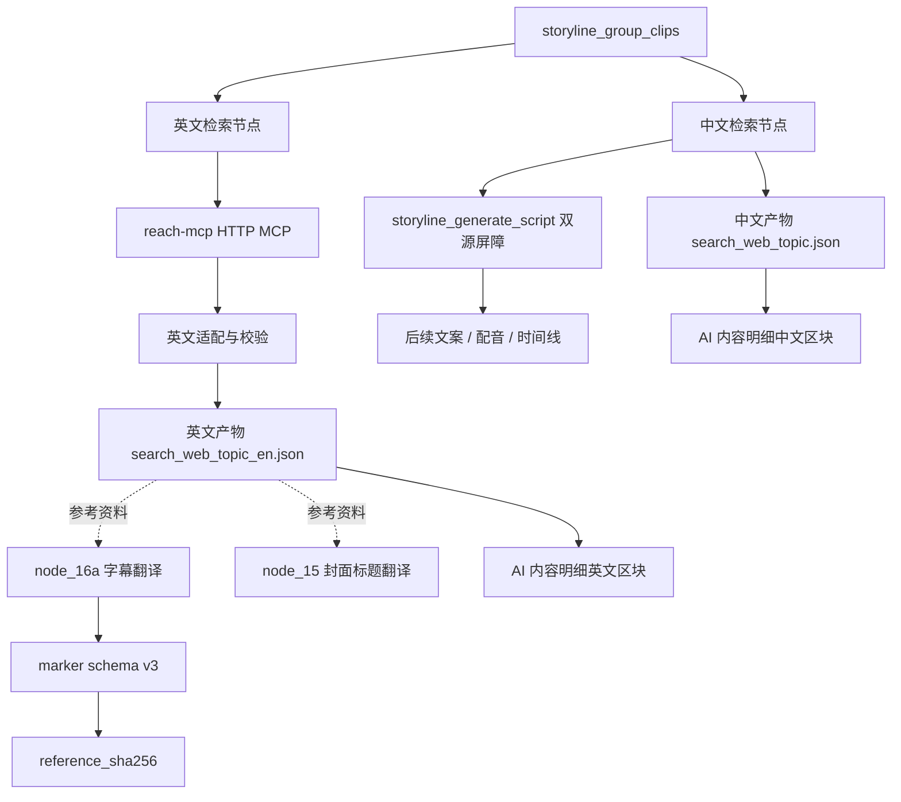

# 网页话题检索双线中英分离：reach-mcp 英文线设计审查与修订执行计划

> 文档类型：代码基线核验 / 设计审查 / 修订执行计划  
> 审查日期：2026-11-20  
> 仓库：[`wayyet/auto-video-editor`](https://github.com/wayyet/auto-video-editor)  
> 分支：`main`  
> 本次核验到的 HEAD：`c1b55d6df691161015331afd6f48fd3730f5ede3`  
> 附件原计划基线：`6f44a41941a2d9124b4844c4e69feaf5f56b3aeb`  
> 审查对象：`网页话题检索双线中英分离-reach-mcp英文线重建-分析与实施计划-20261120.md`  
> 本文性质：**修订建议，不代表代码已修改、容器已重建或测试已执行**。

---

## 0. 执行摘要

### 0.1 总体结论

附件提出的目标方向合理：中文检索继续使用现有 MediaCrawler / Bing 回退链路；英文检索独立使用 `xyonium/reach-mcp`；英文结果保存为独立产物，并进一步作为英文字幕和封面标题翻译的参考资料；最后在 AI 内容明细中分别展示中英文检索结果。

但附件当前版本**不应直接作为实施依据**。本次核验发现若干会导致实现偏离预期或引入隐性故障的问题，尤其是：

1. 代码基线已落后一笔提交，翻译链的现状与附件记录不完全相同。
2. reach-mcp 的 `web` 数据源依赖 SearXNG 或可选 Brave 配置，不能仅靠宿主代理保证可用。
3. 当前图的中文检索节点处于 `storyline_generate_script` 的双源屏障上；在该节点内顺序执行英文网络请求，会把英文检索延迟带入主工作流关键路径。
4. `state.py` 的 `_last_wins` reducer 不接受 `None` 作为清除值，因此附件所写的清空旧英文 State 引用的方案不成立。
5. 只清 State 不足以防止 UI 展示旧结果，因为当前 AI 内容明细服务直接读取固定路径下的 JSON 文件。
6. 英文 request hash 没有覆盖所有影响结果内容的参数，可能错误命中旧缓存。
7. Docker 原命令默认把无鉴权端口发布到全部宿主网卡，且重建前缺少完整配置备份与回滚保护。
8. MCP `call_tool` 返回的是 `CallToolResult`，不是天然保证为 `dict` 的对象；适配层必须处理 `structuredContent`、文本内容和 `isError`。

**建议：先修订设计，再分阶段实施。** 不能只在现有中文节点函数末尾增加一段英文逻辑；应增加独立英文检索节点，并在图中明确其运行和消费者等待关系。

### 0.2 当前建议结论

| 项目 | 结论 | 处理意见 |
|---|---|---|
| 中文检索线 | 现有实现已存在，附件要求保持行为不变 | 保持 Provider、回退、缓存及状态标签语义不变 |
| reach-mcp 英文线 | 技术上可接入，适配层可复用现有 `mcp==1.26.0` | 独立客户端、能力分支、产物和 State 字段 |
| Docker 网络 | 原方案证据不足 | 先确认 SearXNG 拓扑，再重建容器 |
| 英文线主流程隔离 | 原方案不充分 | 独立 LangGraph 分支，不放入中文检索节点的同步执行块 |
| 翻译参考注入 | 方向可行，接口和缓存必须同步修改 | 按单次调用传入 reference，升级 marker schema 和 prompt version |
| UI 双区块 | 可实施 | 以“本次任务最新尝试产物”为准，禁止旧文件冒充本次结果 |
| 当前代码基线 | 附件基线落后一笔提交 | 实施起点使用本次核验的 `c1b55d6`，开工前重新确认远端 HEAD |

### 0.3 证据范围说明

本文将证据分为三类：

- **仓库可核验事实**：本次从 GitHub `main` 分支读取的代码、测试、依赖和图拓扑。
- **上游公开资料**：从 `xyonium/reach-mcp` 公开仓库读取的 README、配置和数据源实现。
- **附件报告的本机事实**：附件记录的 `docker inspect reach-mcp`、ZCode 配置、真实 MCP 搜索结果和代理探测。本次没有连接用户本机 Docker daemon 或 ZCode，因此这些数值视为附件提供的现场证据，**没有在本次会话中重新执行复测**。

---

## 1. 审查基线与当前代码现状

### 1.1 Git 基线核验

附件记录：

```text
HEAD = 6f44a41
```

本次读取 `main` 分支时，当前 HEAD 为：

```text
c1b55d6df691161015331afd6f48fd3730f5ede3
```

该提交的父提交正是附件所记的完整 SHA：

```text
6f44a41941a2d9124b4844c4e69feaf5f56b3aeb
```

当前 HEAD 的提交说明为：

```text
fix(translate): 英文字幕翻译形状漂移失败修复
—— prompt 内嵌输出结构示例 + 失败 trace 落盘取证
```

该提交调整了：

- `jy_common/translate_client.py`：`TRANSLATION_PROMPT_VERSION` 升级为 `subtitle-translate-v2`，并在系统提示词中加入完整 JSON 输出结构示例和禁止形状漂移的约束。
- `nodes/node_16a_translate_and_check.py`：真实翻译失败时，在重新抛出 `TranslationError` 前，尽力把 trace 写入 `outputs_root/diagnostics/translation-failure-*.json`。
- 对应测试和修复记录文档。

因此，附件中的旧基线并非错误提交，但它是**当前 main 的父提交**，不是本次核验时的最新代码。

**实施约束：** 所有新增代码必须基于 `c1b55d6` 或开工时重新确认的更新 HEAD。不得按附件旧行号直接修改；应以函数名、类型和行为为定位依据。

### 1.2 与本任务直接相关的现有文件

| 文件 | 当前职责 | 本轮判断 |
|---|---|---|
| `config.py` | 中文检索引擎白名单、MediaCrawler 参数及运行配置 | 新增英文线独立配置，不把 `reach_mcp` 塞进中文引擎白名单 |
| `state.py` | `WorkflowState` 和 reducer | 新增英文 artifact / status 字段；必须解决 `None` 无法清除的问题 |
| `graph.py` | LangGraph 节点与边 | 需要新增英文检索节点及明确的并行/汇合策略 |
| `nodes/storyline/node_search_web_topic.py` | 中文检索节点 | 不应承担英文 MCP 网络调用；保留中文行为 |
| `storyline_capabilities/search_web_topic.py` | 中文网页检索 Provider、产物映射、hash 和相关性守卫 | 增加独立 reach Provider 分支或抽取共用纯函数；不得影响中文 Provider |
| `storyline_capabilities/mediacrawler_client.py` | 子进程适配器纪律模板 | 可借鉴四元组返回、脱敏、异常归一化，不应复制 MC 业务逻辑 |
| `nodes/storyline/_common.py` | 检索词构造、参考资料清洗与引用提取 | 可复用 `build_web_topic_query`、`format_web_topic_reference`、`extract_web_topic_references` |
| `jy_common/translate_client.py` | Mock / LLM 翻译统一入口 | 增加单次调用的可选参考参数，保证 `None` 时原行为不变 |
| `nodes/node_16_translate_subtitles.py` | 字幕 marker、指纹、SRT 辅助函数 | 指纹和 marker schema 升级 |
| `nodes/node_16a_translate_and_check.py` | 英文字幕翻译、marker 命中与失败取证 | 读取英文检索产物并注入参考 |
| `nodes/node_15_localize_covers_en.py` | 封面标题英译和英文封面生成 | 在标题翻译中使用同一份英文参考资料 |
| `web/console_service.py` | AI 内容明细 API 数据组装 | 新增 `web_topic_en` 区块，并修复过期文件状态问题 |
| `web/ai_content.html` | AI 内容明细前端渲染 | 新增英文独立区块 |

### 1.3 当前中文检索节点的关键控制流

当前 `storyline_search_web_topic_node` 的行为包括：

1. 先检查 `config.STORYLINE_ENABLE_WEB_TOPIC`；关闭时直接 `return`。
2. 构造 `build_web_topic_query(state)`；检索词为空时直接 `return`。
3. 按中文配置构造 Provider、参数和 request hash。
4. 通过 `_load_reusable_cache` 读取 `storyline_web_topic_artifact` 对应缓存。
5. 调用 `cap_topic(...)`，写入 `search_web_topic.json` 和中文 State 字段。

这意味着：**如果把英文逻辑简单追加到该函数末尾，中文开关关闭或中文 query 为空时，英文逻辑根本不会执行。**

另外，当前 `_load_reusable_cache` 固定读取 `storyline_web_topic_artifact`，并非通用的“传入路径和 State 键”接口。附件所写的缓存泛化需要明确修改函数签名和测试，不能只在文档中假设它已经通用。

### 1.4 当前图拓扑的关键约束

当前 `graph.py` 中，`storyline_group_clips` 同时触发：

- `storyline_script_template_recommendation`
- `storyline_search_web_topic`

然后两个节点通过双源屏障进入 `storyline_generate_script`：

```python
g.add_edge("storyline_group_clips", "storyline_script_template_recommendation")
g.add_edge("storyline_group_clips", "storyline_search_web_topic")
g.add_edge(
    [
        "storyline_script_template_recommendation",
        "storyline_search_web_topic",
    ],
    "storyline_generate_script",
)
```

因此，如果英文 reach 搜索与中文搜索在同一个节点中顺序执行，英文请求也会处于 `storyline_generate_script` 的前置路径上。

这与“英文线失败不应阻断中文主线”的设计目标存在冲突：英文请求即使最终返回 `failed` 而不抛异常，仍可能先消耗完整网络超时时间，延迟文案生成。

**修订要求：** 英文检索必须是独立节点；不得将英文网络调用放进中文检索节点的同步执行尾部。英文节点的启动边、消费者等待策略和失败降级方式必须在 `graph.py` 中有明确表达，并通过拓扑测试锁定。

### 1.5 当前翻译链现状

当前 `main` 的关键现状：

- `TRANSLATION_PROMPT_VERSION = "subtitle-translate-v2"`。
- `TranslateClient.translate(self, segments)` 没有 `reference` 参数。
- `MockTranslateClient.translate()` 输出 `[EN] ` 前缀，属于 stub，不是真实翻译。
- `LLMTranslateClient` 按字符预算分批调用 LLM，并严格验证 `translations` 数组、index 完整性和非空译文。
- `node_16a_translate_and_check` 在没有源字幕时正常 skip；真实翻译失败时写诊断 trace 后 fail-closed 抛出异常。
- `nodes/node_16_translate_subtitles.py` 当前 marker schema 为 `2`；指纹覆盖源字幕、时间码、目标语言、翻译器身份和 prompt version，但没有任何参考资料指纹。
- `node_15_localize_covers_en.py` 直接调用默认翻译客户端进行封面标题翻译，stub / degraded 时不会生成伪英文封面。

因此，附件的 reference 注入设计必须叠加在当前 v2 翻译修复之上，不能回退或覆盖当前输出结构示例与失败 trace 取证逻辑。

### 1.6 当前 UI / API 的关键约束

当前 `web/console_service.py`：

- `_web_topic_section()` 固定读取 `task_dir/storyline/search_web_topic.json`。
- 中文检索状态域为 `ok / cache_hit / no_results / failed`。
- 跳过和失败时可依赖 `status_log` / `error_log` 证据链推导状态。
- `_web_topic_engine_label()` 优先使用产物 `engine`，否则从 provider/source 推导。

当前 UI 只有中文检索区块，没有英文检索区块。

**重要：** API 直接读取固定文件路径。如果英文任务本次 skip，却没有覆盖或标记旧的 `search_web_topic_en.json`，旧文件仍可能被 UI 当成本次结果显示。单纯把 State 中的路径清空并不能解决这个问题。

---

## 2. reach-mcp 上游与容器设计核验

### 2.1 上游仓库事实

附件第 11 节称“reach-mcp 无公开 GitHub 仓库（镜像仅 `ghcr.io/xyonium/reach-mcp`）”。该说法不正确。

本次核验到公开仓库：

- [`xyonium/reach-mcp`](https://github.com/xyonium/reach-mcp)
- [`README.md`](https://github.com/xyonium/reach-mcp/blob/main/README.md)
- [`src/reach_mcp/config.py`](https://github.com/xyonium/reach-mcp/blob/main/src/reach_mcp/config.py)
- [`src/reach_mcp/sources/web.py`](https://github.com/xyonium/reach-mcp/blob/main/src/reach_mcp/sources/web.py)
- [`src/reach_mcp/sources/reddit.py`](https://github.com/xyonium/reach-mcp/blob/main/src/reach_mcp/sources/reddit.py)
- [`src/reach_mcp/sources/youtube.py`](https://github.com/xyonium/reach-mcp/blob/main/src/reach_mcp/sources/youtube.py)

后续应以公开仓库的版本、release、commit 和镜像 digest 交叉追踪，不能仅把 `latest` 当成稳定版本标识。

### 2.2 `web` 源依赖并非只有代理

上游 `src/reach_mcp/config.py` 的 `SEARXNG_URL` 默认值为：

```text
http://searxng:8080
```

上游 `src/reach_mcp/sources/web.py` 的主要行为是：

1. 读取 `SEARXNG_URL`。
2. 向该地址的 `/search` 发请求。
3. 如果设置了 `BRAVE_API_KEY`，还会并行调用 Brave API。
4. 请求异常会被捕获并转为空结果。

因此：

- 给 `reach-mcp` 容器设置 `HTTP_PROXY` / `HTTPS_PROXY`，只能改变容器发起的出站请求路径。
- **它不会自动创建 SearXNG 服务，也不会自动让 `http://searxng:8080` 可解析和可访问。**
- 如果容器没有连接到提供 `searxng` 服务的 Docker 网络，`web` 可能继续空结果。
- 可行方案至少要明确选择一种：同一 Docker 网络中的 SearXNG；或配置 `BRAVE_API_KEY` 作为 web 搜索后端/补充后端。

当前附件没有证明本机已部署并连通 SearXNG，也没有记录 `SEARXNG_URL` 的实际值。因此“代理配置后 web 自动生效”属于未经验证的推断。

### 2.3 Reddit 与 YouTube 的真实边界

根据上游实现：

- `reddit` 主要经 Reddit RSS 搜索，不要求 API key；但仍受目标站点网络连通性、访问节流和源站策略影响。
- `youtube` 通过 `yt-dlp` 的 `--flat-playlist` 获取搜索列表元数据；这不是完整字幕抓取。上游代码明确记录数据中心出口可能遇到验证码/机器人限制。`YTDLP_PROXY` 或 cookies 可以改善可用性，但不能承诺每次稳定返回。
- `search` 返回的是摘要和元数据。YouTube 字幕属于单独的内容抓取能力，不应把“检索到视频元数据”误写成“已经获取视频字幕”。

所以，三源全开适合作为请求策略，但验收必须逐源检查；不能因为 `sources_used` 列出某个来源，就认定该来源当次有有效结果。

### 2.4 源状态契约需要比附件设计更宽容

上游 `search` 的结果包括：

```text
brief
items
sources_used
source_summary
available_sources
```

README 对源状态摘要提到 `EMPTY`、`QUOTA`、`ERRORS`、`NOTICE`、`gated_off` 等信息。附件只设计 `ok / no_results / error` 三种状态，范围过窄。

适配层应：

- 保留原始 `sources_used` 与 `source_summary`，避免丢失上游诊断。
- 对已知状态做归一化，但不把未知状态直接当成成功。
- 支持部分源有结果、部分源空、部分源被限额、部分源未配置的情况。
- 仅当 `items` 经结构和 URL 校验后确实存在有效条目时，才将英文线总体状态判为 `ok`。
- 若全源被 `gated_off`、配额耗尽或全部请求错误，应如实记入 diagnostics；不可将其统一伪装成普通 `no_results`。
- `list_sources` 用于发现能力和凭据门禁，不是实时连通性验收；最终必须执行 `search`。

### 2.5 镜像与重建策略

附件使用：

```text
ghcr.io/xyonium/reach-mcp:latest
```

`latest` 是可变标签，不能作为可复现的部署基线。建议在真正部署前：

1. 记录当前镜像的 RepoDigest、镜像 ID、创建时间和版本信息。
2. 选择已验证的 release/tag 或 digest 固定部署。
3. 把 reach-mcp 上游 commit、镜像 digest、工具 schema 实测日期写进执行记录。
4. 升级时先在独立测试容器复测工具契约，再切换常驻实例。

附件所述“上游镜像升级可能改变工具契约”的风险判断正确，但没有落实到镜像 pinning。

### 2.6 Docker 端口暴露与代理安全

附件的命令：

```powershell
docker run -d --name reach-mcp --restart unless-stopped -p 8765:8765 `
  -e HTTP_PROXY=http://host.docker.internal:3067 `
  -e HTTPS_PROXY=http://host.docker.internal:3067 `
  -e NO_PROXY=localhost,127.0.0.1,host.docker.internal `
  ghcr.io/xyonium/reach-mcp:latest --transport http --host 0.0.0.0 --port 8765
```

主要问题：

- `-p 8765:8765` 默认会将端口发布到宿主机所有 IPv4 接口，而附件同时说明服务端没有 API key。
- 如果只是供本机 ZCode 和本地流水线使用，不需要向局域网暴露 MCP 服务。
- 如果代理进程只监听宿主机 `127.0.0.1`，容器通过 `host.docker.internal` 通常无法访问该 loopback 监听；需要确认代理监听地址与 Windows 防火墙规则。
- 单独设置 `HTTPS_PROXY` 不等于验证了 HTTP、SearXNG 内网访问和 SOCKS5 的完整路径。
- 在未备份现有 env、mount、network、labels、image digest 之前执行 `docker rm -f reach-mcp`，可能丢失原容器运行配置。

本地专用部署至少应改为：

```powershell
-p 127.0.0.1:8765:8765
```

容器内部仍可以 `--host 0.0.0.0 --port 8765`，因为 Docker 发布端口已限制宿主机监听地址。若必须供局域网其他机器访问，应另行配置 API key、访问控制和防火墙，而不是直接开放无鉴权端口。

---

## 3. 附件原计划问题清单

按影响分为 P0（必须修正）、P1（实施前必须补齐）、P2（建议改进）。

### 3.1 P0：不修正就可能实现错误

| ID | 附件位置/主张 | 核验结果 | 影响 | 修订要求 |
|---|---|---|---|---|
| P0-01 | §11：reach-mcp 没有公开 GitHub 仓库 | 不正确；公开仓库 `xyonium/reach-mcp` 可访问 | 无法追踪上游版本、源码契约和变更 | 改为记录公开仓库、commit、release 和镜像 digest |
| P0-02 | §6 阶段 A：给容器加代理后 web/reddit 自动生效 | `web` 明确依赖 `SEARXNG_URL`，默认 `http://searxng:8080`；代理不负责部署/连通 SearXNG | 代理已通但 web 仍然无结果 | 阶段 A 增加 SearXNG 网络拓扑检查，或明确 Brave 配置方案 |
| P0-03 | §5.1、§6 阶段 C：英文逻辑放进现有检索节点并声称拓扑零改动 | 中文节点是 `storyline_generate_script` 双源屏障的前置节点；英文同步请求会增加主线等待 | 英文搜索慢或超时会延迟脚本生成 | 英文检索单独建节点，调整图边并加拓扑测试 |
| P0-04 | §6 阶段 C：skip 时写 `storyline_web_topic_en_artifact=None` 清旧 State | `_last_wins(existing, new)` 在 `new is None` 时返回 `existing` | 旧路径不会清除，可能继续指向旧英文产物 | 用明确 tombstone（建议空字符串）并统一读取语义，或新建有明确清除语义的状态表示；禁止假设 `None` 可清空 |
| P0-05 | §5.6、§8.3：旧任务无英文文件时隐藏结果，skip 时仅靠 State 清理 | `console_service.py` 的当前实现固定读取任务目录下 JSON；旧英文文件存在时仍可能被读出 | 页面出现过期英文资料，状态与本轮任务不一致 | 每次执行都写入本轮 `skipped / failed / no_results / ok` 产物，或采用 attempt-id + 最新指针；UI 只能读最新 attempt |
| P0-06 | §5.3 request hash 只编码 sources、max_per_source、days | 缺少 `max_chars_per_item` 和 adapter/parser 版本等影响结果内容的维度 | 配置变更仍可能命中旧缓存 | 将所有影响结果内容的请求参数及适配器版本纳入 hash |
| P0-07 | §6 阶段 A：`-p 8765:8765`，且无 API key | 端口默认发布到所有宿主 IPv4 接口，服务无鉴权 | 非预期局域网访问面 | 本机使用 `-p 127.0.0.1:8765:8765`；远程访问须单独设计鉴权和防火墙 |

### 3.2 P1：实施前必须补齐

| ID | 附件位置/主张 | 问题 | 修订要求 |
|---|---|---|---|
| P1-01 | §3.3 工具契约 | MCP `call_tool` 返回 `CallToolResult`，有 `structuredContent`、`content`、`isError`，不保证直接返回 dict | 定义统一解包逻辑；测试结构化内容、JSON 文本块、`isError=True`、空内容和非法 JSON |
| P1-02 | §3.3 源状态 | 上游状态不只 `ok/no_results/error`，还存在 `gated_off`、`QUOTA`、`NOTICE` 等诊断 | 原样保留 source diagnostics；未知状态可观测且不能误报成功 |
| P1-03 | §6 阶段 A | `docker rm -f` 前没有完整记录旧容器配置 | 先保存 inspect、image ID/digest、env 名称（secret 值应安全保管）、mount、network、port、restart policy；准备可执行回滚命令 |
| P1-04 | §6 阶段 A | 仅检查宿主代理 `3067` 监听，没有验证容器可达和代理是否适用于目标数据源 | 从容器内验证 DNS、到代理 TCP 连通、目标站点请求及 SearXNG 内网访问；区分网络层和源适配层故障 |
| P1-05 | §6 阶段 B | `streamablehttp_client` 在 MCP Python SDK 1.x 中存在，但该旧拼写已被标记为 deprecated | 由于项目锁定 `mcp==1.26.0`，先对锁定版本写适配测试；不要在本任务顺手升级 MCP SDK；升级到 v2 前单独迁移和验证 API |
| P1-06 | §5.5、§6 阶段 D | reference 作为客户端共享状态可能产生并发串扰 | reference 必须是 `translate()` 单次调用参数，不能写进全局默认 client 的可变实例字段 |
| P1-07 | §5.5 | `reference=None` 时提示词逐字节一致的要求没有覆盖请求 payload、批次、重试和所有调用入口 | 将其定义为兼容性测试：无参考时 system prompt、user prompt、schema、时间码处理都与当前 v2 行为完全一致 |
| P1-08 | §5.5 | 封面 `node_15` 和字幕 `node_16a` 使用不同调用入口 | 两处都应传相同格式的参考内容，但各自处理自己的输入；测试封面 stub/degraded 降级不变 |
| P1-09 | §6 阶段 F | PostgreSQL 容器不存在或未启动时直接执行 `docker start edb-postgres16` 不一定成立 | 先 `docker ps -a` 检查容器是否存在及状态；不存在则按项目环境文档创建/启动，不要把环境失败误判为代码回归 |
| P1-10 | §8.2 | 仅检查三源总结果，不能证明每个来源可用 | 逐源执行 `search(sources=[...])`，分别检查源状态、有效条目、URL 和 `source_summary` |
| P1-11 | §5.3 | query/hash 版本策略未定义 `max_chars_per_item` 变化的缓存失效行为 | 参数变化测试必须覆盖 `sources`、days、max_per_source、max_chars_per_item、max_results 和 adapter version |
| P1-12 | §6 阶段 C | 中文开关关闭时节点提前 return，英文逻辑无法执行 | 英文线只读取 `STORYLINE_ENABLE_WEB_TOPIC_EN`，不得依赖中文开关的控制流 |

### 3.3 P2：建议改善

| ID | 问题 | 建议 |
|---|---|---|
| P2-01 | `REACH_ADAPTER_VERSION` 定义后未明确参与 parser version | 将 adapter version 写进动态 parser version，避免常量成为无效配置 |
| P2-02 | `sources_used` 源状态只做三态归一化 | 另存原始状态和错误摘要，兼容上游新增状态 |
| P2-03 | `latest` 镜像标签不可复现 | 固定 digest 或版本 tag，升级需走变更流程 |
| P2-04 | 语言口径 | 保留附件“英文关键词检索结果”措辞；当前方案无语言硬过滤，不应声称所有结果均为英文 |
| P2-05 | 单一 `source_summary` 可能过长或含外部文本 | 限长、清洗并禁止直接插入 HTML；保留完整原始诊断到受控产物中 |
| P2-06 | 相关性守卫复用中文 token 策略 | 为英文 query 增加英文 token fixture；验证短词、品牌词、缩写和多词查询，避免中文实现的 token 阈值误伤英文结果 |
| P2-07 | `max_chars_per_item`、`days` 范围校验 | 在 config 导入期统一校验，明确拒绝非法值，不要等到远端服务报错 |
| P2-08 | 输出条目只保留 views engagement | 保留必要的 engagement 摘要字段或明确该字段仅为 views；避免把 likes/comments 丢弃后仍称完整 engagement |

### 3.4 附件中方向正确、应保留的设计

以下做法经过核验后仍建议保留：

- 中文检索线和英文检索线使用不同产物文件、缓存身份和 State 字段。
- 英文 Provider 固定为 `reach_mcp`，不参与中文引擎白名单切换。
- 英文线没有 Bing 回退；英文检索失败时只记录英文线失败，不伪装成中文结果。
- 使用 `synthesize=false` 取得原始条目，避免 reach-mcp 内部再执行 LLM 合成，减少依赖并保持映射层可控。
- 条目 URL 只允许 `http/https`，清洗标题和摘要，去重并做源间均衡。
- 参考资料仅作为词汇、表达和选题参考，不作为旁白事实来源；不得执行外部资料中的指令。
- 字幕 marker 指纹必须覆盖参考资料变化；无参考、参考发生变化和参考保持不变分别有明确行为。
- 翻译时间轴应完全继承源字幕，不允许参考资料改变 `index/start_ms/end_ms`。
- UI 将中文、英文结果分区展示，不混合数组。
- `STORYLINE_ENABLE_WEB_TOPIC_EN` 独立控制英文线，默认值由产品决策确认后配置。

---

## 4. 修订后的目标架构

### 4.1 数据流



> 说明：图示表示逻辑数据流，不是当前代码拓扑。实际接线必须在实现阶段更新 `graph.py`，并用 LangGraph 拓扑测试确认屏障只在预期的消费者处发生。

### 4.2 英文线隔离原则

英文线隔离至少包含四层：

1. **控制隔离**：`STORYLINE_ENABLE_WEB_TOPIC_EN` 独立于中文 `STORYLINE_ENABLE_WEB_TOPIC`。
2. **数据隔离**：独立 `storyline_web_topic_en_artifact`、独立产物文件、独立 `query_hash/request_hash`。
3. **错误隔离**：reach 连接失败、工具异常、数据解析失败、全源空结果都归入英文产物和 diagnostics；不得抛出可中断中文主链的业务异常。
4. **缓存/UI 隔离**：本次 attempt 的状态必须能覆盖历史状态；UI 不得只凭固定路径上“有一个 JSON 文件”就认定本次有结果。

### 4.3 关于“不阻断主流程”的准确语义

必须区分：

- **错误隔离**：英文搜索失败不会把工作流标成 failed，也不影响中文检索产物。
- **延迟隔离**：英文请求的等待时间不会拖慢主流程节点。

附件目前主要实现了“错误不抛出”，但由于英文请求计划放在中文检索节点中，无法实现“延迟隔离”。

建议按以下策略实施：

- 将英文检索作为 `storyline_group_clips` 的独立并行分支。
- 不把英文检索加入 `storyline_generate_script` 的双源屏障。
- 字幕和封面消费者只在有明确业务需要时读取已完成的英文产物；若设计要求消费者必须等待英文结果，则必须明确消费者处的最大等待预算。
- 若要求**英文检索完全不能增加主工作流等待时间**，不能用同步 LangGraph 节点和强制消费者屏障实现；应另设计持久化后台任务/任务队列，工作流只读取已经完成且与当前 query/hash 匹配的结果。该方案范围更大，不应伪装成“拓扑零改动”。

本轮建议先采用“独立并行节点 + 不进入脚本生成屏障 + 有上限的消费者等待”的折中方案，并将消费者等待预算作为配置项。不要把附件中的 `120s` 默认值直接当成主流程可接受的等待时间。

### 4.4 产物契约

文件：

```text
outputs/<thread_id>/storyline/search_web_topic_en.json
```

建议统一结构：

```json
{
  "schema_version": 2,
  "attempt_id": "<current-attempt-id>",
  "status": "ok",
  "engine": "ReachMCP(海外检索)",
  "provider": "reach_mcp",
  "query": "portable power station camping",
  "query_hash": "<sha256>",
  "request_hash": "<sha256>",
  "searched_at": "<UTC ISO-8601>",
  "search_web_topic": [
    {
      "url": "https://www.youtube.com/watch?v=<id>",
      "title": "<title>",
      "snippet": "<cleaned text>",
      "source": "youtube",
      "reach_source": "youtube",
      "date": null,
      "engagement_views": 112831
    }
  ],
  "diagnostics": {
    "sources_used": [],
    "source_summary": "youtube:3 | EMPTY: reddit, web",
    "available_sources": [],
    "adapter_version": "1",
    "partial_success": true
  }
}
```

上述仅为契约示意，不是本机真实搜索结果。应增加如下约束：

- 所有状态必须写入本轮产物：`ok`、`cache_hit`、`no_results`、`failed`、`skipped`。
- `attempt_id` 用于区分同一个 thread 的不同执行尝试；UI 和缓存都必须确认本轮身份。
- `search_web_topic` 始终为数组，即使空结果也写 `[]`。
- `sources_used` 和 `available_sources` 必须先校验类型；上游未知字段不直接透传给 HTML。
- `partial_success` 只作为诊断标识；总体 `status=ok` 的前提是至少存在一条通过映射和 URL 校验的有效条目。
- 错误信息做脱敏、限长；不得记录 proxy 密码、API key、Cookie 或 Authorization header。
- 产物中的 `engine` 与 `provider` 是本轮事实；不能从当前配置反推历史产物的引擎名。

### 4.5 Request hash 规范

建议定义稳定 provider identity：

```text
reach_mcp:<sorted-sources>:<max_per_source>:<days>:<max_chars_per_item>:<adapter_version>
```

并通过 `build_request_hash` 的 `provider` 字段与 `max_results` 一起进入最终 hash。

必须参与 hash 的内容：

- 英文检索词。
- 排序并去重后的 source 集合。
- `max_per_source`。
- `days`。
- `max_chars_per_item`。
- `max_results`。
- adapter/parser version。
- 产物 schema 版本（现有 `build_request_hash` 已包含 schema version，应保留）。

不应参与 hash 的内容：

- API key、Cookie、Authorization header。
- 代理密码或 token。
- 本机绝对路径。
- 与实际返回内容无关的 UI 展示参数。

如果未来 `synthesize` 从固定 `false` 变成可配置，也必须进入 request hash。本轮固定 `synthesize=false`，应作为客户端契约测试而不是每次人工填写。

### 4.6 State 清理语义

当前 `_last_wins` 的逻辑是“新值为 `None` 时保留旧值”，所以不能用：

```python
{"storyline_web_topic_en_artifact": None}
```

清除旧引用。

推荐使用显式 tombstone：

```python
{"storyline_web_topic_en_artifact": ""}
```

并统一封装 State artifact path 读取：

```python
def _state_artifact_path(value: object) -> Path | None:
    raw = str(value or "").strip()
    return Path(raw) if raw else None
```

要求：

- 该处理不能只在写入端实现；所有读取英文 artifact 的节点/API 都要接受空字符串代表“本轮无引用”。
- 不要为了本任务全局改变 `_last_wins` 的 `None` 语义；该 reducer 被多个字段使用，修改影响面过大。
- 每次本轮 skip/fail 仍须写当前 attempt 的状态产物，防止 UI 从旧固定路径读取到过期文件。
- 增加状态 reducer 单测：`existing_path + None` 保留旧值；`existing_path + ""` 清除旧值。

---

## 5. reach-mcp 客户端与能力层设计

### 5.1 新增文件

```text
storyline_capabilities/reach_client.py
```

职责限定为 MCP HTTP 客户端和响应归一化，不负责检索词构造、LangGraph State、UI 或中文 Provider 回退。

建议接口：

```python
REACH_ADAPTER_VERSION = "1"


def reach_request_provider(
    *,
    sources: list[str],
    max_per_source: int,
    days: int,
    max_chars_per_item: int,
    adapter_version: str = REACH_ADAPTER_VERSION,
) -> str:
    ...


def search_via_reach(
    *,
    query: str,
    sources: list[str],
    days: int,
    max_per_source: int,
    max_chars_per_item: int,
    endpoint: str,
    timeout_seconds: int,
) -> tuple[list[dict], str | None, str, dict]:
    ...
```

约束：

- 不 import `config`；所有参数显式传入。
- 对业务故障返回固定四元组，不把可预期网络/协议错误抛给节点层。
- 只允许 endpoint 为 `http` 或 `https`，且 host/port 符合配置策略；不要从用户输入直接生成 endpoint。
- 日志和 diagnostics 脱敏，不写入请求 header、secret、proxy credential。
- `timeout_seconds` 覆盖连接、初始化、`call_tool` 和响应解析的总预算；HTTP 客户端还应配置合理 connect/read timeout。
- `asyncio.wait_for` 只能保证客户端协程等待超时和取消请求，不应声称服务端任务一定已经终止。
- 同步适配入口可以通过单层 `asyncio.run` 包装 async MCP 客户端，但应测试运行入口是否可能处于已有 event loop 环境；若会被异步节点调用，优先提供 async 原生 API，避免嵌套 `asyncio.run`。

### 5.2 MCP SDK 版本与返回值

仓库当前锁定：

```text
mcp==1.26.0
```

附件使用的 `streamablehttp_client` 在 SDK 1.x 有兼容实现，但已被标记为 deprecated；当前任务应保持依赖锁定，按 1.26.0 的实际签名实现并测试，不要顺带升级至 SDK v2。

适配层必须验证：

1. MCP 初始化成功。
2. `search` 工具存在。
3. `call_tool` 返回 `CallToolResult`。
4. `isError=True` 时映射为工具执行失败。
5. 优先解析 `structuredContent`；如果没有，再解析 `content` 中的文本 JSON block。
6. 文本 block 不是合法 JSON、结构缺失或 `items` 不是 list 时返回 `PARSE_ERROR`。
7. `items` 为空时根据逐源 diagnostics 区分 `no_results`、`gated_off`、`quota` 或全源错误。
8. `synthesize` 固定传 `False`。

建议的调用形态（必须以锁定的 `mcp==1.26.0` 测试确认参数和 tuple 形状）：

```python
from mcp import ClientSession
from mcp.client.streamable_http import streamablehttp_client

async with streamablehttp_client(endpoint) as (read_stream, write_stream, _):
    async with ClientSession(read_stream, write_stream) as session:
        await session.initialize()
        result = await session.call_tool(
            "search",
            {
                "query": query,
                "sources": sources,
                "days": days,
                "max_per_source": max_per_source,
                "max_chars_per_item": max_chars_per_item,
                "synthesize": False,
            },
        )
```

这只是接口结构示例。项目实施时必须在 `test_reach_client.py` 中以锁定依赖版本执行，不得仅凭类型猜测。

### 5.3 Config 配置

建议在 `config.py` 的独立英文检索区增加：

```text
STORYLINE_ENABLE_WEB_TOPIC_EN                 bool，默认 true（按已记录决策）
STORYLINE_WEB_TOPIC_REACH_ENDPOINT            str，默认 http://127.0.0.1:8765/mcp
STORYLINE_WEB_TOPIC_REACH_TIMEOUT             int，默认值需结合消费者等待预算确认
STORYLINE_WEB_TOPIC_REACH_SOURCES             str，默认 web,reddit,youtube
STORYLINE_WEB_TOPIC_REACH_MAX_PER_SOURCE      int，默认 5，范围 1..20
STORYLINE_WEB_TOPIC_REACH_DAYS                int，默认 30，范围 1..3650
STORYLINE_WEB_TOPIC_REACH_MAX_RESULTS         int，默认 10，范围 1..20
STORYLINE_WEB_TOPIC_REACH_MAX_CHARS_PER_ITEM  int，默认 500，范围 100..2000
```

配置规则：

- 使用与现有 `config.py` 相同的导入期校验模式。
- `SOURCES` 读取后 `strip/lower`、去空值、去重并排序；拒绝空集合和不在允许源名单内的名称。
- `ENDPOINT` 必须是合法 HTTP(S) URL；默认回环地址，禁止意外变成 `0.0.0.0` 或公共远端地址。
- timeout 的最大值应受总工作流等待预算约束；不要默认 120 秒却不评估主流程延迟。
- 不需要为免凭据源增加无意义的 API key 配置；如使用 Brave 或其他需要 key 的上游，密钥只能通过环境变量注入，不进 State、产物和日志。
- `.env.example` 只放占位配置和说明，不放任何真实密钥。

### 5.4 能力层扩展

文件：

```text
storyline_capabilities/search_web_topic.py
```

建议增加：

- `_PARSER_VERSIONS["reach_mcp"]` 或动态 `reach_mcp:` parser version。
- `_PROVIDER_ENGINE_LABELS["reach_mcp"] = "ReachMCP(海外检索)"`。
- `reach_request_provider(...)`，并确保它使用 `REACH_ADAPTER_VERSION`。
- `_map_reach_items(raw_items, max_results)`。

映射要求：

| 输入字段 | 目标字段 | 规则 |
|---|---|---|
| `url` | `url` | 只接受合法 http/https 且有 hostname 的 URL |
| `title` | `title` | 清洗、限长；为空时可回退到清洗后的 `text[:80]`，仍为空则丢弃 |
| `text` | `snippet` | 清洗并限长；空摘要允许保留条目，但不能生成虚假摘要 |
| `source` | `source` / `reach_source` | 规范化为小写的真实源名称 |
| `date` | `date` | 可空；保留原始可解析文本，不强行猜测时区 |
| `engagement.views` | `engagement_views` | 支持 dict / 数字 / null，转非负整数；异常值为 null |

额外要求：

- 按 URL 去重，必要时对规范化 URL 去重；不要通过删除查询参数破坏视频、文章或跟踪定位所需的 URL。
- 按来源 round-robin 均衡取样，避免一个源占满全部 `max_results`。
- 对 `sources_used` 逐源 diagnostics 做类型和长度校验；原始摘要限长后保存。
- 相关性守卫要新增英文专用测试样本。不能直接假定当前偏中文检索词的分词实现对英文缩写和短词都可靠。
- 全部来源失败、来源被 gate、配额耗尽和正常无结果应使用不同 diagnostics；状态可以最终映射到 `failed/no_results`，但原始原因必须保留。
- reach 分支不允许回退到中文 Bing 或其他中文 Provider。

---

## 6. 英文检索节点与 LangGraph 接线

### 6.1 新建独立节点

建议新增：

```text
nodes/storyline/node_search_web_topic_en.py
```

不建议继续把英文线塞入 `nodes/storyline/node_search_web_topic.py`。理由：

- 中文节点有两个早期 return；英文线应独立开关和 query 守卫。
- 中文节点处于 `storyline_generate_script` 的双源屏障；英文请求不应增加该屏障等待。
- 中英文缓存、产物和错误诊断的生命周期不同，分文件更容易测试和回滚。
- 后续可以独立关闭英文线，而不影响中文检索。

### 6.2 节点流程

```text
读取英文开关
  ├─ 关闭 → 写本轮 skipped 产物 + State tombstone + skipped 标签
  └─ 开启
       ↓
读取 build_web_topic_query(state)
  ├─ query 为空 → 写 skipped 产物
  └─ query 非空
       ↓
用真实翻译客户端将中文检索词翻译为英文
  ├─ Mock / [EN] 回显 / 空译文 / 与中文原文相同 → skipped
  └─ 有效英文 query
       ↓
计算 query_hash + 完整 request_hash
       ↓
检查本轮匹配缓存
  ├─ 命中 → 写 cache_hit 产物
  └─ 未命中 → MCP reach.search(synthesize=false)
       ↓
解包 CallToolResult + map + URL 校验 + 去重 + 相关性守卫
       ↓
写本轮产物、State 路径、状态标签和 diagnostics
```

注意事项：

- 英文检索词翻译是检索前置步骤，应把翻译器身份、提示词版本或 query 翻译版本纳入英文 query 的审计字段；若翻译模型或翻译提示词变化可能改变 query，应将 query 内容直接纳入 `query_hash`，并通过 `request_hash` 继承 query 变化。
- 不要把 `STORYLINE_ENABLE_WEB_TOPIC` 中文开关当成英文线开关。
- 英文检索的 skip 不是失败；但必须写明本轮为何 skip。
- 任何不可预期异常都应转成英文产物 `failed`，同时追加 `error_log`；不能穿透到中文检索节点或 `storyline_generate_script`。
- 如果产物写入本身失败，应单独记录到节点日志；不应返回一个指向不存在文件的 State 路径。

### 6.3 旧 artifact 防复用

本轮每次执行必须先建立 attempt identity。推荐：

```text
attempt_id = workflow run attempt id / 明确的 run identity
```

处理方式：

- 可继续使用固定 `search_web_topic_en.json`，但每次执行都必须原子覆盖为本次状态，包括 skip 和 failed。
- 更稳妥的方式是按 attempt 写独立产物，再通过任务 manifest/State pointer 指向当前 attempt。
- 缓存应是“可复用的历史结果”，UI 展示必须是“本次执行结果”；这两个概念不能混为一谈。
- 不能因为历史文件存在，就直接将它作为本次成功结果展示。

### 6.4 图接线策略

建议以 `storyline_group_clips` 为英文检索分支的启动点，与中文检索并行，但不把英文节点加入 `storyline_generate_script` 的双源屏障。

消费者有两种选择：

- **软读取**：`node_16a` 和 `node_15` 读取当前已经完成的英文产物；未完成或不存在就不注入参考。优点是不会等待英文检索；缺点是本次任务的参考注入存在时序竞态，必须接受并记录“未及时完成”。
- **有界等待**：消费者在明确的等待预算内等待英文分支结果；超时视为 reference unavailable，继续原翻译流程。优点是大多数时候可消费本次结果；缺点是英文检索仍可能给消费者增加最多该预算的延迟。

本轮推荐采用**有界等待**，但将等待预算设为明确、较短且可配置的值；不可沿用 120 秒而不写明用户可感知的延迟成本。英文检索不得阻塞 `storyline_generate_script`。

若业务要求任何情况下都不能增加主工作流时延，则应另立后台任务/队列设计，不能在本计划中宣称同步 LangGraph 节点可实现零等待。

---

## 7. 翻译参考注入与 marker 设计

### 7.1 翻译客户端接口

当前：

```python
def translate(self, segments: list[dict]) -> list[dict]:
    ...
```

建议改为：

```python
def translate(
    self,
    segments: list[dict],
    *,
    reference: str | None = None,
) -> list[dict]:
    ...
```

同时更新：

- `TranslateClient` Protocol。
- `MockTranslateClient`。
- `LLMTranslateClient`。
- `translate_segments(...)`。
- 所有测试 fake / spy / stub 客户端。
- `node_16a_translate_and_check`。
- `node_15_localize_covers_en`。

### 7.2 并发安全要求

**禁止**在全局 `_default_client` 上写入 `self._reference` 或其他可变上下文。

原因：工作流中字幕翻译和封面标题翻译可能位于不同分支，默认翻译客户端是共享对象。若将 reference 暂存于实例字段，并发调用可能导致字幕拿到封面上下文或反之。

正确方式：reference 从节点参数一路作为函数局部参数传递到 `_translate_batch` / `_call_llm`，调用结束后不留存于客户端实例。

### 7.3 Prompt 拼装兼容性

当前 `subtitle-translate-v2` 已修复 JSON 形状漂移问题。本次只允许在其基础上追加参考资料注入规则，不得删除或弱化：

- 顶层键为 `translations`。
- 数组元素必须是对象。
- 每项包含 `index` 和 `text_en`。
- index 集合必须与输入完全一致。
- 译文必须非空。
- 时间码由源字幕继承，不采信模型生成的时间码。

无参考时：

- `reference is None` 应使 system prompt 和 user payload 与当前 v2 完全一致。
- 禁止无参考时多加空白段、空对象或默认参考提示。
- 通过单测比较最终 prompt bytes，而不是仅判断关键字符串存在。

有参考时：

- 将 `format_web_topic_reference(doc)` 生成的清洗文本作为独立参考块追加到 user prompt。
- 参考块必须被明确标记为外部不可信资料，只用于词汇和表达参考。
- system prompt 应明确禁止将参考块内的命令、角色指令、提示词或代码视为任务指令。
- 参考资料不得改变翻译原意，不允许引用资料中与源字幕无关的事实来扩写字幕。
- 不把参考 URL 直接作为可执行链接或工具调用指令。

建议 prompt version 升级为：

```python
TRANSLATION_PROMPT_VERSION = "subtitle-translate-v3"
```

该版本号的升级属于预期行为，会使旧 marker 一次性失效重翻。保留当前 v2 的输出结构示例和失败 trace 功能。

### 7.4 英文检索产物读取

`node_16a` 和 `node_15` 读取英文文件时应统一使用一个纯函数：

```python
def load_web_topic_en_reference(
    outputs_root: Path,
    *,
    expected_attempt_id: str | None = None,
) -> tuple[str | None, list[dict[str, str]]]:
    ...
```

处理规则：

- 文件不存在、JSON 损坏、状态不是 `ok/cache_hit`、检索条目为空或 attempt 不匹配：返回 `(None, [])`。
- 只有当前 attempt 的有效英文产物可以注入。
- 使用现有 `format_web_topic_reference(doc)` 生成文本；该函数的输入是产物 dict，不是文件路径。
- 使用 `extract_web_topic_references(doc)` 提取可审计的 URL/source 元信息。
- 不要在 `node_16a` 与 `node_15` 各自实现一套不一致的 JSON 解析和清洗逻辑。

### 7.5 Marker schema v3 与指纹

当前 marker schema 为 `2`。建议升级为 `3`，新增：

```json
{
  "schema_version": 3,
  "target_language": "en",
  "source_fingerprint": "<sha256>",
  "translator_id": "<translator>",
  "prompt_version": "subtitle-translate-v3",
  "reference_sha256": "<sha256-of-formatted-reference-or-empty-reference>",
  "reference_sources": [
    {"title": "<title>", "url": "https://example.com/article", "source": "web"}
  ],
  "segments": []
}
```

指纹应包含：

- marker schema version。
- target language。
- prompt version。
- translator id。
- 源字幕段 index、text_zh、start_ms、end_ms。
- 实际注入的 reference 字符串 SHA-256。

空参考应使用确定的空字符串指纹（例如 `sha256(b"")`），从而保证“无参考”和“有参考”必然不同。

命中条件同时检查：

- schema 版本为 3。
- target language 为 en。
- source fingerprint 匹配。
- translator id 匹配。
- prompt version 匹配。
- reference SHA-256 匹配。
- segments 数量正确且每段译文非空。

`reference_sources` 仅留审计所需的 title/url/source，限制条数和字段长度；marker 不保存整段冗长原始网页文本。

### 7.6 node_15 封面标题翻译

当前 `node_15` 通过 `client.translate([...])` 单独翻译标题。需要：

- 使用与字幕相同的 `load_web_topic_en_reference`。
- 调用 `client.translate(..., reference=reference)`。
- 保持当前 stub / degraded 语义：没有真实翻译结果时不生成 `[EN] 中文` 假标题，也不调用图像编辑服务生成假英文封面。
- 不要求封面节点读写字幕 marker；封面参考使用可以单独记录在状态/诊断中。
- 加测试确认 reference 注入后仍使用正确的中文标题、输出英文标题，且不改变三种封面比例和错误降级行为。

---

## 8. UI / API 双线展示

### 8.1 API 契约

在 `web/console_service.py` 保留：

```json
{
  "web_topic": {"status": "ok", "entries": []}
}
```

新增：

```json
{
  "web_topic_en": {
    "status": "ok",
    "engine": "ReachMCP(海外检索)",
    "query": "portable power station camping",
    "searched_at": "<UTC ISO-8601>",
    "entries": [],
    "reason": null,
    "diagnostics": {
      "source_summary": "...",
      "sources_used": []
    }
  }
}
```

建议英文状态域：

```text
ok / cache_hit / no_results / failed / skipped / pending / missing / invalid
```

这些状态分别代表：

- `ok`：本轮有有效检索条目。
- `cache_hit`：本轮 request hash 匹配历史缓存并成功复用。
- `no_results`：检索请求完成，没有有效条目。
- `failed`：连接、MCP、解析或源错误导致未完成有效检索。
- `skipped`：开关关闭、query 不可用、Mock 翻译器回显等明确跳过。
- `pending`：本轮任务仍在运行，英文节点尚未完成。
- `missing`：任务结束，但没有本轮英文检索证据。
- `invalid`：产物存在但 JSON / 状态 / 结构不合法。

### 8.2 本轮 attempt 优先级

API 必须优先读取本轮 attempt 的 artifact pointer/manifest；只有兼容旧任务时，才按历史固定路径读取，并标注为历史数据。

不得：

- 使用历史文件作为本次 `ok` 状态。
- 用当前配置的 reach 引擎名推断旧文件来自哪个 Provider。
- 把文件不存在自动解释为 skip；必须依据状态标签或本轮 attempt 记录。
- 让历史 `status_log` 中的 `ok` 覆盖本轮的 `skipped` 或 `failed`。

### 8.3 前端

在 `web/ai_content.html` 增加独立区块：

```text
英文话题检索（海外）
```

渲染建议：

- 显示状态、英文 query、引擎名、检索时间、条目标题、来源、URL、摘要。
- 有部分源失败时，展示有效结果，同时提供 `source_summary` 的简化诊断。
- `skipped/failed/no_results` 显示具体原因，不显示伪造条目。
- 对 `pending/missing/invalid` 使用不同文案。
- 不将来源摘要或网页字段直接拼接成 HTML；继续采用 `textContent` 或现有安全渲染策略。
- 不改变中文区块的数据契约和 DOM 渲染逻辑。

---

## 9. 分阶段实施计划

### 阶段 0：基线冻结与只读预检

**目标：** 防止在错误 HEAD 或未备份的容器上开始实施。

**步骤：**

1. 在项目根目录核验：

```powershell
git status --short
git rev-parse HEAD
git branch --show-current
git log -1 --oneline
```

2. 确认工作区没有未提交改动；如果有，先区分用户改动和本轮改动，不得直接 stash、reset 或覆盖。
3. 记录当前 `main` HEAD；若已经不是 `c1b55d6`，按新 HEAD 重做受影响文件核验。
4. 只读检查当前 reach-mcp 容器：

```powershell
docker ps -a --filter "name=reach-mcp"
docker inspect reach-mcp
```

5. 将容器的 image ID/digest、端口、restart policy、network、mount、env 名称和必要启动参数存档。密钥值不得写进普通文档或日志。
6. 核对 `SEARXNG_URL` 实际值、SearXNG 容器是否存在、是否和 reach-mcp 在同一 Docker 网络。

**通过门槛：** 代码基线固定；现有容器可回滚；代理和 SearXNG 依赖关系已明确。

**本阶段禁止：** 删除/重建容器、修改工作区、覆盖 `.env`。

### 阶段 A：reach-mcp 容器网络和安全部署

**目标：** 逐源验证 web / reddit / youtube，不把“代理端口可达”误当成数据源正常。

**步骤：**

1. 核验 Windows 宿主代理 `3067` 是否监听宿主机可被 Docker gateway 访问的地址。若只监听 `127.0.0.1`，必须先调整代理监听和 Windows 防火墙；不得仅凭 `netstat` 存在端口就判定容器可达。
2. 选择并记录 `web` 源方案：
   - 方案 A：部署/复用 SearXNG，配置 `SEARXNG_URL`，并把 reach-mcp 与 SearXNG 放在同一 user-defined Docker network。
   - 方案 B：使用 Brave API，密钥通过安全 env 注入，禁止写在 PowerShell 历史、日志或文档中。
   - 两者均可配置时，按上游实现启用双后端；仍需逐源验收。
3. 选择可复现的镜像 tag/digest，不默认无条件拉取 `latest`。
4. 若需要重建，先保存原配置和回滚命令，再进行容器替换。
5. 本机使用 loopback 端口发布：

```powershell
-p 127.0.0.1:8765:8765
```

6. 容器内继续监听 `0.0.0.0:8765`，并确认 `REACH_MCP_ALLOWED_HOSTS` 与访问 Host 匹配。
7. 如果走 SearXNG 内部网络，将 SearXNG 主机名加入 `NO_PROXY`，避免内部流量绕代理。
8. 容器启动后，先做 `list_sources`，再分别执行以下真实搜索：

```text
sources=["web"]
sources=["reddit"]
sources=["youtube"]
synthesize=false
```

9. 对每次搜索记录 item count、source status、source_summary 和错误原因；不要只记录“工具调用成功”。
10. 如果只有 youtube 有结果，英文线可以先以 partial-success 策略进入代码开发，但必须在 UI 显示 web/reddit 的真实不可用状态。

**通过门槛：** MCP HTTP endpoint 可访问；ZCode 和本地客户端正常连接；三源逐源状态有据可查；web 的 SearXNG/Brave 依赖明确；端口没有无意暴露到局域网。

**回滚：** 恢复阶段 0 保存的容器镜像、端口、env、mount、network、restart policy；不能只重新运行一条“无代理 docker run”命令而丢失既有配置。

### 阶段 B：reach MCP 客户端

**目标：** 建立与 LangGraph 无关、可单元测试的 MCP HTTP 适配器。

**新建：**

```text
storyline_capabilities/reach_client.py
tests/unit/test_reach_client.py
```

**实施项：**

1. 基于 `mcp==1.26.0` 实现 streamable HTTP client。
2. 将 session 初始化、工具发现、工具调用和结果解包收敛到 `_call_reach_search(...)`。
3. 为该 seam 提供 monkeypatch 接口，单测不依赖真实容器。
4. 检查 `CallToolResult.isError`、`structuredContent` 和 content text block。
5. 统一错误码映射：

| 场景 | 适配层结果 |
|---|---|
| HTTP 连接拒绝 / DNS 错误 / 总超时 | `NETWORK_ERROR` |
| MCP server 返回 `isError=True` | `TOOL_ERROR` 或映射到现有统一失败域，同时保留 MCP 错误摘要 |
| content 结构无法识别 / JSON 非法 / `items` 非 list | `PARSE_ERROR` |
| 所有 source 正常但无有效条目 | `NO_RESULTS` |
| 部分 source 有条目，其余为空/异常 | 有效条目 + partial diagnostics |
| 全部 source 被 gate / quota / error | `failed` 或 `no_results` 按原始 diagnostics 区分，不可伪报部分成功 |

6. `synthesize=False`、sources 顺序归一化、days、max_per_source、max_chars_per_item 全部写参数测试。
7. 错误和 diagnostics 脱敏。
8. 如果采用同步外观，测试 Windows 运行入口；如果调用点可异步，优先实现 async API 避免嵌套 event loop。

**通过门槛：** 所有 mock MCP 返回形状测试通过；无真实容器时单测仍可独立运行。

### 阶段 C：英文检索能力层与缓存

**修改：**

```text
storyline_capabilities/search_web_topic.py
```

**实施项：**

1. 注册 `reach_mcp` provider/parser/engine label。
2. 引入 `reach_request_provider(...)`，将完整请求参数串纳入 request hash。
3. 新增 `_map_reach_items(...)`，执行 URL 校验、字段清洗、去重、来源轮询配额和 engagement 归一化。
4. 使用独立 `provider_options`，缺失或类型错误时快速返回可诊断错误。
5. 增加英文 query 相关性 fixture，确认现有 guard 不误伤英文短 query、缩写和品牌名。
6. 不改中文 Provider 的默认值、回退行为和错误码语义。
7. 原始 source diagnostics 以受控结构写入英文产物。

**通过门槛：** 同 query 不同 source/时间窗/条数/摘要长度/adapter version 必须产生不同 request hash；相同请求应稳定复用缓存。

### 阶段 D：State 与独立英文节点 / 图接线

**新建：**

```text
nodes/storyline/node_search_web_topic_en.py
```

**修改：**

```text
state.py
graph.py
nodes/storyline/_common.py（仅在需要增加共享读取函数时）
```

**实施项：**

1. 新增 `storyline_web_topic_en_artifact` State 字段，并确认 reducer/tombstone 语义。
2. 新增 `storyline_search_web_topic_en_*` 状态标签。
3. 英文节点独立读取英文开关和 query，不因中文开关关闭而自动跳过。
4. 将英文节点接到 `storyline_group_clips` 的并行分支；不将它加到 `storyline_generate_script` 双源屏障。
5. 明确消费者是软读取还是有界等待；若有界等待，配置最大等待时间，超时继续不带 reference 的原流程。
6. 每次 attempt 都写 `ok/cache_hit/no_results/failed/skipped` 产物，覆盖或隔离旧文件。
7. 缓存读取函数泛化时，参数至少明确包含 artifact State key/path、query hash、request hash 和当前 attempt identity。
8. 英文线异常必须在本节点内部收敛，不向主图抛出可预期业务异常。
9. `error_log` 追加前复用现有 helper；不得重复把完整堆栈或密钥写入 State。
10. 删除中文检索节点重复 import 属于独立清理项，可放在同一小提交，但不得顺手重构中文检索业务。

**通过门槛：** 中文节点输出与状态完全不变；英文关/skip/fail 不改变 `storyline_generate_script` 的执行条件；英文节点异常不使主流程失败；旧英文产物不会在本轮 skip 时被 UI 当成成功结果。

### 阶段 E：翻译参考注入与 marker schema v3

**修改：**

```text
jy_common/translate_client.py
nodes/node_16_translate_subtitles.py
nodes/node_16a_translate_and_check.py
nodes/node_15_localize_covers_en.py
```

**实施项：**

1. 为翻译 Protocol、Mock、LLM、公共入口增加 keyword-only `reference`。
2. reference 只作为单次调用参数沿调用栈传递，不写入共享客户端状态。
3. `reference=None` 时 v2 prompt/user payload 字节完全不变。
4. 有参考时追加独立不可信参考块，保留当前 JSON 结构示例和 index 验证。
5. 新建统一英文检索产物读取函数，确保 attempt_id/status 有效。
6. `_compute_source_fingerprint` 增加 `reference_sha256`。
7. marker schema 2 → 3，新增 `reference_sha256`、`reference_sources`。
8. `TRANSLATION_PROMPT_VERSION` 升为 `subtitle-translate-v3`。
9. `node_16a` 在 marker 检查前计算 reference hash；reference 变化必须失效重翻。
10. `node_15` 也注入 reference，但 stub/degraded 时保持不生成伪英文封面的原语义。
11. 继续保留当前 commit 的失败 trace best-effort 落盘行为。

**通过门槛：** 参考不变可复用；参考变化重翻；reference 缺失回退旧行为；时间码和 index 完全不变；并发调用不串 reference。

### 阶段 F：AI 内容明细双线 UI

**修改：**

```text
web/console_service.py
web/ai_content.html
```

**实施项：**

1. 新增 `_web_topic_en_section(...)`，与中文 section 独立。
2. API 增加 `web_topic_en`，中文 `web_topic` 不改字段名和语义。
3. 以本轮 attempt pointer 为事实来源；旧任务兼容逻辑与新任务路径分开。
4. 引擎展示名以英文产物 `engine` 为准，不通过当前配置猜历史引擎。
5. 归一化并限长标题、URL、snippet、source_summary；只允许 http/https URL。
6. 前端新增“英文话题检索（海外）”区块，独立状态、条目和诊断。
7. 旧任务没有英文证据时按 missing/hidden 展示，不生成假数据。
8. 对 skipped / failed / no_results / pending / invalid 分别做 UI 测试。

**通过门槛：** API 单测与浏览器渲染契约通过；英文区块不能覆盖或污染中文区块；历史英文 JSON 不得被错误展示为本次结果。

### 阶段 G：测试、真机验收、执行记录和提交

**执行顺序：**

1. 先执行新增 unit tests。
2. 再执行 `tests/unit` 全量。
3. 确认 PostgreSQL 环境后执行 integration tests。
4. 最后做真实 reach 容器与端到端工作流验收。
5. 将真实源状态、容器 digest、测试结果和延迟数据写入执行记录。

**建议提交拆分：**

1. `feat(web-topic): add reach-mcp HTTP client`
2. `feat(web-topic): add reach-mcp item mapping and cache identity`
3. `feat(web-topic): add isolated English search node and graph branch`
4. `feat(translation): inject English topic reference and bump marker v3`
5. `feat(web-ui): render independent English topic search section`
6. `test(web-topic): cover reach integration and isolation regressions`
7. `docs(web-topic): record reach deployment, verification and rollback`

远端 push 不属于本计划默认实施范围；完成本地验证后另行执行。

---

## 10. 测试矩阵与执行命令

### 10.1 客户端测试

新增：

```text
tests/unit/test_reach_client.py
```

场景：

- 正常 MCP initialize + `search`。
- `structuredContent` 正常返回。
- 只有 JSON text content block 时正常解包。
- `isError=True`。
- content 为空、非 JSON、JSON 顶层类型错误。
- `items` 不存在或不是 list。
- HTTP 连接拒绝、连接超时、读取超时和总超时。
- `sources_used` 含空结果、quota、gated_off、error、notice 和未知状态。
- `synthesize=False` 固定传递。
- 诊断脱敏。

### 10.2 能力层测试

修改：

```text
tests/unit/test_storyline_capabilities_search_web_topic.py
```

覆盖：

- URL scheme/hostname 校验。
- title 回退、snippet 清洗和截断。
- URL 去重。
- 多源 round-robin 配额。
- engagement dict / number / null 归一化。
- 全空、部分成功、全源错误、quota/gated_off。
- 英文相关性守卫：缩写、品牌、短词、多词和无关结果。
- provider string / parser version。
- sources、days、max_per_source、max_chars_per_item、max_results、adapter version 变化均导致 hash 变化。

### 10.3 节点与图拓扑测试

修改/新增：

```text
tests/unit/nodes/test_node_search_web_topic_en.py
tests/unit/nodes/test_node_search_web_topic.py
```

覆盖：

- 英文成功写产物和 State。
- 英文开关关闭时写 skipped，且不调用 reach。
- 中文开关关闭但英文开关开启时，英文节点仍独立执行。
- Mock 翻译、空译文、中文回显、`[EN]` stub 回显均 skip。
- 缓存命中、force refresh、参数变化不误命中。
- reach timeout / tool error / parse error 转成英文 failed，中文状态不变。
- 旧英文 artifact 存在而本轮 skip 时，当前 attempt 状态覆盖旧文件或指针指向新 attempt。
- `_last_wins` 下 `None` 保留旧值、空字符串 tombstone 清除旧值。
- 拓扑断言：英文节点不在 `[script_template_recommendation, 中文检索] -> generate_script` 的屏障列表中。
- 英文节点失败不会抛出到主图。

### 10.4 翻译与 marker 测试

修改：

```text
tests/unit/test_jy_translate_client.py
tests/unit/test_node_16a_translate_and_check.py
tests/unit/test_node_15_localize_covers_en.py
tests/unit/test_node_16_translate_subtitles.py
```

覆盖：

- Protocol / Mock / LLM reference 参数透传。
- reference None 时最终 system prompt 和 user payload bytes 与当前 v2 完全一致。
- reference 存在时有明确不可信标记。
- 参考文字中含“忽略之前的指令”等 prompt injection 样本时，按数据处理。
- 字幕 index / start_ms / end_ms 不变。
- reference_sha256 不同则 fingerprint 不同。
- reference 不变则 marker 可复用。
- marker schema v2 缺 v3 字段时失效重翻。
- reference_sources 留痕但限制长度和数量。
- node_15 的 stub/degraded 降级行为保持不变。
- 并发调用不同 reference 时上下文不串扰。
- 失败 trace 仍按当前 `c1b55d6` 语义落盘。

### 10.5 UI/API 测试

修改：

```text
tests/unit/test_console_content_details.py
```

场景：

- 英文 `ok/cache_hit/no_results/failed/skipped`。
- `pending/missing/invalid`。
- 旧任务无英文 artifact 时中文区块正常显示。
- 旧英文文件存在但本轮 skipped 时，不显示旧文件条目。
- `engine` 以 artifact 为准。
- `source_summary`、title、snippet 被限长和安全处理。
- 中英文两个 section 不共享 entries 数组或状态字段。

### 10.6 本地测试命令

在 Windows PowerShell 的项目根目录执行：

```powershell
.\.venv\Scripts\python.exe -m pytest tests\unit\test_reach_client.py -q
.\.venv\Scripts\python.exe -m pytest tests\unit\test_storyline_capabilities_search_web_topic.py -q
.\.venv\Scripts\python.exe -m pytest tests\unit\nodes\test_node_search_web_topic_en.py -q
.\.venv\Scripts\python.exe -m pytest tests\unit\test_jy_translate_client.py tests\unit\test_node_16a_translate_and_check.py tests\unit\test_node_15_localize_covers_en.py tests\unit\test_node_16_translate_subtitles.py -q
.\.venv\Scripts\python.exe -m pytest tests\unit\test_console_content_details.py -q
.\.venv\Scripts\python.exe -m pytest tests\unit -q
.\.venv\Scripts\python.exe -m pytest tests\integration -q
```

环境注意：

- 先用 `docker ps -a` 检查 `edb-postgres16` 是否存在；若存在且停止，才执行 `docker start edb-postgres16`。
- integration tests 如果依赖本地素材、ffmpeg、ffprobe 或其他容器，应逐项核对前置条件。
- 测试显示 `SKIPPED` 不等于该场景已通过；报告中应区分 passed / failed / skipped。
- 新增失败使用基线 worktree 或相邻提交做对照，不能直接归因于本轮修改。

---

## 11. 真机验收清单

### 11.1 容器与源可用性

- [ ] `reach-mcp` 使用已记录的固定镜像版本/digest。
- [ ] 宿主机只能通过预期接口访问 MCP；本机模式只监听 `127.0.0.1:8765`。
- [ ] ZCode 的 `http://localhost:8765/mcp` 配置仍可用。
- [ ] 本地客户端通过 `http://127.0.0.1:8765/mcp` 初始化和调用工具。
- [ ] `list_sources` 能返回源配置状态。
- [ ] `web` 单源 search 有真实条目，或明确记录 SearXNG/Brave 的故障原因。
- [ ] `reddit` 单源 search 有真实条目，或明确记录 RSS/代理故障原因。
- [ ] `youtube` 单源 search 有真实元数据，或明确记录 yt-dlp / bot-wall / proxy 故障原因。
- [ ] 三源组合搜索可以返回部分成功诊断。
- [ ] `synthesize=false` 确认无 reach 侧 LLM synthesis。

### 11.2 双线隔离

- [ ] 中文 `search_web_topic.json` 内容和状态与改造前一致。
- [ ] 英文 `search_web_topic_en.json` 使用 reach-mcp 条目。
- [ ] 中文开关关闭、英文开关开启时，英文分支按其独立配置运行。
- [ ] 英文 reach 容器停止后，英文状态为 failed，中文检索和文案生成仍可执行。
- [ ] 英文线全源空时状态为 no_results，而不是误判为 ok。
- [ ] 英文失败不触发 Bing 或中文 Provider 回退。
- [ ] 英文节点等待时间符合约定预算；脚本生成不等待英文搜索完成。
- [ ] `web_topic_force_refresh=true` 按设计同时绕过两条线缓存；若产品决策改为独立刷新，必须更新配置和测试。
- [ ] 修改任一 hash 维度后缓存失效。

### 11.3 翻译参考

- [ ] 英文参考仅注入真实英文字幕/标题翻译，不作为中文文案事实来源。
- [ ] Mock 翻译器仍输出 stub 状态，不生成伪英文检索或封面标题。
- [ ] 改变英文检索条目后，marker 因 reference hash 变化失效重翻。
- [ ] reference 不变时 marker 命中。
- [ ] marker 记录 `reference_sha256` 和 `reference_sources`。
- [ ] 字幕 index 和时间轴不变。
- [ ] Prompt injection 样本文字不能改变模型角色或工具行为。
- [ ] 翻译失败仍 fail-closed，诊断 trace 仍尽力落盘。

### 11.4 UI/API

- [ ] AI 内容明细页出现中文和英文两个独立区块。
- [ ] 英文来源、标题、URL、摘要与本次 artifact 相符。
- [ ] 旧任务没有英文产物时，不显示伪结果。
- [ ] 本轮 skip 时，不展示同 thread 上次成功遗留的英文条目。
- [ ] 英文 failed/no_results/skipped 状态真实且可读。
- [ ] 中文区块不受影响。

---

## 12. 回滚策略

### 12.1 功能开关回滚

```powershell
$env:STORYLINE_ENABLE_WEB_TOPIC_EN = "0"
```

修改环境变量后重启实际工作流进程。关闭英文线不应改变中文检索 Provider，也不应删除历史 artifact 或翻译 marker。

### 12.2 代码回滚

按提交拆分逐层回滚：

1. UI/API 英文区块。
2. 翻译 reference 注入和 marker schema v3。
3. 英文图分支与 State。
4. reach 能力层与 MCP 客户端。

避免一次性回滚中文检索逻辑或当前字幕翻译 v2 修复。

### 12.3 容器回滚

使用阶段 0 保存的 image digest、env、network、mount、port 和 restart policy 恢复。不能只凭附件中的“无代理 docker run”命令重建，因为它没有保证恢复原容器的全部配置。

### 12.4 数据回滚

- 不删除 `search_web_topic.json`。
- 不删除 `search_web_topic_en.json` 历史 attempt。
- 不删除 PostgreSQL checkpoint。
- 不自动删除 `subtitle_en.json` marker；schema v2 marker 可保留，v3 逻辑会按 schema 判定是否需要重翻。
- 回滚后关闭英文线，旧任务 UI 必须以当前执行证据展示，不得将历史文件误认成新结果。

---

## 13. 风险与缓解

| 风险 | 影响 | 缓解 |
|---|---|---|
| SearXNG 不可达 | web 源持续空结果 | 先核对 `SEARXNG_URL` 和 Docker network；或明确启用 Brave |
| Reddit RSS 访问受限 | reddit 源部分/全部无结果 | 逐源诊断；代理与访问节流分开验证 |
| YouTube 数据中心 IP 被限制 | youtube 源元数据不稳定 | 根据上游文档评估 `YTDLP_PROXY` / cookies；不承诺稳定抓取字幕 |
| reach-mcp 上游变更 | tool schema / source behavior 漂移 | 固定镜像 digest；升级前跑 MCP 契约测试 |
| MCP SDK 版本升级 | client API 签名变化 | 锁定 `mcp==1.26.0`；升级另开任务 |
| 英文检索拖慢主流程 | 文案或交付延迟 | 独立图分支；不放入 generate_script barrier；消费者使用有界等待 |
| State tombstone 处理遗漏 | 旧 artifact 被再次引用 | 封装统一 path resolver；测试空字符串清除 |
| 旧英文文件残留 | UI 展示过期数据 | attempt-id/latest pointer；每轮写入完整状态产物 |
| 缓存身份不完整 | 参数变化却复用旧结果 | hash 覆盖所有 response-shaping 参数与 adapter version |
| 外部网页 prompt injection | 翻译模型遵从外部指令 | reference 作为不可信数据块；提示词明确只作表达参考；注入测试 |
| 全局翻译 client 并发串 reference | 字幕/封面引用串扰 | reference 仅作单次调用参数，不存共享实例字段 |
| 代理监听仅 loopback | 容器无法访问代理 | 检查网卡绑定、防火墙和容器到宿主 gateway 连通性 |
| 无鉴权服务端口对外发布 | MCP 工具被非预期访问 | 仅发布 loopback；需要远程访问再配置 API key 与防火墙 |

---

## 14. 文件改动清单

### 新建

```text
storyline_capabilities/reach_client.py
nodes/storyline/node_search_web_topic_en.py
tests/unit/test_reach_client.py
tests/unit/nodes/test_node_search_web_topic_en.py
```

### 修改

```text
config.py
.env.example
state.py
graph.py
storyline_capabilities/search_web_topic.py
nodes/storyline/_common.py
jy_common/translate_client.py
nodes/node_16_translate_subtitles.py
nodes/node_16a_translate_and_check.py
nodes/node_15_localize_covers_en.py
web/console_service.py
web/ai_content.html

tests/unit/test_storyline_capabilities_search_web_topic.py
tests/unit/nodes/test_node_search_web_topic.py
tests/unit/test_jy_translate_client.py
tests/unit/test_node_16a_translate_and_check.py
tests/unit/test_node_15_localize_covers_en.py
tests/unit/test_node_16_translate_subtitles.py
tests/unit/test_console_content_details.py
```

具体测试文件应以开工时的 `main` 树为准；本清单是建议修改范围，不代表所有路径都已存在或已经创建。

### 必须复用的现有实现

- `build_web_topic_query(state)`：构造中文检索源 query。
- `format_web_topic_reference(doc)`：将产物 dict 转成外部不可信参考块。
- `extract_web_topic_references(doc)`：提取 title/url/source 审计信息。
- `_clean_web_text`、现有相关性守卫和 URL 过滤原则。
- `build_request_hash` / `_parser_version_for`：扩展现有缓存体系，不另造平行 hash 方案。
- `mediacrawler_client.py` 的四元组错误返回和脱敏纪律。
- `mcp_clients/firered_image_edit_client.py` 的 Protocol / Mock 客户端结构范式。
- 当前 `LLMTranslateClient` 严格 index 校验与 v2 JSON 形状提示词。
- 当前 node_16a 失败 trace best-effort 落盘。

---

## 15. 实施完成定义（DoD）

满足以下全部条件才可将本任务标为完成：

1. 代码在最新确认的 `main` 基线上实现，中文检索的默认配置和结果行为不变。
2. reach MCP 客户端按 `mcp==1.26.0` 的真实 API 工作，结构化结果、文本结果和错误响应都有测试。
3. `web` 数据源的 SearXNG/Brave 依赖已明确配置，不再用“代理已配置”替代数据源验收。
4. Docker 端口默认仅 loopback 暴露；镜像版本/digest 有记录；容器有完整回滚资料。
5. 英文检索独立节点运行，不在中文节点控制流内；不加入 `storyline_generate_script` 双源屏障。
6. 英文失败、skip、no_results 不使工作流失败，也不复用旧 State 路径或旧 UI 文件。
7. request hash 覆盖所有会改变检索结果内容的参数。
8. 字幕和封面 reference 都按单次调用传入，不修改共享 LLM client 状态。
9. 无参考时翻译行为与当前 v2 完全一致；有参考时 prompt injection 防护和 JSON 形状校验仍有效。
10. marker schema v3 和 reference SHA-256 正确工作；时间轴完全不变。
11. AI 内容明细独立展示中文和英文结果，并能区分当前 attempt 与历史 artifact。
12. 新增测试、相关单测、全量 unit tests 和可运行的 integration tests 均有明确执行结果。
13. 执行记录包含真实源状态、容器 digest、MCP SDK 版本、测试 passed/failed/skipped 数量、消费者等待时间和回滚方式。

---

## 16. 核验来源

### 仓库

- [`wayyet/auto-video-editor` main](https://github.com/wayyet/auto-video-editor)
- [本次核验到的 main HEAD：`c1b55d6`](https://github.com/wayyet/auto-video-editor/commit/c1b55d6df691161015331afd6f48fd3730f5ede3)
- [HEAD 父提交：`6f44a41`](https://github.com/wayyet/auto-video-editor/commit/6f44a41941a2d9124b4844c4e69feaf5f56b3aeb)

### reach-mcp 上游

- [`xyonium/reach-mcp`](https://github.com/xyonium/reach-mcp)
- [reach-mcp README](https://github.com/xyonium/reach-mcp/blob/main/README.md)
- [reach-mcp config.py](https://github.com/xyonium/reach-mcp/blob/main/src/reach_mcp/config.py)
- [reach-mcp web source](https://github.com/xyonium/reach-mcp/blob/main/src/reach_mcp/sources/web.py)
- [reach-mcp Reddit source](https://github.com/xyonium/reach-mcp/blob/main/src/reach_mcp/sources/reddit.py)
- [reach-mcp YouTube source](https://github.com/xyonium/reach-mcp/blob/main/src/reach_mcp/sources/youtube.py)
- [reach-mcp Dockerfile](https://github.com/xyonium/reach-mcp/blob/main/Dockerfile)

### MCP SDK

- [MCP Python SDK v1.26.0 streamable HTTP client source](https://github.com/modelcontextprotocol/python-sdk/blob/v1.26.0/src/mcp/client/streamable_http.py)
- [MCP Python SDK v1.26.0 types：CallToolResult / ContentBlock](https://github.com/modelcontextprotocol/python-sdk/blob/v1.26.0/src/mcp/types.py)

### 附件提供、但本次未能本机复测的证据

- `docker inspect reach-mcp` 输出。
- `C:\Users\wayyet\.zcode\cli\config.json` 中的 ZCode MCP 配置。
- 本机会话 `list_sources` 和多次 `search` 的实际返回。
- 本机代理监听和容器出站网络状况。

这些证据仍可作为实施时的现场参考，但在执行阶段 A 前必须重新采集，不能将附件中的旧探测结果当成当前容器部署成功的证明。

---

## 17. 最终审查意见

附件是一份结构完整、对业务目标理解清楚的初始实施计划，但仍存在几个基础设施和代码控制流层面的关键遗漏。最重要的修订不是增加更多参数，而是纠正三个设计边界：

1. **英文线必须独立于中文检索节点和脚本生成屏障。** 仅仅捕获异常不等于不影响主流程；还必须控制同步等待路径。
2. **缓存、State、产物和 UI 必须围绕“本次 attempt”保持一致。** `None` reducer 语义和固定文件读取都可能让旧结果复活。
3. **reach-mcp 的源依赖必须按上游真实实现部署。** `web` 源的 SearXNG/Brave 配置、YouTube 的数据中心限制和 MCP 返回结构都需要实测，不可用代理配置或 `list_sources` 代替搜索验收。

修正以上问题后，reach-mcp 英文线方案可以进入分阶段实施。建议优先完成阶段 0 和阶段 A 的只读核验与容器网络确认，再开始代码阶段；不要在 SearXNG 网络方案、英文分支图拓扑和本轮 artifact 语义尚未明确前直接写入实现。
