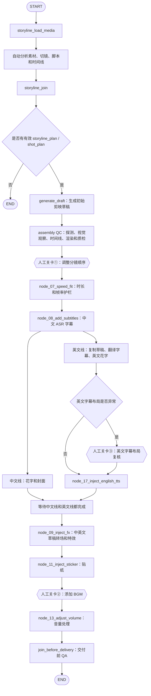
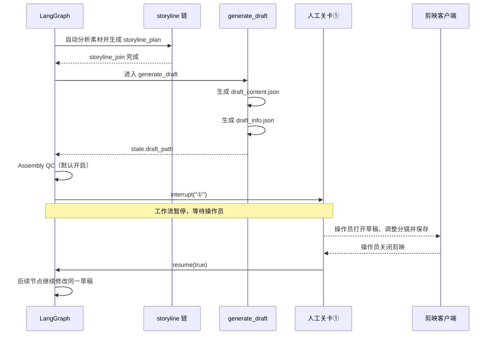

# auto-video-editor 人工关卡与剪映草稿生成、导入设计及分阶段执行计划

> 项目：[`wayyet/auto-video-editor`](https://github.com/wayyet/auto-video-editor)  
> 分支：`main`  
> 设计基线：2026-11-06  
> 文档状态：无日期主版，阶段执行勾选在本文件维护；同名带 `_20261106` 后缀的文件为分析原稿快照，不再更新  
> 技术栈：Python、LangGraph、PostgreSQL Checkpointer、FastAPI、剪映草稿文件结构  
> 目的：解释当前人工关卡的操作方式、剪映首页没有草稿的原因，以及草稿生成和导入的真实时机；给出后续开发设计与分阶段实施任务。

---

## 1. 执行摘要

### 1.1 当前结论

1. 当前工作流采用单一 LangGraph 流水线。人工关卡①、②、③仍通过 `interrupt()` 暂停，并通过恢复入口继续执行。
2. 第一份剪映草稿在 `generate_draft` 节点生成。该节点位于 `storyline_join` 之后、人工关卡①之前。
3. `generate_draft` 调用 `generate_initial_jianying_draft()`，向配置的草稿目录写入 `draft_content.json` 和 `draft_info.json`。
4. 当前创建台为每次运行创建独立目录，并将 `AUTO_VIDEO_EDITOR_DRAFT_DIR` 指向该目录下的 `drafts` 子目录。
5. 当前代码没有完整的“发布到剪映用户草稿库并注册到首页”的节点。因此，工作流目录里存在草稿文件，不代表剪映首页一定能显示它。
6. 第一张截图处于正常人工暂停状态。第二张截图显示剪映首页“草稿（0）”，与当前创建台把草稿写入项目 `outputs` 目录的实现相符。

### 1.2 优先开发目标

**P0：先解决草稿路径和剪映草稿库注册问题。** 人工关卡需要操作员在剪映里打开草稿。如果草稿没有进入剪映可识别的项目目录，人工关卡就无法完成真正的剪辑检查。

**P1：完善人工关卡 UI。** 页面必须显示具体关卡、操作说明、草稿路径、预览和恢复状态，而不是只显示一个通用的“等待人工关卡”。

**P2：完善双语草稿同步和最终交付 QA。** 确保中文主草稿、英文分支草稿以及 BGM、字幕和特效都能正确落盘。

---

## 2. 分析范围与代码依据

本次以 `main` 分支以下代码为分析依据：

| 文件 | 重点 |
|---|---|
| [`README.md`](https://github.com/wayyet/auto-video-editor/blob/main/README.md) | 当前架构、创建台、运行与恢复入口 |
| [`graph.py`](https://github.com/wayyet/auto-video-editor/blob/main/graph.py) | LangGraph 节点注册、执行顺序、条件边和人工关卡位置 |
| [`config.py`](https://github.com/wayyet/auto-video-editor/blob/main/config.py) | 草稿目录解析、剪映版本和创建台输出目录配置 |
| [`nodes/node_05_generate_draft.py`](https://github.com/wayyet/auto-video-editor/blob/main/nodes/node_05_generate_draft.py) | 生成初始剪映草稿 |
| [`nodes/node_06_human_reorder.py`](https://github.com/wayyet/auto-video-editor/blob/main/nodes/node_06_human_reorder.py) | 人工关卡①：分镜顺序调整 |
| [`nodes/node_12_human_add_bgm.py`](https://github.com/wayyet/auto-video-editor/blob/main/nodes/node_12_human_add_bgm.py) | 人工关卡②：添加 BGM、镜像到英文草稿 |
| [`nodes/node_checkpoint3_layout_review.py`](https://github.com/wayyet/auto-video-editor/blob/main/nodes/node_checkpoint3_layout_review.py) | 人工关卡③：英文字幕布局复核 |
| [`nodes/node_16a_translate_and_check.py`](https://github.com/wayyet/auto-video-editor/blob/main/nodes/node_16a_translate_and_check.py) | 英文字幕翻译和布局检查 |
| [`nodes/_checkpoint.py`](https://github.com/wayyet/auto-video-editor/blob/main/nodes/_checkpoint.py) | 关卡 payload 和恢复后的公共逻辑 |
| [`draft_ops/atomic_writer.py`](https://github.com/wayyet/auto-video-editor/blob/main/draft_ops/atomic_writer.py) | 草稿原子写入、双文件写入、校验与回退 |
| [`web/console_service.py`](https://github.com/wayyet/auto-video-editor/blob/main/web/console_service.py) | 创建台任务目录、启动进程和恢复运行 |
| [`web/api_console.py`](https://github.com/wayyet/auto-video-editor/blob/main/web/api_console.py) | 创建任务与人工关卡恢复 API |
| [`web/console_state.py`](https://github.com/wayyet/auto-video-editor/blob/main/web/console_state.py) | 创建台初始 WorkflowState |
| [`nodes/node_join_before_delivery.py`](https://github.com/wayyet/auto-video-editor/blob/main/nodes/node_join_before_delivery.py) | 交付前中文、英文草稿检查 |

说明：本文件分析的是代码实现，不代表已在用户本机实际验证过剪映草稿导入。剪映对草稿目录和索引文件的要求，还需要使用当前安装版本做实机验收。

---

## 3. 当前工作流架构

### 3.1 主链路

当前 `graph.py` 的主要执行顺序如下：



注意：图中“自动分析素材、切镜、脚本和时间线”包含多个节点和并行分支，不是一个实际节点。Assembly QC 是否接入由 `ASSEMBLY_QC_GATE_ENABLED` 控制，当前代码默认开启。

### 3.2 人工关卡的先后顺序

实际执行顺序是：

1. **关卡①**：初始草稿生成后，检查和调整分镜顺序。
2. **关卡③**：英文字幕布局检查发现异常时才触发，不是每次必经。
3. **关卡②**：两条语言分支汇合、完成转场和贴纸后，人工添加 BGM。

因此，实际顺序不是按编号排列的①→②→③，而是 **①→（可选③）→②**。

### 3.3 重要架构变化

`README.md` 说明项目已在 2026-11-04 收敛为单一 LangGraph 流水线：

- 旧聊天运行时和 OpenStoryline Web 工作流入口已删除。
- 当前主执行入口为 `scripts/run_workflow.py`。
- 创建台 `/console` 也启动同一条流水线，不是第二套工作流。
- 监控 API 只读，不负责启动图，也不直接执行恢复。
- 生产 Checkpointer 使用 PostgreSQL；SQLite Checkpointer 已从生产路径移除。

开发时必须以当前 `main` 的实际结构为准，不应再按旧聊天运行时或旧 SQLite 设计修改。

---

## 4. 第一张截图：人工关卡应该执行什么动作

### 4.1 截图状态判断

第一张截图显示：

- Thread ID：`console-99c742e55c7d`
- 执行状态：等待人工关卡
- 已完成：23
- 执行中：0
- 等待：1
- 失败：0

这表示 LangGraph 已经运行到一个 `interrupt()`，并保存了当前 Checkpoint，正在等待人工确认。

这不是失败，也不需要重新创建任务。截图中的 `#1177` 不足以判断它对应关卡①、②还是③；必须读取该 Thread 的实际 interrupt payload。

截图右侧的恢复框包含两个关键参数：

| 参数 | 含义 | 当前建议 |
|---|---|---|
| 关卡 | 要恢复哪个挂起的 interrupt；可使用 `①`、`②`、`③` 或对应 interrupt ID | 只有一个挂起关卡时可留空；有多个时必须明确选择 |
| 放行值 | 传入 `interrupt()` 的恢复值，按 JSON 解析 | 默认 `true`，保持不变 |

**“确认恢复”只负责继续工作流，不会替操作员完成剪映里的剪辑。** 必须先完成当前关卡要求的人工操作、保存并关闭剪映，再执行恢复。

### 4.2 先确认当前到底是哪一道关卡

推荐使用创建台本身的“确认恢复”按钮。若要在恢复前核对具体关卡，可在项目根目录执行：

```powershell
.\.venv\Scripts\python.exe scripts\resume_workflow.py `
  --thread-id console-99c742e55c7d `
  --dry-run `
  --skip-preflight
```

该命令只列出挂起关卡，不执行恢复。输出中的重点字段：

- `checkpoint`：①、②或③。
- `legacy_id`：旧版关卡标识。
- `step`：节点序号。
- `instructions`：该关卡给操作员的具体指引。
- `id`：LangGraph interrupt ID。

恢复前需确保命令连接的是创建该任务时使用的同一个 PostgreSQL 数据库。创建台任务属于入口 A 语义；不要使用旧聊天运行时的恢复方法，也不要用 `agent_gate resume` 恢复一个由创建台启动的任务。

### 4.3 关卡①：调整分镜顺序

代码位置：`nodes/node_06_human_reorder.py`。

代码中的人工指引是：

> 请在剪映客户端手动调整分镜顺序，完成后确认继续。

具体操作：

1. 找到本次运行生成的中文主草稿。
2. 在剪映中打开草稿，检查镜头顺序、故事逻辑和片段衔接。
3. 根据实际内容，把时间轴上的视频片段调整为正确顺序。
4. 保存草稿。
5. 关闭剪映，确保剪映不再自动保存或占用草稿文件。
6. 回到创建台，关卡字段选择 `①`（只有一个挂起关卡时可留空），放行值保持 `true`，点击“确认恢复”。

恢复后，节点 `node_06_human_reorder` 才会继续执行其通知和状态记录逻辑，随后进入 `node_07_speed_fit`。

**特别注意：** 关卡①不是让用户在网页上重新上传视频，也不是让用户重新运行工作流。它要求操作员直接修改剪映草稿时间轴。

### 4.4 关卡③：修正英文字幕布局

代码位置：

- `nodes/node_16a_translate_and_check.py`
- `nodes/node_checkpoint3_layout_review.py`
- `nodes/node_16_translate_subtitles.py`

触发条件：英文字幕已翻译，并且布局检查结果 `layout_issues_detected` 为真。没有布局异常时会跳过关卡③。

可能的问题包括：

- 英文字幕宽度超过画面可用区域。
- 字体缺失或字体不可用。
- 字幕文字显示不完整或不适合当前画幅。

具体操作：

1. 查看关卡 payload 中的 `issues`，确认具体字幕索引、文本、宽度和异常原因。
2. 打开英文分支草稿目录 `draft_dir_en_branch` 对应的剪映草稿。
3. 调整英文字幕的字号、换行、位置或字体，确保文字不超出安全区域。
4. 检查字幕与画面内容的遮挡关系。
5. 保存并关闭剪映。
6. 回到创建台，选择关卡 `③`，放行值保持 `true`，点击“确认恢复”。

恢复后，`node_checkpoint3_layout_review` 会重新读取英文草稿当前内容，并据此重写 SRT 文件。也就是说，**人工修改后的英文字幕才是该关卡后续 SRT 的来源**。

如果当前运行没有触发关卡③，不需要人为创建或强制执行这一关。

### 4.5 关卡②：添加背景音乐 BGM

代码位置：`nodes/node_12_human_add_bgm.py`。

代码中的人工指引是：

> 请从剪映 VIP 音乐库选取 BGM 并拖入音轨，完成后确认继续。

具体操作：

1. 打开中文主草稿。
2. 从剪映 VIP 音乐库选择合适的背景音乐。
3. 将 BGM 拖入音频轨道，检查开始位置和与视频的匹配情况。
4. 保存并关闭剪映。
5. 回到创建台，选择关卡 `②`，放行值保持 `true`，点击“确认恢复”。

恢复后，`mirror_bgm_to_en_draft()` 会把中文主草稿的 audio track 及其引用的音频素材复制到英文分支草稿。设计目标是人工只选一次 BGM，不需要在两份草稿里重复添加。

随后进入 `node_13_adjust_volume`，再进入 `join_before_delivery`。

### 4.6 每一道关卡的共同操作纪律

- 人工关卡暂停期间，先检查和修改草稿，再点击恢复。
- 必须保存剪映草稿。
- 点击恢复之前关闭剪映，避免后续节点写文件时与剪映自动保存发生竞争。
- 不要把放行值改成 `false` 来代替人工修改；`true` 的含义是确认继续。
- 不要重复点击恢复，也不要同时使用多个入口恢复同一个 Thread。
- 关卡①、②、③的具体业务动作不同，不能仅凭“工作流等待人工”就直接点击确认。

---

## 5. 第二张截图：为什么剪映首页仍然显示“草稿（0）”

### 5.1 直接原因：创建台使用独立输出目录

当前 `web/console_service.py` 中：

- `prepare_run()` 为任务创建独立目录。
- 目录下预创建 `drafts` 子目录。
- `_build_launch_env()` 把子进程的 `AUTO_VIDEO_EDITOR_DRAFT_DIR` 设置为 `task_dir / "drafts"`。

当前 `config.py` 的 `CONSOLE_OUTPUTS_ROOT` 默认是项目根目录下的 `outputs`。因此，截图中的 Thread 在默认配置下对应：

```text
<项目根目录>\outputs\console-99c742e55c7d\drafts\
```

预期的主要草稿文件：

```text
<项目根目录>\outputs\console-99c742e55c7d\drafts\draft_content.json
<项目根目录>\outputs\console-99c742e55c7d\drafts\draft_info.json
```

如果本机设置了 `CONSOLE_OUTPUTS_ROOT`，上述路径应替换为自定义输出根目录。

### 5.2 当前代码负责写草稿文件，不负责完整导入剪映首页

`nodes/node_05_generate_draft.py` 的核心职责是：

1. 检测目标草稿是否加密。
2. 把 `storyline_plan` 映射为剪映草稿结构；旧路径则使用 `shot_plan` 兜底。
3. 调用 `safe_write_draft()` 写入草稿。
4. 把生成后的 `draft_content.json` 路径回填到 WorkflowState 的 `draft_path`。

`draft_ops/atomic_writer.py` 的职责是文件层面的安全写入：

- 写 `draft_content.json`。
- 写 `draft_info.json`。
- 校验 JSON 和双文件内容。
- 写入失败时按快照回退。
- 可选更新草稿时长索引。

这些动作都不等同于剪映客户端的“导入”或“注册”。当前主图中也没有专门的 `import_to_jianying` / `publish_jianying_draft` 节点。

因此，第二张截图中的“草稿（0）”并不能证明 `generate_draft` 没有运行。它只能证明剪映首页当前没有列出草稿。

### 5.3 还需要核查剪映草稿库的索引文件

`draft_ops/duration_index.py` 说明剪映会维护：

- 单个草稿目录内的 `draft_meta_info.json`。
- 草稿根目录的 `root_meta_info.json`，其中含 `all_draft_store`。

但当前 `node_05_generate_draft.py` 调用 writer 时只传入 `draft_dir` 和草稿内容，没有传入 `duration_us`。而 `safe_write_draft()` 只有在 `duration_us` 不为 `None` 时才调用时长索引更新器。

这说明目前不能确认新建草稿的所有剪映索引都已经正确建立。它属于需要通过剪映 5.9.0 实机验证的兼容性缺口。不要仅凭 `draft_content.json` 存在就认定剪映一定能显示该项目。

### 5.4 当前截图问题的结论

| 检查项 | 当前代码事实 | 判断 |
|---|---|---|
| 草稿生成目录 | `outputs/<thread_id>/drafts` | 与剪映客户端用户草稿库不是同一个已确认路径 |
| 是否写入草稿 JSON | `generate_draft` 调用双文件 writer | 代码具备写文件能力 |
| 是否注册到剪映首页 | 主图没有专门发布/注册节点 | 当前没有完整实现 |
| 是否维护根目录索引 | 时长索引是可选调用 | 需要进一步验证 |
| 剪映首页显示 0 | 用户截图事实 | 与当前目录隔离实现一致 |

**最可能原因是草稿落在项目 `outputs` 目录，而不是剪映客户端实际扫描的草稿库目录；同时，草稿索引注册能力也尚未形成完整闭环。**

---

## 6. 草稿什么时候生成，什么时候进入剪映

### 6.1 生成节点

**生成节点：`generate_draft`。**

它由 `graph.py` 中的 `generate_draft_wrapped` 包装，主要逻辑是：

```python
existing = state.get("draft_path")
if existing and Path(existing).exists():
    return state

draft_dir = resolve_draft_dir(state)
return generate_initial_jianying_draft(state, draft_dir)
```

`resolve_draft_dir()` 的目录优先级：

1. `state["_draft_dir_override"]`。
2. 环境变量 `AUTO_VIDEO_EDITOR_DRAFT_DIR`。
3. 默认目录：当前工作目录下的 `drafts/default`。

创建台启动任务时会设置 `AUTO_VIDEO_EDITOR_DRAFT_DIR`，因此创建台任务实际使用独立的 `outputs/<thread_id>/drafts` 目录。

### 6.2 生成时机



因此，**正常情况下，工作流第一次到达关卡①时，初始草稿已经生成**。如果关卡①时仍然找不到文件，应检查 `generate_draft` 是否成功、`state.draft_path` 是否有值，以及 `error_log` 中是否记录了加密或时间线校验错误。

### 6.3 “生成”和“导入”不是同一个步骤

| 阶段 | 当前是否实现 | 说明 |
|---|---|---|
| 生成剪映草稿 JSON | 已实现 | `generate_draft` 写入 `draft_content.json` 和 `draft_info.json` |
| 工作流后续节点修改草稿 | 已实现 | 字幕、特效、贴纸、BGM、音量等节点继续改写草稿 |
| 放入剪映用户草稿目录 | 创建台默认路径未实现 | 当前目录在项目 `outputs` 下 |
| 注册剪映首页草稿索引 | 尚未形成完整流程 | 需要实现并进行实机验证 |
| 在剪映中打开并人工编辑 | 依赖草稿能被客户端识别 | 对应人工关卡①、③、② |
| 最终交付 QA | 已有轻量检查 | `join_before_delivery` 检查中英文草稿交付物 |

项目没有一个“等到工作流结束才自动导入剪映”的节点。正确的设计应该是：**初始草稿生成后尽早发布到剪映可识别的位置，使关卡①可以编辑；后续节点继续更新同一份草稿；最终 QA 再检查交付结果。**

### 6.4 工作流何时算完成

`node_13_adjust_volume` 之后执行 `join_before_delivery`，然后进入 `END`。

`join_before_delivery` 是交付前轻量 QA，检查封面、字幕 SRT、中文主草稿和英文分支草稿等交付物。它不是剪映首页导入器，也不是完整的视频导出器。

如产品要求最终自动生成 MP4，还应单独定义并实现渲染/导出节点及其产物验收，不能把 `END` 或草稿写入成功当作 MP4 已导出。

---

## 7. 建议的目标设计

### 7.1 设计原则

1. **一个任务对应一个稳定的草稿目录。** 不允许每个节点随意改变草稿根路径。
2. **工作流和剪映客户端必须读写同一个权威草稿。** 否则人工在剪映里的修改可能没有回到工作流实际使用的文件。
3. **草稿发布必须早于关卡①。** 操作员在第一道人审时就需要能在剪映打开草稿。
4. **剪映打开期间禁止工作流写入同一草稿。** 人工保存、关闭剪映后才能恢复工作流。
5. **草稿 JSON、草稿信息文件和根索引需要一起验收。** 不以文件存在作为唯一成功条件。
6. **所有关卡都要展示真实 payload。** 不只展示通用“等待人工”状态。
7. **恢复是幂等的。** 重复请求不能重复添加 BGM、重复复制音轨或覆盖人工修改。

### 7.2 推荐目录策略

推荐保留 `outputs/<thread_id>` 作为任务日志、上传素材、报告和备份目录；同时把剪映客户端认可的项目目录作为正式草稿的权威位置。

```text
<项目根目录>/outputs/<thread_id>/
├── inputs/                       # 上传的源视频
├── reports/                      # QC 报告和运行报告
├── logs/                         # 工作流运行日志
└── draft_staging/                # 发布前的临时草稿/备份

<剪映草稿根目录>/
├── root_meta_info.json
├── AutoVideo_<thread_id>/        # 中文主草稿，权威目录
│   ├── draft_content.json
│   ├── draft_info.json
│   ├── draft_meta_info.json
│   └── ...                       # 按当前剪映版本要求的其他文件
└── en_branch_<thread_id>/        # 英文分支草稿
    ├── draft_content.json
    ├── draft_info.json
    └── ...
```

上图是目标结构示意，不是当前项目已经实现的目录。剪映草稿根目录必须从实际安装的剪映客户端确认，不能硬编码某个用户目录或假设不同版本路径相同。

**推荐实现方式：** `generate_draft` 先生成并校验 staging 草稿；新增 `publish_jianying_draft` 发布逻辑，在剪映关闭的前提下，创建正式项目目录、补齐经过实机验证的元数据/根索引，并将 `state.draft_path` 更新为正式草稿路径。后续节点和人工关卡统一使用该正式路径。

不建议采用“工作流始终改 outputs，人工编辑另一份复制品”的方案，除非同时实现每次关卡恢复前后的双向同步。否则人工修改可能被后续节点覆盖。

### 7.3 建议新增的组件

| 组件 | 职责 |
|---|---|
| `jianying_draft_root.py` | 发现或校验剪映草稿根目录；支持配置覆盖；拒绝不安全路径 |
| `draft_publisher.py` | staging → 正式草稿目录发布，创建唯一项目目录 |
| `jianying_registry.py` | 按当前剪映版本维护根索引与草稿元数据；优先参考本机新建的有效草稿样本 |
| `draft_lock.py` | 检查剪映进程和草稿占用；工作流写入时采用严格门禁 |
| `draft_integrity.py` | 校验双文件、项目索引、素材路径和必要元数据 |
| `human_gate_payload.py` | 统一生成关卡展示数据，包含 checkpoint、instructions、draft path、preview、issues |

### 7.4 人工关卡 UI 目标

每个挂起关卡建议显示：

- 关卡编号和名称，例如“① 分镜顺序调整”。
- 当前 Thread ID 和对应 LangGraph 节点。
- 操作说明 `instructions`。
- 正式草稿目录和 `draft_content.json` 路径。
- “打开草稿目录”操作。
- 预览视频、QC 报告和问题截图（存在时）。
- 当前剪映进程状态。
- “确认恢复”按钮。

恢复表单应从实际挂起 interrupt 自动获取 checkpoint，只有一个挂起关卡时自动选中；多关卡时要求人工明确选择。恢复值默认 JSON `true`，不应让用户误以为这个值可以代替剪辑结果。

---

## 8. 分阶段的执行开发任务

本章节为新增开发执行计划。建议按阶段顺序实施；每一阶段通过验收后再进入下一阶段。

### 阶段 0：当前运行诊断与基线冻结（P0）

**目标：** 先确认截图对应任务的 checkpoint、草稿文件和运行日志，防止在未知状态下修改或重复恢复。

任务：

- [x] 用 `resume_workflow.py --dry-run` 查询 `console-99c742e55c7d` 当前挂起的 interrupt。
- [x] 读取当前 Checkpoint，确认 `checkpoint`、`legacy_id`、`instructions` 和 `draft_path`。
- [x] 在项目根目录检查 `outputs/<thread_id>/drafts/` 是否存在。
- [x] 检查 `draft_content.json` 和 `draft_info.json` 是否都存在、能否解析为 JSON。
- [x] 检查 `error_log`、`status_log`，确认 `generate_draft` 是否成功。
- [x] 记录当前剪映版本(5.9.0.11632)、实际草稿根目录(%LOCALAPPDATA%\JianyingPro\User Data\Projects\com.lveditor.draft,当前为空;GUI 打开 staging 草稿留待阶段 1 发布后实机验证)——原任务:记录当前剪映版本、实际草稿根目录，以及是否能打开 staging 草稿。
- [x] 保存当前运行日志、草稿文件和 checkpoint 备份，作为后续回归基线。

交付物：

- 当前 Thread 诊断记录。
- 实际 `draft_path` 和剪映草稿根目录。
- 当前挂起关卡编号和操作说明。
- 一份可复现的草稿目录样本。

验收标准：

- 能明确回答“当前挂在哪一道关卡”。
- 能明确回答“草稿文件是否已经生成、实际位于哪里”。
- 未执行重复恢复，没有覆盖原始草稿。

### 阶段 1：剪映草稿目录配置与发布注册（P0）

**目标：** 让工作流生成的草稿能出现在剪映客户端首页，并且后续节点使用的就是剪映中的那一份草稿。

任务：

- [x] 增加 `JIANYING_DRAFT_ROOT` 配置，支持环境变量覆盖。
- [x] 增加剪映版本和目录结构检测，不把 `JIANYING_VERSION = "5.9.0"` 当作实际运行环境已经验证的证据。
- [ ] 使用本机剪映新建一个空白草稿，收集有效的 `draft_content.json`、`draft_info.json`、`draft_meta_info.json`、`root_meta_info.json` 和其他必要文件作为结构样本。 <!-- 待实机:依赖操作员在剪映 GUI 新建样本;阶段 5 兜底 -->
- [x] 实现草稿唯一目录命名，例如 `AutoVideo_<thread_id>`，防止不同任务覆盖。
- [x] 实现 `draft_publisher.py`：发布前校验、复制/写入、元数据补齐、根索引更新、发布后再读校验。
- [ ] 明确 `draft_name`、`draft_id` 与目录名的映射规则，按真实剪映样本验证，不能凭字段名称猜测。 <!-- 待实机:依赖操作员在剪映 GUI 新建样本;阶段 5 兜底 -->
- [x] 发布成功后把正式草稿路径回填为 `state.draft_path`。
- [x] 英文分支目录也使用剪映可识别的正式草稿目录，并在 `draft_dir_en_branch` 保存其路径。
- [x] 创建台不再无条件把正式草稿目录设置为 `outputs/<thread_id>/drafts`；`outputs` 仅负责 staging 和任务产物。
- [x] 增加事件：`draft.generated`、`draft.published`、`draft.publish_failed`，记录源目录、目标目录和校验结果。

建议涉及文件：

- `config.py`
- `web/console_service.py`
- `nodes/node_05_generate_draft.py`
- `draft_ops/atomic_writer.py`
- 新增 `draft_ops/draft_publisher.py`
- 新增 `draft_ops/jianying_registry.py`

验收标准：

- 创建台跑完 `generate_draft` 后，正式草稿出现在剪映首页。
- 从剪映首页打开草稿，不出现“草稿损坏”。
- 时间轴能够显示视频轨道和片段。
- 关闭剪映后，再由工作流读取同一个正式草稿路径，文件内容一致。
- 不同 `thread_id` 的草稿互不覆盖。

### 阶段 2：人工关卡信息展示与操作入口（P0）

**目标：** 让操作员知道需要做什么、要打开哪一份草稿，以及恢复后工作流会继续做什么。

任务：

- [x] 统一读取 LangGraph `snapshot.interrupts`，提取 `checkpoint`、`legacy_id`、`step`、`instructions`、`draft_path`、`issues`。
- [x] 改造创建台等待卡片，显示具体关卡名称和节点名称。
- [x] 关卡①展示中文主草稿路径和分镜调整指引。
- [x] 关卡③展示英文分支目录、`issues`、`preview_video_path` 和证据帧路径。
- [x] 关卡②展示中文主草稿路径及“只需在中文草稿添加一次 BGM”的提示。
- [x] 增加“打开草稿目录”入口；路径必须来自当前 Thread 的状态，不能拼接用户输入。
- [x] 单一挂起关卡时自动选中；多挂起时要求明确选择，不允许默认恢复错误关卡。
- [x] 恢复值固定默认为 JSON `true`，页面明确说明“该操作只恢复工作流，不会自动完成剪辑”。
- [x] 恢复请求成功后显示 `resuming`，不要提前显示“已完成”。
- [x] 从事件流确认 `run.resumed`、`node.resumed` 和下一节点事件。

建议涉及文件：

- `web/api_console.py`
- `web/console_service.py`
- `web/console` 前端相关模块
- `monitoring/workflow_runner.py`
- 新增/复用 `human_gate_payload.py`

验收标准：

- 三种关卡的 UI 说明不同且与节点 payload 一致。
- 关卡③仅在 `layout_issues_detected=True` 时出现。
- 单关卡能够一键恢复；多关卡必须明确选择。
- 页面刷新、SSE 重连不会重复启动恢复任务。

### 阶段 3：人工编辑与工作流恢复的文件安全（P0）

**目标：** 防止剪映自动保存与工作流节点同时写同一个草稿，确保人工修改不会丢失。

任务：

- [x] 扩展 `draft_lock.py`，统一检查剪映进程和草稿目录占用。
- [x] 将当前 `safe_write_draft()` 的“检测到剪映运行但继续写入”告警行为调整为可配置的严格模式。
- [x] 生产模式下，工作流写入正式草稿前若检测到剪映仍运行，应暂停或失败，不应静默继续。
- [x] 人工关卡允许剪映打开；用户保存并关闭后，才允许恢复工作流。
- [x] 恢复前检查草稿文件存在、JSON 可解析、修改时间符合预期。
- [x] 对人工修改后的草稿计算 SHA-256，写入事件或任务 manifest，便于审计。
- [x] 对关卡② BGM 镜像增加幂等测试，保证重复恢复不会追加重复音轨。
- [x] 对关卡③ SRT 重建增加回归测试，确保读取的是人工修改后的英文草稿。
- [x] 对文件锁、权限异常、剪映未关闭、草稿被删除等情况提供明确错误信息。

验收标准：

- 剪映打开时，工作流不会覆盖正式草稿。
- 人工修改并保存后关闭剪映，恢复工作流能够读取修改结果。
- 重复恢复不会重复添加 BGM、重复生成音轨或覆盖人工校正字幕。

### 阶段 4：双语草稿与交付前 QA 完整性（P1）

**目标：** 确保中文主草稿和英文分支草稿都能被剪映识别，并且主要轨道和素材引用完整。

任务：

- [ ] 检查 `fork_draft_for_english_branch` 复制出来的英文分支是否符合剪映项目目录结构。
- [ ] 校验中文和英文草稿的素材路径在当前机器上都可访问。
- [ ] 校验字幕、花字、封面、转场、视频特效和贴纸引用。
- [ ] 验证关卡②后中文音频轨完整镜像到英文分支，音频素材引用无丢失。
- [ ] 扩展 `join_before_delivery`：检查双草稿 JSON、元数据、素材路径、轨道和必要索引。
- [ ] 将 QA 结果结构化写入 `join_qa_issues`，并在创建台展示具体问题。
- [ ] 区分“草稿生成成功”“草稿发布成功”“交付 QA 成功”和“MP4 导出成功”四种状态。

验收标准：

- 中文主草稿和英文分支草稿均可从剪映首页打开。
- 中文、英文字幕和音频轨道内容正确。
- 素材缺失或草稿索引错误时，QA 明确失败，不报告假成功。

### 阶段 5：真实剪映端到端验收与回归（P1）

**目标：** 验证从创建台上传视频到剪映显示草稿，再到人工修改和恢复工作流的完整闭环。

任务：

- [ ] 准备短视频测试素材，覆盖单视频和多视频场景。
- [ ] 使用创建台创建一个新任务，记录 Thread ID。
- [ ] 等待 `generate_draft` 成功，确认创建台显示正式草稿路径。
- [ ] 在剪映首页确认能看到草稿，并成功打开。
- [ ] 完成关卡①：修改镜头顺序、保存、关闭、恢复，检查变更保留。
- [ ] 构造英文字幕布局异常，验证关卡③会被触发；人工修改后检查 SRT 时间码和文本。
- [ ] 完成关卡②：添加一次 BGM，恢复后检查英文分支音轨镜像。
- [ ] 确认 `node_13_adjust_volume` 和 `join_before_delivery` 完成。
- [ ] 验证两个草稿在剪映首页均可打开，且没有损坏提示。
- [ ] 验证监控页面事件和状态正确，断线重连不会重复执行节点。
- [ ] 执行单元测试、集成测试和剪映实机测试，记录测试报告。

验收标准：

- 从上传视频到人工编辑再到工作流完成，整个流程可复现。
- 剪映首页能看到工作流生成的草稿。
- 三道人审关卡按预期触发，恢复后不丢失人工修改。
- 最终 QA 能准确报告中英文草稿状态。

### 阶段 6：可选的最终视频导出能力（P2）

**目标：** 若产品目标不仅是生成可编辑草稿，还要自动交付 MP4，则增加独立导出链。

任务：

- [ ] 明确最终渲染由剪映客户端、FFmpeg 还是其他渲染服务负责。
- [ ] 定义 MP4 输出路径、编码格式、分辨率、帧率、音频采样率和质量标准。
- [ ] 将导出动作与草稿发布、人工关卡、交付 QA 分离。
- [ ] 记录导出任务状态、输出文件哈希和媒体探测结果。
- [ ] 对导出视频执行时长、音轨、分辨率和可播放性校验。

验收标准：

- MP4 输出存在、可播放、时长符合目标。
- 导出失败时工作流状态明确失败，不将草稿文件存在误判为成片交付成功。

---

## 9. 立即排查当前截图对应的任务

### 9.1 检查创建台草稿目录

在项目根目录打开 PowerShell：

```powershell
$threadId = "console-99c742e55c7d"
$draftDir = Join-Path (Join-Path (Get-Location) "outputs") (Join-Path $threadId "drafts")

Write-Host "Draft directory: $draftDir"
Test-Path $draftDir

if (Test-Path $draftDir) {
    Get-ChildItem -Force $draftDir
}
```

如果项目配置了 `CONSOLE_OUTPUTS_ROOT`，请先把 `$draftDir` 中的 `outputs` 替换为该环境变量对应的根目录。

### 9.2 检查双文件是否可解析

```powershell
$contentFile = Join-Path $draftDir "draft_content.json"
$infoFile = Join-Path $draftDir "draft_info.json"

Test-Path $contentFile
Test-Path $infoFile

if ((Test-Path $contentFile) -and (Test-Path $infoFile)) {
    $content = Get-Content $contentFile -Raw -Encoding UTF8 | ConvertFrom-Json
    $info = Get-Content $infoFile -Raw -Encoding UTF8 | ConvertFrom-Json

    Write-Host "Draft JSON parsed successfully."
    Write-Host "Video materials:" $content.materials.videos.Count
    Write-Host "Audio materials:" $content.materials.audios.Count
    Write-Host "Track count:" $content.tracks.Count
}
```

注意：JSON 能解析只证明文件格式基本有效，不代表剪映项目完整，也不代表首页索引已经注册。

### 9.3 定位剪映实际草稿库

当前项目没有提供可靠的自动路径发现，因此建议：

1. 在剪映客户端创建一个临时空白草稿并保存。
2. 在剪映首页找到该草稿，使用右键菜单中的“打开草稿文件夹”（具体菜单名以当前版本为准）。
3. 记录剪映实际使用的草稿根目录和项目目录结构。
4. 关闭剪映，再对照工作流生成的 staging 草稿检查文件差异。
5. 不要在剪映打开时直接覆盖其项目目录中的文件。

不要先把当前 `outputs` 目录随意复制到剪映目录并假设首页一定能识别。应先完成阶段 1 的元数据和根索引验证。

### 9.4 恢复当前人工关卡

只有在确认关卡编号并完成对应剪映操作之后，才点击截图中的“确认恢复”。

- 仅一个挂起关卡：关卡字段可留空。
- 多个挂起关卡：必须明确指定 `①`、`②` 或 `③`。
- 放行值：使用 JSON 布尔值 `true`。
- 恢复成功后：检查 `run.resumed`、`node.resumed` 和下一节点事件。

---

## 10. 风险与实现注意事项

| 风险 | 影响 | 建议措施 |
|---|---|---|
| 草稿目录与剪映用户目录不一致 | 剪映首页显示 0，人工关卡无法打开草稿 | 阶段 1 实现正式发布与注册 |
| 只复制 JSON、不更新元数据和根索引 | 草稿不显示、缩略图或时间轴异常 | 从当前剪映版本创建样本并做字段级对照 |
| 剪映自动保存与工作流同时写入 | 人工修改被覆盖或草稿损坏 | 阶段 3 加严格文件锁和关闭客户端检查 |
| 关卡 UI 不显示实际 payload | 操作员可能恢复错关卡 | UI 直接显示 checkpoint、instructions 和草稿路径 |
| 英文分支路径与中文主草稿路径不统一 | 英文草稿未显示或 BGM 镜像失败 | 统一正式草稿根路径，检查双分支注册 |
| 将 `END` 当作 MP4 已导出 | 误报最终交付 | 分离草稿 QA 与 MP4 导出状态 |
| 使用旧恢复入口 | 恢复失败或控制状态不一致 | 按运行入口选择恢复方式，创建台任务走创建台恢复接口 |

---

## 11. 开发优先级与建议顺序

| 优先级 | 阶段 | 交付重点 | 是否阻塞后续人工剪辑 |
|---|---|---|---|
| P0 | 阶段 0 | 找到当前 Thread 的真实 checkpoint 和草稿路径 | 是，先诊断当前任务 |
| P0 | 阶段 1 | 草稿发布到剪映项目目录并正确注册 | 是，解决“剪映草稿（0）” |
| P0 | 阶段 2 | 人工关卡展示真实操作指引和草稿入口 | 是，避免误恢复 |
| P0 | 阶段 3 | 人工编辑与工作流写入互斥 | 是，保护人工修改 |
| P1 | 阶段 4 | 双语草稿完整性与交付 QA | 否，但决定正式可交付质量 |
| P1 | 阶段 5 | 剪映实机端到端验收 | 发布前必须完成 |
| P2 | 阶段 6 | 自动导出 MP4 | 仅在产品要求自动成片时实施 |

**推荐实施顺序：阶段 0 → 阶段 1 → 阶段 2 → 阶段 3 → 阶段 4 → 阶段 5。** 阶段 6 是可选扩展，不应与草稿发布功能混在一个阶段完成。

---

## 12. 最终结论

1. 当前第一张截图表明工作流正常暂停，正在等待人工处理；不是执行失败。
2. 人工关卡要求操作员直接在剪映中完成分镜调整、英文字幕修正或 BGM 添加，然后保存、关闭剪映，再确认恢复。
3. 初始草稿在 `storyline_join` 之后的 `generate_draft` 节点生成，正常情况下早于第一道人审关卡①。
4. 当前创建台将正式草稿写入 `outputs/<thread_id>/drafts`，而不是已确认的剪映用户草稿目录。
5. 当前主图没有完整的剪映首页发布/注册节点。因此，第二张截图中的“草稿（0）”最可能是目录隔离和缺少注册流程导致，而不是工作流必须等到 END 才生成草稿。
6. 最优先的开发工作是新增草稿发布和注册能力，并保证工作流、剪映和人工关卡始终操作同一份权威草稿。
7. 完成以上改造后，再完善人工关卡 UI、文件锁、双语草稿 QA 和可选 MP4 导出。

