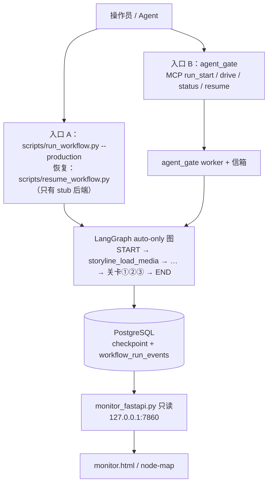

# auto-video-editor：单流水线循环化 · 设计、执行计划与附件评审

> 日期：2026-11-05 起草并核对，2026-11-06 定稿
> 仓库：`wayyet/auto-video-editor`，分支 `main`
> 核对基准：`main` @ `4cc7d29`（2026-11-04 16:04 +0800）
> 原始基线：`9ab3df5`（2026-11-03）
> 参考附件：①《删除①对话回合循环 · 执行计划》　②《单流水线架构设计与分阶段执行计划（评审修订版）》。两份都已入库 `docs/修改文档/`，与附件内容一致（仅换行符不同）。
> 核对方式：只读克隆 + 读代码 + 隔离沙箱实测（pytest 收集、图编译、node 测试）。**没有改仓库、没有 commit / push、没有连数据库。**
> 状态：3 项决策已定（2026-11-06）：D1 A，D2 A，D3 A（见 §6）。下一步：阶段 3R
>
> **2026-11-07 核对注记（收尾后补）**：阶段 0-6 已全部交付并推送（`aa1555a`）；本文列出的 3 个坏点与阶段 3R/4/5 待收口项已在 `5fd5d9d`/`b7c3633`/`10ef99b`/`eaf5c0b`/`ca37c18` 落实。两处按文档原方案的偏差：**阶段 3G** 入口 A 后端提示已按 D3-A 补齐（stub 提示 + `VIDEO_LLM_BACKEND` 非 stub 退出码 2 + `tests/unit/test_entry_a_llm_notice.py`），与既有的 Console `--llm-backend` 路线并存；**阶段 3C** 清理缓存未建 `scripts/clean_cache.py`，改由 `/console` Web 入口落地（`5379f86`，含冷却限流与测试），判定为"已由替代方案达成"。其余核对出的 5 个残留（README §2.6 参数表漂移、`migrate_db.py` legacy 注记、pyproject 依赖钉版、13 个 mcode/zcode 文档历史头注、`workflow_graph._current_mode`）已在本日收尾 commit 修复，详见 `docs/remove-chat-loop-20261104/regression.md` 尾部核对记录。

---

## 0. 先看这个

**结论**

1. 目标不变：**删①对话回合循环，只留②流水线循环。**
2. **main 已经做了大半**：阶段 0–2 完成，阶段 3 完成一半。聊天运行时已删，监控已拆成只读服务，图已改成 auto-only，直接 CLI 已有 resume。
3. **但 main 现在是半成品，不能直接用。** 已实测 3 个坏点：

| # | 坏点 | 证据 |
|---|---|---|
| 1 | 所有 `tests/` 用例在 setup 阶段报错；整轮 pytest 还会因 13 个模块收集失败被中断 | `tests/conftest.py:110` 对已删常量 `STORYLINE_HUMAN_FUSION` 做 `monkeypatch.setattr` → `AttributeError`。单跑 2 个文件共 16 个用例，全部 ERROR |
| 2 | 监控接口 `GET /api/workflow/graph` 不可用 | `build_graph_schema()` 抛 `AttributeError: module 'config' has no attribute 'STORYLINE_HUMAN_FUSION'`（`monitoring/workflow_graph.py:521` 的 `getattr(config_module, FUSION_FLAG)` 没有默认值） |
| 3 | `start_production.ps1` 默认参数直接退出 | `-StorylineMode` 默认 `human`（L49-50）→ Phase 0.6 找不到 `.venv-openstoryline` / `agent_fastapi.py`，`exit 18`（L543-571） |

临时办法（今天就能用）：`.\start_production.ps1 -StorylineMode auto`

4. **还有 1 个设计缺口（不是坏点）：入口 A（`scripts/run_workflow.py`）没有真实的 LLM 后端，永远用假答案。** 两份附件都说 A 能用环境变量 `VIDEO_LLM_BACKEND` 选后端，代码里没有这回事（§2.3）。
5. 两份附件共有 **25 个问题**（附件① 16 个、附件② 9 个），见 §5。**最大的共性问题是顺序：先删"提供者"，后改"使用者"。** 上面 3 个坏点都由它造成。
6. **下一步：先做「阶段 3R 收口」（一个 commit 修好上面 3 点），再做阶段 3G → 3C → 4 → 5 → 6。** 默认在 main 上继续修，不回退（回退会丢掉 6 个基本正确的 commit）。
7. 3 件事你已定（2026-11-06，都选 A）：**D1** 监控保持只读；**D2** 清理缓存做成独立脚本（阶段 3C）；**D3** 入口 A 只做开发 / 冒烟（阶段 3G）。见 §6。

**名词（先解释，后面直接用）**

| 词 | 意思 |
|---|---|
| checkpoint | LangGraph 把每一步的状态存进 PostgreSQL，断了能接着跑 |
| interrupt / 人工关卡 | 图在这里暂停，等人放行。本项目有 3 个：①②③ |
| 信箱（mailbox） | `agent_gate` 用文件夹传 LLM 任务和答案 |
| fail-fast | 配置不对，启动时立刻报错，不带病运行 |
| 提供者 / 使用者 | 提供者 = 被引用的代码（常量、函数、模块）；使用者 = 引用它的代码（测试、监控、脚本） |

---

## 1. 现状核对（main @ 4cc7d29）

### 1.1 执行进度

| 阶段 | 内容 | 状态 | commit | 说明 |
|---|---|---|---|---|
| 0 | 基线冻结与依赖盘点 | ✅ | `d2eb1d8` | 四套 JUnit 基线入库 `docs/remove-chat-loop-20261104/` |
| 1 | 监控拆出并只读化 | ✅ | `6530837` | 新增 `monitor_fastapi.py`、`web/monitor.html`；删 `POST /runs`；`resume` 改 `GET …/resume-status`；修 `_REPO_ROOT` |
| 2 | 删旧聊天运行时 | ✅（有遗留） | `7c70d30` | 删 122 个文件。`start/stop_production.ps1`、`config.toml`、`scripts/install.ps1` 没跟进 |
| 3 前置 | 直接 CLI resume | ✅ | `8af762d` | 新增 `scripts/resume_workflow.py` |
| 3 | 图改 auto-only | ⚠️ 半完成 | `4cc7d29` | 图、`config.py` 已改。监控图、`conftest`、13 个测试、快照没改 |
| 4 | chat_link / DB 收口 | ⏳ | — | 未开始 |
| 5 | 启停脚本 / 配置 / 文档 | ⏳ | — | 未开始 |
| 6 | 回归 / E2E / 验收 | ⏳ | — | 未开始 |

补充：`ab7982b` 把两份计划文档入库。6 个 commit 都直接落在 `main`；远程只有 `main` 和 `refactor/flatten-openstoryline`，计划里的 `refactor/remove-chat-loop-20261104` 没推送。

### 1.2 实测数据（main @ 4cc7d29）

| 项 | 结果 | 怎么测的 |
|---|---|---|
| 图编译 | 通过。47 个业务节点（含 START/END 共 49）；START 只连 `storyline_load_media`；全部可达；6 个已删节点都不在图里 | 沙箱里 `build_graph(InMemorySaver())` + `monitoring.workflow_graph._real_topology` |
| 人工关卡 | ①②③ 仍在：`node_06_human_reorder`、`node_12_human_add_bgm`、`node_checkpoint3_layout_review` | 静态 grep `interrupt(` |
| pytest 收集 | 13 个模块 ImportError → `Interrupted: 13 errors during collection`，一个用例都不跑 | `pytest --collect-only -q -p no:cacheprovider tests agent_gate/tests` |
| pytest 单跑 | `tests/unit/test_resume_workflow_script.py` + `tests/unit/test_api_workflow_readonly.py` 共 16 个用例全部 ERROR（`tests/conftest.py:110`） | 单跑这 2 个文件 |
| 监控 schema | `build_graph_schema()` 抛 `AttributeError` | 同上沙箱 |
| 启动脚本 | 默认参数 `exit 18`；`-StorylineMode auto` 可绕开 | 静态阅读 |
| 前端测试 | `node --test web/tests/*.test.mjs` 14/14 通过；`node --test web/tests`（目录参数）失败 | Node v22.23.4 实测 |
| 静态计数 | `graph.py` 里 `add_node(` 47 条，其中 `"storyline_` 开头 18 条；`add_conditional_edges(` 7 条 | grep |
| CI | 没有 `.github/`，没有自动门禁 | `ls` |
| `agent_gate/` | 自 `9ab3df5` 起只改了 README 的 1 行，其余零变化 | `git diff --stat` |
| 入口 A 的 LLM 后端 | 永远是 `stub`。`VIDEO_LLM_BACKEND` 只在 `agent_gate/factory.py:51` 被读，而读它的 `register_from_env()` 全仓没有调用方；`register_default_clients()` 是空函数 | 分开跑两条：`git grep -n register_from_env`、`git grep -n VIDEO_LLM_BACKEND`；读 `storyline_capabilities/vlm_client.py:147-167` |

沙箱是 Linux，只验证了与平台无关的结论（导入、夹具、拓扑）。PowerShell 脚本、回收站、Edge 等 Windows 行为靠静态阅读。PG 相关数字取自执行者的 `docs/remove-chat-loop-20261104/baseline.md`，我没连库。

### 1.3 ① 的残留清单（本文要收口的范围）

**已删：** `agent_fastapi.py`；`src/open_storyline/` 整包；`tests_openstoryline/`；聊天 UI（`index.html`、`app.js`、`mcode_panel.mjs`、`media_upload.mjs`、`workflow_chat_indicator.mjs`、`style.css`、图片）；`requirements-openstoryline.txt`；4 个旧脚本；human 模式 5 节点；`node_01_clean_cache`；`nodes/storyline/fusion.py`；监控的 `POST /runs` 与 chat-sessions 端点。

**待收口：**

| 残留 | 内容 | 阶段 |
|---|---|---|
| `tests/conftest.py` | 3 个 autouse 夹具（L53–L111）引用已删对象 | 3R |
| 13 个坏测试模块 | 见 §3 阶段 3R 任务 2 | 3R |
| 另 2 个必改测试 | `tests/integration/test_unreachable_nodes_wiring.py:524-536`、`tests/integration/test_e2e_tc01_to_tc06.py:44` | 3R |
| `monitoring/workflow_graph.py` | 已删节点的元数据 / 边标签 / fusion 分支 | 3R |
| `scripts/_smoke_auto_storyline.py:26` | `from graph import _STORYLINE_MODE_OVERRIDE`（已删）→ 脚本 ImportError | 3R |
| `scripts/capture_graph_schema_snapshots.py` | 4 组合里含 `STORYLINE_HUMAN_FUSION`；还强制 `STORYLINE_MODE=human`（L53），`import config` 会直接报错 | 3R |
| `scripts/run_workflow.py` / `resume_workflow.py` | `openstoryline_ready` 判定、退出码 3 | 3R |
| `agent_gate/cli.py:138` | `--checkpoint` 帮助文字仍写 `⓪` | 3R |
| `monitoring/workflow_chat_link_store.py`、`workflow_runner.py` | chat_link 读写 | 4 |
| `db/session_repository.py`、`db/__init__.py` | `chat_sessions` 仓储与导出 | 4 |
| `state.py` | `openstoryline_*`（L132-135）、`preview_opened`（L138）、`import_video_*`（L286-294）、`chat_session_id`（L304） | 4 |
| 7 个 chat 相关测试 | 见阶段 4 | 4 |
| `start_production.ps1`（961 行）、`stop_production.ps1`（407 行） | 旧 Web 生命周期；仍引用已删的 `agent_fastapi` | 5 |
| `scripts/install.ps1` | 建 `.venv-openstoryline`，装已删的 `requirements-openstoryline.txt` → 必失败 | 5 |
| `config.toml` | **没有任何 Python 代码读取它**；20 行 GBK 乱码注释 | 5 |
| `.env.example`、`README.md`、`README-OpenStoryline.md`、docs、ADR | 旧说明 | 5 |
| `.venv-openstoryline/` | 本机目录，不是 git 文件 | 部署清理（手工） |

---

## 2. 目标设计

### 2.1 一句话

只留②：**两个入口 + 一个 auto-only 图 + 一个只读监控。**

删的是"旧聊天回合"，**不是所有循环**。下面这些循环要保留：LangGraph 的条件路由 / 重试 / 并行；`agent_gate` 的信箱与 `drive` 监督循环；PostgreSQL checkpoint 与事件落库。



### 2.2 别把「①」和「mcode」混在一起

| 名字 | 是什么 | 处理 |
|---|---|---|
| ① 对话回合循环 | Web 聊天 + 每条消息拉起一次 mcode/zcode 子进程（900s 预算） | 删（已删） |
| ② 流水线循环 | LangGraph + `agent_gate` worker + PG checkpoint | 保留 |
| `agent_gate drive --agent mcode` | 无人值守"答题者"：拉起 mcode 会话来答 LLM 任务 | **保留**，属于②（你的决策 #2） |
| `src/open_storyline/mcode_*` | ① 的聊天档位 | 已删 |

要删的是"聊天档位"，不是 mcode 这个程序。`agent_gate` 靠环境变量 `AGENT_GATE_MCODE_BIN` 或 PATH 找 mcode（`agent_gate/agent_bin.py:46`），**和 `config.toml` 的 `[mcode]` 段无关**，所以删 `[mcode]` 不影响 `drive`。

### 2.3 两个入口与恢复规则

| | 入口 A：直接 CLI | 入口 B：`agent_gate` |
|---|---|---|
| 启动 | `scripts/run_workflow.py --production --thread-id <ID> …` | `python -m agent_gate start` / MCP `run_start` / `drive` |
| 恢复（过人工关卡） | `scripts/resume_workflow.py` | `agent_gate resume`（要真人交互终端） |
| LLM 任务谁答 | **永远是 `stub`（假答案）** ⚠️。`VIDEO_LLM_BACKEND` 全仓没人读，设了也没用 | `--backend`，默认 `gate`（信箱）；`drive` 拉起 claude / mcode 答 |
| 控制状态 | 进程内 + PG | worker 状态文件 + 信箱 + PG |

**规则：一次运行只能由启动它的入口恢复，不混用。** 两个入口共享 PG 的 checkpoint 与事件表，但不共享控制状态。

**入口 A 的缺口：** 它从不注册 LLM 客户端。`register_default_clients()`（`storyline_capabilities/vlm_client.py:161`）是空函数；唯一读 `VIDEO_LLM_BACKEND` 的 `register_from_env()`（`agent_gate/factory.py:41`）全仓没有调用方。没人设置时，`get_default_client()` 返回 `StubLLMClient`（`storyline_capabilities/vlm_client.py:147-152`）。所以入口 A 会"成功跑完，但答案全是假的"（`"no caption"`、`"{}"`）。`start_production.ps1` 的 Phase 2 跑的正是入口 A（`start_production.ps1:274`）。真实运行目前只能走入口 B。处理见阶段 3G（D3 已选 A）。

`drive` 退出码（`agent_gate/drive.py:21-22`）：`0` done、`1` failed、`2` need_input、`3` budget、`4` stalled、`5` crashed、`10` ask_human（停在人工关卡）。

### 2.4 图（auto-only）

- `START → storyline_load_media`（`graph.py:577`）→ 自动剧情链 → `generate_draft` → 6 节点 assembly QC 通道 → **关卡①** `node_06_human_reorder` → `node_07_speed_fit`（重试回路）→ 中 / 英双分支 → **关卡③** `node_checkpoint3_layout_review`（条件触发）→ `node_09`、`node_11` → **关卡②** `node_12_human_add_bgm` → `node_13_adjust_volume` → `join_before_delivery` → END。
- `STORYLINE_MODE` 固定 `auto`；传别的值，`config.py` import 时直接报错（`config.py:83-87`）。
- 入口前置条件（素材路径、输出目录、配置）由入口层负责。旧的 `launch_openstoryline` / `open_preview` 不能留：基线里 `open_preview` 在 auto 模式也会拉起 Edge 或 Playwright（`nodes/node_03_open_preview.py`，按 `unattended` 分支）。
- 统计口径：以 `build_graph_schema` 的编译结果为准，不沿用 README 旧数字（README 写的 53 / 44 / 10 是改造前）。"19 节点"是历史口径，现在 `storyline_*` 是 18 个注册节点，整图 47 个业务节点。

### 2.5 监控（只读）

| 接口 / 页面 | 说明 |
|---|---|
| `GET /api/workflow/graph` | 图结构 |
| `GET /api/workflow/runs/{thread_id}` | 运行快照 |
| `GET /api/workflow/runs/{thread_id}/events` | SSE 事件流，支持 `Last-Event-ID` 补发 |
| `GET /api/workflow/runs/{thread_id}/resume-status` | 只返回"该去哪恢复"的提示，不执行恢复 |
| `GET /`、`GET /node-map` | 监控首页、节点图 |

保留：`Origin` 校验（`web/api_workflow.py:130-139`）、`127.0.0.1` 绑定、存储不可用返回 503。**没有任何 POST。**

`mode` 字段：继续输出常量 `"auto"`。前端 `web/node_map/node_map.html:1489-1514` 用它拼布局缓存 key，保留就不用改前端，也不用升 `SCHEMA_VERSION`。

### 2.6 数据与迁移

- **不 DROP。** 存量表 `chat_sessions`（16 行）、`workflow_chat_links`（0 行）原样保留（数字取自执行者的 PG 盘点）。
- `db/migrations.py` 的迁移 1–5 **定义原样保留**，只加一行 legacy 注释。原因有四：
  1. 单测 `tests/unit/test_db_migrations.py:40-44` 要求版本号连续（`versions == list(range(1, len+1))`）。删迁移 1 会在开头留空洞，必失败。
  2. 单测 `test_chat_sessions_ddl_present`（同文件 L60-71）要求迁移 SQL 里有 `CREATE TABLE IF NOT EXISTS chat_sessions` 和索引 `idx_chat_sessions_active_updated`。删或改迁移 1 的 DDL，必失败。① 的"移除 `chat_sessions`（98-119）迁移代码"正好踩中。
  3. 迁移 5 的外键引用 `chat_sessions(session_id)`（`db/migrations.py:280-282`）。只删 1 不删 5，新库建表会失败。
  4. 已发布的版本号不能变成空洞，也不能复用。只删最后的迁移 5，单测不会报错；但存量库已应用过 5（`workflow_chat_links` 表存在），而 `apply_migrations` 按版本号跳过已应用项（`db/migrations.py:395`）。以后新增的"迁移 5"会在存量库被静默跳过。
- 说明：`apply_migrations()` 只"跳过已应用版本"，不校验"台账 ⊆ 代码"，所以存量库运行时不会立刻报错。风险集中在新库和单测。
- 要删的是**应用层读写**：`db/session_repository.py`、`monitoring/workflow_chat_link_store.py`、runner 里的 chat_link 逻辑、`--chat-session-id`、`state.chat_session_id`。
- 以后想真清理旧表：用新版本号 6+ 做显式迁移，单独审批。

### 2.7 配置与依赖

- `config.toml`：删掉 `src/open_storyline/config.py` 之后，全仓没有任何 Python 代码读取它（`git grep` 只命中注释、提示语和已删运行时的死测试）。**不要"挑段删"，整文件作废**（阶段 5，`git rm`，可恢复）。`config.toml.local` 含密钥、未入库，不动；备份 `config.toml.local.bak-20261104` 已存在。
- 依赖：主 `.venv` 已声明 `fastapi`、`uvicorn[standard]`（`requirements.txt` + `pyproject.toml`，`6530837`）。不引入 torch 等重型依赖（ADR-001）。
- `.venv-openstoryline/`：本机目录。回滚窗口结束后，由你手工删。

### 2.8 红线

1. **先改使用者，后删提供者。**
2. 每个 commit 必须过三项冒烟（§3.0 的 S1 / S2 / S3）。
3. 所有文件 UTF-8，不用 PowerShell 重写文件。`config.toml` 里已有 20 行乱码注释（如 L29、L58、L91、L137），就是前例。
4. 不顺手改业务节点、ASR 算法、剪映草稿结构。
5. 生产不得静默使用 `stub`。

---

## 3. 剩余执行计划（以 main @ 4cc7d29 为起点）

顺序：**3R 收口 → 3G 入口 A 后端 → 3C 清理脚本 → 4 DB → 5 脚本/配置/文档 → 6 验收。** 3G 与 3C 互不依赖，先后随意，但都排在 3R 之后（3R 之前 `tests/conftest.py` 是坏的，新测试跑不起来）。

### 3.0 通用规则

- 一个阶段 = 一个 commit。commit 前必须三项冒烟全绿。
- 先改使用者，后删提供者。
- 回滚：`git revert <该阶段 commit>`，一次只回一个。
- 差分基准：阶段 0 / 阶段 2 的 JUnit（`docs/remove-chat-loop-20261104/`）。按"用例 ID + 异常类型"逐条比对，新增失败一律先修。
- 既有失败（不算新增）：unit 18 个（全在 `test_session_store_repository.py`，阶段 4 随文件删除）；integration 23 error（`test_sessions_api_postgres.py`）+ 3 failed；`agent_gate/tests` 1 failed（`test_scaffold.py::test_init_writes_expected_files`，中文路径所致）。
- 在 Windows PowerShell、仓库根目录执行。`.\.venv\Scripts\python.exe` 是主 venv。

**三项冒烟**

| 代号 | 检查什么 | 命令 | 期望 |
|---|---|---|---|
| S1 | 测试可收集 | `.\.venv\Scripts\python.exe -m pytest --collect-only -q -p no:cacheprovider tests agent_gate/tests` | 0 个收集错误 |
| S2 | 监控图能出 | 先开一个终端：`.\.venv\Scripts\python.exe -m uvicorn monitor_fastapi:app --host 127.0.0.1 --port 7860`<br>再执行：`curl.exe -s -o NUL -w "%{http_code}" http://127.0.0.1:7860/api/workflow/graph` | `200` |
| S3 | 启动脚本能解析 | `.\start_production.ps1 -WhatIf` | 退出码 0；阶段 5 之前输出里有 `Phase 0.6/0.7: 跳过(auto 模式不起 OpenStoryline Web)`；阶段 5 之后不再出现 Phase 0.6/0.7 |

### 阶段 3R · 收口（最优先，恢复 main 可用）

**目标：** 让 S1 / S2 / S3 全绿。**一个 commit。**

| # | 任务 | 具体位置（行号以 `4cc7d29` 为准） |
|---|---|---|
| 1 | 修 `tests/conftest.py` | 删 L53–L111：3 个 autouse 夹具及注释（`_skip_checkpoint0_for_pre_migration_tests`、`_no_wait_for_manual_import_button`、`_fusion_off_by_default`）。`stub_proc` 夹具（L39-50）全仓已无使用方（`git grep -n "stub_proc" tests agent_gate` 只命中它的定义），可选：一并删；`workspace_root`、`tmp_draft_dir`、`initial_state` 保留 |
| 2 | 处理 13 个收集期报错的测试（表见下） | — |
| 3 | 改 2 个已确认引用已删 API 的测试 | `tests/integration/test_unreachable_nodes_wiring.py:524-536`（`_STORYLINE_MODE_OVERRIDE`）；`tests/integration/test_e2e_tc01_to_tc06.py:44`（`resolved_trash_children`；该文件还有 33 处旧名字命中，需整体复查。已知：L34-44 的 autouse 夹具 `_no_real_cache_cleanup` 和 L156、L192、L271、L353 的用例都 import 已删的 `nodes.node_01_clean_cache`；整个文件已在 L28-31 标 `xfail(strict=False)`，理由写着"Phase 4 后重写或删除"） |
| 4 | 实跑判定 9 个静态命中的集成测试 | `test_assembly_qc_graph.py`、`test_auto_mode_end_to_end.py`、`test_interrupt_resume.py`、`test_postgres_resume.py`、`test_reorder_topology.py`、`test_sequential_integration.py`、`test_state_field_compatability.py`、`test_week4_graph.py`、`test_week5_resilience.py`。做法：完成 1–3 后跑 `pytest tests/integration -q`，对照基线，新增失败逐个改 |
| 5 | 改 `monitoring/workflow_graph.py` | 见下"任务 5 明细" |
| 6 | 重录图快照 | `scripts/capture_graph_schema_snapshots.py`：① L53、L72 的 `"human"` 改成 `"auto"`（否则 `import config` 直接报错）；② 删 fusion：`COMBOS` 里的 `human_fusion_on`（L28）、函数参数 `fusion`（L51）、L55 与 L74 的 `STORYLINE_HUMAN_FUSION`、L90–L91 的循环变量与调用、L24 的注释；③ 文档串里的"四种"改"三种"。剩 `default_baseline`、`assembly_qc_off`、`ai_transition_on` 三组。命令：`.\.venv\Scripts\python.exe scripts\capture_graph_schema_snapshots.py docs\remove-chat-loop-20261104\schema-snapshots`（旧快照在 `docs/refactor-baseline-20261103/`，保留不动） |
| 7 | 小清理 | `scripts/_smoke_auto_storyline.py` L26 / L74 / L107 去掉 `_STORYLINE_MODE_OVERRIDE`；`scripts/run_workflow.py` `_check_final_state`（L252-270）删 `openstoryline_ready` 判定；`scripts/resume_workflow.py` 删 `EXIT_OPENSTORYLINE_NOT_READY`（L68、L248）及 docstring 里退出码 3 的说明（0/1/2/4/5 不变）；`agent_gate/cli.py:138` 帮助文字改为"如 ① ② ③" |
| 8 | 启动脚本最小修复 | `start_production.ps1:50` 默认值 `'human'` → `'auto'`。参数 `ValidateSet` 和整段 Web 生命周期留到阶段 5 |
| 9 | 清理缓存：`nodes/node_01_clean_cache.py` 和 `CACHE_*` 常量已在 `4cc7d29` 删除。**3R 不恢复它们**，对应的 2 个测试直接删（见任务 2）。D2 已选 A：独立清理脚本放到阶段 3C，另开提交 | 见阶段 3C |
| 10 | 注释清理（低优先，可并入） | `nodes/storyline/_common.py:135`、`nodes/storyline/qa_gate.py:15`、`nodes/node_05_generate_draft.py:7`、`storyline/firered_adapter.py:9`、`storyline/plan_reader.py:124`、`jy_common/prompt_core.py:17-21`（模块 docstring 还在讲已删的 `open_storyline` 独立虚拟环境和 `uvicorn agent_fastapi:app`）、`requirements.txt:66`（注释里还写着已删的 `node_02_launch_openstoryline.py`）：只改提到已删节点 / 模块的注释 |

**任务 2：13 个收集期报错的测试**

| 处理 | 文件 |
|---|---|
| 删除（被测对象已删，9 个） | unit：`test_node_02_launch_openstoryline.py`、`test_node_03_open_preview.py`、`test_node_04a_import_video.py`、`test_node_04b_get_storyboard_plan.py`、`test_node_checkpoint0_storyline_plan.py`、`test_import_video_request_result.py`、`test_storyline_fusion.py`<br>integration：`test_human_fusion_graph.py`、`test_no_auto_import_video.py` |
| 删除（清理缓存节点已删，2 个） | `tests/unit/test_node_01_clean_cache.py`、`tests/integration/test_no_autoclean_cache.py`。D2 已选 A：前者的 14 个用例到阶段 3C 改写成 `tests/unit/test_clean_cache_script.py`（来源：`git show 9ab3df5:tests/unit/test_node_01_clean_cache.py`）。后者原有 3 个用例：图不自动触发清缓存、手动调用仍能清理、编译图里 `clean_cache` 零条边；图里已没有该节点，不再需要 |
| 改写（2 个） | `tests/integration/test_workflow_graph_schema.py`：去掉 `nodes.storyline.fusion`、`STORYLINE_HUMAN_FUSION` 与模式参数化，保留拓扑契约。<br>`tests/integration/test_video_input_paths_wiring.py`：只保留"initial_state 的 `video_input_paths` 接到 `storyline_load_media`"；若与 `test_auto_mode_end_to_end.py` 重复就删 |

**任务 5 明细：`monitoring/workflow_graph.py`**

| 动作 | 位置 |
|---|---|
| 删 `FUSION_FLAG`，并删 `flags` 里的该键 | L71；L628 |
| `_NODE_META` 删 6 项：`clean_cache`、`launch_openstoryline`、`open_preview`、`checkpoint0_storyline_plan`、`import_video`、`get_storyboard_plan`；`generate_draft` 描述里"human 与 auto 两条模式链在此汇合"改成 auto 单链 | L91-125 |
| `_EDGE_LABELS` 删 6 条涉及已删节点的标签 | L374-379 |
| 删 `_HUMAN_ONLY_NODES` 及其使用；删两处 `clean_cache` 分支 | L419-423；L592；L589、L604 |
| 删 `_current_mode`（`graph._STORYLINE_MODE_OVERRIDE` 已不存在），`mode` 直接输出常量 `"auto"` | L472-484；L627 |
| `_edge_label` 去掉 `fusion_on` 参数；`build_graph_schema` 删 fusion 逻辑（L565-576 的 if / else 只保留 else 里的 `auto` 两行） | L487-495；L521、L523、L565-576 |
| 不升 `SCHEMA_VERSION` | L65 |

**验收 3R**

1. S1、S2、S3 全绿；浏览器打开 `http://127.0.0.1:7860/node-map`，图能渲染，且没有已删节点。
2. `.\.venv\Scripts\python.exe -m pytest tests/unit -q --junitxml=docs/remove-chat-loop-20261104/stage3r-unit.xml`：失败 ID 仍是既有那 18 个，新增 0。
3. `.\.venv\Scripts\python.exe -m pytest tests/integration -q --junitxml=docs/remove-chat-loop-20261104/stage3r-integration.xml`：对照阶段 0 基线，新增 0。`test_human_fusion_graph` 随文件删除而消失的那 1 个 failed，在报告里列为"合理消失"。
4. `.\.venv\Scripts\python.exe -m pytest agent_gate/tests -q`：只剩 `test_scaffold.py` 那 1 个既有失败。
5. `node --test web/tests/*.test.mjs`：14/14。
6. 新快照落盘；把节点数、边数写进 `docs/remove-chat-loop-20261104/stage3r-audit.md`。

### 阶段 3G · 入口 A 的 LLM 后端（小）

**事实：** 入口 A 从不注册 LLM 客户端（§2.3）。入口 B 不受影响：`agent_gate/runner.py:430-432`、`:577-579` 按 `--backend` 建客户端。项目早先的设计文档把"让 `run_workflow.py` 也走入口 B 的后端"写成可选改法，并注明"这条路径没有实测"（`docs/分析/Agent程序直接驱动auto-video-editor_设计与执行计划.md:919`）。它从未落地。

D3 已选 A，按下面「执行」做。B 未选，只留作备忘。

**执行 · 入口 A 只做开发 / 冒烟（D3 A）**

1. `scripts/run_workflow.py`、`scripts/resume_workflow.py`：解析参数后、预检和建图之前，调用同一个小函数（放进 `scripts/` 下的共用模块）。它做两件事：
   - 向 stderr 打印：`[llm] 入口 A 的 LLM 后端固定为 stub（假答案），仅用于冒烟；真实运行请用 agent_gate。`
   - 若环境变量 `VIDEO_LLM_BACKEND` 已设置且不是 `stub`：打印原因，以退出码 `2` 退出。该入口不读这个变量，继续跑只会得到假答案。
2. 新增 `tests/unit/test_entry_a_llm_notice.py`，3 个用例：未设 → 只打印；`stub` → 只打印；`claude-cli` → 退出码 2。
3. README 与 `start_production.ps1` 头部说明写明：Phase 2 是冒烟入口；真实运行见 §4.3。
4. 验收：S1–S3 全绿；3 个新用例通过；执行下面 4 行，其中 `$LASTEXITCODE` 那行输出 `2`：

```powershell
$env:VIDEO_LLM_BACKEND = 'claude-cli'
.\.venv\Scripts\python.exe scripts\run_workflow.py --production --thread-id x
$LASTEXITCODE
Remove-Item Env:VIDEO_LLM_BACKEND
```

**未选 · B 给入口 A 接上后端（备忘，不执行）**

1. 两个脚本在建图前直接调用 `agent_gate.factory.register_from_env()`。不改 `storyline_capabilities`，避免它反向依赖 `agent_gate`。
2. 只允许 `stub`、`claude-cli`、`mcode-cli`。`gate` 需要信箱环境变量（`AGENT_GATE_THREAD`、`AGENT_GATE_OUTPUTS`），入口 A 不适用，选了就报错。`WORKFLOW_ENV=production`（`--production` 会设置它）且 `VIDEO_LLM_BACKEND` 未设置时报错；`stub` 必须显式写。
3. 新增单测约 4 个用例；`claude-cli`、`mcode-cli` 各补一次真机 E2E。
4. 风险：每次 LLM 调用都拉起一个子进程；不走 `agent_gate` 的信箱和租约；预算、超时、权限范围要另行评估。

### 阶段 3C · 独立清理脚本（D2 A）

**目标：** 把已删的"清理缓存"找回来，做成手动运行的独立脚本。不进图，不接 Web，不接任何自动流程。只新增 2 个文件，不改旧文件。

**来源**（从 git 历史只读取回，不要 `git revert`）：

```powershell
git show 9ab3df5:config.py
git show 9ab3df5:nodes/node_01_clean_cache.py
git show 9ab3df5:tests/unit/test_node_01_clean_cache.py
```

| 旧位置（commit `9ab3df5`） | 取什么 |
|---|---|
| `config.py` L50-L263 | 9 个对象：`_REPO_ROOT_DIR`、`CACHE_PATHS_TO_CLEAN`、`CacheGlobSpec`、`CACHE_GLOB_SPECS`、`_expand_spec`、`resolved_cache_paths`、`CACHE_TRASH_CHILDREN_ROOTS`、`CACHE_TRASH_CHILDREN_KEEP_NAMES`、`resolved_trash_children` |
| `nodes/node_01_clean_cache.py` L52-L105 | 回收站常量、`_SHFILEOPSTRUCTW`、`_send_to_recycle_bin`、`_recycle_one` |
| `tests/unit/test_node_01_clean_cache.py` | 14 个用例 |

**新增文件：** `scripts/clean_cache.py`、`tests/unit/test_clean_cache_script.py`

**脚本怎么写**

1. **自包含**：不 import 仓库里任何模块（`config.py`、`state.py` 都不用）。上表的对象原样搬进来，清单内容不增不减。
2. **唯一的代码改动**：`_REPO_ROOT_DIR = Path(__file__).resolve().parent.parent`。脚本在 `scripts\` 里，比旧 `config.py` 深一层。照抄 `.parent` 会把仓库根推成 `scripts\`，清错目录。
3. **保护项照旧**：`CACHE_TRASH_CHILDREN_KEEP_NAMES` 让 `outputs\openstoryline` 不被清。旧代码把它标为业务数据（旧 OpenStoryline 的会话产物），明确禁清。
4. **import**：`argparse`、`ctypes`、`os`、`sys`、`from ctypes import wintypes`、`from dataclasses import dataclass`、`from pathlib import Path`、`from typing import Literal`。
5. **3 个新函数**（取代旧的 `clean_cache(state)` 和 `clean_cache_paths(paths, state)`，不再有 state）：
   - `collect_targets() -> list[Path]`：先 `resolved_trash_children()`，后 `resolved_cache_paths()`（顺序同旧节点）。
   - `clean_paths(paths) -> tuple[list[str], list[str]]`：逐项调 `_recycle_one`，返回（成功的路径，错误信息）。错误信息前缀 `[node_01]` 改成 `[clean_cache]`，"清理失败"三个字不变。
   - `main(argv: list[str] | None = None) -> int`：见下。
6. **风格**与 `scripts/resume_workflow.py` 一致：开头 `try: … sys.stdout.reconfigure(encoding="utf-8")`（`:58-62`；Windows 默认 GBK）；结尾 `sys.exit(main())`（`:370-371`）。

**命令行**

```powershell
# 只看清单，不动任何文件
.\.venv\Scripts\python.exe scripts\clean_cache.py --dry-run

# 真清：全部移入回收站；单项失败保留原处，不回退成永久删除
.\.venv\Scripts\python.exe scripts\clean_cache.py
```

- `--dry-run`：按处理顺序逐行打印将处理的路径，最后打印总数。不调用 `_send_to_recycle_bin`。
- 不带参数：先打印"将清理 N 项"，再逐项移入回收站；最后打印成功数、失败数和每条失败原因。
- 退出码：`0` 全部成功，或没有可清理项；`1` 至少 1 项失败（其余照常处理）；`2` 参数错误（argparse 默认）。
- 非 Windows：`_send_to_recycle_bin` 抛 `OSError`（旧行为），每项记失败，退出码 `1`；`--dry-run` 不受影响。

**测试**（`tests/unit/test_clean_cache_script.py`，共 17 个）

1. 旧 14 个用例搬过来，改三处：
   - 导入：`from config import …`、`import config as config_mod`、`from nodes.node_01_clean_cache import …`、`import nodes.node_01_clean_cache as mod`，都改成指向 `scripts.clean_cache`。`scripts\` 没有 `__init__.py`，靠 `tests/conftest.py:13` 把仓库根放进 `sys.path`，已有先例：`tests/unit/test_build_resource_library.py:10`。
   - 打桩：`"nodes.node_01_clean_cache._send_to_recycle_bin"` → `"scripts.clean_cache._send_to_recycle_bin"`。
   - 调用与返回值：`clean_cache(state)` → `clean_paths(collect_targets())`；`clean_cache_paths(paths, state)` → `clean_paths(paths)`。返回值由 state 字典变成 `(cleaned, errors)`：`out["cache_cleaned_paths"]` → `cleaned`，`out["error_log"]` → `errors`，`out["cache_cleaned"]` 的断言删掉。
2. 新增 3 个用例（测 `main`）：`--dry-run` 时 `_send_to_recycle_bin` 一次都没被调用、退出码 `0`；有 1 项回收失败时退出码 `1`，其余项照常处理；没有任何可清理项时退出码 `0`。
3. 旧用例里有 Windows 路径断言（如 `"\\venv\\__pycache__"`），**只在 Windows 上验收**，不要在 Linux 沙箱里验收。

**验收 3C**

1. S1–S3 全绿；S1 的收集里有新测试文件，0 个收集错误。
2. `.\.venv\Scripts\python.exe -m pytest tests/unit/test_clean_cache_script.py -q`：17 个全部通过。
3. `.\.venv\Scripts\python.exe scripts\clean_cache.py --dry-run`：`$LASTEXITCODE` 为 `0`；清单里没有 `outputs\openstoryline`，也没有剪映的 `User Data\Cache`、`User Data\Log`。
4. 干跑前后各执行一次下面的命令，数字必须相同（证明没动文件）：

```powershell
Get-ChildItem outputs, inputs, out -Recurse -Force -ErrorAction SilentlyContinue | Measure-Object | Select-Object -ExpandProperty Count
```

5. 真跑（不带 `--dry-run`）不在验收里，由你决定时机。它会清空 `outputs\`、`inputs\`、`out\` 的内容（这三个目录本身保留）并清缓存清单，全部进回收站，可还原。

### 阶段 4 · DB / chat_link 收口

**目标：** 应用层不再读写 chat 表；存量数据与表不动。

| # | 任务（先改使用者，后删提供者） | 位置 |
|---|---|---|
| 1 | `scripts/run_workflow.py` 删 `--chat-session-id`、`_chat_session_id_arg`、`_apply_chat_session_id` 及 3 处调用 | L84-93；L64 起；L239-249；L206、L228、L236 |
| 2 | `monitoring/workflow_runner.py` 删 `_CHAT_LINK_STATUS_BY_RUN_EVENT`、`_default_link_store`、`_chat_link_upsert_running`、`_chat_link_update`；`run_with_events` 去掉 `link_store` 参数和 `chat_session_id` 读取；状态键白名单里的死键（`openstoryline_ready`、`import_video_status`）一并删。**先**跑表后的命令 ①，找全调用方（含 `scripts/resume_workflow.py`） | L105-116；L446-452；L454-470；L472-491；L492、L500、L575-577、L587-612；L96-102 |
| 3 | 删提供者：`monitoring/workflow_chat_link_store.py`、`db/session_repository.py`；`db/__init__.py` 里 `SessionRepository` 等导出；`db/connection.py` docstring 里对 `db.session_repository.jsonb` 的引用 | `db/__init__.py:28-46`；`db/connection.py:25` |
| 4 | `state.py` 删 `chat_session_id`、`openstoryline_pid / mcp_endpoint / web_url / ready`、`preview_opened`、`import_video_*`。**先**跑表后的命令 ②，确认只剩将被删的测试 | L304；L132-135；L138；L286-294 |
| 5 | 删 7 个测试：`tests/unit/test_session_store_repository.py`、`tests/integration/test_sessions_api_postgres.py`、`tests/unit/test_session_repository.py`、`tests/integration/test_session_repository_postgres.py`、`tests/unit/test_workflow_chat_link_store.py`、`tests/unit/test_workflow_runner_chat_link.py`、`tests/integration/test_workflow_chat_link.py` | — |
| 6 | `db/migrations.py`：**不改任何迁移定义**；只在迁移 1、5 上方加 legacy 注释。更新 `scripts/migrate_db.py:4`、`db/__init__.py:6-7` 的 docstring。`tests/unit/test_db_migrations.py` 全部保留（含 `test_chat_sessions_ddl_present`，L60-71，断言迁移 SQL 里有 `chat_sessions` 建表语句，当作 legacy 保护） | — |
| 7 | 迁移验证：新库跑一遍、存量库跑一遍；用你平时连库的方式执行 `SELECT count(*) FROM chat_sessions;`，应仍是 16（阶段 0 盘点值） | — |

```powershell
# 命令 ①（任务 2）：找全 link_store / chat_session_id 的调用方
git grep -n -E "link_store|chat_session_id" -- "*.py"

# 命令 ②（任务 4）：确认这些 state 字段只剩将被删的测试在用
git grep -n -E "openstoryline_pid|openstoryline_mcp_endpoint|openstoryline_web_url|openstoryline_ready|preview_opened|import_video_|chat_session_id" -- "*.py"
```

**验收 4**

1. 生产代码里没有 chat 读写：`git grep -n -i -E "chat_session|workflow_chat_link|SessionRepository" -- "*.py" ":(exclude)db/migrations.py" ":(exclude)tests/unit/test_db_migrations.py"` 无命中（legacy 注释除外）。
2. S1–S3 全绿。
3. 差分：unit 那 18 个、integration 那 23 个旧失败 ID 因文件删除而消失，列入报告"合理消失"；其余新增 0。
4. 旧 checkpoint 兼容：用 `.\.venv\Scripts\python.exe scripts\resume_workflow.py --production --thread-id <旧 thread> --dry-run`，能读出挂起关卡（说明删字段没挡住旧状态载入）。

### 阶段 5 · 启停脚本 / 配置 / 文档

| # | 任务 | 位置 |
|---|---|---|
| 1 | `start_production.ps1`（961 行）：删 `-StorylineMode` 参数与 `STORYLINE_MODE` 注入；删 Phase 0.6 / 0.7；删 `$OsAgent`、`$OsSrc`、`$OsVenvPy`、`$OsWebPort` 等常量；默认素材 / 输入目录改为仓库内 `inputs\`（不再指向 `FireRed-OpenStoryline`）；Phase 0.55 的校验改成 auto 链的真实依赖（如 `.storyline\models\` 的 TransNet 权重）；**新增 monitor 生命周期**：启动 `monitor_fastapi`、写 PID 文件和日志 | 参数 L33、L42-50；注入 L319、L334、L353、L365；Phase 0.6/0.7 L543 起至 Phase 2 之前（约 L791）；常量 L79-90；WhatIf 文案 L266-271 |
| 2 | `stop_production.ps1`（407 行）：删 Phase 2（含 `open_storyline.mcp.server`、`agent_fastapi:app` 命令行兜底）；改成只停"本项目 PID 文件记录的 monitor"；未知进程 / 端口被占，一律 fail-closed，不按端口盲杀 | L167-282；L225 |
| 3 | 删 `scripts/install.ps1`；修 `scripts/download_resources.ps1:55`、`scripts/download_models.ps1:40` 的提示语（先 `git grep -n transnet` 找到现在实际生效的配置位置，再写进提示） | — |
| 4 | `git rm config.toml`。删前再确认：`git grep -n -E "config\.toml" -- "*.py"` 只剩注释和提示。`config.toml.local` 不动 | — |
| 5 | `.env.example` 删 FireRed 相关段 | L7、L19、L40 附近 |
| 6 | `README.md`：§1 目录树（L9-68；L21-25 还列着已删节点）、§2.2 安装（L77-89 的 `E:\Documents\kuaishou\langgraph-main\…` 可编辑安装，与 `requirements.txt` 的"用公共 PyPI 版本"冲突）、§2.6 一键启动（L191-290；L199 默认 human；L248 复用 Web；L264、L283 退出码 23 / 24）、§4.9b / 4.9c（L525-588：chat_sessions 仓储与会话 REST API）、§10（L660-700：改成 `monitor_fastapi`；L668 还写着"agent_fastapi 托管"）。新增 §4 的命令（含 4.7 清理缓存）。另有 L591、L597、L606 三处还在讲 `clean_cache` 节点和 Web「清理缓存」按钮（`POST /api/system/clean-cache`，该端点已随 `agent_fastapi.py` 删除）：改成指向 `scripts\clean_cache.py` | — |
| 7 | `README-OpenStoryline.md` 与 docs 里 mcode / zcode 专属文档顶部加"历史文档，2026-11-04 架构收敛后失效，现行说明见 README"；`docs/integration/architecture_decision_record.md` 追加 ADR（单流水线收敛：删①、auto-only、监控只读、双入口恢复语义、legacy 表保留、`config.toml` 作废） | — |
| 8 | `.venv-openstoryline/`：不进 commit。回滚窗口结束后由你手工删 | — |

**验收 5**

1. S3 变为：`.\start_production.ps1 -WhatIf` 打印计划，且**不含** Phase 0.6 / 0.7。`.\stop_production.ps1 -WhatIf` 同样只打印计划，不含 Web 阶段。
2. 残留扫描（见 §4.6）(a) 类命中，在 `*.ps1` 与可执行 Python 语句里必须为 0。
3. README 里的命令逐条按 §4 的实际参数核对过。

### 阶段 6 · 回归 / E2E / 验收

| # | 任务 |
|---|---|
| 1 | 同一环境（同 Python、同依赖、同 DB）重跑全部基线，JUnit 落 `docs/remove-chat-loop-20261104/stage6-*.xml` |
| 2 | 差分：解析 JUnit，取 `classname::name` 与 `failure` / `error` 的 `type`；新增 = 本次失败 − 基线失败。新增一律阻断 |
| 3 | 图：重录快照，确认 START 可达全部节点、3 个人工关卡都可达、`human` 被拒绝（`$env:STORYLINE_MODE='human'` 时 `import config` 报错） |
| 4 | **入口 A 全流程**（隔离 thread）：启动 → 停在关卡① → `resume_workflow.py --dry-run` → `resume_workflow.py --checkpoint ① --value true` → 到下一关或终态；`workflow_run_events` 里有 `run.resumed` |
| 5 | **入口 B 全流程**：`agent_gate start --backend stub` → `status` → 真人终端 `resume`（`--backend` 与 start 一致） |
| 6 | **drive**：素材在白名单内，`drive --agent mcode`；验证会话预算、任务领取 / 提交、超时退出；停在人工关卡时退出码 `10` |
| 7 | **monitor**：独立启动；`/`、`/node-map` 正常；SSE 断线重连能补发；停掉 PG 后相关接口返回 503 |
| 8 | 残留扫描（§4.6）、`git diff --check`、确认密钥文件未入库：`git ls-files "config.toml.local*"` 应无输出 |
| 9 | 写 `docs/remove-chat-loop-20261104/regression.md`：基线 / 本次、差异、E2E 的 thread_id、DB 表保留确认、已知限制 |

---

## 4. 命令速查（已按 argparse 实际定义核对）

> 在仓库根目录、PowerShell 里执行。`<…>` 是要你替换的占位符，不要原样执行。

### 4.1 入口 A：直接 CLI（只有 stub 后端，只用于冒烟）

> 入口 A 的 LLM 答案是假的（§2.3）。真实素材请用 §4.3 的 `drive`。

```powershell
# 启动。素材二选一：--video-input-paths（逗号分隔）或 --initial-state-json；两个都给时，命令行路径覆盖文件里的同名字段
.\.venv\Scripts\python.exe scripts\run_workflow.py --production --thread-id <THREAD_ID> --video-input-paths "<视频1>,<视频2>"

# 只看挂起的关卡，不恢复
.\.venv\Scripts\python.exe scripts\resume_workflow.py --production --thread-id <THREAD_ID> --dry-run

# 真人确认后，过关卡①（只有 1 个挂起关卡时 --checkpoint 可省略；--value 默认 true）
.\.venv\Scripts\python.exe scripts\resume_workflow.py --production --thread-id <THREAD_ID> --checkpoint ① --value true
```

`resume_workflow.py` 退出码：`0` 成功（含"停在下一关"）、`1` 图执行异常、`2` 预检失败或参数非法、`4` 该 thread 无挂起关卡、`5` 指定关卡与挂起关卡不匹配。

### 4.2 入口 B：`agent_gate`（冒烟用 stub）

```powershell
# 素材白名单。不设置时，agent_gate 拒绝一切素材路径
$env:AGENT_GATE_MEDIA_ROOTS = (Resolve-Path .\inputs).Path

.\.venv\Scripts\python.exe -m agent_gate start  --thread-id smoke-20261105-001 --outputs-root outputs --backend stub --video .\inputs\30s.mp4
.\.venv\Scripts\python.exe -m agent_gate status --thread-id smoke-20261105-001 --outputs-root outputs

# 必须在真人的交互终端执行；--backend 要和 start 一致，否则后续 LLM 任务会进信箱干等
.\.venv\Scripts\python.exe -m agent_gate resume --thread-id smoke-20261105-001 --outputs-root outputs --checkpoint ① --value true --backend stub
```

- `inputs\30s.mp4` 要你自己放：`inputs/` 没入库，`tests/fixtures/` 里也没有 mp4。
- 不要用 `--force-no-tty` 绕过真人关卡，它只给受控 CI 用。
- `stub` 返回假答案，**只用于冒烟**。

### 4.3 无人值守 `drive`

```powershell
# 一次性准备：生成操作员目录；生成加锁的 mcode 配置（去掉 bash / 读写文件等内置工具）
$env:VIDEO_OPS_DIR = "<操作员目录，例如仓库外的 video-ops>"
.\.venv\Scripts\python.exe -m agent_gate init --project-dir $env:VIDEO_OPS_DIR --repo-root (Get-Location).Path
.\.venv\Scripts\python.exe -m agent_gate mcode-lock --base <mcode 的 config.yaml> --out <加锁后的 config.yaml>

# 运行
$env:AGENT_GATE_MEDIA_ROOTS = (Resolve-Path .\inputs).Path
.\.venv\Scripts\python.exe -m agent_gate drive --thread-id drive-20261105-001 --outputs-root outputs --agent mcode --project-dir $env:VIDEO_OPS_DIR --video .\inputs\30s.mp4 --mcode-config <加锁后的 config.yaml>
```

- 不给 `--mcode-config`，`drive` 会警告：mcode 的模型除了 MCP 工具，还带 bash / 读写文件 / 联网等内置能力（`agent_gate/cli.py:278`）。生产请给。
- 退出码 `10` = 停在人工关卡。先 `status`，再由真人 `resume`。
- 其它预算参数：`--batch`（默认 5）、`--max-sessions`（40）、`--max-wall-s`（7200）、`--session-timeout-s`（900）。

### 4.4 监控

```powershell
.\.venv\Scripts\python.exe -m uvicorn monitor_fastapi:app --host 127.0.0.1 --port 7860
```

浏览器打开 `http://127.0.0.1:7860/` 和 `http://127.0.0.1:7860/node-map`。

### 4.5 测试

```powershell
.\.venv\Scripts\python.exe -m pytest --collect-only -q -p no:cacheprovider tests agent_gate/tests
.\.venv\Scripts\python.exe -m pytest tests/unit -q --junitxml=docs/remove-chat-loop-20261104/<阶段>-unit.xml
.\.venv\Scripts\python.exe -m pytest tests/integration -q --junitxml=docs/remove-chat-loop-20261104/<阶段>-integration.xml
.\.venv\Scripts\python.exe -m pytest agent_gate/tests -q --junitxml=docs/remove-chat-loop-20261104/<阶段>-agent-gate.xml

# 前端测试：用 glob。目录写法 node --test web/tests 在 Node 22 / 24 下会失败
node --test web/tests/*.test.mjs
```

`<阶段>` 例如 `stage3r`。

### 4.6 残留扫描

```powershell
# (a) 功能性引用：除注释 / 历史说明 / .gitignore 外必须为 0
git grep -n -E "^[[:space:]]*(from|import)[[:space:]]+(open_storyline|openstoryline|agent_fastapi)|-m[[:space:]]+open_storyline|agent_fastapi:app|\.venv-openstoryline|requirements-openstoryline" -- . ":(exclude)docs" ":(exclude)vendor"

# (b) 名字残留：人工过一遍
git grep -n -i -E "chat_session|workflow_chat_link|STORYLINE_HUMAN_FUSION|launch_openstoryline|get_storyboard_plan|checkpoint0|import_video" -- . ":(exclude)docs" ":(exclude)vendor"
```

允许保留的命中：`db/migrations.py` 与 `tests/unit/test_db_migrations.py`（legacy chat 表）、`README-OpenStoryline.md`（历史头注后）、`.gitignore`、`LICENSE-OpenStoryline`、带"已删除 / 历史说明"字样的注释。扫描 (a) 在 4cc7d29 的现状命中：`install.ps1` 9、`start_production.ps1` 8、`stop_production.ps1` 5、`README-OpenStoryline.md` 3；3 个将被删的测试文件（`tests/unit/test_session_store_repository.py` 19、`tests/integration/test_sessions_api_postgres.py` 7、`tests/unit/test_node_04a_import_video.py` 1）；以及 4 个文件里的注释 / 说明（`config.py:104`、`jy_common/prompt_core.py:18`、`scripts/assembly/phase5_e2e.py:519,521`、`storyline_capabilities/asr_runner.py:7`）。`phase5_e2e.py:521` 是目录豁免名，无害，可留。

### 4.7 清理缓存（手动；阶段 3C 之后才有这个脚本）

```powershell
# 只看清单，不动任何文件
.\.venv\Scripts\python.exe scripts\clean_cache.py --dry-run

# 真清：全部移入回收站；单项失败保留原处，不回退成永久删除
.\.venv\Scripts\python.exe scripts\clean_cache.py
```

退出码：`0` 全部成功或没有可清理项；`1` 至少 1 项失败；`2` 参数错误。不带 `--dry-run` 会清空 `outputs\`、`inputs\`、`out\` 的内容（保留这三个目录本身和 `outputs\openstoryline`），再清缓存清单。

---

## 5. 附件评审

### 5.0 怎么读

- 评审对象：附件①（144 行）、附件②（637 行）。每条结论都对着 `main @ 4cc7d29` 的代码和提交核对过。
- 级别按本文标准重评，和附件②自己的 R 级别不完全一致：
  - **P0**：照做会让 main 不可用，或损坏迁移 / 数据。
  - **P1**：照做会返工，或产生错误行为（命令跑不通、漏改、假答案）。
  - **P2**：口径、文字、可追溯性问题。
- 末列状态：✅ 已在 main 修复；⚠️ 做了一半；⏳ 还没做。

| 对象 | P0 | P1 | P2 | 合计 |
|---|---|---|---|---|
| 附件① | 3 | 6 | 7 | 16 |
| 附件② | 0 | 3 | 6 | 9 |
| 执行记录（main） | 1 | 2 | 1 | 4 |

总评：

- 附件①：方向对。但有 3 处照做会让 main 坏掉（A-01、A-02、A-03）。
- 附件②：质量高。它自带的 22 条发现里，20 条完全成立，2 条部分成立（R-10、R-21），没有不成立的（§5.4）。缺口是：没有顺序规则和逐 commit 门禁；没发现入口 A 没有真实 LLM 后端。

### 5.1 附件①：16 个问题

| 编号 | 级别 | 问题（出处） | 证据 | 修正 · main 现状 |
|---|---|---|---|---|
| A-01 | P0 | 阶段 3 没写图入口怎么重接（①§6 阶段 3）。原图是 `START → launch_openstoryline → open_preview → _route_mode`，只删节点，图就无法编译 | 基线 `graph.py:751`（`add_edge(START, "launch_openstoryline")`）、`:319`（`_route_mode`） | 改为 `START → storyline_load_media`；素材、输出目录、配置交给入口层。✅ `graph.py:577` |
| A-02 | P0 | 阶段 4 "移除 `chat_sessions`（98-119）、`workflow_chat_links`（280-282）迁移代码"（①§6 阶段 4） | `tests/unit/test_db_migrations.py`：L40-44 要求版本连续，L60-71（`test_chat_sessions_ddl_present`）要求迁移 SQL 里有 `chat_sessions` 建表语句，删迁移代码会直接失败；迁移 5 的外键引用 `chat_sessions(session_id)`（`db/migrations.py:280-282`），新库建表会失败；已发布的版本号不能留空洞或复用 | 保留迁移 1–5 定义，只加 legacy 注释，不 DROP。⏳ 阶段 4（`db/migrations.py` 与基线零差异） |
| A-03 | P0 | 阶段顺序倒置，也没有"每个 commit 都能测、能启动"的门禁：阶段 2 先删常量和运行时，阶段 3 才改使用者；验收只有"导入冒烟 + pytest 对照"（①§6、§7） | main 已出现 3 个坏点（§0、E-01）。`import graph, agent_gate.mcp_server` 能通过，但测试、监控图、启动脚本都坏了 | 先改使用者，后删提供者；每个 commit 过 S1–S3（§3.0）。⚠️ 已造成 E-01 |
| A-04 | P1 | 阶段 1 "`POST /runs` 子进程机制原样保留"（①§6 阶段 1） | 它是第三条启动路径，还接受 `chat_session_id`，与①§4 "两条触发路径"矛盾 | 监控只读。✅ `6530837`；D1 已选 A，不恢复 |
| A-05 | P1 | 称入口 A、B 是"两条等价触发路径"（①§4），但 A 有两个缺口：① 当时没有 resume；② 没有真实 LLM 后端 | ① 基线 `scripts/` 里没有 resume 脚本。② `VIDEO_LLM_BACKEND` 只在 `agent_gate/factory.py:51` 被读，而 `register_from_env()` 没有调用方；`register_default_clients()` 是空函数（`storyline_capabilities/vlm_client.py:161`）。A 永远是 stub | ① 新增 `resume_workflow.py`，✅ `8af762d`。② 阶段 3G（D3 已选 A），⏳ |
| A-06 | P1 | 命令示例跑不通（①§6 阶段 5、§7 第 3 条）：`drive` 示例缺必填 `--thread-id`；`start` 示例缺 `--thread-id`、引用不存在的 `tests/fixtures/30s.mp4`、没设素材白名单；还写死了 `E:\Documents\kuaishou\video-ops` | `agent_gate/cli.py:39`；`tests/fixtures/` 里没有 mp4；没设 `AGENT_GATE_MEDIA_ROOTS` 时素材全被拒（`agent_gate/safety.py:214`） | 用 §4 的完整命令，路径用变量。⏳ 阶段 5（README） |
| A-07 | P1 | "使用者"清单不完整（①§6 阶段 3）：13 个收集失败的测试模块只点到 5 个（node_02 / 03 / 04a / 04b、checkpoint0）。还漏了 `tests/conftest.py` 的 3 个 autouse 夹具、`monitoring/workflow_graph.py`（只写"拓扑同步"）、快照脚本、`scripts/_smoke_auto_storyline.py` | 实测：13 个模块收集失败；所有用例 setup 报错；`build_graph_schema()` 抛 `AttributeError`（§0） | 阶段 3R 任务 1–7。⏳ |
| A-08 | P1 | 清理缓存只写"端点无存在必要"（①§2 第 3 点），没列 `node_01_clean_cache.py`、`CACHE_*` 常量、2 个测试，也没问"这个功能还要不要" | 该功能 2026-11-01（`c96c8ab`）才改成走回收站；3 天后随 `4cc7d29` 被删 | D2 已选 A：阶段 3C 补独立脚本。⏳ |
| A-09 | P1 | 测试迁移不完整，且自相矛盾（①§6 阶段 1）：只迁 2 个前端测试，漏了 `test_mcode_status_constants.py` 里依赖 `agent_gate.protocol` 的 3 个用例；要把 `workflow_chat_indicator` "并入监控页"，但它依赖 chat_session_id，阶段 4 又删 chat_link | `docs/remove-chat-loop-20261104/baseline.md` §4；该组件唯一的消费方是聊天页 | 协议测试先迁出；indicator 随聊天 UI 一起删。✅ `6530837`、`7c70d30` |
| A-10 | P2 | 依赖只改 `requirements.txt`，漏了 `pyproject.toml`；没提 `web/api_workflow.py` 的 `_REPO_ROOT` 用 `parents[2]`（指到仓库的父目录）（①§6 阶段 1） | 基线两处都没声明 fastapi / uvicorn；`web/api_workflow.py:72-81` 的修正说明 | 两个清单同步；根目录解析加测试。✅ `6530837` |
| A-11 | P2 | 事实不准（①§2 第 1 点、附A）：① "根级转发壳 server.py 等"实际在 `src/open_storyline/` 包根，不在仓库根；② "src 外仅 2 处 import 命中"不完整 | `baseline.md` §3：另有 `scripts/check_openstoryline_llm.py`、3 个测试文件里的 import、`asr_runner.py` 的子进程 `-m open_storyline.runway` | 删除前用 import 图逐个判定，不用手写清单。✅ 阶段 2 已按真实 import 处理 |
| A-12 | P2 | "auto 19 节点链"口径错（①§4、§6 阶段 3） | 整图现在 47 个业务节点（基线 53，删了 6 个）；`storyline_*` 是 18 个 | 以 `build_graph_schema` 的编译结果为准。✅ §1.2 |
| A-13 | P2 | `config.toml` / `config.toml.local` "按段删"（①§6 阶段 2） | `src/open_storyline/config.py` 删除后，全仓没有 Python 代码读取 `config.toml`；`.local` 含密钥且不入库，改它不可逆 | 整文件作废：`git rm config.toml`；`.local` 不动。⏳ 阶段 5 |
| A-14 | P2 | `.venv-openstoryline/` 写进代码删除清单（①§6 阶段 2、附A） | 它是本机目录，不是 git 文件；提前删了，回滚时就没有旧运行时环境 | 回滚窗口结束后由你手工删。✅ 没动 |
| A-15 | P2 | 验证口径含糊（①§7）：① "存量 PG 不可达 ERROR 不计"；② 残留检查要求 `open_storyline`、`agent_fastapi` 等名字在生产代码"零命中" | ① 那 23 个错误实为 `ModuleNotFoundError: No module named 'openstoryline'`（死路径），PG 可连（`baseline.md` §2.1、§6）。② 注释和 docstring 里的历史说明永远会命中（`stage2-audit.md` §5） | ① 按"用例 ID + 异常类型"差分。② 用 §4.6 的两条扫描。⏳ 阶段 6 |
| A-16 | P2 | 名字混淆：需求里写"删 mcode 档位"，决策 2 又要保留 `drive --agent mcode`，计划没区分（①§3） | `agent_gate/agent_bin.py:46` 用环境变量 `AGENT_GATE_MCODE_BIN` 或 PATH 找 mcode，与 `config.toml` 的 `[mcode]` 段无关 | 删的是聊天档位，不是 mcode 程序（§2.2）。✅ 设计已区分 |

### 5.2 附件②：9 个问题

| 编号 | 级别 | 问题（出处） | 证据 | 修正 · main 现状 |
|---|---|---|---|---|
| B-01 | P1 | 阶段 3 一次塞了 11 项任务（改配置、重接图、删节点、改监控、改 `conftest`、重录快照…），没有顺序（②§6 阶段 3） | `4cc7d29` 做了任务 1–7；任务 9、10、11 没做（任务 8 按计划留到阶段 4）（E-01） | 拆成 3R → …，每项注明"先改使用者"。⚠️ → 阶段 3R |
| B-02 | P1 | 没有逐 commit 冒烟；"零新增失败"在收集被中断时是空转（②§6 阶段 3 验收、§9） | 收集失败时 pytest 一个用例都不跑，差分对象为空 | 加 S1–S3（§3.0）；差分前先要求收集 0 错误。⏳ 阶段 3R |
| B-03 | P1 | 没发现入口 A 没有真实 LLM 后端：②§4.2 把 A 当第二条生产路径 | 同 A-05（`agent_gate/factory.py:41`、`storyline_capabilities/vlm_client.py:161`） | 阶段 3G（D3 已选 A）。⏳ |
| B-04 | P2 | 基线数字未实测、有误（②§2.2）：① "23 条错误 = PG 不可达"；② 前端 "37/37" | ① 实为死模块路径。② `baseline.md` 实测 77/77；main 上现为 14/14 | 数字一律用同环境实测，并写明环境。✅ `baseline.md` 已更正 ① |
| B-05 | P2 | `node --test web/tests`（目录写法；②§6 阶段 0 任务 4、阶段 6 任务 4）在 Node 22 / 24 报 `MODULE_NOT_FOUND` | `baseline.md` 的注；本次在 Node v22.23.4 实测 | 写成 `node --test web/tests/*.test.mjs`。✅ 执行者已改用 glob |
| B-06 | P2 | 命令用裸 `python`，写死个人路径和仓库里没有的 `30s.mp4`（②§7.2、§7.5） | 裸 `python` 可能是系统 Python（缺依赖）；`E:\Documents\kuaishou\video-ops\inputs\30s.mp4` 不在仓库 | 用 `.\.venv\Scripts\python.exe`，路径用变量（§4）。⏳ 阶段 5 |
| B-07 | P2 | `resume` 示例没带 `--backend`（②§7.4）：start 用 `stub`，resume 默认 `gate` | `agent_gate/cli.py:73`、`:140` 两处默认都是 `gate`；resume 用 `args.backend` 建客户端（`:350-351`） | 示例补 `--backend stub`，注明"与 start 一致"（§4.2）。⏳ 阶段 5 |
| B-08 | P2 | R-10 直接给出"删除清理缓存"的结论，没标成业务取舍（②§5） | 同 A-08 | D2 已选 A：阶段 3C 补独立脚本。⏳ |
| B-09 | P2 | "安全残留扫描"只有一句话，没有命令，也没有"允许命中"清单（②§6 阶段 6 任务 11） | 阶段 6 的验收没法机械判定 | §4.6 的两条扫描 + 允许保留名单。⏳ 阶段 6 |

### 5.3 执行记录（main @ 4cc7d29）：4 个问题

| 编号 | 级别 | 问题 | 证据 | 修正 |
|---|---|---|---|---|
| E-01 | P0 | main 是不可部署的中间态：先删了提供者（`config.py` 的常量、`nodes/storyline/fusion.py`），没改使用者 | 3 个坏点（§0） | 阶段 3R |
| E-02 | P1 | 两份附件都没列、但实际存在的残留：`scripts/_smoke_auto_storyline.py:26,74,107`（import 已删的 `_STORYLINE_MODE_OVERRIDE`）；`scripts/capture_graph_schema_snapshots.py:53`（强制 `STORYLINE_MODE=human`，import 即报错）；`scripts/install.ps1`（装已删的 requirements 文件，必失败）；`resume_workflow.py` 的退出码 3；`agent_gate/cli.py:138` 的 ⓪；`config.toml`；`requirements.txt:66` 的注释 | 静态 grep + 阅读 | 阶段 3R、阶段 5 |
| E-03 | P2 | 审计记录里有一处数字对不上：`stage2-audit.md` §6 写前端测试 "77/77 全绿，零变化"，但同一提交已删 3 个 `.mjs` 测试文件；main 上实测 14/14 | 实测 | 以后记录写成"测试数 + 环境 + 命令" |
| E-04 | P1 | 流程：6 个 commit 都直接落在 main，重构分支没推送；阶段 3 提交没有验收记录（`docs/remove-chat-loop-20261104/` 里没有 stage3 文件）；仓库没有 CI（没有 `.github/`），门禁靠人记得跑 | `git log`、`ls` | 3R 起每阶段落一份 `stageN-audit.md` + JUnit；下一步改用分支 + PR；有条件再加 CI |

### 5.4 附件②自带的 22 条发现：逐条核对

结论：22 条里 **20 条成立，2 条部分成立（R-10、R-21），没有不成立的**。

| 编号 | ②的级别 | 核对结论 | 证据 | main 现状 |
|---|---|---|---|---|
| R-01 | P0 | ✅ 成立 | `agent_gate/cli.py:39`：`--thread-id` 必填 | ⏳ 阶段 5（README） |
| R-02 | P0 | ✅ 成立 | 基线没有 resume 脚本 | ✅ `8af762d` |
| R-03 | P0 | ✅ 成立 | 基线 `graph.py:751`：`START → launch_openstoryline` | ✅ `graph.py:577` |
| R-04 | P0 | ✅ 成立 | 基线 `web/api_workflow.py` 有 `POST /runs` | ✅ `6530837`；现在只有 4 个 GET |
| R-05 | P1 | ✅ 成立 | 旧实现 `parents[2]` 指到仓库父目录（目录扁平化的遗留）；其余 `parents[N]` 核对无误 | ✅ `web/api_workflow.py:72-81` |
| R-06 | P1 | ✅ 成立 | 基线两处都没声明 | ✅ `requirements.txt:79-80`、`pyproject.toml:26-27` |
| R-07 | P1 | ✅ 成立 | 保留模块的测试要先迁出 | ✅ `tests/test_workflow_monitor_frontend.py`、`tests/unit/test_agent_gate_protocol_status.py` |
| R-08 | P1 | ✅ 成立，且有更硬的证据 | 单测要求版本连续（`test_db_migrations.py:40-44`），且迁移 SQL 里要有 `chat_sessions` 建表语句（同文件 L60-71）；迁移 5 的外键依赖迁移 1 | ⏳ 阶段 4 照此执行（`db/migrations.py` 与基线零差异） |
| R-09 | P1 | ✅ 成立 | 基线 53 个 `add_node`，现 47；差的 6 个就是已删节点 | ✅ §1.2 |
| R-10 | P1 | ⚠️ 部分成立 | 基线里 `clean_cache` 已注册但没有边，"不是流水线自动节点"属实；但"删除"是业务取舍，不是技术必然 | ⚠️ 已删；D2 已选 A，阶段 3C 补独立脚本 |
| R-11 | P1 | ✅ 成立 | 同 R-03 | ✅ |
| R-12 | P1 | ✅ 成立 | 正是坏点 1 的根因 | ⏳ 阶段 3R |
| R-13 | P1 | ✅ 成立 | 基线脚本直接 import 将被删的模块 | ✅ `7c70d30`：改单 Loader，golden 已重录 |
| R-14 | P1 | ✅ 成立 | `VendoredASRClient` 的子进程调 `-m open_storyline.runway`，该模块全仓不存在（死链） | ✅ `7c70d30`；`asr_runner.py` 现在只接受 `stub` |
| R-15 | P1 | ✅ 成立 | `start_production.ps1`、`stop_production.ps1` 仍引用 `agent_fastapi:app`、Web PID、Phase 0.6/0.7 | ⏳ 阶段 5 |
| R-16 | P1 | ✅ 成立 | Phase 0.55 仍写"校验 openstoryline 资源 / 模型"（`start_production.ps1:477`） | ⏳ 阶段 5 |
| R-17 | P1 | ✅ 成立 | 同 A-06 | ⏳ 阶段 5 |
| R-18 | P2 | ✅ 成立 | `--checkpoint` 必填（`agent_gate/cli.py:138`），取值是关卡符号 ①②③ | ⏳ 阶段 5 |
| R-19 | P2 | ✅ 成立 | 备份已做并校验（逐字节一致），`.gitignore` 已加 `/config.toml.local.bak-*`，内容没输出 | ✅ 阶段 0（`baseline.md` §5） |
| R-20 | P2 | ✅ 成立 | 目录没动 | ✅ |
| R-21 | P2 | ⚠️ 前提不准 | ②说"23 条 PG 不可达"，实为死模块路径；"逐条对比"的做法本身正确 | ✅ `baseline.md` 已更正 |
| R-22 | P2 | ✅ 成立 | 现为 `GET /runs/{thread_id}/resume-status`（`web/api_workflow.py:355`） | ✅ `6530837` |

### 5.5 两份附件互相冲突的 6 处

| 编号 | 冲突点 | 附件① | 附件② | 本文采用 | 理由 |
|---|---|---|---|---|---|
| C-1 | 监控 `POST /runs` | 原样保留 | 删除（R-04） | ② | 否则是第三条启动路径。main 已删；D1 已选 A，保持只读 |
| C-2 | 迁移 1 / 5 | 删迁移代码 | 保留定义 | ② | 版本连续单测、外键、已发布版本号（A-02） |
| C-3 | 节点口径 | "auto 19 节点链" | 旧口径 53 / 44 / 10，改后重新生成 | ② + 实测 | 现为 47 个业务节点（§1.2） |
| C-4 | `workflow_chat_indicator` | 并入监控页 | 不依赖 chat 才保留 | 删除 | 它依赖 chat_session_id（A-09） |
| C-5 | `.venv-openstoryline/` | 写进删除清单 | 放到手工清理 | ② | 它不是 git 文件，而且回滚要用（A-14） |
| C-6 | 清理缓存 | 只删端点 | 删 API + 节点 + 常量 + 测试，或另做独立 CLI | 都不完整 | 业务取舍；D2 已选 A（独立脚本，阶段 3C） |

---

## 6. 3 项决策（已定）

你在 2026-11-06 回复：`D1 A，D2 A，D3 A`（都按推荐）。

| 编号 | 决定 | 落在哪里 |
|---|---|---|
| D1 | **A 监控保持只读** | main 已是这样（`6530837`），不用再改 |
| D2 | **A 清理缓存做成独立脚本** | 阶段 3C |
| D3 | **A 入口 A 只做开发 / 冒烟** | 阶段 3G |

下面保留每项的选项原文，供以后回看。B 都没选。

### D1：监控服务保持只读吗？　✅ 已选 A

| 选项 | 内容 |
|---|---|
| **A（推荐）保持只读** | main 已是这样：监控只有 4 个 GET，启动路径只有入口 A、B |
| B 恢复 `POST /runs` | 监控页能点按钮启动。等于第三个入口，要补：重复启动保护、操作审计、与 `agent_gate` 统一的恢复规则 |

### D2：要不要保留"清理缓存"功能？　✅ 已选 A

背景：节点 `node_01_clean_cache` 和 `CACHE_*` 常量已在 `4cc7d29` 删除。这个功能 11-01（`c96c8ab`）才改成走回收站。

| 选项 | 内容 |
|---|---|
| **A（推荐）做成独立脚本** | 新增 `scripts/clean_cache.py`，手动运行，不进图。逻辑从 `git show 9ab3df5:nodes/node_01_clean_cache.py` 取回，常量从 `git show 9ab3df5:config.py` 取回并放进脚本自己；带 `--dry-run` 先列清单。单独一个提交（阶段 3C），3R 不等它 |
| B 不要这个功能 | 保持现状，以后需要再说 |

### D3：入口 A（`run_workflow.py`）怎么定位？　✅ 已选 A

背景：入口 A 永远用假答案（§2.3）。`start_production.ps1` 的 Phase 2 跑的就是入口 A。

| 选项 | 内容 | 代价 |
|---|---|---|
| **A（推荐）只做开发 / 冒烟** | 启动时打印"假答案"提示；若设了非 stub 的 `VIDEO_LLM_BACKEND` 就报错退出。真实运行只走入口 B（`drive`） | 两个脚本各加几行 + 1 个测试文件；不新增生产路径 |
| B 接上后端 | 入口 A 调用 `register_from_env()`，可选 `claude-cli` / `mcode-cli` | 新增一条生产路径，没实测过；每次 LLM 调用拉起子进程；预算、权限要另评 |

推荐 A 的理由：

1. 附件①对②的定义就是"worker + 信箱 + 人工关卡"，即入口 B。
2. A 不增加新风险。
3. B 以后随时可以加。

---

## 7. 风险与回滚

| 风险 | 影响 | 对策 |
|---|---|---|
| 3R 改动面大（多数是测试文件） | 难评审，容易漏 | 每个子任务单独自测；S1–S3 + JUnit 差分；不过就 `git revert` |
| 删掉夹具后暴露隐藏失败（9 个静态命中的集成测试） | 新增失败 | 逐个判定，改测试去对齐 auto-only 图；不为变绿而改断言含义 |
| 旧 checkpoint 里有已删节点名 | 旧 thread 无法用新图恢复 | 部署前确认没有活跃 thread。基线 PG 里只有 1 个陈旧的 running（`video-wiring-001`，2026-10-29 起无事件），不恢复 |
| 入口 A 只有假答案 | 当成真实运行用，得到假结果 | 阶段 3G（D3） |
| 清理脚本误清数据 | `outputs\`、`inputs\`、`out\` 的内容进回收站 | 先 `--dry-run`；`outputs\openstoryline` 保护项保留；回收失败不回退成永久删除。旧代码注明的边界：单项超过回收站容量上限（约卷容量的 5%~10%）时，Windows 可能直接永久删除 |
| 迁移历史被改写 | 新库与存量库不一致 | 不改定义；新库、存量库各跑一遍；不 DROP |
| 启停脚本误杀进程 | 停掉不相干的服务 | 只停 PID 文件记录的 monitor；未知进程 fail-closed；先 `-WhatIf` |
| 中文路径 / 编码 | 文件被写成乱码 | 一律 UTF-8；不用 PowerShell 重写文件；`git diff --check` |
| mcode 权限过宽 | 会话能执行意外操作 | `mcode-lock` + `--mcode-config`；密钥不入库 |
| 两个入口混用恢复 | 状态不一致 | 谁启动谁恢复；README 写明 |

回滚：

1. 每阶段一个 commit。回滚用 `git revert <commit>`，一次只回一个。
2. 回滚 3R 等于回到半成品，不推荐。有问题先修。
3. PG 数据不回滚、不 DROP。
4. 阶段 5 删的 `config.toml`：`git revert` 即可恢复。`config.toml.local` 从 `config.toml.local.bak-20261104` 恢复（不要把内容打印出来）。
5. `.venv-openstoryline/` 在回滚窗口结束前不删。

---

## 8. 验收清单

- [ ] S1 / S2 / S3 全绿（3R 起每个 commit）
- [ ] JUnit 差分：新增失败 0；"合理消失"的用例已列清单
- [ ] `node --test web/tests/*.test.mjs` 通过（现为 14/14）
- [ ] 图：START 可达全部节点；关卡 ①②③ 都可达；`STORYLINE_MODE=human` 被拒绝
- [ ] 入口 A：启动 → 停在关卡① → `resume_workflow.py` 放行 → 事件里有 `run.resumed`
- [ ] 入口 A 的 LLM 后端（D3 A）：启动时打印假答案提示；`VIDEO_LLM_BACKEND=claude-cli` 时退出码 2；`tests/unit/test_entry_a_llm_notice.py` 3 个用例通过
- [ ] 清理脚本（D2 A）：`scripts\clean_cache.py --dry-run` 退出码 0 且不动文件；`tests/unit/test_clean_cache_script.py` 17 个用例通过；清单里没有 `outputs\openstoryline`
- [ ] 入口 B：`start --backend stub` → `status` → 真人终端 `resume`
- [ ] `drive --agent mcode`：素材在白名单内；会话预算有效；停在人工关卡时退出码 10
- [ ] 监控：`/`、`/node-map` 正常；SSE 断线重连能补发；停掉 PG 返回 503；没有任何 POST
- [ ] 生产代码里没有 chat 读写（阶段 4 验收 1 的命令无命中）
- [ ] `db/migrations.py` 迁移 1–5 定义与基线零差异；`SELECT count(*) FROM chat_sessions;` 仍是 16
- [ ] `.\start_production.ps1 -WhatIf`、`.\stop_production.ps1 -WhatIf` 不含 Phase 0.6/0.7 和 Web 阶段
- [ ] §4.6 扫描 (a) 类在 `*.ps1` 与可执行 Python 语句里为 0
- [ ] `requirements.txt` 与 `pyproject.toml` 的依赖一致
- [ ] `git diff --check` 通过；`git ls-files "config.toml.local*"` 无输出
- [ ] README 命令逐条按 §4 核对过
- [ ] ADR 已追加；旧文档已加"历史文档"头注
- [ ] `docs/remove-chat-loop-20261104/regression.md` 已提交

---

## 附录 A　证据索引

| 结论 | 位置 |
|---|---|
| 图入口（现在） | `graph.py:577` |
| 图入口（基线） | `git show 9ab3df5:graph.py` 第 751 行 |
| `STORYLINE_MODE` fail-fast | `config.py:83-87` |
| 坏点 1：夹具引用已删常量 | `tests/conftest.py:93-111`（`setattr` 在 L97-98、L110-111） |
| 坏点 2：监控图 `AttributeError` | `monitoring/workflow_graph.py:521` |
| 坏点 3：默认 `human`、`exit 18` | `start_production.ps1:49-50`、`:543-571` |
| 入口 A 无后端 | `storyline_capabilities/vlm_client.py:147-152`（默认 Stub）、`:161-167`（空 hook）；`agent_gate/factory.py:41-59`（无调用方） |
| 入口 B 按 `--backend` 建客户端 | `agent_gate/runner.py:430-432`、`:577-579` |
| `--production` 设置 `WORKFLOW_ENV` | `scripts/run_workflow.py:317-318` |
| `start_production.ps1` 的 Phase 2 就是入口 A | `start_production.ps1:274` |
| 早先设计文档：本路径"没有实测" | `docs/分析/Agent程序直接驱动auto-video-editor_设计与执行计划.md:919` |
| `agent_gate` 参数 | `agent_gate/cli.py:39`（`--thread-id` 必填）、`:73`、`:140`（`--backend` 默认 `gate`）、`:138`（`--checkpoint` 必填）、`:340`（TTY 检查）、`:350-351`（resume 用 `args.backend`）、`:278`（mcode 警告） |
| `drive` 退出码 | `agent_gate/drive.py:21-22` |
| 素材白名单 | `agent_gate/safety.py:214` |
| mcode 查找 | `agent_gate/agent_bin.py:46` |
| 迁移与单测 | `db/migrations.py:98-119`、`:280-282`、`:395`；`tests/unit/test_db_migrations.py:40-44`、`:60-71` |
| 监控只读 | `web/api_workflow.py:72-81`（`repo_root()`）、`:130-139`（Origin 校验）、`:179`、`:215`、`:322`、`:355`（4 个 GET） |
| 前端用 `mode` 拼缓存 key | `web/node_map/node_map.html:1489-1514` |
| 依赖声明 | `requirements.txt:79-80`、`pyproject.toml:26-27` |
| 清理缓存的历史 | 改写 `c96c8ab`（2026-11-01）；删除 `4cc7d29`（2026-11-04） |
| 清理缓存的旧实现 | `git show 9ab3df5:config.py` L50-L263；`git show 9ab3df5:nodes/node_01_clean_cache.py` L52-L105；`git show 9ab3df5:tests/unit/test_node_01_clean_cache.py`（14 个用例） |
| 脚本风格与测试导入 | `scripts/resume_workflow.py:58-62`（UTF-8）、`:354`、`:370-371`（`main() -> int` 与 `sys.exit(main())`）；`tests/conftest.py:13`；`tests/unit/test_build_resource_library.py:10` |
| e2e 测试里残留的旧节点 | `tests/integration/test_e2e_tc01_to_tc06.py:28-31`（`xfail`）、`:34-44`（夹具）、`:156`、`:192`、`:271`、`:353`（用例） |
| 执行者的记录 | `docs/remove-chat-loop-20261104/baseline.md`、`stage2-audit.md` |

## 附录 B　本次评审做了什么、没做什么

**做了：**

- 只读克隆 `wayyet/auto-video-editor`（`main @ 4cc7d29`），读代码、读提交历史。
- 在仓库外的临时目录建 venv，跑了：pytest 收集、`build_graph(InMemorySaver())` 编译、`build_graph_schema()`、`node --test`。
- 用 `git grep` 核对了本文引用的文件、行号和命令参数。

**没做：**

- 没改仓库，没 commit / push，没连数据库，没删任何东西。
- 没运行 PowerShell 脚本（沙箱是 Linux，只做了静态阅读）。
- 没真机跑过 `drive`、`resume`。

**另外说明：**

- 一次自动审批拒绝了"再次导入仓库代码做图探测"的脚本。我没有绕过，改用静态 `grep` 计数。
- 我把你的"继续执行"当作 `/confirm-me` 的放行。
- PG 数字（16 行 `chat_sessions`、1 个陈旧 running 等）取自执行者的 `baseline.md`，我没连库。
- 2026-11-06 收到 `D1 A，D2 A，D3 A`，已把结论写进本文（状态行、§0、§6、阶段 3C、检查清单）。为写阶段 3C，又读了 git 历史里的旧清理实现。仍然没改仓库。

## 附录 C　未验证 / 开放项

1. **密钥来源**：`config.toml.local` 里的密钥现在由谁读取？仓库里没有 Python 代码读它。`drive --agent mcode` 用 mcode 自己的配置。若还有外部程序读它，删 `config.toml` 前请先确认（`config.toml.local` 本身不动）。
2. **旧 checkpoint 兼容**：阶段 4 删 `state.py` 字段后，旧 thread 能否载入，要用 `resume_workflow.py --dry-run` 实测（阶段 4 验收 4）。
3. **关卡标识两种写法并存**：`checkpoint`（①②③）和 `legacy_id`（兼容旧调用，见 `nodes/_checkpoint.py`、README L487）。本次没改，也没确认旧脚本是否还在用 `legacy_id`。
4. **Windows 行为**：PowerShell 脚本、`-WhatIf` 输出、回收站清理只做了静态阅读。
5. **真机运行**：`drive --agent mcode` 需要 mcode 和真实素材，没验证。
6. **PostgreSQL 行为**：新库 / 存量库迁移、断库返回 503，沙箱里没有你的 PG，没验证。
