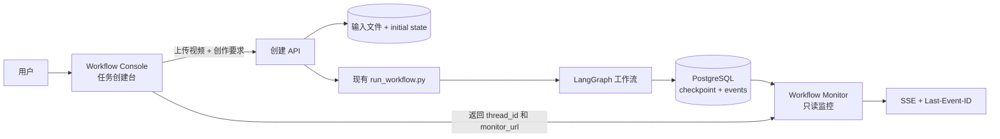
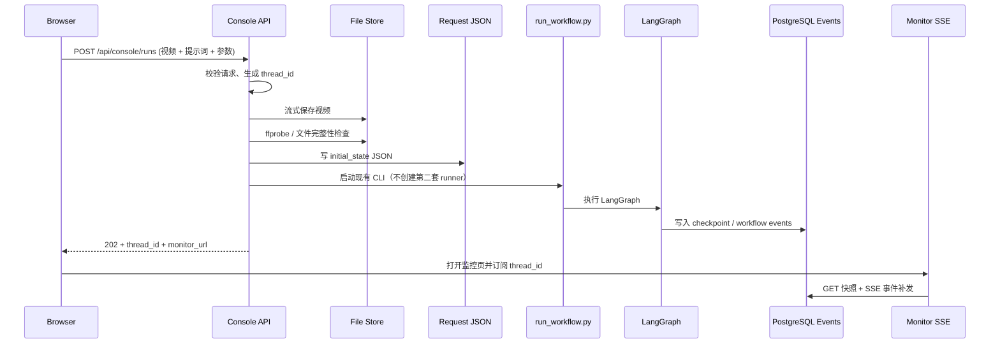

# auto-video-editor：工作流监控与任务创建界面设计及分阶段执行计划

> **文档类型**：UI 改造设计、接口设计、分阶段开发与验收计划  
> **项目**：[`wayyet/auto-video-editor`](https://github.com/wayyet/auto-video-editor)  
> **目标分支**：`main`  
> **代码核对基准**：`951259bc8b1495715c66c09da2a68145578bcc9a`（2026-11-04 21:04:49 UTC）  
> **编写日期**：2026-11-05  
> **参考界面**：用户提供的 `Workflow Monitor` 运行截图  
> **相关历史评审**：`auto-video-editor_单流水线架构设计与分阶段执行计划_评审修订版_20261104.md`、`auto-video-editor_对话历史故障分析与重设计执行方案.md`  
> **状态**：设计与执行计划；尚未修改项目源码

---

## 1. 执行摘要

### 1.1 目标

在当前单流水线架构上，补齐可操作的 Web 任务入口，使用户可以在浏览器中完成：

1. 导入一个或多个视频文件。
2. 输入自然语言创作提示词。
3. 设置目标时长、画幅比例等结构化参数。
4. 创建一次新的 LangGraph 工作流运行。
5. 自动跳转到现有 `Workflow Monitor`，实时查看事件、节点状态和执行结果。

本次不是恢复旧的聊天式 Web UI，而是把交互改为**一次提交创建一个工作流运行**。用户要修改任务要求时，应创建新运行，或者在明确支持的人工关卡中提交结构化输入；不能默认把每条聊天消息解释为重新启动一次视频处理。

### 1.2 核心结论

**当前截图展示的是只读监控页，不是任务创建页。它不能直接输入提示词，也不能导入视频。**

代码核对结果：

- `monitor_fastapi.py` 的职责是提供监控首页、节点图和只读 API。
- `web/monitor.html` 只有 `thread_id` 输入框、“订阅”和“断开”按钮，以及事件流、节点状态区域。
- `web/api_workflow.py` 当前提供 `GET /graph`、`GET /runs/{thread_id}`、`GET /runs/{thread_id}/events`、`GET /runs/{thread_id}/resume-status`。当前版本没有工作流创建用的 `POST /api/workflow/runs`。
- `scripts/run_workflow.py` 已支持 `--thread-id`、`--initial-state-json` 和 `--video-input-paths`。
- `agent_gate/cli.py` 的 `start` / `drive` 命令已支持 `--video`、`--video-paths` 和 `--initial-state-file`。
- `state.py` 已定义 `video_input_path`、`video_input_paths` 和 `storyline_targets`，但没有统一的用户自然语言创作要求字段（例如 `creative_brief`）。

所以，UI 改造必须同时完成两件事：

1. 新增独立任务创建入口，解决“从哪里上传和提交”的问题。
2. 将用户提示词纳入 `WorkflowState` 与对应的 Prompt 构建链路，解决“提示词提交后是否真正影响视频内容”的问题。

### 1.3 推荐方案

采用两个职责清晰的页面：

| 页面 | 职责 | 是否可以修改/启动工作流 |
|---|---|---|
| 工作流创建台 `Workflow Console` | 上传视频、输入创作要求、创建运行 | 可以创建新运行 |
| 现有 `Workflow Monitor` | 订阅事件、查看节点状态、查看执行结果 | 不可以；保持只读 |

推荐新增独立的创建服务/路由，不把启动逻辑塞进 SSE 监控 API。监控仍保持 `127.0.0.1:7860`；创建台可使用独立端口，例如 `127.0.0.1:7861`。端口可以在部署阶段统一配置，但不能把两个 API 的职责混在一起。

---

## 2. 代码基线与证据

### 2.1 本次核对的关键源码

| 文件 | 当前代码职责 | 本次设计的处理 |
|---|---|---|
| `monitor_fastapi.py` | 独立监控 FastAPI 应用 | 保留只读职责 |
| `web/monitor.html` | `Workflow Monitor` 页面 | 保留事件和节点视图；增加“创建任务”导航入口，并支持从 URL 读取 `thread_id` |
| `web/static/workflow_monitor.mjs` | 事件状态归约、SSE 路径和游标去重 | 保留状态机；修正过时注释 |
| `web/api_workflow.py` | 只读图结构、运行快照和 SSE API | 保持 GET-only，不恢复旧 `POST /runs` |
| `scripts/run_workflow.py` | 直接执行 LangGraph 工作流 | 作为创建台后台唯一直接执行适配器 |
| `agent_gate/cli.py` | Agent/worker 启动、任务消费与恢复 | 保留为另一条既有运行入口，不在本次创建台中复制其内部逻辑 |
| `state.py` | LangGraph `WorkflowState` | 新增正式创作要求字段及兼容测试 |
| `start_production.ps1` | 生产依赖、监控服务和工作流启动 | 改造为可只启动服务；不能每次打开创建台都自动执行默认素材 |

### 2.2 当前 main 的运行与持久化约束

1. 当前生产执行路径使用 PostgreSQL Checkpointer，并通过统一 runner 写入 workflow events；不能根据项目早期描述恢复 SQLite/`SqliteSaver` 作为生产状态存储。
2. SSE 使用 `Last-Event-ID` 补发事件；事件先持久化，再由监控端读取并推送。
3. 监控服务不得因页面刷新、订阅或断线重连而创建第二个工作流。
4. 当前生产架构保留两类工作流触发入口：直接 CLI，以及 `agent_gate`（MCP/worker/drive）。创建台应当是这两类现有执行入口的 Web 客户端，不应再实现第三套 LangGraph runner。
5. `start_production.ps1` 当前仍包含准备默认视频、生成 initial state、启动监控服务并执行工作流等步骤。为支持用户从 Web 创建不同任务，需要把“服务启动”和“单次任务启动”拆开。

### 2.3 当前 UI 的实际能力

截图页面由 `web/monitor.html` 实现，界面分为：

- 顶部：`thread_id` 输入框、“订阅”、“断开”、连接状态和“节点图视图”链接。
- 左侧：SSE 事件流，列出 `id`、时间、事件、节点/详情。
- 右侧：节点状态和 attempt 信息。

截图显示“空闲 / 已断开”且事件表为空，只能说明页面尚未订阅到可显示的运行事件；不能据此判断 LangGraph 节点执行失败。页面没有文件选择器、上传进度条、提示词文本框或创建任务按钮。

---

## 3. 为什么要修改原来的界面

本节将“原来的界面”按历史评审中的旧 OpenStoryline 聊天式 Web UI 理解；“新界面”指本次截图中的 `Workflow Monitor`。

### 3.1 旧聊天界面与当前工作流架构不匹配

旧界面的主要交互模型是：用户发一条消息，Agent 处理一轮对话，再等待下一条消息。当前项目的核心则是 LangGraph 视频流水线：一个 `thread_id` 对应一次持久化运行，运行内部有节点、条件路由、并行分支、重试、人工 `interrupt/resume` 和最终交付。

两者的生命周期不同：

| 维度 | 旧聊天式 UI | 当前单流水线模型 |
|---|---|---|
| 主要对象 | Chat Session / Message | Workflow Run / `thread_id` |
| 触发方式 | 每条消息触发一轮 Agent/模型处理 | 一次提交启动一条 LangGraph 流水线 |
| 状态 | 对话消息与会话上下文 | PostgreSQL checkpoint + workflow events |
| 执行过程 | 聊天轮次 | 多节点、有向图、条件边、并行和重试 |
| 人工交互 | 继续发送聊天消息 | 在指定 interrupt 关卡中恢复 |
| 观测 | 聊天消息和工具调用 | SSE 事件、节点状态、attempt、分支选择 |

如果保留旧聊天运行时作为主入口，容易出现“聊天会话 ID 与工作流 thread_id 混用”“每条消息启动新的模型子进程”“聊天轮次与图恢复状态不一致”等问题。2026-11-04 的单流水线评审已经明确：退役旧聊天回合运行时，但保留 LangGraph 条件路由、重试、并行和人工恢复能力。

### 3.2 旧对话历史还有独立的持久化问题

历史排查确认，旧 OpenStoryline 前端曾使用浏览器 `localStorage` 保存侧边栏会话列表；后端能按会话 ID 读单个状态，但旧实现缺少完整的服务端会话枚举入口。浏览器、浏览器配置文件或站点来源变化后，历史列表不能可靠共享。

这意味着不能只把旧聊天 UI 换个皮肤，然后继续把聊天记录当作工作流执行记录。新架构应该以 `thread_id`、checkpoint 和 workflow events 作为执行事实来源。

### 3.3 监控页解决了观测问题，但没有解决任务输入问题

当前截图的设计目的，是让操作者看到：

- 工作流是否启动；
- 哪个节点正在执行、完成、等待人工、重试或失败；
- 节点事件是否已持久化；
- 浏览器断线后是否可以按事件 ID 补发。

监控页面没有任务创建职责。因此，不能要求用户在 `thread_id` 输入框里输入提示词或视频路径，也不能把“订阅”按钮改造成“启动工作流”按钮。订阅必须继续是只读 GET 行为。

### 3.4 修改目标不是“删掉用户操作”，而是重新划分操作入口

应将旧聊天式操作改为明确的任务表单：

1. 用户在创建台选择视频文件。
2. 用户输入一次完整创作要求。
3. 后端生成新的 `thread_id`，保存输入文件和任务参数。
4. 后端调用已有工作流执行入口。
5. 前端打开监控页并自动订阅该 `thread_id`。

由此，**任务创建与执行观测分离，聊天记录不再承担工作流状态管理职责**。

---

## 4. 新界面整体设计

### 4.1 页面与导航



### 4.2 页面职责

**A. 工作流创建台**（新增）

推荐页面路径：`/console`。包含：

- 视频文件选择区，支持拖放和多文件选择；
- 文件列表、格式、大小、上传进度和移除操作；
- 创作提示词文本框；
- 目标时长、画幅比例、输出语言等结构化参数；
- “创建并运行”按钮；
- 创建结果和错误提示。

**B. Workflow Monitor**（保留）

现有 `/` 页面继续展示事件流、节点状态、运行状态、attempt 和节点图入口。顶部新增一个“创建任务”链接，指向 `/console`。用户从创建台提交后，自动返回监控页并订阅刚生成的 `thread_id`。

**C. 节点图视图**（保留）

继续作为工作流拓扑浏览入口。它不负责创建任务或修改运行状态。

### 4.3 为什么建议创建台与监控服务分离

建议创建台使用单独路由模块和独立服务，例如：

- 监控：`monitor_fastapi.py`，监听 `127.0.0.1:7860`；
- 创建台：`workflow_console_fastapi.py`，监听 `127.0.0.1:7861`；
- 监控 API：`/api/workflow/*`，保持 GET-only；
- 创建 API：`/api/console/*`，单独承担文件上传和任务提交。

这样可以避免以下问题：

1. 误把只读监控 API 变成工作流启动入口。
2. SSE 断线重连或刷新页面触发重复执行。
3. 监控服务直接承担大文件上传，影响事件读取稳定性。
4. 用户误以为 `thread_id` 输入框是新任务输入框。

两个服务都只监听本机回环地址。当前项目未在本次范围内设计多用户公网访问；如以后要远程访问，必须额外设计身份认证、授权、CSRF、防重放和文件访问隔离。

---

## 5. 在新界面中输入提示词的操作设计

### 5.1 UI 操作

1. 打开工作流创建台 `/console`。
2. 在“创作要求”区域输入自然语言提示词。
3. 可选设置目标时长、画幅比例和语言等结构化参数。
4. 检查提示词和参数后点击“创建并运行”。
5. 创建成功后，页面显示生成的 `thread_id`，并打开 Workflow Monitor。

建议提示词示例：

```text
请把导入的视频剪辑成一条约 30 秒的旅行回顾短片。
整体节奏明快，优先保留自然风光、人物活动和有辨识度的场景。
镜头衔接自然，避免连续使用相似画面；字幕使用简体中文，文案简洁。
画面整体偏清新、明亮，结尾保留一个完整的收束镜头。
```

此示例只是用户输入格式示例，不代表当前 main 已经支持这些语义。当前代码必须先完成 `creative_brief` 的 State 和 Prompt 传递改造，文本框输入才会真正影响生成结果。

### 5.2 当前代码缺口

`state.py` 当前定义了视频路径字段和 `storyline_targets` 等结构化状态，但没有标准的自然语言创作要求字段。不能只在 HTML 里增加 `<textarea>`，然后把文本保存到 JSON；如果图节点不读取它，提示词就不会生效。

### 5.3 建议的 State 契约

建议增加以下字段（具体类型以当前 Python 版本和 TypedDict 约定为准）：

```python
class WorkflowState(TypedDict, total=False):
    # 用户在创建台输入的自然语言创作要求
    creative_brief: NotRequired[str]

    # 记录本次提示词模板/映射规则版本，便于复现
    prompt_profile: NotRequired[str]
    prompt_version: NotRequired[str]

    # 原有字段继续保留
    video_input_path: str
    video_input_paths: NotRequired[list[str]]
    storyline_targets: NotRequired[Optional[dict]]
```

建议语义：

- `creative_brief`：用户的业务目标、风格和内容偏好；不是系统提示词。
- `storyline_targets`：机器可校验的目标参数，例如目标时长、比例等；不把所有自由文本都塞进这个 dict。
- `prompt_profile` / `prompt_version`：说明这次运行采用哪一套模板映射，便于排错和回放。

### 5.4 Prompt 传递原则

1. 保留仓库内版本化的基础系统提示词，不允许用户文本覆盖系统提示词。
2. 将 `creative_brief` 作为独立的用户上下文传入选定的文案/镜头规划/时间线规划能力。
3. 只把与节点职责相关的内容传给该节点，不要把用户全文无差别拼接到每个 LLM 调用。
4. 明确提示词边界，例如 `用户创作要求` 区块；将其视为不可信输入，不能允许其覆盖系统规则、文件权限或工具策略。
5. 对输入长度设上限；保存完整请求用于追溯，但日志和 SSE 事件只记录摘要、长度、哈希或 request ID，不记录完整私密提示词。
6. 通过 Prompt Golden 测试锁定旧提示词行为；没有创作要求时，必须保持旧默认行为。

建议第一批接入节点先依据当前 `graph.py` 的节点调用链完成源码映射，再选择文案生成、剪辑规划等实际会消费创作目标的节点；不要凭 UI 字段名猜测节点接口。

---

## 6. 在新界面中导入视频的操作设计

### 6.1 UI 操作

1. 打开工作流创建台 `/console`。
2. 点击“选择视频”或把视频拖入上传区域。
3. 支持一次选择多个视频；文件列表展示文件名、大小、格式和上传状态。
4. 用户可以移除错误文件，重新选择。
5. 上传成功后，页面显示文件校验结果。
6. 提交创作要求，点击“创建并运行”。
7. 页面收到新的 `thread_id` 后，自动进入监控页。

### 6.2 浏览器上传方式

网页浏览器不能安全地把用户电脑的任意绝对路径直接交给服务端。正确方式是通过 `multipart/form-data` 上传文件字节，由服务器保存到受控目录，再把服务器端路径写入 initial state。

不要设计成让用户在网页上填写 `C:\\Users\\...\\video.mp4` 后就假设服务器能读取该文件。除非 UI 与工作流服务运行在同一机器且有专门的本地代理，否则浏览器无法直接访问用户选择文件的原始路径。

### 6.3 服务端文件存储

建议按运行 ID 隔离输入文件：

```text
inputs/
└── <thread_id>/
    ├── source_001.mp4
    ├── source_002.mov
    └── manifest.json
```

要求：

- `thread_id` 由服务端生成，不接受用户任意指定目录名。
- 文件名由服务端重新生成或严格清洗；原始文件名仅作为展示元数据。
- 使用流式写入，避免把大视频一次性读入内存。
- 校验扩展名、实际文件类型、视频流和时长；仅检查扩展名不够。
- 配置单文件大小、总上传大小和文件数量限制。
- 拒绝路径穿越、符号链接逃逸、空文件和无法解析的视频。
- 上传失败时清理未完成文件；创建运行失败时保留或按策略清理，不能留下难以识别的孤儿文件。
- 数据库/事件表只保存路径、大小、哈希和状态等元数据，不保存视频二进制内容。

### 6.4 写入初始工作流状态

后端上传完成后，创建 initial state JSON。示例：

```json
{
  "session_id": "wf-20261105-a1b2c3d4",
  "video_input_path": "inputs/wf-20261105-a1b2c3d4/source_001.mp4",
  "video_input_paths": [
    "inputs/wf-20261105-a1b2c3d4/source_001.mp4",
    "inputs/wf-20261105-a1b2c3d4/source_002.mov"
  ],
  "creative_brief": "请把素材剪辑成一条节奏明快的旅行回顾短片……",
  "prompt_profile": "default",
  "prompt_version": "v1",
  "storyline_targets": {
    "target_duration_ms": 30000,
    "ratio": "9:16"
  },
  "error_log": []
}
```

说明：

- `video_input_path` 保留第一条素材，兼容当前单视频消费者。
- `video_input_paths` 用于多视频入口；当前主程序和 `agent_gate` CLI 已有对应字段/参数支持。
- `creative_brief`、`prompt_profile`、`prompt_version` 是本次计划新增的契约，需要先修改 `state.py` 和实际消费节点。
- `storyline_targets` 是当前已有字段；示例中的具体值必须在实施前对照当前消费代码确认，并添加类型/范围校验。
- JSON 文件只放服务器受控目录，例如 `runtime/requests/<thread_id>.json`，不能让客户端传入任意本地路径。

---

## 7. 创建任务 API 与执行流程

### 7.1 API 设计

新增创建台独立接口，不复用已经移除的监控启动接口：

`POST /api/console/runs`

请求类型：`multipart/form-data`

| 字段 | 类型 | 必需 | 说明 |
|---|---|---:|---|
| `videos` | 多个文件 | 是 | 一个或多个视频素材 |
| `creative_brief` | string | 按产品规则 | 用户的自然语言创作要求 |
| `target_duration_ms` | integer | 否 | 目标时长；需校验正数和业务上限 |
| `ratio` | string | 否 | 画幅比例，例如 `9:16`、`16:9` |
| `language` | string | 否 | 输出字幕/文案语言 |
| `idempotency_key` | string | 建议 | 防止用户双击或网络重试造成重复运行 |

成功返回 `202 Accepted`，例如：

```json
{
  "ok": true,
  "thread_id": "wf-20261105-a1b2c3d4",
  "status": "accepted",
  "monitor_url": "http://127.0.0.1:7860/?thread_id=wf-20261105-a1b2c3d4"
}
```

### 7.2 后端处理顺序



### 7.3 唯一执行适配器

推荐创建台先调用现有的直接 CLI 路径：

```powershell
.\.venv\Scripts\python.exe scripts\run_workflow.py `
  --production `
  --skip-preflight `
  --thread-id wf-20261105-a1b2c3d4 `
  --initial-state-json runtime\requests\wf-20261105-a1b2c3d4.json
```

前置条件：生产依赖、PostgreSQL、迁移和 checkpoint schema 已由服务启动/预检步骤确认就绪。`--skip-preflight` 只能用于这些前置检查已完成的路径，不能作为绕过生产预检的默认设置。

实现时必须：

- 使用 `subprocess.Popen([...], shell=False)` 或受控进程管理器，不拼接 shell 命令字符串。
- 对 `thread_id`、文件路径和 JSON 文件路径进行服务端校验。
- `cwd` 固定为仓库根目录；解释器固定为项目主 `.venv`。
- 记录 PID、启动时间、退出码、stdout/stderr 日志路径和运行状态。
- 提交 API 只负责创建运行，不等待长时间视频处理结束。
- 对同一 `idempotency_key` 返回同一个创建结果，避免双击产生重复任务。
- 创建台不得自己 import `graph.build_graph()` 并另写一套 `ainvoke()` 生命周期。

`agent_gate` 的 `start`/`drive` 仍然保留给 Agent/MCP 用户。它们已有 `--video`、`--video-paths`、`--initial-state-file` 支持，但本次 Web 创建台不应同时启动直接 CLI 和 `agent_gate`，否则会出现同一任务被两个执行器消费的风险。

### 7.4 生产服务启动调整

当前 `start_production.ps1` 把服务预检、默认素材准备和工作流执行放在同一个脚本内。新增 UI 后应改成：

1. 服务启动：Docker/PostgreSQL、迁移、监控服务、创建台服务和健康检查。
2. 任务启动：由创建台提交请求后调用 `scripts/run_workflow.py`。
3. CLI 手工启动仍可作为故障排查和备用路径。

建议为生产启动脚本增加明确的“只启动服务”模式，或拆分成 `start_services.ps1` 与单次任务入口。默认启动服务时，不应自动用示例视频创建一条正式任务。

---

## 8. 页面状态与交互细节

### 8.1 创建台状态

| 状态 | UI 展示 | 操作规则 |
|---|---|---|
| 空表单 | 显示选择视频和提示词输入 | 不允许提交空视频列表 |
| 文件上传中 | 每个文件显示进度 | 禁止重复点击提交 |
| 文件校验失败 | 显示失败文件和原因 | 允许移除失败文件并重试 |
| 可以提交 | 显示文件数量、总大小和参数摘要 | 点击创建并运行 |
| 正在创建 | 显示请求处理中 | 按钮进入 loading，使用幂等键 |
| 创建成功 | 显示 `thread_id` 和监控链接 | 自动跳转或由用户点击进入监控 |
| 创建失败 | 显示稳定错误码与可操作提示 | 不显示堆栈和敏感路径 |

### 8.2 监控页状态

1. 支持 `/?thread_id=<id>` 初始化输入框并自动订阅。
2. 用户手动订阅时仍使用当前 GET 快照和 SSE API。
3. 点击“断开”只断开 EventSource，不停止后台工作流。
4. 刷新页面后按 URL 中的 `thread_id` 重连，继续使用 `Last-Event-ID` 补发。
5. 订阅失败时区分 `thread_id` 不存在、事件存储不可用、连接断开和跨源请求被拒绝。
6. 不把“断开”显示成“停止任务”；真正停止运行需要独立的、经过设计的取消机制，本次不新增。

### 8.3 用户需要看到的输入结果

创建成功后，监控页至少显示：

- `thread_id`；
- 本次导入的视频文件名和数量（只显示安全的文件元数据）；
- 创作要求摘要（避免在事件日志里暴露完整提示词）；
- 目标时长、画幅比例和语言；
- 当前运行状态和节点进度。

---

## 9. 安全、持久化与异常处理

### 9.1 文件安全

- 文件上传目录固定在项目受控根目录内，不允许客户端提交任意保存路径。
- 文件名不直接用于磁盘路径；服务器生成文件名，manifest 保存原文件名。
- 通过 `Path.resolve()` 校验目标目录仍在允许根目录内。
- 文件写入采用临时文件 + 校验通过后原子重命名。
- 限制单文件大小、总大小、文件数量和总上传耗时。
- 不执行上传文件，不解压用户不需要的归档文件。
- 视频解码/探测进程设置超时和资源限制。

### 9.2 提示词安全

- `creative_brief` 只是业务内容，不授予额外文件系统、命令执行或网络能力。
- 不允许用用户提示词覆盖系统 Prompt、安全策略、模型工具权限或服务端配置。
- 对极长输入、控制字符和不支持的格式做校验。
- 完整提示词不进入普通日志、SSE 事件或错误响应。

### 9.3 数据和事件

- PostgreSQL checkpoint/event 持久化仍是工作流运行事实来源。
- 上传文件及 manifest 存文件系统；事件表只记录路径引用、哈希、大小和状态等轻量元数据。
- 初始请求 JSON、输入文件和输出目录按同一个 `thread_id` 关联。
- 服务端提交失败要返回明确错误；不能因为数据库不可用而把任务伪装成已启动。
- API 返回 `202` 前，应确认文件已落盘、initial state 已写入，并且运行进程已成功创建或进入明确的 queued 状态。

### 9.4 取消、重试与恢复边界

本次第一版只实现“创建并监控”，不新增任意节点级跳过、回滚或取消。恢复仍走当前项目已定义的 CLI/`agent_gate` 对应路径。监控页的 `resume-status` 只做状态查询与指引，不能伪装成实际恢复动作。

---

## 10. 分阶段执行开发任务

> 执行原则：先冻结现有监控行为，再新增创建入口；每一阶段都有独立验收门槛。不得在第一阶段同时大规模删除监控代码或改写 LangGraph 图。

### 阶段 0：基线确认与接口契约冻结

**目标**：确保开发基于当前 `main`，明确 UI 与工作流的输入契约。

任务：

- [ ] 记录 `main` 实际 HEAD SHA 和工作区状态。
- [ ] 确认 `monitor_fastapi.py`、`web/monitor.html`、`web/api_workflow.py`、`scripts/run_workflow.py`、`agent_gate/cli.py` 的当前版本。
- [ ] 运行现有监控前端测试和关键 API 测试，保存基线结果。
- [ ] 列出 `WorkflowState` 所有视频输入和 `storyline_targets` 消费方。
- [ ] 沿 `graph.py` 的真实调用链确认哪些节点应消费 `creative_brief`。
- [ ] 冻结请求 schema、initial state schema、`thread_id` 生成规则和上传目录规则。
- [ ] 确认 PostgreSQL/事件表已就绪，生产执行入口仍只有既有 CLI/`agent_gate` 两类。

**交付物**：基线记录、数据契约、节点消费映射表。  
**验收条件**：监控页原有订阅、断开、SSE 补发和节点状态测试全部保持原样通过；所有新增字段都有明确消费者或标记为暂不开放。

### 阶段 1：工作流创建台前端

**目标**：先实现用户可理解的创建表单，不启动真实工作流。

任务：

- [ ] 新增 `web/console.html` 和对应静态资源。
- [ ] 实现多文件选择和拖放区域。
- [ ] 展示文件名、格式、大小、删除操作和上传进度占位。
- [ ] 新增创作要求文本框。
- [ ] 新增目标时长、画幅比例、语言等结构化参数。
- [ ] 实现空表单、文件错误、提交中、创建失败和创建成功状态。
- [ ] 在监控页顶部增加“创建任务”入口。
- [ ] 保持监控页原有订阅按钮和只读说明，不改变为启动动作。

**交付物**：可交互的创建台静态页面。  
**验收条件**：前端单测覆盖文件列表、参数校验和状态切换；尚未接入后端时，提交只能提示“后端尚未启用”，不能伪造任务成功。

### 阶段 2：视频上传 API 与文件持久化

**目标**：浏览器上传的视频可以安全地保存到服务器受控目录。

任务：

- [ ] 新增 `web/api_console.py`，实现上传处理服务，并由 `POST /api/console/runs` 统一接收视频文件与任务参数；只有需要断点续传时才另拆独立上传端点。
- [ ] 增加服务端生成 `thread_id` 的逻辑。
- [ ] 实现流式写入和上传进度所需的响应机制。
- [ ] 实现文件数量、文件大小、扩展名和实际视频流校验。
- [ ] 使用 `ffprobe` 或项目已有媒体探测工具验证视频可读性和时长。
- [ ] 实现目录白名单、路径穿越防护、随机文件名和原子落盘。
- [ ] 生成 `manifest.json`，记录原文件名、保存路径、大小、哈希和探测结果。
- [ ] 处理部分上传失败、超时和磁盘空间不足。
- [ ] 增加上传文件清理策略，但默认不清理仍被运行引用的素材。

**交付物**：上传 API、文件 manifest、上传单元测试。  
**验收条件**：单文件、多文件、损坏文件、伪造扩展名、超限文件、空文件和路径穿越测试通过；上传失败时不生成可运行任务。

### 阶段 3：`creative_brief` 与提示词链路接入

**目标**：确保 UI 输入的自然语言确实影响流水线产物。

任务：

- [ ] 在 `state.py` 中增加 `creative_brief`、`prompt_profile`、`prompt_version` 字段。
- [ ] 为 `storyline_targets` 定义正式 schema 和字段范围，不允许任意未验证字段进入图状态。
- [ ] 为初始状态读取、旧 checkpoint 和缺失字段增加向后兼容处理。
- [ ] 完成文案生成、镜头规划和时间线规划等节点的实际源码映射。
- [ ] 通过统一 Prompt Context/Prompt Builder 把创作要求注入选定节点。
- [ ] 禁止将 `creative_brief` 拼接到系统提示词或工具权限配置中。
- [ ] 为默认空创作要求保留当前输出行为。
- [ ] 新增 Prompt Golden 测试、长度限制测试和提示词边界测试。
- [ ] 更新 `scripts/capture_prompt_golden.py` 等提示词基线工具，确保不依赖已退役的旧聊天运行时。

**交付物**：State schema、Prompt Builder、节点接线和 golden 测试。  
**验收条件**：输入不同 `creative_brief` 能在目标节点输入中观察到差异；空值不改变原默认流程；旧 checkpoint 可恢复；无节点消费的字段不得标记为已完成。

### 阶段 4：创建 API 与工作流启动适配

**目标**：将上传文件和提示词组装成 initial state，并调用现有生产入口。

任务：

- [ ] 实现 `POST /api/console/runs`，接收视频、创作要求和结构化参数。
- [ ] 生成唯一 `thread_id`，实现幂等键防重复提交。
- [ ] 将上传文件路径和参数写入 `runtime/requests/<thread_id>.json`。
- [ ] 写入前验证所有路径均位于服务端媒体根目录内。
- [ ] 使用项目主 `.venv` 调用 `scripts/run_workflow.py`，不另建 LangGraph runner。
- [ ] 使用参数数组启动进程，固定 `cwd`，禁用 shell 字符串执行。
- [ ] 保存 PID、日志、进程启动时间和创建状态。
- [ ] 处理启动失败、进程立即退出、重复 `thread_id` 和 PostgreSQL 不可用。
- [ ] 将创建 API 与 `/api/workflow/*` 监控 API 完全分开。

**交付物**：创建 API、运行进程管理器、请求状态记录。  
**验收条件**：一次提交只创建一个运行；相同幂等键不会重复启动；没有完整素材或 initial state 时不执行；API 不直接构造或执行另一套图。

### 阶段 5：监控页联动与服务生命周期

**目标**：创建成功后，用户直接看到这条运行的实时状态。

任务：

- [ ] 监控页支持读取 URL 参数 `thread_id`。
- [ ] 有合法 `thread_id` 时自动填充输入框并订阅；无参数时保持当前空闲状态。
- [ ] 创建 API 成功响应包含 `monitor_url`。
- [ ] 创建台成功后跳转到监控页，显示本次运行 ID。
- [ ] 监控页增加“创建任务”链接。
- [ ] 将创建服务纳入 `start_production.ps1` 和 `stop_production.ps1` 的 PID/健康检查管理。
- [ ] 增加“只启动服务”模式，禁止默认自动提交示例视频。
- [ ] 修正 `web/static/workflow_monitor.mjs` 中与当前 GET-only 监控 API 不一致的历史注释。
- [ ] 验证刷新、断网、重连和终态事件，不产生第二次工作流。

**交付物**：创建—运行—监控闭环、启停脚本和部署说明。  
**验收条件**：创建后自动订阅正确 `thread_id`；刷新后仍能补发历史事件；断开监控不停止任务；停止脚本不会误杀未知进程。

### 阶段 6：端到端验收与回归

**目标**：验证用户从选择视频到工作流完成/挂起的完整流程。

任务：

- [ ] 使用一个有效 MP4 完成单视频创建和执行。
- [ ] 使用多个视频验证 `video_input_path` 与 `video_input_paths` 兼容。
- [ ] 使用不同 `creative_brief` 验证目标节点收到不同上下文。
- [ ] 测试空提示词、极长提示词、非法比例和非法时长。
- [ ] 测试文件上传失败、磁盘不足和 ffprobe 超时。
- [ ] 测试相同幂等键连续提交和双击提交。
- [ ] 测试 PostgreSQL 不可用时的创建失败行为。
- [ ] 测试人工 interrupt、恢复后事件连续性和多节点重试。
- [ ] 测试 SSE `Last-Event-ID` 断线补发、重复事件去重和终态关闭。
- [ ] 比较重构前后旧测试失败 ID，确认没有新增回归。
- [ ] 在剪映客户端打开最终草稿，验证素材、字幕、时间轴和输出结果。

**交付物**：端到端测试报告、回归差异、人工验收记录。  
**验收条件**：所有新功能测试通过；监控旧能力无回退；真实视频产物通过客户端打开验证。

### 阶段 7：上线、文档和回滚

**目标**：完成受控部署，避免未验证 UI 直接影响现有执行入口。

任务：

- [ ] 更新 README 的创建台/监控台入口说明。
- [ ] 更新 API schema、initial state schema 和提示词版本记录。
- [ ] 更新部署、启动、停止、日志和排障文档。
- [ ] 明确上传目录保留期限与清理脚本。
- [ ] 保留旧 CLI 手工启动方式作为回退入口。
- [ ] 记录新增服务的端口、PID 文件、日志路径和配置项。
- [ ] 发布前备份 PostgreSQL 和运行目录；本次不修改已发布迁移历史。
- [ ] 若创建台故障，只关闭创建台服务，监控页和 CLI 运行能力继续可用。

**交付物**：部署版文档、回滚步骤和上线验收记录。  
**验收条件**：创建台可单独回滚；已启动工作流和历史事件不受 UI 回滚影响。

---

## 11. 测试矩阵

| 类别 | 用例 | 预期结果 |
|---|---|---|
| 前端 | 选择单视频/多视频 | 列表正确，文件可移除 |
| 前端 | 未选择视频提交 | 阻止提交并提示 |
| 前端 | 上传进度和失败重试 | 状态准确，不重复创建运行 |
| 上传 API | 伪装扩展名、损坏视频 | 校验拒绝，不启动工作流 |
| 上传 API | 路径穿越、特殊文件名 | 保存到服务端受控目录，不越界 |
| 上传 API | 超出大小/数量限制 | 返回明确错误，不保留半成品 |
| State | 缺少 `creative_brief` 的旧状态 | 兼容执行，保持默认行为 |
| Prompt | 不同创作要求 | 目标节点收到对应用户上下文 |
| Prompt | 空创作要求 | 旧默认行为不变 |
| API | 双击/网络重试 | 幂等，不重复运行 |
| API | PostgreSQL 不可用 | 明确失败，不返回伪成功 |
| 启动 | 子进程启动失败 | 返回失败状态并记录日志 |
| 监控 | URL 带 thread_id | 自动订阅正确运行 |
| 监控 | SSE 断线重连 | 按 Last-Event-ID 补发且不重复应用 |
| 监控 | 点击断开 | 只断开浏览器连接，不停止运行 |
| 回归 | 旧监控测试 | 不新增失败 |
| E2E | 真实视频完整执行 | checkpoint、事件和输出产物一致 |
| 人工关卡 | interrupt/resume | 仍走原恢复路径，事件链完整 |

---

## 12. 风险与控制

| 风险 | 后果 | 控制措施 |
|---|---|---|
| 只加提示词文本框，不接 State/节点 | 用户输入被忽略 | 阶段 3 必须通过节点输入测试验收 |
| 在监控 API 恢复 POST 启动 | 监控职责混乱、重复运行 | 创建 API 使用独立 `/api/console/*` |
| 浏览器直接传本地路径 | 服务端无法读取该路径 | 使用 multipart 文件上传 |
| 一个运行被两个执行器启动 | 重复消耗资源、输出冲突 | 创建台只调用选定的直接 CLI 适配器 |
| 用户双击提交 | 同一任务执行两次 | 幂等键和唯一 `thread_id` |
| 上传文件过大或损坏 | 内存/磁盘耗尽，节点失败 | 流式写入、大小限制、ffprobe 校验 |
| 提示词包含越权指令 | 提示词影响系统策略 | 系统提示词与用户上下文隔离 |
| 服务启停脚本仍自动执行默认素材 | 创建台上线后多出意外运行 | 增加只启动服务模式 |
| 监控页自动订阅后误把断开当停止 | 用户误判后台仍在执行 | 明确 UI 文案；断开只作用 EventSource |
| 上传清理误删运行素材 | 运行恢复失败 | 按 thread_id 引用状态与保留期清理 |

---

## 13. 预计代码改动范围

> 下表是建议的改动范围，不表示这些文件已经创建或修改。

| 路径 | 变更类型 | 说明 |
|---|---|---|
| `workflow_console_fastapi.py` | 新增 | 创建台 FastAPI 服务 |
| `web/console.html` | 新增 | 上传视频、提示词和参数表单 |
| `web/api_console.py` | 新增 | 上传、校验和创建运行 API |
| `web/console/` | 新增 | 创建台前端逻辑/样式（按现有静态资源组织调整） |
| `web/monitor.html` | 修改 | 增加创建任务链接、URL thread_id 自动订阅 |
| `web/static/workflow_monitor.mjs` | 修改 | 修正过时注释；保留事件归约逻辑 |
| `state.py` | 修改 | 增加 `creative_brief` 等正式状态字段 |
| 实际 Prompt Builder/Storyline 节点文件 | 修改 | 显式消费创作要求；以阶段 0 源码映射为准确定文件名 |
| `scripts/run_workflow.py` | 少量修改或不改 | 尽量沿用现有 initial-state JSON 入口；仅补充必要的输入验证/元数据 |
| `start_production.ps1` | 修改 | 增加只启动服务模式并托管创建台服务 |
| `stop_production.ps1` | 修改 | 安全停止创建台进程，遵循 PID 所有权校验 |
| `tests/`、`web/tests/` | 新增/修改 | 上传、State、Prompt、创建 API、URL 自动订阅和 E2E 测试 |
| `README.md`、`docs/` | 修改 | 同步使用方式、接口和运维说明 |

---

## 14. 推荐的实际使用流程

### 14.1 当前版本（尚未完成 UI 改造）

当前截图页面只能订阅已存在的 `thread_id`：

1. 先通过现有 CLI 或 `agent_gate` 创建/启动运行。
2. 例如，在 PowerShell 中启动单视频任务：

   ```powershell
   .\.venv\Scripts\python.exe -m agent_gate start `
     --thread-id wf-manual-001 `
     --video "D:\Videos\sample.mp4"
   ```

   多视频可使用 `--video-paths`：

   ```powershell
   .\.venv\Scripts\python.exe -m agent_gate start `
     --thread-id wf-manual-002 `
     --video-paths "D:\Videos\a.mp4" "D:\Videos\b.mp4"
   ```

   视频路径必须位于项目配置的媒体白名单目录中（`AGENT_GATE_MEDIA_ROOTS`）。
3. 从 CLI 输出、运行目录或 Agent Gate 状态中取得 `thread_id`。
4. 在截图顶部输入 `thread_id`。
5. 点击“订阅”。
6. 查看左侧事件流和右侧节点状态。

当前版本不能在截图页面选择本地视频文件上传，也没有可供用户直接提交的自然语言创作要求字段。即使通过 initial-state JSON 临时写入一段文本，当前节点也不会自动消费它；必须先完成阶段 3 的 State/Prompt 接线。

### 14.2 改造完成后

1. 打开 `Workflow Console`。
2. 选择一个或多个视频。
3. 输入创作提示词，设置目标时长和画幅比例。
4. 点击“创建并运行”。
5. 系统生成 `thread_id`、保存文件和请求 JSON，并启动既有工作流执行入口。
6. 浏览器自动打开 `Workflow Monitor`，填入 `thread_id` 并订阅。
7. 执行期间查看节点状态；若等待人工关卡，按既有恢复流程处理。
8. 工作流完成后从对应输出目录查看草稿和成品。

---

## 15. 参考资料

### 15.1 项目源码（`main`）

1. [`monitor_fastapi.py`](https://github.com/wayyet/auto-video-editor/blob/main/monitor_fastapi.py) — 独立只读监控服务入口。
2. [`web/monitor.html`](https://github.com/wayyet/auto-video-editor/blob/main/web/monitor.html) — 当前截图对应的监控页面。
3. [`web/api_workflow.py`](https://github.com/wayyet/auto-video-editor/blob/main/web/api_workflow.py) — 只读监控 API 和 SSE 实现。
4. [`web/static/workflow_monitor.mjs`](https://github.com/wayyet/auto-video-editor/blob/main/web/static/workflow_monitor.mjs) — 事件状态归约与游标处理。
5. [`scripts/run_workflow.py`](https://github.com/wayyet/auto-video-editor/blob/main/scripts/run_workflow.py) — 直接工作流执行入口及 initial state 参数。
6. [`agent_gate/cli.py`](https://github.com/wayyet/auto-video-editor/blob/main/agent_gate/cli.py) — `start`/`drive` 的视频路径和 initial state 参数。
7. [`state.py`](https://github.com/wayyet/auto-video-editor/blob/main/state.py) — 当前 WorkflowState 字段。
8. [`start_production.ps1`](https://github.com/wayyet/auto-video-editor/blob/main/start_production.ps1) — 生产启动脚本。
9. [`stop_production.ps1`](https://github.com/wayyet/auto-video-editor/blob/main/stop_production.ps1) — 生产停止脚本。
10. [`README.md`](https://github.com/wayyet/auto-video-editor/blob/main/README.md) — 项目总体说明和运行约定。

### 15.2 历史设计与故障分析

- `auto-video-editor_单流水线架构设计与分阶段执行计划_评审修订版_20261104.md`：旧聊天运行时退役、LangGraph 单流水线、两类运行入口、PostgreSQL checkpoint/event 和只读监控服务的评审基线。
- `auto-video-editor_对话历史故障分析与重设计执行方案.md`：旧浏览器聊天历史使用 localStorage、服务端会话枚举缺失等问题的根因分析。

---

## 16. 最终决策建议

**建议按“创建台 + 只读监控台”双页面方案实施。**

关键决策如下：

1. 不恢复旧聊天回合运行时。
2. 不在现有 `thread_id` 输入框中混入提示词或视频上传功能。
3. 保持 `monitor_fastapi.py` 和 `/api/workflow/*` 的只读边界。
4. 新增独立的创建台服务和 `/api/console/*` 接口。
5. 视频通过浏览器 multipart 上传到服务端受控目录。
6. 用户提示词必须作为 `creative_brief` 正式进入 WorkflowState，并由明确的 Prompt Builder/节点消费。
7. 创建台只调用现有 `scripts/run_workflow.py`，不复制一套图执行逻辑。
8. 先完成 State/Prompt 接线和上传验证，再开放“创建并运行”按钮。
9. 修改生产启停脚本，让它可以只启动服务，不再默认自动运行示例视频。

这样可以保留当前监控页的可靠性，同时补齐实际使用所需的提示词输入和视频导入入口。
