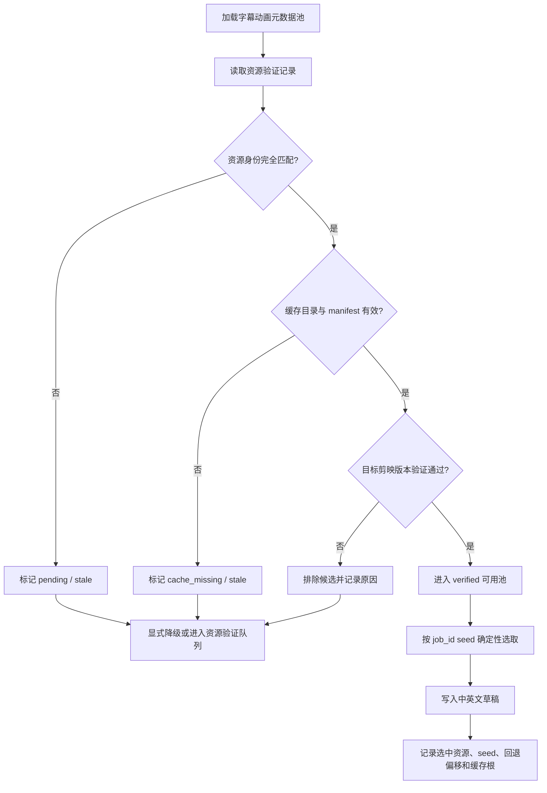

# auto-video-editor 字幕动画丢失根因分析文档正确性审查及分阶段修复执行计划

- 审查日期：2026-11-19
- 项目：[`wayyet/auto-video-editor`](https://github.com/wayyet/auto-video-editor)
- 审查分支：`main`
- 审查基线：`09c297d6cb36273f5f5a44b5a45ccb280b848dbc`
- 原始文档：[`auto-video-editor_字幕动画丢失根因分析与修复计划_20261119.md`](https://github.com/wayyet/auto-video-editor/blob/09c297d6cb36273f5f5a44b5a45ccb280b848dbc/docs/%E7%AC%AC%E4%B8%83%E6%9C%9F%E5%BC%80%E5%8F%91/auto-video-editor_%E5%AD%97%E5%B9%95%E5%8A%A8%E7%94%BB%E4%B8%A2%E5%A4%B1%E6%A0%B9%E5%9B%A0%E5%88%86%E6%9E%90%E4%B8%8E%E4%BF%AE%E5%A4%8D%E8%AE%A1%E5%88%92_20261119.md)
- 本文档性质：代码与设计审查、原文档修订建议、后续分阶段执行计划；**不是代码修复执行记录**。

---

## 1. 审查结论

### 1.1 总体判断

**原始文档的核心方向正确：字幕动画资源库中的元数据不等于剪映本机已经具备可渲染的资源；仅根据 `effect_id`、`md5` 写入草稿，无法保证剪映打开草稿后一定能加载动画。** 当前 `main` 已经提交了 Part A 的主要写入守卫，能够排除未标记验证、或本机缓存目录不存在的字幕入场动画。

但原文档仍有以下问题，不能作为“全部修复完成”的交付报告：

1. **根因证据的确定性表述过强。** “目录里只有 4 个文件”能够证明该资源包与已知正常缓存样本不同，但不能单独证明它必然是下载不完整。文档同时记录了剪映 `5.9.0.11632` 与资源 `config.json` 中 `version: 6.0.0`，却没有把版本兼容性作为并列根因验证。网络下载中断、VIP/登录权限、服务端下发内容、资源版本不兼容都仍需排查。
2. **Part A 的降级路径有潜在破坏性。** 当前字幕节点在没有任何可用动画时，仍会以空 `kept_ids` 清理旧的我方动画；如果只是缓存路径配置错误、缓存暂时不可见或资源池临时不可用，重跑工作流可能删除草稿原有动画引用。
3. **标题动画守卫弱于字幕动画守卫。** 标题节点只检查缓存目录是否存在，没有 `verified` 或资源包校验。已知坏资源证明“目录存在”不等于“资源可正常渲染”。
4. **资源库重建时按 `name` 继承 `verified` 不够安全。** 同名资源的 `resource_id`、`effect_id` 或 `md5` 变化时，旧的验证标记仍可能被转移到新资源。
5. **Part B 全池收割没有完成，也没有进入当前 `main`。** 当前分支不存在 `scripts/harvest_text_fx.py`；资源池仍为 78 条，其中只有 2 条有 `verified: true`。不能宣称 78 条动画均已验证或“全池资源问题已解决”。
6. **“打开一个包含全部 78 条动画的草稿就会触发所有资源完整下载”缺少实证。** 剪映可能按当前时间线可见区、选中素材、预览或其他条件延迟加载资源。必须通过小批次实验确认触发条件。
7. **导出 fidelity 统计把标题动画也算成“字幕入场动画”。** 代码将 `text-anim-*` 和 `anim-hook-title*` 一起计数，但提示文案统一称为字幕动画，统计口径不准确。
8. **原文档的执行状态已过期。** §6 仍称 Part A 代码处于“未提交工作区”，但当前 `main` HEAD 已包含该批代码与文档；原文档中“node_09b 新增测试尚未重跑”等状态也应按最新提交更新。

因此建议将本次问题定为：

- **P1：修复写入守卫的非破坏性降级、验证标记继承安全、标题动画验证一致性，并完成可重复的真实资源验证流程。**
- **P2：修正导出 fidelity 统计口径、补齐资源库生成器测试、强化缓存与验证审计信息。**

当前 Part A 已落地，但 Part B、端到端真机验收及上述补强尚不能视为完成。

### 1.2 当前 `main` 分支状态

截至本次读取，`main` 指向提交：

`09c297d6cb36273f5f5a44b5a45ccb280b848dbc`

提交信息为：`fix(字幕动画): 入场动画缓存可用性守卫 Part A —— 池选取只落 verified+缓存存在条目`。该提交包含配置、资源判定、字幕节点、标题节点、资源库生成器、测试 fixture、测试文件及本次原始分析文档等改动。

当前代码库已具备：

- `JIANYING_CACHE_ROOT` 环境变量配置；
- `text_animation_cache_available()` 缓存目录判定；
- `node_10` 的 `verified + 缓存目录存在` 双条件守卫；
- auto/fixed 模式按池序寻找可用条目；
- 无可用字幕动画时不新增动画并记录降级告警；
- 标题动画缓存目录缺失时不写标题动画、保留标题文字；
- `status_log` 中记录选中动画；
- 资源库重建时保留部分已有 `verified` 标记；
- 测试用临时缓存目录，避免单测依赖开发机真实剪映缓存。

当前资源库 `intro` 仍有 78 条 VIP 入场动画，但只标记了两条：

| 动画 | `effect_id` | `md5` | 当前状态 |
|---|---:|---|---|
| 兔子弹跳 | `8398145` | `5d157129853f479ea15f75075c1ef070` | `verified: true` |
| 逐字旋入 | `13137035` | `9838c6772ddbd48126f30baf74200f99` | `verified: true` |
| 其余 76 条 | — | — | 未标记验证，按当前守卫不可选 |

**状态结论：Part A 已提交；Part B 全池收割未实施；全量回归与剪映真机验收仍需单独确认。**

---

## 2. 审查范围与证据等级

### 2.1 本次已直接核验的内容

本次读取了 GitHub `main` 的仓库元数据、目标文档、相关源代码、资源库 JSON 和测试文件，重点包括：

- `config.py`
- `jy_common/native_fx.py`
- `jy_common/template_library.py`
- `jy_common/job_identity.py`
- `jy_common/hook_title.py`
- `nodes/node_10_inject_text_fx.py`
- `nodes/node_09b_inject_opening_hook.py`
- `scripts/build_resource_library.py`
- `templates/text_resource_library.json`
- `draft_ops/draft_exporter.py`
- `tests/conftest.py`
- `tests/unit/test_node_10_inject_text_fx.py`
- `tests/unit/test_node_09b_inject_opening_hook.py`
- `tests/unit/test_build_resource_library.py`
- `tests/unit/test_native_fx.py`

### 2.2 尚不能独立验证的本机证据

原文档记录的以下材料不在 Git 仓库中，本次也没有作为附件提供，因此不能声称已经重新读取或复现：

- `AutoVideo_console-b0b2a64a78c6` 的中文、英文 `draft_content.json`；
- `Cache/effect/1644278/d3e255df67130866e0d2de42a703637c/` 的真实文件列表、文件内容及哈希；
- 剪映日志 `JianyingPro_2026-11-19T00-14-15.log`；
- 剪映界面中“动画丢失”徽章、动画面板和实际预览结果；
- 本机剪映登录状态、VIP 权限、网络请求与资源下载记录。

因此，本文对这些内容使用“原文档报告”表述。代码层面的判断则以当前 GitHub `main` 的实际实现为准。

### 2.3 证据分类

| 等级 | 含义 | 本次使用方式 |
|---|---|---|
| A：代码事实 | 能从当前 `main` 源码或 JSON 直接确认 | 可作为当前实现结论 |
| B：原文档本机实测 | 原文档记载了文件、日志、界面等观察，但本次未重新读取原始文件 | 作为可信线索，不扩展成独立复现结论 |
| C：待验证假设 | 由现象推导出的原因，但缺少能排除其他原因的证据 | 必须列入实验验证，不写成已证实事实 |

---

## 3. 对原始根因分析的逐项审查

### 3.1 “资源池只是元数据，不代表资源已下载”——成立

当前 `scripts/build_resource_library.py` 的职责是从 vendor metadata 读取资源定义并生成 JSON；资源行包含资源名称、VIP 标记、时长、资源 ID、效果 ID 和 MD5 等元信息。该生成过程本身没有执行剪映 GUI 应用动作，也没有下载每个动画的完整资源包。

当前 `templates/text_resource_library.json` 的 `intro` 数量为 78，`_counts.intro_vip` 也是 78。资源库里只有两条设置了 `verified: true`。因此：

- 78 条是“候选元数据池”；
- 2 条是当前代码认可的“已验证候选”；
- 不能将“存在 JSON 元数据”解释为“本机缓存已完整且可渲染”。

这部分是原文档最重要、也是正确的设计判断。

### 3.2 “任务 seed 命中未下载条目”——代码机制成立，本机具体命中结果属于原文档报告

当前 `node_10` 的 auto 选取仍以 `sha256(job_id + "|text_intro_pool")` 的前 8 位十六进制值确定全池起点，再按资源池顺序循环寻找第一个可用资源。

原始文档报告：`console-b0b2a64a78c6` 的 seed 起点落到“螺旋上升”，其 `effect_id=1644278`、`md5=d3e255df67130866e0d2de42a703637c`，而该资源当时没有已知完整缓存。此结论与原文档的算法描述相符，但本次未取得原始草稿和缓存目录，未独立重算并复核本机文件。

另需明确：当前代码已经加入可用性过滤。即便 seed 起点落在未验证资源，当前逻辑也会继续按池序寻找下一条 `verified` 且缓存目录存在的资源。原文档描述的是守卫修复前的故障，不应混同为当前 `main` 仍会直接选择未验证的“螺旋上升”。

### 3.3 “四个文件说明下载不完整”——证据不足，必须增加版本兼容性验证

原文档报告损坏目录只有：

- `RotateFlyIn.lua`
- `anim.prefab`
- `config.json`
- `content.json`

并与其他正常资源目录的 10 至 15 个文件作了对照。该差异足以说明该目录与当前已知正常样本不同，但**不同动画资源可能拥有不同的文件结构**；仅靠文件数量不能建立一个通用的完整性阈值。

还存在一个原文档已记录、但未深入排查的关键信号：

- 剪映版本：`5.9.0.11632`；
- 损坏资源 `config.json` 的版本字段：`6.0.0`。

这可能意味着资源包格式与剪映客户端版本不兼容，也可能只是资源内部版本号与客户端版本号采用不同的版本体系。没有 vendor 格式说明或对照样本前，不能直接断言二者不兼容，也不能忽略这个信号。

**修订结论：**应把根因暂时定义为“剪映未能成功加载该动画资源”，并将下列原因并列验证：

1. 资源包下载不完整或文件缺失；
2. 资源包结构与剪映 `5.9.0.11632` 不兼容；
3. 登录状态、VIP 权限或资源可用范围限制；
4. 网络请求失败、限流或服务端返回异常内容；
5. 草稿中的资源标识、缓存路径或引用关系不符合当前客户端预期。

只有在排除这些替代解释后，才能将“下载不完整”确定为唯一根因。

### 3.4 “剪映打开草稿按需下载，并且写入 path”——需要区分下载动作和加载成功

原文档指出：剪映打开草稿后会尝试按需获取资源，并且保存草稿时可能填入本机缓存 `path`；但 `path` 填充不是动画可渲染的成功信号。

这个判断是合理的。当前代码也没有把 `path` 当成可用性标准，而是以 `verified` 和缓存目录存在作为写入前置条件。

建议原文档进一步说明：

- `path` 有值，只说明草稿中出现了本地路径信息；
- 目录存在，只说明文件系统中存在目录；
- 目录结构符合某个样本，只说明结构相似；
- **只有在目标剪映版本中实际应用、预览并保存后仍正常显示，才能作为 GUI 可渲染验证。**

### 3.5 “标题动画正常、字幕动画丢失”——现象解释成立，但标题守卫仍有弱点

原文档报告标题使用“冲屏位移”，本机缓存长期存在，因而标题正常、字幕资源失败的现象具有合理解释。

但当前 `node_09b_inject_opening_hook.py` 的标题动画选择逻辑只检查缓存目录是否存在，未要求 `verified`，也没有校验目录文件是否符合已知资源清单。原文档自身已经证明“目录存在但资源仍可能加载失败”，因此标题守卫的标准不应明显弱于字幕守卫。

推荐标题候选也使用经过 GUI 验证的状态或明确的内置资源白名单。对未验证标题资源应降级为纯文字标题，不应仅凭目录存在就写入动画。

### 3.6 “英文草稿打开后也会丢失”——预测，不是已完成的观测

原文档明确说明英文草稿当时尚未由剪映打开。由于中英文草稿选择同一动画资源，推测英文草稿也会触发相同资源解析问题是合理的，但应继续标记为待验证，不能写为已发生事实。

验收时要分别打开中文和英文草稿，确认两个草稿都能加载并预览，不应以中文草稿通过代替英文草稿通过。

### 3.7 “冒烟通过是幸存者偏差”——分析方向正确

冒烟测试命中此前已下载并应用过的“逐字旋入”，而全池其他多数条目没有验证。这说明冒烟只能证明单个缓存样本可以工作，不能证明 78 条资源池都可用。

原文档应进一步将验收范围明确区分为：

- **节点逻辑测试：** 验证选取算法会排除未验证资源；
- **缓存判定测试：** 验证缺目录时会跳过；
- **资源 GUI 验证：** 验证具体动画在指定剪映版本中可以实际渲染；
- **任务端到端验证：** 验证新任务、双语草稿及导出报告的整体行为。

不能用第一、第二类测试替代第三、第四类测试。

---

## 4. 当前代码实现审查

### 4.1 字幕动画守卫：主要方向正确

当前 `nodes/node_10_inject_text_fx.py` 的 `_intro_usable()` 要求：

1. `anim_meta["verified"]` 为真；
2. `Cache/effect/<effect_id>/<md5>` 对应目录存在。

auto 模式仍按原 seed 定位全池起点，随后按池序循环查找可用条目；fixed 模式也会先检查指定动画和旧名称候选是否可用，再回退到可用池中的第一条。

优点：

- 避免把纯元数据条目直接写入剪映草稿；
- 未验证条目不会因为刚好被 seed 选中而进入草稿；
- 已验证资源被清理后会因缓存目录缺失而失去候选资格；
- 没有可用资源时可以显式降级，而不是伪装成功。

代码位置：

- [`nodes/node_10_inject_text_fx.py`](https://github.com/wayyet/auto-video-editor/blob/09c297d6cb36273f5f5a44b5a45ccb280b848dbc/nodes/node_10_inject_text_fx.py#L66-L114)
- [`jy_common/native_fx.py`](https://github.com/wayyet/auto-video-editor/blob/09c297d6cb36273f5f5a44b5a45ccb280b848dbc/jy_common/native_fx.py#L110-L127)
- [`jy_common/template_library.py`](https://github.com/wayyet/auto-video-editor/blob/09c297d6cb36273f5f5a44b5a45ccb280b848dbc/jy_common/template_library.py#L261-L278)

### 4.2 P1：无可用动画时可能清除旧动画，降级不够安全

当前 `_apply_text_animations()` 在 `anim_meta is None` 时：

- 为每条我方字幕增加 `degraded` 计数；
- 不再生成新动画；
- `kept_ids` 保持为空；
- 函数末尾仍执行 `_cleanup_stale_animations(draft, kept_ids)`。

而 `_cleanup_stale_animations()` 会删除所有 ID 以 `text-anim-` 开头、但不在 `kept_ids` 中的动画素材，并从文本轨段中剥离对应引用。因此，当缓存根路径配置错误、缓存暂时不可见、资源池加载异常或本机权限变化时，**一次失败的重跑可能把草稿中上一轮已有的我方字幕动画移除**。

这与“fail-closed”的安全目标不一致。fail-closed 应表示不引入未经验证的新动画，不应在临时不可用时破坏已有草稿内容。

**修复要求：**

- 没有可用动画时，不清理既有 `text-anim-*` 材料和引用；
- 只有新动画已经成功选择并准备写入时，才执行旧材料清理与替换；
- 若要主动移除失效旧动画，应提供独立、显式、可审计的修复动作，不与普通任务重跑绑定。

代码位置：[`nodes/node_10_inject_text_fx.py`](https://github.com/wayyet/auto-video-editor/blob/09c297d6cb36273f5f5a44b5a45ccb280b848dbc/nodes/node_10_inject_text_fx.py#L117-L142) 及 [动画写入流程](https://github.com/wayyet/auto-video-editor/blob/09c297d6cb36273f5f5a44b5a45ccb280b848dbc/nodes/node_10_inject_text_fx.py#L145-L204)。

### 4.3 P1：`verified` 继承只按 name 匹配，可能继承到不同资源

当前 `scripts/build_resource_library.py::_carry_over_verified()` 从旧资源库收集所有 `verified` 条目的 `name`，再将同名的新条目继续设置为 `verified: true`。

风险：vendor 元数据可能在名称不变的情况下更新资源 ID、效果 ID、MD5 或时长。此时新条目可能不是之前通过 GUI 验证的那个二进制资源，却仍继承旧验证标记。

**修复要求：**至少按以下稳定身份字段共同匹配后才继承：

`(section, name, resource_id, effect_id, md5)`

可选增加 `duration_s` 作为额外一致性字段。若任何身份字段改变，应清除旧 `verified`，重新进入待验证状态。

此外，`verified` 不应只有一个无来源的布尔值，建议增加验证信息：

- `verification_status`：`pending / verified / failed / stale`；
- `verified_at`：验证时间；
- `jianying_version`：验证时剪映版本；
- `resource_identity`：资源 ID、效果 ID、MD5；
- `cache_manifest_sha256`：缓存文件清单摘要；
- `evidence_path`：截图或验证记录相对路径；
- `verification_note`：异常、权限和资源加载说明。

代码位置：[`scripts/build_resource_library.py`](https://github.com/wayyet/auto-video-editor/blob/09c297d6cb36273f5f5a44b5a45ccb280b848dbc/scripts/build_resource_library.py#L207-L226)。

### 4.4 P1：标题动画只检查目录存在，验证标准不统一

`node_09b` 对标题候选执行 `text_animation_cache_available()`，该函数只检查目标目录是否为目录，不检查验证状态或文件清单。原文档已经给出“坏包目录存在，但剪映仍显示动画丢失”的反例，因此该判据不足以作为标题资源的可靠保护。

**修复要求：**

- 将“冲屏位移”等标题候选加入同一验证清单；或
- 建立独立的 `verified_hook_animations` 清单，但使用相同验证字段和失效规则；
- 未验证或验证过期时不写动画，保留标题文字；
- 不允许仅凭目录存在就认为标题动画安全。

另一个非破坏性问题：`_cleanup_stale_hook_products()` 会在选择资源前删除上一轮 hook 产物。若本轮标题动画候选不可用，旧动画也会被删掉，随后只重建纯文字标题。建议失败降级时保留上一轮可用的标题动画，除非标题文本或用户配置明确要求重建。

代码位置：

- [`nodes/node_09b_inject_opening_hook.py`](https://github.com/wayyet/auto-video-editor/blob/09c297d6cb36273f5f5a44b5a45ccb280b848dbc/nodes/node_09b_inject_opening_hook.py#L104-L149)
- [标题动画缓存判定](https://github.com/wayyet/auto-video-editor/blob/09c297d6cb36273f5f5a44b5a45ccb280b848dbc/nodes/node_09b_inject_opening_hook.py#L218-L240)
- [`jy_common/hook_title.py`](https://github.com/wayyet/auto-video-editor/blob/09c297d6cb36273f5f5a44b5a45ccb280b848dbc/jy_common/hook_title.py#L45-L73)

### 4.5 P1：缓存目录路径必须与剪映 GUI 登录用户一致

当前 `JIANYING_CACHE_ROOT` 默认由 `Path.home()` 推导，再拼接：

`AppData/Local/JianyingPro/User Data/Cache/effect`

这在工作流 Worker 与剪映 GUI 运行于同一 Windows 用户目录时成立。但若 Worker 以不同账号、服务账号或不同启动环境运行，`Path.home()` 可能指向另一个用户目录。此时守卫会把 GUI 用户实际存在的缓存判断成缺失，导致所有动画降级。

**修复要求：**

- 服务启动时记录实际 `JIANYING_CACHE_ROOT`；
- 记录 Worker 进程的 Windows 用户名和 `Path.home()`；
- 真机验收必须检查该路径与当前剪映 GUI 用户缓存目录完全一致；
- 便携版或自定义安装路径必须显式设置环境变量；
- 对错误路径给出明确诊断，不只返回“无可用动画”。

`JIANYING_CACHE_ROOT` 的值约定为 `Cache/effect` 目录本身，而不是上一级 `Cache` 或 `User Data`。

### 4.6 P2：缓存目录存在不是资源包完整性校验

`text_animation_cache_available()` 当前只调用 `Path(...).is_dir()`。对字幕动画而言，`verified` 提供第二层保障；但验证标记可能因缓存被替换、清理后重新下载、剪映升级或资源文件更新而变陈旧。

建议在 GUI 实证时生成资源缓存 manifest，至少记录：

- 相对文件路径；
- 文件大小；
- SHA-256；
- 关键配置文件中的资源版本信息；
- 剪映客户端版本；
- 资源身份字段。

运行时可以通过轻量预检比较目录清单与已验证 manifest。无需每个节点都重复计算全部大文件哈希，可在任务开始前做一次缓存状态预检，并在资源目录变更时将验证状态标为 `stale`。

### 4.7 P2：导出 fidelity 的标题/字幕统计口径混淆

当前 `draft_ops/draft_exporter.py` 对 `text-anim-*` 和 `anim-hook-title*` 一起计数，但输出统一描述为：

`N 条字幕入场动画未渲染进 MP4(剪映客户端内可见)`

其中 `anim-hook-title*` 是开场标题动画，并非正文字幕动画。统计应拆分为：

- `n_subtitle_anim`：`text-anim-*`；
- `n_title_anim`：`anim-hook-title*`。

另外，最好按实际段落引用关系统计，而不是只数 `materials.material_animations` 中存在的对象，避免孤立或未绑定的素材也被计入“已配置动画”。

代码位置：[`draft_ops/draft_exporter.py`](https://github.com/wayyet/auto-video-editor/blob/09c297d6cb36273f5f5a44b5a45ccb280b848dbc/draft_ops/draft_exporter.py#L224-L242)。

---

## 5. 原文档状态与测试说明需要修订

### 5.1 “未提交工作区”描述已经过期

原始文档 §6 写明 Part A 改动“未提交，工作区状态”。但当前 `main` HEAD 已经是 `09c297d6...`，提交说明明确记录了 Part A 代码改动，并且该提交同时包含原始计划文档。因此应将状态更新为：

- Part A：已提交到 `main`；
- Part B：未实施，待资源收割与 GUI 验证；
- Part C：文档已入库；重启服务和项目外部操作应另行记录；
- 全量回归：提交说明称相关测试套件通过，但本次未在本地检出仓库运行测试；
- 真机验收：本次无法通过 GitHub 源码读取确认。

### 5.2 当前测试覆盖存在缺口

当前 `tests/unit/test_build_resource_library.py` 有资源抽取、去重、写文件、幂等、diff 和缺失源目录等测试，但未覆盖 `_carry_over_verified()` 的身份匹配行为。

当前 `tests/unit/test_native_fx.py` 覆盖原生动画素材结构，但没有针对 `text_animation_cache_available()` 的完整专项测试。

因此必须增加：

- 相同资源身份时继承验证标记；
- 同名但 `effect_id` 变化时不继承；
- 同名但 `md5` 变化时不继承；
- 旧资源被删除后不把验证转移到其他资源；
- 缓存路径缺失、文件而非目录、空 `effect_id`、空 `md5` 的判定；
- 标题动画未验证但目录存在时仍应降级。

### 5.3 当前测试 fixture 的边界

`tests/conftest.py` 使用 autouse fixture 把缓存根目录替换成临时目录，并为当前标记 `verified` 的资源伪造缓存目录。这是正确的单元测试隔离措施，但它只验证选择逻辑，不证明本机资源文件真的完整，也不证明剪映 GUI 能加载。

需要将测试类型显式划分为：

1. 单元测试：逻辑、状态、引用和非破坏性降级；
2. 集成测试：工作流节点和双语草稿的写入行为；
3. 真机 GUI 验收：真实缓存文件、真实剪映版本、实际动画预览；
4. 交付测试：保存、关闭、重开草稿后仍能正常渲染。

### 5.4 本次未执行仓库测试

本次审查通过 GitHub 读取 `main` 源码和测试文件，没有在本机 checkout 仓库、安装 `.venv` 依赖或运行 pytest。因此本文不会声称测试已由本次审查实际执行。

当前提交信息记录相关测试套件通过，但 GitHub 当前提交的 combined status 未返回任何 status 项。应以开发机实际 pytest 输出和剪映真机记录作为正式验收凭据。

---

## 6. 修订后的目标架构

### 6.1 资源状态必须从“是否有元数据”升级为“是否有可审计的验证记录”

建议每条动画至少区分以下状态：

| 状态 | 含义 | 是否可被工作流选择 |
|---|---|---:|
| `metadata_only` | 只有 vendor 元数据，未验证本地资源 | 否 |
| `cache_missing` | 曾验证，但当前缓存目录不存在 | 否 |
| `pending_verification` | 已尝试下载，尚未完成 GUI 实证 | 否 |
| `verified` | 身份匹配、缓存 manifest 匹配、目标剪映版本 GUI 预览通过 | 是 |
| `stale` | 资源身份、缓存清单或剪映版本变化，旧验证不再可靠 | 否 |
| `failed` | GUI 预览失败、资源缺失或权限/版本异常 | 否 |

`verified` 必须绑定到准确的资源身份和验证环境，不得只绑定动画名称。

### 6.2 处理流程

### 6.3 双语动画一致性

中文和英文草稿必须使用相同的：

- 逻辑任务 ID（`configurable.thread_id` 优先）；
- 资源池版本或资源清单版本；
- 可用资源集合快照；
- seed 算法与回退策略。

当前 `jy_common/job_identity.py` 已统一解析 `thread_id`，并兼容 `state.session_id` 及中文草稿目录兜底。建议在一次任务开始时计算并固化 `selected_text_animation`，随后让 zh/en 两个节点消费同一个选择结果，避免两个节点执行期间缓存状态变化造成选取分叉。

### 6.4 非破坏性降级原则

这是本次修订的强制约束：

- **选取失败不等于删除旧数据。**
- 只有新动画已验证、资源可用且准备成功写入时，才替换旧的我方动画。
- 缓存检查失败、配置错误、资源池暂时不可用时，保留草稿原有动画和引用。
- 若旧动画本身已被确认损坏，必须由单独的修复动作处理，并先备份原始 `draft_content.json`。

---

## 7. 分阶段执行计划

### 阶段 0：冻结基线与补齐根因证据（P1，先执行）

**目标：** 在修改 Part A 之前补足可重复证据，区分下载失败、版本不兼容和草稿引用错误。

任务：

1. 固定复现样本：中文草稿、英文草稿、问题动画“螺旋上升”、已知正常动画“兔子弹跳”“逐字旋入”、标题“冲屏位移”。
2. 对每个资源记录 `resource_id/effect_id/md5`，避免只以动画名称识别资源。
3. 记录剪映版本 `5.9.0.11632`、Windows 用户、Worker 用户、`Path.home()`、实际 `JIANYING_CACHE_ROOT`。
4. 对正常和异常缓存目录生成文件清单：相对路径、文件大小、SHA-256、关键配置文件内容及版本字段。
5. 在不覆盖原始草稿的前提下，备份两份 `draft_content.json`，记录文件 SHA-256。
6. 建立打开前、打开后、应用动画后、预览后、保存后四个时点的草稿 JSON 与缓存快照。
7. 分别验证 VIP 登录状态、网络请求、资源下载结果与客户端版本影响。

验收标准：

- 至少一个失败资源和两个正常资源拥有完整缓存 manifest；
- 明确记录剪映版本与资源配置版本；
- 能区分“下载未完成”“目录完整但加载失败”“未登录/VIP 限制”“版本不兼容”；
- 原始草稿及缓存均有可恢复备份；
- 未形成证据前，不把“文件数量少”作为唯一根因结论。

交付物：`outputs/diagnostics/text-animation-cache-baseline-20261119/` 下的 JSON 清单、日志摘要、截图和复现说明（实际路径可按项目 outputs 规范调整）。

### 阶段 1：修复字幕节点的非破坏性降级（P1）

**目标：** 没有可用动画时，不得清除原草稿已有的我方动画。

修改范围：

- `nodes/node_10_inject_text_fx.py`
- `tests/unit/test_node_10_inject_text_fx.py`

实施要求：

1. 在 `_apply_text_animations()` 发现 `anim_meta is None` 时，保留原有 `text-anim-*` 素材和 refs；不以空 `kept_ids` 执行清理。
2. 将旧动画清理放到“新动画已成功选中并完成写入准备”分支。
3. 对每条字幕保留当前降级告警、`degraded` 统计和不伪装成功的行为。
4. 确保手工创建的文本动画（非 `text-anim-*` ID）仍完全不受影响。
5. 只有写入新动画成功后，才清理不再使用的我方旧动画。

必须新增的测试：

| 用例 | 输入 | 预期 |
|---|---|---|
| 无可用资源且草稿已有我方动画 | 缓存根为空，草稿已有 `text-anim-*` 和引用 | 旧素材和 refs 原样保留；返回降级告警 |
| 无可用资源且草稿有人工动画 | 缓存根为空，人工动画 ID 为 UUID | 人工动画和 refs 不变 |
| 有新可用资源 | 新资源已验证且缓存存在 | 新动画完成绑定后，清理旧我方动画 |
| 重放同一任务 | 同一任务、同一资源池和缓存 | 结果稳定，不重复增加动画素材 |
| 缓存路径错误 | `JIANYING_CACHE_ROOT` 指向不存在目录 | 记录明确降级信息，不清除现有草稿动画 |

验收标准：上述测试全通过；现有 `node_10` 选择、双语一致性和幂等测试不得新增失败。

### 阶段 2：统一标题动画验证与非破坏性回退（P1）

**目标：** 标题动画不得使用仅“目录存在”但没有 GUI 验证的资源。

修改范围：

- `jy_common/hook_title.py`
- `nodes/node_09b_inject_opening_hook.py`
- `tests/unit/test_node_09b_inject_opening_hook.py`
- 必要时新增验证清单模块。

实施要求：

1. 为 `HOOK_ANIMATION_CANDIDATES` 建立验证状态，至少“冲屏位移”要有可追溯的 GUI 实证。
2. 候选选择同时验证资源身份、验证状态和缓存有效性。
3. 对未验证、缓存缺失或验证过期的候选，跳过动画并保留标题文字。
4. 如果上一轮标题动画已存在，而本轮只是缓存暂时不可见，不应先删除旧动画再降级；采用先准备、后替换策略。
5. 记录标题动画降级原因和实际命中的资源名称、`effect_id`。

必须新增的测试：

- 目录存在但 `verified` 缺失：不写标题动画；
- `verified` 为真但缓存目录缺失：不写标题动画；
- 缓存目录存在但 manifest 不匹配：不写标题动画；
- 全部候选不可用：标题文字仍存在；
- 原草稿有已绑定的标题动画而本轮候选不可用：旧绑定按非破坏性策略保留；
- 候选有效：标题动画正常写入并绑定。

验收标准：标题文字始终按原逻辑生成；标题动画仅来自当前剪映版本已验证的候选；降级不能导致原有动画被意外删除。

### 阶段 3：修复资源库验证标记继承与验证记录格式（P1）

**目标：** 防止 vendor 元数据变化后，错误继承旧 `verified`。

修改范围：

- `scripts/build_resource_library.py`
- `templates/text_resource_library.json`
- `tests/unit/test_build_resource_library.py`

实施要求：

1. `_carry_over_verified()` 从按 `name` 匹配改为按 `(section, name, resource_id, effect_id, md5)` 匹配。
2. 新旧记录身份不一致时，清空 `verified` 或将 `verification_status` 设为 `stale`。
3. 保留生成器幂等能力；相同源 metadata、相同验证记录重复生成时，输出应稳定。
4. 将验证时间、剪映版本、缓存 manifest 摘要和证据文件路径放入验证记录。
5. 验证记录不得因为 AST 重扫、排序或去重操作而错误附着到另一条资源。
6. 生成器输出统计中分别输出继承成功、因资源身份变化而失效、未验证的条目数。

必须新增的测试：

| 场景 | 预期 |
|---|---|
| 同名且 `resource_id/effect_id/md5` 全相同 | 继承验证记录 |
| 同名但 `effect_id` 不同 | 不继承，标记待验证 |
| 同名但 `md5` 不同 | 不继承，标记待验证 |
| 旧资源消失、新资源复用同名 | 新资源不继承旧验证 |
| 源文件不变、连续运行生成器 | 输出字节级稳定 |
| 验证记录字段缺失或格式损坏 | 安全降级，不把条目标为 verified |

验收标准：生成器相关测试全绿；旧的两个已验证资源在身份不变时保留验证状态；资源身份变化时必须重新验证。

### 阶段 4：建立全池 GUI 资源验证工具和人工操作规程（P1）

**目标：** 逐个确认目标剪映版本实际能够加载、预览和保存资源，而不是把元数据扫描当作资源收割。

建议新增：`scripts/harvest_text_fx.py`

该脚本只负责生成收割草稿、验证任务清单和结果记录，不应自行伪造 `verified: true`。只有 GUI 实证步骤完成后，才允许通过独立回填命令或受控工具更新验证记录。

#### 4.1 收割前置检查

- 剪映版本、登录账号、VIP 权限和网络状态已记录；
- Worker 与剪映 GUI 使用同一个 Windows 用户目录；
- `JIANYING_CACHE_ROOT` 指向实际 `Cache/effect`；
- 原始缓存目录、资源库 JSON 和草稿有备份；
- 记录待测资源清单及当前 `verification_status`。

#### 4.2 不采用未经验证的“一份草稿放 78 条、打开一次即全部下载”假设

先做小批次实验：

1. 选 3 条未验证动画生成测试草稿；
2. 打开草稿后记录实际新增缓存目录；
3. 分别观察“仅打开草稿”“滚动到对应片段”“选中片段”“进入动画面板”“实际预览”“保存草稿”各步骤是否触发下载；
4. 记录是否需要逐条选中或应用动画；
5. 确定可靠触发方式后，再决定每批 5～10 条或逐条验证。

若确认打开草稿不能触发全量下载，则必须通过真实 GUI 操作逐个选中、应用并预览动画。禁止把“草稿 JSON 中存在动画 ID”作为收割成功条件。

#### 4.3 每条资源的验证步骤

1. 生成包含该资源的独立测试段或小批次草稿；
2. 在剪映 GUI 中确认资源可被识别；
3. 选中对应片段，确认动画名称与目标资源一致；
4. 播放动画区间，确认有真实动效，无丢失徽章、静止替代、闪烁或错误弹窗；
5. 保存并关闭草稿；
6. 重新打开草稿，再次预览；
7. 生成缓存 manifest，记录文件、大小、SHA-256 和关键配置；
8. 记录剪映版本、登录/VIP 状态、验证时间和截图路径；
9. 全部通过后才更新该条 `verification_status=verified`。

#### 4.4 失败分类

| 失败状态 | 说明 | 处理 |
|---|---|---|
| `download_failed` | 下载请求失败或资源目录不完整 | 网络/权限诊断后重试 |
| `vip_denied` | 登录或 VIP 权限导致资源不可用 | 不标记 verified，记录权限状态 |
| `client_incompatible` | 当前剪映版本不能加载资源包 | 记录版本差异，不通过增加文件数阈值掩盖 |
| `resource_unavailable` | 资源已从服务端下架或不可获取 | 加入不可用名单 |
| `render_failed` | 资源能写入但实际预览失败 | 记录 UI/日志证据，排除候选 |
| `verified` | 预览、保存、重开后均正常 | 允许进入工作流候选池 |

#### 4.5 损坏缓存处理

不要把“删除缓存目录”作为默认动作。对原文档中的螺旋上升缓存，应按以下方式处理：

1. 关闭剪映及可能读取该缓存的进程；
2. 检查目标路径确实位于配置的 `JIANYING_CACHE_ROOT` 下；
3. 记录目录清单和文件哈希；
4. 将目录移动到隔离/备份位置，不直接永久删除；
5. 重启剪映并进行受控重试；
6. 比较重新下载后的 manifest；
7. 完成 GUI 预览后再决定是否将旧缓存清理。

#### 4.6 收割结果验收

- 每一条资源都有唯一资源身份；
- 每一条资源都有明确成功或失败状态；
- 成功条目均具备缓存 manifest、剪映版本和 GUI 证据；
- 失败条目有明确失败原因，不得简单归类为“下载不完整”；
- 资源库只回填真实验证通过的条目；
- 对 78 条全部完成收割之前，不得宣称“全池验证完成”。

### 阶段 5：完善选取审计、双语选择快照和导出 fidelity（P2）

**目标：** 发生问题时，可以从任务日志确认选到了什么资源、为什么回退，以及动画是否仅存在于剪映草稿而未进入 MP4。

实施要求：

1. 工作流开始时固化一次选中动画，zh/en 节点共用同一选择结果。
2. 选取审计至少记录：`job_id`、池版本、seed 起点 index、最终 index、fallback offset、动画 name、resource/effect ID、MD5、缓存根路径、降级原因。
3. `draft_exporter.py` 将字幕动画和标题动画分开计数。
4. fidelity 的计数只统计实际绑定到段落的动画，不统计孤立材料。
5. 报告要清楚区分“字幕文字已烧录进 MP4”和“剪映原生动画仅在客户端草稿中可见”。

验收标准：

- 同一任务 zh/en 的审计信息可以证明使用同一资源身份；
- 资源池回退时可解释原始 seed 命中项和最终选中项；
- 标题动画与正文字幕动画分别计数；
- 未绑定材料不计入实际动画数量。

### 阶段 6：回归、真机端到端验收与发布（P1）

#### 6.1 自动化测试

按以下顺序执行：

1. `tests/unit/test_native_fx.py`
2. `tests/unit/test_build_resource_library.py`
3. `tests/unit/test_node_10_inject_text_fx.py`
4. `tests/unit/test_node_09b_inject_opening_hook.py`
5. 任务 ID resolver 与双语节点相关测试
6. 相关节点集成测试
7. 全量 unit 测试

剪映开着时，如果原子写入器禁止对子进程/草稿写入，应先关闭剪映，再执行涉及草稿写入的测试；不要通过全局关闭写入守卫来获得表面通过结果。

#### 6.2 真机验收

| 编号 | 验收项 | 通过标准 |
|---|---|---|
| E2E-01 | 新任务字幕动画选择 | 只选择当前版本 verified 且缓存有效的资源 |
| E2E-02 | 中文草稿 | 每条我方字幕引用正确动画，打开无丢失徽章 |
| E2E-03 | 英文草稿 | 英文草稿同样无丢失徽章、动画可预览 |
| E2E-04 | 双语一致性 | zh/en 的 name、resource_id、effect_id、md5、duration 一致 |
| E2E-05 | 时间线实际预览 | 入场动画真实播放，无静止替代、闪烁、裁切或资源弹窗 |
| E2E-06 | 保存与重开 | 保存、关闭、重新打开后动画仍正常 |
| E2E-07 | 无可用资源降级 | 不写入未经验证的新动画，保留旧有动画数据，不破坏草稿 |
| E2E-08 | 标题动画 | 标题动画也来自 verified 候选；无可用候选时保留标题纯文字 |
| E2E-09 | 导出 fidelity | 字幕动画和标题动画分别报告，口径与草稿实际引用一致 |
| E2E-10 | 服务运行环境 | Worker 使用的缓存根与剪映 GUI 用户缓存根一致 |

#### 6.3 发布与回滚

- 发布前保存代码 commit SHA、资源库 JSON SHA-256、验证 manifest 和测试结果；
- 先在测试任务上验证，不直接批量重写存量草稿；
- 存量 `AutoVideo_console-b0b2a64a78c6` 中文/英文草稿先备份，再由操作员在剪映 GUI 中修复；
- 只有在确认回填工具安全、幂等并有备份后，才考虑自动修复存量草稿；
- 代码回滚使用 Git revert 或回退到上一个已知稳定 commit；
- 资源库验证记录与代码分开备份，避免代码回滚时丢失已验证资源信息；
- 服务重启、缓存隔离/清理、存量草稿修改和 Git 推送均属于有副作用的操作，应单独列出具体目标和回滚方式，经操作员明确确认后执行。

---

## 8. 修复优先级与工作拆分汇总

| 优先级 | 编号 | 工作项 | 主要文件 | 完成定义 |
|---|---|---|---|---|
| P1 | P1-01 | 无可用动画时保留旧字幕动画，不清空 refs | `nodes/node_10_inject_text_fx.py` | 降级非破坏性测试通过 |
| P1 | P1-02 | 标题动画采用 verified 与缓存有效性双重检查 | `hook_title.py`、`node_09b` | 未验证/坏缓存不会写标题动画 |
| P1 | P1-03 | `verified` 按资源身份继承，不按名称继承 | `build_resource_library.py` | 同名不同资源不会继承验证 |
| P1 | P1-04 | 全池 GUI 实证收割流程 | 新增 `scripts/harvest_text_fx.py` 及验证记录 | 78 条逐条有通过/失败证据 |
| P1 | P1-05 | 验证剪映版本、权限、网络和缓存 manifest | 验证工具与文档 | 根因分类有证据，不用文件数量单独判定 |
| P1 | P1-06 | 校验 Worker 与 GUI 的缓存根/用户身份 | `config.py`、启动日志 | 两端读取同一缓存位置 |
| P1 | P1-07 | 真机双语保存、重开和预览 | E2E 验收记录 | E2E-01 至 E2E-10 全通过 |
| P2 | P2-01 | 选中资源审计增加 seed 与回退信息 | `node_10` 及 state/log | 可以复算并解释选择结果 |
| P2 | P2-02 | 标题动画与字幕动画分开统计 | `draft_exporter.py` | fidelity 计数不混淆 |
| P2 | P2-03 | 缓存 manifest 与验证状态失效机制 | 验证工具/资源库 | 资源或客户端版本变化后旧验证过期 |
| P2 | P2-04 | 补齐生成器与缓存判定测试 | `test_build_resource_library.py`、`test_native_fx.py` | 覆盖上述边界用例 |
| P2 | P2-05 | 更新原分析文档实施状态 | 原始 MD | 文档与当前 `main` 提交状态一致 |

---

## 9. 最终验收门槛

只有同时满足以下条件，才能把“字幕动画丢失问题”标记为已修复：

1. 未验证资源不会进入新草稿；
2. 缓存缺失、缓存根错误或资源不可用时，节点安全降级且不破坏旧动画；
3. 标题动画也遵循可审计的验证规则；
4. `verified` 只绑定到准确的资源身份，资源变化会使验证失效；
5. 全池验证脚本不会把“打开草稿”或“目录出现”误判为成功；
6. 每条已启用动画均在指定剪映版本内完成实际预览、保存和重开验证；
7. 中文与英文草稿使用同一资源身份并均可正常播放；
8. 导出 fidelity 正确区分 MP4 烧录内容与剪映客户端原生动画；
9. 自动化测试、集成测试及真机验收记录均可追溯到对应 commit 和资源库版本。

**当前状态：Part A 的主要选择守卫已提交；由于 Part B 全池 GUI 验证尚未完成，且仍存在非破坏性降级、验证继承、标题守卫和根因证据方面的补强项，因此目前只能判定为“核心风险已降低，整体修复尚未最终验收”。**

---

## 10. 关键代码与资料索引

以下链接固定到本次审查的 `main` 基线 commit，避免后续分支更新造成引用漂移：

| 文件 | 重点位置 | 用途 |
|---|---|---|
| [`config.py`](https://github.com/wayyet/auto-video-editor/blob/09c297d6cb36273f5f5a44b5a45ccb280b848dbc/config.py#L160-L175) | L160-L175 | 动画池模式、缓存根配置 |
| [`native_fx.py`](https://github.com/wayyet/auto-video-editor/blob/09c297d6cb36273f5f5a44b5a45ccb280b848dbc/jy_common/native_fx.py#L110-L127) | L110-L127 | 缓存目录存在性判定 |
| [`template_library.py`](https://github.com/wayyet/auto-video-editor/blob/09c297d6cb36273f5f5a44b5a45ccb280b848dbc/jy_common/template_library.py#L261-L278) | L261-L278 | 完整资源行读取 |
| [`node_10_inject_text_fx.py`](https://github.com/wayyet/auto-video-editor/blob/09c297d6cb36273f5f5a44b5a45ccb280b848dbc/nodes/node_10_inject_text_fx.py#L66-L114) | L66-L114 | `verified` 双闸、seed 与回退 |
| [`node_10_inject_text_fx.py`](https://github.com/wayyet/auto-video-editor/blob/09c297d6cb36273f5f5a44b5a45ccb280b848dbc/nodes/node_10_inject_text_fx.py#L145-L204) | L145-L204 | 写入、降级和旧动画清理 |
| [`node_10_inject_text_fx.py`](https://github.com/wayyet/auto-video-editor/blob/09c297d6cb36273f5f5a44b5a45ccb280b848dbc/nodes/node_10_inject_text_fx.py#L244-L320) | L244-L320 | zh/en 节点与统一 job_id |
| [`node_09b_inject_opening_hook.py`](https://github.com/wayyet/auto-video-editor/blob/09c297d6cb36273f5f5a44b5a45ccb280b848dbc/nodes/node_09b_inject_opening_hook.py#L104-L149) | L104-L149 | 标题旧产物清理 |
| [`node_09b_inject_opening_hook.py`](https://github.com/wayyet/auto-video-editor/blob/09c297d6cb36273f5a45f5a44b5a45ccb280b848dbc/nodes/node_09b_inject_opening_hook.py#L218-L240) | L218-L240 | 标题动画缓存守卫 |
| [`build_resource_library.py`](https://github.com/wayyet/auto-video-editor/blob/09c297d6cb36273f5a45f5a44b5a45ccb280b848dbc/scripts/build_resource_library.py#L207-L226) | L207-L226 | `verified` 继承逻辑 |
| [`draft_exporter.py`](https://github.com/wayyet/auto-video-editor/blob/09c297d6cb36273f5a45b5a45ccb280b848dbc/draft_ops/draft_exporter.py#L224-L242) | L224-L242 | 动画导出 fidelity 统计 |
| [`tests/conftest.py`](https://github.com/wayyet/auto-video-editor/blob/09c297d6cb36273f5a44b5a45ccb280b848dbc/tests/conftest.py#L23-L62) | L23-L62 | 单测缓存隔离 |
| [`test_node_10_inject_text_fx.py`](https://github.com/wayyet/auto-video-editor/blob/09c297d6cb36273f5a44b5a45ccb280b848dbc/tests/unit/test_node_10_inject_text_fx.py#L573-L670) | L573-L670 | 回退、缓存缺失和降级测试 |
| [`test_build_resource_library.py`](https://github.com/wayyet/auto-video-editor/blob/09c297d6cb36273f5a44b5a45ccb280b848dbc/tests/unit/test_build_resource_library.py) | 全文件 | 当前生成器测试范围 |
| [`text_resource_library.json`](https://github.com/wayyet/auto-video-editor/blob/09c297d6cb36273f5a44b5a45ccb280b848dbc/templates/text_resource_library.json) | `intro` 段 | 78 条 VIP 入场动画及当前验证标记 |

