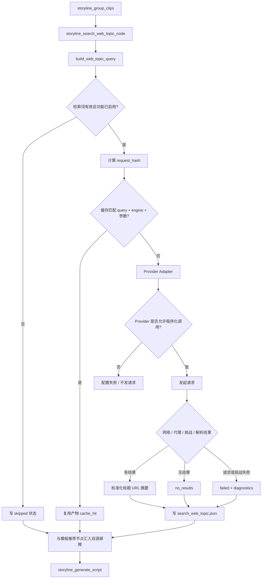

# auto-video-editor 网页话题检索失败分析与 Google 切换计划（审查修订版）

- **审查日期**：2026-11-19
- **仓库**：[`wayyet/auto-video-editor`](https://github.com/wayyet/auto-video-editor)
- **审查分支**：`main`
- **审查基线 HEAD**：`e67376a8cee941f7b6914a76b4438aa383e8e2ab`
- **HEAD 提交时间**：2026-11-18 18:16:26 UTC
- **审查对象**：用户提供的《网页话题检索失败原因分析与 Google 引擎切换计划》
- **文档状态**：已审查、已修订；**未修改仓库代码、未安装依赖、未启动服务、未执行线上检索**
- **总体结论**：问题定位基本成立；原 Google 切换方案不能直接照搬，必须先解决 Google 自动化查询授权问题，并修正缓存、依赖、解析、诊断和 UI 路径设计。

---

## 0. 执行摘要

### 0.1 核心结论

附件对 DuckDuckGo 失败的代码分类和主流程软失败机制判断基本正确：当前能力层发起 DDG HTTP 请求，若响应通过 HTTP 状态检查但没有解析到结果锚点，也没有识别到无结果标记，就返回 `PARSE_ERROR`；节点将失败结果写入检索产物，文案节点在拿不到有效检索材料时按空参考资料继续执行。

但附件提出的“默认切换 Google HTML + 本地 SOCKS5，并直接部署生产”的方案存在一个**P0 级阻断项**：Google 官方政策明确说明，未经 Google 明确许可而向 Google Search 发送自动化查询，属于不允许的自动化流量。SOCKS5 只能改变网络出口和域名解析路径，不能改变请求的自动化性质，也不能替代授权。不得把 SOCKS5 当成绕过 Google 风控或获得访问许可的手段。

因此，本修订版保留“搜索能力层 Provider 可插拔”和“本地 SOCKS5 传输配置”的工程设计，但将 Google HTML 后端设为**授权确认后的条件实施项**。未获得授权之前，不应将 Google HTML 自动抓取配置为生产默认引擎；应接入明确允许机器调用的搜索 API / 供应商，或向 Google 申请适用的正式全网搜索方案。

### 0.2 必须修正的问题

| 优先级 | 问题 | 原附件的不足 | 修订要求 |
|---|---|---|---|
| P0 | Google 自动化查询授权 | 只分析代理和反爬，没有审查 Google 对自动化查询的政策 | 生产实施前增加授权 Gate；没有授权不得启用 Google HTML 自动检索 |
| P0 | 缓存只按 query 匹配 | 只新增 `engine` 字段，没有改变 `_load_reusable_cache()` 的匹配条件 | 增加 `request_hash`，至少包含引擎、检索词、结果数、语言和解析器版本 |
| P1 | Google HTML 解析脆弱 | 仅以 `div.g`、`h3` 和若干 class 字符串为依据 | 使用结构化解析、多个结构回退、URL 归一化和挑战页优先识别 |
| P1 | 代理依赖声明不完整 | 只建议安装 PySocks；没有同步项目元数据 | 在 `requirements.txt` 和 `pyproject.toml` 同步声明 `requests[socks]` |
| P1 | UI 文件路径错误 | 引用了当前 `main` 不存在的 `web/ai_content.html` | 先定位真实的 AI 内容详情页实现；不得对不存在的文件制定行级修改 |
| P1 | 旧产物引擎展示错误 | 建议缺少 `engine` 时默认显示 Google | 旧产物来自 DDG 时不能显示 Google；无引擎信息应显示“历史记录 / 未知” |
| P1 | 调试 HTML 落盘接口不完整 | 未说明能力层如何获得当前任务目录 | 增加显式 `debug_dir` / `debug_path` 参数，并限定大小、内容和访问方式 |
| P2 | 本机环境证据表述过强 | 把有限时间内的挑战结果表述为“长期/永久不可用” | 结论限定为当前出口和已测试时间窗口；不能据此证明永久不可用 |
| P2 | 测试基线数字不可复核 | 写了“全量 unit 基线约 2427” | 执行前本地采集当前分支测试基线，不能把历史数字写成固定验收门槛 |

---

## 1. 审查范围与核对方法

### 1.1 仓库基线

本次以 GitHub `main` 分支在审查时可读取到的 HEAD 为准：

- Commit：[`e67376a8cee941f7b6914a76b4438aa383e8e2ab`](https://github.com/wayyet/auto-video-editor/commit/e67376a8cee941f7b6914a76b4438aa383e8e2ab)
- 能力层：`storyline_capabilities/search_web_topic.py`
- 工作流节点：`nodes/storyline/node_search_web_topic.py`
- 配置：`config.py`、`.env.example`
- 依赖：`requirements.txt`、`pyproject.toml`
- 文案消费端：`nodes/storyline/node_generate_script.py`
- 查询构造：`nodes/storyline/_common.py`
- 图拓扑：`graph.py`
- 测试：`tests/unit/test_storyline_capabilities_search_web_topic.py`、`tests/unit/nodes/test_node_search_web_topic.py`、`tests/integration/test_unreachable_nodes_wiring.py`

> 行号以本次 HEAD 为准。后续 `main` 有新提交时，执行前必须重新核对文件内容和行号。

### 1.2 本次没有验证的事项

以下内容来自附件自身陈述，但无法仅凭 GitHub 已跟踪的源码独立复现：

1. 用户本机 `127.0.0.1:1088` 的 SOCKS5 服务当前是否监听、是否可用，以及代理出口是否能访问 Google。
2. 附件中 `outputs/console-b0b2a64a78c6/storyline/search_web_topic.json` 的本机文件是否与运行目录中的原件完全一致。
3. “全仓 7 次运行全部失败”的统计。当前公开仓库树没有相应的 `outputs/*` 运行产物可供逐个复核。
4. 本机 venv 是否已经安装 PySocks。仓库依赖清单没有声明 SOCKS extra，但这不等于能够远程检查用户电脑当前环境。
5. `web/ai-content` 页面是否存在于用户本地尚未提交的文件或其他分支。本次 `main` 分支没有找到它。

这些内容不能写成“已由本次代码审查实测确认”。

---

## 2. 原附件正确性审查

### 2.1 正确或基本正确的内容

| 原附件观点 | 核查结果 | 代码依据 / 说明 |
|---|---|---|
| `PARSE_ERROR` 表示 HTTP 请求取回了页面，但未解析到结果锚点 | **正确** | `storyline_capabilities/search_web_topic.py` 中 `_ddg_html_search()` 先执行 `requests.get()`、`raise_for_status()`，随后扫描 `class="result__a"`；零结果且无无结果标记时返回 `PARSE_ERROR`。 |
| 当前 DDG 解析依赖固定 HTML 结构 | **正确** | 当前实现是字符串扫描，依赖 `result__a`、`result__snippet` 等固定片段。 |
| 2026-11-10 的真机记录观察到代理出口触发 DDG WAF 挑战 | **有仓库文档支持** | `docs/第三期开发/网页话题检索前置化_阶段7真机验收记录.md` 第 19-20 行记录了代理路径返回 HTTP 202 challenge 页面，以及直连页面没有结果锚点。 |
| 检索失败不会必然中断文案主流程 | **正确** | `nodes/storyline/node_search_web_topic.py` 把能力层结果写入产物并映射状态标签；`nodes/storyline/node_generate_script.py` 在检索产物缺失、无效或读取异常时把 `web_research` 降级为空字符串。 |
| 检索节点与模板推荐节点共同进入文案节点前的双源屏障 | **正确** | `graph.py` 中 `storyline_group_clips` 分别连向 `storyline_script_template_recommendation` 和 `storyline_search_web_topic`，之后以 `[STR, WT]` 汇入 `storyline_generate_script`。 |
| 查询词可由画面概述自动生成，不必要求用户填写手动 query | **正确，但原文描述不完整** | `nodes/storyline/_common.py:470-507` 的 `build_web_topic_query()` 优先加入手动 query，再加入概述首句和最多 3 个分组主题，去重后限制总长度。不是单纯“只取概述首句”。 |
| 当前能力层保留 Provider 分发接口 | **基本正确** | `search_web_topic()` 已有 `provider` 参数，但当前实际只支持 `duckduckgo_html` 和 `stub`；Google 仍未实现。 |
| 600 字单条摘要和 4000 字总上下文限制应保持 | **正确** | 能力层定义 `WEB_TOPIC_SNIPPET_MAX_CHARS=600`、`WEB_TOPIC_TOTAL_CONTEXT_MAX_CHARS=4000`，下游 `_common.py` 继续使用。 |

### 2.2 需要降低结论强度的内容

#### A. “DDG 长期/永久不可用”证据不足

2026-11-10 真机验收记录确实记录了：代理出口被挑战、多个客户端得到相同结果、40 分钟内 8 次探测没有恢复。这足以支持：

> 在当时被测试的本机出口路径和时间窗口内，DDG 自动检索持续受到拦截，无法作为可靠的生产搜索通道。

但不能仅根据 40 分钟的探测结果得出“永久不可用”。代理出口、出口 IP、供应商风控状态和页面策略都可能变化。建议删掉“永久不可用”表述，改成“当前已验证出口下不可用，恢复情况未验证”。

#### B. “直连失败就是 GFW 干扰”不能只凭无结果锚点定性

“页面可取但无锚点”是可以观察的事实；直接把原因归因于 GFW，则需要保留响应内容、DNS 解析结果、TLS/连接证据或其他独立证据。没有这些证据时，应写成：

> 直连获取到的 HTML 页面不包含 DDG 结果锚点；其具体原因尚不能仅凭解析结果确认。

#### C. “7 次真实运行全部失败”尚未独立复核

附件可以记录该统计，但应附带统计脚本、样本列表、采样时间和产物路径。当前仓库 Git tree 中没有对应的 `outputs/*` 运行数据，因此本次只能标注为“附件提供的本机统计，未从公开仓库复核”。

### 2.3 原附件中的明确问题

#### 问题 1：Google 自动化查询存在 P0 合规阻断

Google Search Central 的官方政策将未经明确许可的自动化查询列为不允许的 machine-generated traffic，并明确提到自动化搜索请求会违反 Google 的政策和服务条款。

因此，以下推断不成立：

- “DDG 被拦截，换 Google + SOCKS5 就能稳定恢复检索能力”；
- “只要把请求走代理，就可以把 Google HTML 当成正式生产搜索 API”；
- “Google 返回挑战页时继续尝试不同出口，就能把问题变成正常的工程可用性问题”。

SOCKS5 只能负责网络传输和远端 DNS 解析，不提供自动化查询许可。不能设计验证码自动处理、反爬挑战绕过、代理出口轮换等机制。

Google 官方在 2026-01-20 发布了搜索产品调整说明：Custom Search JSON API 不再适合新接入者作为默认完整网页搜索方案；相关客户需要在 2027-01-01 前完成迁移。Google 对最多 50 个域名的场景介绍了 Vertex AI Search 等方案；若要进行完整网页搜索，需要联系 Google 了解其全网搜索方案。因此不能简单地把旧 Custom Search JSON API 写为“随时可用的官方 API 备选”。

**修订决策：** Google HTML 方案仅作为“获得明确授权后才可启用”的条件实现；授权未落实前，生产环境不切换到 Google HTML。搜索能力层继续保持 Provider 抽象，便于接入明确允许程序化调用的供应商。

#### 问题 2：缓存键没有包含搜索引擎

当前 `nodes/storyline/node_search_web_topic.py` 中：

- `_load_reusable_cache(state, query_hash)` 只比较 `doc["query_hash"]`；
- 缓存有效状态包括 `ok`、`no_results`、`failed`、`cache_hit`；
- `failed` 产物也会复用；
- 当前 `query_hash` 只根据 query 文本计算。

附件计划只新增 `engine` 字段，没有要求 `_load_reusable_cache()` 校验引擎。因此存在以下实际风险：

1. 某任务第一次用 DDG 检索，产生 `status=failed`；
2. 用户把环境变量改成 Google；
3. 同一任务恢复或进入 QA 回路；
4. query 不变，`query_hash` 不变；
5. 节点命中旧 DDG 失败产物，直接 `cache_hit`；
6. Google Provider 根本没有被调用。

这会造成“已经切换 Google，但结果仍然来自旧 DDG 缓存”的假象。

**修订要求：** 保留 `query_hash` 作为检索词审计字段，同时新增 `request_hash`（或 `cache_key`），缓存必须比较它。建议将以下字段参与摘要计算：

- `provider` / `engine`；
- 规范化后的 query；
- `max_results`；
- 语言参数（例如 `hl=zh-CN`）；
- 解析器版本或产物 schema 版本。

不要把代理账号密码明文放入缓存键或日志。若代理出口配置会影响区域化结果，可纳入不含凭据的代理端点指纹。

旧产物没有 `request_hash` 时应视为缓存未命中，而不是猜测其搜索引擎。这样才能保证从 DDG 切换到其他 Provider 时至少执行一次新检索。

#### 问题 3：Google 的 HTML 解析设计过于脆弱

原附件建议：

- 用 `<div class="g">` 作为结果块；
- 在块内找 `<h3>`；
- 摘要依靠一组 class 名回退；
- 支持 Google `/url?q=` 包装跳转。

这只能作为某一份 HTML 样本的解析起点，不能当成稳定契约。页面会因语言、地区、搜索类型、页面实验、验证码及 consent 页面而出现不同结构。HTML 中 class 的顺序、多个 class 的组合、节点嵌套关系都不应通过简单字符串匹配假定。

**修订要求：**

1. 使用 HTML 结构解析器（可用 `html.parser` 或引入 `beautifulsoup4`；不要将嵌套 HTML 当作可靠的纯字符串模板）。
2. 优先检测挑战页、同意页和错误响应，再执行结果解析。
3. 结果链接必须先归一化，再校验 scheme 和 host；只接受合法 `http` / `https` 外链。
4. Google 内部 `/url` 跳转只允许按已识别的参数名提取目标地址；解析后的目标地址仍必须通过 URL 白名单。
5. 标题、摘要统一复用当前 `_clean_web_text()` 和 600/4000 字护栏。
6. 解析器不能识别页面时返回 `PARSE_ERROR`，不能把未知页面当成 `NO_RESULTS`。

#### 问题 4：挑战页识别与错误分类不充分

原附件把 `unusual traffic`、`g-recaptcha`、`consent.google.com` 等字符串映射为 `PARSE_ERROR`。这种分类过于笼统：挑战页不等于普通布局变化，也不等于确实没有搜索结果。

建议能力层增加可观察错误码：

| 错误码 | 含义 | 工作流状态 |
|---|---|---|
| `NO_RESULTS` | 页面明确显示无结果 | `no_results` |
| `NETWORK_ERROR` | DNS、连接、超时等网络错误 | `failed` |
| `HTTP_ERROR` | HTTP 非成功状态，且不是已识别的挑战响应 | `failed` |
| `PROXY_ERROR` | SOCKS 配置错误、代理不可达或 SOCKS 依赖缺失 | `failed` |
| `PROVIDER_BLOCKED` | 识别到验证码、异常流量挑战、拒绝自动访问或强制 consent 页面 | `failed` |
| `PARSE_ERROR` | 页面看似正常，但解析器找不到有效结果结构 | `failed` |
| `UNKNOWN_PROVIDER` | 配置了不存在的 Provider | `failed` |

HTTP 202 本身不是请求异常；`raise_for_status()` 不会因为 202 抛出 HTTP 错误。应检查响应状态、最终 URL 和页面特征。识别到 `PROVIDER_BLOCKED` 后应停止本次检索，不应自动尝试验证码或切换代理出口。

#### 问题 5：PySocks 依赖和项目依赖声明不完整

本次审查确认：

- `requirements.txt` 有 `requests==2.34.2`，但没有 `requests[socks]` 或 PySocks；
- `pyproject.toml` 的生产 `dependencies` 中没有声明 `requests`；
- 能力层把 `requests` 作为可选导入，缺失时只会把检索降级为 `NETWORK_ERROR`。

附件只要求在 venv 执行 `pip install pysocks` 并修改 requirements 文件，没有解决 `pyproject.toml` 依赖元数据和 requirements 的不一致。

**推荐依赖方案：**

- `requirements.txt`：将现有 `requests==2.34.2` 改为 `requests[socks]==2.34.2`；
- `pyproject.toml`：在 `[project].dependencies` 中增加 `requests[socks]>=2.34.2,<3`；
- 安装后执行 `pip check`；
- 在目标 venv 内做真实 SOCKS5 协议连通性测试。

Requests 官方文档说明 SOCKS 支持是可选依赖，推荐使用 `pip install 'requests[socks]'`；`socks5h` 与 `socks5` 的区别是：前者由代理端解析目标域名，后者由客户端本地解析。

#### 问题 6：环境变量读取时机描述不够准确

当前 `config.py` 的 `STORYLINE_ENABLE_WEB_TOPIC` 是模块级变量，导入 `config.py` 时从 `os.environ` 读取。新加的引擎与代理设置建议也采用这一模式。

因此应写成：

> 环境变量必须在服务进程启动前注入；修改后重启相关进程，使模块级配置重新加载。

不要写成“运行时修改环境变量即可立即切换”。进程运行后修改 shell 的环境变量，不会自动改变已导入模块中的 Python 常量。

#### 问题 7：调试文件的落盘路径没有接入设计

附件要求在 `outputs/<task>/storyline/search_web_topic_debug.html` 写入失败时的 HTML，但当前能力层 `search_web_topic()` 不知道本次任务的 `out_dir`。当前节点有 `out_dir = outputs_root / "storyline"`，但调用能力层时没有把这个目录传进去。

必须增加显式接口，例如 `debug_dir: Optional[Path] = None`，由节点传入 `out_dir`。还要明确：

- 默认不落盘原始 HTML；
- 仅在显式诊断开关打开时记录；
- 文件大小上限（例如 64 KiB）；
- 记录为 `.txt` 或 JSON 文本，不让浏览器把不可信响应作为可执行 HTML 展示；
- 不记录代理账号密码、Cookie、Authorization 等敏感信息；
- 采用临时文件 + 原子替换，避免服务中断留下半个文件。

#### 问题 8：UI 修改路径与当前 `main` 不匹配

本次对 `main` 的完整 Git tree 检查结果：

- `web/` 下有 `console.html`、`monitor.html`、`console_service.py`、`api_console.py`、`static/` 等；
- 未找到 `web/ai_content.html`；
- 未找到名称包含 `ai_content` 或 `ai-content` 的文件；
- `web/console_service.py` 当前约 1175 行，附件提到的 1034 行附近属于运行恢复 / 子进程启动流程，并非检索引擎展示接口。

所以原附件第 4.4 节的两个 UI 修改点不能按当前仓库直接实施。它们可能来自用户本机未提交的代码、其他分支或旧版本。执行前必须先确认页面实际所在文件与路由。

另外，旧产物没有 `engine` 字段，且历史搜索 Provider 是 DDG。若 UI 代码使用 `doc.get("engine", "Google")`，就会把旧的 DDG 记录错误地显示为 Google。正确回退逻辑应为：

1. 优先显示产物中的 `engine`；
2. 缺少 `engine` 时，可从首条结果的 `source` 推导；
3. 无结果、无 `source`、无 `engine` 的历史失败产物显示“历史记录 / 未知”，不可默认 Google。

---

## 3. 修订后的目标与边界

### 3.1 目标

1. 保持网页话题检索是可选增强能力，失败不能阻断主视频剪辑工作流。
2. 保持 `storyline_search_web_topic` 与 `storyline_script_template_recommendation` 的并行关系及文案节点前的双源屏障，不修改 LangGraph 拓扑。
3. 将 Provider 选择、代理配置和搜索结果标准化放在能力层 / 配置层，不让节点与 UI 直接耦合具体搜索引擎 HTML。
4. 解决跨引擎缓存误命中。
5. 提高解析失败、代理失败、供应商挑战的可观测性。
6. 只有在取得 Google 许可或正式 API 权限后，才允许启用 Google 搜索后端。

### 3.2 本次不做

- 不改 `build_web_topic_query()` 的查询词拼接策略。
- 不调整 `storyline_search_web_topic` 在 LangGraph 中的位置或双源屏障。
- 不修改文案节点对 `web_research` 的软降级语义。
- 不在本期接入小红书 / 抖音定向检索。
- 不做 Google 验证码识别后的自动处理、反爬规避、代理出口轮换。
- 不把搜索结果正文批量抓取作为本次目标；当前目标仍是标准化的标题、URL、摘要。
- 不在本次审查中直接提交代码或修改 GitHub 仓库。

### 3.3 生产引擎决策 Gate

| 条件 | 允许的动作 |
|---|---|
| 已取得 Google 对自动化网页搜索的明确授权，或具备适用的正式 API 权限 | 可以评估并实现对应的正式 Google Provider；若授权范围明确允许 HTML 查询，才进一步评估 Google HTML 适配器 |
| 没有 Google 自动化查询授权 | 不得将 Google HTML 搜索作为生产默认引擎；选择明确允许程序化调用的第三方搜索 API / 服务 |
| 只想验证本地 SOCKS5 链路 | 可通过普通测试站点验证 SOCKS5 协议和远端 DNS，不需要发送自动化 Google Search 查询 |
| Google 返回验证码 / 异常流量挑战 / 拒绝访问 | 记录 `PROVIDER_BLOCKED`，结束本次搜索；不得自动规避挑战 |

**推荐决策：** Provider 抽象和缓存修复可以先做；Google HTML 生产实现必须等待授权 Gate 通过。若当前目的只是让工作流恢复外部检索，优先选择一款具有明确程序化搜索 API 授权的供应商。

---

## 4. 修订后的整体设计

### 4.1 组件职责

| 组件 | 职责 | 不应承担的职责 |
|---|---|---|
| `config.py` | 读取并校验引擎、SOCKS5 地址、诊断开关 | 解析搜索结果 HTML |
| `nodes/storyline/node_search_web_topic.py` | 构造查询、计算缓存键、调用能力层、写产物、映射状态标签 | 直接请求 Google / DDG URL |
| `storyline_capabilities/search_web_topic.py` | Provider 分发、网络请求、标准化结果、错误分类和可选诊断 | 读取 LangGraph State、拼接任务输出路径 |
| Provider Adapter | 对接一个明确允许程序化调用的搜索服务，输出统一结构 | 改变工作流错误处理语义 |
| `node_generate_script.py` | 将有效检索资料独立注入 `web_research` | 将搜索失败升级为致命错误 |
| UI | 展示产物中实际使用的引擎、状态、来源 | 根据当前环境变量推测历史任务实际使用的引擎 |

### 4.2 建议数据流



> `Provider 是否允许程序化调用` 是发布前的策略约束，不是运行时让模型判断的逻辑。实际部署时应由配置与接入审批控制。

### 4.3 能力层接口建议

保留当前统一入口，并增加必要参数：

```python
def search_web_topic(
    *,
    query: str,
    max_results: int = 10,
    media_dir: Optional[Path] = None,
    provider: str = "duckduckgo_html",
    proxy_url: Optional[str] = None,
    debug_dir: Optional[Path] = None,
    download: bool = False,
) -> dict[str, Any]:
    ...
```

说明：

- `provider` 使用稳定的内部标识，例如 `duckduckgo_html`、`google_html`、`stub` 或其他合规 API Provider。
- `proxy_url` 只作为网络传输配置；不允许把它用于挑战绕过。
- 当 Google Provider 被配置为必须走代理时，代理配置为空或不合法应返回 `PROXY_ERROR`，不能悄悄退回直连。
- `debug_dir` 由节点传入当前任务的 `outputs/<task>/storyline`；能力层不应自行猜测任务目录。
- 对外返回结构统一，Provider 专有数据留在 `diagnostics` 中，不污染下游消费字段。

### 4.4 标准产物契约

建议将现有产物升级为 schema v2，并保留已有字段：

```json
{
  "schema_version": 2,
  "status": "ok",
  "engine": "google",
  "provider": "google_html",
  "query": "实际提交的检索词",
  "query_hash": "sha256(query)",
  "request_hash": "sha256(provider + query + 参数 + parser_version)",
  "search_web_topic": [
    {
      "title": "搜索结果标题",
      "url": "https://example.com/article",
      "snippet": "清洗和截断后的摘要",
      "source": "google_html"
    }
  ],
  "preview_urls": ["https://example.com/article"],
  "error_code": null,
  "message": "",
  "searched_at": "2026-11-19T00:00:00+00:00",
  "diagnostics": {
    "http_status": 200,
    "final_host": "www.google.com",
    "proxy_enabled": true,
    "parser_version": "google_html_v1"
  }
}
```

字段约束：

- `query_hash` 继续只表示 query，保持审计兼容；
- `request_hash` 表示“这次请求的完整语义”，用于缓存命中；
- `engine` 是 UI 展示字段，记录任务实际使用的引擎；
- `provider` 是代码中的适配器标识，不必等同于 UI 文案；
- `diagnostics` 不得写入代理认证信息、Cookie、Authorization 或完整代理 URL；
- `search_web_topic` 每条结果必须包含有效 `http` / `https` URL；
- 保持单条摘要最多 600 字、累计摘要最多 4000 字。

### 4.5 缓存策略修订

当前缓存只比较 query hash，需要改成：

```text
request_hash = SHA256(
    provider
    + normalized_query
    + max_results
    + locale
    + parser_version
    + artifact_schema_version
)
```

缓存行为：

| 场景 | 预期行为 |
|---|---|
| 同一任务、同一 query、同一引擎和参数，QA 回路重复执行 | `cache_hit`，不重复请求互联网 |
| 同一 query 从 DDG 切换为 Google / 其他 Provider | `request_hash` 不同，必须重新检索 |
| query 发生变化 | 缓存未命中，重新检索 |
| 旧产物没有 `request_hash` | 视为旧格式缓存，不得跨引擎复用 |
| 当前 Provider 返回 `failed`，QA 回路中 query 与参数未变 | 可以复用失败产物，避免每轮 QA 重复外呼 |
| 用户显式要求重新检索 | 使用显式 `force_refresh` 或新任务 / 新检索尝试标识绕过缓存 |

不要删除原有的“同一次 QA 回路不重复发网请求”不变式；只修复缓存键缺少 Provider 的问题。

---

## 5. Google + SOCKS5 条件实施设计

> 本节只在第 3.3 节授权 Gate 通过后实施。没有授权时，不得把 Google HTML 自动抓取投入生产。

### 5.1 配置项

建议新增：

```dotenv
# 只有在具备适用授权后，才能把引擎设置为 google_html。
# 未完成授权时保留当前引擎，或设置为已获准的 API Provider。
STORYLINE_WEB_TOPIC_ENGINE=duckduckgo_html

# Google HTML 经批准启用时，要求使用本机 SOCKS5 代理。
# socks5h 表示目标域名由代理端解析。
STORYLINE_WEB_TOPIC_SOCKS5_PROXY=socks5h://127.0.0.1:1088

# 调试响应默认关闭。
STORYLINE_WEB_TOPIC_DEBUG=0
```

配置要求：

1. 引擎只允许白名单值，未知值在配置校验阶段报告，不要默默退回其他引擎。
2. 若 `provider=google_html` 且策略要求代理，代理必须非空且 scheme 为 `socks5h`；否则返回 `PROXY_ERROR`。
3. 服务必须在目标代理运行的同一网络命名空间内访问 `127.0.0.1:1088`。若应用运行在 Docker 容器中，容器内 `127.0.0.1` 指向容器本身，不等于宿主机；需按真实部署网络配置代理地址。
4. 不要因代理失败而自动回退直连；直连回退会违背“必须走代理”的配置含义。
5. 配置由进程启动时读取；修改后重启实际运行工作流的进程。

### 5.2 依赖修订

`requirements.txt` 当前有：

```text
requests==2.34.2
```

建议改为：

```text
requests[socks]==2.34.2
```

`pyproject.toml` 的 `[project].dependencies` 增加：

```toml
"requests[socks]>=2.34.2,<3",
```

原因：

- Requests 官方把 SOCKS 支持作为可选 extra；
- extra 会安装所需的 PySocks 依赖；
- 现有 `pyproject.toml` 没声明 `requests`，而能力层实际使用 `requests`，需要同步修正项目安装元数据；
- requirements 与 pyproject 两处保持一致，避免生产使用不同安装入口时行为不同。

安装/验证命令（Windows PowerShell）：

```powershell
.\.venv\Scripts\python.exe -m pip install -r requirements.txt
.\.venv\Scripts\python.exe -m pip check
.\.venv\Scripts\python.exe -c "import requests, socks; print(requests.__version__); print(socks.__file__)"
```

### 5.3 SOCKS5 请求约束

实际请求必须显式传入两个 scheme 的代理映射：

```python
proxies = {
    "http": proxy_url,
    "https": proxy_url,
}
```

并满足：

- `proxy_url` 示例为 `socks5h://127.0.0.1:1088`；
- 连接超时和读取超时分开设置，例如 `timeout=(5, 15)`；
- 不在日志中输出含认证信息的完整代理 URL；
- 代理失败映射到 `PROXY_ERROR` 或 `NETWORK_ERROR`；
- 不做“代理失败后直连”自动降级；
- 不做 IP 轮换、验证码自动化或其他挑战绕过。

本地 SOCKS 端口测试可以先使用普通测试站点验证传输，不要把“TCP 端口可连接”误当成 SOCKS 协议可用：

```powershell
.\.venv\Scripts\python.exe -c "import requests; s=requests.Session(); p={'http':'socks5h://127.0.0.1:1088','https':'socks5h://127.0.0.1:1088'}; r=s.get('https://example.com/',proxies=p,timeout=(5,15)); print(r.status_code, r.url)"
```

此命令只用于验证 SOCKS5 转发和远端 DNS 路径，不代表已获得 Google Search 自动化查询许可。

### 5.4 Provider 请求与解析

在授权范围允许采用 Google HTML 的前提下：

1. 使用 `requests` 的 `params` 参数传递 query、`num`、`hl`，不要自行拼接 URL 字符串。
2. 记录 HTTP 状态码和最终 URL 的 host；不得记录 Cookie 或认证信息。
3. 页面识别顺序必须是：状态码与最终 URL 检查 → 挑战/拒绝页面识别 → 明确无结果识别 → 正常结果解析。
4. 对结果容器、标题、摘要采用结构化 HTML 解析与有限回退；不要只依赖一个 class 名。
5. 解析 Google 包装跳转链接时，先识别内部跳转路径，再提取 `q` / `url` 等受支持参数；得到外链后必须重新校验 `http` / `https` scheme。
6. 过滤空标题、空 URL、重复 URL、Google 内部导航地址和非 HTTP(S) 地址。
7. 统一使用 `_clean_web_text()`，保留 600 / 4000 字护栏。
8. 不识别或不支持的页面必须返回 `PARSE_ERROR`；明确挑战页面返回 `PROVIDER_BLOCKED`；不能把两者混为 `NO_RESULTS`。
9. 遇到 `PROVIDER_BLOCKED` 后本轮结束，不做自动反复请求。

### 5.5 诊断文件

建议默认只在产物 JSON 的 `diagnostics` 字段记录：

- `http_status`；
- `final_host`；
- `proxy_enabled`；
- `error_code`；
- `parser_version`；
- `response_content_type`；
- 响应体字节数。

只有 `STORYLINE_WEB_TOPIC_DEBUG=1` 时，才额外保存受限的响应片段：

```text
outputs/<task_id>/storyline/search_web_topic_debug.txt
```

要求：最多 64 KiB；不包含请求认证信息；文件按普通文本处理；不要将原始 HTML 作为可执行 HTML 页面暴露给 Web 静态文件服务；写入失败不能覆盖原始搜索错误，也不能让主工作流中断。

---

## 6. 工作流节点与 UI 修改计划

### 6.1 节点修改

文件：`nodes/storyline/node_search_web_topic.py`

修改内容：

1. 从 `config.STORYLINE_WEB_TOPIC_ENGINE` 读取 Provider；
2. 从 `config.STORYLINE_WEB_TOPIC_SOCKS5_PROXY` 读取代理；
3. 生成 `request_hash`，并使用它进行缓存判断；
4. 调用能力层时传 `provider`、`proxy_url` 和任务级 `debug_dir`；
5. 把能力层返回的 `engine` / `provider` 写入 `search_web_topic.json`；
6. 新增错误码映射：`PROXY_ERROR`、`HTTP_ERROR`、`PROVIDER_BLOCKED` 都映射为固定 `storyline_search_web_topic_failed` 状态标签；
7. 继续保留 `NO_RESULTS` 软状态与失败时的 `error_log` 记录；
8. 保持当前节点“每轮必跑、内部跳过”的行为，不改变 LangGraph fan-in 拓扑。

注意：当前节点若在 `cap_topic()` 抛出异常，会走外层异常分支并记录 `error_log`，但该分支不写正常的检索产物。能力层应尽可能把网络、HTTP、代理、解析异常标准化为带 `status=failed` 的结果对象；节点外层异常捕获仍保留，作为最后一道保护。

### 6.2 文案节点和查询构造

本次不需要修改：

- `nodes/storyline/_common.py:470-507` 的 `build_web_topic_query()`；
- `nodes/storyline/node_generate_script.py:48-58` 的 `web_research` 软降级；
- `graph.py` 中 `[storyline_script_template_recommendation, storyline_search_web_topic]` 双源屏障。

验收时必须确认：搜索成功时标题、URL、摘要进入文案 prompt 的独立 `web_research`；搜索失败或无结果时，文案仍可继续生成，不能把 `overall` 改写为空，也不能让搜索结果并入错误的字段。

### 6.3 UI 修改前置检查

当前 `main` 分支没有 `web/ai_content.html`，也没有在 `web/` 文件树中发现 `ai_content` / `ai-content` 文件。因此 UI 阶段必须先执行：

```powershell
git grep -n -i -E "ai-content|ai_content|search_web_topic|检索自 DuckDuckGo" -- web
```

若本地确实存在 AI 内容明细页，但该页不在本次 `main`：

1. 确认该文件属于哪个分支 / 哪个未提交变更；
2. 确认 `/ai-content` 路由由哪个 FastAPI router 或静态页面提供；
3. 以真实页面文件和真实 API 响应为依据制定 UI patch；
4. 不要把 UI 逻辑硬塞进 `web/console_service.py` 的任务启动或恢复代码。

找到真实页面后，展示字段建议：

- 实际引擎（读取产物 `engine`）；
- 状态（`ok` / `no_results` / `failed` / `cache_hit`）；
- 失败原因（友好提示，不展示原始堆栈）；
- 来源标题、URL、摘要；
- 搜索时间。

历史产物缺少 `engine` 时，不得默认显示 Google；应显示“历史记录 / 未知引擎”。

---

## 7. 分阶段执行计划

### P0：实施前置核验与合规 Gate

| 任务 | 修改 / 检查范围 | 验收标准 |
|---|---|---|
| P0-01 固定代码基线 | `main`、本地工作区 | 记录 `git rev-parse HEAD`、`git status --short`；确认本地代码与审查基线差异 |
| P0-02 Google 访问授权核查 | 搜索产品 / 服务条款 | 明确是否有 Google 对自动化检索的授权或可用正式 API 权限；无授权则阻止 Google HTML 生产上线 |
| P0-03 搜索 Provider 选型 | Provider 合同 / API 文档 | 若 Google HTML 不可用，确认一个明确允许程序化调用的 API Provider，并记录 key、额度、限速、服务条款和数据使用约束 |
| P0-04 本机 SOCKS5 核验 | `127.0.0.1:1088` | 用普通测试站点确认 SOCKS5 握手、远端 DNS 和 HTTPS 请求成功；不以 `Test-NetConnection` 单独作为验收 |
| P0-05 当前测试基线 | pytest | 保存当前分支的 unit / integration 通过数和失败列表；不预设“约 2427”一定是当前基线 |
| P0-06 UI 源文件核验 | `web/` 与路由 | 找到实际 AI 内容明细页面；如果 `main` 不包含该页面，将 UI 工作列为依赖缺失，不猜路径 |

**P0 Gate 结果：** 未获得 Google 自动化查询授权时，停止 Google HTML 生产实现；继续执行 Provider 接口、依赖、缓存和软失败机制的通用修复。

### P1：能力层与 Provider 适配器

| 任务 | 主要文件 | 实施内容 | 验收标准 |
|---|---|---|---|
| P1-01 统一 Provider 契约 | `storyline_capabilities/search_web_topic.py` | 明确 `provider`、代理参数、统一结果结构、标准错误码 | DDG / stub / 新 Provider 返回相同字段结构 |
| P1-02 SOCKS 依赖声明 | `requirements.txt`、`pyproject.toml` | 引入 `requests[socks]`，同步两个依赖入口 | 新 venv 安装后 `import requests, socks` 成功；`pip check` 无依赖冲突 |
| P1-03 新 Provider 实现 | `storyline_capabilities/search_web_topic.py` 或独立 adapter 文件 | 仅实现 P0 Gate 已批准的 Provider；如为 Google HTML，必须在授权范围内实施 | 固定 HTML fixture 覆盖正常结果、重定向、无结果、挑战页、解析失败 |
| P1-04 URL 归一化和安全检查 | Provider adapter | 只允许 HTTP(S)，过滤内部导航、非外链、重复 URL | `javascript:`、`data:`、内部搜索页和畸形 URL 均被丢弃 |
| P1-05 错误诊断 | Provider adapter | 区分网络、HTTP、代理、挑战、解析、无结果 | 错误码稳定；异常不向主工作流抛出致命错误 |
| P1-06 诊断文件能力 | Provider adapter | 显式 `debug_dir`，受限文本落盘 | 默认不写；启用后不超过 64 KiB；不泄露认证信息 |

### P2：配置、节点、缓存和工作流集成

| 任务 | 主要文件 | 实施内容 | 验收标准 |
|---|---|---|---|
| P2-01 配置项 | `config.py`、`.env.example` | 添加 engine、SOCKS5 proxy、debug 开关与白名单校验 | 启动前注入生效；非法 engine / 代理格式能明确报错 |
| P2-02 缓存键升级 | `nodes/storyline/node_search_web_topic.py` | 增加 `request_hash`，保留 `query_hash` | 同 query 换 Provider 必须 cache miss；同 Provider 同参数才能 cache hit |
| P2-03 节点透传 | `nodes/storyline/node_search_web_topic.py` | 把 Provider、proxy、debug_dir 传给能力层 | 单测明确断言 engine / proxy 参数 |
| P2-04 状态兼容 | `nodes/storyline/node_search_web_topic.py` | 新错误码映射到既有软失败标签 | `NO_RESULTS` 不进 error_log；Provider / proxy / parse 错误进入 error_log |
| P2-05 软失败回归 | `graph.py`、`node_generate_script.py`、集成测试 | 不改双源屏障和 `web_research` 降级行为 | 检索失败、代理不可达、无结果均不阻断文案节点 |
| P2-06 老产物兼容 | 缓存层、UI 数据契约 | 老产物无 `request_hash` 时不跨 Provider 复用；无 `engine` 时不伪造引擎 | 老任务可展示；不会将旧 DDG 记录显示为 Google |

### P3：UI 与真机验收

| 任务 | 前置条件 | 实施内容 | 验收标准 |
|---|---|---|---|
| P3-01 UI 路径确认 | P0-06 已找到真实页面 | 修复实际检索引擎展示字段 | 页面展示值与任务产物 `engine` 一致 |
| P3-02 失败态展示 | UI API 契约已确认 | 展示失败原因、时间和调试文件是否存在 | `PROVIDER_BLOCKED` 不显示成“无搜索结果” |
| P3-03 单次外部探测 | Google 授权 Gate 已通过，或选用获准 API | 经代理进行低频单次探测，不做挑战绕过 | 返回成功结果、明确无结果或准确失败分类 |
| P3-04 端到端任务 | 服务重启完成 | 新建任务并观察检索产物和文案输入 | 产物字段正确；来源能追溯；主流程不被搜索失败阻断 |
| P3-05 发布与回滚 | 全部测试通过 | 更新 `.env`，重启服务，记录部署信息 | 可以通过配置切回旧 Provider / 获准的备用 Provider |

---

## 8. 测试与验收标准

### 8.1 能力层单元测试

目标文件：`tests/unit/test_storyline_capabilities_search_web_topic.py`

新增或扩展以下测试：

| 测试 | 预期结果 |
|---|---|
| 正常结果页 fixture | 解析出标题、HTTP(S) URL、摘要、source |
| 结果链接为 Google 内部 `/url` 包装 | 按支持的参数提取真实目标 URL，再执行 scheme 白名单校验 |
| 直连外链与包装外链混合 | 两类都能正确归一化 |
| URL 含 `&amp;` / URL 编码 | 还原 query 参数，不破坏 URL |
| 非 HTTP(S) URL | 丢弃 |
| 重复 URL | 去重 |
| 明确无结果标记 | `NO_RESULTS`、`status=no_results` |
| HTTP 202 + 挑战页特征 | `PROVIDER_BLOCKED`，不得当作正常页面继续反复请求 |
| HTTP 403 / 429 / 503 | 按响应类型映射 `HTTP_ERROR` 或 `PROVIDER_BLOCKED` |
| 页面 200 但结构未知 | `PARSE_ERROR` |
| 请求超时 / DNS / 连接错误 | `NETWORK_ERROR` |
| SOCKS 依赖缺失或 SOCKS 初始化失败 | `PROXY_ERROR` / `NETWORK_ERROR`，不得触发直连回退 |
| proxy 参数 | `http` 和 `https` 两种 scheme 都传入同一个 SOCKS5H endpoint |
| 空代理但引擎要求代理 | `PROXY_ERROR`，不发请求 |
| 摘要长度 | 单条不超过 600 字，累计不超过 4000 字 |
| debug 关闭 | 不生成 debug 文件 |
| debug 开启 | 输出上限 64 KiB 文本，落盘失败不改变工作流最终状态 |

当前测试桩 `_FakeRequests.get()` 只定义 `url`、`params`、`headers`、`timeout` 参数。若真实代码增加 `proxies`，必须同步扩展 Fake；若改用 `requests.Session`，则 Fake 也要提供 Session 接口和 `trust_env` 属性。

### 8.2 节点单元测试

目标文件：`tests/unit/nodes/test_node_search_web_topic.py`

必须覆盖：

1. `STORYLINE_WEB_TOPIC_ENGINE` 配置值正确传给能力层；
2. `STORYLINE_WEB_TOPIC_SOCKS5_PROXY` 配置值正确传给能力层；
3. 环境配置覆盖后，节点读取到预期设置（测试模块级配置时用 `monkeypatch.setattr` 或 reload `config`，不要误以为运行中修改 `os.environ` 会自动刷新模块常量）；
4. 同 query 从 `duckduckgo_html` 改为 `google_html` / 其他 Provider，`request_hash` 不同，必须重新调用 Provider；
5. 同 Provider、同 query、同参数，在 QA 回路中复用 `cache_hit`；
6. `failed` 产物仍能按当前 request hash 复用，避免 QA 回路重复外呼；
7. 显式 `force_refresh` 能重新发起检索；
8. 旧产物没有 `request_hash` 时不复用；
9. 新增错误码均映射到正确的状态标签；
10. 节点异常不会改变主图的软失败语义。

原有断言 `captured["provider"] == "duckduckgo_html"` 必须改为基于配置的断言，避免引擎变更后单测仍锁定旧值。

### 8.3 集成测试

目标文件：`tests/integration/test_unreachable_nodes_wiring.py`

- 验证检索节点依然在每轮 `storyline_group_clips` 后触发；
- 验证文案节点仍等待模板推荐和检索节点两路到齐；
- 验证检索失败 / 代理不可达 / Provider 被阻断时，`storyline_generate_script` 仍可执行；
- 验证成功时 `web_research` 包含标题、URL、摘要；
- 验证失败时 `web_research=""`，`overall` 不被检索错误覆盖；
- 更新测试桩签名以兼容新的 `provider`、`proxy_url`、`debug_dir` 参数；
- 所有无网络单测都必须使用 Fake，不允许在普通单测中真实访问 Google 或其他搜索服务。

### 8.4 本地执行命令

先记录当前基线：

```powershell
.\.venv\Scripts\python.exe -m pytest --collect-only -q
.\.venv\Scripts\python.exe -m pytest tests/unit/test_storyline_capabilities_search_web_topic.py tests/unit/nodes/test_node_search_web_topic.py -q
.\.venv\Scripts\python.exe -m pytest tests/integration/test_unreachable_nodes_wiring.py -q
```

代码完成后重复上述命令，再跑全量：

```powershell
.\.venv\Scripts\python.exe -m pytest -q
```

验收口径：

- 两个目标单测文件全部通过；
- 相关 integration 文件全部通过；
- 全量测试相对修改前基线没有新增失败；
- 不能只用“pytest 退出码为 0”替代对测试数量和跳过项的记录；
- 外部探测必须单独记录，不能混入普通单元测试。

### 8.5 真机 E2E 验收

在授权 Gate 通过且部署配置已更新后：

1. 确认本机 SOCKS5 端口真实可用；
2. 使用应用实际 venv 验证 `requests[socks]` 可导入；
3. 对获准的 Provider 发起一次受控探测；
4. 新建一个 auto 创建台任务；
5. 检查 `outputs/<task_id>/storyline/search_web_topic.json`；
6. 成功时：`status=ok`、`search_web_topic` 有条目、每条 URL 有效、`engine` / `provider` 正确；
7. 无结果时：`status=no_results`，不进 `error_log`，文案继续执行；
8. 网络 / 代理 / Provider 挑战时：`status=failed`、`error_code` 准确，文案继续执行；
9. `/ai-content` 或实际详情页应读取任务产物中的引擎名称，不得写死 Google；
10. 检查 `console_run.log` 和 `error_log`，确认没有代理凭据、Cookie 或认证头泄露。

---

## 9. 回滚策略

### 9.1 配置回滚

- 有授权的 Google HTML 后端出现不稳定时，切换到已获准的备用 Provider；
- 没有可用的备用 Provider 时，可把 `STORYLINE_ENABLE_WEB_TOPIC=0` 关闭检索增强，主流程继续工作；
- 如需回到旧 DDG 实现，设置 `STORYLINE_WEB_TOPIC_ENGINE=duckduckgo_html`，但必须明确：根据附件的本机验收记录，旧 DDG 出口路径当时不可用，因此“回滚到 DDG”只是代码回滚，不代表检索功能恢复；
- 所有环境变量修改后重启实际运行工作流的进程。

### 9.2 代码回滚

- 保留原 DDG adapter 和相应单测；
- 新 Provider 独立实现，避免把 DDG 逻辑整体重写；
- 新增 artifact 字段采用 additive 方式，保留 `query_hash`、`searched_at`、`search_web_topic`、`preview_urls`、`status` 等现有字段；
- 回滚时不删除已经写入的历史产物；老产物无 `request_hash` / `engine` 时按旧 schema 兼容读取，但不允许跨引擎缓存复用。

---

## 10. 最终审查意见

### 10.1 对原附件的总体评价

| 维度 | 评价 |
|---|---|
| 现象与错误码解释 | 基本正确 |
| DDG 本机失败证据 | 有 2026-11-10 真机验收文档支撑，但只说明当时测试的出口和时间窗口 |
| 主流程软失败机制 | 正确，代码和集成测试支持 |
| 查询词来源 | 基本正确，但遗漏了手动 query 优先和最多 3 个分组主题 |
| Google 自动化检索方案 | 存在 P0 授权问题，不能直接作为生产方案 |
| SOCKS5 技术方案 | 基本可行，但依赖声明、进程配置时机和代理强制约束需补全 |
| Google HTML 解析 | 设计过于依赖页面 class，需增强结构识别和挑战页分类 |
| 缓存设计 | 有严重遗漏，切换 Provider 后可能误命中旧失败缓存 |
| 诊断文件设计 | 缺少从节点向能力层传递 task 输出目录的接口，并需增加安全约束 |
| UI 修改 | 当前 `main` 分支路径不成立，需要重新定位真实页面 |
| 测试计划 | 覆盖方向正确，但需要补充跨 Provider 缓存、挑战页、代理依赖和 UI 老产物兼容测试 |

### 10.2 推荐实施顺序

1. 先完成 P0：Google 自动化查询授权、代理 1088 本地连通性、当前代码和测试基线、UI 源文件定位。
2. 先完成 Provider 统一契约、`requests[socks]` 依赖声明和 `request_hash` 缓存修复。这些改动不依赖 Google HTML 授权，也不会破坏现有软失败链路。
3. 只有授权 Gate 通过后，才开发 Google HTML Provider；否则接入一个明确授权程序化调用的 Search API。
4. 最后更新真实 UI 页面，并进行完整 E2E 和回滚验收。

**最终结论：** 原附件可以作为问题背景和 DDG 失败证据记录，但不能作为可直接执行的最终实施计划。最重要的修订是：**Google HTML 自动检索必须先过授权 Gate；缓存必须加入 Provider 维度；依赖、调试接口和 UI 路径必须按当前 `main` 实际代码修正。**

---

## 11. 参考资料

### 11.1 仓库代码（本次审查基线）

- [main HEAD commit](https://github.com/wayyet/auto-video-editor/commit/e67376a8cee941f7b6914a76b4438aa383e8e2ab)
- [搜索能力层](https://github.com/wayyet/auto-video-editor/blob/e67376a8cee941f7b6914a76b4438aa383e8e2ab/storyline_capabilities/search_web_topic.py)
- [检索节点](https://github.com/wayyet/auto-video-editor/blob/e67376a8cee941f7b6914a76b4438aa383e8e2ab/nodes/storyline/node_search_web_topic.py)
- [查询构造与外部资料格式化](https://github.com/wayyet/auto-video-editor/blob/e67376a8cee941f7b6914a76b4438aa383e8e2ab/nodes/storyline/_common.py)
- [配置](https://github.com/wayyet/auto-video-editor/blob/e67376a8cee941f7b6914a76b4438aa383e8e2ab/config.py)
- [依赖文件](https://github.com/wayyet/auto-video-editor/blob/e67376a8cee941f7b6914a76b4438aa383e8e2ab/requirements.txt)
- [项目依赖元数据](https://github.com/wayyet/auto-video-editor/blob/e67376a8cee941f7b6914a76b4438aa383e8e2ab/pyproject.toml)
- [能力层单测](https://github.com/wayyet/auto-video-editor/blob/e67376a8cee941f7b6914a76b4438aa383e8e2ab/tests/unit/test_storyline_capabilities_search_web_topic.py)
- [节点单测](https://github.com/wayyet/auto-video-editor/blob/e67376a8cee941f7b6914a76b4438aa383e8e2ab/tests/unit/nodes/test_node_search_web_topic.py)
- [DDG 真机验收记录](https://github.com/wayyet/auto-video-editor/blob/e67376a8cee941f7b6914a76b4438aa383e8e2ab/docs/第三期开发/网页话题检索前置化_阶段7真机验收记录.md)

### 11.2 官方外部资料

- [Google Search Central：Spam Policies — Machine-generated traffic](https://developers.google.com/search/docs/essentials/spam-policies)：关于未经许可的自动化 Google Search 查询。
- [Google Programmable Search Engine：2026-01-20 搜索产品调整公告](https://programmablesearchengine.googleblog.com/2026/01/updates-to-our-web-search-products.html)：关于 Search Element、Vertex AI Search、完整网页搜索和 2027-01-01 迁移时间。
- [Google Custom Search JSON API Overview](https://developers.google.com/custom-search/v1/overview)：官方说明该 API 不再接受新客户，以及既有客户的迁移安排。
- [Requests Advanced Usage — SOCKS](https://docs.python-requests.org/en/latest/user/advanced/#socks)：Requests SOCKS 可选依赖及 `socks5` / `socks5h` 的区别。


---

## 12. 执行记录(2026-11-19 本会话实施)

> 按本文档 P0→P1→P2→P3 顺序执行;Gate 决策与环境阻塞如实记录。

### 12.1 P0 核验结果

| 项 | 结果 |
|---|---|
| P0-01 基线 | 本地 HEAD=`0f7c649`(含 AI 内容明细 5 提交;审查基线 e67376a 为远端树);工作区另有并行会话半成品(user_directives 计划,与本改动集不重叠) |
| P0-02 授权 Gate | **用户拍板:自担政策风险,仍实现 Google HTML 作为生产默认引擎**;约束遵守:检测到挑战页即 `PROVIDER_BLOCKED` 停止,不做验证码处理/出口轮换等任何规避 |
| P0-03 Provider | `google_html`(按 P0-02 决策) |
| P0-04 SOCKS5 | 1088 TCP 探测当时 OK;约 15 分钟后协议级测试发现 **1088 已不监听**(代理客户端状态变化)。3067 实测为混合端口(SOCKS5 握手 `05 00` 应答)但中继被本地软件掐断(10053),HTTP CONNECT 当前也复位(10054)→ **代理出口整体不可用,协议级验证顺延** |
| P0-05 测试基线 | 全量 3 个存量失败(sequential/reorder/auto_e2e,与 20261113 基线漂移记录逐字一致);目标两文件 23 例 + 集成 wiring 45 例全过 |
| P0-06 UI 源文件 | **`web/ai_content.html` 在本地存在**(0224c7e→0f7c649 已入本地 main),审查文档基于远端 e67376a 的"不存在"结论对本地代码过时;UI 改动按真实文件执行 |

### 12.2 代码落地(P1/P2/P3 全部完成)

| 文件 | 改动 |
|---|---|
| `storyline_capabilities/search_web_topic.py` | provider 分发(`duckduckgo_html` 存量保留/`google_html` 新增/`stub`);`_GoogleResultParser`(html.parser 结构化解析:h3-in-a 标题 + 摘要 class 有限回退);`_normalize_google_result_url`(`/url?q=` 还原、scheme 白名单、Google 导航过滤、去重);google_html **强制 socks5h://**(缺失/错 scheme → `PROXY_ERROR` 不发请求不回退直连);七错误码;`diagnostics`;`_write_debug_dump`(默认关、≤64KiB、.txt、原子替换、失败静默);`build_request_hash`(provider+query+max_results+locale+parser_version+schema v2);产物 schema v2(全 additive)。实施期自纠 2 bug:google 路径漏 `raise_for_status()`(503 误判 PARSE_ERROR)、hash 编码名笔误 |
| `nodes/storyline/node_search_web_topic.py` | config 三项透传(engine/proxy_url/debug_dir);节点为 request_hash 权威写入位(`result.setdefault`);缓存比较升级为 request_hash(**老产物无 request_hash 一律未命中**,P2-06);`web_topic_force_refresh` 显式绕过;新错误码→failed 标签映射(P2-04) |
| `config.py` | `STORYLINE_WEB_TOPIC_ENGINE`(默认 `google_html`,白名单外**导入期报错**)/`STORYLINE_WEB_TOPIC_SOCKS5_PROXY`(默认 `socks5h://127.0.0.1:1088`)/`STORYLINE_WEB_TOPIC_DEBUG`(默认 0);均为进程启动时读取,改后须重启 |
| `.env.example` / `requirements.txt` / `pyproject.toml` | 三键样例;`requests[socks]==2.34.2`;`[project].dependencies` 补 `"requests[socks]>=2.34.2,<3"`(P1-02 两处一致) |
| `web/console_service.py` | `_web_topic_engine_label`:产物 engine → provider/条目 source 关键词 → **"未知引擎(历史记录)"**;老 DDG 失败产物不显示 Google(§6.3);section 全 return 路径带 engine |
| `web/ai_content.html` + `web/static/ai_content.mjs` | "检索自 DuckDuckGo" 硬编码改跟随 engine,兜底"未知引擎" |

依赖安装:`PySocks!=1.5.7,>=1.5.6` 经清华镜像入 venv(PyPI 直连被重置);`import requests, socks` 验证通过;`pip check` 报 2 条存量冲突(scenedetect 缺 opencv/platformdirs、langchain↔langgraph 版本),与本次无关。

### 12.3 测试与验收

- 能力层 + 节点层目标文件:**48 例全过**(Google 用例矩阵 §8.1 17 例 + 节点新用例 §8.2 5 例:配置断言/跨引擎缓存 miss/老产物 miss/force_refresh/新错误码映射);
- 集成 wiring:**45 例全过**(P2-05:软失败语义/双源屏障/next_nodes 全保持,拓扑零改动);
- 前端 pytest 包装(含 ai_content js 单测):全过;
- config 冒烟:engine=google_html / proxy=socks5h://127.0.0.1:1088 / debug=False;
- 全量对照:4 个失败 = 3 个存量(sequential/reorder/auto_e2e,与 20261113 基线漂移记录逐字一致)+ 1 个`test_prompt_loader_semantics.py::test_golden_manifest_shape`(golden 清单 file_count 断言,**归属并行会话**——其正在改 generate_script system.md 并重录 golden 46→50,本改动集不涉任何 prompt/golden 文件);本改动集零新增失败。

### 12.4 遗留(环境阻塞,待操作员)

1. **代理客户端恢复后补测**:P0-04 协议级验证(venv 经 socks5h://127.0.0.1:1088 打测试站)+ P3-03 单次受控探测 + P3-04 真机 E2E(重启服务 → 新建任务 → `search_web_topic.json` 应 `status=ok` 且条目/引擎为 Google → `/ai-content` 01 区块绿色);
2. **服务重启**:新代码与默认 env 生效须管理员 pwsh7 重启(restart-video-editor 技能);
3. 二期:小红书/抖音 `site:` 定向(§6)。
