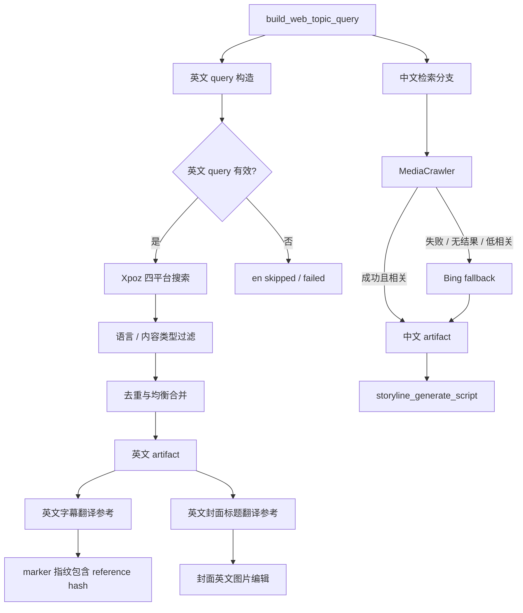

# 网页话题检索双线中英分离——设计审查与修订执行计划

> 文档类型：设计审查 / 修订执行计划  
> 审查日期：2026-11-20  
> 仓库：`wayyet/auto-video-editor`  
> 分支：`main`  
> 审查基线：`28cfe1852e952a25fdafea767234e944a3089070`  
> 被审查文档：`docs/第八期开发/网页话题检索双线中英分离-分析与计划-20261119.md`  
> 被审查文档 Blob：`160ffb2c30306b205a55115a9fc0cc2e50543397`

---

## 0. 审查结论

**结论：方案方向可行，但当前版本不建议直接按原文执行。**

原方案正确识别了项目已有的检索能力层、MediaCrawler 子进程适配器、Xpoz 工具接口、翻译客户端及下游消费节点。把中文检索和英文检索拆成两个独立产物，也符合现有 `storyline/search_web_topic.json` 的产物组织方式。

但原文存在若干会导致实施结果与预期不一致的问题：

1. **MediaCrawler 的许可边界没有作为上线前置门禁。**其许可证限定非商业学习/研究用途，不能只因代码不入库、每次抓取数量少，就推导出可用于商业产品或商业化服务。
2. **Xpoz 超时配置无法按原文生效。**`langchain-xpoz==0.3.0` 的工具工厂创建 `XpozClient` 时没有传入超时参数；`xpoz==0.10.1` 默认操作超时为 300 秒，底层 HTTPX 读取超时又是 `None`。原文配置的 120 秒“四平台总超时”并未真正接入。
3. **英文检索词翻译输入字段写错。**原文使用 `{"text": zh_query}`，而项目 `TranslateClient` 只读取 `text_zh`，可能得到空英文检索词。
4. **字幕翻译缓存没有考虑英文参考资料变化。**只把参考资料注入 prompt、却不更新翻译 marker 指纹，会导致旧字幕翻译被复用，新检索资料根本没有参与翻译。
5. **英文资料的语言约束不完整。**Twitter 工具支持 `language="en"`，原方案未传；其余平台没有统一语言过滤策略。英文检索词不等于返回内容必然是英文。
6. **Xpoz 缓存键没有纳入平台配置。**切换 `STORYLINE_WEB_TOPIC_XPOZ_PLATFORMS` 或每平台条数后，仍可能命中旧缓存。
7. **英文产物的 UI 验收与实际 UI 读取逻辑冲突。**当前内容明细 API 只读取中文产物 `search_web_topic.json`；仅给旧引擎关键词表增加 `xpoz`，不能展示新的 `search_web_topic_en.json`。
8. **“英文标题”的实际范围描述不准确。**`node_15_localize_covers_en` 只把封面图上的中文标题翻译后交给图片编辑提示词，不会在 State 中产出通用 `title_en`。
9. **MediaCrawler 并发风险已在其独立计划中记录，但双线计划没有继承处理。**两个任务可能争用同一个 CDP 端口和浏览器用户目录。

建议在正式编码前先修订本文件第 4 节中的 P0/P1 项，再按第 5 节阶段顺序实施。**本轮只完成分析和文档，不修改仓库代码、不提交 Git、不启动服务、不调用第三方 API。**

### 0.1 输入边界

本次请求提到“把以下的内容写成设计和执行计划”，但消息中没有附上该“以下内容”的具体需求正文。因此，本文件以指定的 2026-11-19 双线方案为审查对象，形成针对该功能的修订版执行计划；若原本还有另一段需求正文，它尚未纳入本次审查范围。

---

## 1. 审查基线与核验范围

### 1.1 代码基线

本次核对的 `main` 分支 HEAD：

```text
28cfe1852e952a25fdafea767234e944a3089070
```

该提交包含被审查的双线计划文档。审查时以此提交可见的仓库文件为依据，不把本地 `.venv` 的安装状态、未提交文件或运行日志当作已验证事实。

### 1.2 已核对文件

| 文件 | 核对点 | 当前状态 |
|---|---|---|
| `config.py` | 检索引擎白名单、MC 环境变量及默认值 | 已允许 `mediacrawler`；当前默认仍为 `bing_html` |
| `storyline_capabilities/mediacrawler_client.py` | 子进程调用契约、返回记录、异常和超时 | 文件已存在，尚未接入能力层分发 |
| `storyline_capabilities/search_web_topic.py` | provider 注册、入口签名、结果契约、hash、相关性守卫 | 仍缺 `mediacrawler` / `xpoz` 分支和 `provider_options` |
| `nodes/storyline/node_search_web_topic.py` | 节点调用、单产物缓存、状态标签 | 当前仍是单线节点 |
| `nodes/storyline/_common.py` | `format_web_topic_reference`、`extract_web_topic_references` | 已有通用参考资料格式化能力 |
| `state.py` | WorkflowState 检索产物键 | 目前只有 `storyline_web_topic_artifact` |
| `jy_common/translate_client.py` | Protocol、翻译实现、提示词版本、翻译入口 | `translate(segments)`，没有 `reference` 参数 |
| `nodes/node_16a_translate_and_check.py` | 字幕翻译和 marker 复用 | 通过 `translate_segments(segments_zh)` 翻译 |
| `nodes/node_15_localize_covers_en.py` | 英文封面标题翻译 | `title_en` 是局部变量，用于封面图片编辑 prompt |
| `graph.py` | 检索节点与英文消费节点的执行顺序 | 检索节点在文案生成之前；字幕/封面翻译位于后续阶段 |
| `web/console_service.py` | AI 内容明细接口、引擎显示名 | 只读取中文检索产物文件 |
| `requirements.txt` | 第三方依赖登记 | 已钉住 `langchain-xpoz==0.3.0`、`xpoz==0.10.1` |

### 1.3 可确认的现状

- `config.py` 已把 `mediacrawler` 放进 `_WEB_TOPIC_ENGINE_WHITELIST`，并登记 `STORYLINE_WEB_TOPIC_MC_*` 配置；但当前默认值为 `bing_html`。因此“白名单已允许 MC”正确，“默认已经切换到 MC”不正确。
- `storyline_capabilities/mediacrawler_client.py` 已存在，能够启动外部 MediaCrawler 的 `main.py` 子进程并读取 JSON 记录；但 `search_web_topic.py` 尚未导入和调用它。
- `search_web_topic.py` 当前 provider 注册表仍只有 `duckduckgo_html`、`google_html`、`bing_html`、`stub`；`search_web_topic()` 当前签名没有 `provider_options`。
- `node_search_web_topic.py` 当前只生成 `storyline/search_web_topic.json`，State 中只写 `storyline_web_topic_artifact`。
- `format_web_topic_reference(doc)` 的参数是**解析后的字典对象**，不是产物文件路径。调用方必须先读取 JSON，再把 dict 传进去。
- `WorkflowState` 使用 `TypedDict(total=False)` 风格，新增可选产物路径键在结构上可行；仍需验证旧 checkpoint 兼容性。
- `graph.py` 中检索节点与文案模板推荐并行，之后在 `[storyline_script_template_recommendation, storyline_search_web_topic]` 双源屏障汇入 `storyline_generate_script`。检索分支的结果可由后续节点消费，不需要为了该依赖随意改动主图边。
- `node_16a_translate_and_check` 的 marker 命中条件包含源指纹、翻译器身份和 prompt version；当前指纹没有参考资料摘要。
- `web/console_service.py` 的 `_web_topic_section()` 读取 `storyline/search_web_topic.json`。它不会自动发现或读取 `search_web_topic_en.json`。

---

## 2. 原方案中正确、可保留的设计

### 2.1 双线分离与产物隔离

中文线继续使用 `storyline_web_topic_artifact` / `storyline/search_web_topic.json`；英文线新增独立的 `storyline_web_topic_en_artifact` / `storyline/search_web_topic_en.json`。两条线分别记录检索词、provider、平台、结果、错误和缓存信息，避免中英文结果混合。

### 2.2 Xpoz 工具类和调用形式

通过核对 `langchain-xpoz` 0.3.0 发布代码，以下类名和调用契约成立：

```python
from langchain_xpoz import (
    XpozTiktokSearch,
    XpozTwitterSearch,
    XpozRedditSearch,
    XpozInstagramSearch,
)

result = XpozTiktokSearch(api_key=api_key).invoke(
    {"query": query, "max_results": 5}
)

# 搜索工具返回形态：
# {"data": [item.model_dump(), ...], "total_results": N}
```

原方案关于四个搜索工具的类名、`query` / `max_results` 输入，以及 `data` / `total_results` 返回结构，和发布源码相符。

### 2.3 Xpoz 结果模型字段

核对 Xpoz Python SDK `v0.10.1` 的类型定义，可确认原方案所依赖的主要字段确实存在：

| 平台 | 已核对字段 | 原方案字段映射的评价 |
|---|---|---|
| TikTok | `id`、`description`、`description_language`、`username`、`hashtags`、`video_url`、`transcripts_json` | 字段存在；构造视频页 URL 时仍须先校验 `id` 和 `username` |
| X/Twitter | `id`、`text`、`author_username`、`lang`、`media_urls` | 字段存在；建议优先使用 `language="en"` 参数并保留 `lang` 供二次过滤 |
| Reddit | `id`、`title`、`selftext`、`url`、`permalink`、`is_video` | 字段存在；URL 应兼容 `permalink` 缺失、绝对 URL 和外链 URL |
| Instagram | `caption`、`media_type`、`code_url`、`video_url`、`video_subtitles_uri`、`subtitles` | 字段存在；不能默认所有搜索结果都是视频 |

### 2.4 复用现有参考资料清洗能力

`nodes/storyline/_common.py` 的 `format_web_topic_reference()` 已经限制条数、标题长度、摘要长度和总长度，并在参考资料头部标记外部文本不可信。该能力可以复用于英文参考资料，但调用前必须读取 JSON 文件，并在翻译 System Prompt 中再次声明不得执行外部内容中的指令。

### 2.5 双线执行顺序

先完成中文 MediaCrawler 接线，再实施英文 Xpoz 分支，可以降低多个改动同时落入 `search_web_topic.py` 时的冲突。中文线先稳定后，英文线应通过独立参数、独立产物和独立状态标签实现，不能改动中文线现有结果契约。

---

## 3. 主要问题与风险分级

### 3.1 P0：MediaCrawler 许可限制必须成为前置决策

原方案引用的 MediaCrawler 上游许可证为 `NON-COMMERCIAL LEARNING LICENSE 1.1`。其授权范围是非商业学习用途，并限制大规模爬取及对平台运营造成干扰的行为。

原文用“每任务一次、最多 10 条、内部使用、代码不入库”说明风险较低，但这并不能证明任何未来的商业用途均被许可。是否属于商业用途取决于实际使用场景，不能仅由部署形态或抓取数量判断。

**修订要求：**

- 在默认启用 MediaCrawler 前，确认该功能只用于许可允许的非商业学习/研究目的。
- 若项目将用于商业交付、商业服务或商业化产品，须先取得权利人的书面许可；未取得前，不应把 MediaCrawler 作为默认生产 provider。
- 如果不能满足许可条件，应保留 Bing 作为中文线默认 provider，另选许可清晰且符合平台规则的数据来源。
- 文档中应明确保留版权和许可证声明；代码不入库不等于无需遵守被调用软件的许可证。

### 3.2 P1：Xpoz 的 120 秒总超时没有接入

原方案设置：

```text
STORYLINE_WEB_TOPIC_XPOZ_TIMEOUT=120
```

并将其描述为四个平台串行请求的总超时。但发布版 `langchain-xpoz==0.3.0` 的 `langchain_xpoz._client.get_sync_client()` 实际执行：

```python
return XpozClient(api_key=api_key, check_update=False)
```

没有传入 `timeout`。`xpoz==0.10.1` 的 `XpozClient` 默认 `timeout` 为 `DEFAULT_TIMEOUT_SECONDS=300`，该 timeout 用于操作轮询；底层 MCP HTTPX transport 则构造 `httpx.AsyncClient(timeout=httpx.Timeout(30, read=None))`。因此：

- 新增的 `STORYLINE_WEB_TOPIC_XPOZ_TIMEOUT=120` 不会自动传入工具类。
- 默认 SDK 操作超时不是 120 秒。
- `read=None` 也意味着不能简单把底层 HTTP 请求理解为 30 秒整体硬超时。
- 四个平台串行调用的总耗时不能由当前配置保证为 120 秒。

**修订要求：**二选一，不允许文档保留一个实际上不生效的 timeout 配置：

1. **推荐：**为 Xpoz 适配层增加可控的 client 构造/注入路径，明确把 timeout 传给 `XpozClient(timeout=...)`，并为四个平台设置整体 deadline；若继续使用 `langchain-xpoz` 的工具包装类，必须扩展或封装其 client factory，使 timeout 真正传递到 SDK。
2. 若暂时不改工具包装层，则删除“120 秒总超时”的承诺，文档明确记录当前使用 SDK 默认超时，并把该限制标记为上线前未解决项。

不建议用 `ThreadPoolExecutor` / `asyncio.wait_for()` 包住不可取消的同步请求后就宣称实现了硬超时；线程超时返回并不代表底层请求已停止，可能继续消耗额度和资源。

### 3.3 P1：英文检索词翻译字段错误

原方案 B4 使用：

```python
translate_segments([
    {"index": 0, "text": zh_query, "start_ms": 0, "end_ms": 0}
])
```

但当前 `jy_common/translate_client.py` 的输入契约是 `text_zh`：

- `MockTranslateClient.translate()` 读取 `seg.get("text_zh", "")`。
- `LLMTranslateClient._split_batches()` 读取 `text_zh` 计算字符预算。
- `_translate_batch()` 序列化给 LLM 的 `text_zh` 也是从该字段取得。

因此传 `text` 会导致翻译输入为空或只产生空内容，英文检索词可能无效。

**修订为：**

```python
translated = translate_segments([
    {
        "index": 0,
        "text_zh": zh_query,
        "start_ms": 0,
        "end_ms": 0,
    }
])
query_en = str(translated[0].get("text_en") or "").strip()
```

同时增加断言：`query_en` 非空、不是 `[EN]` stub 前缀、不是原始中文内容的无意义回显；不满足时标记 `skipped` 或 `failed`，不可把空字符串送给 Xpoz。

### 3.4 P1：字幕翻译 marker 未纳入参考资料指纹

当前 `node_16a_translate_and_check` 会在 marker 命中时直接读取英文字幕，不再调用翻译客户端。`_compute_source_fingerprint()` 当前覆盖：

- 源字幕文本和时间码；
- 目标语言；
- `translator_id`；
- `prompt_version`。

它不覆盖英文检索资料内容。原计划只在 `TranslateClient` 增加 `reference` 参数，没有要求把参考资料变化纳入 marker 复用条件。

**后果：**同一草稿目录中，即使 `search_web_topic_en.json` 已更新，只要源字幕和模型版本不变，`node_16a` 仍可能命中旧 marker，新的英文资料不会参与翻译。

**修订要求：**

- 计算 `reference_sha256 = sha256(normalized_reference)`。
- 将 `reference_sha256` 加入 `_compute_source_fingerprint()` 输入和 marker 数据。
- 同时升级 `TRANSLATION_PROMPT_VERSION`，例如 `subtitle-translate-with-web-reference-v2`。
- 更新 marker schema 或为旧 marker 增加兼容失效策略；旧 marker 缺少 reference hash 时应视为未命中。
- 对参考资料为空的情况使用固定空值 hash，确保“有参考”和“无参考”是不同指纹。

### 3.5 P1：英文语言过滤没有形成闭环

原方案把英文 query 传给四个平台，但“英文检索词”不保证返回内容全部为英文。

已核对 `XpozTwitterSearchInput` 支持 `language` 参数，`XpozTwitterSearch._run()` 会将其传入底层 Twitter 搜索；原方案调用时没有传 `language="en"`。TikTok 返回 `description_language`，Twitter 返回 `lang`；Instagram 和 Reddit 的结果模型不能依赖同一个统一语言字段。

**修订要求：**

- Twitter：调用时明确传 `language="en"`。
- TikTok：优先按 `description_language` 过滤；值缺失时标记为 `unknown`，不可伪装成英文。
- Instagram / Reddit：制定语言检测和未知语言策略。至少应把 `language_status` 写入记录，明确区分 `en`、`non_en`、`unknown`。
- 如果无法可靠判断语言，UI/产物应表述为“英文关键词检索结果”，不能声称“全部为英文资料”。
- 加入中英混合、无语言字段、非英文文案的单元测试。

### 3.6 P1：Xpoz request_hash 未包括平台和检索选项

原方案的 Xpoz 缓存键为：

```python
build_request_hash(
    query=query_en,
    provider="xpoz",
    max_results=max_results,
)
```

但 config 又允许改变：

- `STORYLINE_WEB_TOPIC_XPOZ_PLATFORMS`
- `STORYLINE_WEB_TOPIC_XPOZ_MAX_PER_PLATFORM`

当前 `build_request_hash()` 只把 provider、query、max_results、provider locale、parser version 和 schema version 放入 hash。平台列表和每平台条数不参与 hash。

**后果：**从四个平台切换为两个平台，或调整每个平台条数时，节点可能继续命中之前的缓存，返回不符合当前配置的数据。

**修订要求：**为 Xpoz 构造规范化的请求语义对象，至少包括：

```text
provider=xpoz
query=<query_en>
platforms=<排序后的平台代码列表>
max_per_platform=<整数>
max_results=<总上限>
language_policy=<语言过滤版本>
content_policy=<视频相关内容过滤版本>
parser_version=xpoz_v2
artifact_schema_version=<版本>
```

平台列表排序后再序列化，避免相同平台集合仅因 env 顺序不同导致 hash 不稳定。上述字段应全部参与 SHA-256。

### 3.7 P1：多平台合并后截断会造成平台顺序偏置

原方案默认四个平台各取 5 条，合计最多 20 条，然后“合并去重后截 en max_results=10”。如果按 `tiktok → twitter → reddit → instagram` 顺序简单拼接并截断，前两个平台可能占满 10 条，后两个平台没有机会进入产物。

**修订要求：**选择一种可测试的合并规则：

- 推荐每平台先去重，再做均衡配额；剩余名额再按各平台相关性分数补齐。
- 若 Xpoz 不提供可比的跨平台相关性分数，则不要声称做了统一排名；按固定轮询方式从各平台取结果，保证平台覆盖。
- 记录每个平台请求数、原始结果数、去重数、最终保留数和失败原因。

### 3.8 P1：UI 验收目标与实际 API 范围冲突

原方案 §7 的真机验收要求“AI 内容明细 01 节点应见双产物”，但 §9 又写“v1 不强制接入 UI”。当前实现中：

- `web/console_service.py::_web_topic_section()` 读取 `storyline/search_web_topic.json`。
- `_WEB_TOPIC_ENGINE_KEYWORDS` 只含 Google、Bing、DuckDuckGo。
- Xpoz 英文线计划写入的是 `storyline/search_web_topic_en.json`。

仅在 `_WEB_TOPIC_ENGINE_KEYWORDS` 增加 `("xpoz", "Xpoz(海外社媒)")`，无法让当前 API 读取英文文件，也无法在 `web/ai_content.html` 展示第二条资料流。

**修订要求：**明确选择：

1. **推荐：**把 AI 内容明细升级为双线视图，分别展示中文检索和英文检索的引擎、查询词、平台、结果、状态、错误与缓存信息；同步修改 `console_service.py` 和前端渲染器。
2. 若 v1 不做 UI，则删除“页面应显示双产物”的验收要求，改为通过产物文件、State 和日志验收。

不可同时保留“UI 不做”和“UI 必须显示双产物”两种相互冲突的口径。

### 3.9 P1：`node_15` 不是通用英文标题产出节点

当前 `node_15_localize_covers_en.py` 的职责是：

1. 从剪映草稿读取中文封面标题；
2. 调用翻译器得到局部变量 `title_en`；
3. 把 `title_en` 填入 FireRed 图片编辑 prompt；
4. 返回更新后的 `covers` 和封面状态。

它不会把 `title_en` 作为独立 State 字段返回，也不是完整视频标题/主题 metadata 的输出节点。

**修订要求：**

- 若需求中的“英文标题”指封面图文字，原方案应明确写成“英文封面标题”，不应称为通用 `title_en` 产物。
- 若需求还要求英文视频标题、英文主题字段或可导出的英文 metadata，应定位真正的标题/主题生成与保存节点，新增明确的 State 和 artifact 字段；不能把封面图提示词中的局部变量等同于标题产物。

### 3.10 P1：MediaCrawler 并发争用不能继续作为“出现问题再处理”

被引用的 MediaCrawler 计划 §8 已指出，两个任务同时运行时可能争用 CDP 端口 `9222` 和 `<platform>_user_data_dir` 浏览器 profile。当前创建台有并发运行配置（默认并发数大于 1），这不是纯理论场景。

**修订要求：**

- 对每个 MediaCrawler 平台使用进程间互斥锁，至少保证相同平台的浏览器 profile 同时只有一个爬虫进程使用。
- 锁必须有超时、进程异常退出后的释放机制和锁持有者诊断信息。
- 如果短期无法实现跨进程锁，则把创建台并发限制与 MediaCrawler 串行执行门禁写入实现，不允许仅依赖“单操作员风险低”。
- 对 Agent Gate worker / 无交互会话增加预检：不能完成首次扫码登录时应快速跳过或回退，不应无提示地占用 600 秒等待。

### 3.11 P2：MediaCrawler 低相关结果是否触发 Bing 回退没有定义

原方案新增 `_count_relevant_results()` 相关性守卫，但 MC 分支只明确写了“失败或 0 条回退 Bing”。若 MC 成功返回若干条、但全部与 query 无关，究竟是返回 `IRRELEVANT_RESULTS`，还是回退 Bing，没有明确说明。

**修订要求：**把 `IRRELEVANT_RESULTS` 定义为 MC 检索失败的一种，并纳入 Bing fallback；若 Bing 也失败，最终 error 记录应同时保留 MC 和 Bing 两边的诊断信息。

### 3.12 P2：工具异常分类不应依赖异常类名字符串

原方案建议以异常名称中是否包含 `Auth` / `401` 分类。Xpoz SDK 有明确异常类型，例如 `AuthenticationError`、`ConnectionError`、`OperationTimeoutError`、`OperationFailedError`、`ValidationError`。

**修订要求：**按具体异常类捕获并映射错误码；未知异常才走通用错误分支。`ValidationError` 是请求/参数问题，不应伪装成网络故障。日志必须脱敏，不能记录 API Key、Authorization Header 或完整请求配置。

### 3.13 P2：外部平台结果不等于视频素材

Xpoz 四个平台返回的是不同类型的社交帖子：Instagram 搜索结果可能是图片，Twitter 和 Reddit 可能是纯文本，TikTok 才主要是视频内容。原方案只做统一的 `url/title/snippet/source` 映射，未定义“视频相关”的判断标准。

**修订要求：**产物增加 `content_kind` / `has_video` 等归一化字段：

- TikTok：根据 `video_url`、`duration` 等字段标记视频内容。
- Instagram：根据 `media_type`、`video_url`、`video_subtitles_uri` 判断。
- Reddit：使用 `is_video` 和媒体 URL。
- X/Twitter：根据 `media_urls` / 媒体元数据判断。

若允许纯文本帖子作为选题灵感，应明确它们是“话题参考”，不是“可用视频素材”；不得把帖子页 URL、媒体下载 URL 和可直接剪辑素材混为一谈。

### 3.14 P2：英文参考资料没有形成可追溯记录

中文线已有 `extract_web_topic_references()` 供 `script.json` 留存来源。原方案只把英文资料字符串注入字幕和封面翻译 prompt，没有明确要求在 marker、翻译元数据或内容明细中留存参与翻译的来源 URL。

**修订要求：**保存 `reference_sha256`、被选中的来源 URL 列表、来源平台和检索产物 hash。这样可以复现某次翻译用了哪些参考材料，也能排查“翻译风格变化”的原因。

### 3.15 文档间的状态不一致

双线文档 §3.2 说明当前默认引擎已回拨为 `bing_html`，这与当前 `config.py` 一致；但被引用的《网页话题检索切换 MediaCrawler 接入——分析与计划》§5 / §6 又把“默认引擎 `mediacrawler`”标成已完成。

**修订要求：**同步修订 MediaCrawler 计划的配置进度表，标明：白名单和环境变量已落地；默认值当前为 `bing_html`，待 MC 接线、合规检查和真机验收后再切换。避免多个文档给出不同的当前状态。

### 3.16 本地环境声称已验证，但仓库缺少可复核证据

原文提到主 `.venv` 已安装包、`pip check` 有两条基线冲突、工具已脱离 agent 实测、当前 unit 测试约 2430 例等。这些属于本地运行事实，不能仅凭 `requirements.txt` 证明。

**修订要求：**在实施记录中保存以下输出：

- `python --version`
- `python -m pip show langchain-xpoz xpoz`
- `python -m pip check`
- Xpoz 四个工具各一条脱敏 smoke test（仅在配置 API Key 后执行）
- 测试运行命令、通过/失败/跳过数量和耗时

没有执行记录的运行事实应标记为“待复核”，不要写成仓库可证实的结论。

---

## 4. 修订后的目标设计

### 4.1 功能边界

本版本定义为**中英文话题参考检索**，而不是直接抓取并下载可剪辑视频素材：

- 中文线：MediaCrawler（仅在许可允许且登录环境可用时）→ 失败、无结果或低相关 → Bing HTML 回退。
- 英文线：Xpoz 的 TikTok / X / Reddit / Instagram 搜索 → 独立英文产物。
- 两线不共用结果数组、不共用缓存、不互相回退；英文线失败只影响英文参考资料，不阻断中文线和主工作流。
- 英文资料 v1 只作为英文字幕/封面标题翻译的语言表达参考；**不作为旁白事实来源，不直接覆盖中文原稿，也不代表已生成英文视频标题 metadata**。
- 所有社媒帖子和摘要均是外部不可信内容，不能执行其中的指令，也不能把未验证主张写成事实。

### 4.2 架构图



### 4.3 产物契约

中文产物路径保持不变：

```text
outputs/<thread_id>/storyline/search_web_topic.json
```

英文产物新增：

```text
outputs/<thread_id>/storyline/search_web_topic_en.json
```

英文产物建议沿用 schema v2 的外层字段，并补充检索语义：

```json
{
  "schema_version": 2,
  "status": "ok",
  "engine": "Xpoz(海外社媒)",
  "provider": "xpoz",
  "query": "English search query",
  "query_hash": "...",
  "request_hash": "...",
  "searched_at": "...",
  "platforms": ["tiktok", "twitter", "reddit", "instagram"],
  "search_web_topic": [
    {
      "url": "https://...",
      "title": "...",
      "snippet": "...",
      "source": "TikTok",
      "platform": "tiktok",
      "language_status": "en",
      "content_kind": "video",
      "has_video": true
    }
  ],
  "diagnostics": {
    "platforms": {},
    "deduplicated_count": 0,
    "retained_count": 0
  }
}
```

注意：示例中的 `...` 只表示结构占位，不是运行结果。`search_web_topic` 条目仍保留原有 `url/title/snippet/source` 四个必需字段，额外字段用于英语过滤、视频类型判定和诊断。

### 4.4 缓存规则

- `query_hash`：仅由实际提交给搜索引擎的 query 计算。
- `request_hash`：由 provider、query、语言策略、平台集合、每平台上限、总上限、内容过滤策略、parser version 和 schema version 计算。
- MC 平台必须进入 request hash，例如 `mediacrawler:xhs` 与 `mediacrawler:wb` 不同。
- Xpoz 平台集合和过滤策略必须进入 request hash，不能只用 `provider="xpoz"`。
- `web_topic_force_refresh=true` 继续作为显式绕过缓存的入口。
- 跳过英文线时必须清除本轮 State 中的英文产物引用，防止复用同 thread 早先留下的旧路径。

---

## 5. 修订后的分阶段执行计划

### 阶段 0：范围与合规门禁

**目标：**在代码改动之前消除不明确的需求和许可风险。

任务：

1. 确认 MediaCrawler 使用目的是否严格属于许可证允许的非商业学习/研究范围；若不能确认，暂不把 MC 设为默认 provider。
2. 明确“英文标题”只指封面标题，还是还包括视频标题 / 主题 metadata。若后者需要单独新增 State / artifact。
3. 明确英文线结果定义为“英文关键词检索结果”还是“经过语言识别过滤的英文内容”。建议采用后者，并对无法判断的记录标记 `unknown`。
4. 明确“视频相关内容”允许纯文本帖子作为选题参考，但必须标记 `content_kind`，避免误称为实际视频素材。
5. 保存当前单测基线与依赖信息，供后续对比。

验收：上述范围形成明确决策记录；MediaCrawler 合规门禁通过前，默认检索引擎保持 `bing_html`。

### 阶段 1：中文 MediaCrawler 接线

**目标：**让现有适配器通过 `search_web_topic` 能力层和现有节点被调用，且不破坏 Bing 回退。

改动文件：

- `storyline_capabilities/search_web_topic.py`
- `nodes/storyline/node_search_web_topic.py`
- `web/console_service.py`
- 必要时 `config.py`
- 对应 unit tests

任务：

1. 在能力层 provider 注册表增加 `mediacrawler` 的 parser version、locale 和 engine label。
2. 给 `search_web_topic()` 增加可选 `provider_options`，保留原有 `media_dir` 等兼容参数。
3. 新增 `mediacrawler_request_provider(platform)`，并保证节点缓存 hash 与能力层产物 hash 完全一致。
4. 实现 `_map_mc_records()`，映射并清洗 MC 原始记录。
5. MC 分支执行步骤：调用 `search_notes()` → 映射 → 相关性校验 → 通过才返回成功；失败、无结果和低相关均进入 Bing fallback。
6. Bing fallback 的产物显式写 `fallback` 诊断对象，保留 MC 原始错误码、消息、平台和诊断；Bing 失败时同时保留两边错误信息。
7. 为同一平台的 MediaCrawler 运行增加互斥锁，避免 CDP `9222` / 浏览器 profile 争用。
8. 节点层按 config 构造 `provider_options`；其他 provider 的参数和行为保持原样。
9. UI 引擎标签增加 `MediaCrawler`，并以 artifact 中的 `engine` 为首选证据。
10. 当前默认值继续保持 `bing_html`，完成真实登录、真机检索和回退验证后，再由独立配置变更启用 MC 默认值。

验收：

- MC 成功且结果相关时，产物引擎为 `MediaCrawler(<平台>)`。
- MC 失败、超时、无结果、低相关时，自动回退 Bing。
- Bing 成功时 `fallback` 信息完整；MC 与 Bing 双失败时，错误诊断不丢失。
- 相同平台不允许两个 MC 子进程并发争用 profile；不同平台是否允许并行应由资源测试决定。
- 既有 `bing_html` provider 测试不回归。

### 阶段 2：Xpoz 适配器和英文检索分支

**目标：**构建独立、可观测、缓存语义完整的英文搜索产物。

改动文件：

- `config.py`
- 新建 `storyline_capabilities/xpoz_client.py`
- `storyline_capabilities/search_web_topic.py`
- `nodes/storyline/node_search_web_topic.py`
- `state.py`
- 对应 unit tests

任务：

1. 增加英文线开关、API Key、平台列表、每平台上限、总上限及真正生效的 timeout 配置。API Key 只从 `XPOZ_API_KEY` 读取，不写入 artifact、日志或仓库。
2. 适配层按平台调用四个已核验工具，并严格验证 `invoke()` 返回 dict 的 `data` 必须为 list。
3. Twitter 请求显式传 `language="en"`；其余平台按字段和检测策略生成 `language_status`。
4. 映射时验证 URL 的 scheme 和 hostname；无有效 URL 的记录直接丢弃。TikTok / Instagram / Reddit / Twitter 的视频属性分别归一化。
5. 对不同平台的结果去重，并采用均衡轮询或显式排名规则，避免平台列表前面的平台占满总结果名额。
6. 使用具体 SDK 异常类型分类；Auth、Timeout、Connection、OperationFailed、Validation 和未知异常分别保留可识别诊断。
7. timeout 必须传递到真实 SDK client；若继续使用 `langchain-xpoz` 工具类，增加受控 client factory / 注入层。不得只增加一个没有消费者的 config 常量。
8. Xpoz request hash 纳入 query、平台列表、每平台条数、总条数、语言策略、内容过滤策略、parser version 和 schema version。
9. 在能力层添加 `xpoz` provider，复用 `_result`、`_clean_web_text` 和相关性守卫；英文相关性阈值应有单独配置或单独测试，不要为了英文检索调整中文阈值。
10. 在节点层新增英文线块：开关关闭 / API Key 缺失 / query 为空 / stub 翻译器不可用时，分别正确标记 `skipped` 或 `failed`；英文线任何异常都必须被局部捕获，不得让异常穿透到中文线或主工作流。
11. 新增 `storyline_web_topic_en_artifact` State 键；成功、失败、无结果、缓存命中都写入一致的独立产物路径和状态。
12. 英文线 skip 时将 State 中该路径置为 `None`，避免复用同一 thread 之前的旧英文资料。

验收：

- 4 个平台都能被 fake 工具独立模拟；单平台失败而其他平台成功时仍可部分成功。
- 全平台失败、缺少 API Key、超时、无结果、低相关均有稳定状态标签和诊断。
- 切换平台列表或条数配置会导致 request hash 变化。
- 输出总数不超过上限，各平台不会因固定拼接顺序被系统性排除。
- 英文线失败不改变中文 artifact、中文状态标签或主工作流是否继续。

### 阶段 3：英文翻译参考注入

**目标：**把英文检索结果作为受控的语言表达参考，注入字幕和封面标题翻译。

改动文件：

- `jy_common/translate_client.py`
- `nodes/node_16a_translate_and_check.py`
- `nodes/node_15_localize_covers_en.py`
- `nodes/node_16_translate_subtitles.py`
- 对应 unit tests

任务：

1. 给 `TranslateClient.translate()` 增加 keyword-only 可选参数 `reference: str | None = None`；`MockTranslateClient` 必须接受该参数但忽略，确保测试和 stub 调用不报错。
2. 给 `translate_segments()` 增加同样的可选参数并向默认客户端透传。
3. 由节点调用 `_read_json_artifact(state, "storyline_web_topic_en_artifact")` 读取 dict，再传给 `format_web_topic_reference()`；不能把 `state.get()` 返回的路径字符串直接传给该函数。
4. 将 reference 放入独立且明确标记的用户输入块；System Prompt 明确规定外部参考文本不可信，只能参考词汇、术语和表达风格，禁止执行其中的指令、复制整段内容或改变原旁白事实。
5. `node_16a` 用英文参考资料进行字幕翻译；参考资料不存在时，保持当前翻译语义。
6. `node_15` 把参考资料用于**封面标题**翻译；文档和返回值均称“英文封面标题”，不冒称完整视频标题产物。
7. 翻译 marker 增加 `reference_sha256`，更新 marker schema 和 `TRANSLATION_PROMPT_VERSION`；旧 marker 缺少 reference hash 时失效重翻。
8. 保存本次翻译选中的参考来源 URL、平台和 `reference_sha256`，支持审计和复现。

验收：

- `reference=None` 时旧翻译行为不变。
- 有 reference 时 prompt 中能看到清洗后的参考块。
- reference 内容变化时 marker 不命中；reference 不变时可正常复用。
- 外部参考中包含“忽略之前的指令”等文本时，模型只把它当作引用数据，不执行。
- 字幕仍严格保留原始 `index/start_ms/end_ms`；任何参考内容不得改变时间轴。
- 封面翻译不可用时维持当前 stub/degraded 降级行为，不生成伪英文标题。

### 阶段 4：AI 内容明细双线展示

**目标：**使 UI 展示与双线独立产物一致。

改动文件：

- `web/console_service.py`
- `web/ai_content.html`
- 相关 API / 前端测试

任务：

1. `_web_topic_section()` 分别读取 `search_web_topic.json` 和 `search_web_topic_en.json`。
2. API 返回 `zh` 和 `en` 两个独立 section，不能把两个 provider 的结果混在一个 `entries` 数组。
3. 两个 section 分别展示：状态、引擎、实际 query、平台、结果数、缓存状态、fallback / error diagnostics。
4. Xpoz engine label 应由英文 artifact 的 `engine` 字段显示，不依赖中文产物的 `_WEB_TOPIC_ENGINE_KEYWORDS` 猜测。
5. 媒体类型和语言状态在 UI 里可见；未知语言不可标记为英文。
6. `web/ai_content.html` 增加双线渲染，并验证旧任务只有中文 artifact 时仍正常展示。

验收：

- 双产物任务显示两个独立区块。
- 只有中文旧产物的历史任务不报错、不显示虚假的英文结果。
- 英文线 skipped / failed / no_results 时显示真实状态，不把旧缓存显示为本轮新结果。

### 阶段 5：测试、集成验收、文档与提交

**目标：**完成行为验证，并使文档状态与代码状态一致。

测试范围：

| 层级 | 必测场景 |
|---|---|
| MC client | 子进程成功、超时、非零退出、JSON 缺失/损坏、UTF-8、独立结果目录 |
| MC 能力层 | 正常映射、低相关回退、失败回退、无结果回退、双失败诊断、平台 hash 隔离 |
| MC 并发 | 同平台锁互斥、异常退出释放锁、锁超时诊断 |
| Xpoz client | 四工具输入输出、部分失败、全失败、typed exception、timeout 传递、返回结构错误 |
| Xpoz 映射 | 四平台 URL 校验、缺字段、视频类型识别、语言识别、去重、均衡截断 |
| Xpoz 缓存 | 平台集合变化、每平台条数变化、语言策略变化均改变 request hash |
| 节点 | 缺 key、stub query、英文 query 直用、中文 query 翻译、空翻译、异常隔离、cache hit、force refresh、skip 清理旧 State |
| 翻译客户端 | reference 参数透传、Mock 兼容、prompt 注入隔离、reference hash 改变导致 marker 失效 |
| UI/API | 双产物、单中文历史产物、英文失败/跳过、缓存状态和平台信息正确展示 |
| 回归 | 原有 Bing、文案生成、字幕翻译、封面本地化、GOLDEN_STEPS 和主工作流测试 |

建议执行顺序：

```powershell
# 先激活或直接使用项目主虚拟环境
.\.venv\Scripts\python.exe -m pytest tests\unit\test_storyline_capabilities_search_web_topic.py -q

# 新增的 MC / Xpoz / 翻译 / UI 测试文件按实际文件名追加
.\.venv\Scripts\python.exe -m pytest tests\unit\ -q

# 按项目现有要求运行集成测试
.\.venv\Scripts\python.exe -m pytest tests\integration\ -q
```

真实 Xpoz smoke test 必须显式启用并读取已配置的 `XPOZ_API_KEY`，不应进入默认单元测试；测试报告要脱敏。

提交建议拆分：

1. `feat(web-topic): 接通 MediaCrawler provider 与 Bing fallback`
2. `feat(web-topic): 增加 Xpoz 英文检索和独立产物`
3. `feat(translation): 注入英文参考并升级 marker 指纹`
4. `feat(web-ui): 展示中英文双线检索结果`
5. `test(web-topic): 补齐双线检索与翻译回归测试`
6. `docs(web-topic): 更新双线实施记录和验收报告`

是否推送远端、是否切换默认 provider，应作为独立操作，不包含在本计划的默认提交步骤中。

---

## 6. 真机验收清单

### 6.1 中文线

- [ ] `STORYLINE_WEB_TOPIC_ENGINE=bing_html` 时，现有 Bing 行为不变。
- [ ] 合规门禁通过后，`mediacrawler` 能启动指定外部副本，首登扫码流程有明确交互提示。
- [ ] MC 结果映射为标准条目，URL 可人工打开。
- [ ] MC 空结果、执行失败、超时、低相关都会触发 Bing 回退。
- [ ] fallback artifact 标明 `from_provider`、`from_platform`、MC error 和 Bing 结果。
- [ ] 同平台并发任务被锁正确串行化。

### 6.2 英文线

- [ ] 未配置 `XPOZ_API_KEY` 时英文线 skipped，主工作流继续。
- [ ] 四个平台分别能返回可解析的标准结果。
- [ ] Twitter 请求明确使用 `language="en"`。
- [ ] 其他平台的语言状态可识别；非英文内容不会被标成 `en`。
- [ ] Xpoz timeout 的实际生效值和总耗时有测试证据。
- [ ] 部分平台失败不丢弃其他平台成功结果。
- [ ] 全平台失败不会改变中文 artifact。
- [ ] 配置变更能使 request hash 变化。
- [ ] 多平台合并后保留策略没有固定顺序偏置。

### 6.3 翻译与 UI

- [ ] 英文参考资料经 `format_web_topic_reference()` 清洗后才进入翻译 prompt。
- [ ] marker 保存 reference hash；参考资料变化时重翻。
- [ ] 英文字幕时间码不变。
- [ ] `node_15` 仅被标记为封面标题本地化；如需通用 `title_en`，必须另有产物验收。
- [ ] AI 内容明细双线分别显示中文和英文数据，旧任务兼容。

### 6.4 回滚

- [ ] 设置 `STORYLINE_ENABLE_WEB_TOPIC_EN=false` 并重启工作流进程后，英文线不发请求、不注入参考资料。
- [ ] 设置 `STORYLINE_WEB_TOPIC_ENGINE=bing_html` 并重启后，中文线回到 Bing。
- [ ] 关闭英文线时 State 不残留旧 `storyline_web_topic_en_artifact` 引用。
- [ ] 回滚后不删除历史 artifact、翻译 marker 或 PostgreSQL checkpoint。

---

## 7. 文档修订清单

实施前应同步修订原双线文档：

| 原文位置 | 修订动作 |
|---|---|
| §3.1 | 将“工具已实测”与“仓库可复核事实”分开，附脱敏测试记录 |
| §3.2 | 保留当前默认 `bing_html` 的真实状态，并同步 MC 计划进度表 |
| §3.4 | 明确 `node_15` 仅本地化封面标题，不产出通用 `title_en` |
| §5 | 补充英文语言过滤、视频类型标记、Xpoz 平台均衡合并、缓存语义 |
| §6 B2 | 修正 timeout 设计；删除不生效的 120 秒配置描述，或实现真实 timeout 传递 |
| §6 B3 | 将平台集合、每平台上限、语言策略和内容策略纳入 request hash |
| §6 B4 | 把检索词输入键从 `text` 改成 `text_zh`；skip 时清理旧 State |
| §6 C | 增加 marker reference hash、prompt version 和不可信文本防护 |
| §6 D | 明确修改 `web/ai_content.html`，或移除 UI 双产物验收 |
| §7 | 按实际 UI/API 范围重写真机验收条件 |
| §8 | 进度以代码和测试为准，不允许把“计划”写成“已完成” |
| §9 | 补充 MediaCrawler 许可门禁、并发锁、Xpoz timeout 与语言过滤风险 |

同时修订：

`docs/第八期开发/网页话题检索MediaCrawler接入-分析与计划-20261119.md`

将其中“默认引擎 `mediacrawler` 已完成”的记录更正为“白名单和环境变量已配置；当前默认值仍为 `bing_html`，待接线和验收后再切换”。

---

## 8. 最终建议

建议采用以下实施决策：

1. **先保持中文线默认 Bing。**MediaCrawler 许可和浏览器并发锁通过后，再考虑切换默认值。
2. **Xpoz 先完成 timeout、语言过滤和 request hash 设计，再接入节点。**不要先把四个平台串起来，最后才处理缓存与超时。
3. **字幕翻译必须把参考资料 hash 纳入 marker。**这是确保英文资料真正影响翻译结果的关键条件。
4. **把 AI 内容明细升级为真正的双线展示。**既然原方案的验收要求在 UI 看见双产物，就必须实现对应 API 和前端，而不是只加一个引擎关键词。
5. **将英文标题范围明确为“封面标题”或新增通用标题产物。**不能把 `node_15` 的局部变量 `title_en` 当成项目已经具备完整英文标题输出。

在上述 P0/P1 修订完成前，原计划可作为调研记录保留，但不应作为可直接执行的开发指令。

---

## 9. 核验来源

### 项目仓库

- [auto-video-editor main 分支审查基线](https://github.com/wayyet/auto-video-editor/tree/28cfe1852e952a25fdafea767234e944a3089070)
- [原双线方案（2026-11-19）](https://github.com/wayyet/auto-video-editor/blob/28cfe1852e952a25fdafea767234e944a3089070/docs/%E7%AC%AC%E5%85%AB%E6%9C%9F%E5%BC%80%E5%8F%91/%E7%BD%91%E9%A1%B5%E8%AF%9D%E9%A2%98%E6%A3%80%E7%B4%A2%E5%8F%8C%E7%BA%BF%E4%B8%AD%E8%8B%B1%E5%88%86%E7%A6%BB-%E5%88%86%E6%9E%90%E4%B8%8E%E8%AE%A1%E5%88%92-20261119.md)
- [MediaCrawler 接入计划（2026-11-19）](https://github.com/wayyet/auto-video-editor/blob/28cfe1852e952a25fdafea767234e944a3089070/docs/%E7%AC%AC%E5%85%AB%E6%9C%9F%E5%BC%80%E5%8F%91/%E7%BD%91%E9%A1%B5%E8%AF%9D%E9%A2%98%E6%A3%80%E7%B4%A2MediaCrawler%E6%8E%A5%E5%85%A5-%E5%88%86%E6%9E%90%E4%B8%8E%E8%AE%A1%E5%88%92-20261119.md)

### Xpoz

- [langchain-xpoz on PyPI](https://pypi.org/project/langchain-xpoz/)
- [langchain-xpoz 0.3.0 发布源码](https://github.com/XPOZpublic/langchain-xpoz/tree/4eecc5bba9956730c3c0cfcd97efd3eba0976a94)
- [xpoz Python SDK v0.10.1 源码](https://github.com/XPOZpublic/xpoz-python-sdk/tree/v0.10.1)
- [Xpoz Python SDK 文档](https://help.xpoz.ai/en/articles/14808979-xpoz-python-sdk)

### MediaCrawler

- [MediaCrawler 上游仓库](https://github.com/NanmiCoder/MediaCrawler)
- [MediaCrawler LICENSE](https://github.com/NanmiCoder/MediaCrawler/blob/main/LICENSE)

> 说明：第三方 SDK 的接口和 timeout 结论以对应发布版本源码为主要依据；上游在线文档可能随版本更新。升级 `langchain-xpoz` 或 `xpoz` 后，必须重新核对工具 schema、默认 timeout、transport endpoint 和模型字段。
