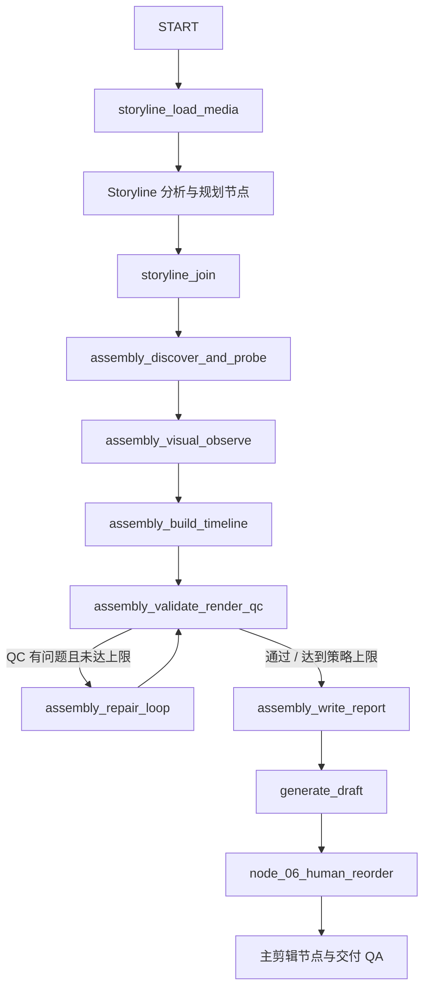

# auto-video-editor：Assembly QC 改造为剪映草稿内容生产链——原分析文档修订版与分阶段执行计划

> **文档类型**：架构修订 / 代码改造设计 / 分阶段执行计划 / 测试验收标准  
> **日期**：2026-11-15  
> **仓库**：`wayyet/auto-video-editor`  
> **分支**：`main`  
> **当前代码基线**：`bbf7306fbce9804f72174cea2e281c7daf6aff7a`  
> **原分析基线**：`60a6ea4993237108146b742d383330d55894ab82`  
> **基线关系**：`bbf7306` 是 `60a6ea4` 的直接子提交；两者之间仅新增原分析 MD 文档，没有代码变更。  
> **改造目标**：六个 assembly 节点全部具有可验证、可追踪的剪映草稿内容影响路径；禁止继续将 assembly 定义为“对剪映草稿零影响的质检旁路”。

---

## 0. 执行摘要与最终决策

### 0.1 本次必须纠正的架构判断

原文档将 assembly 六节点定义为 `generate_draft` 之后的独立 QC 旁路，认为其只生产 `media.json`、抽帧拼贴图、`timeline.json`、`preview.mp4` 和 `report.md`，不修改剪映草稿。

这个判断准确描述了当前代码的行为，但不应继续作为目标架构。当前实现存在一个根本缺口：**assembly 得出的候选片段、视觉观察、时间线选择及修复结果，没有进入生成剪映草稿所消费的 CanonicalTimeline；因此 assembly 做出的编辑决策无法改变最终剪映草稿内容。**

本方案将 assembly 从“独立质检旁路”改造为：

**素材分析 → 视觉观察 → 草稿时间线决策 → 候选草稿渲染验证 → 按 QC 结果修复编辑计划 → 提交最终编辑计划 → 生成剪映草稿。**

### 0.2 必须遵守的节点影响原则

1. **六个节点全部必须对最终剪映草稿具有实际影响能力。** 每个节点都必须输出被下游消费的内容决策、限制条件、补丁或最终提交数据；不得出现仅写日志、仅写报告、仅生成无消费者产物的空转节点。
2. **影响可以是直接或间接，但必须有可证明的因果链。** 例如素材发现决定哪些源素材可以参与剪辑；视觉观察改变片段评分；QC 决定候选编辑方案能否放行；这些节点不必各自直接写 `draft_content.json`，但其结果必须能改变最终草稿内容或阻止不合格草稿被生成。
3. **剪映草稿只能有一个正式写入入口。** 六个 assembly 节点不得并发、分散地直接写 `draft_content.json`。各节点共同修改一份候选 `CanonicalTimeline` / `DraftPatch`，最后由 `generate_draft` 通过现有 mapper 和安全写入链路生成正式剪映草稿。
4. **不能为证明“有影响”而制造无意义的文件改写。** 无需更改时允许最终草稿与基线内容相同，但必须保留每个节点的有效决策记录和影响链；不能通过改 metadata marker 伪装为内容修复。
5. **不得破坏 storyline 已有编辑意图及草稿轨道。** 任何镜头选择、裁剪、排序、时长调整，都必须考虑字幕、旁白、BGM、转场、贴纸、文本特效及素材引用的时间映射和完整性。

### 0.3 推荐目标拓扑

将六节点链路前移到 `storyline_join` 与 `generate_draft` 之间。这样 assembly 在草稿生成前修改最终编辑计划，`generate_draft` 再把最终计划映射为剪映原生草稿。



`ASSEMBLY_QC_GATE_ENABLED=False` 时，保留应急旁路：`storyline_join → generate_draft → node_06_human_reorder`。开关关闭只用于应急回退，不作为正式生产姿态。

### 0.4 目标执行顺序

| 顺序 | 节点 | 新职责 | 对剪映草稿内容的影响方式 |
|---|---|---|---|
| 1 | `assembly_discover_and_probe` | 发现并探测实际参与本次 Storyline 计划的素材 | 形成素材可用性、时长、候选片段、技术风险和源素材映射；决定哪些片段可进入最终剪映视频轨 |
| 2 | `assembly_visual_observe` | 对候选素材抽帧、建立视觉证据 | 为片段选择、裁剪起止点、镜头顺序、内容覆盖提供视觉证据；其结果必须被节点 3 消费 |
| 3 | `assembly_build_timeline` | 基于原始 CanonicalTimeline 生成编辑补丁 | 直接产生会改变剪映视频轨片段选择、裁剪、顺序和时间位置的候选编辑计划 |
| 4 | `assembly_validate_render_qc` | 验证候选编辑计划及其映射后的草稿预览 | 对候选编辑计划进行放行、限制或拒绝；QC 结果决定哪些编辑操作可进入最终草稿 |
| 5 | `assembly_repair_loop` | 按 QC 问题执行真正的时间线修复 | 修改候选编辑补丁及 CanonicalTimeline；修复结果参与下一轮验证和最终草稿生成 |
| 6 | `assembly_write_report` | 形成审计报告并提交最终编辑计划 | 将最终已验证的编辑计划写入专用 state 字段，供 `generate_draft` 消费；同时将报告和预览路径交给关卡① |

**关键设计：** `assembly_write_report` 不直接成为第二个草稿写入器。它提交的是“最终编辑计划”；紧随其后的 `generate_draft` 是唯一把计划转换成剪映草稿并落盘的正式写入者。这样六个 assembly 节点都影响草稿内容，而草稿文件仍由单一入口安全写入。

---

## 1. 当前代码基线与原文档结论修订

### 1.1 版本基线核对

| 项目 | 当前核对结果 |
|---|---|
| `main` HEAD | `bbf7306fbce9804f72174cea2e281c7daf6aff7a` |
| 原分析代码基线 | `60a6ea4993237108146b742d383330d55894ab82` |
| 两者关系 | 直接父子提交 |
| 两者之间提交数 | 1 |
| 该提交变更 | 仅新增原分析 MD 文档，未修改代码 |
| 当前架构依据 | `graph.py`、assembly 节点实现、`state.py`、`storyline/mapper.py`、草稿写入层及集成测试 |

因此，原文档基线没有版本错配；本方案以当前 `main` 的 `bbf7306` 为实施基准。具体行号可能随重构变化，开发时应以函数名和测试契约为准，不应把原文档行号当作永久接口。

### 1.2 当前已经确认的事实

| 编号 | 当前事实 | 代码位置 / 依据 | 修订结论 |
|---|---|---|---|
| F-01 | 当前 assembly 六节点接在 `generate_draft` 之后，最后回到 `node_06_human_reorder` | `graph.py` 的 assembly 注册和 QC 接线 | 目标拓扑必须前移至 `storyline_join → generate_draft` 之间 |
| F-02 | `media.json` 保存的是 `analyze_media()` 摘要，完整候选片段明细落入 sidecar | `nodes/assembly/node_discover_and_probe.py`、`assembly_capabilities/media_probe.py` | 候选片段必须进入正式数据契约，不能依赖被覆盖的 sidecar |
| F-03 | 时间线构建从 `analysis.candidate_segments` 读取候选片段，缺失时构造整段占位候选 | `assembly_capabilities/build_timeline.py::_collect_candidate_segments` | 当前主流程可能让 VLM 只能对整段素材进行占位式选择，必须修复 |
| F-04 | `assembly_visual_observe` 生成抽帧和 contact sheet；当前观察节点本身不做内容决策 | `nodes/assembly/node_visual_observe.py`、`assembly_capabilities/visual_observe.py` | 视觉证据必须进入时间线选段及裁剪决策，不能只作为图片附件 |
| F-05 | `assembly_build_timeline` 生成独立 assembly 时间线，没有与 `storyline_plan` 建立正式编辑补丁关系 | `nodes/assembly/node_build_timeline.py`、`assembly_capabilities/build_timeline.py` | 必须输出针对原始 CanonicalTimeline 的可应用补丁 |
| F-06 | 当前 QC 渲染对象是 assembly `timeline.json`，不是最终映射后的剪映草稿 | `nodes/assembly/node_validate_render_qc.py` | QC 应验证候选 CanonicalTimeline，并通过同一 mapper 生成临时剪映草稿结构进行一致性验证 |
| F-07 | 当前修复回路主要写 `metadata.repair_marker`，没有按问题类型实际修复片段 | `nodes/assembly/node_repair_loop.py::_build_repair_patch` | 必须改为有类型、有目标、有前后差异的真实编辑补丁 |
| F-08 | 当前 `assembly_write_report` 汇总报告，不提交 `storyline_plan` 的最终内容变更 | `nodes/assembly/node_write_report.py` | 报告节点必须提交最终编辑计划，供 `generate_draft` 消费 |
| F-09 | 当前关卡① interrupt payload 只有 `draft_path`；报告路径在 resume 后通知中打印 | `nodes/node_06_human_reorder.py`、`nodes/_checkpoint.py` | 改为 interrupt 前就展示报告、预览、草稿路径 |
| F-10 | `llm_used` 表示获得非空 `selected_segments` 列表，不等于已证明真实 API 请求成功 | `assembly_capabilities/build_timeline.py` | 拆分 attempted、client、响应状态、结果采用状态和失败原因 |
| F-11 | 多素材 `analyze_media()` 当前未传独立 `output_json`，多个素材可能覆盖默认 sidecar | `nodes/assembly/node_discover_and_probe.py`、`assembly_capabilities/media_probe.py` | sidecar 必须按稳定素材 ID 分目录保存 |
| F-12 | `ToolResult` 可以通过 `[ERROR]` 文本返回错误，而当前 discover 节点主要捕获异常，未完整检查错误结果 | `nodes/assembly/node_discover_and_probe.py`、`assembly_capabilities/media_probe.py` | 对每个素材的 probe 和 analysis 做显式成功、数据结构和必要字段校验 |
| F-13 | node_12 的 resume/无 interrupt 放行路径都会执行 BGM 镜像逻辑 | `nodes/node_12_human_add_bgm.py` | 不能将 node_12 归类为自身零草稿影响；它会写英文分支草稿 |
| F-14 | node_14/15 写入草稿目录的 covers 附属文件；node_16a 的 marker 写入会触发草稿写入流程 | 对应 node 实现及 `_draft_io.py` | 影响分类需区分 JSON 内容变化、附属文件、净零写入和间接影响 |
| F-15 | `NEIGHBORS` 表只覆盖部分 Storyline 节点，不是完整全图邻接表 | `tests/integration/test_unreachable_nodes_wiring.py` | 完整 assembly 拓扑必须增加专属测试 |

### 1.3 原文档第 0 章结论的替换版本

原结论“assembly 六节点对剪映草稿零写入”只描述当前实现，不再适合作为未来目标。修订为：

1. 当前实现中，六节点确实没有将编辑结果写入最终剪映草稿；这属于当前功能缺口，而不是必须保留的架构边界。
2. 目标实现中，六节点通过同一份 `AssemblyDraftPlan` / CanonicalTimeline Patch 形成连续内容影响链；任何节点的输出都必须被下游消费，并能在测试中证明其对最终剪映视频轨或草稿放行结果的影响。
3. 六节点不各自独立写 `draft_content.json`。最终正式草稿由 `generate_draft` 统一生成，使用 mapper 和 `safe_write_draft` / `write_draft` 的已有安全写入机制。
4. Assembly QC 的最终对象必须是“将要被映射成剪映草稿的同一份编辑计划”，而不是另一份与最终草稿无关的独立时间线。
5. 原始素材质量检查仍然保留，但只作为剪辑决策的一部分；不得把它称为最终剪映草稿 QC。

---

## 2. 目标架构与数据流

### 2.1 新拓扑与边调整

当前核心连接：

```text
storyline_join → generate_draft → assembly_discover_and_probe
                → assembly_visual_observe
                → assembly_build_timeline
                → assembly_validate_render_qc
                → assembly_repair_loop（条件回环）
                → assembly_write_report
                → node_06_human_reorder
```

目标连接：

```text
storyline_join
    └─（ASSEMBLY_QC_GATE_ENABLED=True）
       → assembly_discover_and_probe
       → assembly_visual_observe
       → assembly_build_timeline
       → assembly_validate_render_qc
          ├─ QC 需要修复且 retry < MAX → assembly_repair_loop → 回到 assembly_validate_render_qc
          └─ QC 通过 / 经策略允许降级 → assembly_write_report
       → generate_draft
       → node_06_human_reorder
```

应急关闭：

```text
storyline_join → generate_draft → node_06_human_reorder
```

实施要点：

- 删除 `generate_draft → assembly_discover_and_probe` 这条旧接入关系。
- 将 `storyline_join` 的成功路由目标改为 `assembly_discover_and_probe`（QC 开启时）。
- 将 `assembly_write_report → node_06_human_reorder` 改为 `assembly_write_report → generate_draft`。
- 保留 `generate_draft → node_06_human_reorder`。
- QC 关闭时，`storyline_join` 仍直接路由到 `generate_draft`。
- `storyline_join` 的 END 路由语义必须保留；没有可生成的有效计划时不能误入 assembly。
- `ASSEMBLY_QC_GATE_ENABLED` 仍在建图时生效；修改开关后需要重新构建图。监控 schema 和拓扑测试同步更新，必要时 `SCHEMA_VERSION` 从 9 升为 10。

### 2.2 单一写入者与候选计划

不采用六个节点分别修改正式剪映草稿的方式。多写入者会带来：

- 某个节点用旧版本 `draft_content.json` 覆盖另一个节点刚写入的更新；
- 一条视频轨已经重新排序，但字幕、配音、转场仍停留在旧时间位置；
- 同一素材在 `materials` 中被重复创建，或 `material_id` / `extra_material_refs` 变成悬空引用；
- 失败回滚时回滚了其他节点已完成的有效写入。

目标为单一编辑计划流：

```text
storyline_plan（原始基线，不覆盖）
        ↓
AssemblyDraftPlan（候选编辑计划）
        ↓
QC / Repair（针对同一候选计划迭代）
        ↓
assembly_final_plan（最终批准计划）
        ↓
generate_draft → mapper → safe_write_draft
        ↓
正式 Jianying draft_content.json + draft_info.json
```

`storyline_plan` 原始版本应保持不可变，以 `base_plan_sha256` 或稳定版本 ID 作为补丁基线。最终计划单独保存在 `assembly_final_plan` 或独立 artifact 中，防止修改原始输入导致无法审计和回滚。

### 2.3 建议的数据契约

建议新增或统一以下数据结构。字段名是设计建议，落地时应遵循现有 `WorkflowState`、CanonicalTimeline schema 和 mapper 的实际字段约定。

#### A. `assembly_media_manifest.json`

```json
{
  "schema_version": 1,
  "job_id": "<job_id>",
  "base_plan_sha256": "<sha256>",
  "sources": [
    {
      "asset_id": "stable_asset_id",
      "source_path": "<absolute_path>",
      "duration_seconds": 30.88,
      "probe_status": "ok",
      "analysis_status": "ok",
      "candidate_segments": [
        {
          "candidate_id": "stable_candidate_id",
          "source_start": 1.2,
          "source_end": 5.8,
          "duration": 4.6,
          "evidence": ["scene_boundary"]
        }
      ],
      "technical_risks": []
    }
  ]
}
```

约束：

- `candidate_segments` 必须保存在正式 manifest 中，不能只放在临时 sidecar。
- sidecar 使用 `asset_id` 或路径哈希命名，禁止仅使用文件 stem。
- 同一个输入素材在 storyline plan、media manifest 和 timeline patch 中必须能稳定关联。
- Probe/analysis 失败必须使用明确状态，不允许以空数据伪装成功。

#### B. `assembly_visual_observation.json`

每个候选片段必须可以关联视觉观察结果，例如关键帧时间戳、拼贴图引用、可见场景标签、是否疑似黑帧/遮挡/重复画面，以及观察置信度。

视觉观察可以先保留确定性抽帧，但候选选择必须读取并消费这些视觉证据。模型未能产生有效选择时，必须明确退回到“可解释的确定性规则”，而不是无差别地整段拼接。

#### C. `assembly_draft_patch.json`

```json
{
  "schema_version": 1,
  "base_plan_sha256": "<sha256>",
  "operations": [
    {
      "operation_id": "stable_operation_id",
      "operation": "trim_or_select_or_reorder",
      "target_clip_id": "existing_canonical_clip_id",
      "asset_id": "stable_asset_id",
      "source_start": 1.2,
      "source_end": 5.8,
      "new_order": 0,
      "reason": "visual_evidence_and_editorial_selection",
      "evidence_refs": ["candidate_id", "frame_id"],
      "confidence": 0.91
    }
  ],
  "track_alignment_policy": "preserve_and_remap",
  "created_by": "assembly_build_timeline"
}
```

约束：

- 所有 operation 必须有稳定 ID、目标 clip、源素材引用、原因和证据引用。
- 不允许使用未经校验的任意路径或不存在的素材 ID。
- 所有时间字段统一单位，禁止秒、毫秒、微秒混用；进入 CanonicalTimeline / mapper 前由单一 adapter 归一。
- Patch 必须基于 `base_plan_sha256` 应用；基线变化则拒绝应用，不能将旧 patch 套在新计划上。

#### D. `assembly_final_plan`

最终输出应是通过 QC 的 CanonicalTimeline 或其明确版本化文件，能被 `generate_draft` 直接读取。`generate_draft` 应优先读取 `assembly_final_plan`，QC 关闭时才回退到原 `storyline_plan`。

#### E. `assembly_influence_trace.json`

为六节点建立可追踪因果链：

```json
{
  "base_plan_sha256": "...",
  "node_contributions": [
    {
      "node_id": "assembly_discover_and_probe",
      "artifact": "assembly_media_manifest.json",
      "consumed_by": ["assembly_build_timeline"],
      "affected_operations": ["operation_001"],
      "final_clip_ids": ["clip_001"]
    }
  ],
  "final_plan_sha256": "...",
  "mapped_draft_sha256": "..."
}
```

测试必须证明每个节点输出不是“写了但无人读取”的死产物。

---

## 3. 六个 assembly 节点的目标职责与剪映草稿影响契约

### 3.1 `assembly_discover_and_probe`

**目标职责**：发现 `storyline_plan` 中引用的源媒体，执行 ffprobe 和场景/黑帧/静音扫描，形成完整素材 manifest。

**必须输出**：

- 素材稳定 ID、源路径、时长、视频/音频流信息；
- `candidate_segments` 明细；
- 源素材技术风险和可用状态；
- 与原 CanonicalTimeline clip / source_media 的映射关系。

**对剪映草稿的影响路径**：

```text
素材探测结果
  → 过滤损坏/缺失/不符合约束的源素材候选
  → build_timeline 的可选片段集合发生变化
  → 最终 CanonicalTimeline 的视频 clip 集合变化
  → mapper 生成的剪映视频轨内容变化
```

**重要限制**：不得仅凭技术风险就静默删除素材。删除/替换会造成内容变化的操作必须进入 patch、报告原因，并保留可回滚的原始 plan。

### 3.2 `assembly_visual_observe`

**目标职责**：按素材与候选区间进行抽帧，生成 contact sheet、关键帧索引及视觉证据。

**必须输出**：

- 每个 candidate 与 frame 的稳定关联；
- 原视频时间戳、图片路径、抽帧参数、缓存签名；
- 可用于选段、裁剪和排序的视觉观察字段；
- 视觉观察失败、缓存失效和降级原因。

**对剪映草稿的影响路径**：

```text
关键帧/视觉证据
  → build_timeline 的片段评分与选择结果变化
  → clip 选择、source in/out、镜头排序变化
  → 最终剪映视频轨内容变化
```

**重要限制**：仅生成 JPG 而不将视觉证据交给时间线决策，不算完成节点职责。视觉观察错误不能假装“没有风险”；需要输出 `unknown/degraded` 并由选择策略处理。

### 3.3 `assembly_build_timeline`

**目标职责**：从原始 CanonicalTimeline 出发，结合 manifest 和视觉证据，构造新的候选 CanonicalTimeline / DraftPatch。

**必须支持的编辑操作**：

- 选择/排除视频片段；
- 修正源素材入点、出点；
- 调整视频片段顺序；
- 在明确规则和安全校验下调整时长；
- 为每一项变更给出原因、证据、置信度和原始 clip ID。

**对剪映草稿的影响路径**：直接改变最终 CanonicalTimeline，后续由 mapper 生成新的剪映视频轨。

**重要限制**：不能把原有 `storyline_plan` 全部丢弃，再生成一个与 storyline 文案、配音、音乐计划脱节的独立时间线。应在原有编辑意图上做增量变更。无有效候选时默认保留原始 plan 或进入显式失败/人工确认，不允许把“无候选”解释成“把所有视频整段首尾相接”。

### 3.4 `assembly_validate_render_qc`

**目标职责**：验证候选 CanonicalTimeline 的结构、媒体引用、轨道映射和预览渲染结果。

**验证层次必须分开**：

1. 原始素材技术质量；
2. 候选 CanonicalTimeline 结构与引用完整性；
3. 通过同一 mapper 生成的临时剪映草稿结构；
4. 从候选时间线/临时草稿映射出的预览视频质量；
5. 视频轨变更对字幕、旁白、BGM、转场和其他轨道的时间影响。

**对剪映草稿的影响路径**：

```text
QC 结果
  → 确定候选编辑操作是否允许提交
  → 对失败操作生成约束 / 拒绝原因 / 修复目标
  → repair_loop 修复或撤销相关操作
  → 改变最终剪映草稿内容或阻止不安全草稿生成
```

**重要限制**：QC 不能只检查 assembly 自己的 `timeline.json`，却宣称已验证剪映草稿。必须验证候选计划与 mapper 输出的一致性，并覆盖轨道引用及时间映射。

### 3.5 `assembly_repair_loop`

**目标职责**：基于 QC issue 生成有类型的真实 patch，修改候选 CanonicalTimeline，再交给 QC 复验。

**必须实现的修复类型**（按实际 QC 能提供证据的范围逐步开放）：

- 删除/替换确定为坏素材的片段；
- 调整黑帧/静音/卡帧对应的 source in/out；
- 处理超短片段或不合法时间区间；
- 修复缺失/重复素材引用；
- 修复轨道时间映射、片段重叠或非法排序；
- 当缺陷无法可靠自动修复时，撤销相应候选操作并恢复基线 clip。

**对剪映草稿的影响路径**：repair patch 改变最终 CanonicalTimeline；mapper 会将修复结果转换为正式剪映草稿内容。

**重要限制**：只修改 `metadata.repair_marker` 不算修复。每轮修复必须产出明确的 `before_hash`、`after_hash`、修改 operation、issue 对应关系；如果 patch 未改变任何有效内容，必须标记 `repair_noop`，不能虚报修复成功。

### 3.6 `assembly_write_report`

**目标职责**：汇总证据、QC 状态、修复历史和最终编辑计划，并提交 `assembly_final_plan`。

**必须执行**：

- 校验最终 plan 的 `base_plan_sha256`；
- 校验所有 operation 已应用且没有未处理的结构性错误；
- 生成 `assembly_final_plan` 并保存其 hash；
- 输出 `report.md`、QC 报告路径和 preview 路径；
- 写入六节点的 `assembly_influence_trace`；
- 将最终 plan artifact/state 交给下一节点 `generate_draft`。

**对剪映草稿的影响路径**：

```text
assembly_final_plan
  → generate_draft
  → storyline mapper
  → draft_ops.safe_write_draft / nodes._draft_io.write_draft
  → draft_content.json / draft_info.json
```

**重要限制**：报告节点不能只写 Markdown 然后直接返回；它必须负责把最终批准的编辑计划正式提交到 state，并让 `generate_draft` 明确消费该字段。报告写入磁盘不等于剪映草稿内容发生变化。

---

## 4. 剪映草稿内容映射与轨道保护设计

### 4.1 最终草稿写入仍由单一入口负责

沿用项目现有写入架构：

```text
generate_draft
  → storyline/mapper.py
  → nodes/_draft_io.py
  → draft_ops/atomic_writer.py::safe_write_draft
  → draft_content.json + draft_info.json
```

不得让 assembly 节点直接调用 `safe_write_draft()` 写正式草稿。这样可以避免多节点并发写入、重复快照、内容覆盖和部分写入。

### 4.2 视频轨变更必须有时间映射

仅改变视频轨片段顺序或时长，而不更新关联轨道，会造成字幕、配音和音效错位。因此，在应用视频轨 patch 时必须建立从原时间线到新时间线的映射关系：

- 保留片段：记录旧 clip ID、新 clip ID、源素材区间和新时间线区间；
- 裁剪片段：按 source time 映射推导字幕/配音/事件锚点是否仍然覆盖；
- 重新排序：按 clip 关联关系移动对应的内容组，不能只移动视频 clip；
- 删除片段：处理依附该片段的字幕、文本特效、贴纸、转场和旁白；
- BGM：维持音频轨身份及素材引用，按新视频总时长重新计算循环、裁剪和淡出范围；
- 转场：按新的相邻 clip 边界重新定位，不允许继续引用已经不存在的边界；
- 未来节点生成的字幕/特效必须读取最终 plan，因此应在最终 plan 固化之后才运行相关主链节点。

### 4.3 必须保留的素材与轨道不变量

至少验证：

1. 每个视频 clip 的 `material_id` / source media 引用都存在；
2. 所有 `extra_material_refs` 都能在对应 materials bucket 中解析；
3. 轨道 ID、素材 ID 和 segment ID 不发生意外重复；
4. clip 的源素材入点、出点和 duration 合法；
5. 视频轨顺序与最终 CanonicalTimeline 一致；
6. 音频、旁白、字幕、文本特效、贴纸和转场的时间区间在视频时间线变化后仍满足关联关系；
7. BGM 不因视频剪辑修改而丢失；
8. 剪映所需的 `draft_content.json` 与 `draft_info.json` 由同一次 safe-write 流程保持一致；
9. node_06 人工调整发生在草稿已生成且报告、预览可访问之后；
10. node_12 后续对英文分支的 BGM 镜像能力不得被 assembly 重构破坏。

### 4.4 安全策略

- assembly 生成、QC 和修复阶段全部操作候选 plan，不操作正式剪映草稿文件。
- `generate_draft` 写入前，确认最终 plan 与 `base_plan_sha256` 一致。
- 若原始 plan 在候选生成期间发生变化，拒绝应用旧 patch。
- 若映射后引用完整性校验失败，禁止生成正式草稿，返回明确错误。
- QC 达到重试上限但仍有 warning 时，可以带 warning 继续；如果存在结构性 error、悬空引用、非法时间范围或轨道映射损坏，则必须 fail-closed，不能把错误草稿交给 node_06。
- 如果产品确实需要在未完全修复时继续，必须增加显式人工接受降级结果的状态/interrupt，不能默认把“达到重试上限”等同于“质量通过”。

---

## 5. P1 分阶段代码修复执行计划（必须完成）

> P1 是使六节点真正进入剪映草稿内容生产链的必要改造。P1 未完成前，不得宣称 assembly 已具备剪映草稿内容影响能力。

### P1-0：建立基线与防回归测试

**目标**：先固定当前行为、拓扑和剪映草稿结构契约，避免重构过程中破坏已有主链。

**涉及文件**：

- `graph.py`
- `state.py`
- `nodes/node_05_generate_draft.py`
- `storyline/mapper.py`
- `nodes/_draft_io.py`
- `draft_ops/atomic_writer.py`
- `tests/integration/test_workflow_graph_schema.py`
- `tests/integration/test_unreachable_nodes_wiring.py`
- 新增 `tests/integration/test_assembly_draft_influence.py`

**开发任务**：

1. 固定现有 CanonicalTimeline 测试 fixture，至少包含多个视频 clip、音频、voiceover、BGM、transition 和字幕/文本样例。
2. 保存同一 fixture 的基线 mapper 输出和草稿结构摘要。
3. 定义最终草稿影响测试 helper：比较 video track clip IDs、源入出点、时间线顺序和持续时间，并检查音频等关联轨道。
4. 为六个 assembly 节点建立统一的 `assembly_influence_trace` 测试契约。

**测试与验收**：

- [ ] 当前原始 `storyline_plan → mapper → draft_content` 路径通过基线测试。
- [ ] 对无改动 plan，mapper 输出不发生非预期结构变化。
- [ ] 对同一个素材计划重复执行 mapper，结果稳定且确定。
- [ ] 草稿引用完整性检查可以识别缺失素材 ID、重复 ID 和悬空引用。
- [ ] 测试样本覆盖中文主草稿与英文分支所需的音轨字段。

### P1-1：重接 LangGraph 拓扑，将 assembly 前移

**目标**：让 assembly 决策在剪映草稿生成之前完成。

**涉及文件**：

- `graph.py`
- `monitoring/workflow_graph.py`
- `tests/integration/test_workflow_graph_schema.py`
- `tests/integration/test_unreachable_nodes_wiring.py`

**开发任务**：

1. 将 QC 开启时的入口从 `generate_draft` 移至 `storyline_join` 成功路由。
2. 将 `assembly_write_report` 的出口改为 `generate_draft`。
3. 保留 `generate_draft → node_06_human_reorder`。
4. QC 关闭时保留 `storyline_join → generate_draft` 应急路径。
5. `storyline_join` 若没有可用 timeline，继续走现有 END/失败语义，不进入 assembly。
6. 更新监控 schema 版本（若 schema 节点/边或语义有变化，建议 `SCHEMA_VERSION=10`）。

**测试与验收**：

- [ ] QC 开启轨迹：`storyline_join → discover → observe → build → validate → write_report → generate_draft → node_06`。
- [ ] QC 修复轨迹：`validate → repair_loop → validate`，最后回到 `write_report → generate_draft`。
- [ ] QC 关闭轨迹：`storyline_join → generate_draft → node_06`，assembly 节点不执行。
- [ ] `storyline_join` 返回 END 时不触发 assembly 和 generate_draft。
- [ ] 不存在 `generate_draft → assembly_*` 的旧边。
- [ ] 不存在 `assembly_write_report → node_06_human_reorder` 的旧边。
- [ ] 全部注册节点仍可达，所有节点均有有效出边；不产生新的静默终点。

### P1-2：修复素材分析契约与多素材 sidecar 覆盖

**目标**：保证每个素材的完整候选片段明细都进入正式输入，且素材间不会覆盖。

**涉及文件**：

- `nodes/assembly/node_discover_and_probe.py`
- `assembly_capabilities/media_probe.py`
- `state.py`
- 新增或调整 `tests/assembly/test_media_manifest.py`

**开发任务**：

1. 主节点为每个源素材计算稳定 `asset_id`，传给 `analyze_media(output_json=...)`。
2. sidecar 保存到 `assembly/media_analysis/<asset_id>.json`，不再共用固定 `out/media_analysis.json`。
3. 将完整 `candidate_segments`、场景切点、黑帧区间、静音区间及摘要统一写入 `media.json` 或 manifest。
4. 检查 `ToolResult.text` 是否为 `[ERROR]`，并验证 `data` 类型和必要字段。
5. 区分 `probe_status`、`analysis_status`、`degraded_reason`；错误结果不能追加成功标签。
6. 通过 `storyline_plan` 解析本轮真实素材引用，避免只依赖通用 `video_input_path` 导致发现素材与 storyline 计划不一致。
7. 同名文件不得冲突；路径标准化和 hash 必须纳入资产身份。

**测试与验收**：

- [ ] 两个不同目录中存在同名 `clip.mp4` 时，产物互不覆盖。
- [ ] 三个素材连续执行后，每个素材的 candidate 明细都存在。
- [ ] `media.json` 可完整还原各素材候选区间。
- [ ] ffprobe 缺失、ffmpeg 缺失、文件损坏、ToolResult 返回 `[ERROR]` 均不会被标记为成功。
- [ ] 某个素材失败时，按策略明确 fail / skip / degraded，不得静默丢失素材。
- [ ] manifest 中每个候选片段都能映射回源素材和原始 plan 的相关 clip。

### P1-3：让视觉观察结果成为编辑决策输入

**目标**：节点 2 不再只是生产拼贴图，而是实际影响片段选择与裁剪。

**涉及文件**：

- `nodes/assembly/node_visual_observe.py`
- `assembly_capabilities/visual_observe.py`
- `assembly_capabilities/build_timeline.py`
- 新增 `tests/assembly/test_visual_observation_influence.py`

**开发任务**：

1. 为每个候选片段建立 `candidate_id → frame_ids → contact_sheet` 关联。
2. 保留抽帧时间戳、抽帧参数和缓存签名。
3. build_timeline 读取候选对应的图像证据，不允许只拿无映射关系的全片前几张拼贴图。
4. 对画面不可用、关键帧缺失或观察失败给出 `unknown/degraded` 状态。
5. 将视觉观察与用户/Storyline 叙事目标、片段时长约束共同输入选段逻辑。
6. 结果必须形成能改变 clip 选择、source in/out 或顺序的选择依据。

**测试与验收**：

- [ ] 同一份媒体候选在两种不同视觉 fixture 下，能产生预期不同的候选排序或裁剪决策。
- [ ] 选段结果中每个 clip 都能找到至少一个视觉 evidence ref，或明确标注为确定性兜底。
- [ ] 缓存命中与缓存未命中产生一致的观察数据契约。
- [ ] 缓存签名变化（源文件内容/大小/mtime/采样参数变化）后必须重新抽帧。
- [ ] 视觉观察输出被 `assembly_build_timeline` 实际读取；通过覆盖/断言证明不是死产物。

### P1-4：把独立 assembly timeline 改成 CanonicalTimeline 编辑补丁

**目标**：节点 3 直接修改“将要生成剪映草稿的计划”，而不是生成另一条无消费者的时间线。

**涉及文件**：

- `nodes/assembly/node_build_timeline.py`
- `assembly_capabilities/build_timeline.py`
- `state.py`
- `storyline/contract.py`
- `storyline/mapper.py`
- 新增 `assembly_capabilities/draft_patch.py`
- 新增 `tests/assembly/test_canonical_timeline_patch.py`

**开发任务**：

1. 将 `storyline_plan` 作为不可变基线输入。
2. 根据 P1-2 的 candidate segments 和 P1-3 的视觉 evidence 生成 DraftPatch。
3. 生成候选 CanonicalTimeline，不能只保存独立 assembly 格式。
4. 对视频 clip 的新增、保留、裁剪、删除和排序变更建立明确 operation。
5. 对每项 operation 记录目标 clip ID、源素材 ID、源时间区间、修改理由和证据。
6. 处理与视频 clip 关联的 narration、voiceover、BGM、transition、subtitle/text 等时间关系；无法安全映射时禁止自动删除关联内容。
7. 原始 storyline plan 必须保留；候选 plan 单独保存并记录 base hash。
8. 不再把空候选统一转为“全片整段首尾相接”；优先保留基线计划并标记 `no_safe_candidate`。

**测试与验收**：

- [ ] 候选选择变化可以改变最终 CanonicalTimeline 的视频 clip 集合/顺序/入出点。
- [ ] patch 应用前后 diff 可解释，且每个变化都能追溯至候选 ID 和 evidence ref。
- [ ] 原始 `storyline_plan` 不被覆盖。
- [ ] 对无候选/模型失败/模型返回非法索引，执行可解释 fallback，不产生虚构素材引用。
- [ ] 对同一输入、同一模型输出和同一规则，结果确定且可重复。
- [ ] `base_plan_sha256` 不匹配时拒绝应用 patch。
- [ ] BGM、voiceover、transition 和其他已有轨道引用不因视频轨编辑而丢失或悬空。

### P1-5：QC 验证候选剪映草稿的真实映射结果

**目标**：节点 4 评价的必须是即将生成的剪映草稿内容，而不只是 assembly 自己的 timeline JSON。

**涉及文件**：

- `nodes/assembly/node_validate_render_qc.py`
- `assembly_capabilities/render_preview.py`
- `assembly_capabilities/timeline_ops.py`
- `storyline/mapper.py`
- `draft_ops/draft_integrity.py`
- 新增 `assembly_capabilities/draft_preview_adapter.py`
- 新增 `tests/assembly/test_candidate_draft_qc.py`

**开发任务**：

1. 用与正式 `generate_draft` 相同的 mapper / adapter 将候选 CanonicalTimeline 转换为临时草稿结构。
2. 临时草稿只落在本次 job 的隔离目录，不写入剪映正式草稿库。
3. 验证临时草稿 JSON 结构、视频/音频素材引用、track/segment IDs、时间区间及必需素材桶。
4. 由候选计划生成 preview，并验证黑帧、卡帧、静音、音量、总时长和轨道时间映射。
5. 建立“候选 CanonicalTimeline → mapper 输出 → 临时 draft JSON → preview”的一致性验证。
6. QC issue 应能定位到具体 clip ID、operation ID 和时间区间，供 repair_loop 定向修复。
7. 严重结构错误、素材悬空引用、非法时间范围、轨道映射丢失必须阻止放行。

**测试与验收**：

- [ ] QC 检查的是候选计划映射后的临时 Jianying draft 结构。
- [ ] 临时草稿 video track 与候选 CanonicalTimeline 的 clip 顺序和时间范围一致。
- [ ] 删除一个视频素材、破坏一个 material ref 或制造非法时间区间时，QC 必须失败。
- [ ] video clip 时长变化后，字幕/配音/BGM/转场等相关轨道的同步校验能发现错位。
- [ ] QC 阶段不会修改正式 `draft_path`、剪映草稿库或原始 storyline plan。
- [ ] QC issue 可定位到真实 clip/operation，不得仅输出笼统错误文本。

### P1-6：实现真实 Timeline Repair Patch

**目标**：节点 5 必须对候选编辑计划进行真正的内容修复。

**涉及文件**：

- `nodes/assembly/node_repair_loop.py`
- `assembly_capabilities/timeline_ops.py`
- `assembly_capabilities/qc_preview.py`
- 新增 `assembly_capabilities/repair_strategies.py`
- 新增 `tests/assembly/test_assembly_repair_effectiveness.py`

**开发任务**：

1. 将 QC issue 转成 typed issue：`black_frame`、`freeze_frame`、`silence`、`invalid_range`、`missing_asset`、`broken_reference`、`track_desync` 等。
2. 为每类 issue 实现有限、可解释、可回滚的修复策略。
3. 优先对候选 patch 做局部修复；无法修复时撤销有问题的 operation，恢复对应基线 clip。
4. 每轮修复输出前后 plan hash、patch、目标 clip、issue ID、修复结果。
5. 应用 patch 后重新运行 validate/render/QC。
6. 设置重试上限和重复 patch 检测，避免相同无效修复反复渲染。
7. 对无法安全自动修复的 issue 保留为人工处理项；结构性错误不得软降级成“通过”。

**测试与验收**：

- [ ] 黑帧 issue 能导致明确的 clip 时间区间调整、坏片段剔除或操作撤销，而不是只改 metadata。
- [ ] 悬空引用 issue 能修复或阻止草稿生成。
- [ ] `track_desync` 能触发关联轨道映射修复或回滚相关视频操作。
- [ ] 修复后再次 QC，结果必须按真实预览重新计算。
- [ ] 修复前后 plan hash 不同且 diff 可解释；未变化必须标记 `repair_noop`。
- [ ] 相同 issue 重复出现时不能无限执行相同 patch。
- [ ] 达到重试上限且仍有结构性 error 时 fail-closed。

### P1-7：报告节点提交最终 plan，generate_draft 消费最终结果

**目标**：将六节点最后的有效决策真正传递到剪映草稿。

**涉及文件**：

- `nodes/assembly/node_write_report.py`
- `nodes/node_05_generate_draft.py`
- `storyline/mapper.py`
- `state.py`
- `nodes/node_06_human_reorder.py`
- `nodes/_checkpoint.py`
- `tests/integration/test_assembly_draft_influence.py`

**开发任务**：

1. `assembly_write_report` 校验最终候选计划，生成 `assembly_final_plan` / `assembly_final_plan_path`。
2. 保存 `assembly_influence_trace`，逐一记录六节点输出被谁消费、影响了哪些 operation、最终哪些 clip 受影响。
3. `generate_initial_jianying_draft` 优先消费 `assembly_final_plan`；QC 关闭时回退原 `storyline_plan`。
4. mapper 生成正式草稿后，使用现有 `safe_write_draft` 双写、校验和快照回滚机制。
5. 写入后读取实际 `draft_content.json`，将实际 video track 与 `assembly_final_plan` 比对。
6. `node_06_human_reorder` 的 interrupt payload 在挂起前包含：`draft_path`、`assembly_report_path`、`assembly_preview_path`、QC status 和关键 warnings。
7. 前端 interrupt/等待输入 UI 必须展示报告与预览的可访问链接；不能只在 resume 后打印路径。

**测试与验收**：

- [ ] `assembly_final_plan` 被 `generate_draft` 明确读取；不允许存在只写 state、无人消费的情况。
- [ ] 改变 assembly 的 selected clip、source in/out 或 order，最终 `draft_content.json` 对应视频轨内容必须改变。
- [ ] QC 修复导致 plan 回滚时，最终 draft 必须反映修复后的 plan，而非旧候选。
- [ ] `draft_content.json` 与 `draft_info.json` 仍走 `safe_write_draft` 一致性流程。
- [ ] mapper 生成后检查引用完整性，无悬空素材和无效时间范围。
- [ ] 关卡①挂起时即可取得报告和预览路径；前端可以打开实际文件或受控 URL。
- [ ] QC 失败的结构性错误不会进入关卡①并被误认为可编辑交付物。

### P1-8：端到端验证六节点都能影响剪映草稿

**目标**：用真实集成测试证明“六节点全部有草稿影响能力”，而不是只检查节点被调用。

**测试场景**：

1. 改变 discover 的素材可用性/候选片段输入，验证最终 draft 的 clip 集合变化。
2. 固定原始素材但改变 visual evidence，验证最终 draft 的选择/裁剪/顺序变化。
3. 改变 build 输出 patch，验证最终 draft video track 对应变化。
4. 注入 QC issue，验证候选 patch 被拒绝或进入修复，最终草稿不包含被禁止的操作。
5. 注入可修复 issue，验证 repair 修改 plan，最终 draft 反映修复结果。
6. 改变 report/final-plan 提交内容或 hash，验证 generate_draft 只消费被批准的最终 plan；报告节点不提交时禁止生成未审计草稿。

**统一验收条件**：

- [ ] `assembly_influence_trace` 包含六个节点，每个节点均有 artifact、consumer 和最终影响证据。
- [ ] 测试不只断言节点执行过，还必须断言 `draft_content.json` 的最终业务字段变化，或验证该节点对草稿提交有可观测的阻止/放行影响。
- [ ] 六节点任何一个输出被 mock 成无变化/错误状态时，相关下游行为符合预期，不得静默丢弃节点结果。
- [ ] 端到端任务成功后，可从最终草稿 clip 追溯回原始素材、候选片段、视觉证据、QC 结果和 patch。

---

## 6. P2 分阶段增强与生产加固计划

> P2 不替代 P1。P1 完成后，P2 用于提高模型诊断、可观测性、性能、缓存、回滚和人工复核能力。

### P2-1：完善 LLM/VLM 调用诊断

**涉及**：`assembly_capabilities/build_timeline.py`、`storyline_capabilities/vlm_client.py`、`agent_gate/runner.py`、`monitoring/`、测试文件。

**任务**：

- 分开记录 `llm_attempted`、`llm_client_type`、`model_name`、`request_status`、`response_valid`、`selection_applied`、`fallback_used`、`failure_reason`、`elapsed_seconds`。
- 区分 Stub、真实 mcode 客户端、未注入 client 和真实 API 失败。
- 检查 worker、直接 CLI、测试入口是否正确注入 client；避免仅 worker 路径可调用真实模型。
- 记录模型返回的候选索引、无效索引数、重复索引数和最终被采纳的片段。

**测试验收**：

- [ ] Stub 客户端必须明确显示 `client_type=stub`。
- [ ] 真实模型成功、超时、空响应、JSON 解析失败、schema 不匹配均有不同状态。
- [ ] `llm_used` 不再作为判断“是否发起请求”的唯一字段。
- [ ] 不会把 Stub 输出标记为真实模型成功。

### P2-2：性能与资源优化

**涉及**：`assembly_capabilities/media_probe.py`、`visual_observe.py`、`build_timeline.py`、`render_preview.py`、节点日志。

**任务**：

- 避免 `discover` 与 `analyze_media` 对同一素材重复做不必要的 ffprobe。
- 分素材并行执行时设置并发上限、超时和取消策略。
- 抽帧缓存使用 source content identity、mtime、sampling config 和工具版本作为签名依据。
- 记录六节点耗时及每个子阶段耗时；区分模型请求、FFmpeg、OpenCV 和磁盘 I/O。
- 大素材支持抽帧预算、候选数量预算和 preview 分辨率预算。

**测试验收**：

- [ ] 每个素材的 ffprobe 次数符合预期，不再无必要重复探测。
- [ ] 并行处理不会造成 sidecar 覆盖或 GPU/内存无限增长。
- [ ] 缓存失效条件完整；同一输入重复运行可复用缓存。
- [ ] 输出完整 `node_timing.json`，包含六节点和内部阶段耗时。
- [ ] 性能测试记录素材数量、时长、分辨率、并发数、缓存状态，不能只报告单次总时长。

### P2-3：DraftPatch 版本、幂等与回滚

**涉及**：`assembly_capabilities/draft_patch.py`、`draft_ops/`、`state.py`、恢复/重放测试。

**任务**：

- operation ID 确定性生成，重复执行不会重复添加 clip。
- patch 绑定 base plan hash；旧版本 patch 不允许套用新计划。
- 保存原始 plan、候选 plan、修复 plan 和最终 plan 的 hash。
- 失败时能够丢弃候选结果并回到原始 storyline plan。
- LangGraph checkpoint resume 时复用同一 job 的稳定 artifact，不产生重复操作。

**测试验收**：

- [ ] 同一个 patch 重放两次，最终 plan 和 draft 业务内容一致。
- [ ] 不同 base hash 的 patch 应用失败。
- [ ] 中断后 resume 不重复增加 clip、音轨或素材引用。
- [ ] 写入失败后原始草稿/输入 plan 保持可恢复。

### P2-4：前端工作流可观测性与人工复核

**涉及**：`monitoring/workflow_graph.py`、`web/console.html`、`nodes/node_06_human_reorder.py`、相关 API/event。

**任务**：

- 在 workflow graph 显示六个节点各自的实际输入、输出、耗时和当前状态。
- 显示候选片段数、选中数、被排除数、修复次数和 QC warnings。
- 关卡①在 interrupt 时提供正式草稿、preview、report 三个入口。
- 提供“查看修复前后差异”的证据视图，至少包含 clip ID、原始区间、新区间、原因和 evidence ref。
- 人工拒绝降级结果时应有明确失败/回退路径，而不是直接继续后续剪辑。

**测试验收**：

- [ ] interrupt payload 包含所有展示必需字段。
- [ ] 页面能打开当前 job 的 report 和 preview。
- [ ] 所展示的 node status 与后端 graph 状态一致。
- [ ] 旧线程缺少新字段时前端可兼容展示，不发生页面异常。

### P2-5：测试数据、真实运行证据与质量基线

**涉及**：`tests/fixtures/assembly/`、文档目录、运行产物归档脚本。

**任务**：

- 准备多素材、同名素材、旋转视频、HDR、静音、黑帧、VFR、无音轨、损坏素材等 fixture。
- 每次关键版本验证后归档脱敏的 manifest、visual observations、base/final plan、draft diff、QC report 和 timing。
- 增加真实剪映客户端打开草稿的人工验收清单；自动化 JSON 校验不能替代客户端兼容性测试。

**测试验收**：

- [ ] 每份证据包记录 commit SHA、schema version、配置开关、模型信息和输入素材摘要。
- [ ] 运行证据中的最终 plan hash 与 draft influence trace 对得上。
- [ ] 测试样本覆盖单素材和多素材、竖屏和横屏、音视频混合轨道。
- [ ] 至少完成一次真实剪映客户端导入/打开/播放验证，并记录客户端版本及异常。

---

## 7. 完整测试验收矩阵

| 验收域 | 必测内容 | 通过标准 | 对应阶段 |
|---|---|---|---|
| 图拓扑 | assembly 前移、QC 开关两态、修复回环 | 与目标图完全一致，无旧边残留 | P1-1 |
| 素材发现 | 多视频、同名文件、坏文件、ToolResult error | manifest 完整，无 sidecar 覆盖，错误不伪装成功 | P1-2 |
| 候选片段 | scene boundaries、黑帧/静音区间、候选范围 | 完整候选明细被 build 节点消费 | P1-2 |
| 视觉证据 | 帧时间戳、contact sheet、缓存、候选关联 | 视觉证据影响选择/裁剪结果 | P1-3 |
| 编辑计划 | clip select/trim/reorder、source refs、track mapping | 生成合法、可解释的 CanonicalTimeline patch | P1-4 |
| 草稿映射 | mapper、video track、materials、segment IDs | 最终 draft 与 final plan 一致 | P1-4/P1-7 |
| QC | schema、引用、预览、时间映射、音视频质量 | 能阻止结构性错误，issue 能定位 clip/operation | P1-5 |
| Repair | 黑帧、静音、坏素材、时间错位、悬空引用 | 真实修改 plan 或撤销操作，并经重新 QC | P1-6 |
| Final plan | 报告节点提交、hash、trace | generate_draft 只读取最终批准 plan | P1-7 |
| 草稿写入 | atomic writer、双文件一致性、回滚 | 只由 generate_draft 写正式草稿，写入可恢复 | P1-7 |
| 人工关卡 | interrupt payload、报告/预览访问 | 用户挂起时即可查看产物和正式草稿 | P1-7/P2-4 |
| 六节点影响 | 每节点变更输入并追踪最终结果 | 六节点均有最终 draft 内容或放行决策的可验证因果影响 | P1-8 |
| 模型观测 | stub/真实客户端、失败分类、耗时 | 请求状态与模型结果状态分离 | P2-1 |
| 性能 | ffprobe、抽帧、渲染、缓存、并发 | 有分阶段 timing 和资源预算 | P2-2 |
| 幂等恢复 | checkpoint resume、重复 patch、回滚 | 重放不重复编辑、不丢失原始 plan | P2-3 |
| 真实客户端 | 剪映实际打开、播放、音轨/字幕检查 | 客户端可加载，轨道和画面符合预期 | P2-5 |

---

## 8. 推荐新增/调整的测试文件与测试用例

以下是建议名称，实施时可以按仓库测试组织方式合并，但测试覆盖项不可删减。

### 8.1 新增测试文件

```text
 tests/
 ├── assembly/
 │   ├── test_media_manifest.py
 │   ├── test_visual_observation_influence.py
 │   ├── test_canonical_timeline_patch.py
 │   ├── test_candidate_draft_qc.py
 │   ├── test_assembly_repair_effectiveness.py
 │   └── test_assembly_influence_trace.py
 └── integration/
     ├── test_assembly_draft_influence.py
     ├── test_assembly_graph_wiring.py
     ├── test_assembly_generate_draft_handoff.py
     └── test_assembly_checkpoint_artifacts.py
```

### 8.2 核心端到端用例

**用例 A：素材发现影响最终剪映视频轨**

- 输入两段素材，第一段可用，第二段被标记为损坏或不满足约束。
- 运行六节点链路。
- 断言最终 `draft_content.json` 的视频轨只包含允许参与剪辑的片段，且报告解释第二段被排除的原因。

**用例 B：视觉观察影响镜头选择**

- 使用同一份源素材和相同原始 storyline plan。
- 替换视觉 fixture，使候选 A/B 的内容证据发生变化。
- 断言最终 plan 的 selected clip 或 source in/out 发生对应变化。
- 断言最终剪映草稿视频轨与最终 plan 一致。

**用例 C：QC 失败阻止不安全内容进入草稿**

- 在候选 plan 中注入悬空素材引用或非法时间范围。
- 断言 QC 将该候选计划判为阻断，不允许 `generate_draft` 使用该版本。
- 修复失败时应明确失败或恢复原始计划，不能生成伪成功草稿。

**用例 D：Repair 真正修改内容**

- 在某个 clip 区间注入确定的黑帧问题。
- 断言 repair 改变 clip 的 source in/out、移除坏段或撤销相应 operation。
- 再次 QC 后，若问题被修复则放行；若仍存在则保留 issue。
- 最终剪映草稿体现修复后的区间或回滚结果。

**用例 E：报告提交最终计划**

- 构造一个已通过 QC 的修复计划。
- 让 `assembly_write_report` 生成 `assembly_final_plan`。
- 断言 `generate_draft` 使用最终计划，而不是原始 `storyline_plan` 或上一次 checkpoint 残留值。
- 删除 final plan 或制造 hash 不匹配，断言生成草稿失败关闭。

**用例 F：六节点影响链覆盖**

- 每个节点分别注入一个可观察的输入变化。
- 检查 `assembly_influence_trace` 的 artifact → consumer → operation → final clip 映射。
- 断言六节点都不是只有日志/报告而没有业务消费者。

---

## 9. 风险、兼容性与回滚策略

### 9.1 主要风险

| 风险 | 后果 | 防护 |
|---|---|---|
| CanonicalTimeline 与 assembly timeline 格式不一致 | 生成了独立时间线但 mapper 不消费 | 只允许通过统一 adapter / DraftPatch 修改 CanonicalTimeline |
| 视频轨重排导致字幕、配音、BGM 错位 | 草稿可打开但成片内容错误 | 建立 piecewise time mapping，并对关联轨道做 QC |
| 候选片段选择过度改变 storyline | 画面与旁白/脚本脱节 | 限制 patch 范围，保留语义组/叙事锚点；每项变化必须有理由和证据 |
| 模型返回无效片段索引 | 引用不存在素材 | schema 校验 + index 白名单 + deterministic fallback |
| sidecar 被覆盖 | 多素材内容丢失 | 使用 stable asset ID 分离存储 |
| 修复策略反复产生相同 patch | 重试耗时、递归上限 | patch hash 去重、最大重试、no-op 识别 |
| QC 降级继续导致损坏草稿 | 下游节点基于错误草稿继续执行 | 结构性 error fail-closed；只允许 warning 降级 |
| 多节点同时写正式草稿 | 丢更新、损坏轨道和引用 | 正式草稿单一写入者 `generate_draft` |
| 旧 checkpoint 缺少新字段 | resume 失败或消费旧 plan | schema version / checkpoint compatibility guard，缺字段走显式旧路径或拒绝不安全恢复 |

### 9.2 回滚策略

- 保留当前 `ASSEMBLY_QC_GATE_ENABLED` 应急开关。
- 新拓扑开启时，若 assembly 发生错误，优先恢复原始 `storyline_plan` 并标记 assembly failed；只有结构完整的 baseline 才允许 `generate_draft` 继续。
- 如果正式草稿写入失败，继续使用现有 `safe_write_draft` 快照恢复能力。
- 任何 patch 应用前后保留 plan hash 和 diff，支持定位并回退到原始 plan。
- 不允许通过关闭 QC 开关来掩盖 schema、素材引用或 mapper 的程序错误；开关关闭仅作为生产应急回退。

---

## 10. 文件级改造范围汇总

| 文件/目录 | 计划动作 | 主要目的 |
|---|---|---|
| `graph.py` | 修改 | 将 assembly 从 `generate_draft` 后移到 `storyline_join` 与 `generate_draft` 之间 |
| `state.py` | 修改 | 增加候选 plan、最终 plan、patch、influence trace、模型状态字段 |
| `nodes/assembly/node_discover_and_probe.py` | 修改 | 从 storyline plan 发现素材，保存完整候选明细，校验 ToolResult |
| `assembly_capabilities/media_probe.py` | 修改 | 支持独立 sidecar 输出和复用 probe 数据 |
| `nodes/assembly/node_visual_observe.py` | 修改 | 产出候选级视觉证据索引 |
| `assembly_capabilities/visual_observe.py` | 修改/复用 | 保留抽帧缓存，并提供 candidate 到 frame 的关联 |
| `nodes/assembly/node_build_timeline.py` | 修改 | 构建 CanonicalTimeline DraftPatch |
| `assembly_capabilities/build_timeline.py` | 重构 | 从独立 assembly timeline 构建转成针对基线 plan 的编辑计划生成 |
| `assembly_capabilities/draft_patch.py` | 新增 | Patch schema、apply、diff、hash、幂等、回滚 |
| `nodes/assembly/node_validate_render_qc.py` | 修改 | 验证候选 mapper draft 和预览内容 |
| `assembly_capabilities/draft_preview_adapter.py` | 新增 | 候选 CanonicalTimeline 到临时 Jianying draft / preview 的统一映射 |
| `nodes/assembly/node_repair_loop.py` | 重构 | 按 QC issue 执行真实内容修复 |
| `assembly_capabilities/repair_strategies.py` | 新增 | typed issue 到 typed patch 的修复策略 |
| `nodes/assembly/node_write_report.py` | 修改 | 生成报告、提交 `assembly_final_plan` 和影响追踪 |
| `nodes/node_05_generate_draft.py` | 修改 | 消费最终批准 plan，再通过 mapper 生成正式剪映草稿 |
| `nodes/node_06_human_reorder.py` | 修改 | interrupt 前提供 draft/report/preview/QC 摘要 |
| `monitoring/workflow_graph.py` | 修改 | 更新 schema version 和六节点语义/监控字段 |
| `web/console.html` | 修改 | 展示节点产物和关卡①报告/预览入口 |
| `tests/assembly/` | 新增/调整 | 节点级数据契约和内容影响测试 |
| `tests/integration/` | 新增/调整 | 拓扑、handoff、端到端草稿影响及恢复测试 |

---

## 11. 完成定义（Definition of Done）

只有全部满足以下条件，才能认为本次重构完成：

- [ ] assembly 六节点的接线位置符合目标拓扑。
- [ ] 六节点全部有明确输入/输出契约和下游消费者。
- [ ] 六节点全部有可证明的剪映草稿内容影响路径；影响追踪能从节点产物定位到最终 clip 或草稿放行结果。
- [ ] `candidate_segments` 完整进入正式 manifest，被时间线构建节点使用。
- [ ] 多素材 sidecar 不再发生覆盖。
- [ ] 视觉观察证据实际影响镜头选择、裁剪或顺序决策。
- [ ] build_timeline 输出针对原始 CanonicalTimeline 的编辑补丁，而不是独立无关时间线。
- [ ] QC 验证 mapper 映射后的候选草稿结构和预览结果。
- [ ] repair_loop 真实修改候选计划或回滚不安全操作；不存在只写 metadata marker 的假修复。
- [ ] `assembly_write_report` 提交最终批准计划，`generate_draft` 明确消费该计划。
- [ ] 正式 `draft_content.json` 仍只有单一写入者，并经过 atomic safe-write、双文件校验和失败回滚。
- [ ] 视频轨发生变化时，字幕、旁白、BGM、转场及其他关联轨道不会出现未处理的错位或悬空引用。
- [ ] 关卡① interrupt 之前已提供正式草稿、report 和 preview 路径。
- [ ] QC 关闭的应急路径仍可用且有测试覆盖。
- [ ] P1 所有测试全部通过；P2 关键幂等、模型诊断和真实剪映打开验证通过。
- [ ] 至少完成一次多素材真实运行，并归档脱敏证据包、最终 draft diff、QC report 和 timing。

**特别强调：** “六个节点都运行过”“每个节点都写出一个文件”或“最终 report.md 中出现六个节点名称”，都不能作为六节点具备草稿影响能力的验收依据。必须证明每个节点的输出被下游消费，并且可以影响最终 `draft_content.json` 的业务内容，或者对不安全草稿的提交产生明确阻断作用。

---

## 12. 实施顺序建议

推荐按以下顺序执行，不建议并行改写 mapper、节点拓扑和 repair 策略，以降低集成风险：

1. **P1-0 基线和测试契约**：先锁定现有草稿结构、mapper 行为及引用完整性。
2. **P1-1 拓扑重接**：先把六节点放到正确的生命周期位置。
3. **P1-2 素材数据契约**：解决候选片段缺失和 sidecar 覆盖。
4. **P1-3 视觉证据消费**：确保观察数据能改变决策。
5. **P1-4 CanonicalTimeline Patch**：建立唯一编辑决策对象。
6. **P1-5 QC 候选草稿验证**：确保检查对象与最终 mapper 输出一致。
7. **P1-6 真正修复**：实现 typed patch 和复验闭环。
8. **P1-7 最终计划交接和草稿生成**：由 `generate_draft` 单一写入正式草稿。
9. **P1-8 端到端影响验证**：逐个注入六节点变化，验证最终 draft 内容及阻断效果。
10. **P2 生产加固**：模型诊断、性能、幂等、UI 和真实剪映客户端验证。

---

## 13. 最终架构结论

本次改造的目标不是简单地让 assembly 节点“调用一次草稿写入函数”，而是让它们从原始素材分析、视觉判断、编辑计划、质量验证、自动修复到最终计划提交，完整参与剪映草稿内容生产。

**最终责任链应为：**

```text
素材发现与探测
  → 视觉观察
  → 生成剪映编辑计划
  → 验证候选剪映草稿
  → 修复候选编辑计划
  → 提交最终编辑计划
  → generate_draft / mapper
  → safe_write_draft
  → 正式剪映草稿
```

这套设计同时满足两个要求：

- **内容要求**：六个 assembly 节点全部能够对剪映草稿内容产生可验证的直接或间接影响，不允许继续存在零影响的旁路节点。
- **工程要求**：正式剪映草稿仍由单一写入者生成，避免多个节点竞争写入造成的时间线、音轨、字幕和素材引用损坏。

当前仓库尚未实施以上代码改造。本文件是基于 `main@bbf7306` 当前源码制定的设计与执行计划，不代表 P1/P2 任务已经完成。
