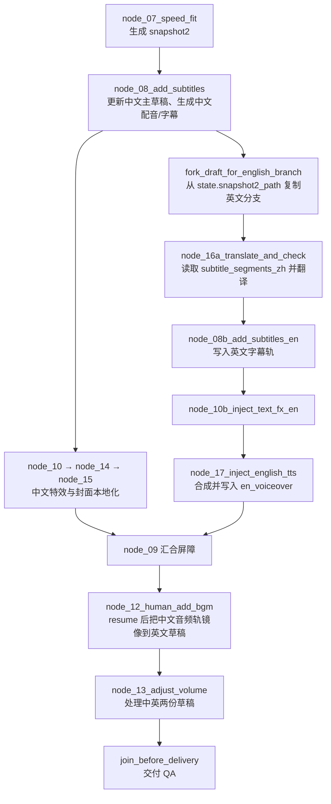

# auto-video-editor 英文分支配音与字幕假翻译：源码核验、修订设计与分阶段执行计划

> 文档类型：源码审查后的设计与开发执行计划  
> 仓库：[`wayyet/auto-video-editor`](https://github.com/wayyet/auto-video-editor)  
> 分支：`main`  
> 核验基线：`2e6f06c0ebb39173c63647ac279c4052bc9edf00`（2026-11-16 16:47:57 UTC）  
> 原始问题文档：[`auto-video-editor_英文分支中文配音残留与字幕假翻译_分析与修复计划_20261117.md`](https://github.com/wayyet/auto-video-editor/blob/main/docs/%E7%AC%AC%E5%85%AD%E6%9C%9F%E5%BC%80%E5%8F%91/auto-video-editor_%E8%8B%B1%E6%96%87%E5%88%86%E6%94%AF%E4%B8%AD%E6%96%87%E9%85%8D%E9%9F%B3%E6%AE%8B%E7%95%99%E4%B8%8E%E5%AD%97%E5%B9%95%E5%81%87%E7%BF%BB%E8%AF%91_%E5%88%86%E6%9E%90%E4%B8%8E%E4%BF%AE%E5%A4%8D%E8%AE%A1%E5%88%92_20261117.md)  
> 原始文档 blob SHA：`86925111c0b48a8572d97b2a68ce2bc895ea79f7`  
> 本文状态：**已完成源码级核验；修订设计待实施；未执行仓库代码修改与运行测试**。

---

## 1. 执行结论

原文档识别的两个用户可见问题成立：

1. 英文分支草稿可能同时包含中文配音轨 `Voiceover_zh` 和英文配音轨 `en_voiceover`。
2. 英文字幕翻译默认客户端仍是 `MockTranslateClient`，只给中文加 `[EN] ` 前缀；该结果会被写入剪映文本轨、英文 SRT，并被英文 TTS 节点当作英文文案朗读。

但原文档不能原样作为开发任务单直接执行。源码审查发现至少五个需要修正的设计缺口：

- **fork 时序解释不准确**：`snapshot2` 由 `node_07_speed_fit` 在 `node_08_add_subtitles` 之前生成。图上 fork 节点虽然位于 node_08 之后，但 fork 复制的是先前落盘的 `snapshot2_path`，并不是 node_08 执行后的中文主草稿。原文所称“node_08 已先把 `Voiceover_zh` 写入被 fork 的快照”不能由当前代码支持。
- **node_12 的镜像回灌是确定性问题**：`mirror_bgm_to_en_draft()` 当前选取中文草稿全部 `type=audio` 轨，只在英文侧保留 `en_voiceover`，随后把中文音轨整体镜像进英文侧。只要中文草稿存在 `Voiceover_zh`，它就会被回灌。
- **翻译 marker 判定不足**：只记录 translator 类型（`mock`/`llm`）与段数，不能识别“段数不变但中文内容变了”“模型版本变了”“提示词版本变了”等情况，会误用过期翻译。
- **stub 结果仍可能进入交付链**：原文允许 stub 继续生成 `[EN] 中文`，但没有明确阻断 `node_08b` 将其写入最终字幕轨、阻断 `node_17` 将其作为英文文本送入 TTS，以及阻断 QA 将该任务判为成功。
- **漏掉直接 CLI resume 注入入口**：除 `scripts/run_workflow.py` 与 `agent_gate/runner.py` 外，`scripts/resume_workflow.py` 也有独立的 `_apply_llm_backend()`，当前同样只设置 VLM/LLM 默认 client，没有设置翻译 client。

**建议采用修订后的总体方案：**新建英文分支时清理中文配音轨；node_12 镜像时再次排除中文配音轨；交付 QA 同时检查“中英文镜像一致性”和“英文草稿禁止出现中文配音轨”；翻译适配器复用本次运行已创建的 LLM client；marker 使用输入内容指纹、模型身份和提示词版本；stub 仅用于测试/联调，不能作为真实英文字幕或英文 TTS 的成功输入；封面标题翻译与字幕翻译共用翻译能力，但不依赖不稳定的 `materials.texts[0]` 隐式约定。

---

## 2. 范围、目标与非目标

### 2.1 目标

| 编号 | 目标 | 可验证结果 |
|---|---|---|
| G1 | 英文分支不含中文配音 | 英文草稿不存在 `name == "Voiceover_zh"` 的 audio track；英文 TTS 成功时只保留 `en_voiceover` 等允许的英文配音轨 |
| G2 | 中文 BGM 可以继续镜像 | 人工或自动添加的 BGM 仍能从中文草稿镜像到英文草稿；不得因排除中文配音而漏掉 BGM |
| G3 | 英文字幕是真实翻译 | `Subtitles_en`、`subtitle_en.json`、`subtitle_en.srt` 内容来自真实翻译结果，而非 `[EN] ` 前缀 mock |
| G4 | 英文 TTS 使用真实英文文本 | `node_17` 的输入严格来自有效英文翻译段；翻译缺失、stub 或校验失败时不得把中文伪装成英文送入 TTS |
| G5 | 封面标题不再使用假翻译 | `node_15` 使用同一真实翻译能力；翻译失败时明确降级，不生成 `[EN] 中文` 假标题 |
| G6 | 重放安全 | fork 清理、node_12 镜像和翻译 marker 均可幂等重放；不得删除 BGM 或被其他轨道共享的素材 |
| G7 | 老任务数据不被追溯修改 | 本次验收使用新 `thread_id/session_id`；不批量修改旧任务、不扫描并修复既有草稿目录 |

### 2.2 非目标

- 不改变中文主草稿的中文配音业务行为。
- 不删除中文主草稿中的 `Voiceover_zh`。
- 不删除磁盘上的 WAV 文件；本方案仅调整英文草稿 JSON 内的轨道、素材和引用关系。
- 不改变 `node_17` 的 TTS provider、音色选择、音频时间线算法；只约束其输入必须是有效英文翻译。
- 不借本任务重构整个 LLM 网关、Storyline 节点或 BGM 业务。
- 不回写或修补已经完成的历史任务草稿。

---

## 3. `main` 分支现状与真实工作流时序

### 3.1 当前图拓扑（与本问题相关）



### 3.2 必须区分“图执行顺序”和“快照内容时间点”

当前代码存在一个容易误读的时序：

1. `nodes/node_07_speed_fit.py` 在放行路径调用 `_produce_snapshot2(draft_path)`，将当时的中文主草稿目录复制到 `snapshots/snapshot2/`，并把该快照路径写入 `state.snapshot2_path`。
2. `graph.py` 中 `node_07_speed_fit` 的条件边放行后才进入 `node_08_add_subtitles`。
3. `node_08_add_subtitles` 后续修改的是 `state.draft_path` 指向的中文主草稿；其中 `_write_zh_voiceover_track()` 会按当前草稿的视频分组时间重新写入 `Voiceover_zh`，代码注释明确说明它是 node_05 初稿配音之后的第二次落点。
4. `fork_draft_for_english_branch` 虽然在图上排在 node_08 后面，但 `nodes/node_fork_english_branch.py::_fork()` 读取的是 `snapshot2_path`，然后复制该快照，而不是重新复制当前 `draft_path`。

因此，**不能用“node_08 在图上先于 fork”推导“node_08 写入的 `Voiceover_zh` 一定存在于 fork 复制的 snapshot2”**。快照文件在 node_07 时已经生成。node_05 初稿、snapshot2 本身是否含有某条未命名或旧格式的旁白音轨，需要以对应任务的 `draft_content.json` 和审计记录中的轨道 ID/名称为证，不能仅凭 `materials.audios` 数量推断。

无论 fork 初始快照是否已经带入中文旁白，下面的回灌路径是当前源码明确存在的：

- `node_12_human_add_bgm.py::mirror_bgm_to_en_draft()` 从**当前中文主草稿**取全部 `type=audio` 轨。
- 当前筛选条件没有排除 `Voiceover_zh`。
- 英文侧只保留 `EN_VOICEOVER_TRACK_NAME`（`en_voiceover`）轨，然后追加中文侧所选全部 audio 轨。

所以 node_12 是本缺陷必须修复的确定路径；fork 清理则是阻止旧快照/旧格式音轨带入英文草稿的第一道防线。

### 3.3 代码行为核验表

| 文件/函数 | 当前行为 | 核验结论 |
|---|---|---|
| `nodes/_dual_draft.py` | 定义 `EN_VOICEOVER_TRACK_NAME = "en_voiceover"`，没有统一中文配音轨常量 | 需要增加 `ZH_VOICEOVER_TRACK_NAME`，避免各模块重复写字符串 |
| `nodes/node_fork_english_branch.py::_fork()` | 从 `snapshot2_path` 复制目录；state 路径复用和文件系统目录复用都可提前返回 | fork 本身没有清理中文配音；清理必须覆盖新建与合法重放路径，但不能误改历史目录 |
| `nodes/node_08_add_subtitles.py::_write_zh_voiceover_track()` | 生成/重建 `Voiceover_zh`，并保留非本节点拥有的音轨 | 中文主草稿保留中文配音是正确行为；不能在此删除 |
| `nodes/node_12_human_add_bgm.py::mirror_bgm_to_en_draft()` | 复制中文草稿全部 audio tracks，仅保护英文配音轨 | 缺陷确定；需过滤中文配音轨，并从旧英文稿清理残留 |
| `nodes/node_13_adjust_volume.py` | `VOICEOVER_TRACK_NAMES` 包含 `Voiceover_zh` 和 `en_voiceover`；对两份草稿分别处理音量 | 不必改变音量算法；共享中文轨常量，增加回归测试即可 |
| `draft_ops/draft_integrity.py::check_audio_mirror()` | 英文侧排除 `en_voiceover`，中文侧所有 audio tracks 都参与镜像集合比较 | 若 node_12 不再镜像中文 VO，QA 会误报；需同步调整，并另增英文禁止中文 VO 检查 |
| `jy_common/translate_client.py` | `_default_client` 全局默认是 `MockTranslateClient()`，输出 `[EN] ` + 中文原文 | 根因确定；生产流程目前不会自动替换此 client |
| `nodes/node_16a_translate_and_check.py` | 调 `translate_segments()`；marker 只按文件存在、list 类型和段数决定是否跳过 | 会复用过期假翻译；需改成来源内容与翻译器版本指纹 |
| `nodes/node_08b_add_subtitles_en.py` | 将 `text_en` 同时写到剪映 `content` 和 `text_en`，并同步到原生 text 轨 | 这是假翻译最终显示在剪映画面上的写入点 |
| `nodes/node_17_inject_english_tts.py` | 将 `subtitle_segments_en[*].text_en` 拼接后送 TTS，成功时写 `en_voiceover` | 假翻译会继续流入英语音色 TTS；必须增加翻译状态门禁 |
| `nodes/node_15_localize_covers_en.py::_get_titles()` | 从 `materials.texts[0]` 取中文标题，再用 `[EN] ` 前缀构造英文标题 | 假翻译确定；还存在标题取值依赖数组第 0 项的问题 |
| `scripts/run_workflow.py::_apply_llm_backend()` | 仅设置 `storyline_capabilities.vlm_client` 默认 client | 需同时安装翻译 adapter，并复用同一个 client 实例 |
| `scripts/resume_workflow.py::_apply_llm_backend()` | 同样只设置 VLM/LLM 默认 client | 原文档漏掉此生产恢复入口，必须补上 |
| `agent_gate/runner.py::install_client()` | 只调用 `storyline_capabilities.vlm_client.set_default_client()` | 需同时安装翻译 adapter |

---

## 4. 缺陷一：英文草稿残留中文配音

### 4.1 根因

该问题不是单一节点造成，而是“英文分支创建时不清理 + 后续音频镜像未区分角色 + QA 镜像集合定义不一致”共同造成：

1. fork 复制 `snapshot2` 时没有定义英文草稿音轨白名单/黑名单，也没有过滤中文旁白。
2. node_08 会在中文主草稿上生成权威 `Voiceover_zh` 轨；fork 之后，node_12 又从当前中文主草稿镜像全部音频轨，使中文配音确定性进入英文分支。
3. node_13 把 `Voiceover_zh` 与 `en_voiceover` 都识别为配音轨，并分别应用 voiceover 音量。这是音量角色处理逻辑，不是残留根因；但它说明只在 fork 清一次不够，node_12 必须同时过滤。
4. `check_audio_mirror()` 目前要求中文侧的全部音频轨都在英文侧匹配；如果只修改 node_12 而不调整 QA，就会把“有意不镜像的中文配音”报告为镜像失败。

### 4.2 修订后的删除策略

**清理对象：英文分支草稿 JSON 中由工作流明确标记为中文配音的音轨。**

唯一权威匹配条件：

```python
track.get("type") == "audio" and track.get("name") == ZH_VOICEOVER_TRACK_NAME
```

不得根据“中文文件名”“音频路径包含 zh”“轨道名称含中文”等模糊条件删除，因为人工 BGM、剪映 VIP 音乐或用户本地音频可能具有相似命名。

清理步骤：

1. 从 `tracks` 中移除 `name == ZH_VOICEOVER_TRACK_NAME` 的 audio track。
2. 收集这些 track segments 的 `material_id` 和 `extra_material_refs`。
3. 重新扫描剩余所有 tracks 的 `material_id` / `extra_material_refs`，以及仓库现有草稿结构检查所覆盖的引用关系。
4. 只有在确认某个 material ID 不再被任何保留轨道/片段引用时，才从对应 `materials` bucket 删除该素材；不能只因它曾被中文配音轨引用就直接删除。
5. 对中文配音段引用的 `speeds` 等伴随素材执行相同的“全草稿无其他引用才删除”规则，避免留下孤儿 material。
6. **不删除素材文件本身**，不执行 `Path.unlink()`，不删除 `storyline_outputs` 下 WAV 文件。素材可能被其他任务、原始中文草稿或用户文件引用。
7. 通过 `nodes._draft_io.write_draft(..., audit_node="node_fork_english_branch")` 写回；写入成功后重新加载草稿，断言不存在中文配音轨，并运行 `check_track_references()`。
8. `write_draft()` 返回值必须检查 `result.get("ok")`；若写入未通过，不得只写 status tag 后继续运行。

### 4.3 fork 清理必须兼容重放，同时保护历史任务

`_fork()` 有三种路径：新复制、state 中已有路径复用、文件系统中找到既有目录复用。清理逻辑不能只放在 `copytree()` 后的一个分支。

建议增加分支策略标记，例如 `en_branch_cleanup_version`（进入 LangGraph state 并随 checkpoint 持久化）：

- 本次运行新创建的英文分支：执行清理，成功后写入策略版本标记。
- 同一新任务的 checkpoint 重放：标记已存在时允许重复执行幂等清理。
- 发现一个**没有本策略标记的历史英文分支目录**：不得仅凭“路径被复用”就自动改写它；应将本次 state 标记为 `legacy`，记录 `legacy_en_branch_cleanup_skipped`。
- `node_12` 也必须读取该策略标记：只有 `en_branch_audio_policy_version == "v2"` 时才采用“排除并清理中文 VO”的新镜像策略；`legacy`/无版本的旧任务保持原有镜像行为，避免旧任务在恢复执行时被本次改动追溯修改。
- 新增的“英文草稿禁止中文 VO”QA 只对 `v2` 分支启用；旧分支报告 `not_applicable/legacy`，不因新规则阻断历史任务。该隔离检查对 `v2` 分支是**硬性必选项**，不能受用户 `required_features` 配置关闭。
- 同一新任务内清理失败：fail-fast，不允许让不干净的英文草稿进入下游节点。

实现时应让 `_fork()`/wrapper 能区分“本次新建”与“发现历史目录”，不要仅用 `Path.exists()` 判断是否安全写入。上述策略字段必须加入 `state.py` 的 `WorkflowState`，否则 LangGraph state schema 不一定会持久化这些新字段。

### 4.4 node_12 镜像修复

`mirror_bgm_to_en_draft()` 应在读取中文草稿后立即构造镜像轨集合：

```python
audio_tracks = [
    track
    for track in (zh_draft.get("tracks", []) or [])
    if track.get("type") == "audio"
    and track.get("name") != ZH_VOICEOVER_TRACK_NAME
]
```

后续 `referenced_ids`、音频素材复制和 companion refs 只能基于过滤后的 `audio_tracks` 计算。这样 `Voiceover_zh` 的 audio materials/speed companion refs 不会因 BGM 镜像流程再次带入英文草稿。

另外，英文侧合并前应删除可能遗留的 `Voiceover_zh` 轨，再保留 `en_voiceover` 和替换 BGM 镜像轨。注意：删除遗留轨后，也要执行与 §4.2 相同的引用扫描和孤儿素材清理，不能无条件删除共享材料。

`node_12` 在以下边界条件下必须保持现有语义：

- 中文草稿有 BGM + `Voiceover_zh`：只镜像 BGM，不镜像中文 VO。
- 中文草稿有 BGM、英文草稿已有 `en_voiceover`：英文 VO 必须保留。
- 中文草稿没有 BGM：继续按现有 gate 语义由 node_12 提醒/挂起，不得把中文 VO 当作 BGM。
- 镜像重放多次：BGM 不重复，英文 VO 不丢失，中文 VO 不出现。

### 4.5 QA 修复：区分“允许不镜像”与“禁止残留”

不能简单把中文 VO 从镜像比较中排除，然后就不再检查英文草稿。正确做法是两类检查分离：

**A. 音频镜像一致性**

- 中文侧比较集合：排除 `Voiceover_zh`，保留 BGM/用户添加音轨。
- 英文侧比较集合：排除 `en_voiceover`，也排除 `Voiceover_zh`（中文 VO 不属于镜像集合）。
- 比较两边剩余音轨 segments 的 ID 集合，以及引用 audio materials/companion materials 的完整性。

**B. 英文草稿语言隔离检查（新增）**

- 对 `en_branch_audio_policy_version == "v2"` 的英文草稿，只要出现 `name == ZH_VOICEOVER_TRACK_NAME` 的 audio track，就生成 `SEV_ERROR`。
- 建议新增专用 `audio_language_isolation` category，或由 join QA 将该 issue 直接提升为硬性 `gate_failed=True`。它是 v2 分支的结构不变量，不得受 `required_features.voiceover_en` 是否勾选影响。
- 对 `legacy`/无版本历史分支标记 `not_applicable`，避免本次新规则追溯阻断旧任务。
- 同时将残留轨的 track ID、segment ID、引用 material ID 写入 QA issue，便于定位来源。

这样既不会因“中文 VO 不应镜像”误报 BGM 镜像不一致，也不会漏掉英文草稿残留中文 VO 的实际缺陷。

---

## 5. 缺陷二：英文字幕是假翻译

### 5.1 根因与传播链

当前 `jy_common/translate_client.py`：

- 定义 `TranslateClient` Protocol，方法为 `translate(segments)`。
- `_default_client: TranslateClient = MockTranslateClient()` 是全局默认值。
- `MockTranslateClient.translate()` 对每段执行 `f"[EN] {text_zh}"`。
- `set_default_client()` 存在，但工作流运行时目前没有调用它来安装真实翻译 adapter。

当前传播链：

1. `node_16a_translate_and_check` 调用 `translate_segments(segments_zh)`。
2. 假 `text_en` 写入英文草稿 `materials.texts`，并输出 `subtitle_en.json`、`subtitle_en.srt`。
3. `node_08b_add_subtitles_en` 把 `text_en` 写入 `content`，再同步到原生 `Subtitles_en` text track，形成剪映实际显示文本。
4. `node_17_inject_english_tts` 把 `subtitle_segments_en[*].text_en` 拼接后送入 TTS，因此假翻译还会成为英语音色的合成输入。
5. `node_15_localize_covers_en` 也直接用 `[EN] ` 前缀构造封面标题。

### 5.2 新增 `LLMTranslateClient` 的实现方式

在 `jy_common/translate_client.py` 新增 `LLMTranslateClient`，继续实现现有 `TranslateClient` Protocol。不要重造一个独立 LLM SDK，也不要假设 `LLMClient` 对象存在 `chat_json()` 方法。

当前真实接口关系是：

- `storyline_capabilities.vlm_client.LLMClient` Protocol 提供 `.chat(...)`。
- 同模块提供函数 `chat_json()` 和 `chat_json_with_trace()`。
- `chat_json_with_trace()` 可以显式接收 `client=`，并返回解析结果与 trace；调用异常、JSON 解析失败会体现在 trace 中。

建议实现：

1. `LLMTranslateClient` 构造函数接收一个 `LLMClient` 实例，以及模型/提示词版本等元数据；不要在 adapter 中另起一套默认模型选择。
2. 调用 `storyline_capabilities.vlm_client.chat_json_with_trace(client=self._client, ...)`，使用结构化 schema 要求模型按输入 `index` 返回翻译文本。
3. 以输入段 `index` 为主键合并输出；`start_ms`、`end_ms` 始终从源段继承，不让 LLM 自行改写时间码。
4. 校验输出 index 唯一、完整、无多余项；翻译文本非空；schema 不符合、index 缺失、重复、缺段、模型调用异常时，最多重试 1 次，然后 raise 明确异常。
5. 不允许使用 `zip(source, translated)` 直接静默截短结果：LLM 返回少一段时，`zip` 会吞掉尾部源段，造成字幕数与时间轴不一致。
6. 对长字幕列表分批调用（批量上限按 token/字符数配置），每批按原始 index 对齐；批次失败可单独重试，但整体不能把未翻译段当作成功。
7. 记录 `translator_id`、模型/provider、prompt version、耗时、重试次数和失败摘要；日志不能记录 API Key 或敏感密钥。

### 5.3 同一次运行必须复用同一个 client 实例

三条执行入口必须保持一致：

| 入口 | 当前注入行为 | 修订要求 |
|---|---|---|
| `scripts/run_workflow.py::_apply_llm_backend()` | `build_client()` 后设置 `vlm_client.set_default_client()` | 同一实例同时传给翻译 adapter |
| `scripts/resume_workflow.py::_apply_llm_backend()` | 独立构建/注入 VLM client | 同步安装翻译 adapter；避免 crash/resume 后翻译能力退回 Mock |
| `agent_gate/runner.py::install_client()` | 仅设置 VLM 默认 client | 同时调用 `jy_common.translate_client.set_default_client(LLMTranslateClient(client))` 或统一的 client 注册函数 |

推荐将“注册 VLM client + 注册 translation client”收敛到一个公共装配函数，避免三个入口复制相同逻辑。调用顺序必须在 graph invoke/resume/worker 执行前完成。

`stub` 后端可以保留 Mock 以便单元测试和本地联调，但必须通过结果状态区分：`translator_id="mock"`、`translation_status="stub"`，不能把它报告为真实翻译完成。

### 5.4 stub 必须 fail-closed，不能混进正式交付

仅在日志中标记 `[EN]` 或写入 `translator="mock"` 不足以防止假翻译流入下游。至少需要：

- `node_16a` 输出明确的 `translation_status`（`real` / `stub` / `failed` / `skipped`）和 `translator_id`。
- `node_08b` 在 `translation_status != "real"` 时，不得把 mock 文本当作正常 `Subtitles_en` 写入正式英文草稿；可在测试 fixture 中验证占位写入，但生产任务必须标记 degraded。
- `node_17` 在 `translation_status != "real"` 或有效英文段为空时跳过 TTS，并记录明确原因；绝不把中文原文传给英文 voice provider。
- `join_before_delivery` / `build_qa_categories` 必须将 required 的英文字幕标记为 `degraded/failed`，令 `gate_failed=True`。只把状态写入 `status_log` 而不进入 gate，不能构成安全门禁。
- 若开发者需要 stub 预览，应有显式的开发开关并在 QA 报告中显示“预览/不可交付”；默认生产模式不允许。

此外不要用“英文文本不含任何 CJK 字符”作为唯一判定标准：英文专有名词、品牌名、人名可能保留汉字。可以将残留 CJK 比例作为诊断信号，结合 `translator_id` 和人工抽样检查判断，而不是无条件拒绝。

### 5.5 marker：升级为输入与翻译配置指纹

现有 `_marker_exists(draft_dir, expected_count)` 只校验 `subtitle_en.json` 是否是 list 且段数相同。这个逻辑无法识别同段数不同文案，必须升级。

建议 marker schema：

```json
{
  "schema_version": 2,
  "target_language": "en",
  "source_fingerprint": "<sha256>",
  "translator_id": "mcode-cli:<model-id>",
  "prompt_version": "subtitle-translate-v1",
  "segments": [
    {
      "index": 0,
      "start_ms": 0,
      "end_ms": 1800,
      "text_en": "A translated sentence."
    }
  ]
}
```

`source_fingerprint` 应对有序规范化输入计算 SHA-256，至少包括：

- `index`、`text_zh`、`start_ms`、`end_ms`；
- `target_language`；
- 影响翻译结果的 prompt/template version；
- translator/backend/model identity（或与之关联的 `translator_fingerprint`）。

marker 复用条件必须同时满足：schema 版本兼容、源 fingerprint 相同、translator/model identity 相同、prompt version 相同、段数和 index 集合完整、翻译文本合法。

旧版 list marker 应视为 legacy mock/unknown，不得自动视为真实翻译命中。对当前新任务应触发重新翻译；无需为了本次修复回写旧任务文件。

若 marker 指纹匹配，则可以继续从英文草稿读取人工修订后的文本；若源文案、模型或 prompt 改变，则必须重新翻译，不能只因“段数一样”而复用。

### 5.6 封面标题翻译

`node_15_localize_covers_en.py::_get_titles()` 当前把 `materials.texts[0]` 当作中文标题，缺失时退回“默认标题”，再加 `[EN] `。这里有两个问题：假翻译和标题来源不稳定。

修订要求：

1. 先定义 canonical title 的唯一来源，例如 `state.storyline_script_artifact`/明确的 `title_zh` state 字段，或一个有稳定 ID/标记的 draft title material；不要只依赖 `materials.texts[0]`。
2. `node_14` 和 `node_15` 复用同一个 title resolver，避免中文封面与英文封面取到不同文本。
3. 通过同一 `LLMTranslateClient` 翻译标题；不为封面另造模型接口。
4. 翻译失败时不拼接假前缀；保留原图或标记 `en_path=None` 并写 `cover_translation_status=degraded`，按现有封面失败策略走后续 QA。
5. 增加测试覆盖标题 material 排序变化、没有标题、标题是 native JSON content、标题含英文/品牌名等情况。

---

## 6. 推荐代码改动清单

| 优先级 | 文件 | 主要改动 | 不应改变的行为 |
|---|---|---|---|
| P0 | `nodes/_dual_draft.py` | 新增并导出 `ZH_VOICEOVER_TRACK_NAME = "Voiceover_zh"` | 保留现有 `EN_VOICEOVER_TRACK_NAME` |
| P0 | `state.py` | 增加 `en_branch_audio_policy_version` 等分支策略字段 | 不改变既有 state 字段语义 |
| P0 | `nodes/node_fork_english_branch.py` | fork 新建分支后清理中文配音；增加策略版本/新建与历史目录识别；写后校验 | 不改中文主草稿；不追溯修改无策略标记的历史英文草稿 |
| P0 | `nodes/node_08_add_subtitles.py` | 删除私有轨名常量，改引用 `_dual_draft.ZH_VOICEOVER_TRACK_NAME` | 中文 VO 生成、时间区间与轨道写入逻辑不变 |
| P0 | `nodes/node_12_human_add_bgm.py` | 过滤 `Voiceover_zh`；清理英文侧残留同名轨；素材/companion refs 按过滤集合计算 | BGM 镜像、`en_voiceover` 保留、人工 BGM 轨名不受影响 |
| P0 | `nodes/node_13_adjust_volume.py` | `VOICEOVER_TRACK_NAMES` 使用共享常量 | 不改 volume/fade 算法 |
| P0 | `draft_ops/draft_integrity.py` | 镜像比较排除两类独立旁白；新增英文侧禁止中文 VO 的 error 级 QA | 不放宽 BGM/audio material 引用完整性检查 |
| P1 | `state.py` | 增加 `subtitle_translation_status`、`subtitle_translator_id`、fingerprint/prompt/error 等 state 字段 | 不改变既有 state 字段语义 |
| P1 | `jy_common/translate_client.py` | 新增 `LLMTranslateClient`、schema、index 校验、trace/重试、translator metadata | 保留 Protocol 和可注入 Mock，避免影响现有单测 |
| P1 | `nodes/node_16_translate_subtitles.py` | marker schema v2、source fingerprint、translator/prompt/model version校验 | 保留 SRT 序列化与 native/legacy draft 双形态读取 |
| P1 | `nodes/node_16a_translate_and_check.py` | 调用真实 adapter；验证输出；传递 translation status；marker 仅有效命中才跳过 | 无源字幕时现有正常 skip 语义不变 |
| P1 | `nodes/node_08b_add_subtitles_en.py` | 只消费真实翻译结果；stub/failure 不得冒充可交付英文字幕 | 原生 text material 与 track 构造方式不变 |
| P1 | `nodes/node_17_inject_english_tts.py` | 检查 translation status，阻止中文/mock 文本进入英文 TTS | 保留英文音轨 ID、幂等写轨和 TTS provider 选择 |
| P1 | `scripts/run_workflow.py` | 生产入口装配同一 LLM client 到 VLM 和 translation client | 保留现有 `--llm-backend` 参数和生产 stub 防护 |
| P1 | `scripts/resume_workflow.py` | resume CLI 同步安装翻译 client | 保留 checkpoint 匹配和 resume guard |
| P1 | `agent_gate/runner.py` / 公共 client 注册函数 | Agent Gate worker 也安装同一个 translation adapter | 不改变 Mailbox/worker 状态机 |
| P2 | `nodes/node_15_localize_covers_en.py` | 删除 `[EN]` 拼接，改用共享标题解析与翻译能力 | 图片编辑 provider 与并发模型不变 |
| P2 | `nodes/node_14_make_covers.py` | 复用 canonical title resolver | 中文封面生成规格不变 |
| P2 | `nodes/node_join_before_delivery.py` | 聚合 translation status / voiceover language isolation QA | 不降低现有 required-feature gate 严格度 |

---

## 7. 分阶段执行计划

### P0：中文配音轨隔离（先修确定性数据污染）

**目标：英文草稿创建、BGM 镜像、QA 三处行为一致。**

任务：

1. 在 `_dual_draft.py` 定义唯一中文配音轨常量；更新 node_08、node_13 的引用。
2. 实现可单测的 `remove_chinese_voiceover_from_draft()` helper：轨道匹配、material/ref 扫描、孤儿素材处理、写回、回读检查。
3. 调整 fork wrapper：新建英文分支必须清理；同一任务 checkpoint 重放可幂等重清；没有本策略标记的历史目录不得被静默改写。
4. 调整 node_12 镜像筛选和英文侧残留清理，确保素材复制逻辑只看到 BGM/其他允许音轨。
5. 调整 `check_audio_mirror()` 的比较集合，并新增 `check_no_zh_voiceover_in_en_draft()`。
6. 更新 node_12 / fork / draft_integrity 测试。

**P0 验收：**

- fork 新建分支后不含 `Voiceover_zh`，且 `state.en_branch_audio_policy_version == "v2"`。
- fork 对策略标记的同一任务重复执行，结果不变。
- 历史分支（无策略标记）不因本次新任务代码而被修改；node_12 对其保持 legacy 行为，QA 不启用 v2 隔离规则。
- v2 分支的 node_12 只镜像 BGM/允许音轨，不回灌 `Voiceover_zh`；`en_voiceover` 保留。
- BGM material、speed/fade 等 companion refs 完整；共享 material 不被删除；磁盘 WAV 不被删除。
- QA 在英文侧残留 `Voiceover_zh` 时必报 error；没有中文 VO、BGM 镜像正确时不误报。

### P1：英文字幕翻译接入真实 LLM

**目标：翻译调用链端到端真实化，并对失败/Mock 显式降级。**

任务：

1. 定义翻译输出 schema、prompt version、translator identity 和错误类型。
2. 实现 `LLMTranslateClient`，通过 `chat_json_with_trace(client=...)` 调现有 LLM client。
3. 实现分批翻译、index 完整性校验、时间字段从源段继承、最多一次重试。
4. marker 升级 v2，计算 `source_fingerprint`；旧 list marker 不作为真实翻译命中。
5. 给 `node_16a` 增加 `translation_status`、`translator_id`、`translation_fingerprint` 等状态字段。
6. 更新 `node_08b` 和 `node_17` 的门禁：只有 `translation_status == "real"` 才允许正式写入英文字幕轨和提交英文 TTS。
7. 将 client 装配集中到公共 helper，分别在 run、resume、Agent Gate 三个入口调用。
8. `build_qa_categories()` 将 required 的英文字幕翻译状态为 stub/failed/degraded 识别为阻断问题。

**P1 验收：**

- 使用 `mcode-cli` 或 `claude-cli` 时，翻译 client 与 Storyline 使用同一个运行时 client 实例。
- 三种运行入口（直接 run、直接 resume、Agent Gate worker）都能安装翻译 client。
- 翻译结果按 index 一一对应，source 时间码保持不变。
- 缺段、重段、重复 index、非法 JSON、空翻译、API 异常都不会生成“成功”的英文字幕或英文 TTS。
- 源文本变更、模型变更、prompt 版本变更会使 marker 失效并重新翻译。
- 旧 marker 不会继续复用 `[EN] 中文` 假翻译。
- stub 模式被明确标记，required 英文字幕 QA 阻断交付；stub 文本不进入正式英文 TTS。

### P2：封面标题翻译统一

任务：

1. 设计并实现 canonical title resolver。
2. `node_14` 中文封面与 `node_15` 英文封面复用 resolver。
3. `node_15` 使用 `LLMTranslateClient` 翻译标题，不再 `[EN]` 拼接。
4. 翻译失败显式标记 degraded，不生成伪英文标题。
5. 增加封面标题来源、native content、空标题和翻译失败测试。

**P2 验收：**

- 中英文封面标题基于同一个中文 canonical title。
- 英文封面标题是模型返回的翻译，不是 `[EN]` 前缀。
- 翻译失败有可观察日志与 QA 状态，不会伪装成英文封面成功。

### P3：新任务端到端验收与回归

任务：

1. 使用新的 `thread_id/session_id` 启动完整工作流，不复用目标旧任务的 thread。
2. 使用真实 LLM backend，完成中文脚本、中文配音、中文主草稿、英文翻译、英文字幕、英文 TTS、BGM 镜像与交付 QA。
3. 保存运行时 thread id、main commit SHA、LLM backend/model、TTS backend、QA 报告、英文草稿目录和审计文件路径。
4. 检查英文草稿 JSON、SRT、剪映 GUI 时间轴和实际播放效果。
5. 执行全量单测/集测，对比既有失败基线；不以未提供日志的“历史 3 个失败”作为默认豁免。

**P3 验收：**见第 9 节完整验收清单。

---

## 8. 必须新增/修改的测试

### 8.1 fork 清理测试

| 测试场景 | 断言 |
|---|---|
| 新 fork 带 `Voiceover_zh` | 清理后该 track 不存在，state 标记 v2 |
| 新 fork 带 `Voiceover_zh` + BGM | 只删除 VO，BGM track/material 保留 |
| VO material 同时被其他轨引用 | material 保留，不产生悬空引用 |
| VO speed companion 仅被 VO 段引用 | 清理 orphan companion material/ref |
| VO companion 被其他轨引用 | companion material 保留 |
| 同一任务重复 fork/cleanup | 不重复删、不产生重复轨、不改变 BGM |
| 无策略标记的历史英文目录 | fork/node_12 不应用 v2 清理和过滤；不被本次代码追溯改写 |
| 写回失败或回读仍存在 VO | fail-fast，不标记成功 |
| 本地 WAV 路径 | 仅草稿 JSON 引用改变，物理文件仍存在 |

### 8.2 node_12 镜像测试

在 `tests/unit/test_node_12_human_add_bgm.py` 增加：

- 中文草稿同时含 `Voiceover_zh`、BGM；英文草稿原有 `en_voiceover`；执行后英文侧仅保留原英文 VO + 镜像 BGM。
- 断言中文 VO 的 track/segment/material 不被复制。
- 断言 BGM 伴随素材 refs 完整复制。
- 连续执行两次，音轨数与 material 数不增长。
- 中文草稿没有 BGM 时仍触发既有缺失处理，不把 VO 当成 BGM。

### 8.3 draft_integrity / join QA 测试

- 中文、英文均无 BGM 时，允许无 BGM 的既有业务语义保持不变。
- 中文侧 `Voiceover_zh` 不参与 BGM 镜像集合。
- 英文侧 `en_voiceover` 不参与 BGM 镜像集合。
- v2 英文侧存在 `Voiceover_zh` 时新增 error issue，且硬性触发 `gate_failed`；legacy 分支不执行此新规则。
- 英文侧只有 `en_voiceover`、中文侧无 BGM 时不误报为镜像异常。
- BGM 段引用的 material/companion 丢失时仍报错。

### 8.4 翻译 adapter 与 marker 测试

- 正常 JSON 翻译输出完整返回。
- source index 顺序变化时仍按 index 对齐，不错位。
- 缺少 index、重复 index、多余 index、少段、多段、空字符串均判失败。
- LLM 抛异常、返回非法 JSON、返回非 object 时按策略重试一次后失败。
- `start_ms/end_ms` 以源段为准，不采信模型返回的时间。
- 大量字幕按批次执行；单批失败不会让未翻译段被标记成功。
- 同源 fingerprint + 同 translator/model/prompt 命中 marker 时跳过 LLM，并保留草稿中人工修订文本。
- 源文本相同段数但文字改变时 marker 失效。
- translator/model 改变时 marker 失效。
- prompt version 改变时 marker 失效。
- legacy list marker 触发重翻，不被视为真实翻译。
- marker 写入失败时不返回成功状态；resume 可重试。

### 8.5 node_08b / node_17 / node_15 测试

- `translation_status="real"` 时 node_08b 正常落 `Subtitles_en` 原生 text track。
- `translation_status="stub"/"failed"/"skipped"` 时 node_08b 不得把 mock 或中文伪装成正式英文字幕。
- node_17 只对真实英文段调用 TTS；stub/failed 不请求英文 TTS。
- node_17 的 TTS 文本与英文字幕段拼接内容一致；不丢段、不混入 `text_zh`。
- node_15 翻译真实标题；失败时不写 `[EN]` 假标题。
- title resolver 不依赖 `materials.texts[0]`；文本素材顺序变动不改变标题。

### 8.6 三条入口装配测试

- `run_workflow` 显式选择 `mcode-cli` / `claude-cli` 后，VLM 与翻译 adapter 使用同一个 client 对象。
- `resume_workflow` 恢复执行也安装相同 client；不会因单独启动 resume 而掉回 Mock。
- Agent Gate `install_client()` 同时安装 VLM 与翻译 adapter。
- 测试 teardown 恢复全局默认 client，避免用例相互污染。

---

## 9. 新任务端到端验收清单

以下验收必须在**新建任务**上完成；不得拿旧英文分支目录作为写测试目标。

### 9.1 输入与运行配置

- [ ] 使用全新的 `thread_id/session_id`。
- [ ] 记录仓库 commit SHA。
- [ ] `VIDEO_LLM_BACKEND`/CLI backend 为 `mcode-cli` 或 `claude-cli`，确认 adapter 已装配。
- [ ] 记录实际 model/provider 和 prompt version。
- [ ] `TTS_BACKEND` 使用已配置的真实 TTS provider；记录音色与 provider。
- [ ] 保存 LangGraph run events、`status_log`、`error_log` 和 `join_qa_report`。

### 9.2 英文草稿音轨

- [ ] 英文草稿不存在 `name == "Voiceover_zh"` 的 audio track。
- [ ] 英文 TTS 成功时存在合法 `en_voiceover` track；失败时不得回退到中文 VO。
- [ ] BGM（如中文草稿有 BGM）成功镜像到英文草稿。
- [ ] 英文 VO 与 BGM 的 materials、segment refs、companion refs 全部可解析。
- [ ] 中文主草稿仍保留正常中文配音。
- [ ] `node_12` 重放不产生重复 BGM、不删除 EN VO。

### 9.3 英文字幕与 SRT

- [ ] `subtitle_en.json` marker schema 为 v2，含 source fingerprint、translator/model identity、prompt version。
- [ ] `subtitle_en.srt` 每条英文字幕均有合法时间码，段数与源字幕一一对应。
- [ ] 英文草稿 `materials.texts` 的 `content` 是翻译结果，而不是 `[EN] 中文`。
- [ ] 剪映时间轴中存在有效 `Subtitles_en` text track。
- [ ] 通过抽样人工检查，语义与中文原意一致；专有名词按 glossary/上下文合理保留。
- [ ] 英文 TTS 朗读内容与英文字幕基本一致。

### 9.4 封面与 QA

- [ ] 英文封面标题使用 canonical title 的真实翻译。
- [ ] 英文封面失败时有明确 degraded 状态，不生成假翻译。
- [ ] `check_audio_mirror` 不把中文 VO 当作必须镜像的内容。
- [ ] 新增“英文草稿禁止中文 VO”检查通过。
- [ ] required `subtitles_en` / `voiceover_en` 状态为 `passed`；stub/failed 不得被标成 passed。
- [ ] `join_qa_report.gate_failed == false`，且报告中没有 BGM 引用、草稿结构或英文语言隔离错误。
- [ ] 剪映 GUI 中英文草稿可以正常打开，播放时听不到中文旁白残留。

---

## 10. 风险与回滚

| 风险 | 影响 | 控制措施 |
|---|---|---|
| 删除轨道时误删 BGM material | 英文草稿 BGM 丢失或产生悬空引用 | 以 track name 精确识别；全草稿引用扫描；不物理删除文件 |
| 删除 speed/companion material 时误删共享数据 | 其他音轨损坏 | 仅当全草稿引用计数为零才清理 |
| fork 复用历史目录 | 修改旧任务草稿 | 策略版本标记；无标记历史目录默认不改；新任务使用新 thread_id |
| 只改 node_12 不改 QA | 正确过滤中文 VO 后仍被镜像 QA 误报 | `check_audio_mirror` 同步修改，并新增独立 no-ZH-VO 检查 |
| stub/mock 混入正式产物 | 用户仍看到假英文、英文音色读中文 | translation status + node_08b/node_17 门禁 + required-feature QA gate |
| marker 指纹覆盖不全 | 旧翻译被错误复用 | 输入文本、时间、语言、模型和 prompt 统一参与 fingerprint |
| resume 入口未安装 adapter | 恢复后退回 Mock | run/resume/Agent Gate 三入口共同测试 |
| 模型返回不完整 | 字幕丢段或错位 | schema + index 集合校验；不允许 `zip` 静默截短 |
| 本地剪映进程占用草稿 | safe write 失败 | 复用现有 `safe_write_draft` 安全门禁；写失败不标记完成 |

### 回滚边界

- P0：回滚 fork 清理、node_12 过滤和 QA 变更；不恢复历史任务文件，因为本次设计原则是不修改历史数据。
- P1：恢复旧 adapter 会重新引入 Mock 风险；生产环境回滚时必须同时关闭英文字幕/英文 TTS 的正式交付 gate，不能把 Mock 重新视为真实翻译。
- P2：可以单独回滚封面翻译 adapter，但不得恢复 `[EN] ` 前缀伪翻译。
- 任一回滚均保留日志和 marker 版本，避免回滚后旧 marker 被错误识别为新格式。

---

## 11. 对原始 20261117 文档的正确性审查

### 11.1 判断正确、建议保留的内容

| 原文判断/方案 | 审查结论 | 依据 |
|---|---|---|
| 默认翻译客户端仍是 `MockTranslateClient`，输出 `[EN] ` + 中文 | 正确 | `jy_common/translate_client.py` 的默认 client 与 `translate()` 实现 |
| `node_08b` 把 `text_en` 写入剪映实际显示的 `content` 和 text track | 正确 | `nodes/node_08b_add_subtitles_en.py` |
| `node_17` 使用 `subtitle_segments_en` 生成英文 TTS 文本 | 正确 | `nodes/node_17_inject_english_tts.py::_join_segments_text()` |
| node_12 把中文侧音频轨镜像到英文侧，只保留 `en_voiceover` | 正确 | `nodes/node_12_human_add_bgm.py::mirror_bgm_to_en_draft()` |
| `check_audio_mirror()` 目前会把中文 VO 算进镜像集合 | 正确 | `draft_ops/draft_integrity.py::check_audio_mirror()` |
| `node_15` 封面标题使用 `[EN] ` 前缀 | 正确 | `nodes/node_15_localize_covers_en.py::_get_titles()` |
| 共享 `ZH_VOICEOVER_TRACK_NAME` 是合理设计 | 正确 | node_08/node_12/node_13/QA 多处需要同一轨名语义 |
| 英文草稿清理要幂等；node_12 也必须过滤中文配音 | 正确 | fork 复用路径、node_12 后续镜像路径都必须覆盖 |
| 真实翻译 adapter 复用 `storyline_capabilities.vlm_client` 的能力 | 方向正确 | `chat_json_with_trace()` 可接收 `client=`，能返回解析 trace |
| 应在新任务上验证，不应批量修改旧草稿 | 正确 | 能隔离新旧行为，避免对用户历史项目产生副作用 |

### 11.2 原文需要修正的问题

| 严重程度 | 原文问题 | 为什么不准确/不充分 | 修订要求 |
|---|---|---|---|
| P0 | 声称 node_08 已先把 `Voiceover_zh` 写入 fork 所复制的 snapshot2 | `node_07_speed_fit` 先生成 snapshot2；node_08 后续才在当前 `draft_path` 上重铺中文配音；fork 复制 `snapshot2_path`，不是 node_08 后的当前草稿 | 说明快照内容时间点；不能仅凭图节点顺序认定快照包含 node_08 产物；以具体草稿 JSON 轨道 ID/名称验证快照是否含早期旁白 |
| P0 | fork 清理只写“删除 track + 删除它引用的 audio materials” | 若素材也被 BGM/其他轨引用，直接删会破坏共享资源；audio 段还有 speed 等 companion refs | 全草稿扫描所有引用；只清理引用归零的 material；不删除 WAV 文件 |
| P0 | QA 只调整镜像比较，不额外检查英文侧中文 VO | 把中文 VO 从镜像集合排除后，QA 也可能忽略英文侧遗留的中文 VO | 新增英文草稿语言隔离 error 检查 |
| P0 | stub 保持 Mock，但没有下游阻断细节 | Mock 仍会被 node_08b 写进 `content`，node_17 仍会拿去 TTS；仅写日志标记不能阻止假翻译 | node_08b/node_17/required QA 都校验 `translation_status` |
| P1 | marker 仅增加 `translator` 标识和 `segments` | 同为 llm 时，源句、模型版本或 prompt 改变仍可能命中旧 marker；段数相同不代表输入相同 | 增加 source fingerprint、model/provider identity、prompt version、schema version |
| P1 | 只列 `run_workflow.py` 和 `agent_gate/runner.py` 两个注入点 | `scripts/resume_workflow.py` 有独立 `_apply_llm_backend()`，当前也只装 VLM client | 三个入口共用一个注册函数并做测试 |
| P1 | 翻译结果按 `zip(source, translated)` 对齐的描述不够严格 | 若模型少返回一段，zip 会静默截短；重复/缺失 index 也可能被忽略 | 以 index 集合精确校验，禁止丢段、重段和额外段 |
| P1 | 没有明确同一 client 实例的传递方式 | VLM client 和 translation client 可能各自初始化，配置、认证或模型不一致 | `LLMTranslateClient(client)` 显式接收 `build_client()` 返回的同一对象 |
| P1 | 未说明翻译失败时如何阻止正式英文 TTS | 即使字幕标记失败，若 node17 仍运行，可能继续合成中文或空文本 | node17 依赖真实翻译状态；缺失/失败/stub 时跳过并由 QA gate 判定 |
| P2 | 封面标题继续从 `materials.texts[0]` 读取 | 数组顺序不一定是稳定的标题标识；可能读到字幕/其他文本 | 引入 canonical title resolver，node14/node15 共用 |
| P2 | 基线“integration 维持 3 存量 F”缺少可复核证据 | 文档没有给出对应 workflow run、commit SHA、日志链接和失败用例名称 | 开发前保存明确基线 run URL、commit 和失败列表；没有证据不把历史失败数作为豁免 |
| P2 | 对真机草稿的证据目前无法独立复核 | 原文提供了本地目录和审计数据，但未随 GitHub 文档附完整 JSON/审计文件或校验和 | 保存脱敏后的 track 摘要、draft SHA-256、审计文件摘要；避免上传媒体与隐私数据 |

### 11.3 本次审查不能确认的事项

以下信息不能仅靠公共仓库源码验证：

- 原文中 Windows 本地草稿 `en_branch_console-553e3e7b34f7_20261117_001556_972` 的真实轨道 JSON、素材引用关系和本地文件是否完整。
- 原文所列运行日志时间、各节点 `materials.audios` 计数是否与本地文件逐项一致。
- 用户机器上当前实际使用的 mcode/Claude 模型、模型版本、API 配置和 TTS 服务状态。
- 原文提及的历史 integration 失败数量是否是最新且可复现的基线。

因此，本文对代码路径给出的是**源码级结论**；真机样本证据仍需在本地对照 `draft_content.json`、`.autovideo_draft_mutations.jsonl`、草稿 SHA 和本次新任务日志复核。本文没有执行本地 pytest，也没有实际打开剪映 GUI。

---

## 12. 关键源码与文档

### 源码

- [`graph.py`](https://github.com/wayyet/auto-video-editor/blob/main/graph.py)：node_07、node_08、fork、node_12、QA 的实际图接线。
- [`nodes/node_07_speed_fit.py`](https://github.com/wayyet/auto-video-editor/blob/main/nodes/node_07_speed_fit.py)：`_produce_snapshot2()` 的快照生成时点。
- [`nodes/node_fork_english_branch.py`](https://github.com/wayyet/auto-video-editor/blob/main/nodes/node_fork_english_branch.py)：英文分支从 `snapshot2_path` 复制、复用目录的逻辑。
- [`nodes/node_08_add_subtitles.py`](https://github.com/wayyet/auto-video-editor/blob/main/nodes/node_08_add_subtitles.py)：中文旁白/字幕写入。
- [`nodes/node_12_human_add_bgm.py`](https://github.com/wayyet/auto-video-editor/blob/main/nodes/node_12_human_add_bgm.py)：中文音轨镜像到英文分支。
- [`nodes/node_13_adjust_volume.py`](https://github.com/wayyet/auto-video-editor/blob/main/nodes/node_13_adjust_volume.py)：配音轨角色识别和音量处理。
- [`draft_ops/draft_integrity.py`](https://github.com/wayyet/auto-video-editor/blob/main/draft_ops/draft_integrity.py)：音频镜像和 required-feature QA。
- [`jy_common/translate_client.py`](https://github.com/wayyet/auto-video-editor/blob/main/jy_common/translate_client.py)：Mock 默认翻译客户端。
- [`storyline_capabilities/vlm_client.py`](https://github.com/wayyet/auto-video-editor/blob/main/storyline_capabilities/vlm_client.py)：`LLMClient`、`chat_json_with_trace()`。
- [`nodes/node_16a_translate_and_check.py`](https://github.com/wayyet/auto-video-editor/blob/main/nodes/node_16a_translate_and_check.py)：翻译调用和 marker 命中逻辑。
- [`nodes/node_16_translate_subtitles.py`](https://github.com/wayyet/auto-video-editor/blob/main/nodes/node_16_translate_subtitles.py)：marker、草稿文本读取和 SRT 序列化。
- [`nodes/node_08b_add_subtitles_en.py`](https://github.com/wayyet/auto-video-editor/blob/main/nodes/node_08b_add_subtitles_en.py)：英文字幕写入剪映 text track。
- [`nodes/node_17_inject_english_tts.py`](https://github.com/wayyet/auto-video-editor/blob/main/nodes/node_17_inject_english_tts.py)：英文 TTS 与 `en_voiceover` 写轨。
- [`nodes/node_15_localize_covers_en.py`](https://github.com/wayyet/auto-video-editor/blob/main/nodes/node_15_localize_covers_en.py)：英文封面标题来源和 mock 拼接。
- [`scripts/run_workflow.py`](https://github.com/wayyet/auto-video-editor/blob/main/scripts/run_workflow.py)、[`scripts/resume_workflow.py`](https://github.com/wayyet/auto-video-editor/blob/main/scripts/resume_workflow.py)、[`agent_gate/runner.py`](https://github.com/wayyet/auto-video-editor/blob/main/agent_gate/runner.py)：三个运行/恢复入口的 client 装配。

### 相关设计文档

- [`docs/第三期开发/相似功能节点分析与设计执行计划.md`](https://github.com/wayyet/auto-video-editor/blob/main/docs/%E7%AC%AC%E4%B8%89%E6%9C%9F%E5%BC%80%E5%8F%91/%E7%9B%B8%E4%BC%BC%E5%8A%9F%E8%83%BD%E8%8A%82%E7%82%B9%E5%88%86%E6%9E%90%E4%B8%8E%E8%AE%BE%E8%AE%A1%E6%89%A7%E8%A1%8C%E8%AE%A1%E5%88%92.md)：P3b 曾将英文配音写入英文草稿列为可选能力。
- [`docs/第六期开发/storyline_配音与BGM节点后移至node17之后_架构分析与执行计划.md`](https://github.com/wayyet/auto-video-editor/blob/main/docs/%E7%AC%AC%E5%85%AD%E6%9C%9F%E5%BC%80%E5%8F%91/storyline_%E9%85%8D%E9%9F%B3%E4%B8%8EBGM%E8%8A%82%E7%82%B9%E5%90%8E%E7%A7%BB%E8%87%B3node17%E4%B9%8B%E5%90%8E_%E6%9E%B6%E6%9E%84%E5%88%86%E6%9E%90%E4%B8%8E%E6%89%A7%E8%A1%8C%E8%AE%A1%E5%88%92.md)：此前曾把“英文分支未生成/英文 TTS 失败时中文配音是否继续”列为待确认业务语义；本次修订需作为后续决策记录，不应让旧文档继续被误读为当前实现要求。

---

## 13. 最终实施顺序

严格按以下顺序执行，不建议把所有改动放在一个大提交中：

1. **P0 配音隔离**：共享常量 → fork 清理 → node_12 过滤 → mirror QA + no-ZH-VO QA → 单测。
2. **P1 真实翻译**：LLMTranslateClient → marker fingerprint → 三入口 client 注入 → node_16a → node_08b/node_17 门禁 → required QA。
3. **P2 封面翻译**：canonical title resolver → node_14/node_15 共用 → 封面失败状态。
4. **P3 端到端验收**：新 thread、真实 LLM、真实 TTS、剪映 GUI、完整 QA、审计数据。

**合并门槛：**P0/P1 的所有单测通过；全量单测没有新增失败；集成测试基线有明确 run 证据；新任务端到端满足第 9 节清单。任一 required 英文能力仍处于 `stub`、`failed` 或 `degraded`，不得把该任务标记为正常交付完成。
