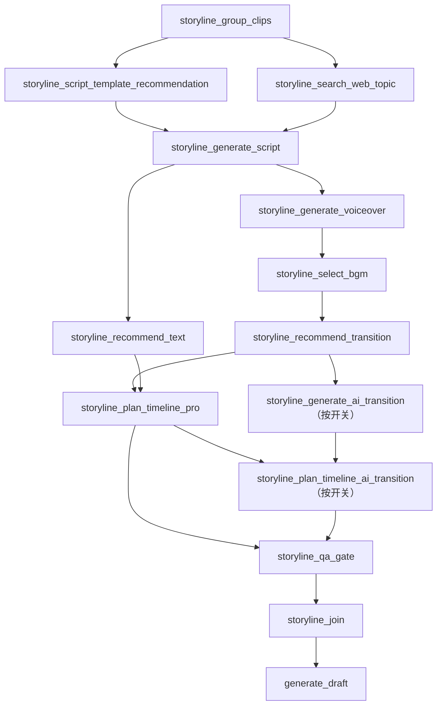
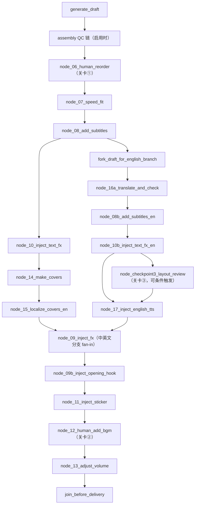
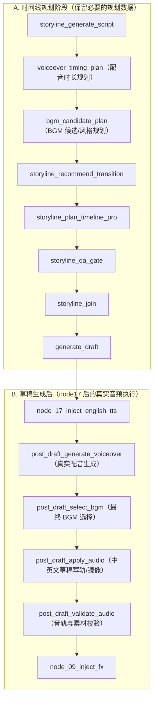

# `storyline_generate_voiceover` / `storyline_select_bgm` 后移至 `node_17_inject_english_tts` 之后：架构可行性分析与设计执行计划

> 分析基线：`wayyet/auto-video-editor` 仓库 `main` 分支  
> 本次核对的最新提交：`4f48bd3c7427717683ed4608052f44f9881039a8`  
> 提交时间：2026-11-14 15:45:57 UTC  
> 目标：评估将 `storyline_generate_voiceover`、`storyline_select_bgm` 移动到截图红框节点 `node_17_inject_english_tts` 之后是否合理，并给出安全的改造方案。  
> 结论性质：源码静态分析和设计建议；本次没有修改仓库、运行工作流或执行测试。

---

## 1. 执行摘要

### 1.1 结论

**不建议把现有两个节点原样移动到 `node_17_inject_english_tts` 之后。**

这不是单纯的节点排序问题，而是跨越了两个不同的工作流阶段：

- `storyline_generate_voiceover` 和 `storyline_select_bgm` 当前位于 Canonical Timeline（规范化时间线）生成之前。
- `node_17_inject_english_tts` 位于 `generate_draft` 之后的英文分支末端，负责把英文 TTS 真实音频写入已经存在的英文剪映草稿。
- 当前 `storyline_generate_voiceover` 的音频时长会被 `storyline_select_bgm` 消费，并进一步进入时间线规划链。
- 当前 `storyline_select_bgm` 的结果会进入 `storyline_recommend_transition`，并被时间线规划及草稿映射链消费。

如果仅修改边，把两个节点接到 `node_17_inject_english_tts` 后面，会让它们的上游输入或下游消费者尚未就绪，或令已经生成的时间线和草稿缺少原先依赖的配音/BGM 信息。

### 1.2 推荐方案

采用**计划阶段与草稿物化阶段分离**的方案，而不是直接搬动两个现有节点：

1. 保留时间线规划前所需的音频规划数据依赖。
2. 将真实音频写入剪映草稿的职责放在草稿已生成之后。
3. 在 `node_17_inject_english_tts` 后新增明确的音频落稿/校验阶段，或者将现有节点拆分为“规划”和“执行”两个职责。
4. 调整 `node_15_localize_covers_en` 与英文分支完成点的 fan-in（多前驱汇合）关系，保证音频落稿结束后才进入 `node_09_inject_fx`。
5. 在 `node_13_adjust_volume` 和 `join_before_delivery` 前校验中英文草稿的 BGM/配音轨是否符合配置。

**关键决策：** 如果产品要求的是“把真实 TTS 合成和真实 BGM 文件选择/落稿推迟到英文配音节点之后”，则需要重构时间线规划对音频时长和 BGM 元数据的依赖，不能只改 `graph.py` 的边。

---

## 2. 本次代码基线与核对范围

### 2.1 Git 基线

- 仓库：<https://github.com/wayyet/auto-video-editor>
- 分支：`main`
- 核对提交：[`4f48bd3c7427717683ed4608052f44f9881039a8`](https://github.com/wayyet/auto-video-editor/commit/4f48bd3c7427717683ed4608052f44f9881039a8)
- `graph.py` 当前文件 Blob SHA：`2b76b220a4f6f5e41c532119551d926e9c895492`
- `nodes/storyline/node_generate_voiceover.py` Blob SHA：`97076f6dd6ee2fb42c4258b7bfa415b99feaed06`
- `nodes/storyline/node_select_bgm.py` Blob SHA：`8c0578a94a8209e7db267952901eff1201c88c52`

注意：文件 Blob SHA 与 commit SHA 不是同一概念。后续开发应以实际 checkout 的 commit 为准，并在 PR 中记录 `git rev-parse HEAD`。

### 2.2 重点核对文件

| 文件 | 核对目的 |
|---|---|
| `graph.py` | 当前两个节点的真实入边、出边；node17 所在英文分支及 fan-in |
| `nodes/storyline/node_generate_voiceover.py` | 配音生成的输入、产物、失败语义 |
| `nodes/storyline/node_select_bgm.py` | BGM 选择是否依赖配音时长、输出字段 |
| `nodes/node_17_inject_english_tts.py` | 截图目标节点的实际职责及其草稿写入行为 |
| `nodes/node_09_inject_fx.py` | node17 之后的尾链入口及草稿操作边界 |
| `nodes/node_12_human_add_bgm.py` | 人工 BGM 关卡及中英草稿镜像职责 |
| `nodes/node_13_adjust_volume.py` | 音量处理对 BGM、配音轨的消费 |
| `state.py` | Storyline artifact 和 BGM selection 状态字段 |

---

## 3. 当前工作流拓扑

### 3.1 Storyline 自动剪辑链（音频节点当前所在位置）

当前 `graph.py` 的主干如下：



AI 转场开关关闭时，`storyline_plan_timeline_pro` 直接进入 QA；开启时，QA 等待 AI 转场时间线规划节点。

### 3.2 草稿生成后的中英文编辑链



`ASSEMBLY_QC_GATE_ENABLED` 关闭时，`generate_draft` 会直接进入 `node_06_human_reorder`，不改变本次讨论的核心依赖关系。

### 3.3 当前关键边

当前 `graph.py` 中的关键连线是：

```python
g.add_edge("storyline_generate_script", "storyline_generate_voiceover")
g.add_edge("storyline_generate_script", "storyline_recommend_text")

g.add_edge("storyline_generate_voiceover", "storyline_select_bgm")
g.add_edge("storyline_select_bgm", "storyline_recommend_transition")

g.add_edge(
    [
        "storyline_recommend_transition",
        "storyline_recommend_text",
    ],
    "storyline_plan_timeline_pro",
)

g.add_edge(_plan_for_qa, "storyline_qa_gate")
g.add_conditional_edges(
    "storyline_qa_gate",
    _qa_gate_mod.route_after_storyline_qa,
    {
        "storyline_group_clips": "storyline_group_clips",
        "storyline_join": "storyline_join",
    },
)
g.add_conditional_edges(
    "storyline_join",
    _route_after_storyline_join,
    {"generate_draft": "generate_draft", END: END},
)
```

英文分支和尾链的关键边是：

```python
g.add_edge("node_10b_inject_text_fx_en", ...)
g.add_edge("node_checkpoint3_layout_review", "node_17_inject_english_tts")

g.add_edge(
    ["node_15_localize_covers_en", "node_17_inject_english_tts"],
    "node_09_inject_fx",
)

g.add_edge("node_09_inject_fx", "node_09b_inject_opening_hook")
g.add_edge("node_09b_inject_opening_hook", "node_11_inject_sticker")
g.add_edge("node_11_inject_sticker", "node_12_human_add_bgm")
g.add_edge("node_12_human_add_bgm", "node_13_adjust_volume")
g.add_edge("node_13_adjust_volume", "join_before_delivery")
```

这意味着 `node_09_inject_fx` 当前必须等两个分支都完成：

- 中文/封面线：`node_15_localize_covers_en`
- 英文线：`node_17_inject_english_tts`

如果在 node17 后增加音频落稿节点，必须把 fan-in 的英文前驱从 node17 改为最后一个音频落稿节点，不能让 node09 与音频落稿并行执行。

---

## 4. 两个待迁移节点的真实职责

### 4.1 `storyline_generate_voiceover`

源码：[`nodes/storyline/node_generate_voiceover.py`](https://github.com/wayyet/auto-video-editor/blob/main/nodes/storyline/node_generate_voiceover.py)

输入：

- `storyline_script_artifact`：脚本 JSON，读取其中 `group_scripts`。
- `storyline_targets.voiceover_request`：用户对配音音色的要求。

执行：

1. 解析分组脚本。
2. 安装当前环境配置的 TTS client。
3. 调用 `storyline_capabilities.generate_voiceover.generate_voiceover`。
4. 将生成结果写入 `outputs/storyline/voiceover.json`。
5. 将 JSON 路径写入 `storyline_voiceover_artifact`。
6. 记录成功、跳过、Stub 数量或错误。

重要行为：

- 生产环境下，`TTS_BACKEND` 必须显式为 `firered` 或 `jianying`，否则 fail-closed，拒绝用静音 Stub 冒充真实配音。
- 没有脚本时写最小空 artifact 并标记 skipped。
- 单段失败记录 `error_log`，不一定阻断整个工作流。
- TTS 整体异常时可能不写新的 artifact。

### 4.2 `storyline_select_bgm`

源码：[`nodes/storyline/node_select_bgm.py`](https://github.com/wayyet/auto-video-editor/blob/main/nodes/storyline/node_select_bgm.py)

输入：

- `storyline_groups_artifact`：分组信息。
- `storyline_script_artifact`：分组文案。
- `storyline_targets.bgm_request`：用户 BGM 要求。
- `storyline_voiceover_artifact`：读取配音各段 `duration`，聚合总时长。

关键代码行为：

```python
voiceover_total_ms = _read_voiceover_total_ms(state)

result = select_bgm(
    user_request=user_request,
    groups=groups,
    narration_text=narration_text,
    voiceover_total_ms=voiceover_total_ms,
)
```

输出：

- `storyline_bgm_selection`：内联 BGM 选择结果。
- `status_log`：选择完成或降级记录。

BGM 选择节点并非只读取用户偏好。它明确消费配音时长，所以它与 `storyline_generate_voiceover` 之间存在真实的数据依赖。

### 4.3 两个节点不是可互换的重复功能

| 比较维度 | generate_voiceover | select_bgm |
|---|---|---|
| 工作对象 | 旁白文本 | 背景音乐 |
| 核心操作 | TTS 合成 | 曲目选择/匹配 |
| 输入 | 分组脚本、音色要求 | 分组、文案、BGM 要求、配音时长 |
| 输出 | 配音 JSON artifact | BGM 选择结果 dict |
| 被谁消费 | select_bgm、时间线规划/映射链 | transition 推荐、时间线规划/映射链 |
| 能否直接合并 | 不建议 | 不建议 |

---

## 5. 为什么不能直接移动到 node17 之后

### 5.1 问题一：时间线规划需要配音时长

当前依赖链：

```text
generate_script
    ↓
generate_voiceover
    ↓
select_bgm
    ↓
recommend_transition
    ↓
plan_timeline_pro
    ↓
qa_gate
    ↓
join_storyline
    ↓
generate_draft
    ↓
...
    ↓
node_17_inject_english_tts
```

如果把 `generate_voiceover` 移到 node17 之后：

- `storyline_select_bgm` 不能在原位置读取真实配音时长。
- `storyline_recommend_transition` 的上游 BGM 选择结果不再按时序保证就绪。
- `storyline_plan_timeline_pro` 可能在配音文件生成之前完成。
- `generate_draft` 会在 node17 之前执行。
- 已生成的 Canonical Timeline 和剪映草稿无法自动包含后移节点产生的音频真实时长。

**风险：** 配音实际时长与时间线规划阶段的估算时长不一致，导致配音截断、空白、字幕与旁白错位或时间线超长。

### 5.2 问题二：BGM 选择结果被更早的节点消费

`storyline_select_bgm` 当前后继为 `storyline_recommend_transition`。

`storyline_recommend_transition` 位于 `storyline_plan_timeline_pro` 前面。将 BGM 选择节点移动到 node17 之后，原有 `recommend_transition` 便失去及时可用的 BGM selection 输入。

除非重新定义 transition 推荐逻辑，使其不再读取 BGM selection，或将其拆成独立输入，否则不能保持原功能不变。

### 5.3 问题三：node17 处理的是英文分支，不是统一的音频编排入口

`node_17_inject_english_tts` 的职责是：

- 读取 `subtitle_segments_en`。
- 调用英文 TTS。
- 将音频写入英文分支草稿。
- 标记 `en_voiceover` 音轨。
- 失败时写 `error_log`，不阻断主链。

它不是中英文统一音频生成器，也不负责 BGM 选择。

将中文 Storyline 配音和 BGM 选择直接接到它后面，会造成职责边界混乱：

- 英文分支节点控制中文配音的执行时机。
- 英文 TTS 失败/空字幕可能与中文配音生成形成不必要的执行耦合。
- 未启用英文分支、英文字幕为空或英文 TTS 失败时，需要重新定义中文音频和 BGM 是否仍应执行。

### 5.4 问题四：node09 fan-in 必须同步调整

当前：

```python
g.add_edge(
    ["node_15_localize_covers_en", "node_17_inject_english_tts"],
    "node_09_inject_fx",
)
```

如果新建：

```text
node_17_inject_english_tts
    ↓
new_voiceover_apply
    ↓
new_bgm_apply
    ↓
node_09_inject_fx
```

则必须改为：

```python
g.add_edge(
    ["node_15_localize_covers_en", "new_bgm_apply"],
    "node_09_inject_fx",
)
```

否则 node09 可能与新增音频节点并发修改同一份剪映草稿，形成文件写入竞争和状态不一致。

---

## 6. 推荐架构：规划阶段与音频落稿阶段分离

### 6.1 总体原则

不要把“音频决策”和“音频写入剪映草稿”混为一个职责。

建议分为：

- **规划阶段（草稿生成之前）**：提供时间线规划必须的音频信息，例如预估配音时长、BGM 风格/节拍/候选元数据、音频启用策略。
- **执行阶段（草稿生成之后）**：对真实音频文件进行合成、选定、写入、镜像、校验和音量处理。

这能避免在 `generate_draft` 之前缺少时间线规划输入，同时让真正的剪映音轨物化发生在截图所示 node17 之后。

### 6.2 推荐目标拓扑



说明：

1. 这是目标职责示意图，不是可以直接复制到当前 `graph.py` 的最终接线。
2. `voiceover_timing_plan`、`bgm_candidate_plan` 是建议新增的逻辑职责，不代表当前仓库已经存在这些节点。
3. 真实 TTS 的最终时长如果与规划值不同，必须执行时间线校验/修正；不能假定规划值和实际值永远一致。
4. `node_17` 的英文配音轨与中文 Storyline 配音轨必须保留独立角色标记，不能混成一条轨。
5. 若希望保留现有 `storyline_generate_voiceover` 节点 ID，可将它改造成 post-draft 执行节点，但必须先解除其对 `storyline_plan_timeline_pro` 的前置依赖，并建立新的时长规划输入。更推荐新建清晰的 post-draft 节点，避免旧节点语义发生隐式变化。

### 6.3 更稳妥的分阶段落地方案

不建议第一轮就把 TTS 真正合成后移。先做以下拆分：

| 阶段 | 处理内容 | 目的 |
|---|---|---|
| P0 | 保留当前两个节点和当前图结构，增加依赖/产物审计测试 | 固化当前行为，防止无意破坏 |
| P1 | 抽出 `voiceover_timing_plan`，使时间线只依赖规划时长，不依赖真实音频文件 | 解除时间线对真实 TTS 执行时机的硬耦合 |
| P2 | 抽出 `bgm_candidate_plan`，明确 transition 推荐真正需要哪些 BGM 字段 | 解除 transition 对最终 BGM 文件落稿的依赖 |
| P3 | 新建 node17 后的真实音频执行节点 | 将实际 TTS/BGM 文件写入中英文草稿 |
| P4 | 修改 fan-in、草稿校验、音量处理与交付 QA | 保证写入完成后再进入后续编辑 |
| P5 | 清理旧节点职责、旧 state 字段和兼容逻辑 | 避免重复生成、重复落稿和孤儿字段 |

---

## 7. 必须明确的关键数据契约

### 7.1 配音数据

建议区分：

| 字段/对象 | 含义 | 产生时机 |
|---|---|---|
| `voiceover_timing_plan` | 每组预计配音时长、时间预算、组顺序 | 时间线规划之前 |
| `storyline_voiceover_artifact` | 真实 TTS 文件路径、真实时长、provider、错误 | 真实配音生成之后 |
| `voiceover_track_status` | 草稿写入状态、轨道数量、素材引用校验结果 | 音频落稿之后 |

不要让同一个字段同时代表“预计时长”和“真实音频文件”。

### 7.2 BGM 数据

建议区分：

| 字段/对象 | 含义 | 产生时机 |
|---|---|---|
| `bgm_candidate_plan` | 风格、节拍、候选曲目、推荐理由 | 时间线规划之前 |
| `storyline_bgm_selection` | 最终曲目选择、真实本地路径、素材可用状态 | 最终选曲之后 |
| `bgm_track_status` | 中英文草稿写入情况、素材引用情况 | 音频落稿之后 |

### 7.3 状态迁移要求

- 新字段应声明在 `state.py`。
- 如果并行节点可能写同一字段，必须确认 reducer（状态归并器）语义。
- 不允许多个节点同时写同一份草稿文件。
- 新节点必须具备幂等性：重放不能重复追加音轨或素材。
- 真实音频路径必须经过文件存在性、可读性和时长校验。
- 失败状态不能被标记成成功；Stub 不能冒充真实音频。

---

## 8. 对现有后续节点的影响分析

| 后续节点 | 当前职责 | 改造影响 | 约束 |
|---|---|---|---|
| `node_09_inject_fx` | 中英文草稿注入转场/特效 | fan-in 前驱必须调整 | 必须等待音频落稿完成，避免并发写草稿 |
| `node_09b_inject_opening_hook` | 注入开场钩子 | 通常无直接音频依赖 | 必须在音频阶段之后或保持明确串行 |
| `node_11_inject_sticker` | 注入贴纸 | 通常无直接音频依赖 | 不应覆盖音频轨 |
| `node_12_human_add_bgm` | 人工 BGM 关卡、人工修改后中英文 BGM 镜像 | 重叠最大 | 必须决定自动 BGM 与人工 BGM 的优先级 |
| `node_13_adjust_volume` | main/BGM/voiceover 音量与淡入淡出 | 必须确认新音轨已写入 | 必须在音频落稿之后执行 |
| `join_before_delivery` | 交付 QA 与 required-feature gate | 增加音轨完整性检查 | 不应只检查“节点运行过”，还要检查真实轨道和素材 |
| `node_18_export_video` / 导出节点 | 最终导出 | 间接受影响 | 只能导出通过音轨校验的草稿 |

### 8.1 `node_12_human_add_bgm` 是必须先处理的冲突点

当前尾链：

```text
node_09
  → node_09b
  → node_11
  → node_12_human_add_bgm
  → node_13_adjust_volume
  → join_before_delivery
```

如果新节点已经自动选择并写入 BGM，那么 `node_12_human_add_bgm` 不能再无条件要求用户从零添加 BGM。

建议将关卡②改为“BGM 人工复核/覆盖”，并定义三种模式：

- `auto_only`：自动选曲并写入，人工关卡不要求重复添加。
- `manual_override`：自动结果仅作为候选，人工确认或替换。
- `manual_only`：不自动写入 BGM，保持原人工添加行为。

推荐默认 `manual_override` 或沿用产品当前已确认的策略；不能在没有业务决定的情况下擅自改变默认模式。

### 8.2 `node_13_adjust_volume`

当前 `node_13_adjust_volume` 按角色处理：

- `main`
- `bgm`
- `voiceover`

BGM 默认音量、淡入和淡出由配置控制；voiceover 默认音量为 1.0。新音轨必须在 node13 前写入，否则 node13 只能调整旧轨或发现不到新轨。

---

## 9. 需要防止的错误改法

### 9.1 只改 `graph.py` 的错误示例

不要直接这样做：

```python
# 错误示意：不能只把现有节点接到 node17 后面
g.add_edge("node_17_inject_english_tts", "storyline_generate_voiceover")
g.add_edge("storyline_generate_voiceover", "storyline_select_bgm")
```

原因：

- Storyline 的 `plan_timeline_pro` 已经在 `generate_draft` 之前执行。
- `storyline_select_bgm` 的上游 `storyline_recommend_transition` 已经执行或等待其输入。
- node17 位于 `generate_draft` 之后，不能为已经执行完的上游节点补齐输入。
- 这会造成图拓扑上看似可达，但数据契约已经失效。

### 9.2 不能让 node09 与音频落稿并行

错误示意：

```python
g.add_edge(
    ["node_15_localize_covers_en", "node_17_inject_english_tts"],
    "node_09_inject_fx",
)
g.add_edge("node_17_inject_english_tts", "post_draft_apply_audio")
```

此结构不能保证 node09 等待 `post_draft_apply_audio`，可能出现两个节点并发修改草稿。

### 9.3 不能让 node12 再次无条件添加 BGM

如果自动 BGM 已经写入，node12 再添加一次可能造成：

- 两条 BGM 音轨叠加。
- 重复素材引用。
- 音量叠加导致过响。
- 中英文草稿的 BGM 不一致。
- node13 对多个 BGM 轨同时应用音量和 fade。

---

## 10. 分阶段执行开发任务

### P0：基线审计与测试固化

**目标：** 先锁定最新 main 的现有行为，不改变拓扑。

任务：

1. 记录 commit SHA、图结构和节点输入输出。
2. 梳理 `storyline_voiceover_artifact` 的所有读取位置。
3. 梳理 `storyline_bgm_selection` 的所有读取位置。
4. 梳理 `node_17`、`node_09`、`node_12`、`node_13` 的草稿读写路径。
5. 新增/补齐图边测试，锁住 node17→node09 的 fan-in 现状。
6. 新增/补齐测试，确认 `storyline_select_bgm` 只执行一次且消费配音时长。

验收：

- 当前单测与集成测试基线可复现。
- 关键 state 字段的生产者/消费者列表完整。
- 没有节点被误判为可删除。

### P1：拆分配音时长规划

**目标：** 使时间线规划不依赖真实 TTS 文件必须先生成。

任务：

1. 新增独立的配音时长规划能力。
2. 输入分组旁白文本、语言、音色/语速配置。
3. 输出每组预计时长及总时长。
4. `storyline_plan_timeline_pro` 消费规划数据。
5. `storyline_select_bgm` 在最终执行前可消费规划时长。
6. 保留真实 TTS 输出字段，不复用预计时长字段。

验收：

- 真实 TTS 服务不可用时，仍能按明确策略生成可解释的规划结果。
- 预计时长和真实时长分别存储。
- 超出误差阈值时有明确的告警/修正策略。

### P2：拆分 BGM 规划与最终选曲

**目标：** 解除 transition 推荐对“真实音频文件已落稿”的依赖。

任务：

1. 检查 `storyline_recommend_transition` 实际消费的 BGM 字段。
2. 只把 transition 推荐真正需要的风格/节拍/语义作为规划输入。
3. 最终曲目选择保留真实文件可用性校验。
4. 明确无可用音乐文件时的降级状态。
5. 不允许 `bgm_ref` 有值但本地文件不存在时伪报已落稿。

验收：

- transition 推荐不再依赖 post-draft 音轨是否存在。
- BGM 候选与最终曲目选择字段职责清楚。
- 不存在空路径素材被当作有效音轨的情况。

### P3：增加 node17 后的音频执行阶段

**目标：** 将真实音频物化/落稿放到 node17 之后。

建议节点职责：

| 建议节点 | 职责 |
|---|---|
| `post_draft_generate_voiceover` | 生成/获取真实配音文件，输出真实路径和时长 |
| `post_draft_select_bgm` | 根据最终草稿时长和用户偏好确定最终 BGM |
| `post_draft_apply_audio` | 将配音/BGM 写入中英文草稿，按轨道角色分开 |
| `post_draft_validate_audio` | 校验素材文件、音轨、时间范围和中英文一致性 |

实施注意：

- 如果决定保留现有节点 ID，必须同步重写 docstring、输入输出契约、测试及所有消费者。
- 更推荐新增 post-draft 节点，避免同一节点 ID 在不同阶段代表不同职责。
- 英文 TTS 与中文 Storyline TTS 不应因同处 node17 后而互相覆盖。
- 如果中英文配音均需要保留，轨道名和素材 ID 必须确定且幂等。

验收：

- 中英文草稿各自有正确配音轨。
- BGM 只按策略写入一次。
- 音频段时长不超过目标草稿时长。
- 重放不会重复添加素材和轨道。

### P4：调整 fan-in 与人工关卡

**目标：** 确保尾链只在所有音频操作完成后执行。

任务：

1. 将 node09 的英文分支前驱改为最后一个音频落稿/校验节点。
2. 中文分支 `node_15_localize_covers_en` 仍作为另一前驱。
3. 保证 node09 不与音频写入并发。
4. 将 node12 从“无条件手动添加 BGM”改为策略化人工复核/覆盖（须先确认产品策略）。
5. node13 继续统一调整 main/BGM/voiceover 角色。
6. join QA 增加真实音轨与素材引用校验。

验收：

- node09 必须等待中文线和音频完成线。
- node12 不重复添加自动 BGM。
- node13 能发现并调整新写入的 BGM 和配音轨。
- 人工关卡 interrupt/resume 后，音轨不丢失、不重复。

### P5：全量回归与清理

任务：

1. 清理旧字段或只保留明确标记的兼容字段。
2. 检查旧 checkpoint 恢复时缺少新字段的容错。
3. 检查生产 TTS 后端 fail-closed。
4. 检查 BGM 文件缺失、TTS 失败、空英文字幕、英文分支跳过等场景。
5. 检查 PostgreSQL checkpointer 下 interrupt/resume。
6. 更新 Mermaid 工作流图、README、节点说明和执行计划。

验收：

- 单测、集成测试、关键 e2e 全通过。
- 新旧 checkpoint 兼容策略明确。
- 无重复音轨、无悬空素材引用、无静默 END。
- 交付 QA 能准确区分真实音频、Stub、跳过和失败。

---

## 11. 必须覆盖的测试矩阵

| 场景 | 预期 |
|---|---|
| 中文 TTS 成功、英文 TTS 成功 | 中英文配音轨均正确，音轨角色不混淆 |
| 中文 TTS 失败、英文 TTS 成功 | 中文按明确降级策略处理，英文不受牵连 |
| 中文 TTS 成功、英文 TTS 失败 | 中文配音保留，英文失败有记录 |
| 英文字幕为空 | 英文 TTS 跳过，不阻止中文音频处理 |
| BGM 文件不存在 | 不写入虚假音轨，记录降级 |
| BGM 成功、人工替换 | 旧自动 BGM 按策略替换，不产生叠加 |
| 自动 BGM 关闭 | node12 按 manual_only 策略工作 |
| node17 后节点失败 | 不应让 node09 提前执行 |
| node17/音频节点重放 | 不重复创建音轨和素材 |
| PostgreSQL interrupt/resume | 恢复后不重复合成、不重复落稿 |
| node13 执行 | main/BGM/voiceover 分角色调音 |
| join QA | 能识别缺失、重复、空路径和超时长音轨 |

---

## 12. 风险与回滚策略

### 12.1 主要风险

| 风险 | 严重性 | 控制措施 |
|---|---|---|
| 时间线已生成后再生成配音，实际时长不匹配 | 高 | 先拆分时长规划；真实时长偏差触发校验/修正 |
| BGM 选择后移导致 transition 输入缺失 | 高 | 抽出 BGM 候选规划，不让 transition 依赖最终落稿 |
| node09 与音频节点并发写草稿 | 高 | 调整 fan-in，使 node09 等待最终音频校验节点 |
| node12 再次添加 BGM | 高 | 自动/人工模式策略化，人工节点改为复核/覆盖 |
| 中英文音轨混淆 | 高 | 独立轨道名、material ID 和 role |
| checkpoint 恢复后重复合成或写轨 | 高 | 幂等 ID、产物复用和执行状态校验 |
| TTS/BGM 失败后仍显示成功 | 高 | 显式状态枚举与 join QA 检查 |

### 12.2 回滚

建议分 PR：

- PR-1：只新增时长规划/BGM 规划能力，不改变默认拓扑。
- PR-2：新增 post-draft 音频节点，默认 feature flag 关闭。
- PR-3：在测试环境开启，验证中英文草稿与 node09 fan-in。
- PR-4：生产启用并观察交付 QA。
- PR-5：确认稳定后再清理旧职责。

任何阶段出现音轨丢失、重复、时间线错位或静默完成，应关闭新功能开关并恢复原图边，不要在生产环境直接删除旧节点。

---

## 13. 最终建议与决策点

### 13.1 建议结论

| 方案 | 评价 | 建议 |
|---|---|---|
| A. 现有两个节点原样移动到 node17 后 | 破坏现有数据依赖，时间线/transition 可能缺输入 | 不采用 |
| B. 只改 graph.py 边，保留节点代码不变 | 节点输入输出时序不成立 | 禁止 |
| C. 规划阶段保留轻量时长/候选规划，真实音频生成和落稿移到 node17 后 | 职责清楚，但需要拆分能力与数据契约 | **推荐** |
| D. 完全重构为 node17 后统一音频编排，并重算时间线 | 架构改动大，风险高，需要重做时间线与字幕校准 | 暂不推荐 |

### 13.2 推荐的目标职责

```text
generate_script
    ↓
voiceover_timing_plan
    ↓
bgm_candidate_plan
    ↓
recommend_transition / recommend_text
    ↓
plan_timeline_pro
    ↓
qa_gate → join_storyline → generate_draft
    ↓
原有剪映编辑流程
    ↓
node_17_inject_english_tts
    ↓
post_draft_generate_voiceover
    ↓
post_draft_select_bgm
    ↓
post_draft_apply_audio
    ↓
post_draft_validate_audio
    ↓
node_09_inject_fx
    ↓
node_09b → node_11 → node_12(人工复核/覆盖) → node_13
    ↓
join_before_delivery
```

### 13.3 开发前必须确认的业务语义

1. 中文 Storyline 配音是否必须在时间线规划之前生成真实音频，还是允许先估算时长、草稿生成后再合成？
2. BGM 是自动选曲后直接落稿，还是自动推荐、由用户在关卡②最终确认？
3. 英文分支未生成/英文 TTS 失败时，中文配音和 BGM 是否仍必须继续？
4. BGM 是否要求中英文草稿使用同一首曲目、同一时间范围和同一音量？

**在这些业务语义确认前，不应直接实施节点搬迁。**

---

## 14. 关键源码链接

- [`graph.py`](https://github.com/wayyet/auto-video-editor/blob/main/graph.py)
- [`node_generate_voiceover.py`](https://github.com/wayyet/auto-video-editor/blob/main/nodes/storyline/node_generate_voiceover.py)
- [`node_select_bgm.py`](https://github.com/wayyet/auto-video-editor/blob/main/nodes/storyline/node_select_bgm.py)
- [`node_17_inject_english_tts.py`](https://github.com/wayyet/auto-video-editor/blob/main/nodes/node_17_inject_english_tts.py)
- [`node_09_inject_fx.py`](https://github.com/wayyet/auto-video-editor/blob/main/nodes/node_09_inject_fx.py)
- [`node_12_human_add_bgm.py`](https://github.com/wayyet/auto-video-editor/blob/main/nodes/node_12_human_add_bgm.py)
- [`node_13_adjust_volume.py`](https://github.com/wayyet/auto-video-editor/blob/main/nodes/node_13_adjust_volume.py)
- [`state.py`](https://github.com/wayyet/auto-video-editor/blob/main/state.py)

> 说明：本文件中的目标节点名称是设计建议，不表示它们已存在于仓库。实际实施前应再次拉取最新 `main`，核对提交 SHA、文件路径和测试现状。
