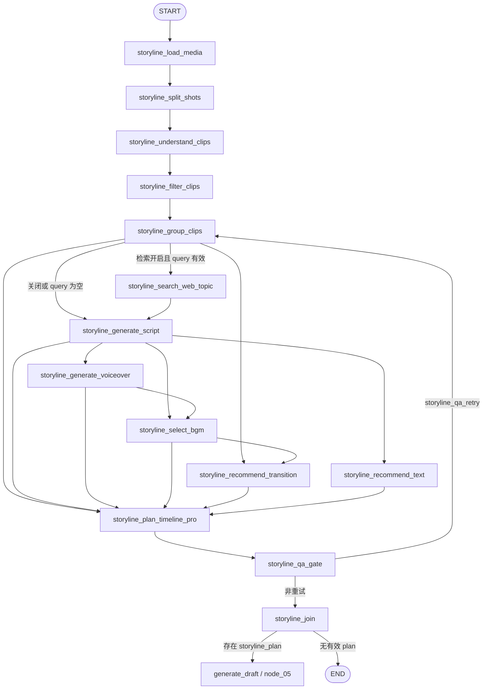
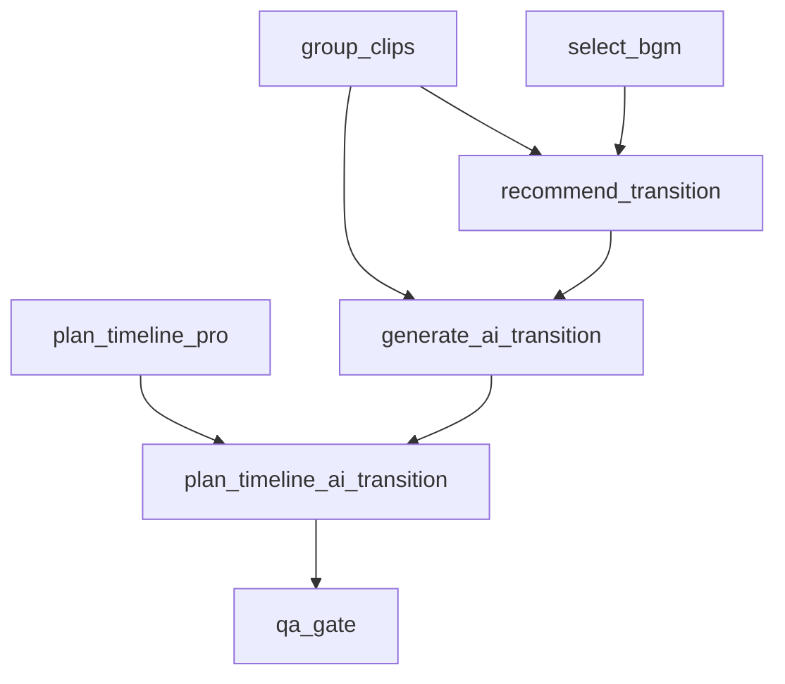
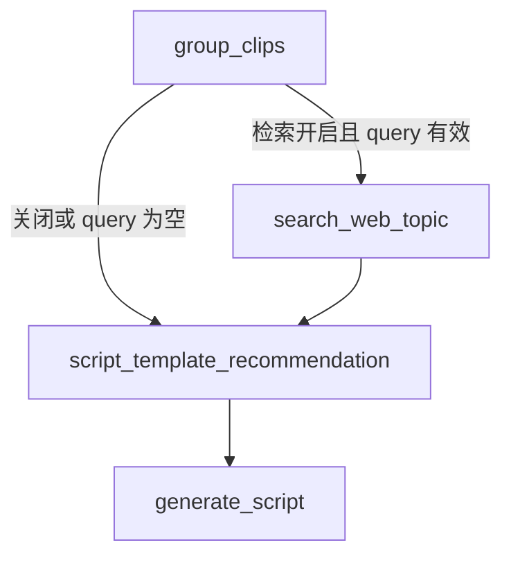

# auto-video-editor：OpenStoryline 子图边有效性审计、拓扑精简设计与分阶段执行计划

> **分析日期：** 2026-11-12  
> **代码范围：** `wayyet/auto-video-editor` 的 `main` 分支；对照 `wayyet/FireRed-OpenStoryline` 的 `main` 分支。  
> **核心参考文档：**《auto-video-editor 与 FireRed-OpenStoryline：OpenStoryline 节点对比及工作流分析》（2026-11-12）。  
> **本报告聚焦：** 参考文档 §7.1「OpenStoryline 子图：当前 `main` 拓扑」中的边，核验边的存在性、调度语义、数据依赖、重试可达性和下游消费情况。  
> **报告性质：** 源码静态审计与目标设计，不代表已经修改仓库或完成真实媒体端到端运行。

---

## 1. 结论摘要

### 1.1 核心结论

**§7.1 中的边并非全部都应按当前方式保留。边大多在源码中真实存在，图结构也基本有业务意图，但部分边的调度语义与节点实际输入不一致。** 当前主要问题不是“边的数量多”本身，而是边被用来表达了不正确或不完整的数据依赖。

本次静态审计得到以下结论：

| 级别 | 问题 | 结论 | 建议 |
|---|---|---|---|
| P0 | `generate_script`、`generate_voiceover` 分别单独连到 `select_bgm` | 不是“二者都完成后再执行”；BGM 可能被提前触发，并在后续再次触发 | 改为一个多源 fan-in：`[generate_script, generate_voiceover] -> select_bgm` |
| P0 | `group_clips`、`select_bgm` 分别单独连到 `recommend_transition` | 不是“两个输入都准备好后再执行”；普通转场推荐可能先在没有 BGM 结果时运行 | 改为：`[group_clips, select_bgm] -> recommend_transition` |
| P0 | PTP 时间线规划 fan-in 未包含普通转场、文字样式推荐 | `plan_timeline_pro` 实际会读取这两个产物，但当前屏障没有等待这两个节点 | 将 PTP 屏障扩展为 6 个来源：`GC、GS、GV、BGM、RT、TXT` |
| P0 | GAT（AI 转场生成）没有等待普通转场推荐完成 | GAT 会读取 `storyline_transition_plan` 作为提示，但当前屏障不含 `recommend_transition` | 改为 `[group_clips, recommend_transition] -> generate_ai_transition` |
| P1 | QA 屏障重复等待 RT/TXT | QA 只读取最终时间线；在 PTP 屏障修复后，RT/TXT 已经是 PTP 的上游依赖 | QA 仅等待最终时间线节点：PTP 或 PTAT |
| P1 | `generate_script -> script_template_recommendation` | 模板推荐发生在文案生成之后，不能影响当前文案；该节点当前又是 noop、无消费者 | 删除当前无效方向；保留节点能力，后续改为模板推荐在前、文案生成在后 |
| P1 | AI 转场开关默认开启，但当前实现是 Stub JSON，mapper 不物化 AI 转场 | 图上运行不等于剪映草稿里出现可播放转场视频 | 在 Provider 和 Timeline→Draft 物化完成前，建议生产默认关闭；功能节点保留待完善 |
| P1 | `QA -> render_video -> join` | 当前 render 节点默认 skipped；开启时也只写 JSON stub，不生成正式 MP4，产物没有下游消费者 | 生产主路径建议 `QA -> join`；smoke-test 如保留，应移到测试/诊断路径 |
| P2 | 图中 `JOIN -> generate_draft -> OUT` | `JOIN -> generate_draft` 是实际条件边；`generate_draft -> OUT` 是业务示意，不是 OpenStoryline 子图内的一条独立源码边 | 文档图中应明确区分“实际图边”和“进入外层主流程的示意箭头” |

### 1.2 推荐目标拓扑

生产主路径建议收敛为：

```text
START
  -> load_media -> split_shots -> understand_clips -> filter_clips -> group_clips
      -> (按条件选择：search_web_topic -> generate_script；或直接 generate_script)

  generate_script -> generate_voiceover
  [generate_script, generate_voiceover] -> select_bgm
  [group_clips, select_bgm] -> recommend_transition
  generate_script -> recommend_text

  [group_clips, generate_script, generate_voiceover,
   select_bgm, recommend_transition, recommend_text]
     -> plan_timeline_pro

  -> qa_gate
      ├─ QA 时长超限且仍可重试 -> group_clips
      └─ 通过 / 空计划 / 非时长错误 -> storyline_join

  -> (storyline_plan 有效 ? generate_draft : END)
```

AI 转场属于可选增强链路，不建议在当前 Stub 版本中作为默认生产路径：

```text
[group_clips, recommend_transition] -> generate_ai_transition
[plan_timeline_pro, generate_ai_transition] -> plan_timeline_ai_transition
plan_timeline_ai_transition -> qa_gate
```

只有真实 Provider 能输出可校验的视频文件，并且 PTAT 能把它转成 `CanonicalTimeline.source_media + clips`、最终由 mapper 写入剪映视频轨后，才建议重新默认启用。

### 1.3 一个重要概念澄清

参考文档 §7.1 将这些节点称为“OpenStoryline 子图”。但从当前 `graph.py` 的装配方式看，它们**不是一个单独构建并编译的嵌套 `StateGraph` 子图**，而是主 `StateGraph` 中按业务职责划分的一组节点和边。它与外层 `generate_draft`、后续剪映草稿流水线共用同一张主图。

这意味着：边的正确性不仅要看 OpenStoryline 节点之间，还要看它的最终产物是否能正确交给外层 `node_05_generate_draft`。

---

## 2. 代码基线与审计范围

### 2.1 仓库基线

| 仓库 | 分支 | 本次核对 HEAD | 时间（UTC） |
|---|---|---|---|
| `wayyet/auto-video-editor` | `main` | `262098953b7f51171e91b12d8c65667a31dc3b76` | 2026-11-11 15:13:01 |
| `wayyet/FireRed-OpenStoryline` | `main` | `b45011d1a7ca7273ccba585cbaef6f3e3b23accd` | 2026-09-19 17:08:55 |

> 两个仓库快照并非同一日期。Auto 的 HEAD 比 FireRed 晚约七周。本报告只用 FireRed 作为能力与依赖契约的参考，不把它的 MCP Agent 调用顺序直接复制成 Auto 的 LangGraph 边。

### 2.2 本次重点源码

**auto-video-editor**

- [`graph.py`](https://github.com/wayyet/auto-video-editor/blob/main/graph.py)：节点注册、普通边、条件边、多源 fan-in 和 QA 重试路由。
- [`state.py`](https://github.com/wayyet/auto-video-editor/blob/main/state.py)：`WorkflowState` 字段及 reducer。
- [`nodes/storyline/node_select_bgm.py`](https://github.com/wayyet/auto-video-editor/blob/main/nodes/storyline/node_select_bgm.py)：BGM 节点实际读取的输入。
- [`nodes/storyline/node_recommend_transition.py`](https://github.com/wayyet/auto-video-editor/blob/main/nodes/storyline/node_recommend_transition.py)：普通转场节点实际读取的输入。
- [`nodes/storyline/node_recommend_text.py`](https://github.com/wayyet/auto-video-editor/blob/main/nodes/storyline/node_recommend_text.py)：文字样式节点实际读取的输入。
- [`nodes/storyline/node_plan_timeline_pro.py`](https://github.com/wayyet/auto-video-editor/blob/main/nodes/storyline/node_plan_timeline_pro.py)：时间线节点的真实输入集合。
- [`storyline_capabilities/plan_timeline_pro.py`](https://github.com/wayyet/auto-video-editor/blob/main/storyline_capabilities/plan_timeline_pro.py)：时间线算法对普通转场和文字样式数据的使用。
- [`nodes/storyline/node_generate_ai_transition.py`](https://github.com/wayyet/auto-video-editor/blob/main/nodes/storyline/node_generate_ai_transition.py)：AI 转场生成节点。
- [`nodes/storyline/node_plan_timeline_ai_transition.py`](https://github.com/wayyet/auto-video-editor/blob/main/nodes/storyline/node_plan_timeline_ai_transition.py)：AI 转场时间线合并节点。
- [`nodes/storyline/qa_gate.py`](https://github.com/wayyet/auto-video-editor/blob/main/nodes/storyline/qa_gate.py)：时间线校验和重试条件路由。
- [`nodes/storyline/node_script_template_recommendation.py`](https://github.com/wayyet/auto-video-editor/blob/main/nodes/storyline/node_script_template_recommendation.py)：当前 noop 模板节点。
- [`nodes/storyline/node_render_video.py`](https://github.com/wayyet/auto-video-editor/blob/main/nodes/storyline/node_render_video.py)：当前 smoke-test/stub 渲染节点。
- [`storyline/mapper.py`](https://github.com/wayyet/auto-video-editor/blob/main/storyline/mapper.py)：Canonical Timeline 到剪映草稿结构的映射。
- [`nodes/storyline/join_storyline.py`](https://github.com/wayyet/auto-video-editor/blob/main/nodes/storyline/join_storyline.py)：OpenStoryline 子流程到外层草稿生成的交接。

**FireRed-OpenStoryline**

- [`generate_ai_transition.py`](https://github.com/wayyet/FireRed-OpenStoryline/blob/main/src/open_storyline/nodes/core_nodes/generate_ai_transition.py)：真实 AI 转场素材生成流程。
- [`plan_timeline_ai_transition.py`](https://github.com/wayyet/FireRed-OpenStoryline/blob/main/src/open_storyline/nodes/core_nodes/plan_timeline_ai_transition.py)：转场素材插入时间线的实现参考。
- [`script_template_rec.py`](https://github.com/wayyet/FireRed-OpenStoryline/blob/main/src/open_storyline/nodes/core_nodes/script_template_rec.py)：模板推荐能力参考。

### 2.3 当前主分支持久化技术备注

仓库简介仍可能显示 `LangGraph + SqliteSaver`，但本次 `main` 分支源码已将 SQLite checkpointer 依赖移除，生产图使用 PostgreSQL `AsyncPostgresSaver`，单测可使用 `InMemorySaver`。这与本报告的边审计不是同一个问题，但在记录当前技术基线时应以实际源码为准，而不是沿用旧项目描述。

---

## 3. 判断 LangGraph 边是否有效的规则

### 3.1 `add_edge(A, B)` 与 `add_edge([A, B], C)` 不是同一种语义

这是本次审计最重要的规则。

| 写法 | 调度含义 | 是否代表“等待所有来源” |
|---|---|---|
| `g.add_edge("A", "C")` | A 完成后，C 可以被调度 | 否，只依赖 A |
| `g.add_edge("B", "C")` | B 完成后，C 也可以被调度 | 否，只依赖 B |
| `g.add_edge(["A", "B"], "C")` | A、B 都完成后，C 才被调度 | **是**，等待所有来源 |

因此，下面这种写法：

```python
g.add_edge("A", "C")
g.add_edge("B", "C")
```

不能表达“C 等待 A 和 B 都准备好”。它表达的是两个独立触发关系：A 或 B 各自完成时，都可能触发 C。若 C 的逻辑需要同时读取 A、B 的产物，就可能出现提前运行、重复执行、读取空值或覆盖先前结果等问题。

正确表达多源屏障的写法是：

```python
g.add_edge(["A", "B"], "C")
```

官方参考：

- [LangGraph `StateGraph.add_edge` API](https://reference.langchain.com/python/langgraph/graph/state/StateGraph/add_edge)
- [LangGraph Graph API 概念说明](https://docs.langchain.com/oss/python/langgraph/graph-api)

### 3.2 什么是 fan-out、fan-in 和 barrier

- **fan-out（分支）**：一个节点完成后，多个后续节点分别执行。例如文案生成完成后，可同时触发配音、文字样式等工作。
- **fan-in（汇合）**：多个分支的结果重新汇合到同一个下游节点。
- **barrier（汇合屏障）**：fan-in 中要求所有指定来源节点都完成后，目标节点才允许运行。
- **conditional edge（条件边）**：路由函数根据 state 返回一个目标节点。未选中的分支不会执行。
- **retry loop（重试回路）**：QA 不通过时回到指定节点重新执行一段流程。

边多并不必然意味着设计错误。媒体工作流通常包含并行任务、条件功能和 QA 重试，所以比纯线性流程拥有更多边是正常的。真正需要审计的是：**每条边是否对应真实的数据依赖或控制流，以及它是否采用了正确的调度语义。**

### 3.3 本报告的有效性判断标准

每条边按以下五个维度检查：

1. **图结构有效**：起点和终点是否注册；条件路由映射是否覆盖可能返回值。
2. **输入依赖有效**：目标节点读取的 state 字段是否由上游产出。
3. **调度语义有效**：目标节点是否必须等待多个上游；若是，是否用了列表形式 fan-in。
4. **重试可达性有效**：QA 回到 `group_clips` 后，本轮所需的 fan-in 来源能否全部再次执行。
5. **业务结果有效**：节点产物是否真正进入时间线、剪映草稿或最终交付，而不是只生成了一个没人读取的 artifact。

注意：边在 Python 图定义中存在，不等于它的业务依赖一定正确；节点成功返回，也不等于它的产物一定被下游消费。

---

## 4. 为什么 §7.1 的边比较多

§7.1 不是单一的“从上到下”处理链。它把媒体剪辑的几个不同类型的关系都画在同一张图里，因此边的数量自然上升。

### 4.1 第一类：素材理解主干

```text
START -> load_media -> split_shots -> understand_clips
      -> filter_clips -> group_clips
```

这是串行的数据加工链。后一个节点必须读取前一个节点的产物：

- `load_media`：读取导入素材，产出媒体信息。
- `split_shots`：基于素材切分镜头。
- `understand_clips`：读取切分结果，生成视觉描述。
- `filter_clips`：按用户意图筛选片段。
- `group_clips`：对筛选结果排序、分组并形成叙事结构。

这一类边应保留。它们表达的是确定的数据依赖，不是可随意合并的装饰性连接。

### 4.2 第二类：网页检索条件分支

`group_clips` 完成后，根据 `STORYLINE_ENABLE_WEB_TOPIC` 和 `build_web_topic_query(state)` 的结果，二选一：

```text
group_clips
  ├─ 检索开关开启且 query 有效 -> search_web_topic -> generate_script
  └─ 检索关闭或 query 为空 -----------------------> generate_script
```

这里必须有两条条件出口，因为网页检索不是必经步骤：关闭检索或没有有效查询词时，文案仍应正常生成。

**为什么不能把 `search_web_topic` 加进固定 fan-in 屏障？**

QA 重试会回到 `group_clips`，之后重新执行条件路由。某些情况下条件路由可能跳过网页检索。如果固定屏障仍然要求 `search_web_topic` 完成，目标节点就可能永远凑不齐来源，出现图运行提前结束或静默终止。

因此，当前设计中以下边应保留：

- `group_clips -> (conditional) search_web_topic`
- `group_clips -> (conditional) generate_script`
- `search_web_topic -> generate_script`

条件边的目的地必须互斥，不能同时让 `group_clips` 无条件直连 `generate_script`，否则检索分支可能被绕过。

### 4.3 第三类：文案生成后的并行能力

文案生成后，工作流会触发多个相互独立的能力：

```text
generate_script
  ├─ generate_voiceover
  ├─ select_bgm（还需要 voiceover 时长/脚本上下文）
  ├─ recommend_text
  └─ script_template_recommendation（当前 noop）
```

这里使用多条边表达 fan-out 是合理的，但不能因此认为每个下游节点都可以立即运行。需要根据节点实际读取的输入进一步判断：

- 配音节点需要文案，`generate_script -> generate_voiceover` 有效。
- 文字样式节点需要文案及分组，分组是文案的上游，因此 `generate_script -> recommend_text` 可表达其关键依赖。
- BGM 节点实际读取脚本和配音结果，必须等待二者都完成，不能只用两条单源边。
- 模板推荐如果要影响文案，就必须发生在文案生成之前；当前 `generate_script -> script_template_recommendation` 的方向不成立。

### 4.4 第四类：多个上游汇合成时间线

`plan_timeline_pro` 不是一个只需要“分组 + 文案”的节点。它实际读取：

- `storyline_groups_artifact`
- `storyline_script_artifact`
- `storyline_voiceover_artifact`
- `storyline_bgm_selection`
- `storyline_transition_plan`
- `storyline_text_style_plan`
- `storyline_media_artifact`
- `storyline_targets`

因此它本身需要一个多源屏障。主图把它画成多条入边，是因为它必须等待上游产物全部准备好。

**当前问题：** PTP fan-in 只有 `group_clips`、`generate_script`、`generate_voiceover`、`select_bgm` 四个来源，没有等待 `recommend_transition` 和 `recommend_text`。但时间线算法会读取这两个产物。也就是说，边数不够表达真实依赖，反而有丢失样式/转场配置的风险。

### 4.5 第五类：AI 转场可选支路

AI 转场是一个独立增强能力：生成相邻组之间的转场素材，再合并进时间线。

```text
plan_timeline_pro -----------┐
                             ├-> plan_timeline_ai_transition -> QA
 generate_ai_transition -----┘
```

它需要两条边汇合，是因为 PTAT 需要基础时间线和 AI 转场结果。开关控制是否把这两个节点接入运行图。

但当前版本的实际能力尚未闭环：生成端默认使用 Stub 客户端写占位 JSON，PTAT 写入的是 `ai_transitions` 元数据，而 `storyline/mapper.py` 没有把该字段物化成剪映视频素材和视频片段。因此，**当前 AI 支路的图结构虽然有业务意图，但实际并没有形成完整可交付的剪映转场视频。**

### 4.6 第六类：QA 汇合与重试回路

QA 前需要有最终时间线；如果时间线总时长超出目标阈值，QA 最多三次回到 `group_clips` 重新组织片段。

```text
PTP 或 PTAT -> QA
                ├─ 时长超限且 retry < 3 -> group_clips
                └─ 通过 / 空计划 / 非时长重试错误 -> 后续收尾
```

回边是控制流的一部分，不是多余循环。它使工作流能在目标时长不符合要求时自动调整分组与时间线。

同时，QA 当前只负责读取并校验 `storyline_timeline_plan`。如果 PTP 已经等待了普通转场和文字样式产物，那么 QA 再直接等待这两个节点就是重复依赖，没有必要。

---

## 5. 当前边逐类核验与处理建议

### 5.1 主干串行边

| 当前边 | 图结构 | 输入依赖 | 建议 | 原因 |
|---|---|---|---|---|
| `START -> storyline_load_media` | 有效 | 有效 | **保留** | 当前 auto-only 工作流入口；素材输入由入口层提供 |
| `storyline_load_media -> storyline_split_shots` | 有效 | 有效 | **保留** | 镜头切分依赖加载后的媒体信息 |
| `storyline_split_shots -> storyline_understand_clips` | 有效 | 有效 | **保留** | 视觉理解依赖镜头切分产物；ASR 旁路已经移除 |
| `storyline_understand_clips -> storyline_filter_clips` | 有效 | 有效 | **保留** | 筛选依赖片段理解结果 |
| `storyline_filter_clips -> storyline_group_clips` | 有效 | 有效 | **保留** | 分组依赖筛选后的片段集合 |

### 5.2 网页检索条件边

| 当前边 | 图结构 | 输入依赖 | 建议 | 原因 |
|---|---|---|---|---|
| `group_clips -> (conditional) search_web_topic` | 有效 | 有效 | **保留** | 只有开关开启且可构造有效 query 才触发 |
| `group_clips -> (conditional) generate_script` | 有效 | 有效 | **保留** | 检索关闭或无有效 query 时跳过检索，直接生成文案 |
| `search_web_topic -> generate_script` | 有效 | 有效 | **保留** | 检索结果是文案的可选上下文 |
| 把 `search_web_topic` 加入 PTP/QA 固定 fan-in | 当前不存在 | 不适用 | **禁止新增** | 条件节点在重试轮次可能被跳过，固定等待会产生死锁/静默结束风险 |

### 5.3 BGM 与普通转场边：必须修改

#### A. `select_bgm` 当前边不符合节点真实依赖

当前代码：

```python
g.add_edge("storyline_generate_script", "storyline_select_bgm")
g.add_edge("storyline_generate_voiceover", "storyline_select_bgm")
```

节点 `storyline_select_bgm_node()` 会读取文案、分组和配音 artifact，并用配音信息辅助音乐时长对齐。当前两条独立单源边的含义不是“等待脚本和配音都完成”，而是脚本完成和配音完成时都可能触发 BGM 节点。

**风险：**

1. `generate_script` 先完成时，BGM 可能在 voiceover artifact 尚不存在时运行。
2. `generate_voiceover` 完成后，BGM 可能再次运行。
3. 两次执行可能写入同一 BGM 状态/文件，产生重复计算或结果覆盖。
4. PTP 可能读取到提前执行的 BGM 结果，而不是依赖配音对齐的最终结果。

建议替换为：

```python
g.add_edge(
    ["storyline_generate_script", "storyline_generate_voiceover"],
    "storyline_select_bgm",
)
```

**处理结论：删除两条独立单源边，保留一个双源 fan-in。**

#### B. `recommend_transition` 当前边不符合节点真实依赖

当前代码：

```python
g.add_edge("storyline_group_clips", "storyline_recommend_transition")
g.add_edge("storyline_select_bgm", "storyline_recommend_transition")
```

`storyline_recommend_transition_node()` 会读取 `storyline_groups_artifact` 和 `storyline_bgm_selection`，并把二者传入转场推荐能力。当前代码注释也表明它希望等 BGM 完成后再执行，但两条独立边没有实现这个等待语义。

**风险：** 转场推荐可能先在 BGM 尚未生成时执行一次，再在 BGM 完成后执行一次；第一次没有音乐节奏上下文，不能视为最终推荐。

建议替换为：

```python
g.add_edge(
    ["storyline_group_clips", "storyline_select_bgm"],
    "storyline_recommend_transition",
)
```

其中 `group_clips` 是直接依赖；`select_bgm` 本身已经等待文案和配音。该双源屏障可清晰表达两个必需输入。

**处理结论：删除两条独立单源边，保留一个双源 fan-in。**

### 5.4 文字样式边

| 当前边 | 图结构 | 输入依赖 | 建议 | 原因 |
|---|---|---|---|---|
| `generate_script -> recommend_text` | 有效 | 有效 | **保留** | 文字样式节点读取分组和文案；分组已经是文案上游 |
| `recommend_text -> PTP` | 当前缺失 | **依赖缺失** | **新增到 PTP fan-in** | `plan_timeline_pro` 接收 `text_style_plan`，时间线能力会把样式映射到 clip |
| `recommend_text -> QA` | 当前存在 | 冗余 | **从 QA 屏障移除** | 应由 PTP 等待样式后产出完整时间线；QA 本身不读取 text style plan |

### 5.5 PTP 时间线规划 fan-in：需要扩展

当前源码：

```python
g.add_edge(
    [
        "storyline_group_clips",
        "storyline_generate_script",
        "storyline_generate_voiceover",
        "storyline_select_bgm",
    ],
    "storyline_plan_timeline_pro",
)
```

当前 4 个来源有其原因：

- `group_clips`：提供分组与片段顺序。
- `generate_script`：提供分组文案。
- `generate_voiceover`：提供配音产物。
- `select_bgm`：提供音乐选择。

但 PTP 的实际代码还会读取：

- `storyline_transition_plan`：普通转场推荐结果。
- `storyline_text_style_plan`：文字样式推荐结果。

时间线 capability 会将转场字段写入 clip 的 `transition_in` / `transition_out`，并将文字样式写入 `subtitle_style`。如果 PTP 没有等待 RT、TXT 完成，就可能在这两个字段尚未写入时读取 state，最终时间线缺少推荐结果。

建议改为 6 源屏障：

```python
g.add_edge(
    [
        "storyline_group_clips",
        "storyline_generate_script",
        "storyline_generate_voiceover",
        "storyline_select_bgm",
        "storyline_recommend_transition",
        "storyline_recommend_text",
    ],
    "storyline_plan_timeline_pro",
)
```

这里不需要将 `load_media`、`split_shots`、`understand_clips`、`filter_clips` 单独加进屏障：它们都是 `group_clips` 的祖先节点，`group_clips` 完成已经蕴含这些上游主干完成。尤其不能将 QA 重试时不会重跑的早期节点放进回路内的 fan-in 屏障。

**处理结论：保留当前 4 个来源，并补入 RT、TXT；采用 6 源 fan-in。**

### 5.6 AI 转场生成和时间线合并边

当前 AI 转场生成 GAT 使用与 PTP 相同的 4 源屏障：

```python
g.add_edge(
    [
        "storyline_group_clips",
        "storyline_generate_script",
        "storyline_generate_voiceover",
        "storyline_select_bgm",
    ],
    "storyline_generate_ai_transition",
)
```

但 `storyline_generate_ai_transition_node()` 实际读取：

- `storyline_groups_artifact`：确定需要处理的相邻分组。
- `storyline_transition_plan`：为转场生成提供普通转场提示。

它不需要直接读取文案和 voiceover 产物。当前屏障包含 GS/GV/SB，却没有包含 RT，因而不能保证 `storyline_transition_plan` 已经就绪。

建议修改为：

```python
g.add_edge(
    ["storyline_group_clips", "storyline_recommend_transition"],
    "storyline_generate_ai_transition",
)
```

PTP 与 GAT 汇合到 PTAT 的现有边：

```python
g.add_edge(
    ["storyline_plan_timeline_pro", "storyline_generate_ai_transition"],
    "storyline_plan_timeline_ai_transition",
)
```

该边是正确的，应保留。PTAT 需要基础时间线和 AI 转场清单两类产物。

但必须补充一个**业务有效性判断**：当前 `get_default_ai_transition_client()` 返回 `StubAITransitionClient`，只生成占位 JSON；PTAT 把清单写入 `ai_transitions`，而 `storyline/mapper.py` 的 `canonical_to_draft()` 只把普通 `clips` 转成剪映 `materials.videos` 和 video track segment，并不消费 `ai_transitions`。因此当前 AI 支路并没有把真实转场视频落到剪映草稿。

**推荐决策：**

1. 不永久删除 GAT/PTAT 节点和能力接口。
2. 在 Provider 与 mapper 物化能力未完成前，生产环境将 `STORYLINE_ENABLE_AI_TRANSITION` 默认关闭，避免把 Stub 路径误认为真实转场。
3. 完成真实转场后，PTAT 应把每个合法转场视频纳入 `source_media` 和 `clips`，由现有 mapper 作为普通视频素材/片段写入剪映草稿。
4. 真实 Provider 必须校验文件存在、容器可读、时长/分辨率/帧率有效，并对输入哈希缓存，避免 QA 重试时重复付费。

### 5.7 QA fan-in 和重试边

当前 QA 等待：

- 时间线节点：AI 关闭时是 PTP；AI 开启时是 PTAT。
- `storyline_recommend_transition`。
- `storyline_recommend_text`。

但 QA 节点实际只读取 `storyline_timeline_plan`，再校验 Canonical Timeline 的结构、源区间、速度和总时长。它不直接读取 `storyline_transition_plan` 或 `storyline_text_style_plan`。

在 PTP 已修正为等待 RT、TXT 后，QA 再等 RT、TXT 就属于冗余依赖。

建议 QA 屏障改为只等待最终时间线节点：

```python
_plan_for_qa = "storyline_plan_timeline_pro"
if is_ai_transition_enabled():
    # PTP + GAT -> PTAT 的现有屏障保持
    ...
    _plan_for_qa = "storyline_plan_timeline_ai_transition"

g.add_edge(_plan_for_qa, "storyline_qa_gate")
```

QA 条件边必须保留：

```python
g.add_conditional_edges(
    "storyline_qa_gate",
    _qa_gate_mod.route_after_storyline_qa,
    {
        "storyline_group_clips": "storyline_group_clips",
        "storyline_render_video": "storyline_render_video",  # 若暂时保留 smoke-test
    },
)
```

`storyline_qa_gate` 读取 `status_log[-1] == "storyline_qa_retry"` 判断是否重试。QA 只对“总时长超限”进入重试；源区间、片段速度或时间线契约错误记录为失败，不按时长问题重试。该语义应保持。

### 5.8 模板推荐边

当前代码：

```python
g.add_edge(
    "storyline_generate_script",
    "storyline_script_template_recommendation",
)
```

`storyline_script_template_recommendation_node()` 当前只追加 `storyline_script_template_recommendation_done` 状态，不产生模板 artifact，也没有任何下游读取者。因此当前边只是给一个 noop 叶子节点提供触发来源。

更重要的是，模板推荐应该影响文案 prompt；如果在 `generate_script` 完成后才执行，就无法影响刚刚生成的文案。

**本报告不建议永久删除模板推荐能力。** 参考 FireRed 的模板检索流程，应将其改造为“检索候选模板 → 确定性筛选 → 将模板内容注入文案 prompt”。

目标拓扑应是：

```text
group_clips
  ├─ 条件检索开启 -> search_web_topic -> script_template_recommendation
  └─ 条件检索关闭 ---------------------> script_template_recommendation

script_template_recommendation -> generate_script
```

这需要把 `group_clips` 的条件路由目标从“search_web_topic 或 generate_script”调整为“search_web_topic 或 template_recommendation”，并将 `search_web_topic -> template_recommendation`、`template_recommendation -> generate_script` 连起来。模板节点不应依赖网页检索一定执行，也不应把条件检索节点放进固定 fan-in。

实施分为两个状态：

- **功能未完成期间：** 删除当前 `generate_script -> script_template_recommendation` 这条无效边；节点代码保留为待实现能力，不要记录为 `done`，而应明确标记 `skipped/not_implemented`，避免监控误报。
- **功能完成后：** 按上面的目标拓扑将模板推荐移动到文案生成前，并由 `generate_script` 显式读取模板 artifact。

### 5.9 Render smoke-test 和 Join 边

当前 `storyline_render_video`：

- 默认 `STORYLINE_ENABLE_RENDER_SMOKE_TEST=0`，只记 `storyline_render_video_skipped`。
- 开启后写的是 JSON 占位产物，不是 MP4。
- `storyline_render_smoke_test_path` 没有下游业务消费者。
- OpenStoryline 子图最终交付的是 Canonical Timeline，之后由外层 `generate_draft` 生成剪映草稿；真正的最终 MP4 导出由外层 `export_final_video`（FFmpeg）负责。

因此，当前 `QA -> render_video -> join` 对生产结果没有增益，容易让执行轨迹出现“render done”而用户误以为已生成视频的语义混淆。

**推荐生产拓扑：**

```text
QA（非重试分支） -> storyline_join
```

建议从生产图中移除：

- `storyline_qa_gate -> storyline_render_video` 条件目标。
- `storyline_render_video -> storyline_join`。
- `storyline_render_video` 的生产注册（如果保留节点函数，可仅供开发测试调用）。

如果未来需要在剪映草稿生成前做预览，另行实现有真实 MP4 输出、文件可探测、并有明确 UI 消费者的 preview/export 节点；不应继续把 JSON stub 称为视频渲染。

`storyline_join` 必须保留。它负责反序列化并校验时间线，写入 `storyline_plan`，供外层 `node_05_generate_draft` / mapper 消费。

### 5.10 Join 到外层草稿生成

当前 `storyline_join` 之后的实际条件路由：

- state 中有 `storyline_plan`（兼容读取 `shot_plan`）时，去 `generate_draft`。
- 否则进入 `END`。

该条件边应保留。它负责阻止没有可用时间线的运行误入剪映草稿生成节点。

参考图中的 `generate_draft -> OUT` 是说明性箭头：真实 `generate_draft` 后面还有 Assembly QC、人工关卡、速度护栏、中英文字幕/封面分支、交付 QA 和可选导出等外层工作流节点，不是 OpenStoryline 子图的最后一条字面边。

---

## 6. 边保留、删除、修改总表

下表把“当前已有边”和“目标需要新增的边”合并列出。这里的“删除”指从生产图中删除当前这条连接关系，不代表删除对应的业务能力源码。

| 当前边 / 边组 | 处理 | 目标边 / 目标状态 | 优先级 |
|---|---|---|---|
| `START -> load_media` | 保留 | 不变 | P0 |
| `load_media -> split_shots` | 保留 | 不变 | P0 |
| `split_shots -> understand_clips` | 保留 | 不变 | P0 |
| `understand_clips -> filter_clips` | 保留 | 不变 | P0 |
| `filter_clips -> group_clips` | 保留 | 不变 | P0 |
| `group_clips -> (conditional) search_web_topic` | 保留 | 条件成立时触发 | P0 |
| `group_clips -> (conditional) generate_script` | 保留（模板功能未上线阶段） | 模板功能上线后改为条件目标 `script_template_recommendation` | P0/P1 |
| `search_web_topic -> generate_script` | 保留（模板功能未上线阶段） | 模板功能上线后改为 `search_web_topic -> script_template_recommendation` | P0/P1 |
| `group_clips -> recommend_transition` | 修改 | 与 BGM 形成 `[group_clips, select_bgm] -> recommend_transition` 屏障 | P0 |
| `generate_script -> select_bgm` | 删除原单源边 | 合入 `[generate_script, generate_voiceover] -> select_bgm` | P0 |
| `generate_voiceover -> select_bgm` | 删除原单源边 | 合入同一个双源屏障 | P0 |
| `generate_script -> generate_voiceover` | 保留 | 不变 | P0 |
| `generate_script -> recommend_text` | 保留 | 不变 | P0 |
| `generate_script -> script_template_recommendation` | **删除当前无效方向** | 功能实现后改成 `group/search -> template_recommendation -> generate_script` | P1 |
| PTP fan-in `[GC,GS,GV,SB]` | 修改 | 扩展为 `[GC,GS,GV,SB,RT,TXT] -> PTP` | P0 |
| GAT fan-in `[GC,GS,GV,SB]` | 修改 | 改为 `[GC,RT] -> GAT`；仅在真实功能启用时连边 | P1 |
| `[PTP,GAT] -> PTAT` | 保留 | 不变；仅 AI 功能启用时连边 | P1 |
| QA fan-in `[PTP/PTAT,RT,TXT]` | 修改 | 只等待最终时间线节点 `[PTP]` 或 `[PTAT]` | P0 |
| `QA -> group_clips` 条件回边 | 保留 | 不变；只处理 `storyline_qa_retry` | P0 |
| `QA -> render_video` 非重试分支 | 删除生产边 | 改为 `QA -> storyline_join` | P1 |
| `render_video -> storyline_join` | 删除生产边 | render 若保留，只作为测试/诊断节点 | P1 |
| `storyline_join -> generate_draft/END` 条件边 | 保留 | 不变 | P0 |
| `generate_draft -> OUT` | 从 §7.1 的真实边清单中移除 | 标注为外层流程示意，不作为源码边统计 | P2 |

### 6.1 需要保留的核心边

1. 素材加载、镜头切分、视觉理解、筛选、分组主干。
2. 网页检索的互斥条件路由与检索结果进入文案的边。
3. `generate_script -> generate_voiceover`、`generate_script -> recommend_text`。
4. 正确构造后的多源屏障：BGM、普通转场、PTP、GAT、PTAT。
5. QA 重试回边。
6. Join 到外层 `generate_draft` 的条件边。

### 6.2 应删除的当前边

1. 当前 `generate_script -> script_template_recommendation`：顺序反了，且当前节点没有可供下游使用的产物。
2. 当前 `QA -> render_video` 和 `render_video -> join` 生产路径：render 当前没有真实 MP4 产物，也没有下游消费者。
3. QA fan-in 中 RT、TXT 两条直接入边：在 PTP 已等待这两个产物后，它们对 QA 属于重复依赖。
4. BGM 和 RT 当前两组单源触发边：删除的是两条独立连接，替换为列表式 fan-in，不是删除 BGM 或转场能力。

### 6.3 仅在功能完成后再启用的边

- GAT/PTAT AI 转场分支：保留代码和可选拓扑设计，但在 stub-only 阶段不要默认当作生产能力启用。
- 模板推荐分支：当前无效边删除，待模板检索和 prompt 消费契约落实后再按上游依赖重接。

---

## 7. 推荐目标拓扑 Mermaid

### 7.1 生产基础路径（AI 转场关闭、模板推荐功能尚未上线）



> Mermaid 中多条入边只展示连接关系。源码实现必须将 PTP 的六个来源写在同一个 `add_edge([...], PTP)` 里；BGM 和 RT 也必须采用列表式 fan-in，不能拆成独立 `add_edge()`。

### 7.2 AI 转场功能完成后的可选路径



此分支只说明能力启用后的依赖关系。真实上线前，必须补充真实 MP4 产物校验和时间线片段物化；只把 JSON 列表写进 Timeline 不足以构成可交付的转场视频。

### 7.3 模板推荐能力完成后的文案前置链



文案模板候选应该作为 `generate_script` 的显式输入，不能通过并行节点写同一个 `storyline_script_artifact` 的方式注入。推荐使用独立 `storyline_script_template_artifact` 字段。

---

## 8. 推荐 graph.py 修改方式

以下是拓扑修改的核心代码表达。具体合并时应保留项目已有的条件路由和功能开关读取位置，不应机械复制片段导致重复注册边。

### 8.1 BGM 等待文案和配音

```python
# 原来：两条单源边会分别触发 BGM
# g.add_edge("storyline_generate_script", "storyline_select_bgm")
# g.add_edge("storyline_generate_voiceover", "storyline_select_bgm")

# 修改后：等待两个来源都完成

g.add_edge(
    ["storyline_generate_script", "storyline_generate_voiceover"],
    "storyline_select_bgm",
)
```

### 8.2 普通转场等待分组和 BGM

```python
# 原来：分别触发转场节点
# g.add_edge("storyline_group_clips", "storyline_recommend_transition")
# g.add_edge("storyline_select_bgm", "storyline_recommend_transition")

# 修改后：两个真实输入都准备好再执行

g.add_edge(
    ["storyline_group_clips", "storyline_select_bgm"],
    "storyline_recommend_transition",
)
```

### 8.3 PTP 等待所有会被它读取的推荐产物

```python
g.add_edge(
    [
        "storyline_group_clips",
        "storyline_generate_script",
        "storyline_generate_voiceover",
        "storyline_select_bgm",
        "storyline_recommend_transition",
        "storyline_recommend_text",
    ],
    "storyline_plan_timeline_pro",
)
```

### 8.4 GAT 等待普通转场推荐

```python
if is_ai_transition_enabled():
    g.add_edge(
        ["storyline_group_clips", "storyline_recommend_transition"],
        "storyline_generate_ai_transition",
    )
    g.add_edge(
        ["storyline_plan_timeline_pro", "storyline_generate_ai_transition"],
        "storyline_plan_timeline_ai_transition",
    )
```

### 8.5 QA 只等待最终时间线

```python
_plan_for_qa = "storyline_plan_timeline_pro"

if is_ai_transition_enabled():
    # PTP 与 GAT 汇合到 PTAT 的边在上方定义
    _plan_for_qa = "storyline_plan_timeline_ai_transition"

g.add_edge(_plan_for_qa, "storyline_qa_gate")
```

QA 对非重试路径可以直接进入 Join：

```python
g.add_conditional_edges(
    "storyline_qa_gate",
    _qa_gate_mod.route_after_storyline_qa,
    {
        "storyline_group_clips": "storyline_group_clips",
        "storyline_join": "storyline_join",
    },
)
```

此时需同步把 `route_after_storyline_qa()` 的返回值由 `storyline_render_video` 改为 `storyline_join`，并移除生产图中 `storyline_render_video` 的边和注册；不要只改图映射而忘记改路由函数。

---

## 9. 分阶段设计与执行计划

> 阶段顺序以先修正确性、再精简冗余、最后恢复未完成能力为原则。建议先在独立分支实施，并以当前 main SHA 建立回滚基线。

| 阶段 | 优先级 | 执行任务 | 修改范围 | 验收标准 |
|---|---|---|---|---|
| 阶段 0：基线固化 | P0 | 固定当前 graph 节点/边清单、HEAD SHA、关键功能开关；保存当前 §7.1 Mermaid | `graph.py`、设计文档 | 能通过代码审查比较新增、删除、修改的边；开关默认值有明确记录 |
| 阶段 1：修复 BGM/普通转场触发 | P0 | 将 BGM 两条单源边改成双源 fan-in；将 RT 两条单源边改成双源 fan-in | `graph.py` | BGM 仅在脚本和 voiceover 都完成后执行一次；RT 仅在 groups 与 BGM 都完成后执行一次 |
| 阶段 2：补齐 PTP 数据依赖 | P0 | PTP 屏障纳入 RT、TXT；去除 QA 对 RT/TXT 的重复等待 | `graph.py`、节点级测试 | PTP 执行时 `storyline_transition_plan`、`storyline_text_style_plan` 均已就绪；QA 收到的是最终 Timeline |
| 阶段 3：修正 AI 转场依赖与默认策略 | P1 | GAT 屏障改为 `[GC, RT]`；确认 PTAT 只在真实能力启用时运行；Stub-only 环境默认关闭 | `graph.py`、`config.py` 或 AI transition 配置模块 | GAT 调用时 groups 和 transition plan 已存在；开关关闭时 GAT/PTAT 不参与生产执行；重试路径无屏障缺口 |
| 阶段 4：清理 noop 模板边并实现前置模板能力 | P1 | 删除 `GS -> STR`；节点未完成时记录 skipped；实现模板资源、检索、标签过滤、候选 artifact 和 prompt 注入；改为 `GC/WT -> STR -> GS` | `graph.py`、`nodes/storyline/node_script_template_recommendation.py`、`node_generate_script.py`、`storyline_capabilities/`、`state.py` | 模板候选有独立 artifact；文案 prompt 确实读取模板；无模板库时有确定性降级，不冒充 done |
| 阶段 5：清理 render smoke-test 生产路径 | P1 | QA 非重试路径改为直接到 Join；从生产图删除 render 节点边和注册；区分子图 Timeline 与最终 MP4 导出 | `graph.py`、`qa_gate.py`、监控状态定义和文档 | OpenStoryline 完成只代表 Timeline/plan 可交接；最终 MP4 状态由外层 export 节点负责 |
| 阶段 6：AI 转场结果物化 | P1 | 对接真实视频生成 Provider；校验 MP4；缓存生成结果；将转场素材作为 SourceMedia + Clip 插入 Timeline；mapper 生成剪映素材及片段 | AI transition capability、PTAT、`storyline/contract.py`、`storyline/mapper.py` | 转场视频在剪映草稿中存在真实 material 与 segment；时间轴累计时长正确；stub 不得标记为真实转场 |
| 阶段 7：回归与运行态观测 | P0 | 增加拓扑结构测试、运行顺序测试、重试测试；监控展示 conditional branch、barrier 等待和节点跳过原因 | `tests/`、Workflow Monitor | 无重复执行、无静默 END、无遗漏推荐产物；失败原因和跳过原因可追踪 |

### 9.1 阶段 1–2：先解决错误触发与数据缺失

此阶段不建议顺带重构所有节点。只调整必要的图边和测试：

- `select_bgm` 只允许被一个双源 barrier 触发。
- `recommend_transition` 只允许被一个双源 barrier 触发。
- PTP 只能在它实际读取的全部产物都准备好后执行。
- QA 屏障只保留真正的 QA 输入——最终时间线。

这样可以先修复“节点跑了多次”或“读取上游空值”的正确性问题，而不会影响其他主干节点。

### 9.2 阶段 3：AI 转场采取 fail-closed 策略

**fail-closed** 是指能力不满足真实生产条件时，不把占位结果当成成功交付。

建议：

- 开发/测试可允许 Stub，用于验证图调度和数据契约。
- 生产默认关闭 AI 转场，直到 `provider != stub`、文件探测通过、Timeline 物化和剪映草稿验证全部完成。
- 如果业务希望在开发环境保留开关默认开启，必须在状态卡上明确显示 `stub`，不能显示“AI 转场已生成”。

### 9.3 阶段 4：模板推荐的正确数据契约

建议使用独立字段，不与脚本 artifact 争写：

```text
storyline_script_template_artifact
  ├─ selected_template_id
  ├─ template_content
  ├─ tags
  ├─ match_score
  └─ retrieval_status
```

`generate_script` 明确读取这个 artifact，并将模板正文作为 prompt 的风格/结构参考。模板推荐节点不能在 `generate_script` 之后运行；也不要让它与 `generate_script` 并行写相同 state key。

推荐先使用确定性关键词/BM25 风格检索和标签过滤，避免在主环境直接引入 FireRed 的整个向量检索依赖链。需要向量检索时再通过可选 provider/sidecar 扩展。

### 9.4 阶段 5：Render 与最终导出分离

要区分以下三个状态：

| 状态 | 含义 | 所属模块 |
|---|---|---|
| `timeline_ready` | Canonical Timeline 已生成并通过必要 QA | OpenStoryline 子流程 |
| `jianying_draft_ready` | 剪映草稿已生成并完成结构检查 | 外层 `generate_draft` / mapper |
| `video_export_ready` | 最终 MP4 已真实导出、探测并验收 | 外层 `export_final_video` |

不得因为 `storyline_render_video` 写了一个 JSON 占位文件，就把 `video_export_ready` 置为成功。

---

## 10. 测试与验收矩阵

### 10.1 拓扑结构测试

新增独立的 graph topology tests，测试重点不是比对 Mermaid 字符串，而是检查图中关键节点的真实 predecessor/successor 与条件路由。

| 测试项 | 断言 |
|---|---|
| BGM fan-in | `select_bgm` 的必需上游为 `generate_script` 和 `generate_voiceover`；不能存在两条独立单源触发关系 |
| RT fan-in | `recommend_transition` 的必需上游为 `group_clips` 和 `select_bgm` |
| PTP fan-in | PTP 等待 GC、GS、GV、SB、RT、TXT 六个来源 |
| GAT fan-in | AI 开启时等待 GC 与 RT；关闭时不接入生产路径 |
| PTAT fan-in | AI 开启时等待 PTP 与 GAT |
| QA fan-in | QA 只等待最终时间线来源；不重复等待 RT/TXT |
| SearchWeb 条件路由 | 开关关闭或 query 为空时跳过 SearchWeb，文案路径仍可完成 |
| Template 推荐 | 不能保持 `GS -> STR` 的反向数据流；真实实现后必须 `STR -> GS` |
| Render 路径 | 生产图不把 JSON stub 节点作为真实渲染步骤 |
| Join 条件 | 无有效 `storyline_plan` 时不进入 `generate_draft` |

### 10.2 节点执行顺序测试

使用 spy/mock 包装对应节点，记录调用计数和调用时 state：

1. BGM 在脚本与 voiceover 都产出 artifact 后才执行，且每个 QA 轮次只执行一次。
2. 普通转场推荐在 groups 与 BGM 都已存在时执行，且只能执行一次。
3. PTP 执行时 `storyline_transition_plan`、`storyline_text_style_plan`、`storyline_bgm_selection` 等输入均存在。
4. GAT 执行时能够读取当前轮次生成的 transition plan，而不是前一轮 checkpoint 的旧数据。
5. QA 读取的是 PTP/PTAT 写出的最新 `storyline_timeline_plan`。
6. QA retry 后 GC、GS、GV、SB、RT、TXT、PTP 按依赖重新执行；没有等待上一轮中不会再次执行的节点。

### 10.3 条件与重试场景

| 场景 | 预期路径 | 核心断言 |
|---|---|---|
| Web 开关关闭 | GC -> GS | SearchWeb 不执行，PTP 不等待 SearchWeb |
| Web 开关开启但 query 为空 | GC -> GS | 不调用 SearchWeb；工作流正常推进 |
| Web 开关开启且 query 有效 | GC -> WT -> GS | Script 能读取网页检索结果；PTP 不把 WT 作为直接屏障来源 |
| AI 转场关闭 | PTP -> QA | GAT/PTAT 不参与生产图执行 |
| AI 转场开启且 Stub 模式 | PTP + GAT -> PTAT -> QA | 监控明确标注 stub；不声称产生真实剪映转场片段 |
| AI 转场开启且真实 Provider | PTP + GAT -> PTAT -> QA | 转场文件可探测，且被映射为剪映视频 material/segment |
| QA 总时长超标 | QA -> GC -> 下游重新执行 | 最多 3 次；Web 条件分支可安全跳过或 cache_hit，不发生屏障死等 |
| QA 源区间/速度错误 | QA -> 非重试出口 | 记录结构化错误，不将其误判为时长重试 |
| QA 空计划 | QA -> Join | Join/外层条件路由按现有空 plan 规则处理，不误报视频完成 |
| Template 无资源库 | Template 节点显式 skipped | Script 按无模板策略生成；状态不能显示 done/命中 |

### 10.4 运行测试建议

由于本次任务是基于 GitHub `main` 的静态审计，没有在用户本机或仓库运行时环境中执行 pytest，因此不在本报告中声称“测试已通过”。实施后建议在项目根目录执行：

```powershell
python -m pytest tests/unit -q
```

随后执行覆盖 OpenStoryline 子流程的集成测试。集成测试应使用测试用的 `InMemorySaver`，避免把 Postgres 服务可用性和图边正确性混在同一测试前提中；生产联调再使用 PostgreSQL checkpointer。

如果现有 `tests/unit` 没有覆盖上述 fan-in 和 retry 场景，应新增专门的 topology/scheduling tests，而不是假设现有单测已经覆盖。

---

## 11. 风险与回滚策略

| 风险 | 影响 | 缓解方案 |
|---|---|---|
| 将多个单源边简单改成列表边时漏掉真实输入 | 节点可能拿不到推荐产物 | 先逐个审计节点函数读取哪些 state 字段，再构建 barrier |
| 把条件 SearchWeb 放进固定 fan-in | QA retry 时可能等待不到被跳过的节点 | SearchWeb 保持条件路径，不作为 PTP/QA 固定屏障来源 |
| QA 重试时有上游节点没有重新运行 | fan-in 永远无法补齐，图可能静默结束 | 屏障只包含每轮必跑的节点；早期节点由 GC 的完成隐含保证 |
| `status_log[-1]` 被其他状态覆盖 | QA retry 路由判断错误 | 重试路径内状态标签维持固定写入纪律；增加状态序列测试 |
| GAT/PTAT Stub 被误报成 AI 转场完成 | 用户看不到真正的剪映转场 | 生产默认关闭 Stub；状态明确标注 `stub/skipped` |
| PTAT 只写 metadata，mapper 不物化 | Timeline 里有记录，剪映草稿无视频片段 | 先实现 SourceMedia/Clip 物化，再启用生产开关 |
| Render smoke-test 被误认为 MP4 导出 | UI 交付状态不准确 | 从生产路径删除，最终 MP4 统一由 `export_final_video` 负责 |
| 模板推荐和文案并行写同一个状态字段 | LangGraph 并发写冲突或结果覆盖 | 模板产物使用独立字段，且模板节点放到 Script 上游 |

### 11.1 建议回滚顺序

1. 保留旧版本 `graph.py` 与当前 HEAD SHA，作为拓扑回滚基线。
2. 阶段 1–2 修改只涉及 fan-in 和 QA 入边；如集成测试不通过，可先回滚该阶段的拓扑修改。
3. AI 转场开关可独立关闭，确保主链仍走 PTP -> QA。
4. Template 和 Render 路径的清理与实现分开提交，避免在一个提交内同时改数据契约、节点实现和流程图。
5. 只有当 Timeline、mapper、剪映草稿和导出端到端验证通过后，才把 AI 转场能力作为默认生产路径开放。

---

## 12. 最终决策清单

### 应保留

- 素材加载到分组的确定性主干。
- Web Topic 条件分支及其进入文案生成的边。
- 文案到配音、文字样式的依赖边。
- BGM、普通转场、PTP 的多源等待机制，但应按实际输入改成正确的列表式 fan-in。
- PTP 与 GAT 汇合到 PTAT 的机制（真实 AI 转场能力完成后启用）。
- QA 的重试回边。
- Join 和 Join 到 `generate_draft` 的条件交接。

### 应删除或替换

- 删除 `generate_script -> select_bgm` 与 `generate_voiceover -> select_bgm` 两条独立单源触发边，替换为双源 fan-in。
- 删除 `group_clips -> recommend_transition` 与 `select_bgm -> recommend_transition` 两条独立单源触发边，替换为双源 fan-in。
- 删除当前 `generate_script -> script_template_recommendation` 的反向边；不是永久删除模板推荐能力。
- 将 PTP 四源屏障扩展为六源屏障，补入 RT 和 TXT。
- 将 GAT 当前四源屏障改为 GC + RT。
- 删除 QA 对 RT/TXT 的重复 fan-in 入边，只等待最终时间线节点。
- 建议从生产图删除 `QA -> render_video -> Join` 路径，改为 QA 非重试直接 Join。
- 将 `generate_draft -> OUT` 从 §7.1 的真实边集合中移出，改为外层流程示意。

### 暂时不应默认启用

- AI 转场：Provider 仍是 Stub，时间线到剪映草稿的物化链尚未完成。
- 文案模板：当前节点是 noop，待检索、候选选择及 prompt 消费功能上线后再接入。
- Render smoke-test：当前不是真实 MP4 渲染，不应属于生产主路径。

**最终判断：§7.1 的边数量多有其合理原因：主干串行、条件分支、并行任务、多源汇合和 QA 重试都需要边来表达。但当前拓扑存在真实依赖未正确表达的问题。建议先纠正 BGM、普通转场、PTP、GAT 和 QA 的 fan-in 关系，再清理模板 noop 和 render stub 的生产边；保留主干、条件检索、QA 重试和 Join 交接。这样不是单纯减少线条，而是让每条保留的边都准确表达节点所需的数据依赖和执行顺序。**

---

## 13. 参考资料

### 项目内部文档

- `auto-video-editor 与 FireRed-OpenStoryline：OpenStoryline 节点对比及工作流分析`（2026-11-12），重点 §4、§6、§7.1、§10。
- `auto-video-editor_noop空转节点_源码核验与治理设计执行计划_20261111.md`：用于交叉核验模板 noop、AI 转场 Stub/mapper 未消费、render stub 无下游消费者、BGM 资源路径和人工 BGM 设计。

### Auto 源码

- [graph.py](https://github.com/wayyet/auto-video-editor/blob/main/graph.py)
- [state.py](https://github.com/wayyet/auto-video-editor/blob/main/state.py)
- [node_select_bgm.py](https://github.com/wayyet/auto-video-editor/blob/main/nodes/storyline/node_select_bgm.py)
- [node_recommend_transition.py](https://github.com/wayyet/auto-video-editor/blob/main/nodes/storyline/node_recommend_transition.py)
- [node_recommend_text.py](https://github.com/wayyet/auto-video-editor/blob/main/nodes/storyline/node_recommend_text.py)
- [node_plan_timeline_pro.py](https://github.com/wayyet/auto-video-editor/blob/main/nodes/storyline/node_plan_timeline_pro.py)
- [plan_timeline_pro capability](https://github.com/wayyet/auto-video-editor/blob/main/storyline_capabilities/plan_timeline_pro.py)
- [node_generate_ai_transition.py](https://github.com/wayyet/auto-video-editor/blob/main/nodes/storyline/node_generate_ai_transition.py)
- [node_plan_timeline_ai_transition.py](https://github.com/wayyet/auto-video-editor/blob/main/nodes/storyline/node_plan_timeline_ai_transition.py)
- [qa_gate.py](https://github.com/wayyet/auto-video-editor/blob/main/nodes/storyline/qa_gate.py)
- [node_script_template_recommendation.py](https://github.com/wayyet/auto-video-editor/blob/main/nodes/storyline/node_script_template_recommendation.py)
- [node_render_video.py](https://github.com/wayyet/auto-video-editor/blob/main/nodes/storyline/node_render_video.py)
- [mapper.py](https://github.com/wayyet/auto-video-editor/blob/main/storyline/mapper.py)
- [join_storyline.py](https://github.com/wayyet/auto-video-editor/blob/main/nodes/storyline/join_storyline.py)

### FireRed 源码

- [generate_ai_transition.py](https://github.com/wayyet/FireRed-OpenStoryline/blob/main/src/open_storyline/nodes/core_nodes/generate_ai_transition.py)
- [plan_timeline_ai_transition.py](https://github.com/wayyet/FireRed-OpenStoryline/blob/main/src/open_storyline/nodes/core_nodes/plan_timeline_ai_transition.py)
- [script_template_rec.py](https://github.com/wayyet/FireRed-OpenStoryline/blob/main/src/open_storyline/nodes/core_nodes/script_template_rec.py)

### LangGraph 官方文档

- [StateGraph.add_edge API](https://reference.langchain.com/python/langgraph/graph/state/StateGraph/add_edge)
- [LangGraph Graph API](https://docs.langchain.com/oss/python/langgraph/graph-api)
