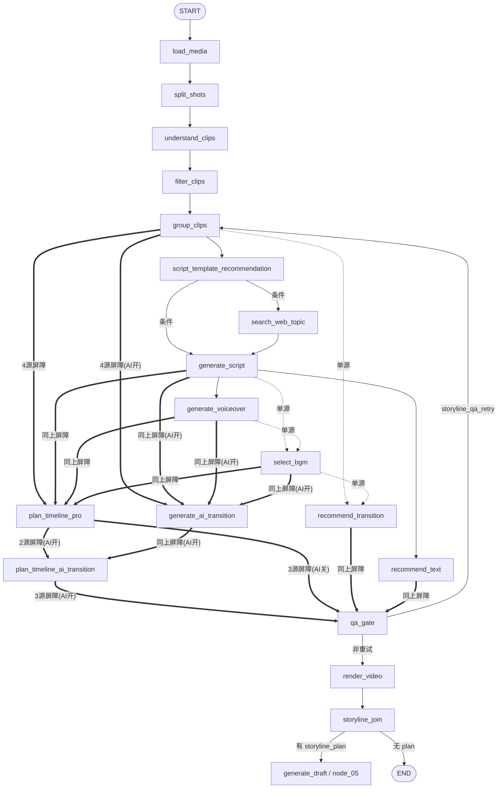

# OpenStoryline 子图边治理：阶段 0-3 执行记录

> **执行日期：** 2026-11-12
> **依据文档：**《auto-video-editor_OpenStoryline_子图边有效性审计与精简设计执行计划_20261112.md》（同目录）
> **执行范围：** 仅阶段 0-3（基线固化 / BGM·普通转场屏障 / PTP 六源屏障·QA 精简 / GAT 屏障修正）；阶段 4-7 不执行。
> **报告性质：** 执行前基线快照，行号均指改动前 `main @ 6e6a13e` 的 `graph.py`。

---

## 1. 基线

| 项 | 值 |
|---|---|
| 基线 HEAD | `6e6a13edb97a97ba3859766a9ede0f04f2de0272`（2026-11-12 04:39 +0800，test(四期·阶段6)） |
| 分支 | `main` |
| 工作区 | 仅一条未跟踪文件：同目录设计文档本体（随本记录一并入库） |
| 单测基线 | `.venv/Scripts/python.exe -m pytest tests/unit -q` ≈ 1850 passed / 3 skipped |
| 集成基线 | 存量失败以 stash 对照为准，不得新增 |

**对依据文档过时前提的校准**（本阶段核实，执行时以当前代码为准）：

1. 模板推荐已于 noop 治理阶段 1 前置：`group_clips → script_template_recommendation →（条件路由）→ search_web_topic | generate_script`（graph.py:722-730）。依据文档阶段 4 的目标拓扑已存在，本次不碰。
2. AI 转场 Stub 已整体删除，为 MiniMax 真实现（Hailuo-02 + ffmpeg 首尾帧 + pair 级缓存），PTAT 已把真实转场 MP4 物化为 SourceMedia+Clip 进 Canonical Timeline。依据文档"Stub 占位、mapper 不消费"的描述过时。
3. 因此阶段 3 **不改** `STORYLINE_ENABLE_AI_TRANSITION` 默认值：图接线开关默认开（`test_flag_defaults_aligned.py` 锁定 true），"默认不产生假转场"由双门禁 fail-closed 保证（`STORYLINE_AI_TRANSITION_PROVIDER` 默认空 + `STORYLINE_AI_TRANSITION_APPROVED` 默认 false → 默认 0 次 Provider 外呼、0 占位产物）。
4. QA 路由已是信号字段制（`storyline_qa_route_signal` 每次运行必写；`status_log[-1]` 仅旧 checkpoint 兼容回退），屏障精简不影响路由函数。
5. `storyline_render_video` / `storyline_join` 相关边属于阶段 5 范围，本次不动。

---

## 2. 节点注册清单（graph.py，改动前）

全部无条件 `add_node`，无一在 if 分支内（AI 开关只控制**边**的接法）：

| 节点 | 注册行 | 备注 |
|---|---|---|
| `storyline_load_media` | graph.py:551 | |
| `storyline_search_web_topic` | graph.py:554 | 条件触发节点，永不进屏障（D10） |
| `storyline_split_shots` | graph.py:555 | |
| `storyline_generate_ai_transition`（GAT） | graph.py:557-560 | 边在 AI 开关分支内接 |
| `storyline_understand_clips` | graph.py:561 | |
| `storyline_filter_clips` | graph.py:562 | |
| `storyline_group_clips`（GC） | graph.py:563 | QA 重试回边目标 |
| `storyline_generate_script`（GS） | graph.py:564 | |
| `storyline_script_template_recommendation`（STR） | graph.py:565-568 | 已前置，条件路由出口 |
| `storyline_generate_voiceover`（GV） | graph.py:569 | |
| `storyline_select_bgm`（SB） | graph.py:570 | |
| `storyline_recommend_transition`（RTR/RT） | graph.py:571 | |
| `storyline_recommend_text`（TXT/RTX） | graph.py:572 | |
| `storyline_plan_timeline_pro`（PTP） | graph.py:573 | |
| `storyline_plan_timeline_ai_transition`（PTAT） | graph.py:575-578 | 边在 AI 开关分支内接 |
| `storyline_render_video` | graph.py:579 | 默认 skip；阶段 5 范围 |
| `storyline_qa_gate`（QA） | graph.py:580 | |
| `storyline_join` | graph.py:581 | |

---

## 3. 边清单（graph.py，改动前）

### 3.1 主干与条件边（本次不动）

| 边 | 行号 | 形式 |
|---|---|---|
| `START → storyline_load_media` | :589 | 普通 |
| `storyline_load_media → storyline_split_shots` | :698 | 普通 |
| `storyline_split_shots → storyline_understand_clips` | :702 | 普通 |
| `storyline_understand_clips → storyline_filter_clips` | :705 | 普通 |
| `storyline_filter_clips → storyline_group_clips` | :706 | 普通 |
| `storyline_group_clips → storyline_script_template_recommendation` | :722 | 普通 |
| `STR → {search_web_topic, generate_script}` 条件路由 | :723-730 | 条件 |
| `storyline_search_web_topic → storyline_generate_script` | :733 | 普通 |
| `storyline_generate_script → storyline_generate_voiceover` | :740 | 普通 |
| `storyline_generate_script → storyline_recommend_text` | :742 | 普通 |
| QA 条件出口 `{group_clips(重试), render_video}` | :811-818 | 条件 |
| `storyline_render_video → storyline_join` | :822 | 普通（阶段 5 范围） |
| `storyline_join → {generate_draft, END}` 条件路由 | :825-829 | 条件 |

### 3.2 待治理边（本次改动对象）

| 边 | 行号 | 形式 | 问题 |
|---|---|---|---|
| `GS → SB` | :741 | 独立单源 | SB 被 GS 提前触发一次 |
| `GV → SB` | :745 | 独立单源 | SB 在 GV 完成后再触发一次（实测每轮 2 次，重复写 `storyline_bgm_selection`） |
| `GC → RTR` | :731 | 独立单源 | RTR 在 BGM 缺席时提前跑一次 |
| `SB → RTR` | :748 | 独立单源 | 实测 RTR 每轮 3 次 |
| `[GC,GS,GV,SB] → PTP` | :763-771 | 列表屏障 4 源 | PTP 实际还读 `storyline_transition_plan`（node_plan_timeline_pro.py:56）与 `storyline_text_style_plan`（:57），屏障缺这两源 |
| `[GC,GS,GV,SB] → GAT` | :785-793 | 列表屏障 4 源（AI 开） | GAT 实际只读 groups + transition_plan hints（node_generate_ai_transition.py:196-197），4 源反而不能保证 transition_plan 就绪 |
| `[PTP,GAT] → PTAT` | :794-797 | 列表屏障（AI 开） | 正确，不动 |
| `[_plan_for_qa, RTR, RTX] → QA` | :800-808 | 列表屏障 3 源 | QA 只读最终时间线；RTR/RTX 已是 PTP 上游，对 QA 属重复依赖 |

---

## 4. 开关默认值基线（阶段 0 固化）

| 开关 | 定义位置 | 默认值 | 读取时机 | 备注 |
|---|---|---|---|---|
| `STORYLINE_ENABLE_WEB_TOPIC` | config.py:52-53 | `true` | **运行时**（graph.py:230 路由函数读 `config.XXX`） | |
| `STORYLINE_ENABLE_AI_TRANSITION` | config.py:61-62；镜像 `ENABLE_AI_TRANSITION` 于 storyline_capabilities/ai_transition_client.py:19-21 | `true` | **建图时**（graph.py:784），改后须重启 | 双拷贝对齐由 tests/unit/test_flag_defaults_aligned.py 锁定；本次不改 |
| `STORYLINE_AI_TRANSITION_PROVIDER` | config.py:73-74 | `""`（空 = 关） | 运行时 `resolve_default_provider()` | 门禁 a：默认 0 外呼 |
| `STORYLINE_AI_TRANSITION_APPROVED` | config.py:76-77 | `false` | 运行时节点层 | 门禁 b：未批准只写 estimate，不物化 |
| `STORYLINE_ENABLE_RENDER_SMOKE_TEST` | config.py:141-142 | `0`（关） | 运行时（node_render_video.py:97） | noop 治理阶段 3 后语义 = 故事线预览 |
| `STORYLINE_SPLIT_SHOTS_DETECTOR` | config.py:106-107 | `auto` | 运行时 | |
| `STORYLINE_MODE` | config.py:125 | `auto`（否则 import 时 fail-fast） | import 时 | |
| `ASSEMBLY_QC_GATE_ENABLED` | config.py:323-324 | `true` | 建图时（graph.py:603） | 外层 QC 通道，本次不动 |

AI 转场默认姿态（阶段 3 固化结论）：**接线开关默认开 + 双门禁 fail-closed**。默认生产路径 0 次 Provider 外呼、不产生占位 JSON；真实生成须同时满足 `PROVIDER=minimax` + `MINIMAX_API_KEY` + `APPROVED=true`。

---

## 5. 改动前拓扑快照（Mermaid）

> Mermaid 无法直接表达列表屏障，`==N源屏障==` 标注 list 形式 fan-in；`.->` 标注独立单源触发边（待治理）。

**黄金轨迹实测问题**（AI 关、flags off，每 QA 轮次）：`select_bgm` 出现在 2 个超步（双单源边重复触发）、`recommend_transition` 出现在 3 个超步。治理后各恰 1 次。

---

## 6. 阶段 0-3 边改动对照表

| 阶段 | 删除 | 新增 / 变化 | 语义 |
|---|---|---|---|
| 1 | `GS→SB`(:741)、`GV→SB`(:745) | `[GS,GV] → SB` 列表屏障 | SB 等文案+配音都完成，每轮恰 1 次 |
| 1 | `GC→RTR`(:731)、`SB→RTR`(:748) | `[GC,SB] → RTR` 列表屏障 | RTR 等分组+BGM 都就绪，每轮恰 1 次 |
| 2 | PTP 屏障缺源 | PTP 扩为 6 源 `[GC,GS,GV,SB,RTR,TXT]` | PTP 执行时它读取的全部产物（含 transition_plan/text_style_plan）均已就绪 |
| 2 | QA 屏障中 RTR、TXT 两源 | QA 精简为单源 `[_plan_for_qa]` | QA 只等最终时间线（AI 开=PTAT，关=PTP） |
| 3 | GAT 4 源屏障 | `[GC,RTR] → GAT` | GAT 只读 groups + transition_plan hints，2 源即其全部真实输入 |

**重试回路安全性（D10）**：所有新屏障源（GS/GV/SB/RTR/TXT/GC）都在 QA 重试回路内（GC→STR→WT|GS→GV·SB·TXT→RTR→PTP 每轮重跑），条件节点 search_web_topic 继续留在任何屏障之外，无屏障缺口、无静默 END 风险。

---

## 7. 测试影响清单

**必改（tests/integration/test_unreachable_nodes_wiring.py）**：

| 测试/数据 | 位置 | 改动 |
|---|---|---|
| `NEIGHBORS` 邻居期望表 | :113-123 | SB 入边 {GS,GV}；RTR 入边 {GC,SB}；GAT 入边 {GC,RTR}；PTP 入边 6 源；QA 入边 {PTAT}（AI 开）/ {PTP}（关） |
| `GOLDEN_STEPS` 黄金轨迹 | :75-95 | 重录：SB/RTR 每轮 1 次；PTP 触发时机后移（等 RTR/TXT） |
| `test_ai_pair_is_beside_plan_timeline_pro` | :257-265 | GAT 不再与 PTP 同源，断言重写为 GAT={GC,RTR} |
| `test_ai_flag_off…barriers_as_before` | :268-278 | barrier 集合更新（新增 [GS,GV]→SB、[GC,SB]→RTR 两条；PTP 6 源；QA 单源） |
| `test_ai_nodes_are_in_barriers_only_in_the_designed_places` | :296-305 | barrier 集合同步更新 |
| `test_defaults_run_all_wired_nodes_with_expected_shape` | :716-752 | GAT 不再与 PTP 同超步，断言 GAT 在 RTR/PTP 之后 |

**实跑确认仍绿（不改动，除非实测失败）**：

- `test_qa_retry_loop_still_retriggers_plan_timeline_pro`（:758-785）—— 重试 4 轮计数回归
- `test_ai_status_tags_are_fixed_so_retry_survives_changing_group_count`（:1074-1095）
- `test_conditional_nodes_are_never_in_a_fan_in_barrier`（:281-293）—— 新屏障源全是必跑节点，应保持绿
- tests/unit/test_draft_path_degradation.py:82-114 —— PTP "必含 4 源、不含 split_shots" 断言（6 源为其超集，扩展语义保持绿）

---

## 8. 提交计划

| 阶段 | 提交内容 |
|---|---|
| 0 | 本执行记录 + 依据文档入库（docs，无代码改动） |
| 1 | graph.py 双源屏障 ×2 + wiring 测试更新 |
| 2 | graph.py PTP 六源 + QA 单源 + wiring 测试更新 |
| 3 | graph.py GAT 两源 + wiring 测试更新 |

每阶段独立提交、独立可回滚；完成后不自动推送（如需同步 GitHub 走 /sync-github）。
